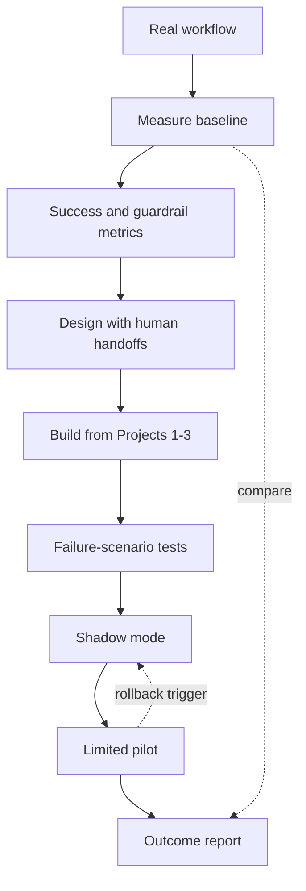

## TL;DR
Solve one real operational problem end to end: measure today's baseline, design and build the agent
from your earlier projects, test how it fails, deploy a pilot, and report the business outcome against
the baseline.

## For agent builders
- **Why it matters for agents.** Businesses buy outcomes (hours saved, errors avoided, faster cycle
  time), not agents. This project forces every technical choice to answer to a metric someone owns.
- **Where it shows up in your stack.** Everything from Projects 1-3: retrieval, guarded tools, the
  production service, plus integrations with systems of record and a human work queue.
- **What you control.** Problem scope, success metrics, where the agent stops and a person takes over,
  failure behaviour, rollout pace and how the outcome is measured.
- **What you can skip.** A general platform. Solve one workflow for one team; generalise only after the
  outcome is proven.

## Why it exists
- **Most AI pilots stall after the demo.** They lack a baseline, so nobody can say whether the pilot
  helped, and the sponsor moves on.
- **Technical metrics do not sell themselves.** 92% extraction accuracy means nothing to finance; "AP
  clerks spend 155 fewer hours a week on matching" does.
- **Real workflows fail in specific ways.** Corrupt documents, duplicate submissions, system outages and
  edge-case policies must end in safe states, which you only know by testing them.
- **Deployment is a business event.** Users need training, a fallback, a support owner and rollback
  criteria, or the first bad week ends the pilot.
- **It is the portfolio piece.** One measured business outcome is stronger evidence of skill than any
  number of demos.

## How it works
Pick one workflow you can observe: accounts-payable invoice matching, support ticket triage, contract
intake or IT access requests. The running example is invoice matching against purchase orders.

### M1. Problem, baseline and metrics (after scoping)
- **Build:** a workflow map of today's process, a measured baseline (volume, minutes per item, error
  rate, cycle time) from at least one week of real data, and 2-4 success metrics with owners and targets.
- **Acceptance:** the sponsor signs off the metric definitions and the targets before any build; one
  guardrail metric (such as wrong payments) is defined as must-not-worsen.
- **Lessons:** `scoping/workflow-analysis`, `scoping/success-metrics-kpis`,
  `scoping/baseline-measurement-before-deployment`, `scoping/roi-model`.

### M2. Design (after system-design)
- **Build:** a design that marks each step as deterministic code, model call, agent decision or human
  task, with the data flow, permissions and the handoff to people; decisions recorded as ADRs.
- **Acceptance:** every path that can move money or data has an explicit owner and a human-review
  branch; a reviewer can trace each success metric to the component that moves it.
- **Lessons:** `system-design/ai-solution-architecture`, `agents/workflows-vs-agents`,
  `agents/human-in-the-loop`, `system-design/adrs`.

### M3. Implementation and integration (after enterprise-integration)
- **Build:** reuse the Project 1 retriever, Project 2 dispatcher and Project 3 service; connect to the
  real system of record (ERP, ticketing, CRM) through a sandbox first, with deduplication and
  reconciliation.
- **Acceptance:** an end-to-end run on 50 historical items in the sandbox matches human decisions on an
  agreed share, and every write is traceable to a run id.
- **Lessons:** `enterprise-integration/legacy-system-integration`,
  `enterprise-integration/retry-deduplication-reconciliation`,
  `enterprise-integration/sandbox-vs-production-environments`, `enterprise-integration/client-document-parsing`.

### M4. Failure scenarios (after reliability)
- **Build:** an FMEA-style table of failure modes (bad input, model outage, integration error,
  duplicate, policy edge case) with the required safe outcome, and automated tests for each.
- **Acceptance:** every scenario has a passing test; no failure path ends in an unreviewed write.
- **Lessons:** `reliability/fmea`, `reliability/chaos-engineering-and-resilience-testing`,
  `system-design/graceful-degradation`, `evals/adversarial-evaluation`.

### M5. Pilot deployment (after deployment)
- **Build:** shadow mode first (the agent decides, humans still act), then a limited rollout, with UAT,
  a runbook, a support owner and written rollback triggers.
- **Acceptance:** shadow agreement with humans meets the agreed bar before any live write; rollback is
  rehearsed once.
- **Lessons:** `customer-data-evaluation/shadow-mode-validation`, `deployment/uat`,
  `deployment/rollout-criteria-and-rollback-triggers`, `deployment/runbooks`, `deployment/hypercare`.

### M6. Business outcome (after adoption)
- **Build:** a report comparing pilot weeks with the baseline on the M1 metrics, including the guardrail,
  cost of running the system, adoption by users and a list of failures found in production.
- **Acceptance:** each number traces to a query or log; the report states a recommendation (scale,
  iterate or stop) the sponsor can act on.
- **Lessons:** `adoption/adoption-and-value-realization-measurement`, `adoption/usage-analytics`,
  `infra-capacity-economics/unit-economics-per-successful-task`, `adoption/exec-communication`.

## Diagram
The left column is the build; the dotted edges show the baseline feeding the final comparison.



## Examples
### Starter skeleton: safe-outcome tests and an outcome estimate
Standard library only, run on Python 3.9. Each scenario asserts the decision a failure must end in;
the last lines turn pilot inputs into the number a sponsor reads.

```python
POS = {"PO-1": 1200.00, "PO-2": 560.00}               # purchase orders from the ERP (stubbed)
PAID = set()                                          # invoice numbers already paid (duplicate guard)

def extract(doc):                                     # stand-in for the LLM extraction step
    if doc.get("corrupt"): raise ValueError("unreadable pdf")
    if doc.get("llm_down"): raise TimeoutError("model timeout")
    return {"invoice_no": doc["no"], "po": doc["po"], "amount": doc["amount"]}

def process(doc, tolerance=0.02):
    """Return (decision, reason). Every failure must end in a human queue, never in a payment."""
    try:
        inv = extract(doc)
    except (ValueError, TimeoutError) as e:
        return "human_review", f"extraction failed: {e}"
    if inv["invoice_no"] in PAID:
        return "reject", "duplicate invoice"
    po_amount = POS.get(inv["po"])
    if po_amount is None:
        return "human_review", "unknown PO"
    if abs(inv["amount"] - po_amount) > tolerance * po_amount:
        return "human_review", "amount outside tolerance"
    PAID.add(inv["invoice_no"])
    return "auto_approve", "matched PO"

SCENARIOS = [  # (name, document, decision that is acceptable)
    ("happy path",        {"no": "I-1", "po": "PO-1", "amount": 1200.00}, "auto_approve"),
    ("within tolerance",  {"no": "I-2", "po": "PO-2", "amount": 565.00},  "auto_approve"),
    ("duplicate",         {"no": "I-1", "po": "PO-1", "amount": 1200.00}, "reject"),
    ("over tolerance",    {"no": "I-3", "po": "PO-2", "amount": 700.00},  "human_review"),
    ("unknown PO",        {"no": "I-4", "po": "PO-9", "amount": 90.00},   "human_review"),
    ("corrupt document",  {"corrupt": True},                              "human_review"),
    ("model outage",      {"llm_down": True},                             "human_review"),
]
results = [(n, *process(d), want) for n, d, want in SCENARIOS]
for n, got, why, want in results:
    print(f"{'PASS' if got == want else 'FAIL'}  {n:17} -> {got:12} ({why})")

# Business outcome for a pilot week (illustrative inputs; replace with your measured baseline)
invoices, manual_min, review_min, auto_rate = 2000, 6.0, 3.0, 0.55
before = invoices * manual_min / 60
after = invoices * (1 - auto_rate) * review_min / 60
print(f"AP hours/week: {before:.0f} -> {after:.0f} ({1 - after / before:.0%} saved)")
```

All seven scenarios pass and the estimate prints `AP hours/week: 200 -> 45 (78% saved)`. Treat both
outputs with suspicion:
- **The tests cover only the failures you imagined.** Shadow mode on real invoices finds the rest, such
  as credit notes or split deliveries.
- **The estimate assumes review takes 3 minutes,** half the manual time. Measure it in the pilot;
  exception cases are often harder than average, so savings can be much smaller.
- **The duplicate check runs on extracted numbers,** so an extraction error can defeat it. That is a
  failure mode for the M4 table.

### Evaluation table: business outcome report
Fill it from the baseline week and the pilot weeks. Values in the example column are the illustrative
inputs above, not results.

| Metric | Type | Baseline | Pilot | Example target |
|---|---|---|---|---|
| Clerk hours per week | success | measured | measured | 50% fewer |
| Straight-through rate | success | 0% | measured | 50%+ |
| Cycle time, receipt to approval | success | measured | measured | 2 days faster |
| Wrong or duplicate payments | guardrail | measured | measured | not worse, ideally zero |
| Cost per processed invoice (system) | cost | n/a | measured | below clerk-minute cost saved |
| Weekly active reviewers | adoption | n/a | measured | all pilot clerks |
| Escalations to engineering | operations | n/a | measured | falling week on week |

## Production patterns
- **Shadow, then canary, then scale.** Run the agent beside humans until agreement is proven, then let
  it act on a small share of volume. Monitor agreement and guardrail metrics per stage.
- **Guardrail metric with a hard trigger.** Pick one outcome that must not worsen and write the rollback
  rule in advance, such as any duplicate payment pauses auto-approval. Monitor it daily.
- **Human queue as a first-class product.** Exceptions land in a queue with the agent's reason and
  evidence, so review is fast. Monitor queue age and review minutes per item.
- **Outcome metrics from systems of record.** Compute hours, cycle time and errors from ERP or ticket
  data, not from the agent's own logs. Monitor the gap between both sources.
- **Weekly failure review.** Production failures become new scenarios and golden-set items. Monitor how
  many new failure types appear each week; it should fall.

## Trade-offs
- **Narrow scope vs visible impact.** One workflow for one team ships and measures cleanly, but the
  impact may look small; a broader scope looks bigger and usually fails to measure anything.
- **Automation rate vs risk.** A tighter tolerance sends more items to people, lowering savings but also
  wrong payments; tune it on the guardrail metric, not on automation rate.
- **Shadow duration vs time to value.** Longer shadow mode finds more failure modes, while sponsors wait;
  end it when agreement is stable and new failure types stop appearing.
- **Build on Projects 1-3 vs a vendor product.** Your components fit the workflow exactly, but a vendor
  may already solve 80% with support; compare against it explicitly.

## Pitfalls
- **No baseline before launch.** Symptom: the pilot "feels faster" but nobody can prove it, and funding
  stops. Diagnose: try to fill the baseline column from data collected before the agent existed. Fix:
  measure at least one week before build, from systems of record.
- **Measuring automation, not outcome.** Symptom: straight-through rate is high, yet clerk hours barely
  move. Diagnose: compare exception review time with the assumed time in the business case. Fix: report
  hours and cycle time, and improve the exception queue.
- **Untested failure paths.** Symptom: a model outage or corrupt file causes a wrong write or a silent
  drop. Diagnose: list every exception the pipeline can raise and check each has a scenario test. Fix:
  default every failure to the human queue and test it.
- **Owner missing after launch.** Symptom: issues sit unanswered between the engineering team and the
  business team. Diagnose: ask both who handles a stuck invoice at 9 a.m. Monday. Fix: name the operational
  owner and support boundaries in the runbook before go-live.

## When to use
- **Use when:** a repetitive operational workflow has measurable volume, cost or delay and a sponsor who
  owns the outcome.
- **Avoid when:** the process itself is unclear or changing, or there is no data to build a baseline; fix
  the process first.
- **Measure:** the M1 success metrics, one guardrail metric, cost per processed item, adoption and
  failures found per week.
- **Interviews:** this project answers "tell me about an AI system you shipped and what it achieved".

## Exercise
**Goal:** complete M1 for a real workflow you can observe at work, in a volunteer group or with public
data that mirrors one.
- **Inputs:** access to the people doing the work and at least one week of records (tickets, invoices,
  requests) with timestamps.
- **Constraints:** no building; metrics must come from records, not estimates; at least one guardrail
  metric.
- **Deliver:** a workflow map, a baseline table (volume, time per item, error rate, cycle time), and a
  one-page metrics brief with owners and targets.
- **Acceptance:** each baseline number can be recomputed from the raw records with a query you include;
  the owner of the workflow agrees in writing that the metrics describe success.
- **Acceptance (stretch):** an ROI estimate with stated assumptions and a pessimistic case.

## Role lens
- **Engineer:** Builds the integrated system from earlier components, writes the failure-scenario tests
  and instruments the outcome metrics from systems of record.
- **Architect:** Decides scope, automation boundaries, integration approach and rollout stages, and
  records the decisions and their reversal conditions.
- **FDE:** Works with the business owner on the baseline, success metrics, training and rollout, and
  presents the outcome report.

## Check yourself
**Q:** After four pilot weeks, straight-through processing is 60%, but AP clerk hours fell only 10%.
What do you investigate and report?
**A:** The business case assumed that automating items saves their full handling time and that exceptions
take normal effort. Check how long exception reviews actually take from queue timestamps; the hard items
left for people may take longer than before. Check whether clerks still re-verify auto-approved invoices
because they do not trust them, and whether time moved to other tasks such as fixing integration errors.
Report the gap honestly, with causes, then propose fixes such as better evidence in the review queue, a
trust-building sample audit, or a narrower automation band.

## Interview questions
### How do you choose success metrics for an AI pilot?
- **Start from the owner's goal,** such as cost, cycle time or error rate, and measure it today from
  systems of record.
- **Add a guardrail metric** that must not worsen, such as wrong payments, with a rollback trigger.
- **Agree targets before building** so the result cannot be reinterpreted afterwards.

### Walk me through how you tested failure scenarios before launch.
- **Enumerate failure modes** with an FMEA-style table: inputs, model, integrations, duplicates, policy
  edge cases.
- **Define the safe outcome** for each, usually the human queue, and write an automated test.
- **Then run shadow mode** on real traffic to find the modes you did not imagine.

### The pilot improved the agent's metrics but the sponsor is unhappy. What happened?
- **Likely mismatch:** you reported model or automation metrics while the sponsor owns hours, cycle time
  or customer outcomes.
- **Or a hidden cost:** review effort, rework or trust issues absorbed the savings.
- **Fix:** report the agreed business metrics against baseline, with the causes of any gap.

### When would you stop a pilot rather than iterate?
- **When the guardrail metric worsens** and the cause is not quickly fixable.
- **When the measured outcome is far below the case** after the main fixes, and the remaining lever is
  a large rebuild.
- **When ownership or data access is not available,** since the system cannot be run safely.

### How do you hand the system over to the business?
- **A runbook** with common failures, rollback steps and who to call.
- **A named operational owner** and support boundaries between business and engineering.
- **Dashboards** for the outcome and guardrail metrics, plus a cadence for failure reviews.

## Quiz
### Q: Why measure a baseline before building?
- [ ] It is needed to train the model
- [x] Without it you cannot show the pilot changed the business outcome
- [ ] It replaces the need for evaluation
- [ ] Sponsors require it for budget approval only
> The outcome of a pilot is a difference from the starting point. Without a baseline from real records,
> any improvement claim is an opinion.

### Q: What should most failure paths in an operational AI workflow default to?
- [ ] Retrying until the model succeeds
- [ ] Silently dropping the item
- [x] A human review queue with the reason and evidence
- [ ] Auto-approving with a warning flag
> Routing failures to people keeps the business process moving and prevents unreviewed writes. Retrying
> forever or dropping items hides failures and loses work.

### Q: What is a guardrail metric in a business pilot?
- [ ] The metric that shows the biggest improvement
- [ ] A model accuracy score
- [x] An outcome that must not get worse, with a pre-agreed rollback trigger
- [ ] The number of guardrail rules in the prompt
> Success metrics show value; a guardrail metric, such as wrong payments, protects against harm. Agreeing
> its trigger in advance makes rollback a decision already made.

## Mastery test
**Problem:** the same invoice solution moves to a company where clerks are paid per invoice by an
outsourcing partner, invoices arrive in four languages, and a regulator requires every payment decision
to be explainable for seven years. Rework the plan.

**A strong answer:**
- changes the success metric from clerk hours to cost per invoice and error rate, because savings now
  appear as fewer billed invoices from the partner;
- adds per-language golden sets and failure scenarios, and checks extraction accuracy by language before
  enabling auto-approval for each;
- stores each decision's inputs, extracted fields, matched PO, rule or model version and reason in an
  audit store with seven-year retention;
- involves the outsourcing partner in the handoff design, since the human queue is now theirs.

## Use cases & projects
### Use cases
- **Accounts-payable invoice matching.** Auto-approve matched invoices; route exceptions with evidence.
- **Support ticket triage and drafting.** Route, prioritise and draft replies, measured on resolution time.
- **IT access requests.** Validate against policy and provision through guarded tools with approval.
- **Contract intake.** Extract key terms and flag deviations for legal review, measured on turnaround.

### Mini project
**Exception queue time study (2 hours).**
- **Goal:** test the riskiest assumption in your business case: how long exception reviews take.
- **Steps:** take 30 items that your rules or agent would send to review; time a person handling each
  with and without the agent's reason and evidence attached; record minutes and errors per item.
- **Done when:** you have the measured review minutes, its spread, and an updated outcome estimate that
  replaces the assumed value in the skeleton.
