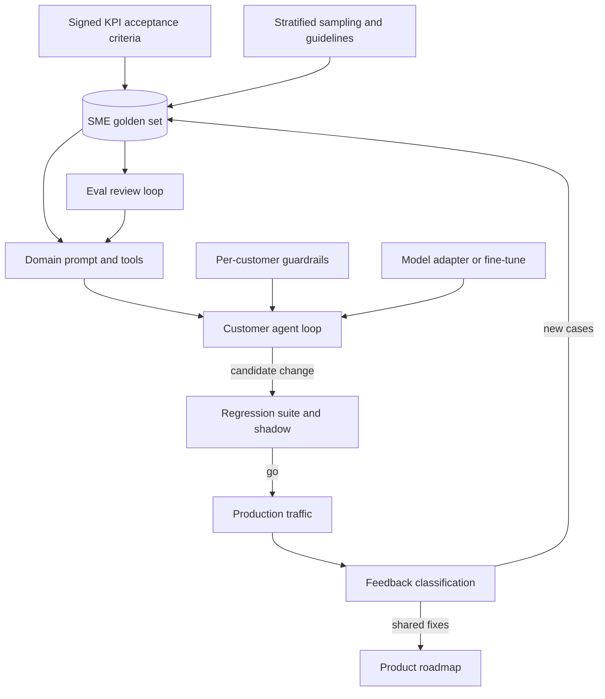

## Overview
This module is about proving, on one customer's own data and by their own experts' standard, that your
agent does the job they are paying for, and keeping that true after go-live. The evals module teaches
the measuring instrument in general. This one teaches how to build and run it inside a client
engagement.

In a client engagement the data is governed, SME time is scarce, and acceptance is a contract. The
module follows the life of a customer's agent from scoping to sign-off and on into a multi-customer
deployment.

What it gives an agent builder:
- **A ruler you can trust.** Business KPIs turned into signed acceptance criteria with baselines and sample sizes, and a golden dataset agreed by client SMEs, sampled by stratum so rare high-cost cases are dense enough to judge, labelled under written annotation guidelines in facilitated labeling sessions.
- **A way to improve the agent.** Domain prompt engineering turns the tacit rules those sessions surface into tested instructions, and eval review loops sort every failure into system, label, guideline or grader error.
- **Safe change after acceptance.** Customer-specific regression suites stop shared changes from breaking one customer quietly, per-customer guardrails enforce each tenant's policy in code, and fine-tuning pipelines, model integration and shadow mode let you change the model under a live customer with evidence instead of hope.
- **A closed loop.** Production feedback classification and feedback loops to product turn thumbs-down and tickets into routed failure modes, regression cases and roadmap decisions.

Core for agents (you use them directly in the build): golden-dataset-creation-with-client-smes,
domain-prompt-engineering, eval-review-loops, per-customer-guardrails and model-integration.

Useful (you meet them when operating, fine-tuning or shipping agents to customers): the other nine
lessons. None is pure background; each one changes something in your harness, config or agent loop.

Afterwards you can run an agent pilot from scoping to sign-off and keep a multi-customer agent
deployment healthy. It matters most for FDEs, who own the customer relationship and the acceptance
decision, and for architects designing a platform that serves many customers from shared components.

## Why it matters
- **Engineer:** You build the per-customer regression suite that replays each tenant's agent tasks with stubbed tools, the tenant guardrail engine around the tool adapters and the leakage-safe fine-tuning pipeline, and gate every shared prompt or model change on paired, case-by-case flips for each customer rather than on a blended global score.
- **Architect:** You design where customer specificity lives in the agent platform (versioned guardrail config with a platform floor, per-customer adapters, model adapters with capability checks, per-tenant suites) so that one shared agent serves many customers without forking code or letting averages hide a regression.
- **FDE:** You get the sponsor to sign KPI-based acceptance criteria for the agent before results exist, run the SME labeling sessions that produce an authoritative golden set, and bring shadow-mode evidence to the customer's risk committee before any user sees a new model behind the agent.

## Mental model
Picture the customer's judgement as the only ruler that counts, and the module as the work of copying
that ruler faithfully and keeping it in use around your agent.

- **Agree what the ruler measures.** Business KPIs translated into proxies, thresholds and sample sizes, signed in advance.
- **Manufacture the ruler.** Real cases sampled by stratum, labelled by the customer's SMEs under a written guideline, with disagreements resolved as policy and the set signed off.
- **Measure every candidate against it.** A domain prompt, a fine-tuned adapter or a different model is a candidate; every failure is first asked "is the system wrong, or is the ruler?"
- **Let the ruler multiply and travel.** Frozen per-customer regression suites gate shared changes, guardrails encode each customer's rules, and shadow mode checks the candidate on live traffic.
- **Keep adding marks.** Classified production feedback adds new cases to the ruler and sends shared problems back to the product.

A number you cannot trace to the customer's experts is not evidence.

The diagram shows where these ideas sit around a shared agent serving one customer.

## Suggested order
1. golden-dataset-creation-with-client-smes — core: builds the signed, governed reference set of agent tasks every prompt, tool or model change is measured against.
2. domain-prompt-engineering — core: encodes SME rules, definitions and exceptions as a tested system prompt and tool policy, the cheapest lever once a golden set exists.
3. eval-review-loops — core: teaches reading failing agent traces with SMEs and attributing each to system, label, guideline or grader before changing anything.
4. per-customer-guardrails — core: makes each tenant's rules versioned, enforced-in-code policy around the agent loop on top of a platform floor, tested on their own data.
5. model-integration — core: shows what really changes in a tool-calling loop when a new or customer-mandated model, or a fresh adapter, goes behind the agent.
6. acceptance-testing-against-customer-kpis — fixes what "accepted" means in business terms, which drives dataset size, strata and pilot design for the golden set you built.
7. representative-test-case-sampling — chooses which real cases enter that set so the score predicts production and rare strata have enough items.
8. sme-review-and-annotation-guidelines — writes the shared standard SMEs apply, so labels measure the system rather than reviewer differences.
9. labeling-sessions — turns the guideline into labels at speed and surfaces the tacit rules that only live disagreement reveals.
10. customer-specific-regression-suites — freezes each customer's accepted cases and fixed incidents so shared changes are gated per customer.
11. fine-tuning-pipelines-on-client-data — covers the audited, repeatable path to a per-customer adapter when prompting has plateaued.
12. shadow-mode-validation — validates that candidate model on live customer traffic with zero user impact before any exposure.
13. production-feedback-classification — turns raw production signals into labelled failure modes with severity and an owning component.
14. feedback-loops-to-product — routes those classified failures into shared fixes, regression cases and a reply to the customer, closing the cycle.

## Capstone
### Brief
**Use case:** a customer-service email agent for a regional utility company. It classifies inbound
emails, routes them through tools, and drafts responses. You are the forward-deployed engineer for the
vendor that ships it.

The sponsor, the head of customer operations, wants average handle time down 25% with no increase in
misrouted complaints. The regulator treats complaint misrouting as a reportable issue.

This is the module's major project, run end to end over a week. You work from a synthetic or anonymised
set of about 3,000 emails (provided or generated). It includes a 3% stratum of formal complaints and a
2% stratum of vulnerable-customer cases. Two or three volunteers act as the utility's SMEs.

The agent component you build and evaluate:
- an agent loop with tools such as `route_ticket`, `draft_reply` and `escalate_to_human`;
- a per-tenant guardrail layer in the tool adapters;
- a model adapter you can swap behind the loop;
- an eval harness, regression suite and shadow worker around it.

The engagement steps:
- Draft and sign acceptance criteria with a baseline.
- Sample and label a golden set under a written guideline.
- Iterate a domain prompt through review loops, then freeze a regression suite.
- The utility then mandates a move to a model hosted in its own cloud tenancy: integrate it, shadow it against the current system on replayed traffic, and configure the utility's guardrails.
- Classify a batch of simulated production feedback into routed issues, one of which becomes a product fix with a regression case.

### Deliverables
- A signed acceptance document mapping each business KPI (handle time, misrouting rate, complaint recall) to a proxy, a baseline measurement, a threshold, a sample size with its expected interval width, and the split between offline and pilot criteria.
- A versioned golden set of at least 300 items, stratified with floors for complaints and vulnerable-customer cases and re-weighting back to the traffic mix, labelled under a written annotation guideline with a decision order, boundary examples and an unsure path, plus a double-labelled subset with agreement reported per criterion.
- A labeling-session log and a domain prompt in which every rule traces to a logged SME decision and at least one golden-set case, plus an eval review log attributing every failure from two rounds to system, label, guideline or grader error.
- A per-customer regression suite and harness that compares a candidate agent against production case by case and gates on blocking-case failures, and a guardrail config for the utility layered on a platform floor with tighten-only merging and tests on the utility's labelled data.
- A model-integration and shadow-mode report for the mandated model covering adapter changes, tokenizer and context effects, prompt porting, paired flips on the regression suite, adjudicated disagreements, latency, cost and confirmation that the shadow path made no writes.
- A feedback taxonomy built from at least 100 simulated production signals classified at trace level, with per-class precision against human labels, and one evidence-backed product issue carried through to a fix, a new regression case and a written reply to the reporting customer.

### Rubric
- Thresholds and sample sizes are dated before any result is shown, the misrouting baseline is measured on the current human process rather than assumed to be zero, and the acceptance verdict reports each criterion with its interval, not a point estimate.
- The complaint and vulnerable-customer strata each contain enough items to tell 70% from 90% recall, and the headline score is re-weighted to the real traffic mix with the re-weighting shown.
- At least one review-loop failure is resolved by changing a label or the guideline rather than the prompt, and agreement on the double-labelled subset is reported with the guideline version it was measured under.
- A planted change that improves the global score while breaking a utility-specific rule is caught by the per-customer suite and blocked, with the flipped cases listed.
- The utility's complaint-routing rule fires in a test where the prompt instruction is bypassed, proving enforcement sits outside the prompt in the tool adapter, and the platform floor cannot be lowered by customer config.
- The shadow report gives a clear go, hold or no-go for the mandated model with its evidence, and names at least one difference (tool-call format, tokenizer or error semantics) that a smoke test would have missed.
