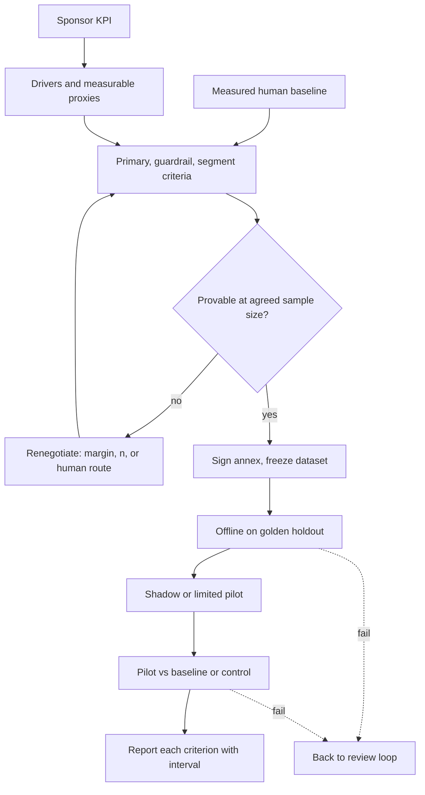

## TL;DR
The pre-agreed test that decides acceptance: business KPIs become proxies, thresholds and sample sizes,
signed before results are seen, then measured offline and in a pilot against a baseline. "Scores 91%"
does not answer "did invoice cost fall without more errors?"

## Why it exists
- **A customer buys an outcome, not an accuracy number.** The sponsor's success statement is in business
  terms: cut average handle time, raise first-contact resolution, process more claims per adjuster, keep
  error rates no worse than today. Engineers report model-level metrics, and the two languages do not meet.
- **Model metrics alone are ambiguous.** A 91% extraction accuracy might be great or useless depending on
  which fields fail, how errors are caught downstream and what the human process achieved before.
- **Informal acceptance fails three ways:**
  - *No baseline:* nobody measured the current process, so "better" has no reference and the human error
    rate is assumed to be zero.
  - *The bar moves:* once results are in, stakeholders unhappy for other reasons re-open the definition of success.
  - *Statistics ignored:* a pilot of 200 cases "beats" a 2% error target with 1.5%, yet the uncertainty on
    200 cases is wider than the difference.
- **Naive alternatives prove nothing or the wrong thing:** accepting on a demo, or on a single overall
  accuracy number.
- **What it buys:** an explicit deal. These metrics, measured this way, on this data, with these thresholds
  and this much confidence, mean the system is accepted.

## How it works
### 1. Start from the KPI tree
1. **Top:** the sponsor's KPI (cost per invoice processed).
2. **Drivers:** share of invoices needing no human touch, review time per touched invoice, error rate
   reaching payment.
3. **Measurable proxies:** map each driver to something measurable offline or in a pilot. Offline evals
   can measure accuracy and straight-through eligibility; only a pilot can measure time and behaviour change.
- **Why explicit:** the tree shows which model metric moves which business number.

### 2. Measure the baseline
- **Measure the current process on the same kind of sample:** human error rate, handle time, throughput.
- **Without it,** thresholds are guesses and the system is held to a standard of perfection the humans never met.

### 3. Define criteria of three types
| Type | Examples | Why |
|---|---|---|
| **Primary** | KPI proxies that must improve (straight-through rate, handle time) | what the sponsor is buying |
| **Guardrails** | must not get worse: critical-field error rate, compliance violations, escalation rate | optimising one KPI often degrades another |
| **Segment floors** | minimum performance on high-stakes strata (high-value invoices, regulated products) | an overall average can pass while the segment that matters fails |

### 4. Fix the statistics in advance
- **Point estimate or confidence bound?** State which for each criterion, and size the sample accordingly,
  because some criteria are unprovable at small n.
- **Use an interval that behaves near 0 or 1,** such as the Wilson interval; the simple normal approximation
  can produce bounds below zero.

Three decisions hide inside "no worse than today":
- **Non-inferiority margin.** Requiring the system's upper bound to sit at or below the baseline's point
  estimate demands near-proof that it is *better*. The usual form is non-inferiority: upper bound ≤
  baseline + δ, where δ is the largest degradation the sponsor would accept. Choosing δ is a business
  decision, not a statistical one, so it is the sponsor's to sign.
- **Baseline uncertainty.** The baseline is itself a sample. Measured on a few hundred cases, its own
  interval may be wider than the margin; measure it on more cases or acknowledge the comparison is approximate.
- **Power.** To show an upper bound at or below threshold t when the true rate is p, with z_α for the bound
  and z_β for the chance of passing:

```
n ≈ [z_α·√(t(1−t)) + z_β·√(p(1−p))]² / (t − p)²
```

- **The lesson is the (t − p)² denominator:** halving the gap between expected performance and threshold
  quadruples the sample.
- **Pass chances multiply.** If acceptance requires *every* criterion to pass, three independent criteria,
  each passed with 90% probability by a system that truly meets them, are all passed only about 73% of the
  time (0.9³). Keep the signed list short and power each criterion generously.

### 5. Sign before measuring
- **Put metrics, data, thresholds, sample sizes and the decision rule** in the statement of work or an
  acceptance annex, signed by the sponsor.
- **Freeze** the acceptance dataset version and the holdout.

### 6. Run in stages
1. **Offline** on the frozen golden holdout.
2. **Shadow mode or a limited pilot** on live traffic, with humans still in control.
3. **A pilot that measures time and throughput** against the baseline or a concurrent control group.
- **Each stage has its own pass criteria;** failure sends you back to the review loop.

### 7. Report against the contract
- **Every criterion** with its estimate, interval and pass or fail, plus segment results.
- **Do not substitute** a different metric that happens to look better.

## Diagram
The feasibility check sits before the signature: a criterion that cannot pass at the agreed sample size is
renegotiated then, not discovered at the go/no-go meeting.



## Examples
### Scoring signed criteria with Wilson intervals
Invoice extraction for an accounts-payable team. Baseline, measured on 500 invoices: 2.0% critical-field
error rate (amount, supplier bank details, due date), and every invoice is touched by a human. The KPI is
cost per invoice; the agreed proxies are below, all illustrative.

```python
import math

def wilson(k, n, z=1.96):
    """95% Wilson interval for a proportion k/n (better than the normal approximation near 0 or 1)."""
    p, d = k / n, 1 + z * z / n
    centre = (p + z * z / (2 * n)) / d
    half = z * math.sqrt(p * (1 - p) / n + z * z / (4 * n * n)) / d
    return centre - half, centre + half

# Criteria signed in the SOW: (name, observed count, n, rule, threshold)
CRITERIA = [
    ("critical-field error rate", 6, 400, "upper<=", 0.02),   # guardrail: no worse than baseline
    ("straight-through rate", 292, 400, "lower>=", 0.65),     # primary: no human touch needed
    ("critical-field error, high-value", 3, 80, "upper<=", 0.03),  # segment floor
]
for name, k, n, rule, t in CRITERIA:
    lo, hi = wilson(k, n)
    ok = hi <= t if rule == "upper<=" else lo >= t
    print(f"{name:34s} {k/n:6.1%} CI [{lo:.1%}, {hi:.1%}] {rule}{t:.0%} {'PASS' if ok else 'FAIL'}")
# critical-field error rate            1.5% CI [0.7%, 3.2%] upper<=2% FAIL
# straight-through rate               73.0% CI [68.4%, 77.1%] lower>=65% PASS
# critical-field error, high-value     3.8% CI [1.3%, 10.5%] upper<=3% FAIL
```

What the result means, and what should have been caught when the annex was written:

| Finding | Numbers |
|---|---|
| Guardrail fails despite a better point estimate | 1.5% beats the 2% baseline, but 400 invoices cannot show it with confidence |
| Sample needed for that rule | at a true 1.5%, about 3,000 invoices just for the upper bound at the expected error count to reach 2%, and then it passes only about half the time; roughly 8,000 for around a 90% chance of passing |
| The rule was stricter than its label | the baseline was 10 errors in 500, whose own Wilson interval is roughly 1.1% to 3.6%, so "upper bound ≤ 2.0%" asked for proof of improvement over a noisy number |
| Non-inferiority version | upper bound ≤ 2.5% (a 0.5-point margin the AP manager signs as tolerable) needs only about 2,000 to 2,500 invoices for a roughly 90% chance at a true 1.5%, a volume pilot traffic can often supply |
| Segment floor is unpassable | even zero errors in 80 invoices gives an upper bound near 4.6% |

- **The fix is a renegotiation *before* testing:** either larger samples (pilot traffic can supply them),
  or a point-estimate rule backed by a downstream control such as human review of all high-value invoices.

### Feasibility check before anyone signs
Run the power formula for each criterion while drafting the annex. This normal-approximation version
reproduces the orders of magnitude above.

```python
import math

def n_for_upper_bound(t, p, z_a=1.96, z_b=1.2816):
    """Items so the upper bound lands at or below threshold t when the true rate is p.
    z_a matches the 95% interval used for the bound; z_b=1.2816 gives ~90% chance of passing."""
    return math.ceil(((z_a * math.sqrt(t * (1 - t)) + z_b * math.sqrt(p * (1 - p))) / (t - p)) ** 2)

print(n_for_upper_bound(0.02, 0.015, z_b=0))   # 3012: passes only about half the time
print(n_for_upper_bound(0.02, 0.015))          # 7403: about a 90% chance of passing
print(n_for_upper_bound(0.025, 0.015))         # 2133: non-inferiority with a 0.5-point margin
print(round(0.9 ** 3, 2))                      # 0.73: three such criteria all passing
```

## Production patterns
- **Acceptance annex as configuration.** Keep each signed criterion (metric, rule, threshold, sample size,
  dataset version, segment filter) in one config file the harness reads, and record its hash with every
  report. Monitor that re-running the harness on the frozen dataset reproduces identical numbers.
- **Feasibility gate on the draft annex.** Before signature, compute required n for every criterion at the
  expected rate, and flag any criterion where even zero errors at the agreed n would fail. Unpassable
  criteria go back to the sponsor for a margin, a bigger sample or a human route.
- **Fixed stopping point for the pilot.** Write the pilot volume or end date into the annex and evaluate
  then, because stopping the first time an interval crosses the threshold inflates the chance of a false
  pass. Track running intervals on a dashboard for visibility, not for the decision.
- **Concurrent control when mix shifts.** Where volume and mix are unstable, route a random share of
  traffic to the current process during the pilot and compare handle time and errors between arms. Monitor
  that the arms stay balanced by segment.
- **Guardrails become production alerts.** After acceptance, keep the same guardrail metrics running on
  sampled production traffic with a rollback trigger agreed in the annex. Monitor the guardrail interval
  weekly, not just its point estimate.

## Trade-offs
- **Confidence-bound thresholds vs data.** They protect the customer from lucky small samples but demand
  large test sets; when labelled data is scarce, use point estimates plus a production guardrail that
  triggers rollback.
- **Concurrent control vs capacity.** A control group gives a clean causal estimate of time saved but costs
  the customer capacity running two processes; before-and-after is cheaper when volume and mix are stable.
- **Wider non-inferiority margin vs risk.** The test becomes passable at realistic sample sizes but admits a
  system somewhat worse than today; when errors are costly or regulated, keep δ small and pay for the
  larger sample.
- **More criteria vs noise.** They cover more risks, but each extra one raises the chance of failing on
  noise; keep a handful of primary metrics and guardrails, and report the rest as diagnostics.
- **Strict segment floors vs launch.** They protect high-stakes cases but can block launch on tiny
  segments; when a segment is too small to test, route it to humans and exclude it from automated scope.

## Pitfalls
- **Setting thresholds without a measured baseline.** Symptom: a system rejected for a 2% error rate when
  the human process, once measured, turns out to run higher.
- **Agreeing thresholds after seeing results.** Symptom: a sponsor or skeptical stakeholder re-opens the
  definition of success at the go/no-go meeting.
- **Only primary metrics, no guardrails.** Symptom: a faster process that pushes more errors into payment
  or compliance, discovered at month-end.
- **Criteria unprovable at the agreed sample size.** Symptom: a "fail" on a system whose observed
  performance beats the threshold.
- **Accepting on offline evals alone.** Symptom: good golden-set numbers and no change in handle time,
  because users do not trust the output and re-check everything.

## When to use
- **Define acceptance tests at scoping,** as soon as the KPIs and baseline are known and certainly before
  the pilot starts; they drive dataset size, sampling strata and pilot design.
- **Offline criteria** for quality; **pilot criteria** for time, throughput and behaviour.
- **Skip formal statistics only** for low-stakes internal tools where a wrong decision costs a cheap rollback.
- **Measure** each criterion with its interval over the pilot, not just at the end.
- **Interviews:** show the chain from business KPI to proxy to threshold to sample size, and mention
  baselines and guardrails unprompted.

## Role lens
- **Engineer:** Implements the acceptance harness that computes every signed criterion with intervals and
  segment breakdowns from frozen dataset versions, reproducibly.
- **Architect:** Owns the KPI tree and decides which criteria are tested offline, in shadow mode, or in a
  live pilot, and what production guardrails back them after launch.
- **FDE:** Negotiates the acceptance annex with the sponsor, insists on a baseline, and checks that
  thresholds are provable at the agreed sample size before anything is signed.

## Check yourself
**Q:** A sponsor wants the contract to say "the AI must be 99% accurate". How do you turn that into an
acceptance test you can actually pass or fail fairly?
**A:** I would ask what business outcome 99% stands for, then decompose it: which errors matter (a wrong
bank account is not a misspelled supplier name), what the current human error rate is, and which KPI
the sponsor is buying, such as time or cost per item. I would propose a primary metric tied to that KPI,
guardrails on critical-field errors framed as non-inferiority against the measured baseline, with a
margin the sponsor signs, and floors on high-stakes segments. For each I would state whether the threshold applies to a point estimate or a confidence bound
and size the sample so it is provable. Then everything goes into a signed annex with a frozen dataset.

## Interview questions
### Why is "the model scores 91% on our eval" not an acceptance criterion?
- **It is not the outcome bought:** the sponsor buys lower cost, time or errors, and 91% may be great or
  useless depending on which fields fail and what catches errors downstream.
- **It has no reference:** without a measured human baseline, nobody knows whether 91% is better than today.
- **It has no confidence or segments:** a single average hides high-stakes strata and sampling noise.

### Explain non-inferiority and who should choose the margin.
- **Definition:** pass when the system's upper bound ≤ baseline + δ, instead of demanding proof it beats
  the baseline, which needs far larger samples.
- **δ is a business decision:** the largest degradation the sponsor would tolerate, so the sponsor signs it.
- **Keep δ small when errors are costly or regulated,** and pay for the larger sample instead.

### How many invoices do you need to show an error rate's upper bound is at most 2% if the true rate is 1.5%?
- **Use the power formula:** n ≈ [z_α·√(t(1−t)) + z_β·√(p(1−p))]² / (t − p)², which gives about 3,000 for a
  coin-flip chance and roughly 7,400 to 8,000 for about 90%.
- **The gap drives it:** halving t − p quadruples n.
- **Moving to a 2.5% non-inferiority bound** cuts it to roughly 2,000 to 2,500, which pilot traffic can supply.

### The contract has eight criteria that must all pass. What is the risk, and what do you change?
- **Pass chances multiply:** even at 90% each, three independent criteria all pass only about 73% of the
  time; eight would fail a good system more often than not.
- **Shorten the signed list** to a handful of primary metrics and guardrails, and report the rest as diagnostics.
- **Power each remaining criterion generously,** so a system that meets them passes with high probability.

### Offline acceptance passed, but handle time did not change in the pilot. How do you debug it?
- **Check behaviour first:** users may not trust the output and re-check everything, which offline evals cannot see.
- **Measure where time goes:** compare touched versus straight-through items and review time per touched
  item against the baseline.
- **Fix the right lever:** confidence display, routing of low-confidence items, or training, then re-run the
  pilot criterion rather than relaxing it.

## Quiz
### Q: Why measure the human baseline before setting acceptance thresholds?
- [ ] Baselines are required for statistical significance tests
- [ ] The AI system must always beat humans by a fixed margin
- [x] Without it, thresholds are guesses and the system may be held to a standard the current process never met
- [ ] Baselines replace the need for a golden dataset
> Human processes have error rates and costs too. Measuring them grounds thresholds in reality and
> turns "is it perfect?" into "is it better than what we do today?"

### Q: An acceptance criterion says the error rate's 95% upper bound must be at most 3%, tested on 80 items. What is the problem?
- [ ] 80 items is too many for a segment test
- [ ] Upper bounds should never be used for error rates
- [ ] The Wilson interval cannot be computed at small n
- [x] Even zero errors on 80 items leaves an upper bound above 3%, so the criterion cannot pass
> With n = 80, the Wilson upper bound for zero errors is about 4.6%. The test is unpassable by design,
> which should be caught when the criteria and sample sizes are agreed.

### Q: What is the role of guardrail metrics in a KPI acceptance test?
- [ ] They replace primary metrics when those are hard to measure
- [x] They ensure improving the target KPI does not degrade something else that matters, such as errors
- [ ] They are only reported after launch
- [ ] They measure the model's latency and nothing else
> Pushing straight-through rate or speed can increase downstream errors or compliance breaches.
> Guardrails make "no worse than baseline" on those dimensions an explicit condition of acceptance.
