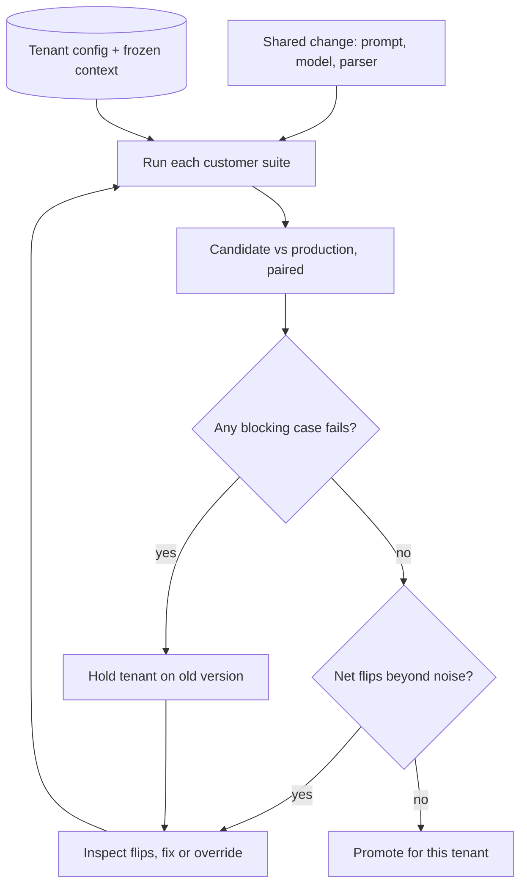

## TL;DR
A frozen set of one customer's own cases, run under that customer's configuration whenever a shared
prompt, model or pipeline changes, and gated case by case against production. Averages hide one
customer's breakage; this suite does not.

## Why it exists
- **Every shared change hits every customer at once.** Base prompt, model version, retriever and parser
  are shared, so one edit changes all tenants. Customers never experience the average; they see their
  invoice layout, their label taxonomy, their rule that amounts are always written with two decimals.
- **A global golden set dilutes regressions.** The global set is a blend that answers "did we get
  better on average?". If customer A contributes 120 of 3,000 cases (4%) and drops from 92% to 80% pass,
  the global score moves about half a point, inside the run-to-run noise of most LLM evals.
- **So the release ships anyway.** The first signal is an angry email from A's operations lead.
- **Re-running the acceptance test is not enough either.** Acceptance tests were written once, for
  go-live, and contain none of the bugs found since. Already-reported bugs are the ones a customer checks
  first if they come back, so they are the most valuable tests you own.
- **What a per-customer suite buys.** Results are reported and gated per customer, so gains for others
  cannot average away one customer's regression, and the suite grows with every fixed incident.

## How it works
### What goes into a suite
Four sources, each for a different reason:

| Source | What it is | Why it is there |
|---|---|---|
| **Acceptance cases** | The cases that defined "done" at go-live (see acceptance testing against KPIs) | Protect the contractual baseline |
| **Fixed incidents** | Every diagnosed and fixed production failure, added *after* the fix, with the assertion that would have caught it | "Every bug becomes a test", which is why the suite gets more valuable over time |
| **Contract rules** | Format, terminology, refusal and escalation behaviours ("never state a settlement amount", "dates as DD/MM/YYYY") | Often deterministic checks the customer requires |
| **Sampled traffic** | A small stratified sample of recent real inputs | Stops the suite drifting away from what the customer actually sends |

### What a case records
- **Input** and the **customer configuration it must run under**: tenant flags, prompt version,
  retrieval index snapshot or fixed context, tool stubs.
- **Assertion type**: exact match, schema check, field-level comparison, rubric or LLM judge.
- **Severity tier**: blocking or tracked.
- **Provenance** (which ticket or SME session it came from) and an **owner**.
- **Why configuration is part of the case:** a regression that only appears with A's feature flags is
  invisible if you test with defaults.
- **Why retrieval is frozen** (a snapshot or the captured context): otherwise a failure could be caused
  by new documents rather than by your change, and you could not tell which.

### How it is run and judged
1. **On every change to a shared component**, run each customer's suite under that customer's config.
2. **Run both sides:** the **candidate** and the **current production version**.
3. **Compare paired, case by case.** The same cases run on both sides, so what matters is which cases
   flipped pass-to-fail and which flipped the other way. This is far more sensitive than comparing two
   pass rates, because case difficulty cancels out.
4. **Apply the two-part gate:**
   - **Blocking cases must pass.** A failing contract-rule or previously-fixed-incident case blocks the
     release for that customer, regardless of averages.
   - **Scored cases must not regress beyond noise.** Count pass-to-fail and fail-to-pass flips and test
     whether the imbalance exceeds chance (McNemar's test on the discordant pairs).
5. **Measure noise** by running production against itself a few times. Cases that flip between identical
   runs are flaky and should be fixed or repeated, not gated on.

### Power and many customers
- **Small suites have little power.** McNemar only sees discordant pairs. With 3 flips against and 0
  for, the exact two-sided p is 0.25, so a pure significance gate waves through a change that broke
  three of a customer's cases and fixed none.
- **Hence the blocking tier**, and why many teams add a practical floor ("no more than N net
  pass-to-fail flips") alongside the test.
- **Many customers inflate false blocks.** A 40-customer fleet tested at p < 0.05 each will, on a
  harmless change, falsely block at least one customer on most releases: if the tests were independent,
  1 − 0.95⁴⁰ ≈ 0.87.
- **Two fixes:** correct for it (a Holm or false-discovery-rate adjustment across customers), or treat a
  significant-but-small flip count as "inspect", not "block", and reserve hard blocks for blocking cases.

### Cost and cadence
- **Cost is customers × cases × repetitions**, so suites are tiered: a small smoke subset per customer on
  every pull request, the full suite nightly and before release.
- **A failing customer can be held back.** Per-tenant routing keeps them on the old version while the
  rest roll forward, which is only possible if config and version are per tenant.

### Data handling
- **Suites contain customer data.** Store and run them under that customer's data agreement and region.
- **Never mix them** with other tenants' suites, and never use them for training without permission.
- **Delete or return them** when the contract ends.

## Diagram
Each customer's suite runs twice (candidate and production) under its own config; blocking cases and
paired flips decide that tenant's gate independently of everyone else.



## Examples
### Paired gate with an exact McNemar test
A shared extraction prompt change lifts the global score from 91.2% to 92.0%. Customer A's 120-case
suite tells a different story. The paired comparison below counts flips and computes an exact McNemar
p-value from the discordant pairs.

```python
from math import comb

def mcnemar_exact(b, c):
    """b = pass->fail flips, c = fail->pass flips. Two-sided exact binomial test."""
    n, k = b + c, min(b, c)
    tail = sum(comb(n, i) for i in range(k + 1)) / 2 ** n
    return min(1.0, 2 * tail)

def gate(baseline, candidate, blocking_ids):
    """baseline/candidate: {case_id: bool passed}. Returns (ok, report)."""
    broken_blockers = [cid for cid in blocking_ids if not candidate[cid]]
    b = sum(baseline[k] and not candidate[k] for k in baseline)
    c = sum(not baseline[k] and candidate[k] for k in baseline)
    p = mcnemar_exact(b, c)
    ok = not broken_blockers and not (b > c and p < 0.05)
    return ok, {"pass_to_fail": b, "fail_to_pass": c, "p": round(p, 4),
                "broken_blockers": broken_blockers}

# Customer A: 14 cases broke, 3 improved, one broken case is a past incident (blocking).
print(mcnemar_exact(14, 3))   # 2 * (1 + 17 + 136 + 680) / 2**17 = 0.0127
```

- **The drop is real.** With 14 pass-to-fail and 3 fail-to-pass, p ≈ 0.013: not noise, even though A's
  pass rate only moved from, say, 90% to 81% and the global number went up.
- **It fails on two counts.** One broken case was a blocking past-incident case.
- **The fix:** hold A on the old prompt version through per-tenant routing, inspect the 14 flips (here,
  multi-currency invoices), and re-run before promoting.

### Fleet-wide gate with a Holm correction
With many customers, adjust the per-customer p-values before hard-blocking anyone. Holm's step-down
method compares the smallest p with α/m, the next with α/(m−1), and stops at the first miss.

```python
def holm_flagged(pvals, alpha=0.05):
    """pvals: {customer: p}. Returns customers whose regression survives Holm correction."""
    order = sorted(pvals, key=pvals.get)
    m, flagged = len(order), []
    for i, cust in enumerate(order):
        if pvals[cust] < alpha / (m - i):
            flagged.append(cust)
        else:
            break                      # step-down: everything after this also passes
    return flagged

p = {"A": 0.0127, "B": 0.04, "C": 0.31, "D": 0.0009, "E": 0.6}
print(holm_flagged(p))   # ['D']  -> A and B go to "inspect", not "block"
```

| Fleet size, per-customer α = 0.05 | Chance a harmless change blocks someone (independent tests) |
|---|---|
| 40 customers, uncorrected | 1 − 0.95⁴⁰ ≈ 0.87 |
| 40 customers, Bonferroni (0.05 / 40 each) | ≈ 0.049 |

- **Note on A:** Holm does not hard-block A here, but A still fails because a blocking case broke. That
  is exactly why the blocking tier exists alongside the statistics.

## Production patterns
- **Tenant-parameterised test harness** — when two or more customers share components. Load each tenant's
  config (flags, prompt version, context snapshot, tool stubs) per case and parameterise the runner by
  tenant id, for example a pytest fixture per tenant. Monitor per-tenant flips and blocking failures, not
  the global pass rate.
- **Smoke on PR, full suite nightly** — when the fleet grows. Tag a small per-customer subset (for example
  a custom pytest marker selected with `-m`) for every pull request, and run the full suite nightly and
  before release. Monitor suite wall-clock time and cost per run.
- **Incident-to-case checklist** — on every fixed production incident. Make "blocking regression case
  added, verified against the fixed version" a required item in the postmortem or ticket template.
  Monitor how many incidents closed without a case.
- **Production-vs-production flake runs** — before trusting any gate. Run the production version against
  itself a few times and quarantine cases that flip. Monitor flaky-case rate per suite; rising flake rate
  means the gate is losing credibility.
- **Per-tenant version pinning** — when one customer fails. Route that tenant to the old prompt or model
  version through tenant configuration while others roll forward. Monitor how many tenants are pinned and
  for how long, because each pin is another live version to maintain.

## Trade-offs
- **Per-customer gating vs cost.** It catches regressions averages hide, but cost and run time grow with
  the number of customers; tiered smoke-versus-full runs keep pull requests fast until the customer count
  is large.
- **Frozen retrieval vs coverage.** Freezing context makes failures attributable to your change, but stops
  the suite catching regressions caused by index or ingestion changes; run a separate live-index suite for
  those.
- **Gating every customer vs release speed.** It slows shared releases; per-tenant version pinning lets
  most customers move forward, at the price of maintaining several live versions for a while.
- **LLM judges vs determinism.** Judge assertions cover open-ended outputs that exact checks cannot, but
  add their own noise; prefer deterministic checks whenever the requirement can be stated as a rule.

## Pitfalls
- **Running every customer's cases with default configuration.** Symptom: a green suite followed by a
  regression that only occurs under one tenant's feature flags or prompt overrides.
- **Comparing pass rates instead of paired flips.** Symptom: releases blocked by noise one week and real
  regressions waved through the next, because two independent rates are too noisy at 100-case scale.
- **Never removing or re-reviewing cases.** Symptom: a suite full of expectations the customer no longer
  holds, and engineers learning to ignore failures as "probably stale".
- **Adding the incident case before the fix is verified, or with the wrong expected output.** Symptom: a
  blocking case that fails on every candidate and gets silently downgraded to tracked.
- **An uncorrected p < 0.05 gate on every customer in a large fleet.** Symptom: nearly every release
  blocks some customer whose failing flips share no cause and vanish on re-run, until the team stops
  trusting the gate.
- **Treating customer suites as shared fixtures.** Symptom: one customer's documents appear in another
  customer's test logs or in a training set, which is a data-handling breach.

## When to use
- **Use when** a second customer runs on shared components. Start on day one with the acceptance cases
  and grow the suite with every fixed incident.
- **Matters most when** customers differ in document formats, terminology or contract rules, and shared
  prompts or models change often.
- **Skip when** there is one customer: your global regression set already is the customer suite.
- **Measure:** flips per customer, blocking-case failures and flaky-case rate.
- **Interviews:** the strong signal is explaining why averages hide per-customer regressions and why the
  comparison must be paired against production.

## Role lens
- **Engineer:** Builds the harness that runs each suite under its tenant config, freezes retrieval
  context, computes paired flips and wires the per-customer gate into CI.
- **Architect:** Makes configuration and model version per tenant so a failing customer can be held back,
  and sets the data boundary for where customer suites live.
- **FDE:** Converts every fixed customer incident into a blocking case with the customer's SME, and uses
  the suite results to tell the customer exactly what a release changes for them.

## Check yourself
**Q:** A shared prompt change improves the global eval by 1.5 points. One customer's 80-case suite shows
6 cases newly failing and 2 newly passing. Should you ship, and to whom?
**A:** Look at the paired flips, not the averages. Six versus two on 8 discordant pairs gives an exact
McNemar p of about 0.29, so on its own that imbalance is not clearly beyond noise; I would check the
production-versus-production flake rate for that suite. But the type of case matters more: if any of the
six is a blocking contract rule or a past incident, that customer is held on the old version through
per-tenant routing while everyone else gets the change. I would then read the six failures to see if
they share a cause, fix or add a customer-scoped override, and re-run before promoting that tenant.

## Interview questions
### Why is a global eval set not enough once several customers share one product?
- **Averages dilute.** A customer with 4% of the cases can drop 12 points while the global score moves
  about half a point, inside run-to-run noise.
- **Customers experience their own traffic**, not the blend, so the regression surfaces as a complaint
  instead of a failed gate.
- **So** results must be reported and gated per customer.

### How would you design the comparison so a per-customer gate is sensitive but not noisy?
- **Pair it.** Run the same cases on the candidate and production under the tenant's config and count
  pass-to-fail versus fail-to-pass flips; case difficulty cancels out.
- **Test the discordant pairs** with an exact McNemar test, plus a practical floor on net flips because
  small suites have little power.
- **Calibrate noise** with production-versus-production runs and quarantine flaky cases.

### Your gate blocks some customer on almost every release, and the failures vanish on re-run. What is going on?
- **Multiple comparisons.** With 40 customers each tested at p < 0.05, a harmless change blocks at least
  one about 87% of the time if tests were independent.
- **Fix:** apply Holm or a false-discovery-rate adjustment across customers, or downgrade
  significant-but-small flip counts to "inspect" and keep hard blocks for blocking cases.
- **Also check flake rate**, since flaky cases inflate discordant pairs.

### When would you not freeze the retrieval context in a customer suite?
- **When the change under test is the index or ingestion itself.** Frozen context hides exactly those
  regressions.
- **So run two suites:** a frozen-context suite that attributes failures to prompt and model changes, and
  a separate live-index suite for retrieval and ingestion changes.

### How do you keep the cost of per-customer suites under control as the fleet grows?
- **Cost scales as customers × cases × repetitions**, so tier it: a small smoke subset per customer on
  every pull request, the full suite nightly and before release.
- **Prefer deterministic assertions** over LLM judges where the rule allows, because they are cheaper and
  need fewer repetitions.
- **Prune and re-review cases** so stale expectations do not consume budget or trust.

## Quiz
### Q: Why are customer regression suites compared case by case against production rather than against a pass-rate threshold?
- [ ] Thresholds are illegal to set in customer contracts
- [x] Paired comparison cancels out case difficulty, so flips reveal real regressions that noisy rates hide
- [ ] Production outputs are always correct, so they serve as the ground truth labels
- [ ] Pass-rate thresholds cannot be computed for LLM judges
> Running the same cases on both versions turns the question into which cases flipped, which is much more
> sensitive than comparing two noisy rates. Production is not ground truth; it is the paired baseline.

### Q: Which source of cases most directly prevents a customer from seeing the same bug twice?
- [ ] A random sample of the global eval set
- [ ] Synthetic cases generated from the product documentation
- [x] Each fixed production incident added as a case with the assertion that would have caught it
- [ ] The acceptance tests written at go-live
> Acceptance tests predate the bugs found in production. Turning each fixed incident into a blocking
> case guards exactly the failures the customer has already noticed and will check first.

### Q: Why should each case store the customer's configuration and a frozen retrieval context?
- [ ] To reduce the token cost of running the suite
- [ ] Because LLM judges require a configuration object to score outputs
- [ ] So the suite can be reused for other customers with similar documents
- [x] So failures reproduce under that tenant's real setup and are attributable to the change being tested
> Bugs often appear only under one tenant's flags or prompt overrides, and live retrieval adds changes
> unrelated to the release. Pinning both makes a flip mean that your change caused it.
