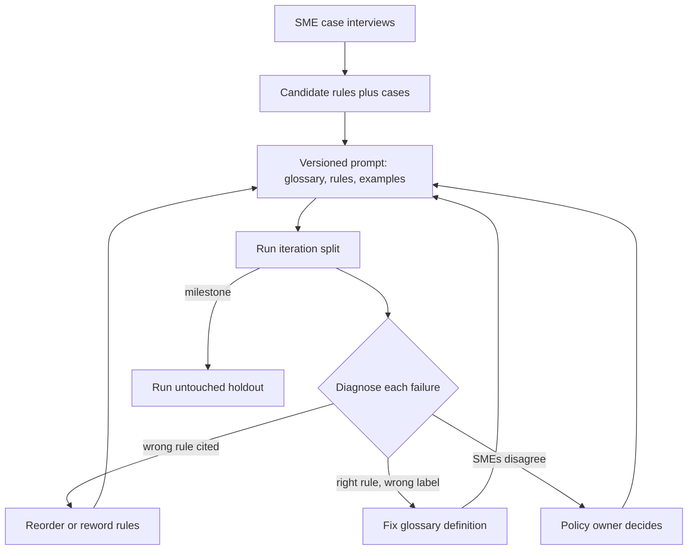

## TL;DR
Domain prompt engineering turns one customer's tacit expertise (vocabulary, policies, exceptions, output
conventions) into explicit definitions, ordered rules and examples. It is elicitation and testing, not
wordsmithing: every rule traces to an SME decision and an eval case.

## Why it exists
- **The model knows the public domain, not this customer.** A frontier model has read plenty about
  insurance, logistics or clinical coding, but never the internal policy manual, the exceptions senior
  staff apply from memory, or that here "active account" means "billed in the last 90 days" rather than
  "logged in recently". Deployments win or lose on these private definitions, because the customer's
  experts judge outputs against them, not textbook knowledge.
- **A persona prompt adds no information.** "You are an expert claims adjuster with 20 years of
  experience" changes tone and confidence only, so the model fills gaps with the most common public
  interpretation. The output sounds expert and is wrong exactly where the customer cares, which is worse
  than sounding uncertain.
- **Pasting the whole manual fails differently.** A 200-page policy manual is written for humans who
  already share context, contradicts itself across versions, and buries the three rules that decide most
  cases under fifty that rarely matter.
- **What this buys.** Extract the decision-relevant knowledge, make it explicit and unambiguous, and prove
  each piece earns its place on real customer cases. Behaviour becomes predictable, auditable and
  traceable to a prompt version.

## How it works
### 1. Elicit the decision procedure, not the domain
- **Interview around concrete cases.** Hand SMEs ten real inputs and ask "what would you do, and why?"
  People cannot list their own rules from memory, but they can explain a decision on a case in front of them.
- **Record each reason as a candidate rule with its triggering case,** because the case later becomes an
  eval item that proves the rule works.
- **Ask which reason decided each case.** That annotation ("rule R3 decided this") is what later lets you
  tell a precedence error from a definition error.

### 2. Write a glossary of contested terms
- **Most domain errors are definitional.** List every term whose customer meaning differs from the common one.
- **Define it operationally:** which data field, which threshold, which time window, and the default when
  the input is ambiguous.
- **Example entry:** "Late: delivered after the promised window, where the window is extended by any
  customer-requested reschedule." It removes a whole class of disagreements, because the model resolves
  undefined terms toward the public meaning.
- **Say explicitly "use these definitions, not general meanings",** because a definition that merely sits
  in the prompt competes with a strong prior and can lose.

### 3. Order the rules as a procedure
- **Domain policies have precedence:** regulatory rules override contract terms, which override house
  preferences. Write rules in check order and state which wins on conflict.
- **Data-validity checks go first** ("delivery time missing"), because a rule evaluated on missing data
  invites the model to invent the value.
- **Avoid unordered bullet lists,** because the model then weights rules by how prominent they look, which
  is not the customer's precedence.

### 4. Choose examples at the boundaries
- **Use the customer's own data:** few-shot examples teach format and judgement at once.
- **Pick cases where the decision flips** (just inside and just outside a threshold, the exception that
  overrides the default), because easy central examples teach nothing the instructions did not already say.
- **Pairs that differ in one field are strongest,** because they isolate the feature the rule turns on.
- **Keep examples out of the golden set,** or the eval measures memorisation.
- **Watch the label mix,** because models tend to drift toward labels over-represented in the shots.

### 5. Specify abstention and escalation
- **Domain work always has out-of-policy cases.** Give the model a legitimate exit ("needs_review" with the
  reason) and say when to use it.
- **Without one, it is forced to guess,** and guesses on out-of-policy cases are where customers lose trust fastest.

### 6. Fix the output contract
- **State the closed label set and a machine-checkable format.**
- **Ask the output to name the deciding rule and the glossary terms it relied on.**
- **The citation is not proof of reasoning** (a self-reported rule can be a post-hoc rationalisation), but it
  makes failures diagnosable:

| Failure shape | Points at |
|---|---|
| Wrong label, cites the wrong rule | precedence or rule wording |
| Wrong label, cites the right rule | a term definition |

### 7. Separate stable knowledge from per-request context
- **Versioned system prompt:** policies and glossary.
- **User turn or retrieval:** facts that change per request (the account, the contract, the retrieved clause).
- **When knowledge outgrows a prompt,** move the long tail into retrieval and keep only the core procedure inline.
- **Cost:** a stable prefix can be served from a prompt cache where the provider supports it, while
  per-request content cannot.

### 8. Test every change, on a split you did not tune on
1. **Split the data.** The cases SMEs used to elicit rules are, by construction, the ones the prompt fits
   best, so iterate on an iteration split and keep a holdout nobody reads while writing rules.
2. **After each change,** run the iteration split and review failures with SMEs.
3. **At milestones,** run the holdout.
4. **Read the movement:** a rule that moves no case is redundant or untested (ablate it: drop it and
   re-run); a rule that fixes three cases and breaks two needs rewording.
5. **Watch for memorisation:** iteration score climbing while the holdout stays flat means the rules are
   memorising cases rather than capturing policy.
6. **Version the prompt per customer,** so a regression traces to the change that caused it.

## Diagram
Rules come from cases, and each eval failure is routed back by its shape: wrong rule cited means fix
precedence, right rule cited means fix the glossary.



## Examples
### Prompt assembled from SME-owned parts
A freight customer wants shipment exceptions classified. The prompt is built from versioned components so
each piece can be tested separately, and the output cites the rule that fired so failures can be sorted
into precedence errors and definition errors.

```python
import json
GLOSSARY = {
    "late": "Delivered after the promised window. The window moves only if the consignee requested a "
            "reschedule (reschedule_by == 'consignee'). Carrier reschedules do NOT move it.",
    "damaged": "Consignee noted damage on the POD, or a photo claim was filed within 48h of delivery.",
}
RULES = [  # checked in order; the first matching rule wins
    ("R1", "hazmat flag set and any exception exists -> needs_review (regulatory)"),
    ("R2", "delivery_ts missing -> needs_review; never infer a delivery time"),
    ("R3", "both late and damaged apply -> damaged (claims outrank SLA credits)"),
    ("R4", "otherwise apply the definitions -> late, damaged or on_time"),
]
EXAMPLES = [  # SME boundary pair, differs only in who rescheduled; excluded from the golden set
    ({"promised_end": "10:00", "delivery_ts": "10:20", "reschedule_by": "consignee",
      "new_end": "12:00"}, {"label": "on_time", "rule": "R4"}),
    ({"promised_end": "10:00", "delivery_ts": "10:20", "reschedule_by": "carrier",
      "new_end": "12:00"}, {"label": "late", "rule": "R4"}),
]

def build_prompt(version="acme-freight-v7"):
    terms = "\n".join(f"- {k}: {v}" for k, v in GLOSSARY.items())
    rules = "\n".join(f"{rid}. {text}" for rid, text in RULES)
    shots = "\n".join(f"Input: {json.dumps(x)}\nOutput: {json.dumps(y)}" for x, y in EXAMPLES)
    return (f"[prompt {version}]\nClassify the shipment. Use these definitions, not general "
            f"meanings:\n{terms}\nRules, in priority order:\n{rules}\n"
            'Reply only with JSON: {"label": on_time|late|damaged|needs_review, "rule": "R1".."R4"}\n'
            f"Examples:\n{shots}")

def diagnose(results):
    """results: dicts with the SME's gold_label and gold_rule, and the model's label and rule."""
    out = {"correct": 0, "precedence": 0, "definition": 0}
    for r in results:
        if r["label"] == r["gold_label"]:
            out["correct"] += 1
        elif r["rule"] != r["gold_rule"]:
            out["precedence"] += 1      # fired the wrong rule: fix ordering or rule wording
        else:
            out["definition"] += 1      # right rule, wrong reading of a term: fix the glossary
    return out
```

Calling `diagnose` on three toy results shows each bucket:

```python
results = [
    {"gold_label": "late",    "gold_rule": "R4", "label": "late", "rule": "R4"},  # correct
    {"gold_label": "damaged", "gold_rule": "R3", "label": "late", "rule": "R4"},  # wrong rule fired
    {"gold_label": "on_time", "gold_rule": "R4", "label": "late", "rule": "R4"},  # term misread
]
print(diagnose(results))   # {'correct': 1, 'precedence': 1, 'definition': 1}
```

### Worked iteration: v6 to v7 (numbers illustrative)
Prompt v6 defined "late" as "after the promised window" with no reschedule clause.

| Step | Iteration split (160 cases) | Holdout (80 cases) |
|---|---|---|
| v6 baseline | 121 right; `diagnose`: 9 precedence, 30 definition errors | 60 right |
| Read the 30 definition errors | 24 are carrier reschedules treated as moving the window (the public reading of "rescheduled delivery") | untouched |
| v7: SMEs confirm, add consignee-only clause and the boundary pair | 146 of 160 | 71 of 80 |

- **The holdout moved too,** so the fix generalises rather than memorising the 24 cases.
- **The 9 precedence errors are a separate problem:** most are damaged-and-late shipments labelled late, so
  the next change targets R3's wording, not the glossary.

## Production patterns
- **Shared base plus customer overlays.** When several customers share most rules, keep one base prompt
  and a small per-customer overlay (glossary additions, rule overrides) in version control, composed at
  build time with a version id like `acme-freight-v7`. Monitor every customer's golden-set score whenever
  the base changes, because one base edit touches all of them.
- **Eval gate on prompt changes.** Treat glossary, rule and example files as code: each pull request
  runs the iteration split and reports per-term and per-rule failure counts, and milestones run the
  holdout. Block the merge when any customer's score drops beyond an agreed tolerance.
- **Stable prefix first for prompt caching.** Put the glossary, rules and examples at the start and the
  per-request facts last. On Anthropic mark the system block with `cache_control`; OpenAI caches long
  repeated prefixes automatically. Monitor cached input tokens in the usage fields of each response.
- **Constrained output with a closed label set.** Use the provider's JSON-schema structured output with
  an enum for the label and rule id, then validate the cited rule exists. Monitor parse-failure rate and
  the share of outputs citing each rule; a rule that is never cited is an ablation candidate.
- **Abstention rate as a production metric.** Track the "needs_review" share per day and per customer
  against the review team's capacity. A rising rate signals new out-of-policy inputs or a broken data
  field; a falling one can mean the model has started guessing.

## Trade-offs
- **Explicit rules vs prompt size.** Rules make behaviour predictable and auditable, but each adds tokens
  and a chance of conflict; once rules number in the dozens, retrieving the relevant subset usually beats
  inlining all.
- **Customer few-shot examples vs bias.** They teach judgement fast, but leak format quirks and can bias
  the label distribution; when examples skew toward one class, predictions skew with them.
- **Per-customer prompt vs maintenance.** It fits each client precisely but multiplies upkeep; once three
  customers share most rules, factor a shared base prompt with customer overlays.
- **Abstention vs human workload.** "needs_review" protects trust on out-of-policy cases but raises review
  volume; if the queue exceeds what operations can staff, tighten the abstention criteria with SMEs.

## Pitfalls
- **Writing rules from the policy manual instead of from cases.** Symptom: a long prompt that scores no
  better than the short one, because the manual rules were not the ones deciding outcomes.
- **Leaving a contested term undefined.** Symptom: SMEs and model disagree on the same subset of cases over
  and over, all containing that word.
- **Reusing few-shot examples inside the golden set.** Symptom: an eval score that drops sharply when a
  fresh sample of production cases is labelled.
- **Tuning rules on the cases used to elicit them, with no holdout.** Symptom: an iteration score that keeps
  rising while a fresh sample or the holdout does not move.
- **Trusting the cited rule as an explanation of reasoning.** Symptom: "fixing" the rule the output cited
  and seeing no change, because the citation was rationalised after the label.
- **Encoding one SME's personal preference as policy.** Symptom: a second SME rejects outputs the first
  approved; the rule needs the policy owner's decision, not more prompting.

## When to use
- **Use when** a general model's outputs are fluent but judged wrong by the customer's experts, and errors
  cluster around definitions, precedence or exceptions. It is the first lever before retrieval or
  fine-tuning, because it is cheap, reversible and inspectable.
- **Move to retrieval when** the needed knowledge is too large or changes too often for a prompt.
- **Consider fine-tuning when** the behaviour is a style or skill that instructions cannot pin down after
  several rounds.
- **Measure** with the customer's golden set and per-term failure counts.
- **Interviews:** show that you treat the prompt as a tested artefact owned jointly with SMEs, not as
  clever phrasing.

## Role lens
- **Engineer:** Builds prompts from versioned glossary, rule and example components, and wires each change
  to a golden-set eval run with per-term failure breakdowns.
- **Architect:** Decides the boundary between shared base prompt, per-customer overlays and retrieved
  policy, so domain knowledge scales across clients without copy-paste drift.
- **FDE:** Runs case-based interviews with the customer's experts, extracts definitions and precedence,
  and gets the policy owner to resolve rules where SMEs disagree.

## Check yourself
**Q:** Your insurance-claims classifier scores well on public examples but the customer's adjusters reject
a third of its outputs. Adding "You are a senior adjuster" did nothing. What do you do next, and why?
**A:** The persona carried no new information, so the model is still applying public definitions. I would
pull the rejected outputs, sit with two adjusters and ask them to explain each rejection on the case.
I expect clusters around a few terms or exceptions, such as what counts as a pre-existing condition. I
would write operational definitions for those terms, order the rules by the customer's precedence, add
boundary examples from their data that are kept out of the golden set, and add a needs_review exit for
out-of-policy cases, and have outputs cite the rule applied so remaining failures split into precedence
and definition errors. Then I would re-run the iteration split, check the rejected clusters shrink without
new failures elsewhere, and confirm the gain on a holdout the rules were not written from. Where adjusters
disagree with each other, I escalate to the policy owner rather than prompting around it.

## Interview questions
### What is domain prompt engineering, and how is it different from general prompt engineering?
- **Definition:** encoding one customer's private definitions, rule precedence, exceptions and output
  conventions as explicit glossary entries, ordered rules and boundary examples.
- **Why it differs:** general prompting improves clarity and format; domain prompting supplies information
  the model has never seen, because the customer's experts grade against their own policy, not public norms.
- **Evidence:** each rule traces to an SME decision on a real case and to an eval item.

### You add five rules and the iteration score rises from 80% to 92%, but the holdout is flat. What is happening?
- **Diagnosis:** the rules are fitting the cases they were written from rather than capturing policy,
  because the iteration split is exactly where the SMEs drew the rules.
- **Next steps:** ablate each new rule and re-run; keep only rules that move cases on both splits; reword
  rules that name specific cases into operational definitions.
- **Check the data too:** confirm the holdout was sampled like production and was never read while writing rules.

### When would you stop prompting and move to retrieval or fine-tuning?
- **Retrieval:** when the rule set reaches dozens of rules, or the policy changes too often to re-release
  the prompt; keep the core procedure inline and retrieve the long tail.
- **Fine-tuning:** when the failure is a style or skill that several rounds of instructions and examples
  cannot pin down, and you have enough labelled data to train and still hold out an eval.
- **Stay with prompts** while errors cluster on definitions and precedence, because those are cheap,
  reversible and inspectable fixes.

### How would you structure prompts for ten customers in the same vertical?
- **Shared base prompt** with the procedure, output contract and common glossary, plus a per-customer
  overlay for their definitions and rule overrides.
- **Versioning:** each customer's composed prompt gets its own version id, so a regression traces to a base
  or overlay change.
- **Gate:** any base change runs every customer's golden set, because one edit affects all ten.

### How do you tell whether a wrong label is a precedence error or a definition error?
- **Make the output cite its rule,** and have SMEs record the deciding rule on each gold case.
- **Wrong label with the wrong rule cited** points at ordering or rule wording; **wrong label with the right
  rule cited** points at a term definition.
- **Caveat:** the citation can be a post-hoc rationalisation, so confirm a fix by re-running the cases, not
  by reading the explanation.

## Quiz
### Q: Why does a persona prompt ("you are an expert in X") rarely fix domain errors on customer data?
- [ ] Models ignore system prompts that describe a role
- [x] It changes tone and confidence but adds none of the customer's private definitions or policies
- [ ] Personas only work with fine-tuned models
- [ ] It makes the prompt too long for the context window
> The errors come from missing information: the customer's own meanings and precedence rules. A persona
> adds no facts, so the model still falls back to public interpretations, only more confidently.

### Q: Where should few-shot examples for a domain prompt come from?
- [ ] Random central cases from the golden set, so the prompt and the eval agree
- [ ] Synthetic examples written by the engineer to avoid exposing customer data
- [x] Boundary cases from the customer's data where the decision flips, kept out of the golden set
- [ ] The longest and most complex cases, since easy cases need no help
> Boundary examples teach where the customer's rule diverges from the default. Taking them from the
> golden set would make the eval measure memorisation instead of generalisation.

### Q: Two SMEs consistently disagree about whether a case is "late". What is the right fix?
- [ ] Add more few-shot examples until the model matches the more senior SME
- [ ] Average their labels in the golden set
- [ ] Remove the cases from the eval because they are ambiguous
- [x] Escalate to the policy owner for an operational definition, then encode it in the glossary
> Persistent SME disagreement means the policy itself is undefined. Prompting cannot resolve it; only
> the person who owns the policy can, and the decision then becomes a glossary entry and eval cases.
