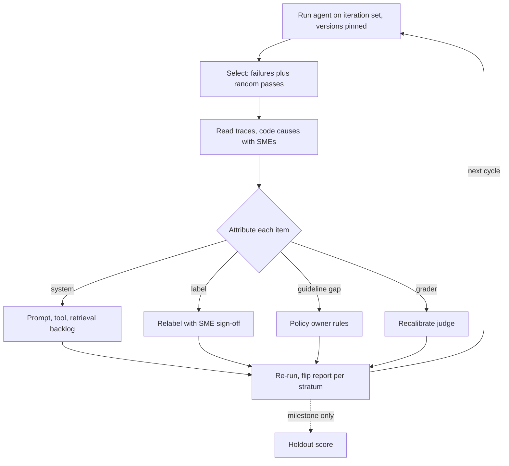

## TL;DR
The weekly cycle of running your agent's customer eval, reading failing traces with SMEs,
attributing each to the agent, a label, a guideline gap or the grader, then fixing and re-running with
regression checks. A score says how much is wrong, not why.

## For agent builders
- **Why it matters for agents.** An agent fails in more places than a single prompt: the plan, a tool
  choice, a tool's arguments, a bad tool result, or the final answer. The review loop is how you find
  which, instead of rewriting the system prompt every time the number drops.
- **Where it shows up in your stack.** Your eval harness and its run manifest, the tracing tool you read
  trajectories in, the LLM judge, the flip report in CI, and a weekly review meeting with the customer's SMEs.
- **What you control.** Which traces get read (failures plus random passes), the cause taxonomy, the
  attribution step before any fix, version pinning, the judge audit sample and the holdout discipline.
- **What you can skip.** Fancy dashboards early on. A spreadsheet of coded traces and three small scripts
  (tally, corrected pass rate, flip report) carry a pilot.

## Decision case
### Scenario
The support agent from the worked loop has launched. It now has a `change_plan` write tool and handles
about 6,000 conversations a week, all graded by the LLM judge. The pilot's weekly loop reviewed every
failure; that no longer scales. All figures are illustrative.

- **Judge results.** About 89% pass, so about 660 judge failures a week. Judge-to-SME agreement was 36 of
  40 on the last audit.
- **High-stakes stratum.** Conversations that call `change_plan` are about 3% of traffic (180 a week), and
  about 11% of them fail the judge: about 20 a week.
- **Change rate.** Engineers ship prompt or tool changes about twice a week, each gated by the flip report.

Constraints:
- **Expert time.** Two SMEs give 4 hours a week in total; a trace review takes about 4 minutes, so about 60
  reviews a week.
- **Write safety.** Every judge failure in the `change_plan` stratum must be read by an SME.
- **Customer report.** Each month the customer receives an SME-validated quality figure and the judge's
  agreement with SMEs.

### Options
| Option | How it works | SME reviews a week | Judge drift detection | Write-safety rule |
|---|---|---|---|---|
| **A. Keep reviewing every failure** | Pilot loop unchanged | About 660, or 44 hours: 11 times the budget | Strong | Met |
| **B. Judge only** | No human review after launch | 0 | None: drift is invisible from the score | Fails |
| **C. Fixed weekly allocation** | 20 high-stakes failures plus a 40-item random judge audit; engineers code other failures by first bad step | 60 | Weekly, pooled monthly | Met |
| **D. Fortnightly deep review** | 120 traces every two weeks | 60 on average | Every two weeks, slower | Met, but failures wait up to two weeks |

### Decision
Choose **C**, because it is the only option inside the 60-review budget that meets both the write-safety
rule and the monthly report:
- **A does not fit.** 660 failures at 4 minutes each is 2,640 minutes, about 44 hours against 4.
- **B breaks two constraints.** No SME reads `change_plan` failures, and the monthly agreement figure would
  have no data behind it.
- **The audit stays random.** 40 items drawn from everything the judge graded, passes included, because
  leniency only shows in passes.
- **Monthly pooling makes the audit usable.** At 90% agreement, 40 items carry about ±9.3 points; four
  weeks pooled (160 items) carry about ±4.6, which is what the customer report quotes.
- **Engineers do the bulk coding.** Other failures are coded by first bad step without SMEs; only items
  attributed to a label or guideline gap go to the SMEs' queue.
- **D delays high-stakes reads** by up to two weeks while write-tool failures keep happening.

What would change it:
- **A product, policy or traffic-mix change.** Agreement measured on the old mix does not transfer, so
  double the audit for a month, using the pilot loop on the affected strata.
- **Pooled agreement falls.** If the four-week figure drops against recent months (the team uses 85% as
  its own trigger), recalibrate the judge before trusting any score movement.
- **High-stakes failures exceed 20 a week.** Then ask the sponsor for more SME time rather than sampling
  them, because the rule says every one is read.

### Trade-offs accepted
- **Non-critical failures get no SME eye.** Engineer-coded clusters may misattribute label errors as system
  errors. Watch the attribution mix: if the label and guideline shares stop shrinking, route more to SMEs.
- **Weekly audit numbers are noisy.** About ±9 points a week, so do not react to one week; plot the pooled
  trend per customer.
- **No new failure categories from SMEs outside the high-stakes stratum.** Add user-flagged traces to the
  engineer queue and track the share of new categories found in production.
- **The holdout ages.** Score it only at milestones and refresh it from production samples quarterly.

### Review rubric
- **Budget is converted to reviews.** SME hours become a weekly review count, and every option is costed
  against it.
- **Allocation follows risk.** High-stakes strata get full coverage, and the write-up says why.
- **The audit is random and sized.** It states the sample, its interval, and how pooling tightens it.
- **Attribution still happens.** It says who codes which failures and how label or guideline gaps reach SMEs.
- **Scale-up triggers are stated,** tied to product, policy or traffic changes and to an agreement trend.
- **The customer-facing number has a method.** The report says how the SME-validated figure is computed.

## Why it exists
- **The eval is not an oracle.** The tempting workflow after a golden set and first agent prompt exist is
  "change the prompt, re-run, watch the number". But a failing case can mean three things: the agent is
  wrong; the reference label is wrong; or the guideline never defined the case, so neither is clearly right.
- **Label and guideline errors are common early,** because the dataset was labelled before anyone saw how
  the agent fails. Tune only the agent and you "fix" correct behaviour to match wrong labels, and the
  customer's experts reject the result in production.
- **Automated graders drift from experts.** At scale most customer evals use an LLM judge, because SMEs
  cannot review every output of every run. The drift is invisible from the score: lenient on confident
  wrong answers, harsh on terse correct ones. Only periodic judge-versus-SME comparison on the same items
  keeps the number honest.
- **A score without review builds no shared understanding.** The loop is where the customer's experts see
  failures, agree on what matters, and come to trust the number used at acceptance.
- **Without a held-out set,** the loop overfits to the cases it keeps looking at.

## How it works
### One iteration
1. **Run** the current agent on the iteration set (never the holdout) and grade with the automated
   grader. Record system, prompt, dataset and grader versions together, because a score is only comparable
   when all four are pinned. For agents, pin tool versions and fixtures too.
2. **Select for review:** all failures in high-stakes strata, a random sample of other failures, and a
   random sample of *passes*. Passes are included because grader leniency only shows up there.
3. **Read and code failures.** Engineers and SMEs read each trace and assign a cause from a small, evolving
   taxonomy (retrieval missed the clause, misread table, wrong policy precedence, format violation, wrong
   tool, loop, and so on). Open coding first, then cluster, because a fixed taxonomy invented upfront
   misses failure modes you did not anticipate.
4. **Attribute each item:** system error, label error, guideline gap, or grader error. This step is what
   distinguishes a review loop from error analysis alone.
5. **Route the fix:**

   | Attribution | Goes to |
   |---|---|
   | System error | prompt, retrieval, tool or code backlog, ordered by frequency × cost |
   | Label error | relabelling with SME sign-off |
   | Guideline gap | the policy owner, then guideline, labels and judge prompt updated together |
   | Grader error | judge recalibration |

6. **Re-run with regression checks.** Compare per-stratum results with the previous version and inspect
   every item that flipped from pass to fail, because averages hide regressions offset by gains elsewhere.
7. **Report** a short note to the customer: score with interval, top failure clusters, decisions taken,
   and what changed in labels or guideline (so score movement is explainable).

### Where in the agent the system error lives
Locate the first step in the trace that went wrong, because later steps usually inherit it:

| First bad step | Typical fix |
|---|---|
| Plan or tool choice | system prompt procedure, tool descriptions |
| Tool arguments | argument schema, validation, examples |
| Tool result (stale, empty, wrong) | the tool or retrieval index, not the prompt |
| Reading a good result wrongly | glossary, output contract |
| Looping or stopping early | stop conditions, step budget |

### How much to read, and in what order
- **Read failures until new cause categories stop appearing.** In practice the first few dozen usually
  reveal the main clusters; hundreds more mostly add counts, not categories.
- **Rank clusters by frequency × cost of the error** in this customer's process, because a rare error that
  sends money to the wrong bank account outranks a common formatting slip.

### Reading the score through the review
If the judge passes a share p_judge of items, SMEs find that a fraction f_pass of judge-passes are actually
wrong, and a fraction r_fail of judge-fails are actually right (label or grader errors), then the
SME-equivalent pass rate is approximately

```
p_true ≈ p_judge × (1 − f_pass) + (1 − p_judge) × r_fail
```

- **Both fractions come from small samples,** so the corrected number carries a wide band.
- **Its value is direction:** it shows which way the grader errs and by how much.

### Keeping the grader honest
- **Each cycle, SMEs grade a fixed-size sample the judge also graded;** track judge-to-SME agreement over time.
- **A drop** means the judge prompt, or the guideline it encodes, has fallen behind.
- **The sample must be random, not drawn from failures,** or it measures the judge only where it is already suspected.

### Avoiding overfitting
- **The loop repeatedly exposes the iteration set.** Keep a holdout nobody reads, evaluated only at milestones.
- **A large iteration-to-holdout gap** means the team has tuned to specific cases rather than the behaviour.

### Cadence
- **Weekly is a common pilot rhythm:** frequent enough for momentum, slow enough for SMEs.
- **Rerun the automated eval on every change;** reserve human review for the cadence.

## Diagram
Each reviewed trace is attributed before anything is fixed, so label, guideline and grader errors are not
"fixed" by changing the agent.



## Examples
### Attribution tally, corrected pass rate and flip report
The three small tools a review loop runs every cycle.

```python
from collections import Counter

def corrected_pass_rate(p_judge, f_pass, r_fail):
    """SME-equivalent pass rate from the judge rate and the review sample's error fractions."""
    return p_judge * (1 - f_pass) + (1 - p_judge) * r_fail

def flips(prev, curr):
    """prev, curr: {item_id: passed}. Returns items that went pass->fail and fail->pass."""
    down = sorted(i for i in prev if prev[i] and not curr.get(i, False))
    up = sorted(i for i in prev if not prev[i] and curr.get(i, False))
    return down, up

week1 = Counter(system=31, label=14, guideline=9, grader=12)   # 66 reviewed failures
print(week1.most_common())
print(round(corrected_pass_rate(0.78, 4 / 30, 26 / 66), 2))     # 0.76

prev = {"q1": True, "q2": False, "q3": True, "q4": False}
curr = {"q1": True, "q2": True, "q3": False, "q4": False}
print(flips(prev, curr))                                         # (['q3'], ['q2'])
```

### Coding agent traces by first bad step
A review sheet row per failing trace; the tally tells you whether to work on tools, retrieval or the prompt.

```python
from collections import Counter

reviewed = [  # one row per failing trace, coded by an engineer and an SME together
    {"id": "t07", "attribution": "system", "first_bad_step": "tool_result", "cause": "stale release note"},
    {"id": "t11", "attribution": "system", "first_bad_step": "tool_choice", "cause": "skipped tier lookup"},
    {"id": "t19", "attribution": "label",  "first_bad_step": None,          "cause": "pre-pricing-change ref"},
    {"id": "t23", "attribution": "system", "first_bad_step": "tool_result", "cause": "stale release note"},
    {"id": "t31", "attribution": "grader", "first_bad_step": None,          "cause": "short answer penalised"},
]
system = [r for r in reviewed if r["attribution"] == "system"]
print(Counter(r["first_bad_step"] for r in system).most_common())
# [('tool_result', 2), ('tool_choice', 1)]: fix the retrieval tool before touching the prompt
```

### Worked loop: three weeks on a support agent with a docs-search tool (numbers illustrative)
A software customer. Iteration set of 300 items, holdout of 100; an LLM judge grades correctness against
references.

**Week 1:** judge pass rate 78%. The team reviews all 66 failures plus 30 random passes with two SMEs.

| Attribution of the 66 failures | Count | Detail |
|---|---|---|
| System errors | 31 | 19 retrieval tool returned an outdated release note, 12 wrong product-tier logic |
| Label errors | 14 | references written before a pricing change |
| Guideline gaps | 9 | is a workaround acceptable when a fix exists? |
| Judge errors | 12 | correct answers marked wrong for being shorter than the reference |
| False passes in the 30 sampled passes | 4 | judged lenient because they sounded confident |

- **Correcting the headline:** f_pass ≈ 4/30 ≈ 0.13 and r_fail = 26/66 ≈ 0.39 (the label and judge errors,
  where the agent was right). So p_true ≈ 0.78 × 0.87 + 0.22 × 0.39 ≈ 0.76, before the 9 guideline gaps
  are ruled on.
- **Right by accident:** about 30 false passes and 26 false fails nearly cancel. A grader whose errors cancel
  on this mix will not cancel on the next one, so the judge is fixed anyway.
- **Decisions:** filter the search tool by release version; relabel 14 items; the product owner rules "a
  workaround is acceptable only if the answer also states the fix version"; the judge prompt now grades
  content not length and checks stated version numbers.

**Week 2:**
- **Measurement first:** after relabelling and the judge update, the *same* week-1 agent scores 81%. The
  improvement is measurement, not the agent, and is reported as such.
- **Why not 87% already:** the 26 recovered label and length errors alone would suggest about 87%, but
  the stricter version check also turns some previously lenient passes into failures; the week-1 pass
  sample implied there were dozens of them.
- **With the retrieval fix, 87%.** Two items flip pass-to-fail; both are multi-version questions now
  filtered too aggressively, so the filter is relaxed for those queries.

**Week 3:**
- **89% on the iteration set and 86% on the holdout,** a small gap well inside the roughly ±7-point 95%
  interval a 100-item holdout carries.
- **Judge-to-SME agreement** on a fresh random 40-item sample is 36 of 40, up from 31 of 40 on the
  equivalent week-1 sample. Forty items is small, so the team treats this as consistent with the fixes
  rather than proof, and keeps sampling weekly.
- **Outcome:** the customer now trusts the number enough to use it in the acceptance test.

## Production patterns
- **Pinned run manifest.** Every eval run writes system, prompt, dataset, grader and tool versions (plus
  the code commit) into its result record, and the comparison report refuses to diff runs whose dataset or
  grader versions differ. Monitor how often teams hit that refusal; frequent hits mean labels churn too fast.
- **Rescore the baseline on every measurement change.** When labels or the judge prompt change, a job
  re-runs the previous agent version on the new labels and grader, and the report shows measurement
  change and system change as separate lines.
- **Flip report as a merge gate.** For each candidate change, list every pass-to-fail item per stratum and
  require a named reviewer to accept each flip in high-stakes strata. Monitor flip counts per release.
- **Weekly random judge audit.** SMEs grade a fixed-size random sample the judge also graded, and agreement
  is plotted per week per customer. Recalibrate the judge when agreement falls against recent weeks,
  remembering that a 40-item sample moves several points on noise.
- **Attribution mix over time.** Record the system, label, guideline and grader shares each cycle. Label
  and guideline shares should shrink as the dataset matures; if they do not, fix the guideline process
  before tuning the agent further.
- **Production traces into the loop.** After launch, sample real agent traces each week (random plus
  user-flagged), grade them with the same judge and add confirmed failures to the iteration set. Monitor
  the share of new failure categories found in production versus in the eval.

## Trade-offs
- **Deep SME review vs expert time.** Reviewing every failure gives accurate attribution but consumes
  expert time; once judge and SME agree well, review a sample of failures and all high-stakes ones.
- **Truthful labels vs a moving baseline.** Fixing labels and guidelines makes the score more truthful but
  moves the baseline, so trends are harder to read; always re-score the previous agent version on the new
  labels before comparing.
- **Weekly cadence vs engineering pace.** It keeps SMEs engaged but can feel slow to engineers; run
  automated evals continuously and keep human review weekly.
- **Evolving taxonomy vs comparability.** It captures new failure modes but makes cluster counts
  incomparable over time; freeze it at a milestone once new categories stop appearing.

## Pitfalls
- **Treating every failure as a system error.** Symptom: the team rewrites prompts to match a reference
  that SMEs later admit was wrong.
- **Reviewing only failures.** Symptom: a judge that is lenient on confident wrong answers and a production
  complaint rate higher than the eval suggests.
- **Comparing scores across label or judge changes without re-scoring the old system.** Symptom: a
  celebrated improvement that came from relabelling, not engineering.
- **Repeatedly tuning on the same visible items.** Symptom: a widening gap between iteration and holdout scores.
- **Silently editing labels.** Symptom: the customer asks why last week's 82% is now 79% with no system
  change, and nobody can explain it.
- **Fixing the last step of a trace.** Symptom: prompt edits about "reading results carefully" that change
  nothing, because the first bad step was a stale tool result.

## When to use
- **Start** the first time you have an agent, a golden set and an automated grader, and keep it running
  through the pilot and into production with real traffic samples.
- **Why it matters:** it is the main mechanism for converting SME expertise into agent improvements and a
  trusted acceptance metric.
- **Skip the heavy human part** only when grader-to-SME agreement is high and stable and the task is not
  high-stakes.
- **Measure** the attribution mix over time; label and guideline errors should shrink as the dataset matures.
- **Interviews:** the distinguishing answer separates system, label, guideline and grader errors.

## Role lens
- **Engineer:** Pins system, prompt, dataset and grader versions per run, builds the flip report and
  review queue, and turns failure clusters into prioritised fixes.
- **Architect:** Designs the eval platform so versions, holdouts and judge-to-SME agreement are tracked
  per customer, making scores comparable and auditable across releases.
- **FDE:** Runs the weekly review with the customer's SMEs, routes guideline gaps to the policy owner,
  and explains every score movement in the customer report.

## Check yourself
**Q:** Your judge-scored pass rate jumped from 74% to 85% in one week. The engineers changed the prompt;
the SMEs also relabelled 30 items and the judge prompt was edited. How much of the gain is the prompt?
**A:** I cannot tell from the two numbers because three things changed at once. I would re-run the
previous system version with the new labels and the new judge; the difference between that and 74% is
the measurement change. The difference between that re-score and 85% is the prompt effect. I would also
check flips in both directions, verify the judge edit with an SME agreement sample, and confirm the
holdout moved in the same direction. Only the prompt-attributable part should be reported as system
improvement to the customer.

## Interview questions
### What makes an eval review loop different from iterating against a score?
- **Attribution:** every reviewed failure is classed as a system, label, guideline or grader error before
  anything is fixed, because only system errors should change the system.
- **Grader audit:** a random sample of passes and a judge-versus-SME sample catch the errors a score hides.
- **Customer trust:** SMEs see the failures and the decisions, so the final number is one they accept at go-live.

### Your agent's task success drops after a release. How do you use traces to find the cause?
- **Flip report first:** list the pass-to-fail items per stratum, so you read the changed cases, not a sample.
- **Find the first bad step** in each trace: plan, tool choice, arguments, tool result, reading or stopping,
  because later steps inherit the error.
- **Check pinned versions:** a tool, index or fixture change can explain the drop without any prompt change.

### The judge says 78%. Review finds 4 of 30 sampled passes are wrong and 26 of 66 failures are actually right. What is the real pass rate?
- **Apply the correction:** p_true ≈ 0.78 × (1 − 0.13) + 0.22 × 0.39 ≈ 0.76.
- **Read it with care:** both fractions come from small samples, so the band is wide; the useful finding is
  that false passes and false fails nearly cancel on this mix.
- **Act anyway:** fix the judge, because the errors will not cancel on the next mix.

### How do you keep an LLM judge aligned with the customer's experts over a pilot?
- **Derive the judge prompt from the annotation guideline,** and update both together when the policy owner rules.
- **Audit weekly on a random sample** graded by both SMEs and the judge, tracking agreement over time
  rather than reacting to one week.
- **Pin the judge version** in every run, so a judge change is never mistaken for a system improvement.

### The customer asks why last week's 82% is now 79% with no system change. How do you answer, and what should have prevented it?
- **Diagnose:** check the run manifests for a dataset or grader version change; a silent relabel or judge
  edit is the usual cause.
- **Answer with a rescore:** run the same system on both label versions and show the measurement change
  separately.
- **Prevent:** version every label change with a changelog and refuse comparisons across versions without
  a baseline rescore.

### When would you scale back the human part of the loop?
- **When grader-to-SME agreement is high and stable** over several audits and the task is not high-stakes.
- **Keep reviewing** all failures in high-stakes strata and a small random sample of passes.
- **Scale back up** when the product, policy or traffic mix changes, because agreement measured on the old
  mix does not transfer.

## Quiz
### Q: Why should an eval review include a random sample of passing items?
- [ ] Passing items are where the system has the most errors
- [x] Grader leniency only shows up in items it marked as passes
- [ ] SMEs need easy items to stay motivated
- [ ] Including passes raises the measured pass rate
> If the judge accepts confident wrong answers, those errors never appear in the failure list. Reviewing
> passes estimates false passes and reveals where the grader needs recalibration.

### Q: A failure is traced to a reference answer written before a policy change. What is the right action?
- [ ] Change the prompt so the system reproduces the old reference
- [ ] Delete the item from the dataset
- [x] Relabel it with SME sign-off, version the dataset, and re-score the previous system
- [ ] Leave it, since the score only needs to be directionally right
> This is a label error, not a system error. Fixing it with sign-off and re-scoring the old version
> keeps comparisons honest and stops the team tuning the system toward outdated behaviour.

### Q: What does a growing gap between the iteration-set score and the holdout score indicate?
- [ ] The holdout set is mislabelled
- [ ] The automated judge is becoming more accurate
- [ ] Production traffic has drifted
- [x] The team is overfitting fixes to the specific cases it repeatedly reviews
> The iteration set is read every cycle, so fixes can become case-specific. The untouched holdout
> estimates generalisation; a widening gap means improvements are not transferring.

## Use cases & projects
### Use cases
- **Weekly pilot reviews with customer SMEs.** The loop turns failing agent traces into prompt, tool and
  guideline fixes the customer has seen and agreed.
- **Release gating for agent changes.** Flip reports and pinned manifests show whether a prompt or tool
  change regressed any high-stakes stratum.
- **Keeping an LLM judge honest.** A random weekly audit catches a judge drifting toward lenient passes.
- **Post-launch improvement.** Sampled production traces feed new failure categories back into the eval set.

### Mini project
**Run one review cycle on a toy agent (2-3 hours).**
- **Goal:** take a small agent through run, review, attribution, fix and re-run, and show measurement versus
  system change separately.
- **Steps:** build a docs-search agent over 20 short documents with one deliberately stale doc; run 40 eval
  questions with an LLM judge; review all failures and 10 random passes; code first bad step and
  attribution; fix one label and the judge prompt, rescore the unchanged agent, then fix the stale doc and
  score again.
- **Done when:** you have an attribution tally, a corrected pass rate, a flip report, and a two-line report
  separating the measurement change from the agent change.
