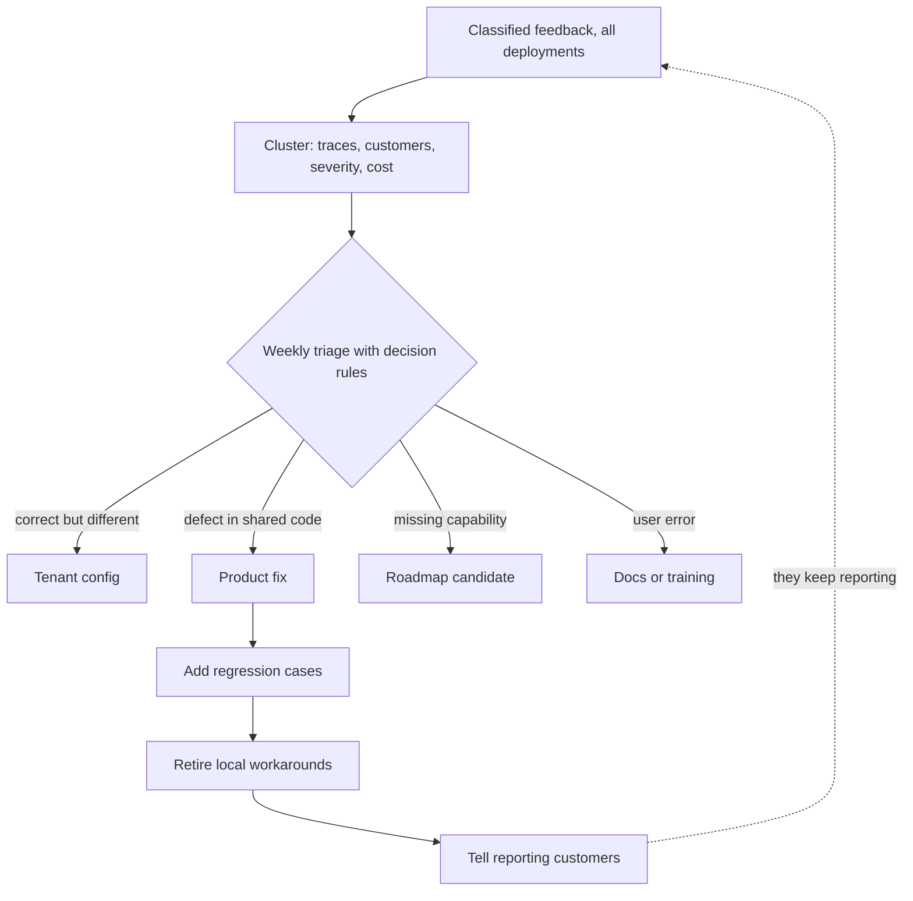

## TL;DR
Carrying what agent deployments learn back into the shared agent: evidence-backed issue clusters,
regular triage into config, product fix or roadmap, a regression case per fix, and a reply to the
reporter. Without it, every tenant gets its own prompt patch.

## For agent builders
- **Why it matters for agents.** The fastest field fix for an agent is a per-tenant prompt override ("dates
  are DD/MM/YYYY", "always call `lookup_policy` first"). Repeated across tenants, these overrides fork the
  agent's behaviour and break on the next shared prompt, tool or model change.
- **Where it shows up in your stack.** Tenant config and prompt overrides, the shared system prompt and
  tool schemas, the regression suites, and the feedback classifier that builds the clusters.
- **What you control.** Whether a fix lands as tenant config, a shared tool-schema or loop change, or a
  roadmap item; the workaround registry with expiries; and which regression cases each fix adds.
- **What you can skip.** Product-management ceremony; a weekly triage slot, written rules and a
  workaround file in CI are enough to start.

## Why it exists
- **Field teams see real usage first.** The date parser fails on one customer's European formats, the
  retriever cannot handle scanned tables, users at three banks all want the same approval step.
- **Under delivery pressure, the local fix is rational.** A prompt override, a pre-processing script, a
  customer-specific branch: the customer is happy this week.
- **Repeated across customers, it becomes a mess.** The same date problem is solved four times, four
  slightly different ways, in four deployments. Product never sees the pattern, because each instance
  closed locally, and every local patch is a potential break when the platform changes.
- **Customers stop reporting.** A patched problem returns in the next release, or a reported gap never gets
  a reply; after a few rounds they stop, which removes the signal entirely.
- **"FDEs should file tickets" is noise.** A product manager cannot weigh 300 one-line tickets against each
  other. What works is a deliberate loop: a unit of evidence, a cadence, decision rules and a closing step
  back to the customer.

## How it works
### 1. The unit is an issue cluster with evidence
Classified feedback (see production feedback classification) is grouped into clusters: one failure mode
or request, with:
- **linked traces** and **counts**;
- **customers affected** and **severity**;
- **the current workaround** and **its cost** (hours spent, deals blocked, workaround maintenance).

A cluster lets the product team compare items on the same terms, which raw tickets never do.

### 2. Aggregate across customers
- **Merge the same cluster across deployments**, keeping per-customer counts.
- **This is where patterns appear:** a quirk for one customer is a product gap when it appears in four.
- **Respect data boundaries.** Customer data cannot be pooled freely, so clusters carry redacted or
  synthetic examples plus links to traces held under each customer's data rules.

### 3. Triage on a cadence with decision rules
A regular (for example weekly) triage between field and product leads decides each cluster:

| Outcome | When | What happens |
|---|---|---|
| **Customer configuration** | Behaviour is customer-specific and legitimate | Expressed as tenant config, not code |
| **Product fix** | Cause is in shared code, prompts or models | Goes on the product backlog |
| **Roadmap candidate** | A missing capability | Ranked with the roadmap rather than squeezed in |
| **No change** | User error or out of scope | Answered with documentation or training |

Decision rules make triage predictable, for example:
- **Anything severe** is a product fix.
- **Anything seen in several customers** is reviewed for productisation.
- **A local workaround is allowed** only with a tracking issue and an expiry.

### Config or product: the decision people get wrong most
- **The test:** is the behaviour *correct but different*, or *wrong*?
- **Correct but different is configuration.** "Dates in this market are day-first" is a legitimate,
  stable customer difference.
- **Wrong is a defect.** "The parser guesses the order and is sometimes wrong" hidden behind a
  per-customer flag stays live for every customer who has not set the flag yet.

### Where agent fixes land
An agent cluster usually resolves into one of these shared layers, each more durable than a tenant's
prompt line:

| Field workaround | Shared product fix | Why it is better |
|---|---|---|
| Prompt line telling the agent a format | Typed tool argument plus normalisation in the tool adapter | Enforced in code, survives model swaps |
| Prompt line "call tool X before Y" | Loop or guardrail rule that requires X before Y | Holds when the model ignores instructions |
| Tenant-specific tool wrapper | Capability in the shared tool, switched on by tenant config | One implementation to test |
| Local retry hack for a flaky API | Typed tool errors the loop handles the same everywhere | Fixes loops and invented results for all tenants |

### Rank clusters on comparable terms
Triage needs a ranking that does not reward volume of complaint. One reasonable scheme (a convention to
adapt, not a standard):

`priority = Σ over affected customers of (affected share of that customer's traffic × severity weight) + workaround cost`

- **Severity weights** such as 1 cosmetic, 3 wrong-but-harmless, 10 acted-upon, 30 compliance.
- **Workaround cost on the same scale**, for example one point per engineer-day per quarter.
- **Share of traffic, not number of tickets, is the point.** Loud complaints about a cosmetic issue on 20%
  of one customer's requests score 0.2 × 1 = 0.2; a silent acted-upon error on 3% of requests at each of
  three customers scores 3 × 0.03 × 10 = 0.9.
- **Writing the weights down makes the trade-off arguable**, and strategic-account weight becomes an
  explicit term rather than a side conversation.

### 4. Every fix closes three things
1. **Regression cases** go into each affected customer's suite and, if general, the shared suite, so the
   problem cannot silently return.
2. **Local workarounds are retired**, which is how deployments converge back onto the product.
3. **Reporting customers are told**, with the release it shipped in. This step is what keeps customers
   reporting.

### 5. Measure the loop itself
- **Speed:** time from first report to decision and to shipped fix.
- **Recurrence rate:** clusters that reopen.
- **Workaround debt:** number of open local workarounds and their age; share of field patches upstreamed.
- **Feedback volume per active user over time.** Falling feedback with flat usage often means people gave
  up, not that quality improved.

### Watch the loop's own failure modes
- **Loud customers dominate** unless clusters are weighted by breadth and severity.
- **Optimising one signal** such as thumbs-up rate invites changes that please users without helping them
  (Goodhart's law).
- **Accepted outputs as training data** need both permission and care: users often accept plausible but
  wrong answers, so the model can drift toward its own errors.

## Diagram
Feedback from every deployment merges into one cluster, triage picks one of four outcomes, and a product
fix only counts as done when all three closing steps happen.



## Examples
### Worked scenario: swapped dates at four insurers
Four FDE teams run a document-extraction product at four insurers. Over a quarter, classified feedback
contains a cluster "dates parsed with month and day swapped" in three deployments.

| Deployment | Before the loop |
|---|---|
| Insurer 1 | Prompt line: "dates are DD/MM/YYYY" |
| Insurer 2 | Regex post-processor |
| Insurer 3 | Customer-specific parser branch |
| Insurer 4 | Same problem, undetected: users correct dates by hand and never complain |

1. **Triage sees the cluster:** three customers, linked traces, severity "wrong and acted upon" (dates
   drive claim deadlines), and roughly a week of combined engineering time on three workarounds
   (illustrative).
2. **The rule "severe and seen in more than one customer" makes it a product fix.** The extraction schema
   gains a locale field in tenant config, and the parser uses it.
3. **Regression cases:** each of the four customers' suites gets day-first date cases; the shared suite
   gets cases for both orders.
4. **Workarounds deleted:** all three, one of which, the regex, had been mangling ISO dates.
5. **The silent customer is found.** The fourth insurer's edit-rate data, checked because the cluster
   prompted it, confirms the problem, and their config is set too.
6. **Loop closed:** all four receive a release note naming the fix. Next quarter the cluster stays closed
   and open workarounds go down by three.

### Agent scenario: three tenants patch the same tool-calling bug
A shared booking agent sends dates to a `create_appointment` tool. Over a month the classifier finds a
"bad tool arguments: date order" cluster (illustrative numbers):

| Tenant | Share of runs affected | Local workaround |
|---|---|---|
| Clinic group A | 4% | System-prompt override with a date-format rule |
| Clinic group B | 2% | Post-processor rewriting the tool arguments |
| Clinic group C | 3% | None: staff fix bookings by hand |

- **Score:** acted-upon severity 10, so 10 × (0.04 + 0.02 + 0.03) = 0.9 before workaround cost, which puts
  it at the top of triage.
- **Product fix:** the tool schema takes an ISO date, the adapter converts using a tenant locale in
  config, and invalid dates return a typed error the agent can correct.
- **Close it:** day-first and month-first cases go into all three suites and the shared one, A's prompt
  override and B's post-processor are deleted, and all three get a release note.

### Priority scoring and a workaround expiry check
The ranking formula and the "tracking issue plus expiry" rule as code a triage tool or CI job can run.

```python
from datetime import date

SEVERITY = {"cosmetic": 1, "wrong_harmless": 3, "acted_upon": 10, "compliance": 30}

def priority(cluster):
    traffic = sum(share * SEVERITY[cluster["severity"]] for share in cluster["affected_share"].values())
    return round(traffic + cluster.get("workaround_points", 0), 2)

loud = {"name": "logo misaligned", "severity": "cosmetic", "affected_share": {"A": 0.20}}
dates = {"name": "day/month swapped", "severity": "acted_upon",
         "affected_share": {"B": 0.03, "C": 0.03, "D": 0.03}}
print(priority(loud), priority(dates))        # 0.2 0.9: the quiet, severe cluster wins

def overdue(workarounds, today):
    """Workarounds with no tracking issue or past their expiry: fail the build or page the owner."""
    return [w["id"] for w in workarounds if not w.get("tracking_issue") or w["expires"] < today]

ws = [{"id": "b-date-regex", "tracking_issue": "PROD-812", "expires": date(2026, 9, 30)},
      {"id": "c-date-prompt", "tracking_issue": None, "expires": date(2026, 12, 31)},
      {"id": "d-parser-branch", "tracking_issue": "PROD-812", "expires": date(2026, 12, 31)}]
print(overdue(ws, date(2026, 10, 20)))        # ['b-date-regex', 'c-date-prompt']
```

## Production patterns
- **Workaround registry checked in CI** — whenever field teams can patch locally. Keep every tenant
  override in a versioned file with owner, tracking issue and expiry, and fail CI (or open a ticket) on a
  missing issue or past expiry, as in the snippet above. Monitor open workaround count and median age.
- **Auto-clustering from classifier labels** — once feedback is classified. Group by category and owner,
  then cluster evidence text (for example embedding similarity) and merge across tenants, attaching counts
  and redacted examples. FDEs add only context and cost. Monitor cluster count per week and unclustered
  share.
- **Written triage rules and a fixed weekly slot** — when more than one field team exists. Publish the
  decision rules and severity weights, record each decision with its rule, and revisit weights quarterly.
  Monitor time from first report to decision.
- **Cluster-to-release linking** — for closing the loop. Link each cluster to the release that fixed it
  and generate per-customer release notes listing fixes they reported. Monitor the share of reporters who
  were told, and recurrence of closed clusters.
- **Feedback-per-active-user with a sample check** — on the loop dashboard. Plot feedback volume divided
  by active users, and when it falls with flat usage, audit a random traffic sample before calling it a
  quality gain. Monitor renewal risk for quiet customers.
- **Prompt overrides as registered workarounds** — for every multi-tenant agent. Treat each per-tenant
  system-prompt addition or tool wrapper as a registry entry with owner, tracking issue and expiry, and
  run the shared regression suites with and without overrides. Monitor override count per tenant and
  overrides older than a release cycle.

## Trade-offs
- **Upstreaming vs speed.** It removes duplicate work and patch drift but is slower than a local fix; allow
  local workarounds when a customer is blocked, provided each has a tracking issue and an expiry.
- **Breadth weighting vs strategic accounts.** It protects the roadmap from the loudest customer but can
  starve a single strategic customer's real need; give account strategy an explicit, visible weight
  instead of a backdoor.
- **Rich clusters vs FDE time.** Traces and cost make decisions easy but take time to assemble; automate
  clustering from the feedback classifier so FDEs only add context and cost.
- **Tenant config vs branches.** Config keeps one codebase, but each flag multiplies the combinations to
  test; once flags interact, prefer a few vetted presets and retire flags nobody has changed in months.
- **Closing the loop vs communication work.** Replying to every reporter builds trust and keeps feedback
  flowing; batch it into release notes per customer rather than individual replies.

## Pitfalls
- **Fixing locally and closing the ticket.** Symptom: the same failure mode appears as "new" in each new
  customer deployment.
- **Sending raw tickets to product instead of evidence clusters.** Symptom: a product backlog nobody
  triages and field teams saying "product never listens".
- **Shipping product fixes without regression cases.** Symptom: a customer reports the same problem again
  after a later release.
- **Never retiring workarounds after the product fix.** Symptom: local patches conflict with the new
  behaviour, like a post-processor double-correcting fixed output.
- **Turning a defect into a per-customer config flag because it ships fastest.** Symptom: a new customer
  hits the "already fixed" bug on day one because nobody set their flag.
- **Reading falling feedback volume as rising quality.** Symptom: churn or low renewal from a customer
  whose dashboards looked quiet.
- **Stacking tenant prompt overrides on a shared agent.** Symptom: a shared prompt or model upgrade breaks
  some tenants and not others, and nobody can say which override caused it. Fix: register overrides and
  move recurring ones into tool schemas, loop rules or shared config.

## When to use
- **Use once** a product has more than one customer deployment or field team, and well before local
  workarounds become a maintenance burden.
- **A single pilot** needs only a shared list between the FDE and the product owner.
- **Measure:** time to decision and to fix, recurrence, open workaround count and age, and feedback per
  active user.
- **Interviews:** for FDE and architect roles, describing how field learning reaches the product, and how
  you avoid forking the product per customer, is a strong signal.

## Role lens
- **Engineer:** Upstreams fixes behind tenant config instead of customer branches, adds the regression
  cases, and removes the local workaround once the product fix ships.
- **Architect:** Designs the product so customer differences are configuration, owns the triage decision
  rules, and tracks workaround debt as a platform risk.
- **FDE:** Assembles evidence clusters from their deployment, argues for them in triage, and closes the
  loop with the customer when the fix ships.

## Check yourself
**Q:** Your FDE teams ship fast because they patch locally, and the product team complains that
deployments have drifted. How would you set up a loop without slowing the field teams down?
**A:** Keep local patches allowed, but make each one register a tracking issue with an expiry date and
link it to a feedback cluster. Clusters are built automatically from classified feedback across customers,
and a weekly triage with field and product leads applies explicit rules: severe or multi-customer clusters
become product fixes, customer-specific behaviour becomes tenant config. Each product fix must add
regression cases and delete the matching workarounds. I would track open workaround count and age and time
to upstream, and send customers release notes when their issue ships so they keep reporting.

## Interview questions
### Why does "FDEs should file tickets" not create a working feedback loop?
- **One ticket per complaint is noise.** A product manager cannot weigh hundreds of one-line tickets.
- **The workable unit is an evidence cluster:** one failure mode with traces, affected customers,
  severity and workaround cost, merged across deployments.
- **Plus a cadence, decision rules and a closing step** back to the customer.

### How do you decide between a tenant config flag and a product fix?
- **Ask whether the behaviour is correct but different, or wrong.** Day-first dates in one market are a
  legitimate difference: config.
- **A parser that guesses date order is a defect.** A per-customer flag leaves it live for every customer
  who has not set it, so it is a product fix.

### How would you stop the loudest customer from owning the roadmap?
- **Score clusters by share of traffic × severity weight**, summed across affected customers, plus
  workaround cost.
- **Example:** a cosmetic issue on 20% of one customer's requests scores 0.2, while an acted-upon error on
  3% at three customers scores 0.9.
- **Give strategic accounts an explicit weight** so the trade-off is visible, not a backdoor.

### Field teams keep adding per-tenant prompt overrides to fix your agent's tool use. What do you do?
- **Register every override** with owner, tracking issue and expiry, and cluster them across tenants;
  the same override in several tenants is a product defect.
- **Fix it in a durable layer:** typed tool arguments, adapter normalisation, a loop or guardrail rule,
  or shared config, so it survives model and prompt changes.
- **Then add regression cases, delete the overrides and tell the tenants.**

### Feedback volume per active user is falling while usage is flat. Good news?
- **Not necessarily.** It matches users giving up on a loop that never closes.
- **Check a random traffic sample** for failure prevalence, and whether reporters heard back about their
  issues; watch renewal risk for quiet customers.

### What does "done" mean for a fix to a shared agent that came from the field?
- **Regression cases** in each affected customer's suite and, if general, the shared suite.
- **Local workarounds retired**, so deployments converge and stale patches cannot double-correct.
- **Reporters told**, with the release it shipped in; track recurrence to confirm it stayed fixed.

## Quiz
### Q: What is the most useful unit for passing field feedback to a product team?
- [ ] One ticket per user complaint, filed as soon as it arrives
- [x] A cluster per failure mode or request with traces, affected customers, severity and workaround cost
- [ ] A monthly average satisfaction score per customer
- [ ] A list of the customers who complained the most
> A cluster lets the product team compare items on breadth, severity and cost. Raw tickets are too noisy
> to weigh, and averages or complaint counts say nothing about what to fix.

### Q: After a product fix ships for a cross-customer problem, what should happen to the local workarounds?
- [ ] Keep them in place as a backup in case the fix regresses
- [ ] Leave them until the customer asks for removal
- [x] Remove them, with regression cases ensuring the product fix covers each customer
- [ ] Convert them into the default behaviour for new customers
> Leftover workarounds diverge and can conflict with the fix, for example double-correcting outputs.
> Regression cases, not stale patches, are the right guard against the problem returning.

### Q: Feedback volume per active user has fallen steadily while usage is flat. What is a plausible and worrying interpretation?
- [ ] The feedback classifier has become more accurate
- [ ] The model has certainly improved, so users have less to report
- [ ] Usage analytics are miscounting sessions
- [x] Users have stopped reporting because earlier reports produced no visible change
> Falling feedback can mean better quality, but it also matches users giving up on a loop that never
> closes. Check with a random traffic sample and ask whether reporters heard back.

## Use cases & projects
### Use cases
- **Multi-tenant agent products with field teams.** Recurring tenant prompt overrides are clustered and
  upstreamed into tool schemas, loop rules or shared config.
- **Agent platform roadmaps.** Missing-capability clusters (a new tool many tenants ask for) are ranked
  by traffic share and severity rather than by the loudest account.
- **Release hygiene for shared agents.** Every upstreamed fix adds regression cases to each affected
  tenant's suite and retires the local patch before the next model or prompt change.
- **Customer trust.** Per-customer release notes tell tenants which reported agent failures were fixed.

### Mini project
**Run one feedback-to-fix loop on a shared agent (2-3 hours).**
- **Goal:** take one agent failure seen in several tenants from cluster to upstreamed fix, with nothing
  left behind.
- **Steps:** build a small tool-calling agent with a date argument and three tenant configs, two with
  prompt-override workarounds in a registry file; score the cluster with `priority`; run `overdue` on the
  registry; fix it in the tool schema and adapter; add day-first and month-first regression cases per
  tenant; delete the overrides; generate a per-tenant release note.
- **Done when:** all tenants pass their suites without overrides, the registry is empty for that
  cluster, and each tenant has a release note naming the fix.

### Major project
This lesson feeds the module Capstone (see the module guide): one evidence-backed issue from the
utility's classified feedback is carried through to a product fix, a new regression case and a written
reply to the reporting customer.
