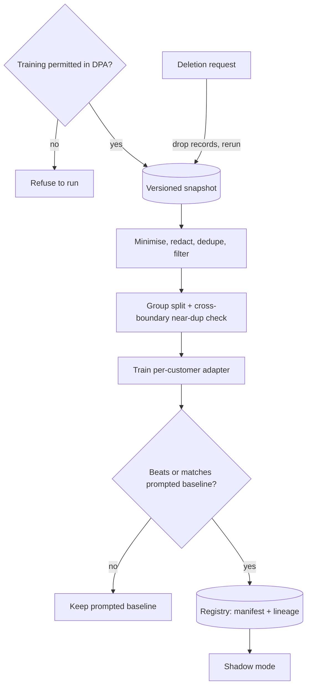

## TL;DR
A repeatable, audited path from a customer's records or agent traces to a per-customer adapter, with
permission, redaction, leakage-safe splits, baseline evals and lineage. It must be a pipeline, because
deprecations, deletion requests and new labels force reruns.

## For agent builders
- **Why it matters for agents.** The most common reason to fine-tune for an agent is distillation: a large
  prompted agent works but is slow and costly at the customer's volume, so its successful tool-calling
  traces train a smaller model for one step (routing, classification, a fixed-format tool call).
- **Where it shows up in your stack.** Your trace store feeds the dataset; the eval harness and
  per-customer regression suite gate the adapter; the serving layer loads one adapter per tenant.
- **What you control.** Which traces qualify (successful, reviewed, permitted), how tool calls and
  results are rendered in the model's chat template, the split unit (conversation or case), and the
  gate against the prompted agent.
- **What you can skip.** Training-loop internals and full fine-tuning; a per-customer LoRA adapter on a
  standard trainer covers most agent uses.

## Decision case
### Scenario
A logistics customer runs your support agent at about 50,000 conversations a day. Step one, choosing one
of 30 queues and a tool, runs on a large prompted model. It is the routing step from the distillation
example: 31,000 qualifying traces, and the prompted agent agrees with the human queue 90% of the time.

Constraints (figures illustrative):
- **Cost.** Step one costs about $0.02 per conversation, so $1,000 a day. Finance wants it cut by at
  least half.
- **Latency.** Step one takes about 2.5 seconds; the customer wants under 1 second.
- **Data boundary.** The data processing agreement permits training, but only inside the customer's EU
  cloud account, and the customer owns the resulting adapter.
- **Deletion.** About one data-subject deletion request a month must reach every derived artifact.
- **Quality floor.** The customer accepts at most a 2-point drop in routing agreement, and tool calls
  must be at least 99.5% schema-valid.
- **Team.** Two ML engineers, one of whom has run LoRA training before.

### Options
| Option | How it works | Data boundary | Cost and latency | Deletion and portability |
|---|---|---|---|---|
| **A. Keep prompting** | Tighten the prompt, try a smaller prompted model | Fine | Prompt work has plateaued; a smaller prompted model has not been measured against the floor | Nothing to retrain |
| **B. Provider's hosted fine-tuning** | Upload traces, tune a hosted model | Fails: data leaves the customer's account | Likely cheaper and faster per call | Model lives at the provider; cannot be exported; retrain on its replacement when the base is retired |
| **C. Self-hosted LoRA adapter, automated pipeline** | Permission gate, redaction, split by conversation, adapter on an open model in the customer's cloud, gate against the prompted agent | Fine | Assume a serving node at about $100 a day; sub-second on a mid-size model | Rerun monthly from the manifest; adapter is small and owned by the customer |
| **D. Full fine-tune of the open model** | Same pipeline, all weights updated | Fine | Same serving cost | Each rerun is far heavier, and nothing shows 31,000 traces need it |

### Decision
Choose **C**, for step one only:
- **It is the only option that meets both cost and the data boundary.** B fails the agreement, and A has
  not shown it can reach half the cost.
- **The quality floor holds.** Routing agreement is 89% against 90%, a 1-point drop inside the 2-point
  floor. Schema validity is 99.6%, above 99.5%.
- **Invalid calls fall back.** The 0.4% invalid calls, about 200 conversations a day, go back to the
  prompted model for about $4 a day.
- **The saving is large.** $1,000 a day becomes about $104 including fallback, close to $27,000 a month.
- **Monthly deletion is affordable** because the adapter is small and the manifest says which runs
  contained the record.

What would change it:
- **Volume.** Below about 5,000 conversations a day ($100 ÷ $0.02), the serving node costs more than
  prompting saves, so A wins.
- **A smaller prompted model that holds the floor.** If it measures within 2 points at under $0.01 per
  conversation and under 1 second, A meets the constraints with no pipeline to run; measure it first.
- **A flat learning curve below the floor.** If the 25%, 50% and 100% points flatten under 88%, more
  traces will not help; keep the prompted step.
- **An EU-hosted provider option that the agreement allows.** Then B is worth a cost comparison, accepting
  the lock-in.

### Trade-offs accepted
- **One point of routing agreement.** Watch the human-queue override rate per day against the prompted
  baseline, with a rollback flag.
- **Retraining on every base-model change.** Watch the open model's release notes, and keep the pipeline
  green with a monthly rerun.
- **A second serving stack.** Watch per-adapter latency and GPU utilisation.
- **Schema drift.** Watch tool-call validity after any tool schema change, and re-render traces first.

### Review rubric
- **Permission comes first.** The write-up quotes what the agreement allows, where training may run and
  who owns the weights.
- **The baseline is the prompted agent.** It compares against the prompted step on held-out conversations,
  not against a weaker model.
- **The split unit is stated.** It splits by conversation or case and says how near-duplicates are handled.
- **Cost arithmetic includes fallback and serving.** Daily costs before and after add up.
- **Deletion has a path.** It explains how a request reaches the adapter, cached datasets and eval logs.
- **Reversal conditions are concrete.** It names the volume, learning-curve or agreement fact that would
  change the choice.

## Why it exists
- **Sometimes fine-tuning is right.** Hundreds of house-specific labels, a rigid output format, a house
  writing style, or distilling a large prompted model into a smaller, cheaper one for their volume.
  Running supervised fine-tuning or LoRA is the easy part; the hard part is that the data belongs to
  someone else.
- **The one-off notebook leaves no lineage.** Nobody can say which records trained the model, so when
  legal asks to delete a former employee's data you cannot tell whether the weights are affected.
- **It leaks and memorises.** A random row split puts near-duplicate tickets on both sides, so the eval
  looks better than reality. Unredacted personal data means the model can reproduce a customer's phone
  number given the right prefix. Combining two customers' data "because more data helps" lets one's
  information surface in the other's outputs.
- **It cannot be reproduced.** The provider deprecates the base model a year later and nobody can rerun
  the training.
- **So it must be an automated pipeline with explicit gates.** Same inputs and config reproduce an
  equivalent model (bit-identical weights are rare on GPUs because of non-deterministic kernels, but eval
  results should match within noise), every artifact has lineage, and governance is enforced in code
  rather than remembered.

## How it works
### 0. Decide it is worth it
- **Prerequisite:** a strong prompted baseline (with retrieval where knowledge is the issue), measured on
  the customer's golden set, that has plateaued.
- **Fine-tuning is good at *behaviour*:** format, style, label space, and cost/latency via distillation.
- **It is bad at *facts that change*,** because facts baked into weights go stale and cannot be cited;
  those stay in retrieval.

### 1. Permission gate
- **Check the contract and data processing agreement:** is training permitted, on which data, who owns
  the resulting weights or adapter, and where may training run (region, cloud, on-prem)?
- **Record the basis in the run manifest.** If it is not written down, the pipeline refuses to start.

### 2. Extract and minimise
- **Pull only the fields the task needs**, from a snapshot with a recorded identifier and time, so the run
  is reproducible and deletion requests can be checked against it.

### 3. Redact and filter
1. **Mask PII and secrets the task does not need** (names, account numbers, credentials), because a model
   trained on them can memorise and regurgitate them.
2. **Deduplicate**, exact and near-duplicate.
3. **Drop low-quality or mislabelled examples**, and balance classes.
- **Expect heavy losses.** On customer data, cleaning often removes a large share of the raw records,
  which is normal.

### 4. Split without leakage
- **Split by group** (customer account, case, document or time period), not by row. Tickets from one case
  share wording; on both sides, the test set measures memorisation.
- **Time-based splits match deployment:** train on the past, predict the future.
- **Then check across the boundary.** Grouping misses some leaks (one template email can open many
  unrelated cases), so run a near-duplicate check (MinHash or embedding similarity above a high
  threshold) and move or drop test items with a near-twin in train.
- **Report how many you removed.** A large number means the dataset is more repetitive than it looked.

### 5. Format and train
- **Template-exact formatting.** Render examples in the base model's exact chat template, with the same
  system prompt production will use.
- **Prefer a per-customer adapter** (LoRA or another PEFT method) over full fine-tuning: small, cheap to
  retrain, isolates each customer's data in its own artifact, deletable when the contract ends.
- **Never pool customers' data** unless every customer has agreed.

Where training runs is a separate decision:

| Option | Gain | Cost |
|---|---|---|
| **Provider's hosted fine-tuning API** | Least engineering | Data goes to that provider (the data agreement must allow it); the tuned model typically lives only there and cannot be exported; when the provider retires the base model you retrain on whatever replaces it |
| **Self-hosted on an open model** | Data stays in the customer's boundary; portable adapter | You own GPUs, the training stack and serving |

- **Distillation has its own terms.** If training targets are outputs of a large prompted model, check
  that model's terms too: some providers restrict using outputs to train other models.

### Agent traces as training data
Distilling an agent step adds four rules to steps 3-5:
1. **Keep only qualifying traces.** Runs that completed the task and passed review or an automatic check;
   training on failed or looping runs teaches the failure.
2. **Render tool calls in the base model's own tool-calling format,** with the same tool schemas
   production sends, because a model tuned against an old schema emits calls the adapter rejects.
3. **Learn from the agent's turns, not the tools'.** Tool results and user turns are context; compute the
   loss on assistant turns (tool calls and replies), which most fine-tuning stacks support as an option.
4. **Redact tool results too.** CRM lookups and order APIs return the PII that ticket text omits.
- **Split by conversation or case**, never by turn: turns of one run share almost all of their context.

### 6. Evaluate against the baseline
- **Compare with the prompted baseline** on the customer's held-out golden set and regression suite.
- **Run general capability and safety checks** to catch catastrophic forgetting or loosened refusals.
- **Add memorisation probes:** prompt with prefixes of training records and check whether redacted-class
  strings (or planted canary strings) come back.
- **Plot a learning curve.** Train on nested subsets (say 25%, 50% and 100% of the training groups) and
  plot golden-set score against size:
  - still climbing at 100%: more labelled data is the cheapest next gain;
  - flattened at 50%: more data will not help; the ceiling is in the labels, task definition or base
    model.
- **This one plot answers "should we label more?"** with evidence instead of opinion.

### 7. Register with lineage
- **Register** the dataset snapshot hash, the record-id manifest, code version, base model id and version,
  hyperparameters, eval results and the permission record.
- **The manifest answers "was record X used?"** and lets you rerun the pipeline when needed.

### Deletion is retraining
- **Unlearning is not a guarantee.** Removing a record's influence from trained weights is not reliably
  possible today; machine unlearning is an active research area.
- **The practical answer: drop the record and retrain**, which is only cheap if the pipeline is automated
  and adapters are small.
- **Deletion reaches everything derived from the snapshot:** cached tokenised datasets, the golden set if
  the record was in it, eval logs that quote it, and old adapter versions still in the registry.

## Diagram
Every run passes the permission gate and ends in the registry with a manifest; a deletion request loops
back to the snapshot and reruns the whole path.



## Examples
### Leakage-safe split and run manifest
The leakage-safe split and the manifest step, the two parts most often done wrong. Records are grouped by
case, split by a stable hash of the group key, and the manifest records exactly which ids went where.

```python
import hashlib, json

def bucket(key: str, salt: str = "split-v1") -> float:
    h = hashlib.sha256(f"{salt}:{key}".encode()).hexdigest()
    return int(h[:8], 16) / 0xFFFFFFFF            # stable in [0, 1]

def split_and_manifest(records, tenant, snapshot_id, permission_ref, test_frac=0.15):
    assert permission_ref, "no recorded training permission: refusing to run"
    assert all(r["tenant"] == tenant for r in records), "cross-tenant data in batch"
    train, test = [], []
    for r in records:                               # all tickets of one case land together
        (test if bucket(r["case_id"]) < test_frac else train).append(r)
    manifest = {
        "tenant": tenant, "snapshot_id": snapshot_id, "permission_ref": permission_ref,
        "train_ids": sorted(r["id"] for r in train),
        "test_ids": sorted(r["id"] for r in test),
        "train_cases": len({r["case_id"] for r in train}),
        "test_cases": len({r["case_id"] for r in test}),
    }
    blob = json.dumps(manifest, sort_keys=True).encode()
    manifest["manifest_sha256"] = hashlib.sha256(blob).hexdigest()
    return train, test, manifest
```

### Worked scenario: support-ticket classifier adapter
Illustrative numbers chosen for the walkthrough, not a benchmark.

| Stage | Count |
|---|---|
| Raw support tickets | 40,000 |
| After deduplication and quality filters | 26,000, belonging to 9,000 cases |
| Test bucket at 15% | roughly 1,350 cases, around 3,900 tickets (cases vary in size) |
| Cross-boundary near-duplicates dropped | 210 test tickets, mostly auto-generated "password reset" requests |

A LoRA adapter on a mid-size open model is compared with the prompted large-model baseline on the
customer's golden set:

| Model | Label accuracy |
|---|---|
| Prompted large-model baseline | 86% |
| Adapter on 25% / 50% / 100% of training cases | 81% / 85% / 87% |

- **The curve is still rising**, so more labels would likely help.
- **It is within noise of the baseline** at a fraction of the per-request cost; general capability and
  refusal checks are unchanged; no canary string comes back in 500 prefix probes.
- **That combination, not the accuracy alone, moves it to shadow mode.**
- **The row-split counterfactual.** The same adapter would have scored higher offline, because
  near-identical tickets from one case would sit on both sides, and the gap would surface only in
  production.

### Agent scenario: distilling a routing step from agent traces
A support agent on a large prompted model spends its first step choosing one of 30 queues and a tool.
The team distils only that step (illustrative numbers, not a benchmark):

| Stage | Count or result |
|---|---|
| Logged first-step traces | 60,000 |
| Kept: run completed and routing confirmed by the human queue | 31,000, from 22,000 conversations |
| Dropped after redacting tool results and dedup | 2,400 |
| Test split by conversation at 15% | about 3,300 conversations |
| Routing agreement with the human queue: prompted agent vs adapter | 90% vs 89% |
| Tool-call schema validity on the tenant regression suite | 100% vs 99.6% |

- **The adapter only replaces step one.** Later steps stay on the prompted model, so the decision is per
  step, measured on the agent's own regression suite.
- **The 0.4% invalid calls** are a gate item: they trace to an old tool schema in early traces, which is
  exactly why rendering uses production's current schemas.

### Canary memorisation probe
Plant random canary strings in a few training records before training, then prompt the tuned model with
record prefixes and look for them (and for redacted-class patterns) in the output. `generate` is any
function that calls your tuned model.

```python
import re, secrets

def make_canaries(n=5):
    return [f"canary-{secrets.token_hex(8)}" for _ in range(n)]   # random, so never in real data

PHONE = re.compile(r"\+?\d[\d\s-]{8,}\d")      # example redacted-class pattern

def probe(generate, records, canaries, prefix_chars=200, limit=500):
    hits = []
    for r in records[:limit]:
        out = generate(r["text"][:prefix_chars])
        leaked = [c for c in canaries if c in out] + PHONE.findall(out)
        if leaked:
            hits.append({"id": r["id"], "leaked": leaked})
    return hits          # gate: any canary hit blocks registration
```

## Production patterns
- **Manifest-first runs** — every training run. Write snapshot id, record-id manifest hash, code commit,
  base model id and version, hyperparameters and permission reference into the model registry entry (for
  example as MLflow run params, tags and artifacts). Monitor runs registered without a permission
  reference: the target is zero.
- **Near-duplicate check across the split** — after grouping. Use MinHash LSH (for example the
  `datasketch` library) or embedding cosine similarity above a high threshold between test and train, and
  drop test items with a twin. Monitor the removed count per run; a jump means new templated traffic.
- **Per-tenant adapters on shared serving** — when many customers each have a small adapter. Serve one
  base model with multiple LoRA adapters selected per request, for example vLLM with `--enable-lora`.
  Monitor per-adapter latency and that tenant routing selects the adapter from the authenticated tenant.
- **Learning curve as a standard stage** — on every new dataset. Train 25%, 50% and 100% nested subsets in
  the same pipeline run and attach the plot to the eval report. Monitor the slope between the last two
  points to decide whether to fund more labelling.
- **Deletion runbook wired to the manifest** — for data-subject and contract-end requests. Look up record
  ids in manifests, rerun affected pipelines, then purge cached datasets, eval logs and old adapter
  versions. Monitor time from request to completed purge.
- **Trace-qualification filter for agent distillation** — before every agent fine-tune. Select traces by
  outcome (task completed, no human correction, no guardrail denial) and by tool-schema version, and
  record the filter in the manifest. Monitor the kept share per run and the schema-validity rate of the
  tuned model's tool calls.

## Trade-offs
- **Per-customer adapters vs full fine-tuning.** Adapters isolate data and make deletion and retraining
  cheap, but cap how much the model can learn; full tuning is worth it only with large data and ownership
  terms that allow it.
- **Aggressive redaction vs task signal.** It lowers memorisation risk but can remove signal the task
  needs (names in entity extraction); keep a field only when the task cannot work without it, and probe
  for leakage.
- **Small tuned model vs prompted large model.** Cheaper and faster at high volume, but every base-model
  change means retraining; at low volume the prompted model's flexibility usually wins.
- **Group or time splits vs flattering numbers.** Honest splits look worse than random ones; accept the
  lower number, because it is the one production will show.

## Pitfalls
- **Changing the split salt or re-extracting a live table between runs.** Symptom: a "rerun" whose test
  ids differ from the original manifest, so before-and-after scores are not comparable.
- **Splitting by row.** Symptom: an excellent offline score followed by a much worse production result on
  new cases.
- **Training without a recorded permission basis.** Symptom: a legal review orders the model deleted, with
  no way to prove what it contained.
- **A different template or system prompt from production.** Symptom: a tuned model that does well in the
  training harness and inconsistently in the product.
- **Skipping memorisation probes.** Symptom: a red-team or user finds real customer identifiers in
  generated text.
- **Mixing customers' data "for more signal".** Symptom: one customer's terminology or records appear in
  another's outputs, which is a cross-tenant leak.
- **Treating the run as one-off.** Symptom: a deprecation notice for the base model and nobody able to
  reproduce the dataset or hyperparameters.
- **Distilling every agent trace, good or bad.** Symptom: the tuned agent reproduces the prompted model's
  loops and wrong tool choices more confidently. Fix: keep only completed, verified runs.
- **Training on traces with an outdated tool schema.** Symptom: malformed or rejected tool calls after
  deployment. Fix: re-render traces with current schemas or drop old-schema traces.

## When to use
- **Use when** a prompted baseline has plateaued on a behaviour fine-tuning is good at, the customer
  permits training, and volume or latency makes a smaller tuned model pay off.
- **Avoid** to add knowledge that changes, to fix retrieval failures, or before a golden set exists to
  prove the gain.
- **Measure** the tuned model against the prompted baseline on held-out groups, plus cost per request,
  forgetting and memorisation checks.
- **Interviews:** emphasise permission, group splits, adapters for isolation and the fact that deletion
  means retraining.

## Role lens
- **Engineer:** Implements extraction, redaction, deduplication, group splits, template-exact formatting,
  adapter training and memorisation probes as one rerunnable pipeline.
- **Architect:** Decides adapter-per-tenant versus shared models, where training runs relative to data
  residency, and the lineage records the registry must hold.
- **FDE:** Secures the written training permission, works with customer SMEs on labels and the golden set,
  and explains to the customer what deletion requests mean for trained models.

## Check yourself
**Q:** Six months after you deliver a fine-tuned adapter, the customer must delete all data about one of
their clients. What do you do, and what would have made it easy?
**A:** First check the run manifest: if none of that client's record ids appear in the training set, the
adapter is unaffected and you document that. If they do, I would not rely on unlearning, because removing a
record's influence from weights is not dependable; I would drop the records from the snapshot, rerun the
pipeline, re-evaluate against the same golden set and replace the adapter, then delete the old one. That is
easy only if the pipeline is automated, inputs are versioned snapshots with id manifests, and the model is
a small per-customer adapter rather than a shared multi-customer model.

## Interview questions
### When is fine-tuning on a customer's data the right call, and when is it not?
- **Right for behaviour:** a large house-specific label space, rigid output format, house style, or
  distilling a prompted model for cost and latency at volume.
- **Wrong for changing facts**, because weights go stale and cannot cite; those belong in retrieval.
- **Only after** a strong prompted baseline has plateaued on the customer's golden set, and training is
  permitted in writing.

### Your fine-tuned model scored 8 points above baseline offline but is worse in production. What happened?
- **Most likely leakage.** A row split put tickets from the same case, or templated near-duplicates, on
  both sides, so the test measured memorisation.
- **Fix:** split by case, account or time, then run a cross-boundary near-duplicate check.
- **Also check** that training used production's exact chat template and system prompt.

### Hosted fine-tuning API or self-hosted training on an open model?
- **Hosted:** least engineering, but data goes to the provider, the tuned model usually cannot be exported,
  and a base-model retirement forces retraining on its replacement.
- **Self-hosted:** data stays in the customer's boundary and the adapter is portable, at the cost of GPUs,
  a training stack and serving.
- **The data agreement often decides** before engineering preference does.

### How do you show a customer whether labelling more data is worth it?
- **Learning curve:** train on nested 25%, 50% and 100% subsets of training groups and plot golden-set
  score.
- **Still climbing at 100%:** more labels are the cheapest next gain. **Flat after 50%:** the ceiling is
  labels, task definition or base model, not volume.

### What does your registry need to hold for a client fine-tune?
- **Lineage:** snapshot hash, record-id manifest, code version, base model id and version,
  hyperparameters, eval results and the permission record.
- **Why:** it answers "was record X used?", lets you rerun after a deprecation or deletion, and proves to
  auditors what the model contained.

### You want to distil a customer's prompted support agent into a smaller model. How do you build the dataset?
- **Pick one step to distil** (often routing or a fixed-format tool call) and measure it separately on the
  agent's regression suite, rather than replacing the whole loop at once.
- **Use only qualifying traces:** completed, verified, permitted for training, redacted including tool
  results, rendered with current tool schemas in the base model's template.
- **Split by conversation** and compute the loss on assistant turns, then gate against the prompted agent
  on schema validity as well as accuracy.

## Quiz
### Q: Why should a fine-tuning dataset of support tickets be split by case rather than by individual ticket?
- [ ] Case-level splits produce more training examples
- [x] Tickets in the same case share content, so a row split leaks near-duplicates into the test set and inflates scores
- [ ] Training frameworks require all examples from a case to be in one batch
- [ ] Row-level splits make the dataset impossible to deduplicate
> Related records on both sides of the split let the test measure memorisation. Grouping by case, account
> or time gives a score that reflects new, unseen inputs.

### Q: What is the most dependable way to honour a request to delete records that were used for training?
- [ ] Run a machine unlearning algorithm on the existing weights
- [ ] Add the records to a blocklist in the output guardrail
- [x] Remove the records from the dataset snapshot and retrain from the pipeline
- [ ] Lower the sampling temperature so memorised text is less likely
> Unlearning methods do not yet give reliable guarantees, and output filters hide rather than remove
> influence. Retraining without the records is dependable when the pipeline is automated and reproducible.

### Q: A customer's product catalogue changes weekly. What should fine-tuning on their data be used for?
- [ ] Teaching the model current prices and stock levels
- [ ] Replacing retrieval so the model answers without documents
- [ ] Nothing, since fine-tuning never helps with catalogue tasks
- [x] Teaching output format, tone or label scheme, while retrieval supplies the changing catalogue facts
> Facts in weights go stale and cannot be cited. Fine-tuning shapes stable behaviour; changing knowledge
> belongs in retrieval, where it can be updated and grounded.

## Use cases & projects
### Use cases
- **Distilling an agent's routing step.** A small per-tenant adapter replaces a large model's first
  routing call at a fraction of the cost per request.
- **House-format tool calls.** A customer's extraction agent must emit a rigid, custom schema that
  prompting gets right most but not all of the time.
- **Customer-hosted agents.** A regulated customer requires a self-hosted open model; an adapter trained
  inside their boundary recovers quality lost by the switch.
- **Deletion and contract-end requests.** Manifests show which traces trained which adapter, so a purge
  becomes a pipeline rerun.

### Mini project
**Distil one agent step into a LoRA adapter, with lineage (2-3 hours).**
- **Goal:** turn logged agent traces into a leakage-safe, manifest-backed dataset for one routing step.
- **Steps:** generate or collect about 2,000 synthetic first-step traces with a conversation id, a tenant
  and a chosen tool; filter to completed runs; redact phone numbers in tool results; split with
  `split_and_manifest` with the conversation id stored as `case_id`, so it is the group key; plant canaries with `make_canaries`;
  render examples in a chat template; train a small adapter if you have a GPU, or stop at the dataset.
- **Done when:** the manifest lists every train and test id with a hash, no conversation appears on
  both sides, a near-duplicate check reports its removals, and (if trained) the probe finds no canaries.

### Major project
This lesson feeds the module Capstone (see the module guide): the utility's mandated move to a model in
its own cloud tenancy is where an adapter trained inside that boundary would be evaluated against the
prompted baseline before shadowing.
