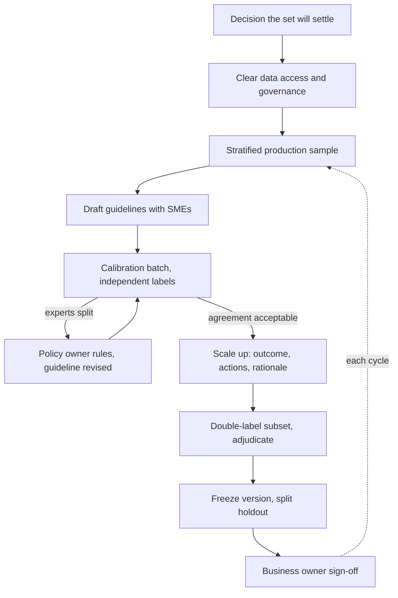

## TL;DR
A versioned set of the customer's real tasks with reference outcomes their own experts agreed on, so
"is the agent good enough?" is settled by the customer's judgement. The hard parts are expert time,
sampling, disagreement, data governance and formal sign-off.

## For agent builders
- **Why it matters for agents.** Every prompt, tool or model change to a customer's agent needs a fixed
  yardstick. Without an SME-built set, "the agent got better" means the engineer liked a few transcripts.
- **Where it shows up in your stack.** A JSONL file of task inputs, frozen tool fixtures, reference final
  answers or acceptance criteria and expected key actions, read by your eval harness in CI and on
  milestone runs against the holdout.
- **What you control.** What an item records for an agent (final answer, required and forbidden tool
  calls, end state), how the set is sized per segment, where labelling runs, and the version id stamped
  on every eval result.
- **What you can skip.** Building a custom labelling UI on day one. A spreadsheet or a self-hosted
  open-source tool inside the customer's tenant is enough until volume demands more.

## Why it exists
- **Only the customer's experts can define the standard,** and they define it case by case. The project
  turns on "do your outputs meet our standard?" If the vendor writes the reference answers, the eval
  measures agreement with the vendor's guesses, and the first SME review of production output reveals the
  score as fiction. (The general golden-dataset idea is in the evals module; this lesson covers the
  engagement mechanics inside a client.)
- **SME time is the scarcest resource.** Senior adjusters, clinicians or lawyers are billing or seeing
  patients, so an ad-hoc request for "some labels" produces a few dozen easy cases and then silence.
- **Experts disagree more than anyone expects.** Unmanaged disagreement silently becomes label noise that
  caps every metric.
- **The data is governed.** It may contain personal or regulated information that cannot leave the
  customer's environment, so "export a CSV and label it in our tool" may be forbidden.
- **The naive path fails all three.** Engineers labelling from documentation while SMEs "spot check" also
  leaves no artefact the customer will sign as the acceptance standard.

## How it works
### 1. Anchor the dataset to a decision
- **Write down what it will decide:** prompt iteration, model choice, or go-live acceptance of the agent.
  This sets the size, the error tolerance and who must sign off.
- **Signatures differ:** an acceptance dataset needs the business owner's signature; an iteration dataset
  only needs the working SMEs.
- **Size follows from the precision the decision needs,** per segment that has its own threshold:

```
For a pass rate near p and a desired 95% half-width E:
    n ≈ 1.96² · p(1−p) / E²
At p = 0.9 and E = 0.05 that is about 140 items, for EACH segment with its own bar.
```

- **That is why segment thresholds, not the headline,** usually drive the total and the expert-hours.

### 2. Clear data access first
- **Agree** where the data lives, who may see it, and whether de-identification is needed, before anyone labels.
- **Expect the tool to run inside the customer's environment;** labelling tools often must.
- **Why first:** a governance blocker found after SMEs have labelled 200 exported records means throwing
  the work away. The same rule covers the tool fixtures an agent eval replays.

### 3. Sample from production, stratified
- **Draw candidates from real recent traffic,** stratified by the segments the business cares about.
- **Oversample rare high-stakes cases** deliberately (see representative test-case sampling).
- **Synthetic or hand-picked items only as a tagged minority,** because experts write cleaner inputs than
  the world does.

### 4. Write guidelines, then calibrate
1. Draft annotation guidelines with one or two SMEs.
2. Run a calibration batch that several experts label independently.
3. Measure agreement and revise the guideline where they split.
4. Only then scale up. Calibrating first is cheap; discovering disagreement after 500 labels is not.

### 5. Label for reference and rationale
Each item stores more than an answer, because each field answers a later question:

| Field | Why it is there |
|---|---|
| input, source record id | reproducibility, and deletion if the customer revokes the record |
| reference answer, or acceptance criteria | closed tasks get a label; open-ended ones get must-include facts and must-not errors, because many wordings are correct |
| rationale citing the guideline section | lets an engineer tell a model error from a label error later |
| ambiguous / difficulty flag | ambiguous items are scored separately, not silently counted |
| labeller, guideline version, date | a definition change can then be traced to the labels it affects |
| agent items: tool fixtures, required and forbidden actions | an agent run is scored on what it did, not only what it said, and fixtures make runs repeatable |

- **Ask SMEs for outcomes and key actions, not full trajectories.** Many tool sequences are acceptable;
  experts can say "must check the policy before approving" and "must never close a litigated claim"
  far more reliably than they can write the one correct path.
- **Decide early: from scratch or correct a pre-label** (agent output or engineer draft).
- **Pre-labels can cut expert time substantially but anchor reviewers toward the draft,** so measure how
  often SMEs change them; a change rate near zero on hard items signals rubber-stamping.

### 6. Double-label a subset and adjudicate
- **Fixed fraction labelled by two experts;** compute chance-corrected agreement (Cohen's κ) per category.
- **Disagreements go to an adjudicator,** normally the policy owner.
- **Persistent disagreement in a category is a policy gap.** Resolve it as a written rule, not by majority
  vote, because the agent will be judged against the rule in production.
- **Agreement caps what the metric can show:** if two experts agree on 85% of items, an agent "scoring" 95%
  against one of them is partly fitting that expert's quirks.

### 7. Freeze, version and sign off
- **Freeze a version with a changelog;** record guideline version and labeller per item.
- **Split off a holdout** (stratified, so rare segments appear in it) that the team never inspects during iteration.
- **Get written sign-off** from the business owner that this set, at this threshold, is the acceptance standard.

### 8. Refresh on a schedule
- **Production drifts:** add newly sampled cases each cycle and retire items that no longer reflect policy.
- **Tools drift too:** when a tool's response schema changes, re-record the affected fixtures and bump the version.
- **Never edit a label silently;** changes go through the same review and bump the version.

## Diagram
The calibration loop runs before scale-up, and disagreements become written policy rather than votes;
only a frozen, signed version is the acceptance standard for the agent.



## Examples
### A golden item for a claims agent, and a scorer that reads it
The SME supplies the outcome and the key actions; the fixture freezes what the tools returned so every
agent version is scored on the same world.

```python
item = {
    "id": "claims-0412", "version": "1.0", "segment": "litigation",
    "input": "FNOL: rear-end collision, third party named, attorney letter attached.",
    "fixtures": {"get_policy": {"status": "active", "deductible": 500},
                 "get_claim_history": {"prior_claims": 1}},
    "reference": {"route": "litigation_desk"},
    "required_actions": ["get_policy"],          # must check coverage before routing
    "forbidden_actions": ["close_claim"],        # never close a claim with an attorney letter
    "rationale": "Guideline 4.2: attorney letter -> litigation desk",
    "labeller": "adj-2", "guideline_version": "g3", "ambiguous": False,
}

def score(item, trace):
    """trace: {'tool_calls': [names in order], 'final': {...}} from one agent run."""
    calls = trace["tool_calls"]
    return {
        "outcome": trace["final"].get("route") == item["reference"]["route"],
        "required": all(a in calls for a in item["required_actions"]),
        "no_forbidden": not any(a in calls for a in item["forbidden_actions"]),
    }

trace = {"tool_calls": ["get_policy", "route_claim"], "final": {"route": "litigation_desk"}}
print(score(item, trace))   # {'outcome': True, 'required': True, 'no_forbidden': True}
```

### Sizing calculator and agreement check
Plug in the pass rate, the half-width the decision needs, and the minutes per item.

```python
import math
from collections import Counter

def n_for_halfwidth(p, E, z=1.96):
    """Items needed so a pass rate near p has a 95% half-width of E."""
    return math.ceil(z**2 * p * (1 - p) / E**2)

def halfwidth(p, n, z=1.96):
    return z * math.sqrt(p * (1 - p) / n)

def expert_hours(items, minutes_per_item=4, double_frac=0.2):
    return items * (1 + double_frac) * minutes_per_item / 60

def cohen_kappa(a, b):
    n = len(a)
    po = sum(x == y for x, y in zip(a, b)) / n              # observed agreement
    ca, cb = Counter(a), Counter(b)
    pe = sum(ca[k] * cb[k] for k in ca) / n**2              # agreement expected by chance
    return (po - pe) / (1 - pe)

print(n_for_halfwidth(0.9, 0.05))      # 139: "about 140" per segment with its own bar
print(round(halfwidth(0.9, 160), 3))   # 0.046: about ±5 points on a 160-item holdout
print(round(halfwidth(0.85, 16), 3))   # 0.175: about ±17 points, too wide to decide anything
print(round(expert_hours(400), 1))     # 32.0 expert-hours for 400 items, 20% double-labelled

adj1 = ["fast"] * 6 + ["subro"] * 2 + ["std"] * 2
adj2 = ["fast"] * 6 + ["std"] * 3 + ["subro"]
print(round(cohen_kappa(adj1, adj2), 2))  # 0.46, although raw agreement is 70%
```

### Worked plan: commercial-insurance claims triage agent pilot (numbers illustrative)
The customer offers three senior adjusters for two hours a week each, six expert-hours weekly. Target: a
400-item set.

| Week | What happens | Numbers |
|---|---|---|
| 1 | Claims can be labelled only inside the customer's tenant, so the tool is deployed there and policyholder names are masked; stratified sample by line of business and claim size band | 600 candidates from the last quarter; litigation flags (roughly 3% of claims) oversampled to 40 of 400 slots instead of the 12 a proportional sample gives |
| 2 | 30-item calibration batch labelled by all three adjusters independently | at an assumed 4 minutes per item, 90 labels, about 6 hours: the whole week's budget |
| 2 | High agreement on fast-track routing; split on "potential subrogation" | 8 of 30 cases; the claims director rules subrogation applies only when a third party is named in the first notice, and the rule goes into the guideline and the agent prompt |
| 3 to 8 | Single-label 400 items, double-label 20% | about 27 plus 5, roughly 32 expert-hours: five to six weeks of offered time, shown to the sponsor up front rather than promising three weeks; one 45-minute adjudication session per week |
| 9 | Version 1.0 frozen, stratified split | 240 iteration / 160 holdout; 16 litigation items land in the holdout |

Before anyone signs, the FDE runs the interval arithmetic in front of the sponsor:
- **Overall:** on 160 holdout items, 90% routing accuracy carries about ±5 points (√(0.9·0.1/160) ≈ 0.024).
- **Litigation:** on 16 items, an 85% floor carries about ±17 points, which cannot separate a good agent
  from a poor one.
- **Signed bar:** 90% overall on the holdout, and 85% on litigation measured on those 16 plus 60
  litigation claims sampled and labelled after iteration ends (about 4 more expert-hours). That gives
  roughly ±8 points on 76 items, with no tuned-on item counted.

## Production patterns
- **Physically separate holdout.** Store the holdout in its own location with access limited to the eval
  job, and let the harness read it only on milestone runs. Monitor who accessed it and how many holdout
  runs happened, because every look erodes its independence.
- **Versioned dataset files.** Keep the set as JSONL with a version number and changelog in git, or in a
  data-versioning tool such as DVC for large files, and record the dataset version and content hash in
  every agent eval result. Monitor label churn between versions.
- **Frozen tool fixtures per item.** Record the tool responses an item needs and replay them in the eval
  harness instead of calling live systems, so a score change means the agent changed, not the customer's
  data. Monitor fixture misses (the agent called a tool the item has no fixture for).
- **Labelling inside the customer's tenant.** Deploy a self-hostable labelling tool (Label Studio is one
  open-source option) in the customer's cloud account or VPC, with masking applied before records reach
  the UI. Monitor that no export paths leave the tenant.
- **Pre-label change-rate tracking.** When SMEs correct agent drafts, log whether each draft was changed
  and report the change rate per difficulty stratum each week. A rate near zero on hard items is the
  rubber-stamping alarm.
- **Weekly agreement report.** Compute κ per category on the double-labelled subset and send any category
  below the agreed level to the adjudication session. Monitor the trend after each guideline revision.

## Trade-offs
- **More SMEs per item vs expert time.** Cleaner labels and measurable agreement, but scarce time
  multiplies; double-label a subset, and label everything twice only when errors are very costly.
- **Customer's labelling environment vs tooling.** It satisfies governance, but you lose your tooling and
  automation; when data can be de-identified safely, an external tool may be faster and still compliant.
- **Larger set vs expert minutes.** It narrows confidence intervals, but every item costs time; once
  intervals are tighter than the decision needs, spend the time on rare strata instead.
- **Early freeze vs early mistakes.** A stable target, but early mistakes freeze too; keep a short revision
  window after the first full eval run before declaring the acceptance version.
- **Outcome-only vs action-level labels.** Outcome labels are cheap and robust to many valid paths; adding
  required and forbidden actions catches unsafe agents that land on the right answer, at extra SME time.

## Pitfalls
- **Engineers writing reference answers while SMEs only spot-check.** Symptom: a high eval score followed by
  SMEs rejecting a large share of production outputs.
- **Letting the most available SME label everything.** Symptom: a second expert, brought in late, disagrees
  with a third of the labels.
- **Resolving disagreement by majority vote.** Symptom: the same category flip-flops between dataset
  versions, because no policy was ever written.
- **Reusing golden items as prompt examples or retrieval content.** Symptom: a score that collapses on
  freshly sampled production cases.
- **Signing a segment threshold the holdout is too small to test.** Symptom: a go/no-go meeting where a
  3-item swing in a 16-item segment decides the outcome.
- **Skipping the formal sign-off.** Symptom: the acceptance bar is renegotiated after results come in.
- **Scoring agents against one exact trajectory.** Symptom: valid alternative tool orders fail and the
  team starts "fixing" correct behaviour. Fix: label outcomes plus required and forbidden actions.

## When to use
- **Use for** any agent deployment where the customer's experts, not a public benchmark, decide whether
  outputs are acceptable, which is nearly every enterprise deployment.
- **Start in the first two weeks of a pilot,** in parallel with the first prototype, because SME
  scheduling and data access are the long poles.
- **A vendor-built iteration set is fine for day-one debugging,** but it must never be the acceptance standard.
- **Measure** agreement on the double-labelled subset, coverage per stratum, and label churn between versions.
- **Interviews:** emphasise sign-off, governance and policy resolution, not just "collect examples".

## Role lens
- **Engineer:** Builds the sampling and labelling pipeline, stores labeller, guideline version and
  rationale per item, and keeps the holdout physically separate from iteration data.
- **Architect:** Decides where labelling runs given data residency and access constraints, and how
  datasets are versioned per customer so they feed regression suites later.
- **FDE:** Negotiates SME time with the business owner, facilitates calibration, routes disagreements
  to the policy owner, and secures written sign-off on the acceptance set.

## Check yourself
**Q:** The customer offers one SME for one hour a week and wants go-live in six weeks. What do you do?
**A:** I would show the arithmetic: at a few minutes per item, one hour a week yields at most about
ninety labels by go-live, single-labelled, with no agreement estimate, which cannot support an
acceptance decision with useful confidence. Then I would offer options: add a second SME for the
calibration and double-labelled subset; have the vendor team pre-label so SMEs only review and correct,
while measuring how often they change the pre-label to detect anchoring; narrow the scope to the
highest-volume segments; or move the date. I would also ask the business owner to sign off on the
reduced confidence explicitly, because the risk is theirs to accept.

## Interview questions
### Why should the customer's SMEs, not your team, write the reference answers?
- **The standard is theirs:** acceptance is judged by the customer's experts against their own policy, so
  vendor-written answers only measure agreement with the vendor's guesses.
- **The failure is delayed and public:** the eval looks great until the first SME review of production
  output, which then discredits both the score and the team.
- **Sign-off needs ownership:** a set the customer built is one the business owner can sign as the bar.

### What does a golden item need for a tool-calling agent that it does not need for a classifier?
- **Frozen tool fixtures,** so each run sees the same world and score changes reflect the agent, not live data.
- **Required and forbidden actions** from the SME (check coverage first, never close a litigated claim),
  because a right answer reached through an unsafe action still fails the customer.
- **Outcome rather than one exact path,** since many tool orders are valid and SMEs cannot reliably write the one true trajectory.

### How many golden items do you need for a go-live decision?
- **Work from the decision:** n ≈ 1.96² · p(1−p) / E² per segment that has its own threshold; at p = 0.9
  and E = 0.05 that is about 140.
- **Segments drive the total:** five segments with separate bars need about 140 each, not 140 overall.
- **Convert to expert-hours:** at around 4 minutes per item plus a double-labelled fraction, show the
  sponsor the weeks it costs before promising a date.

### Two experts agree on 85% of calibration items. What does that tell you?
- **A ceiling on the metric:** an agent scoring far above 85% against one expert is partly fitting that
  expert's quirks, not policy.
- **Look per category:** use Cohen's κ, because raw agreement overstates consistency when one label dominates.
- **Fix the cause:** categories with persistent splits go to the policy owner for a written rule, then the
  guideline and the affected labels are updated.

### When would you use agent pre-labels, and what is the risk?
- **Use when** expert time is the binding constraint and the task has many easy items, because correcting
  a draft is faster than labelling from scratch.
- **Risk:** anchoring, where reviewers accept plausible drafts and the set inherits the agent's errors,
  inflating its own score.
- **Control:** measure the change rate per difficulty stratum, and keep some items labelled from scratch to compare.

### Data cannot leave the customer's environment. How do you build the set and run agent evals?
- **Bring the tool to the data:** deploy labelling inside the customer's tenant, with de-identification or
  masking applied before records are shown.
- **Run the harness there too:** fixtures recorded from customer systems are customer data, so the eval job
  runs in the same boundary.
- **Store only what you may:** keep record ids so items can be traced and deleted if the customer revokes a record.

## Quiz
### Q: Two adjusters disagree on a category in a quarter of calibration cases. What should happen?
- [ ] Take the majority label once a third adjuster votes
- [x] Escalate to the policy owner, write the ruling into the guideline, and relabel the affected cases
- [ ] Drop the category from the dataset because it is ambiguous
- [ ] Keep both labels and score the model correct if it matches either
> A consistent split signals a policy gap. Voting hides it and it resurfaces in production; a written
> ruling from the owner fixes labels, guideline and prompt together.

### Q: Why should data-access and governance questions be settled before labelling starts?
- [ ] Labelling tools cannot read customer data formats
- [ ] Governance reviews always take longer than labelling
- [ ] SMEs refuse to label without a signed contract
- [x] If labelled data later turns out to be unusable outside the customer's environment, the labelling work is lost
> The expensive asset is expert time. A late governance blocker can invalidate labels done in the wrong
> place, so where data lives and who may see it must be agreed first.

### Q: What makes a client golden dataset "authoritative" for go-live?
- [ ] It has more than a thousand items
- [ ] It was labelled by the vendor's most experienced engineers
- [x] The customer's business owner signed off on the set and the threshold as the acceptance standard
- [ ] It matches the distribution of a public benchmark
> Authority comes from the customer's agreement, not size or vendor expertise. Without sign-off, the
> bar tends to be renegotiated after results are seen.

## Use cases & projects
### Use cases
- **Go-live acceptance for a customer agent.** A signed, frozen set and threshold decide whether a claims,
  support or operations agent launches.
- **Regression suite for agent changes.** Every prompt, tool-schema or model upgrade runs the iteration
  split in CI before merge.
- **Model or vendor selection.** Two candidate models run the same agent on the same fixtures, scored
  against SME outcomes rather than public benchmarks.
- **Safety gating of write actions.** Forbidden-action labels catch agents that reach the right answer
  through an action the customer never allows.

### Mini project
**Build a 30-item agent golden set with fixtures (2-3 hours).**
- **Goal:** create a small, versioned golden set for a tool-calling agent and score two agent versions on it.
- **Steps:** pick a toy domain (refund requests); write 30 items with input, tool fixtures, reference outcome,
  required and forbidden actions and a rationale; have a colleague label 10 independently and compute κ;
  write a harness that replays fixtures and applies `score`; run a weak and a strong prompt.
- **Done when:** the set is a versioned JSONL file, κ on the overlap is reported, and you have a table of
  outcome, required-action and forbidden-action pass rates for both agent versions.
