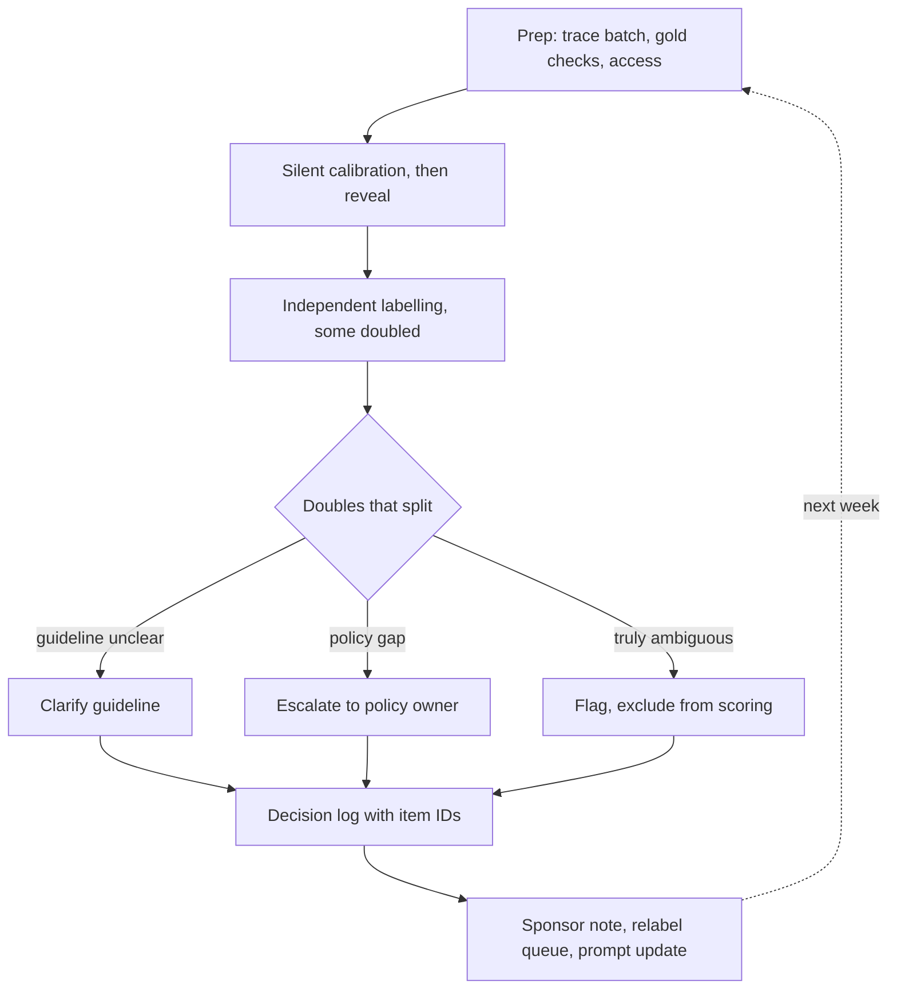

## TL;DR
A scheduled, facilitated block where customer SMEs calibrate, label agent outputs and traces
independently, then resolve disagreements into written guideline rules. Async requests to busy experts
stall, and tacit rules surface only live. The facilitator drives throughput while protecting independence.

## For agent builders
- **Why it matters for agents.** The labels from these sessions are your agent's golden set, your judge's
  calibration data and the source of new prompt rules. If sessions stall, every agent change ships on
  vibes.
- **Where it shows up in your stack.** The labelling tool loaded with rendered agent traces, the batch
  export from your eval harness, the decision log that feeds the agent's system prompt and guideline,
  and the agreement report after each session.
- **What you control.** Batch size from measured minutes per trace, which traces are doubled, gold checks,
  how traces are rendered, and having an engineer in the room who can explain what the agent saw.
- **What you can skip.** Building bespoke tooling; a self-hosted labelling tool or a controlled spreadsheet
  works if it opens on the item and captures label, rationale and reviewer.

## Decision case
### Scenario
A logistics customer needs a 400-trace golden set for its multi-step claims agent within 8 weeks, to
calibrate an LLM judge and set the acceptance bar. Three claims SMEs review: two in London, one in
Singapore. Figures are illustrative; batch sizes use `batch_size` from the Examples.

- **Expert time.** Each SME gives 150 minutes a week.
- **Speed.** Last week's dry run measured about 3 minutes per 6-step trace.
- **Per batch.** 3 gold checks per reviewer and a 25% double-label fraction.

Constraints:
- **Time zones.** The only shared working window is about 1 hour, once a week (late afternoon in Singapore).
- **Rules must surface.** Disagreements must become logged decisions with the claims director, because they
  feed the guideline, the judge prompt and the agent's system prompt.
- **Governance.** Traces stay in the customer's tenant; the labelling tool runs there.

### Options
| Option | How it works | Traces per week | Weeks to 400 | Rules and quality |
|---|---|---|---|---|
| **A. Weekly live session** | Calibration, labelling and disagreement review in the 1-hour overlap, about 30 minutes of it labelling | 16 | 25: misses the deadline | Best for rules, but the slot is too short |
| **B. Async link only** | Each SME labels 150 minutes a week alone | 112 on paper | 4 on paper, but async stalls on a day-one burst and a long tail | No calibration, and splits arrive as numbers in a column |
| **C. Async labelling plus a live review** | 120 minutes async labelling each, then 30 minutes live: silent calibration, then splits | 88 | 5 (400 / 88 ≈ 4.5) | Splits resolved weekly with the director |
| **D. Two-day on-site workshop** | About 600 labelling minutes each in one block | 472 in one go | 1 | Fatigue after an hour or two, travel for one SME, no fixes between rounds |

### Decision
Choose **C**, because the time-zone window is the binding constraint and rules must still surface live:
- **It meets the deadline with slack.** 88 traces a week reaches 400 in 5 weeks, leaving 3 weeks for relabels
  after guideline changes.
- **Independence comes for free.** Async labels are committed before the live call, so discussion cannot
  turn the loudest opinion into the label.
- **The live 30 minutes does what only live time can.** Silent calibration on a few shared traces, then
  about 22 doubled traces a week are reviewed for splits, and each outcome goes into the decision log with
  item IDs.
- **The stall risk of async is managed, not ignored.** The sponsor books the 120-minute async blocks in each
  SME's calendar, and the facilitator checks completion the day before the live call.

What would change it:
- **Async completion falls.** If any SME finishes under 80% of their batch two weeks running (a team
  threshold, not a standard), raise it with the sponsor and move part of their labelling into a second
  shared slot.
- **A much wider overlap.** A 90-minute window with 50 labelling minutes, as in the worked session, still
  gives only 32 traces a week, about 13 weeks to 400. The all-live format (A) returns only if the window
  reaches about 2 hours (about 75 labelling minutes, 52 traces a week, just under 8 weeks with no slack) or
  the deadline moves past 13 weeks.
- **Stable, high agreement.** Once pooled agreement and gold-check accuracy hold for several weeks, the live
  call can go fortnightly.

### Trade-offs accepted
- **Async labellers cannot ask questions in the moment.** Watch the "unsure" rate per reviewer and add the
  items they mark to the next silent calibration.
- **Fatigue is invisible async.** Track minutes per trace and gold-check accuracy by position in the batch,
  and split a 120-minute block into two if late items degrade.
- **One live session's agreement is noisy.** At 80% agreement, 22 doubles carry about ±17 points, so
  report agreement pooled over four weeks next to the weekly figure.
- **The director's time is fixed at 30 minutes.** Splits that need more go on an escalation list with a due
  date, tracked in the decision log.

### Review rubric
- **Capacity is computed.** The write-up sizes each format with reviewers, minutes, minutes per trace,
  gold checks and the double fraction, and states weeks to the target.
- **The binding constraint is named.** It identifies the one constraint (here the shared window) that
  eliminates options, with numbers.
- **Independence is protected.** Labels are committed before any discussion in the chosen format.
- **Rules have a path.** Splits become logged decisions with item IDs that reach the guideline, judge and
  agent prompt.
- **Stall and fatigue are monitored.** It names a completion check and a quality-by-position check.
- **Reversal triggers are stated** as observable thresholds, labelled as team choices where they are.

## Why it exists
- **SMEs are the bottleneck of every customer evaluation.** They are senior, booked, and labelling is not
  their job.
- **Async links stall on a predictable curve.** A shared spreadsheet or tool link with a deadline gets a
  burst of labels on day one, then a long tail, with the hardest items skipped because nobody is there to
  answer "what do you mean by this category?" Weeks pass, and the eval set is half done and labelled by
  whoever had time.
- **Async loses the most valuable output: the rules.** When two adjusters disagree on a claim and explain
  why in the same room, you learn the unwritten exception and write it down while the policy owner is
  present. Async, that disagreement shows up weeks later as two numbers in a column.
- **Sessions create accountability a link cannot.** A recurring calendar slot with a sponsor's backing is
  a commitment the customer's managers can plan around.
- **One long workshop fails too,** because fatigue degrades label quality after an hour or two, and a
  single session leaves no room to fix the guideline between rounds.

## How it works
### Before the session
1. **Prepare the batch: size it from capacity, not ambition.**

   ```
   capacity (labels) = reviewers × labelling minutes ÷ minutes per label
   every reviewer also labels the gold checks
   a double-label fraction d costs d extra labels per item
   ```

   So `items ≈ (capacity − reviewers × gold_checks) / (1 + d)`.
   - **Measure minutes per label in the first session** rather than guessing. Multi-step agent traces take
     several times longer than single answers, so measure them separately.
   - **Shuffle strata through the batch,** so fatigue late in the session does not fall on one segment.
   - **Include a few previously adjudicated "gold check" items** to detect drift in individual reviewers.
2. **Pre-load the tool.** Whatever it is (Label Studio, Argilla, the customer's own platform or a
   controlled spreadsheet), it must open on the item, show the guideline beside it, and capture label,
   rationale and reviewer. Fiddling with access during the session wastes the scarcest time.
3. **Render agent traces for humans.** Show the user request, each tool call with arguments and result, and
   the final answer, without internal ids or model names, so SMEs judge what the agent saw.
4. **Clear access.** Confirm every SME can open the data in the environment governance allows, the day
   before, not at minute one.
5. **Share the current guideline** and a one-page decision card.

### During the session
1. **Warm-up calibration (10–15 minutes).** Everyone labels the same handful of items silently, then
   reveals. This re-anchors reviewers to the guideline, because standards drift between sessions.
2. **Independent labelling (the bulk).** Reviewers work alone on assigned items, with a fraction
   double-assigned for agreement. No discussion yet, because talking first turns the loudest opinion into
   the label.
3. **Disagreement review.** The facilitator shows double-labelled items where reviewers split, asks each to
   explain, and drives to one of three outcomes:
   - a guideline clarification;
   - an escalation to the policy owner;
   - "genuinely ambiguous" (flagged and excluded from scoring).
4. **Decision log.** Each outcome goes into the guideline changelog on the spot, with the item IDs it
   affects, so relabelling can be targeted later and the agent prompt can be updated from the same entry.

### After the session
- **Close the loop:** adjudicate remaining splits, relabel items affected by guideline changes, recompute
  agreement.
- **Send the sponsor a short note:** items labelled, agreement, decisions made, open questions. That note
  is what keeps the next session on the calendar.
- **Read one session's agreement with care.** On 30 doubles, 80% agreement carries roughly ±14 points
  (√(0.8·0.2/30) ≈ 0.073), so a drop from 83% to 77% between sessions is noise.
- **Pool before concluding drift:** track agreement over a rolling window of sessions, and per reviewer
  pair, before concluding a guideline or a reviewer has drifted.
- **Same logic for gold checks:** one miss in three is weak evidence on its own and becomes a signal only
  when it repeats.

### Facilitation choices
- **Keep sessions to about 60–90 minutes,** because label quality decays with fatigue.
- **Have an engineer present** to answer "what is the system actually seeing?" questions, such as which
  document the retrieval tool returned or why a tool call failed.
- **No model pre-labels in calibration batches,** because pre-labels anchor reviewers; if you use them later
  to save time, measure how often reviewers change them.

## Diagram
One session in order: the silent calibration and independent labelling protect independence, and only
afterwards do splits become logged decisions that feed the guideline and the agent prompt.



## Examples
### Batch sizing for answers vs agent traces
Plug in last session's measured minutes per label; the interval shows why single-session agreement is noisy.

```python
import math

def batch_size(reviewers, minutes, min_per_label, gold_checks, d):
    """items = (capacity - reviewers * gold_checks) / (1 + d), capacity in labels."""
    capacity = reviewers * minutes / min_per_label
    return math.floor((capacity - reviewers * gold_checks) / (1 + d))

def agreement_halfwidth(p, n_doubles, z=1.96):
    return z * math.sqrt(p * (1 - p) / n_doubles)

items = batch_size(reviewers=3, minutes=50, min_per_label=0.943, gold_checks=3, d=0.25)
print(items, round(items * 0.25))                 # 120 items, 30 of them double-labelled
print(round(agreement_halfwidth(0.8, 30), 3))     # 0.143: one session, about +/-14 points
print(round(agreement_halfwidth(0.8, 120), 3))    # 0.072: four sessions pooled, about +/-7
print(round(1 - 0.9 ** 3, 2))                     # 0.27: a 90%-accurate reviewer misses >=1 of 3 gold checks

# Same slot, but reviewing 6-step agent traces at an assumed 3 minutes each
print(batch_size(reviewers=3, minutes=50, min_per_label=3, gold_checks=3, d=0.25))  # 32 traces
```

- **The agent line is the planning point:** a session that labels 120 short answers labels only about 32
  traces, so a 400-item agent golden set needs about 13 sessions instead of 4, far more than the sponsor
  expects.

### Worked session: contract-review pilot (timings and rates illustrative)
A 90-minute weekly session with three in-house lawyers reviewing a clause-extraction agent.

**Prep:** 120 clause-extraction outputs loaded, 30 of them assigned to two lawyers each, plus 3 gold check
items from last week's adjudication. Access was tested the previous afternoon; one lawyer's account lacked
permission and was fixed then.

| Slot | What happens | Outcome |
|---|---|---|
| 0–15 min, calibration | All three label 5 clauses silently. On a limitation-of-liability clause with a carve-out for confidentiality breaches, two mark "cap correctly extracted", one marks "fail, carve-out omitted" | The guideline was silent on carve-outs; the general counsel (present for this slot) rules they must be extracted; rule L4 and an example added, and L4 goes into the agent's prompt |
| 15–65 min, independent labelling | Last week measured a little under a minute per label: 3 lawyers × 50 minutes ≈ 159 labels; minus 3 gold checks per lawyer leaves 150; at a 25% double-label fraction, 150 / 1.25 = 120 items | 90 labelled once, 30 twice; each lawyer completes about 53 labels with no slack, which is why the batch was not padded |
| 65–85 min, disagreement review | 6 of the 30 doubles split | Four trace to "auto-renewal" when notice periods differ: escalated to the general counsel, due before next week. Two are slips by one lawyer, who also missed one of the three gold checks |
| 85–90 min, wrap | Facilitator reads back two decisions and one open question | Follow-up note sent |

- **The slips:** any one of those signals alone would be weak, but together they justify a second look at
  that lawyer's batch.
- **The note reports:** 120 items labelled, 24 of 30 doubles in agreement (80%, a wide interval at this
  size, so it is reported next to the four-week pooled figure), rule L4 added, 9 earlier items flagged for
  relabel under L4.

## Production patterns
- **Sponsor-owned recurring slot.** Have the business sponsor send a weekly 60–90 minute series to the
  SMEs, so it reads as their manager's priority rather than a vendor request. Monitor attendance and items
  labelled per session, and raise a drop with the sponsor the same week.
- **Pre-flight access check.** The day before, each SME opens one test item in the tool inside the allowed
  environment and confirms it with the facilitator. Monitor minutes lost to access or tooling in each
  session; the target is zero.
- **Rotating gold checks.** Draw about three adjudicated items per reviewer per session from a pool, so
  nobody sees the same check twice in a row. Track per-reviewer gold accuracy over a rolling window, and
  act on repeated misses rather than single ones.
- **Decision log that generates relabel work.** Each changelog entry records the rule id, date, deciding
  person and affected item IDs, and the tool or a script turns it into a relabel queue and a pending
  agent-prompt change. Monitor open relabel items and decisions still waiting on an escalation.
- **Pooled agreement report.** After each session, publish agreement for that session and pooled over the
  last four, per reviewer pair, and for the first versus second half of the session. Shorten sessions when
  the second half is consistently worse.
- **Batch export straight from agent traces.** Have the eval harness export the sampled runs, already
  rendered and stripped of version tells, into the labelling tool. Monitor minutes per trace by step count
  so the next batch is sized from real numbers.

## Trade-offs
- **Live sessions vs calendars.** They get decisions and throughput but demand synchronous time; when SMEs
  are across time zones, run async labelling with a short live disagreement review instead.
- **Policy owner in the room vs deference.** Splits resolve immediately, but reviewers may defer to them;
  have them join only for the disagreement segment.
- **Pre-labelling vs anchoring.** Agent outputs as pre-labels can raise throughput substantially, but anchor
  reviewers toward the agent; use them only after calibration, and track the change rate to detect
  rubber-stamping.
- **Longer sessions vs fatigue.** More labels per calendar booking, but quality drops; when gold-check
  accuracy falls in the second half, shorten the session.

## Pitfalls
- **Spending the first twenty minutes on access and tool problems.** Symptom: the session labels a third of
  its planned batch and the sponsor questions the time.
- **Discussing items before reviewers commit labels.** Symptom: near-perfect agreement in session that is
  not reproduced when the same reviewers label alone.
- **Making decisions without writing them down.** Symptom: the same disagreement is debated again two
  sessions later.
- **Not sending a summary to the sponsor.** Symptom: SMEs get pulled into other work and sessions are
  quietly cancelled.
- **Ignoring gold-check items.** Symptom: one reviewer's labels drift for weeks unnoticed and drag down agreement.
- **Sizing trace batches from answer-labelling speed.** Symptom: half the agent traces are unlabelled at
  the end and the hardest, longest ones are the ones skipped.

## When to use
- **Use when** SME labels are on the critical path of an agent pilot: building the golden set, calibrating
  an LLM judge, or reviewing a new failure category.
- **Prefer a weekly recurring slot** over an occasional workshop, because it allows guideline fixes
  between rounds.
- **Pure async labelling is fine** for stable, well-calibrated tasks with high agreement.
- **Measure** items per session, agreement on doubles, gold-check accuracy, unsure rate and decisions logged.
- **Interviews:** describe how you keep labels independent while still extracting rules from disagreement.

## Role lens
- **Engineer:** Prepares batches, gold checks and double assignments, makes sure the tool captures
  rationale and guideline version, and computes agreement immediately after the session.
- **Architect:** Chooses labelling tooling and where it runs under the customer's data constraints, and
  designs how session decisions flow into guidelines, judge prompts and datasets.
- **FDE:** Books and facilitates sessions, keeps the sponsor informed, steers disagreements to decisions,
  and protects SME time from tooling and access problems.

## Check yourself
**Q:** Your sessions label plenty of items but agreement on double-labelled items keeps falling week over
week. What might be wrong and what would you change?
**A:** First I would confirm the fall is real: with about 30 doubles per session, single-session
agreement swings by over ten points on noise alone, so I would compare pooled multi-session windows. If
it holds, falling agreement with steady throughput suggests drift rather than a bad guideline: reviewers'
private standards diverging, new item types in the batches that the guideline does not cover, or fatigue.
I would check gold-check accuracy per reviewer to find an individual drifting, look at which guideline
sections are cited in recent disagreements to find uncovered cases, and compare agreement in the first
versus second half of sessions for fatigue. Fixes would be a longer warm-up calibration, guideline
sections plus examples for the new case types, and shorter sessions if quality decays late.

## Interview questions
### Why run facilitated labelling sessions instead of sending SMEs a labelling link?
- **Throughput:** async requests to busy experts produce a day-one burst and a long tail, with the hardest
  items skipped because nobody can answer questions.
- **Rules:** disagreements explained live reveal unwritten exceptions that can be decided while the policy
  owner is present; async, they arrive weeks later as two numbers in a column.
- **Commitment:** a sponsor-backed recurring slot is something managers plan around.

### How do you size the batch for a 90-minute session with three SMEs?
- **Capacity first:** reviewers × labelling minutes ÷ measured minutes per label, leaving time for
  calibration and disagreement review (about 50 labelling minutes in a 90-minute slot).
- **Subtract gold checks and divide by 1 + d:** with three reviewers, 3 gold checks each and d = 0.25,
  about 159 labels become 120 items.
- **Do not pad:** an overfilled batch leaves the hardest items unlabelled at the end.

### How would you run a labelling session on multi-step agent traces rather than single answers?
- **Re-measure speed:** traces take several minutes each, so the same slot labels a fraction of the items;
  size the batch and the session count from that.
- **Render traces for humans:** request, tool calls with results, final answer, no version tells, and an
  engineer present to explain what each tool returned.
- **Label action and answer separately,** so a split tells you whether the guideline gap is about what the
  agent did or what it said.

### One reviewer missed one of three gold checks this week. What do you do?
- **Treat it as weak evidence:** even a 90%-accurate reviewer misses at least one of three about 27% of the time.
- **Look for a second signal:** repeated misses over a rolling window, or slips on double-labelled items in
  the same session.
- **If signals agree,** review that reviewer's batch and recalibrate together on the items concerned,
  rather than discarding their labels wholesale.

### How do you turn session disagreements into agent prompt rules without destroying label independence?
- **Order matters:** silent calibration and independent labelling come first, and labels are committed
  before any discussion.
- **Discuss only the splits afterwards,** asking each reviewer to explain, and log the outcome against item IDs.
- **Relabel from the log,** so the rule changes later labels without anyone editing their original
  judgement in the moment.
- **Ship the rule as one versioned change:** the log entry updates the guideline, the judge prompt and the
  agent's system prompt together, then the affected items are rescored before the change is called a win.

### When would you not run live sessions?
- **Stable, well-calibrated tasks** with high agreement can go async, because there are few new rules to surface.
- **SMEs across time zones:** label async, then hold a short live disagreement review.
- **Very small batches** may not justify a slot, but keep the decision log and agreement checks either way.

## Quiz
### Q: Why start each labeling session with a short silent calibration on shared items?
- [ ] To measure how fast each reviewer works
- [x] To re-anchor reviewers to the guideline and surface new ambiguities before the bulk of labelling
- [ ] To generate pre-labels for the rest of the batch
- [ ] To test whether the labelling tool is working
> Standards drift between sessions. A few shared items labelled silently, then revealed, show where
> reviewers diverge so the guideline can be clarified before hundreds of labels inherit the split.

### Q: What is the main risk of showing model outputs as pre-labels to SMEs?
- [ ] It slows the session down
- [ ] It exposes customer data to the model
- [ ] It makes agreement statistics impossible to compute
- [x] Reviewers anchor on the pre-label, so labels drift toward the model's view
> Anchoring makes reviewers accept plausible model outputs they would have failed unaided. If
> pre-labels are used for throughput, measure how often reviewers change them.

### Q: During disagreement review, two SMEs split for a reason the guideline does not cover. What is the best outcome?
- [ ] Take the more senior SME's label
- [ ] Average the labels and move on to save time
- [ ] Remove the item permanently from the dataset
- [x] Record a guideline decision or escalation with affected item IDs so labels can be updated
> The value of the session is turning splits into written rules. Logging the decision with item IDs
> lets the team relabel precisely and stops the same debate recurring.

## Use cases & projects
### Use cases
- **Building an agent golden set with scarce experts.** Weekly sessions turn a few SME hours into labelled
  traces plus written rules.
- **Calibrating an LLM judge for agent runs.** Session labels on doubled traces give the human agreement bar
  the judge is measured against.
- **Triage of a new agent failure category.** A focused session on fresh failing traces surfaces the missing
  rule fast, with the policy owner present.
- **Customer onboarding of reviewers.** Silent calibration plus gold checks bring new SMEs onto the shared
  standard.

### Mini project
**Plan and dry-run one trace-labelling session (1-2 hours).**
- **Goal:** prepare a realistic session for labelling agent traces and measure what it would actually yield.
- **Steps:** export 40 traces from a toy agent and render them as request, tool calls, answer; time yourself
  labelling 5 to get minutes per trace; size the batch with `batch_size`; pick doubles and gold checks;
  write the agenda, decision-log template and sponsor note template.
- **Done when:** you have a session pack (batch file, agenda, card, log template) and a one-line estimate of
  sessions needed to label a 400-trace golden set.
