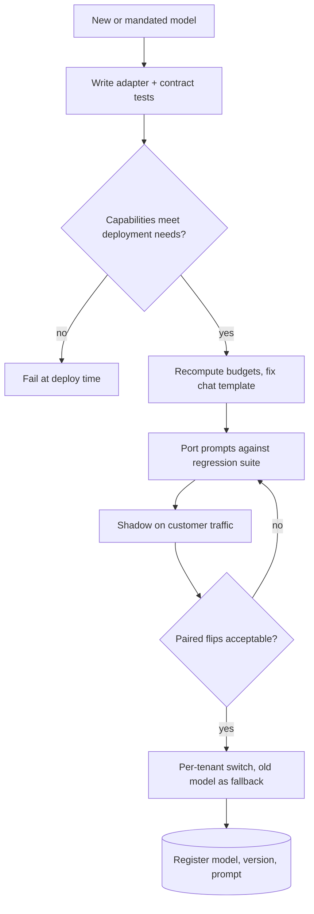

## TL;DR
Putting a different model behind a delivered agent: a new provider, fine-tuned adapter or
customer-mandated model. Models are not drop-in parts for a tool-calling loop: it takes an adapter,
capability check, ported prompts and the customer's suite as the gate.

## For agent builders
- **Why it matters for agents.** The agent loop branches on what the model returns: tool calls, their
  arguments, the finish reason and token usage. Each of those differs across providers, so a model swap
  can silently stop tools running, truncate answers or break the context budget.
- **Where it shows up in your stack.** The model adapter under your agent loop (or a gateway such as
  LiteLLM), the capability registry, the tokenizer used by the context packer, retry and fallback logic,
  and per-tenant model routing.
- **What you control.** The internal `Completion` contract, which capabilities a deployment requires,
  per-model prompt versions, the error taxonomy, pinned versions and the gate: contract tests, regression
  suite, shadow.
- **What you can skip.** Each provider's full SDK surface; map only the fields your loop reads.

## Decision case
### Scenario
A bank is moving your 6-tool support agent off a hosted model. Its security team mandates an open-weight
model on the bank's own GPUs, with a 32,000-token window and no parallel tool calls. This is the
migration from the agent scenario below, with the bank's 200-case regression suite as the gate.

Constraints (figures illustrative):
- **Data boundary.** No prompt, document or tool result may leave the bank's network, including during an
  outage, so a hosted fallback is not allowed.
- **Acceptance.** At least 170 of 200 suite cases (85%) must pass, and every tool call must parse.
- **Deadline.** Go-live in 6 weeks.
- **Context.** Prompts pack 10 chunks of 2,000 tokens; the new tokenizer counts about 15% more.
- **Capacity.** Two GPU nodes, sized for the current median of 4 steps per task.

### Options
| Option | How it works | Meets acceptance? | Deadline | Data boundary |
|---|---|---|---|---|
| **A. Swap the endpoint and model name** | Point the loop at the new server, run a smoke test | No: 131 / 200 and 88% of tool calls parsed | Days | Yes |
| **B. Full integration** | Adapter into `Completion`, capability check, chat-template test, token recount, ported prompts, mapped errors, suite and shadow | Yes: 176 / 200, 100% parsed | About 3 to 4 weeks | Yes |
| **C. B plus a fine-tuned adapter** | Also run the fine-tuning pipeline on the bank's traces | Possibly higher than 176 | Fails: permission review, pipeline and gate add weeks | Yes, if trained in the bank's cloud |
| **D. Ask for an exception** | Keep the hosted model behind a private endpoint | 182 / 200 | Depends on the bank | Only if its security team agrees |

### Decision
Choose **B**, because it meets acceptance inside the deadline without touching the boundary:
- **Most of the gap was mechanical.** Parsing string arguments and fixing the chat template take tool
  parsing from 88% to 100% and pass from 131 to 176.
- **176 / 200 is 88%**, above the 85% bar. The 6 cases below the hosted model's 182 go to the bank as
  paired flips, so it accepts the gap with evidence.
- **The context budget is recomputed.** At +15% the old pack totals about 33,300 tokens, over the window,
  so the packer deliberately takes 9 chunks, not 10.
- **The capability check runs at deploy.** No parallel tool calls means the loop is configured for one
  call per turn, which the contract tests cover.
- **The fallback stays inside the network.** It is a second replica of the same model, with handoff to a
  human queue, and it runs the same suite.

What would change it:
- **Pass below 170 after porting.** Then C is worth its weeks, and go-live moves.
- **An in-tenancy hosted model offered by the bank's cloud.** Then D becomes a cost and quality comparison.
- **A later need for parallel tool calls.** Then the capability entry fails at deploy, and the model choice
  is reopened.

### Trade-offs accepted
- **About 3 points of task pass (91% to 88%).** Watch the bank's flipped cases and its escalation rate
  per week after go-live.
- **More steps per task.** The median rises from 4 to 5, about 25% more model calls. Watch GPU utilisation
  and step-budget hits, and add capacity before they climb.
- **One fewer retrieved chunk.** Watch quality on long, document-heavy questions in the suite.
- **No hosted fallback.** Watch replica health and the share of requests handed to humans during outages.

### Review rubric
- **Mechanical differences are listed and tested.** The write-up names tool-call format, chat template,
  tokenizer, finish reasons and errors, each with a test.
- **The gate is the customer's suite.** It reports pass counts and paired flips, not a smoke test.
- **Budgets are recomputed.** It redoes the context arithmetic with the new tokenizer and states what was cut.
- **Fallback respects the constraints.** It says what serves traffic in an outage, and that it was tested.
- **Cost and capacity are per task.** It uses steps per task, not cost per token.
- **Reversal conditions are concrete.** It names the pass rate, capability or contract fact that would
  change the choice.

## Why it exists
- **In customer work the model is often not your choice.** A bank requires inference inside its own cloud
  tenancy, so you use the models its cloud offers. An air-gapped defence customer means an open-weight
  model on its GPUs. Another customer already has an enterprise agreement with a different provider. Your
  own fine-tuning pipeline ships a new adapter every few months.
- **The same application must run on a model it was not built against.** Prompts, tool-call formats,
  tokenizers, context limits, error semantics and quotas all differ.
- **"Change the endpoint and model name, run a smoke test" fails silently.** Instructions the old model
  followed reliably are followed loosely; tool calls arrive in a different structure, or arguments as a
  JSON string instead of an object; a new tokenizer counts more tokens, so retrieved documents get
  truncated.
- **More silent breaks.** A self-hosted model with the wrong chat template looks plausible but is
  measurably worse, with no error anywhere. A "max tokens" parameter means something different.
  Rate-limit errors carry a different status code, so retry logic treats them as fatal.
- **None of these crash a smoke test.** They show up as quality loss on the customer's traffic weeks
  later, so integration has to make differences explicit and measure their effect.

## How it works
### 1. Normalise behind an adapter
- **One internal interface:** messages in; text, tool calls, usage, finish reason and a typed error out.
- **One adapter per provider or serving stack** maps to and from it.
- **Why:** the application depends on the interface, not the vendor SDK, so swapping models changes one
  adapter and a config entry instead of every call site.
- **Gateways help but do not own the contract.** An AI gateway, LiteLLM and similar give you much of the
  mapping, but you still own the contract and its tests.

### 2. Declare capabilities, check them at startup
- **Models differ in** context window, maximum output, tool calling, parallel tool calls,
  schema-constrained output, vision input and streaming events.
- **Record these per model in a capability entry** and check what the application needs when it loads
  config.
- **So the failure moves to deploy time:** "this deployment needs strict JSON schema and the configured
  model does not support it" fails at deploy, not in production.

### 3. Recompute budgets with the right tokenizer
- **Use the target model's tokenizer or token-counting endpoint** for context budgeting: how many
  retrieved chunks fit, when to compact history.
- **Why:** the same text can tokenize to noticeably different counts across model families, and that
  difference is the whole safety margin.

### 4. Get the serving details right for self-hosted models
- **Use the model's own chat template** (from its tokenizer config), the correct stop tokens and the
  recommended sampling defaults.
- **Template mismatches degrade quality silently**, so keep a template unit test that renders a known
  conversation and compares it with the expected string.

### 5. Port the prompts, do not copy them
1. **Treat prompts as model-specific artifacts**, versioned per model in the prompt registry.
2. **Run the customer's regression suite** and read the failures.
3. **Adjust instructions and examples**, and repeat.
- **Expect format and refusal behaviour** to need the most work.

### 6. Map errors and quotas
- **Translate errors into your own taxonomy:** rate limited, overloaded, context too long, content
  filtered, invalid request, auth. Then retries, fallbacks and alerts behave the same on every model.
- **Size concurrency to the customer's quota** on their deployment, which is often lower than yours.
- **Map parameters, not just responses.** An output limit can be required on one API and optional on
  another. On reasoning models it may also have to cover hidden reasoning tokens, so a limit copied from a
  non-reasoning model can truncate answers.

### 7. Pin versions and gate the switch
1. **Configure an exact model version or snapshot**, not a moving alias, so the model cannot change under
   you.
2. **Adapter contract tests.**
3. **The customer's regression suite.**
4. **Shadow mode on their traffic.**
5. **A per-tenant routing switch** with the old model as fallback.
6. **Register what was deployed** (model id, version, adapter, prompt version) so incidents can be traced
   to a specific combination.

### What a model swap changes inside the agent loop
| Loop behaviour | What differs across models | What to test |
|---|---|---|
| **Tool-call detection** | Where calls live and how the finish reason names them | Loop runs a tool for every returned call |
| **Parallel tool calls** | Some models return several calls per turn, some one, some none | Loop executes and returns results for all of them |
| **Tool results back to the model** | The message shape that carries results and links them to call ids | Model reads the result instead of re-calling |
| **Steps per task** | Weaker or differently tuned models re-plan and retry more | Steps and tokens per completed task, not per call |
| **Stopping** | When the model ends its turn versus asks for another tool | Stop-reason mix and step-budget hits |

### Fallback models are integrations too
- **If the router fails over** from the primary to a second model during an outage, that second model
  needs its own capability entry, ported prompt and suite run.
- **Otherwise** failing over to an unported model turns an availability incident into a quality incident
  that is harder to see.

## Diagram
A model change passes mechanical checks first, then quality gates on the customer's own data, before the
per-tenant switch moves traffic.



## Examples
### Two adapters into one internal Completion
Two adapters mapping raw response shapes (as plain dicts, the way they arrive over HTTP) into one
internal `Completion`. The two shapes differ in exactly the ways that break naive integrations: where tool
calls live, whether arguments are a JSON string or an object, and what the finish reasons are called.

```python
import json
from dataclasses import dataclass, field

@dataclass
class Completion:
    text: str
    tool_calls: list = field(default_factory=list)   # [(name, args_dict)]
    finish: str = "stop"                             # stop | length | tool_use | filtered
    input_tokens: int = 0
    output_tokens: int = 0

def from_openai_chat(r: dict) -> Completion:
    ch, msg = r["choices"][0], r["choices"][0]["message"]
    calls = [(c["function"]["name"], json.loads(c["function"]["arguments"]))  # args: JSON string
             for c in msg.get("tool_calls") or []]
    finish = {"stop": "stop", "length": "length", "tool_calls": "tool_use",
              "content_filter": "filtered"}[ch["finish_reason"]]
    return Completion(msg.get("content") or "", calls, finish,
                      r["usage"]["prompt_tokens"], r["usage"]["completion_tokens"])

def from_anthropic_messages(r: dict) -> Completion:
    text = "".join(b["text"] for b in r["content"] if b["type"] == "text")
    calls = [(b["name"], dict(b["input"]))                                     # args: object
             for b in r["content"] if b["type"] == "tool_use"]
    finish = {"end_turn": "stop", "stop_sequence": "stop", "max_tokens": "length",
              "tool_use": "tool_use", "refusal": "filtered"}[r["stop_reason"]]
    return Completion(text, calls, finish,
                      r["usage"]["input_tokens"], r["usage"]["output_tokens"])
```

- **The application branches only on `finish == "length"` or `"tool_use"`.**
- **Without the mapping**, code that checks `finish_reason == "length"` silently never fires on a provider
  that says `max_tokens`, so truncated answers are shipped as complete.
- **Field names** follow these two public APIs at the time of writing.
- **Unknown finish values raise**, the strict choice: providers add values over time, and defaulting an
  unknown one to "stop" is how truncation or refusals go unnoticed.

### Worked budget: the tokenizer shift the adapter cannot fix
A deployment packs a 32,000-token window:

| Item | Old model (tokens) | New tokenizer, +15% (illustrative) |
|---|---|---|
| System prompt | 1,500 | ≈ 1,725 |
| History | 4,000 | ≈ 4,600 |
| 10 retrieved chunks × 2,000 | 20,000 | ≈ 23,000 |
| **Input total** | **25,500** | **about 29,300** |
| Output reserved | 4,000 | 4,000 |
| **Total vs window** | 29,500: a 2,500-token margin | about 33,300: over the window |

- **Measure the ratio** on the customer's documents, since it depends on language and content.
- **Two failure modes.** Depending on the stack, requests fail with a context-length error, or a packer
  that trusts the old counts silently drops the last two chunks.
- **The silent one is worse.** It shows up only as lower answer quality on long, document-heavy questions,
  exactly where the customer's hard cases are.

### Startup capability check and budget recompute
Fail at deploy when a model lacks a needed feature, and recompute how many chunks fit with the measured
token ratio instead of trusting old counts.

```python
CAPS = {
    "hosted-model-2025-01": {"context": 128_000, "strict_json": True, "parallel_tools": True},
    "open-model-v2":        {"context": 32_000, "strict_json": False, "parallel_tools": False},
}

def check_caps(model, min_context, features):
    c = CAPS[model]
    missing = [f for f in features if not c.get(f)]
    if c["context"] < min_context:
        missing.append(f"context<{min_context}")
    if missing:
        raise RuntimeError(f"{model} lacks {missing}: refusing to deploy")

def chunks_that_fit(window, reserve_out, system, history, chunk, ratio=1.0):
    free = window - reserve_out - round((system + history) * ratio)
    return max(0, free // round(chunk * ratio))

check_caps("hosted-model-2025-01", 32_000, ["strict_json"])                  # passes
print(chunks_that_fit(32_000, 4_000, 1_500, 4_000, 2_000))              # 11 (10 used, margin kept)
print(chunks_that_fit(32_000, 4_000, 1_500, 4_000, 2_000, ratio=1.15))  # 9: pack 9, deliberately
check_caps("open-model-v2", 32_000, ["strict_json"])   # RuntimeError: lacks ['strict_json']
```

### Agent scenario: migrating a support agent to a customer-hosted model
A customer mandates an open-weight model on its GPUs for a 6-tool support agent. Readout on the
customer's 200-case regression suite (illustrative numbers):

| Measure | Hosted model | Open model, endpoint swapped only | After adapter, template and prompt port |
|---|---|---|---|
| Task pass | 182 / 200 | 131 / 200 | 176 / 200 |
| Tool calls parsed | 100% | 88% (arguments arrived as strings) | 100% |
| Median steps per task | 4 | 7 | 5 |
| Step-budget hits | 1 | 19 | 3 |

- **Most of the drop was mechanical.** Unparsed arguments and a missing chat template made the agent
  re-call tools until the step budget, which looked like a weak model.
- **The remaining gap** (182 versus 176, with paired flips listed) is the real model difference, which
  the customer can now accept or reject with evidence.

## Production patterns
- **Gateway with pinned model aliases** — when several providers or tenants are in play. Map internal
  names to exact provider versions in one place (for example LiteLLM proxy's `model_list` config) and pin
  the gateway's own version. Monitor per-model error rates and keep contract tests for tool calls and
  streaming on every gateway upgrade.
- **Chat-template golden test** — for every self-hosted model. Render a fixed conversation with the
  tokenizer's `apply_chat_template(messages, tokenize=False, add_generation_prompt=True)` (Hugging Face
  Transformers) and compare it with the expected string in CI. Monitor that the test runs on every model
  or tokenizer upgrade.
- **Count tokens with the target model** — whenever budgets change. Use the target family's tokenizer or
  the provider's token-counting endpoint, and store a measured token ratio per customer corpus. Monitor
  context-length errors and the number of chunks packed per request.
- **Typed error taxonomy with per-class retry policy** — on every adapter. Map provider status codes and
  error types (rate limited, overloaded, context too long, filtered, invalid, auth) to one enum and attach
  retry and fallback rules to the enum, not the vendor code. Monitor retries on non-retryable classes:
  the target is zero.
- **Fallback models in the suite** — whenever a router can fail over. Run the customer's regression suite
  on every configured fallback, with its own ported prompt, before enabling it. Monitor quality metrics
  tagged by serving model so a failover dip is visible.
- **Recorded agent-loop contract test** — on every adapter or model change. Replay a few recorded
  multi-step conversations (including one with parallel tool calls and one tool error) through the
  adapter and the real loop, with stubbed tools. Assert that every call is parsed, executed and answered
  with a linked result. Monitor steps per task and step-budget hits per model.

## Trade-offs
- **Normalising adapter vs model-specific features.** Models become swappable, but a
  lowest-common-denominator interface hides features only one model has; expose those as optional
  capabilities rather than dropping them.
- **Gateway or library vs own code.** It saves mapping work, but adds a dependency whose updates can change
  behaviour; pin its version and keep your contract tests, especially for tool calls and streaming.
- **Pinned versions vs aliases.** Pinning gives stable behaviour, but you must plan migrations before the
  provider retires them; aliases avoid that work only when unannounced behaviour changes are acceptable.
- **Customer-mandated model vs quality.** It satisfies their data and procurement rules but may score
  lower; show the measured gap on their suite so the trade-off is their informed decision, not a surprise.

## Pitfalls
- **Reusing the old prompt unchanged.** Symptom: a sudden rise in format and instruction-following
  failures on the regression suite with no code change.
- **Counting tokens with the wrong tokenizer.** Symptom: context-length errors or silently truncated
  retrieved documents on long requests.
- **Serving an open-weight model with the wrong chat template.** Symptom: fluent outputs that score
  clearly below the model's expected quality, with no errors logged.
- **A moving alias instead of a pinned version.** Symptom: a quality or format change on a date when
  nothing was deployed.
- **A fallback model never run against the customer's suite.** Symptom: a quality dip and format failures
  that coincide exactly with the primary provider's outage window.
- **Not mapping provider errors.** Symptom: retries hammering a model on non-retryable errors, or giving
  up immediately on rate limits.
- **An agent loop that handles only the first tool call.** Symptom: on a model that returns parallel
  calls, some tools never run and the model asks for them again, inflating steps. Fix: execute every
  returned call and return all results, or disable parallel calls where the API allows it.
- **Judging a new model by cost per token.** Symptom: a cheaper model that costs more per task because it
  takes more steps. Fix: report cost and latency per completed task on the suite.

## When to use
- **Treat every model change as an integration project:** a new provider, a customer-mandated deployment,
  a fine-tuned adapter, or a version bump of the same model.
- **Scale the effort to the change.** A version bump may need only the regression suite and shadow; a new
  model family needs the adapter, capability entry, tokenizer, prompt porting and errors.
- **Measure:** paired flips on the customer suite, format-failure rate, latency, cost and error rates.
- **Interviews:** listing the non-obvious differences (templates, tokenizers, tool-call formats, error
  semantics) shows hands-on experience.

## Role lens
- **Engineer:** Writes the adapter and its contract tests, maps errors and tool-call formats, fixes chat
  templates and token counting, and ports prompts against the regression suite.
- **Architect:** Defines the internal model interface, the capability registry and per-tenant model
  routing, so customer-mandated models plug in without forking the application.
- **FDE:** Gets the customer's endpoint, quotas and allowed models, runs their suite on that model, and
  explains measured quality differences to their stakeholders.

## Check yourself
**Q:** A customer requires you to move from your hosted provider to an open-weight model on their GPUs.
After switching the endpoint, answers look fine in a demo but the regression suite drops sharply. What
do you check, in order?
**A:** First the mechanical causes, because they are cheap and common: that the server applies the
model's own chat template and stop tokens, that tool-call output is parsed correctly, and that context
budgets use the new tokenizer so documents are not being truncated. Then sampling settings and maximum
output. Only after those are clean would I attribute the remaining drop to the model, and then port the
prompt by reading failures, and if needed consider a larger model or a fine-tuned adapter. Throughout I
compare paired flips against the old model on the same suite.

## Interview questions
### Why is swapping the model name in config not a safe model migration?
- **Models differ beyond quality:** tool-call formats, tokenizers, chat templates, output-limit semantics,
  error codes and quotas.
- **None of these crash a smoke test.** They appear as silent quality loss: truncated context, unparsed
  tool calls, retries treating rate limits as fatal.
- **So** migrate through an adapter, capability check, prompt port and the customer's suite.

### How would you design the internal model interface for a multi-provider product?
- **Messages in; text, tool calls, usage, finish reason and a typed error out**, with one adapter per
  provider or serving stack.
- **Normalise finish reasons and argument types** (JSON string vs object), and raise on unknown values.
- **Expose model-only features as optional capabilities** declared in a registry and checked at startup.

### After a failover during a provider outage, complaints about bad answers spike. What went wrong?
- **The fallback model was never integrated.** No ported prompt, capability entry or suite run, so an
  availability incident became a quality incident.
- **Fix:** treat every configured fallback as a full integration and tag quality metrics by serving model.

### When would you accept a moving model alias instead of a pinned version?
- **Only when unannounced behaviour changes are acceptable**, such as internal prototypes without a gated
  eval.
- **For customer deployments, pin**, because an alias can change the model under a validated deployment;
  plan migrations before the provider retires the pinned version.

### A new tokenizer counts your customer's text 15% higher. What do you change?
- **Recompute the budget** with the target tokenizer: in a 32,000-token window with 4,000 reserved for
  output, 10 chunks of 2,000 no longer fit with 5,500 of system and history; 9 do.
- **Pack deliberately** rather than letting the server error or truncate silently, and monitor chunks per
  request and context-length errors.

### After swapping your agent's model, tasks take far more steps and often hit the step budget. How do you debug it?
- **Check mechanics first:** are all tool calls parsed (arguments as string versus object), are parallel
  calls all executed, and do results go back in the shape the new model expects, linked to call ids?
- **Then check the chat template and stop tokens** if self-hosted, since a wrong template makes the model
  ignore results and re-plan.
- **Only then compare models** on paired flips, steps per task and cost per completed task.

## Quiz
### Q: Why should context budgeting use the target model's own tokenizer?
- [ ] Tokenizers determine the model's sampling temperature
- [x] The same text can produce different token counts across model families, which changes what fits
- [ ] Only the target tokenizer can detect prompt injection
- [ ] Token counts are identical everywhere, but the API requires it
> Budgets sized with another model's tokenizer can overflow the context or truncate retrieved documents.
> Counting with the target tokenizer keeps the safety margin real.

### Q: A self-hosted model produces fluent but noticeably worse answers than expected, and no errors are logged. What is a likely integration cause?
- [ ] The GPU is too slow for the model
- [ ] The new model's context window is larger than the old model's
- [ ] The rate limiter is rejecting half the requests
- [x] Conversations are rendered with the wrong chat template
> The model was trained on a specific conversation format; a mismatched template still yields fluent
> text, so it degrades quality silently. Slow GPUs and rate limits cause latency and errors, not this.

### Q: What is the main reason to configure a pinned model version rather than a moving alias?
- [x] So the model cannot change underneath a validated deployment without a deliberate, tested switch
- [ ] Pinned versions are always cheaper per token
- [ ] Aliases are not allowed in customer contracts
- [ ] Pinned versions have larger context windows
> A moving alias can point at a new model at any time, invalidating the evals you gated on. Pinning makes
> every change an explicit integration step with its own regression run.

## Use cases & projects
### Use cases
- **Customer-mandated models.** A bank's agent must run on its cloud tenancy's models; the adapter and
  capability entry make that a config change plus a gated port.
- **Multi-provider agent platforms.** One agent loop runs on several providers per tenant, with typed
  errors driving the same retries and fallbacks everywhere.
- **Deploying fine-tuned adapters.** A new per-customer adapter is integrated and gated like any other
  model change.
- **Outage fallbacks.** A second model is pre-integrated and suite-tested so failover does not become a
  quality incident.

### Mini project
**Make one agent loop run on two providers (2-3 hours).**
- **Goal:** a tool-calling agent that works unchanged on two model APIs through one internal contract.
- **Steps:** reuse `from_openai_chat` and `from_anthropic_messages` above; write a loop that branches only
  on `Completion.finish`; add a capability entry per model and `check_caps` at startup; record three
  conversations (one with parallel tool calls, one with a tool error) and replay them through both
  adapters with stubbed tools; log steps, tokens and finish reasons per model.
- **Done when:** all three conversations complete on both providers, an unknown finish value raises, and
  you have a per-model table of steps per task and cost per completed task.

### Major project
This lesson feeds the module Capstone (see the module guide): integrating the utility's mandated model
in its own cloud tenancy, with a report on adapter changes, tokenizer and context effects, prompt
porting and paired flips on the regression suite.
