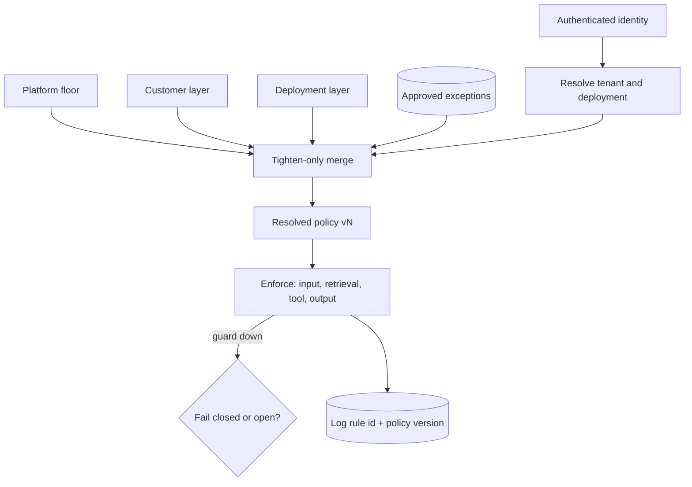

## TL;DR
Input, output and action policies resolved per tenant at request time: a platform floor nobody can
lower, plus each customer's rules on top. They live in versioned config, are enforced in code, not the
prompt, and are tested on each customer's labelled data.

## Why it exists
- **Customers legitimately disagree.** A bank forbids anything that reads like investment advice. A
  pharmaceutical company needs drug dosages discussed freely, which a generic medical filter would block.
  A retailer bans competitor mentions. A hospital needs PHI redacted in logs but not in the
  clinician-facing answer. One customer allows refunds up to 50 units of currency; another forbids them.
- **One global policy fails both ways.** The union of everyone's restrictions blocks the pharma
  customer's core use case; the intersection drops the bank's rule. So one global policy is too strict
  for some customers and too loose for others.
- **Rules in the system prompt are not enforcement.** "Never mention competitors" is a request to the
  model: a user can talk it out of it, a model upgrade can change how strictly it follows it, and there is
  no log of when it fired.
- **Forking code per customer drifts.** It enforces rules but turns every platform change into N merges,
  until nobody knows which customer has which fix.
- **Per-customer guardrails make policy data:** one enforcement engine, many policies, each versioned,
  tested and auditable per tenant.

## How it works
### Layers, and why the floor only tightens
Policy is resolved from layers, most general first:
1. **Platform baseline.** Non-negotiable: illegal content, credential leakage, cross-tenant data,
   prompt-injection defences. No customer can relax them, because the platform's own legal and
   reputational risk does not change per contract.
2. **Customer layer.** Set by the customer (often in their admin console) within an allowed envelope:
   blocked topics, PII entity types to redact, allowed languages, action limits, classifier thresholds.
3. **Deployment or use-case layer.** A customer's HR assistant and sales assistant need different rules,
   so policy can narrow further per deployment.

Merging is monotonic toward safety:

| Field type | Merge rule |
|---|---|
| Allow vs deny | Deny wins |
| Numeric limits | Take the minimum |
| Allowlists | Intersect |
| Blocklists | Union |

- **Relaxations are explicit exceptions, not overrides.** The pharma customer allowing dosage discussion
  is not a lower layer overriding a higher one; it is a platform-approved exception declared in the
  envelope, so it can be reviewed and audited.

### Resolution comes from identity, not the request
- **Take tenant and deployment from the authenticated context:** API key, SSO token, service identity.
- **Never from a request-body field or the prompt**, because otherwise a caller can choose the loosest
  policy by claiming to be another tenant.

### Enforcement points
Apply the resolved policy wherever risk enters or leaves:

| Point | Checks |
|---|---|
| **Input** | Topic and injection classifiers, size limits, language checks |
| **Retrieval** | ACL and document-scope filters, so the model never sees what the user may not |
| **Tool calls** | Argument validation against per-tenant limits (refund ceiling, allowed recipients), in the tool adapter before execution, because that is the last point you control |
| **Output** | PII redaction, banned-term and topic checks, format validation, citation requirements |

### Thresholds are per customer too
- **The threshold is the trade-off.** Classifier guards output a score; the cut-off that turns a score
  into a block decides false blocks versus misses. That depends on the customer's traffic and risk
  appetite.
- **Calibrate on each customer's labelled sample** (from their SMEs) and monitor the false-positive rate
  in production. A threshold copied from another customer is a guess.

The calibration procedure is ordinary operating-point selection:
1. **Score** the customer's labelled sample.
2. **Pick the threshold that meets their stated tolerance** on the side they care about most, usually
   misses: "catch at least 95% of real investment-advice responses". Among thresholds that meet it, take
   the one that blocks least.
3. **Read off the false-block rate** that threshold implies and show it to the customer, because that
   number is the cost they are accepting.

Two cautions:
- **Violations are rare.** A 1,000-case sample may hold only 20 positives, and a recall estimate from 20
  positives moves 5 points per case. Enrich the sample with known violations before trusting it.
- **The operating point drifts** when the customer's traffic changes, so re-check it on fresh labelled
  samples rather than treating it as set-and-forget.

### Fail-open or fail-closed
- **Guards are services that time out and fail**, and what happens then is itself per-customer policy.
- **Regulated tenant:** the output check fails closed (return a safe refusal or route to a human).
- **Low-risk internal tool:** may fail open, with the event logged and alerted.
- **Do not leave it to the exception handler.** Otherwise the guardrail is silently off during exactly
  the incidents when load is highest.
- **Streaming raises the same question at a finer grain.** Either buffer and check before release (safer,
  adds latency to the first visible token), or check chunk by chunk and retract, which only works for
  rules a partial answer cannot already violate.

### Change control and audit
1. **Policies are versioned config validated against a schema.**
2. **A change is diffed** and run against that customer's guardrail test cases, which belong in their
   regression suite.
3. **It rolls out in stages.**
4. **Every block or redaction logs the policy version and rule id**, so "why was this answer blocked?"
   has an answer and the customer's auditors can see the rule fired.

## Diagram
Identity picks the tenant, layers merge tighten-only (plus approved exceptions), and the one resolved
policy is enforced at four points, each logging rule id and version.



## Examples
### Tighten-only merge with an approval registry
A tighten-only merge of platform, customer and deployment layers. Relaxations are *requested* by a
layer but only take effect if the platform's approval registry lists them for that tenant, so the review
gate is in the code path, not in a wiki.

```python
from dataclasses import dataclass
from typing import Optional

@dataclass(frozen=True)
class Policy:
    blocked_topics: frozenset = frozenset()
    redact_pii: frozenset = frozenset()
    allowed_tools: Optional[frozenset] = None     # None = no restriction at this layer
    max_refund: float = float("inf")
    requested_exceptions: frozenset = frozenset() # e.g. {"dosage"}; inert until approved

APPROVED = {"pharma-co": frozenset({"dosage"})}   # owned by platform policy, change-controlled

def merge(tenant: str, *layers: Policy) -> Policy:
    tools = [l.allowed_tools for l in layers if l.allowed_tools is not None]
    asked = frozenset().union(*(l.requested_exceptions for l in layers))
    granted = asked & APPROVED.get(tenant, frozenset())          # unapproved asks are ignored
    return Policy(
        blocked_topics=frozenset().union(*(l.blocked_topics for l in layers)) - granted,
        redact_pii=frozenset().union(*(l.redact_pii for l in layers)),   # blocklists union
        allowed_tools=frozenset.intersection(*tools) if tools else None,  # allowlists intersect
        max_refund=min(l.max_refund for l in layers),                     # limits take the min
    )

PLATFORM = Policy(blocked_topics=frozenset({"weapons", "dosage"}), redact_pii=frozenset({"ssn"}))
ACME     = Policy(redact_pii=frozenset({"iban"}), max_refund=50.0,
                  allowed_tools=frozenset({"lookup_order", "issue_refund"}),
                  requested_exceptions=frozenset({"dosage"}))   # asks, but is not approved
ACME_FAQ = Policy(allowed_tools=frozenset({"lookup_order"}), max_refund=100.0)

p = merge("acme", PLATFORM, ACME, ACME_FAQ)
print(sorted(p.blocked_topics), p.allowed_tools, p.max_refund)
# ['dosage', 'weapons'] frozenset({'lookup_order'}) 50.0
print(sorted(merge("pharma-co", PLATFORM, Policy(requested_exceptions=frozenset({"dosage"}))).blocked_topics))
# ['weapons']
```

Read the output against the rules:
- **Acme asked to unblock dosage**, but no approval exists, so the request is inert.
- **The FAQ deployment tried to raise the refund ceiling to 100** and got 50, because limits take the
  minimum.
- **Its tool allowlist intersected Acme's down to `lookup_order`**, so a refund call is rejected in the
  tool adapter before it runs.
- **Only the pharma tenant**, with a recorded approval, has the floor relaxed, and only for the one topic
  approved.

### Calibrating one customer's classifier threshold
A bank's SMEs labelled a 1,000-case sample with 20 real investment-advice responses; they want at least
95% caught. The scores below are synthetic, standing in for a real classifier's output.

```python
import random

def pick_threshold(scores, labels, min_recall=0.95):
    """Block when score >= t. Return the highest t meeting min_recall, i.e. the fewest false blocks."""
    pos = [s for s, y in zip(scores, labels) if y]
    neg = [s for s, y in zip(scores, labels) if not y]
    for t in sorted(set(scores), reverse=True):
        recall = sum(s >= t for s in pos) / len(pos)
        if recall >= min_recall:
            false_block = sum(s >= t for s in neg) / len(neg)
            return t, recall, false_block
    return None

random.seed(7)
labels = [1] * 20 + [0] * 980
scores = [round(random.betavariate(5, 2), 3) if y else round(random.betavariate(2, 5), 3) for y in labels]
t, r, fb = pick_threshold(scores, labels)
print(f"threshold={t} recall={r:.2f} false_block={fb:.3f}")
# threshold=0.518 recall=0.95 false_block=0.108
```

| Reading | What it means for the customer |
|---|---|
| Recall 0.95 from 20 positives | 19 of 20 caught; one more miss would drop it to 0.90 (5 points per case) |
| False-block rate ≈ 0.108 | About 106 of 980 legitimate answers blocked: the cost they are accepting |
| Next step | Enrich with known violations, re-run, and re-check on fresh samples as traffic changes |

## Production patterns
- **Policy schema validated in CI** — when customers or FDEs edit policy. Define the customer-settable
  envelope as a schema (JSON Schema or a Pydantic model), reject unknown fields and out-of-envelope values
  in CI, and roll out per tenant in stages. Monitor rejected changes and block-rate shifts after each
  rollout.
- **Central policy engine for tool calls** — when several agents and tools share rules. Evaluate tool
  arguments against the resolved tenant policy in one service, for example Open Policy Agent with its
  decision logs on, called from each tool adapter. Monitor deny counts per rule and engine latency.
- **Decision logging with rule id and version** — always. Every block, redaction or tool denial writes
  tenant, deployment, rule id, policy version and request id to the audit log. Monitor block rate per
  rule per tenant; a sudden jump usually means a policy or model change.
- **Explicit failure mode per tenant** — for every guard dependency. Wrap each guard call with a timeout
  and a configured `fail_closed` or `fail_open` choice per tenant, not the default exception path.
  Monitor guard timeout rate and the count of fail-open passes.
- **Vetted presets before free-form rules** — when most customers want similar policies. Offer a few
  reviewed presets ("regulated finance", "internal tool") and let customers adjust only listed fields.
  Monitor how many tenants diverge from a preset and why.

## Trade-offs
- **Per-tenant policy vs maintenance.** One platform can serve customers with opposite rules, but every
  customer now has a policy to test and maintain; offer a few vetted presets when most want similar rules.
- **Code and classifiers vs prompt instructions.** Enforcement in code is reliable and auditable, at the
  cost of latency per check; prompt instructions are cheaper but should only shape tone, never carry a
  rule that must hold.
- **Strict vs loose thresholds.** Strict reduces misses but raises false blocks, which push users to work
  around the tool; the balance flips toward strict where one miss is a regulatory incident.
- **Self-service policy vs safety.** Letting customer admins edit their own policy speeds iteration, but
  needs schema validation, an envelope of allowed values and staged rollout, or a typo becomes a
  production outage.

## Pitfalls
- **A customer rule only as a system-prompt instruction.** Symptom: a user screenshot of the assistant
  doing the forbidden thing after a little persuasion.
- **Reading the tenant id from the request payload.** Symptom: a penetration test where changing one
  field gives a caller another tenant's looser policy.
- **Copying classifier thresholds between customers.** Symptom: one tenant reports constant false blocks
  while another reports misses, on the same model and policy.
- **Unhandled guard timeouts, so the request proceeds unchecked.** Symptom: violations cluster in
  high-load windows, when the classifier service was timing out and nobody noticed.
- **Not logging which rule and policy version fired.** Symptom: support spends hours unable to explain
  why a specific answer was blocked or redacted.
- **A customer layer silently relaxing the platform floor.** Symptom: an audit finding that a baseline
  protection was off for one tenant with no approval record.

## When to use
- **Use when** two customers need different rules, or a customer's compliance team hands you a written
  policy.
- **Start small:** a platform floor and a short schema of customer-settable fields; resist free-form rules
  until you have demand.
- **Avoid** for a single-customer deployment, where one policy is the customer policy.
- **Measure per tenant:** block rate, false-block rate on reviewed samples, misses found in red-teaming,
  and time to change a rule safely.
- **Interviews:** the key ideas are tighten-only merging and enforcement outside the prompt.

## Role lens
- **Engineer:** Implements the policy schema, the monotonic merge, enforcement hooks at input, retrieval,
  tool and output, and rule-level logging with policy versions.
- **Architect:** Defines the non-negotiable platform floor, the envelope customers may configure, and
  that tenant identity for policy resolution comes only from authentication.
- **FDE:** Translates the customer's compliance documents into policy config, calibrates thresholds with
  their SMEs on labelled samples, and walks their auditors through the logs.

## Check yourself
**Q:** A healthcare customer wants clinicians to see unredacted patient names in answers, but your
platform baseline redacts names everywhere. How do you support them without weakening the platform?
**A:** I would not let their layer simply override the baseline. Instead the baseline gets a declared,
reviewable exception, "names visible in output for authenticated clinician roles in this deployment",
approved by whoever owns platform policy and recorded with the contract basis. Redaction stays on in
logs, traces and any data leaving the deployment. The exception applies only for that tenant and role,
resolved from the SSO identity, and a guardrail test asserting names are still redacted for other roles
and in logs goes into their regression suite.

## Interview questions
### Why enforce customer rules in code instead of putting them in each customer's system prompt?
- **A prompt is a request, not an enforcement point.** Users can persuade the model, a model upgrade can
  change adherence, and nothing logs when the rule fired.
- **Code-level checks** at input, retrieval, tool and output are deterministic and log rule id and policy
  version, so they can be tested and audited.
- **Prompts still help** with tone, but never as the only carrier of a rule that must hold.

### Design the merge of platform, customer and deployment policies.
- **Tighten-only:** deny wins, numeric limits take the minimum, allowlists intersect, blocklists union.
- **Relaxations** are explicit exceptions that only take effect if a platform-owned approval registry lists
  them for that tenant.
- **Resolve the tenant from authentication**, never from the request body, so callers cannot pick a
  looser policy.

### A customer complains about constant false blocks. How do you debug it?
- **Check where the threshold came from.** If it was copied from another customer, it was a guess.
- **Recalibrate on their labelled sample:** meet their miss tolerance, then show the false-block rate it
  implies.
- **Check the sample size.** With 20 positives each case moves recall 5 points, so enrich with known
  violations first.

### Should a guardrail fail open or fail closed when its classifier times out?
- **It depends on the tenant, and it must be declared.** Regulated tenants fail closed with a safe refusal
  or human route; low-risk internal tools may fail open with logging and alerts.
- **The wrong answer is leaving it to the exception handler**, which silently disables the guard during
  high-load incidents.

### What does streaming output change about output guardrails?
- **Buffer and check** before release is safer but adds latency to the first visible token.
- **Check chunk by chunk and retract** keeps latency low, but only works for rules a partial answer cannot
  already violate, such as format checks rather than a leaked account number.

## Quiz
### Q: Why should a customer's "never discuss competitors" rule not live only in the system prompt?
- [ ] System prompts have a strict length limit
- [x] A prompt instruction is a request the model can be talked out of, with no enforcement or audit trail
- [ ] Models ignore system prompts entirely in multi-turn conversations
- [ ] Prompt instructions cannot be different per customer
> Prompts can be per customer, which is why the approach is tempting, but they are not enforcement. A
> code-level output check enforces the rule and logs every time it fires.

### Q: The customer layer sets a refund limit of 50 and that customer's deployment layer sets 100. What limit applies?
- [ ] Use the deployment's value because it is the most specific layer
- [ ] Use the larger value to avoid blocking legitimate refunds
- [x] Use the minimum, because merging is tighten-only
- [ ] Average them to balance risk and usability
> Monotonic merging means numeric limits take the minimum (50 here) and denies win, so no layer can loosen
> what a more general layer set. "Most specific wins" is the tempting rule, but it would let any lower layer
> relax a higher one; relaxations must be explicit, approved exceptions.

### Q: Where should the tenant used to resolve guardrail policy come from?
- [ ] A tenant field in the request body
- [ ] The model's own inference from the conversation
- [ ] A header that the client application sets freely
- [x] The authenticated identity, such as the API key or SSO token
> Anything the caller controls can be spoofed to select a looser policy. Binding policy to the
> authenticated identity makes the resolved rules as trustworthy as the authentication.
