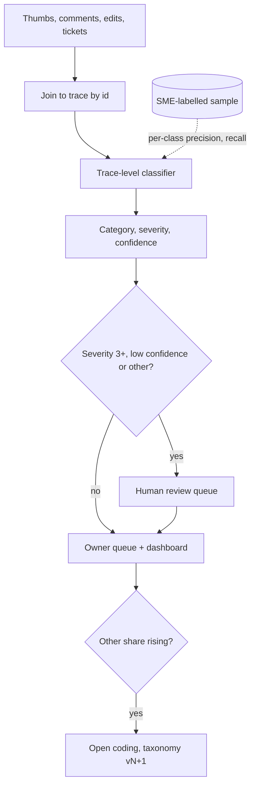

## TL;DR
Turning an agent's raw feedback (thumbs-down, edits, escalations, tickets) into labelled failure modes
with severity and an owning component. A thumbs-down rate says something is wrong; labelling whole agent
traces against a grown taxonomy says what and who fixes it.

## For agent builders
- **Why it matters for agents.** An agent fails in more places than a chatbot: retrieval, tool choice,
  tool arguments, tool errors, loops, guardrail denials, the final answer. "Wrong again" from a user
  could be any of them, and each has a different owner and fix.
- **Where it shows up in your stack.** Your tracing (trace ids on every step and feedback event), a
  trace-level LLM classifier with a schema, review queues, and the regression suite that confirmed
  failures feed.
- **What you control.** The taxonomy (grown from real agent traces), what the classifier sees (the whole
  trajectory), routing by severity and calibrated confidence, and prevalence estimates on random samples.
- **What you can skip.** Fancy classifier training at first; an LLM classifier with a strict schema and a
  weekly SME sample is enough until volume is high.

## Decision case
### Scenario
An e-commerce customer runs your five-tool order-support agent. Each week it produces about 1,000
negative signals: 600 escalations, as in the agent scenario below, plus 400 thumbs-downs and edits. The
customer wants a weekly report of failure modes with owners, and wants any harmful failure looked at fast.

Constraints (figures illustrative):
- **SME time.** Two support leads can review 400 items a week. 100 of those are a random calibration
  sample, which leaves 300 for a review queue.
- **Severity.** Every severity-3 or higher item (users acted on a wrong answer) must reach a human within
  2 business days. About 15% of items, so 150 a week, are severity 3 or higher.
- **Calibration.** At the calibrated threshold of 0.9 from the example below, about 61.4% of labels are
  confident enough to auto-route; assume the same share for the other 850 items.
- **Cost.** An assumed $0.01 per trace classification; the budget is not the binding constraint.
- **Data.** Traces contain addresses and order details, so classification runs under the production data
  agreement.

### Options
| Option | How it works | Severity-3 coverage | Human queue per week | Owner attribution |
|---|---|---|---|---|
| **A. Humans read a random 300** | No classifier; SMEs label a sample | About 30%: 70% of harmful items go unread | 300 | Good, on the sample only |
| **B. Comment-only LLM classifier** | Classify the feedback text | Severity guessed from comments | Small | Poor: most items become "wrong answer" |
| **C. Trace-level classifier, single pass** | Full trajectory, calibrated threshold, severity 3+ always human | 100% | 150 + about 328 low-confidence = about 478, over capacity | Good, by step |
| **D. C plus a second pass on low-confidence items** | A different model reclassifies the 328 below threshold; only disagreements go to humans | 100% | 150 + about 131 = about 281, at an assumed 40% disagreement | Good, by step |

### Decision
Choose **D**, because it is the only option that covers every harmful item inside SME capacity:
- **Severity is never left to confidence.** All 150 severity-3+ items go to humans, like the invented
  "delivered" answers in the agent scenario.
- **The second pass replaces most human reads.** Of about 328 low-confidence items, about 197 agree on
  both passes and auto-route flagged "agreed, low confidence"; about 131 disagree and reach humans.
- **The queue fits.** About 281 items is under the 300 available.
- **Cost is trivial.** About 1,328 classifications a week is about $13.
- **Trace-level input makes owners real.** Bad tool arguments go to the tool schema, unhandled errors to
  the loop, legitimate escalations to nobody.

What would change it:
- **Disagreement above about 46%.** At 150 + 0.46 × 328 the queue reaches about 300, so raise the threshold
  for the second pass or add reviewer time.
- **Severity-3 share rising.** If it grows past the queue, the customer must fund more review, because
  that rule is not relaxed.
- **A few thousand stable labels.** Then a small trained classifier replaces the first pass and cuts cost.

### Trade-offs accepted
- **Agreed low-confidence labels are unverified.** Two models can agree and both be wrong. Watch their
  error rate on the weekly random sample, reported separately from confident labels.
- **The random sample is only 100 items.** Per-class recall for rare classes is noisy. Watch the
  confidence intervals, and pool several weeks before correcting prevalence.
- **Twice the model calls on a third of items.** Watch disagreement rate per model version, since a model
  upgrade can shift it.
- **Taxonomy drift.** Watch the "other" share and schedule open coding when it rises.

### Review rubric
- **Capacity arithmetic is shown.** The write-up computes queue size from volume, severity share and
  confidence share, and compares it with reviewer hours.
- **Severity overrides confidence.** It routes the top severities to humans regardless of score.
- **The classifier sees the trace.** It lists the trajectory fields given to the classifier and how owners
  follow from them.
- **Calibration is measured.** It names the random sample, per-class precision and recall, and how the
  threshold was set.
- **Prevalence is corrected.** It distinguishes feedback rates from true rates and says how they are estimated.
- **Reversal conditions are concrete.** It names the disagreement rate or volume that would change the design.

## Why it exists
- **There is far more feedback than anyone can read.** Explicit signals are sparse and terse: a
  thumbs-down with no comment, or "wrong again". Implicit signals are plentiful but ambiguous:
  regenerating, heavily editing a draft, abandoning a session, escalating to a human. Support tickets mix
  model failures with login problems and feature requests.
- **One satisfaction rate gives nothing to act on.** A rise in thumbs-down could be retrieval missing a
  newly uploaded policy, a guardrail over-blocking, or latency.
- **Reading ad hoc sets priorities by anecdote**, ranked by whoever complained most memorably.
- **Classifying only the comment misattributes cause.** "This is wrong" does not say whether the retriever
  missed the document, the model ignored it, or the source itself was out of date: three owners, three
  fixes.
- **Classification makes feedback countable and routable:** how many failures of each kind, for which
  customer, in which component, and whether rising. It feeds the regression suite (which failures become
  tests), the roadmap and the customer conversation.

## How it works
### 1. Build the taxonomy bottom-up
1. **Pull a few hundred negative traces** and read each (error analysis).
2. **Write a free-text note** on what went wrong (open coding).
3. **Group the notes into categories.** Categories invented upfront ("hallucination", "bad answer") are
   too vague; categories from real traces map to fixes.
4. **Give each category** a definition, positive and negative examples, and an owning component.

A typical first taxonomy for a RAG assistant: retrieval miss, ignored context, unsupported claim, wrong
format, over-refusal or over-blocking, outdated source, latency or timeout, out of scope, missing
capability (a feature request), user error, and other.

For a tool-calling agent, open coding usually adds trajectory categories that a RAG taxonomy lacks:

| Agent category | Seen in the trace as | Typical owner |
|---|---|---|
| **Wrong tool chosen** | A plausible tool called when another fits the task | Prompt or tool descriptions |
| **Bad tool arguments** | Right tool, invalid or wrong values (wrong order id, wrong date format) | Tool schema or prompt |
| **Tool error not handled** | Tool returned an error; agent ignored it or invented a result | Agent loop |
| **Loop or budget hit** | Repeated calls, stop at the step limit | Agent loop or prompt |
| **Blocked by guardrail** | Denial event, user could not finish a legitimate task | Guardrails |
| **Premature stop** | Agent answered before doing a required step | Prompt |

### 2. Add severity and owner as separate fields
| Field | Says | Values |
|---|---|---|
| **Category** | What happened | The taxonomy above |
| **Severity** | How bad | Cosmetic, wrong but harmless, wrong and acted upon, safety or compliance |
| **Owner** | Who fixes it | Retrieval, prompt, guardrails, ingestion, product, customer content |

- **Why separate:** you can sort by severity within a category and route by owner.

### 3. Classify the trace, not the comment
- **Input to the classifier:** user input, retrieved passages, tool calls, final output, guardrail events
  and the user's feedback.
- **Retrieval visibility is the point.** It separates "the answer was in no retrieved passage" (retrieval
  miss) from "it was in passage 2 and the answer contradicts it" (ignored context).
- **Implementation:** an LLM classifier with a structured output schema works well; small fine-tuned
  classifiers are cheaper once you have enough labels.

### 4. Calibrate against humans, per class
1. **SMEs label a sample** with the same codebook.
2. **Measure their agreement first.** If humans cannot agree, the definition is the problem.
3. **Measure classifier precision and recall per class**, because overall accuracy hides that, for
   instance, "unsupported claim" is rarely detected.
4. **Re-check** after any taxonomy, prompt or model change.

### 5. Route by confidence
- **High-confidence labels** flow straight to dashboards and owners' queues.
- **Low-confidence or high-severity items** go to a human review queue, because that is where a wrong
  label costs most.
- **Self-reported confidence is weak.** A number an LLM writes into its own JSON is often poorly
  calibrated, so do not trust a 0.7 cut-off because it looks like a probability.
- **Option 1, calibrate it:** on the SME-labelled sample, find the score above which labels are, say, 90%
  correct, and use that as the threshold.
- **Option 2, derive it from agreement:** classify each item two or three times, or with two different
  models, and send disagreements to humans. It costs more tokens but is measurable.

### 6. Watch for taxonomy drift
- **Track the share of "other" and of low-confidence items.** A rise means a new failure mode (a new
  document type, a new user population).
- **Respond with another round of open coding** and a revised taxonomy with a version number, so trends
  across versions are interpretable.

### Know the sampling bias
- **Feedback comes from users who bother to give it**, skewed negative and toward heavy users.
- **Use it to find and rank failure modes**, then estimate true prevalence on a random traffic sample
  before claiming "12% of answers have retrieval misses".

### Correct for the classifier's own errors
Even on a random sample, classifier errors distort the rate. For one category, with recall (true-positive
rate) *r* and false-positive rate *f* measured against SME labels, the observed share *p_obs* relates to
the true share *p* by:

```
p_obs = r·p + f·(1 − p)      so      p ≈ (p_obs − f) / (r − f)
```

- **Worked case:** the classifier flags 3% of a random sample as "unsupported claim" but catches only half
  the real ones (*r* = 0.5) with a 1% false-positive rate. True share ≈ (0.03 − 0.01) / 0.49 ≈ 4%: the
  dashboard understates the category by a quarter.
- **The correction is only as good as the *r* and *f* estimates**, one more reason to keep a labelled
  calibration sample per customer.

### Handle it as customer data
- **Comments and traces contain personal and confidential information.**
- **Classification runs under the same data agreement as production**, and stored labels inherit the
  trace's retention and access rules.

## Diagram
Feedback is joined to its full trace before classification; severity and confidence decide whether a
label goes straight to an owner or to a human first.



## Examples
### Trace-level classifier with confidence routing
A trace-level classifier with a fixed schema and confidence routing. `llm_json` stands for any client call
that returns JSON validated against the schema.

```python
from enum import Enum
from pydantic import BaseModel, Field

class Category(str, Enum):
    retrieval_miss = "retrieval_miss"; ignored_context = "ignored_context"
    unsupported_claim = "unsupported_claim"; wrong_format = "wrong_format"
    over_refusal = "over_refusal"; outdated_source = "outdated_source"
    missing_capability = "missing_capability"; user_error = "user_error"; other = "other"

class Label(BaseModel):
    category: Category
    severity: int = Field(ge=1, le=4)         # 1 cosmetic ... 4 safety/compliance
    evidence: str                              # quote from the trace supporting the label
    confidence: float = Field(ge=0, le=1)

OWNER = {"retrieval_miss": "retrieval", "ignored_context": "prompt", "unsupported_claim": "prompt",
         "wrong_format": "prompt", "over_refusal": "guardrails", "outdated_source": "customer_content",
         "missing_capability": "product", "user_error": "enablement", "other": "triage"}

def classify(trace: dict, codebook: str, llm_json) -> dict:
    prompt = (f"{codebook}\n\nUSER INPUT:\n{trace['input']}\n\nRETRIEVED:\n" +
              "\n".join(f"[{i}] {p}" for i, p in enumerate(trace["passages"])) +
              f"\n\nTOOL CALLS:\n{trace['tool_calls']}\n\nGUARDRAIL EVENTS:\n{trace['guardrail_events']}" +
              f"\n\nOUTPUT:\n{trace['output']}\n\nUSER FEEDBACK:\n{trace['feedback']}")
    label = Label.model_validate(llm_json(prompt, schema=Label.model_json_schema()))
    needs_human = label.confidence < 0.7 or label.severity >= 3 or label.category == Category.other
    return {"trace_id": trace["id"], **label.model_dump(mode="json"),
            "owner": OWNER[label.category.value], "queue": "human" if needs_human else "auto"}
```

- **The routing rule is deliberately asymmetric.** Severity 3 and above goes to a human whatever the
  confidence, because a confidently wrong label on a compliance failure costs far more than a reviewer's
  minute.
- **The 0.7 here is a placeholder**; replace it with a calibrated threshold (next example).

### Calibrating the threshold and correcting prevalence
Pure Python on an SME-labelled sample: each item is (classifier confidence, label was correct).

```python
def calibrated_threshold(scored, target=0.90):
    """Lowest confidence cut-off at which auto-routed labels are >= target correct."""
    for t in sorted({c for c, _ in scored}):
        kept = [ok for c, ok in scored if c >= t]
        if sum(kept) / len(kept) >= target:
            return t, len(kept) / len(scored)          # threshold, share auto-routed
    return None

def corrected_prevalence(p_obs, recall, fpr):
    return min(1.0, max(0.0, (p_obs - fpr) / (recall - fpr)))

sme = [(0.95, True)] * 50 + [(0.95, False)] * 2 + [(0.9, True)] * 30 + [(0.9, False)] * 4 \
    + [(0.8, True)] * 20 + [(0.8, False)] * 10 + [(0.7, True)] * 10 + [(0.7, False)] * 14
print(calibrated_threshold(sme))                       # (0.9, 0.614...): 0.7 would be far too low
print(round(corrected_prevalence(0.03, 0.5, 0.01), 3)) # 0.041, not the 0.03 the dashboard shows
```

### Worked week: rank by count × severity
Illustrative week (numbers invented for the walkthrough): 1,400 negative signals for one customer.

| Group | What the classifier found | Action |
|---|---|---|
| Not model failures | About 150 items: login problems, feature requests | Route straight to product or support |
| Outdated source | A large group; roughly two-thirds cite one policy document the customer replaced last month | Re-ingest the replaced policy: an ingestion and customer-content fix, not a model fix |
| Retrieval miss | The other largest group | Retrieval owner's queue |
| Unsupported claim, refund eligibility | Only 40 items, but severity 3: users acted on them | All sent to human review by the severity rule; added to the regression suite before changing the prompt |

- **Count alone** would put outdated sources first anyway; **count × severity** makes the 40 refund cases
  jump the queue.

### Agent scenario: one week of an order-support agent's escalations
An order-support agent with five tools logs 600 escalations to humans in a week (illustrative numbers).
The trace-level classifier, checked against a 100-item SME sample, groups them:

| Category | Items | Severity | What the trajectory showed | Fix |
|---|---|---|---|---|
| Bad tool arguments | 210 | 2 | Order ids passed with a prefix the API rejects | Tool schema: pattern on the argument, plus a regression case |
| Tool error not handled | 120 | 3 | Carrier API timeouts; agent told users "delivered" | Loop: surface tool errors, never invent results |
| Loop or budget hit | 90 | 2 | Repeated `lookup_order` after the same error | Return structured errors the model can act on |
| Legitimate escalation | 150 | 1 | Policy says a human decides | None: not a failure |
| Other | 30 | – | Mixed | Next open-coding session |

- **The 120 invented "delivered" answers go first** despite a lower count, because users acted on them.
- **A comment-only classifier** would have called most of these "wrong answer", with no owner.

## Production patterns
- **Stable trace ids on every feedback event** — from day one of a deployment. Attach the request's trace
  id (for example the OpenTelemetry trace id) to thumbs, edits and escalations so feedback joins to
  retrieval, tool and guardrail spans. Monitor the share of feedback events that fail to join.
- **Schema-constrained labels** — for the LLM classifier. Validate output against a Pydantic model (as
  above) or the provider's structured-output mode, and retry or route to humans on validation failure.
  Monitor validation-failure rate per model version.
- **Self-consistency routing** — when self-reported confidence is uncalibrated. Classify each item twice
  (or with two models) and send disagreements to the human queue. Monitor disagreement rate and the
  human-confirmed error rate on agreed labels.
- **Weekly calibration sample** — per customer. SMEs label a fixed-size random sample each week; recompute
  per-class precision, recall, the confidence threshold and corrected prevalence. Monitor per-class recall
  for rare, severe classes.
- **"Other" share alert** — always on. Alert when "other" or low-confidence share rises above its usual
  band, and schedule an open-coding session and taxonomy version bump. Monitor trends only within one
  taxonomy version.
- **Step-level evidence in labels** — for agent traces. Require the classifier's `evidence` to name the
  step index and tool call where the failure began, and route by the owner of that step. Monitor the share
  of labels whose cited step a reviewer disagrees with, since misplaced blame sends fixes to the wrong team.

## Trade-offs
- **LLM classifier vs small trained classifier.** The LLM handles free text and full traces with little
  setup, but costs tokens per item and drifts with model changes; a trained classifier is cheaper once you
  have a few thousand labels.
- **Fine-grained vs coarse taxonomy.** Fine-grained points directly at fixes but lowers annotator
  agreement; merge categories whose distinction does not change who fixes the problem.
- **Auto-routing vs human review.** Auto-routing high-confidence labels saves reviewer time, but rare
  severe failures can be mislabelled confidently; always send the top severities to humans regardless of
  confidence.
- **Implicit vs explicit signals.** Edits and regenerations give far more volume than thumbs, but are
  noisier; weight them lower and validate their meaning on a sample before using them as targets.

## Pitfalls
- **Classifying only the user's comment.** Symptom: most items labelled "inaccurate answer" with no way to
  tell retrieval failures from generation failures.
- **Inventing the taxonomy upfront.** Symptom: a large "other" bucket and categories that map to no team's
  backlog.
- **Reporting overall classifier accuracy only.** Symptom: a rare but critical class never appears on the
  dashboard because the classifier almost never predicts it.
- **Trusting self-reported confidence as a probability.** Symptom: a human-review queue that rarely
  catches errors while confidently mislabelled items flow into owners' backlogs.
- **Treating feedback rates as prevalence.** Symptom: alarming numbers that a random-sample audit of
  traffic does not reproduce.
- **Changing the taxonomy without versioning.** Symptom: a trend chart with a sudden jump that is a
  relabelling artifact, not a real change.
- **Truncating long agent traces before classification.** Symptom: failures that began in an early tool
  call get blamed on the final answer. Fix: pass a compact step list (tool, arguments, result status)
  for every step, with full text only around errors.
- **Counting every escalation as a failure.** Symptom: an alarming failure rate dominated by escalations
  the customer's policy requires. Fix: a "legitimate escalation" category with severity 1.

## When to use
- **Start when** a deployment produces more feedback than one person reads in a day; before that, read
  everything yourself and build the first taxonomy from it.
- **Re-run open coding** after major launches or new customer onboarding.
- **Do not automate** classification before humans agree on the codebook.
- **Measure:** per-class precision and recall against SME labels, the "other" share, and time from
  feedback to routed owner.
- **Interviews:** trace-level classification and bottom-up taxonomies distinguish real practice from
  dashboard talk.

## Role lens
- **Engineer:** Builds the trace-level classifier with a strict schema, the routing by confidence and
  severity, and per-class evaluation against human labels.
- **Architect:** Ensures traces capture retrieval, tool and guardrail data with stable ids so feedback
  can be joined to them, and that labels inherit data retention rules.
- **FDE:** Runs the open-coding sessions with customer SMEs, agrees severity definitions with the
  customer, and brings the weekly classified summary to the customer review.

## Check yourself
**Q:** Thumbs-down rate for one customer doubled after a release. Your classifier says most new items
are "unsupported claim". How do you confirm and act?
**A:** First check the classifier itself: sample the new items and have an SME label them, because a
release can also change what the classifier sees. If confirmed, compare the traces: are the claims absent
from retrieved passages (retrieval changed) or present but contradicted (prompt or model changed)? Diff
the release for retrieval, prompt and model changes, run the customer regression suite, and add the
confirmed failures as cases. Estimate prevalence on a random traffic sample, since feedback is biased,
then roll back for that tenant if the regression is real and severe.

## Interview questions
### Why build a feedback taxonomy bottom-up instead of starting from standard categories?
- **Upfront categories are vague.** "Hallucination" or "bad answer" do not say who fixes what.
- **Open coding on a few hundred real negative traces** produces categories that map to components and
  fixes, each with definitions, examples and an owner.
- **The "other" share then tells you** when the taxonomy needs a new version.

### How would you design the input to a feedback classifier so it attributes cause correctly?
- **Give it the whole trace:** input, retrieved passages, tool calls, guardrail events, output and the
  feedback.
- **That separates** a retrieval miss (answer in no passage) from ignored context (answer in a passage
  but contradicted), which have different owners.
- **Store severity and owner as separate fields** from category.

### Your human-review queue rarely finds errors, yet owners keep getting mislabelled items. Why?
- **The confidence threshold trusts self-reported scores** that are poorly calibrated.
- **Fix:** calibrate the cut-off on SME labels (the score above which labels are, say, 90% correct), or
  route on agreement between repeated or dual-model classifications.
- **Keep severity 3+ in human review** regardless of confidence.

### The dashboard says 3% of answers are unsupported claims. Is that the real rate?
- **Not if it comes from feedback**, which is self-selected and negatively skewed; measure on a random
  traffic sample.
- **Even then correct for classifier error:** p ≈ (p_obs − f) / (r − f). With recall 0.5 and 1%
  false positives, 3% observed is about 4% true.

### When would you switch from an LLM classifier to a small trained one?
- **Once you have a few thousand labels** and volume makes per-item tokens expensive.
- **The trained classifier is cheaper and stable**, but needs retraining when the taxonomy changes; keep
  the LLM for new categories and low-confidence items.

### How would you classify feedback on a multi-step tool-calling agent so each failure reaches the right team?
- **Classify the trajectory:** every step's tool, arguments and result status, plus retrieval and
  guardrail events, so the label can name where the failure began.
- **Use agent categories from open coding** (wrong tool, bad arguments, unhandled tool error, loop,
  premature stop, guardrail block) with an owner each.
- **Rank by count × severity** and turn confirmed high-severity items into regression cases.

## Quiz
### Q: Why should the classifier see retrieved passages and tool calls, not only the user's comment?
- [ ] Comments are too short to embed
- [ ] It reduces the classifier's token cost
- [x] Cause and owner depend on whether the information was retrieved and then ignored, or never retrieved at all
- [ ] Users' comments are not allowed to be stored
> "This is wrong" is the same comment for a retrieval miss and for ignored context, but they have different
> owners and fixes. Only the trace shows which one happened.

### Q: A feedback taxonomy shows a growing share of items labelled "other". What does it most likely indicate?
- [ ] The classifier's temperature is too high
- [x] A new failure mode has appeared that the taxonomy does not cover, so open coding should be repeated
- [ ] Users are giving less feedback overall
- [ ] The severity scale has too many levels
> A rising "other" share means real items do not fit existing definitions. Reading a sample and revising
> the versioned taxonomy keeps categories mapped to actual fixes.

### Q: Why is the rate of a category in feedback not a good estimate of its prevalence in all traffic?
- [ ] Feedback is always anonymised, so it cannot be counted
- [ ] LLM classifiers cannot estimate rates
- [ ] Prevalence is only defined for classification tasks
- [x] Feedback comes from a self-selected, negatively skewed group of users, so it over- or under-represents failures
> Feedback is excellent for discovering and ranking failure modes, but its sample is biased. A random
> traffic sample labelled with the same codebook gives the true rate.

## Use cases & projects
### Use cases
- **Weekly triage for a deployed support agent.** Classified escalations and thumbs-down go to prompt,
  tool, retrieval and guardrail owners with counts and severity.
- **Post-release regression detection.** A jump in one agent category (say, bad tool arguments) after a
  release points at the shared change that caused it.
- **Customer reviews.** The FDE brings a classified summary showing which failures were fixed and which
  are customer-content issues.
- **Feeding the regression suite.** Confirmed, high-severity classified traces become blocking cases.

### Mini project
**Classify a week of synthetic agent traces (2-3 hours).**
- **Goal:** turn 200 negative agent traces into owned, severity-ranked categories with measured accuracy.
- **Steps:** generate 200 synthetic traces from a small order agent with injected failures (bad
  arguments, unhandled tool errors, loops, legitimate escalations); open-code 50 by hand into a taxonomy;
  extend the `Category` enum and `OWNER` map; classify all 200 with the `classify` function; hand-label
  60 and compute per-class precision and recall and a calibrated threshold with `calibrated_threshold`.
- **Done when:** you have a ranked count × severity table, per-class precision and recall, the calibrated
  threshold, and the top two categories each turned into a regression case.

### Major project
This lesson feeds the module Capstone (see the module guide): classifying at least 100 simulated
production signals for the utility's email agent at trace level, with per-class precision against human
labels and one issue carried through to a product fix.
