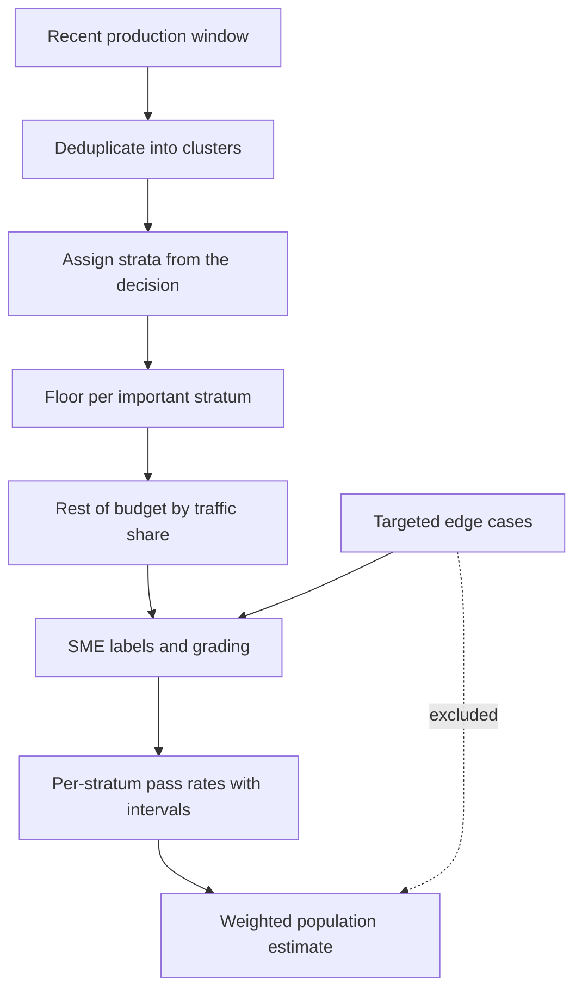

## TL;DR
Choosing which real customer inputs enter the eval set so its score predicts production. Sample recent
traffic by stratum with a floor per important stratum, then re-weight to the real mix: a trustworthy
overall number plus enough cases per segment to act on.

## Why it exists
- **An eval score is an estimate of future traffic,** and an estimate is only as good as the sample behind
  it. Customers usually hand over the cases their team remembers (the weird ones, the escalations, the
  demo favourites) or a random export. Both mislead, in opposite directions.
- **Hand-picked sets reflect memory, not traffic.** They over-represent memorable edge cases and
  under-represent the boring bulk, so the score is pessimistic on volume and says nothing reliable about
  the mix. They are also biased toward problems the team has already seen and discussed.
- **Simple random samples starve rare strata.** If legal-threat tickets are 2% of traffic, a 300-item
  random sample holds about six, too few to tell 60% accuracy from 90%, though a wrong answer there is the
  most expensive kind.
- **Old samples go stale.** Last year's traffic misses new products, policy changes and seasonal patterns.
- **What this buys:** a set faithful to production in aggregate and dense enough in the strata where
  decisions are made.

## How it works
### 1. Define the population and the sampling unit
- **State exactly which traffic the system will see:** channels, products, languages, date range.
- **Pull from the most recent representative window,** ideally the same period of the business cycle the
  launch will face, because traffic composition drifts and old samples encode old policies.
- **Pick the unit deliberately:** sample conversations or documents, not turns or pages, when the system is
  judged on the whole; cap items per account so one heavy customer cannot dominate.
- **Check what the logs cannot contain.** If today's process routes legal threats straight to a phone
  team, they never reach the ticket log and no sampling scheme recovers them; fill that gap from another source.

### 2. Choose strata from the decision, not the data
- **Strata are segments needing a separate answer:** intent or document type, customer tier, language,
  risk class, input length band, source system.
- **Test each one:** "if quality differed here, would we act differently?" Each stratum costs sample
  budget, so keep only those with a consequence.
- **When nobody knows the segments yet,** cluster a large unlabelled slice by embedding, have SMEs name the
  clusters, and promote the ones with distinct risk to strata.

### 3. Size the budget and allocate with a floor
Precision depends on the count in a stratum, not its share of traffic:

```
standard error of a pass rate p on n items  ≈ √(p(1−p)/n)
  p = 0.9, n = 100  ->  0.03, so a 95% interval is roughly ±6 points
count needed for a target half-width E       n ≈ 1.96² · p(1−p) / E²
rule of three: zero failures in n items      one-sided 95% upper bound ≈ 3/n
  proving "under 1% failures"  ->  roughly 300 clean items in that stratum
```

- **Six items cannot distinguish anything** (about ±24 points at 90%).
- **Allocation is a deliberate compromise:**

| Allocation | Rule | Good for | Weakness |
|---|---|---|---|
| Proportional | mirror traffic | the headline number, only when strata behave alike | rare strata get a handful |
| Neyman | n_h ∝ N_h·σ_h (σ_h is the stratum's spread) | minimum variance of the population estimate | still no usable count in a 2% stratum |
| Floor plus proportional | floor per important stratum first, rest by traffic | both a headline and per-stratum answers | slightly wider headline interval |

### 4. Deduplicate before sampling
- **Logs are full of near-duplicates:** templated emails, retries, the same invoice resubmitted.
- **Cluster by normalised text or embedding similarity and sample clusters, not rows,** because fifty
  copies of one template make the set look large while testing one case.

### 5. Re-weight to report the population number
- **The raw average is biased** toward oversampled strata, because strata were sampled at different rates.
- **Population estimate:** with W_h the stratum's share of traffic and p_h its measured pass rate,
  p̂ = Σ W_h·p_h, with standard error √(Σ W_h²·p_h(1−p_h)/n_h).
- **The price of floors:** oversampled small strata add almost nothing to the variance (W_h² is tiny),
  while the bulk stratum, which lost items to the floors, contributes most of it.
- **Report per-stratum numbers with their own intervals** alongside the weighted one.

### 6. Add targeted cases as a labelled minority
- **Known failure modes, adversarial inputs and SME-nominated edge cases belong in the suite,** tagged as a
  separate "targeted" stratum excluded from the weighted population metric.
- **Mixing them in silently** makes the headline number unrepresentative.

### 7. Keep it fresh and leak-free
- **Resample a slice each cycle** from new traffic.
- **Keep a holdout** nobody tunes against.
- **No sampled case** may also appear as a prompt example or in a fine-tuning set.

## Diagram
Floors make rare strata measurable; re-weighting by traffic share turns the oversampled set back into a
production estimate. Targeted cases stay out of the headline.



## Examples
### Stratified sample with floors, then re-weighting
Ticket triage for a telecom customer. Of 10,000 recent tickets, 9,000 are billing, 800 cancellation and
200 legal threats (illustrative mix). The budget is 300 SME-labelled items, with a floor of 60 per
stratum so the rare one is measurable.

```python
import random, math
from collections import defaultdict

def stratified_sample(logs, key, budget, floor, seed=7):
    """Floor per stratum first, the rest of the budget proportionally. Returns sample, weights."""
    rng, strata = random.Random(seed), defaultdict(list)
    for r in logs:
        strata[key(r)].append(r)
    spare = budget - floor * len(strata)
    sample, weight = [], {}
    for s, items in strata.items():
        n = min(len(items), floor + round(spare * len(items) / len(logs)))
        sample += [(s, r) for r in rng.sample(items, n)]
        weight[s] = len(items) / n          # each sampled item stands for this many real ones
    return sample, weight

def weighted_estimate(graded, weight, N):
    """graded: (stratum, correct) pairs. Population estimate and its standard error."""
    by = defaultdict(list)
    for s, ok in graded:
        by[s].append(ok)
    est = se2 = 0.0
    for s, oks in by.items():
        W, p = weight[s] * len(oks) / N, sum(oks) / len(oks)   # W = stratum share of traffic
        est += W * p
        se2 += W * W * p * (1 - p) / len(oks)
    return est, math.sqrt(se2)

logs = ([{"intent": "billing"}] * 9000 + [{"intent": "cancel"}] * 800
        + [{"intent": "legal"}] * 200)
sample, w = stratified_sample(logs, key=lambda r: r["intent"], budget=300, floor=60)
n = {s: sum(t == s for t, _ in sample) for s in w}
print(n)            # {'billing': 168, 'cancel': 70, 'legal': 62}

true_acc = {"billing": 0.95, "cancel": 0.85, "legal": 0.60}   # pretend grading results
graded = [(s, i < round(true_acc[s] * n[s])) for s in n for i in range(n[s])]
raw = sum(ok for _, ok in graded) / len(graded)
est, se = weighted_estimate(graded, w, len(logs))
print(f"unweighted {raw:.3f}  weighted {est:.3f} ± {1.96 * se:.3f}")
# unweighted 0.857  weighted 0.938 ± 0.030
```

Reading the result:

| Number | Meaning |
|---|---|
| unweighted 85.7% | understates production quality, because legal threats are 21% of the set but 2% of traffic |
| weighted 93.8% | the population estimate |
| ±3.0 points | the headline cost of floors, against about ±2.7 for a simple random sample of 300 at the same accuracy, because legal and cancel carry tiny weights |
| legal: 62 items near 60% | roughly ±12 points: enough to know it is far below billing and must be fixed before launch |
| proportional 300-item sample | would have held about six legal tickets |

### Deduplicate by cluster before drawing
A crude but runnable version: normalise digits and whitespace, keep one representative per cluster and
its size, so the size can weight the population metric later. Production versions use embedding similarity.

```python
import re, random
from collections import defaultdict

def normalise(text):
    text = text.lower()
    text = re.sub(r"\d+", "<n>", text)          # invoice numbers, dates, amounts
    return re.sub(r"\s+", " ", text).strip()

def sample_clusters(rows, k, seed=7):
    """One representative per near-duplicate cluster, with the cluster size for re-weighting."""
    clusters = defaultdict(list)
    for r in rows:
        clusters[normalise(r)].append(r)
    rng = random.Random(seed)
    keys = rng.sample(sorted(clusters), min(k, len(clusters)))
    return [(rng.choice(clusters[c]), len(clusters[c])) for c in keys]

rows = [f"Invoice {i} was charged twice" for i in range(50)] + ["Cancel my plan", "Your agent threatened me"]
for row, size in sample_clusters(rows, k=3):
    print(size, row)
# 52 rows collapse to 3 clusters: one invoice template of size 50 and two singletons
```

## Production patterns
- **Versioned sampling frame.** Write the population filter (channels, products, languages, date window),
  strata, floors and random seed into a config file checked in beside the eval set, so any customer's set
  can be redrawn and audited. Monitor that each refresh reproduces the documented counts per stratum.
- **Per-stratum report as the default view.** Every eval run prints count, pass rate and 95% interval
  per stratum, then the weighted headline with its own interval. Alert when a stratum's interval is wider
  than the threshold gap the decision needs.
- **Rolling refresh from new traffic.** Each cycle, draw a fresh slice with the same frame and replace the
  oldest items, keeping the holdout fixed. Monitor the strata mix of production against the set and
  investigate when a stratum's traffic share shifts.
- **Leak check before every run.** Hash normalised inputs and compare against prompt examples, retrieval
  content and fine-tuning data; fail the run on any overlap. Monitor the overlap count, which should be zero.
- **Coverage gap audit.** Ask operations which case types bypass the log (phone, email to a named team,
  manual workarounds) and source those separately. Monitor post-launch complaints by case type for
  categories absent from the set.

## Trade-offs
- **Floors vs headline precision.** Floors make rare strata measurable but spend budget away from the bulk,
  widening the interval on the population metric; when the overall number is the acceptance criterion,
  lower the floors.
- **More strata vs budget.** Finer diagnosis, but each stratum needs its own floor; beyond a handful, merge
  strata whose quality you would act on identically.
- **Recent window vs seasonality.** It tracks current traffic but can miss seasonal or quarter-end
  patterns; when the business is seasonal, sample across the cycle or add the missing period explicitly.
- **Cluster-level dedup vs volume.** It tests more distinct behaviours per label but underweights genuinely
  high-volume templates; weight clusters by size when reporting the population metric.

## Pitfalls
- **Reporting the raw average of an oversampled set as "accuracy".** Symptom: production differs from the
  eval by a stable amount, consistently higher or lower.
- **Letting the customer hand-pick the eval set.** Symptom: a set dominated by escalation stories and a
  score that does not move when the bulk of traffic improves.
- **Sampling before deduplicating.** Symptom: a large share of the set shares one template, and fixes for
  it swing the score far more than their production impact.
- **Mixing targeted adversarial cases into the population metric.** Symptom: a headline number that drops
  every time someone adds a new red-team case.
- **Treating the log as the population when part of the traffic bypasses it.** Symptom: post-launch
  complaints about a case type that never appeared in the eval set.
- **Sampling from a period before a policy or product change.** Symptom: SMEs relabel many items as "no
  longer how we do it".

## When to use
- **Use stratified, re-weighted sampling** whenever an eval set will inform a ship decision or be quoted
  to a customer, and whenever traffic has rare segments with a high cost of error.
- **Simple random sampling is fine** for a quick health check on homogeneous traffic.
- **Decide strata with the business owner** at the same time as acceptance criteria, because they define
  where thresholds apply.
- **Measure** per-stratum counts, interval widths and the gap between eval and observed production metrics.
- **Interviews:** explaining why a random sample fails for a 2% stratum, and how to re-weight, is the
  expected depth.

## Role lens
- **Engineer:** Implements deduplication, stratified draws with floors and population re-weighting, and
  reports per-stratum results with confidence intervals rather than one average.
- **Architect:** Defines the sampling frame and refresh cadence as part of the eval platform, so every
  customer's suite is drawn and weighted the same auditable way.
- **FDE:** Works with the customer to name the strata that matter commercially, and explains why their
  hand-picked favourites become a targeted stratum, not the whole set.

## Check yourself
**Q:** A customer's eval set shows 92% accuracy, but production QA reports 81%. The set was built from
cases their team nominated. What is likely happening and how do you fix it?
**A:** Nominated sets reflect memory, not traffic. The nominated cases are probably heavy in categories the
team already worked on and light in the high-volume segments where production errors actually occur,
or drawn from an older period. I would compare the strata mix of the set against recent traffic, then
draw a fresh stratified sample from the latest production window, deduplicated, with floors for
high-stakes segments, and re-weight results to the production mix. I would keep the nominated cases as a
targeted stratum outside the headline number. If the new weighted metric is close to 81%, the gap was
sampling; if not, I would look at grading differences between eval and production QA.

## Interview questions
### Why not just take a large random sample of production traffic?
- **It fixes the mix but starves rare strata:** precision depends on the count per stratum, so a 2% segment
  in 300 items gets about six cases and an interval tens of points wide.
- **Rare strata are often the expensive ones,** so the sample is weakest exactly where errors cost most.
- **Fix:** floors on important strata, then re-weight by traffic share for the headline.

### Your eval is oversampled on rare intents. How do you report one production accuracy number?
- **Weight each stratum by its traffic share:** p̂ = Σ W_h·p_h, not the plain average over sampled items.
- **Give its uncertainty:** standard error √(Σ W_h²·p_h(1−p_h)/n_h), which is dominated by the bulk stratum.
- **Always show per-stratum numbers too,** because they are what the team acts on.

### How do you show a rare failure is below 1% with no failures observed?
- **Rule of three:** zero failures in n items gives a one-sided 95% upper bound of about 3/n.
- **So you need roughly 300 clean items in that stratum;** 50 clean items only bound it at about 6%.
- **Budget it explicitly,** because 300 SME-labelled items in one stratum is a real cost to agree with the sponsor.

### The eval said 94% but production QA measures 86% a month after launch. How do you debug it?
- **Compare the strata mix** of the eval set against the launch-period traffic, and check for new intents,
  products or policy changes since the sampling window.
- **Look for traffic the log never held:** case types routed elsewhere before launch now reach the system.
- **Check grading:** confirm eval graders and production QA apply the same rubric before blaming sampling.

### When would you choose Neyman allocation over floors plus proportional?
- **Neyman** (n_h ∝ N_h·σ_h) minimises the variance of the population estimate, so use it when the headline
  number is the acceptance criterion and strata spreads are known.
- **Floors plus proportional** wins when separate per-stratum thresholds matter, because Neyman still
  leaves a 2% stratum with too few items.

## Quiz
### Q: Legal-threat tickets are 2% of traffic. Why is a 300-item simple random sample a poor eval for them?
- [ ] Random sampling systematically excludes rare categories
- [ ] Legal tickets need a different metric than accuracy
- [x] It contains only about six such tickets, too few to estimate their accuracy with useful precision
- [ ] Rare categories should be evaluated only in production
> Precision depends on the number of items in the stratum. Six items give an interval tens of points
> wide, so a floor (oversampling) is needed, followed by re-weighting for the overall metric.

### Q: After oversampling rare strata, how should you report overall production accuracy?
- [ ] Use the plain average over all sampled items
- [ ] Report only the worst stratum
- [ ] Drop the oversampled items and average the rest
- [x] Weight each stratum's results by its share of production traffic
> Oversampling distorts the raw average toward rare strata. Weighting by stratum size over sample count
> recovers the population estimate while keeping the per-stratum precision you paid for.

### Q: Why deduplicate production logs before sampling test cases?
- [ ] Duplicates break most labelling tools
- [x] Near-duplicate templates inflate the set while testing one behaviour, so fixes to them distort the score
- [ ] Duplicates contain more personal data than unique records
- [ ] Deduplication guarantees the set matches production traffic
> Fifty copies of a templated email are one test case wearing fifty labels. Sampling clusters gives more
> distinct behaviours per expert label; re-weighting by cluster size restores the population view.
