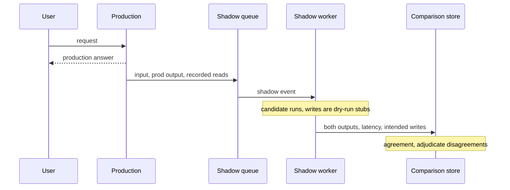

## TL;DR
Shadow mode runs a candidate agent (new model, prompt or tools) on a copy of real traffic while only
production's answer reaches users. It measures agreement and judged quality, not user outcomes, and is
safe only if every write tool is stubbed.

## For agent builders
- **Why it matters for agents.** It is the safest way to see a new model or prompt drive your real tools
  on real customer inputs before anyone acts on its output. The cost of getting it wrong is concrete: an
  unstubbed write tool means duplicate refunds or emails.
- **Where it shows up in your stack.** A queue after the production response, a shadow worker that runs
  the candidate agent loop, a tool layer that knows which tools write, and a comparison store keyed by
  request id.
- **What you control.** Which tools run live, replay or dry-run; what you compare (routing fields, tool
  calls, intended writes, steps, cost); the self-agreement baseline; and the exit criteria.
- **What you can skip.** Mesh-level mirroring details unless your candidate is a separate HTTP service;
  most agent shadows are queue-based workers.

## Decision case
### Scenario
An insurer runs your claims-triage agent on about 9,000 claims a week. It reads claims and policies and
can call `update_claim`, `send_email` and `issue_payment`. The insurer wants to move from the hosted model
to a model running in its own cloud account, which its data team has already approved.

Constraints (figures illustrative):
- **No exposure before evidence.** The insurer's risk committee will not let any claimant see candidate
  output until it has reviewed evidence from real traffic.
- **Deadline.** The committee meets in 3 weeks, so evidence must be ready in under 3 weeks.
- **SME time.** Two claims handlers can adjudicate about 150 disagreements a week between them.
- **Budget.** At most $1,000 of extra inference, at an assumed $0.04 per candidate run.
- **Coverage.** The window must include month-end, when bulk claims arrive.
- **No duplicate actions.** No claimant may get a second email or payment.

### Options
| Option | How it works | Meets deadline? | Exposure | Cost | Evidence quality |
|---|---|---|---|---|---|
| **A. Replay last month's logs** | Run the candidate offline on logged claims with recorded reads | Yes, days | None | About $720 for 18,000 logs | Right distribution, but stale: no live latency, rate limits or this month's new forms |
| **B. Async shadow on 100% for 2 weeks** | Queue fork after production answers; dry-run writes; 5% self-agreement slice | Yes: 2 weeks plus 1 for readout | None | 18,000 × $0.04 + 900 × $0.04 = $756 | Live traffic, about 1,080 disagreements at 6%, 300 adjudicated |
| **C. Async shadow on 25% for 4 weeks** | Same fork, sampled | No: 4 weeks | None | 9,000 × $0.04 = $360 | About 540 disagreements, same 300 adjudicated, but late |
| **D. 5% canary straight away** | Candidate answers 5% of claimants, with rollback triggers | Yes | Real claimants | Low | User outcomes, but forbidden by the committee |

### Decision
Choose **B**, timed so the 2 weeks span month-end:
- **It is the only option inside the rules and the deadline.** D breaks the exposure rule, and C misses
  the committee date.
- **It beats A on live evidence.** The committee's question is "our traffic, this month", and only a live
  fork shows latency, timeouts and new forms.
- **SME capacity sets the sample, not traffic.** 150 a week for 2 weeks gives 300 adjudicated, matching
  the worked readout, where a 140 to 90 split gives a rough interval of 55% to 67%.
- **Writes are data.** `issue_payment` and `send_email` run as dry-run stubs, and intended writes are
  diffed against production's real writes.
- **Budget holds.** $756 is under $1,000, including the self-agreement slice that calibrates disagreement.

What would change it:
- **No approval for the candidate's hosting.** Then even shadow is an unapproved transfer, and only A
  on approved infrastructure remains.
- **A write tool that cannot be dry-run.** Then shadow is unsafe for that tool; replay it from logs instead.
- **The committee allows exposure.** Then shorten shadow to 1 week and move to D with rollback triggers.

### Trade-offs accepted
- **No user-outcome signal.** Shadow cannot show whether claimants or handlers would have acted on the
  output. Watch it in the follow-up canary with rollback on reopen and complaint rates.
- **One-step counterfactuals.** Multi-turn claim chats only test the candidate's next turn. Watch
  divergence on turn two onwards during the canary.
- **Latency is not under identical load.** The async worker runs later. Check p95 again in the canary.
- **Doubled inference for 2 weeks.** Watch shadow cost per day and stop at the volume target.

### Review rubric
- **Side effects are neutralised by design.** The write-up lists every write tool and says how each is
  dry-run, and what happens with an undeclared tool.
- **Volume follows from adjudication capacity.** It sizes the window from how many disagreements SMEs
  can judge and states the resulting interval.
- **Disagreement is calibrated.** It includes a production-versus-production baseline and reads the gap.
- **The window covers known cycles.** It names month-end or weekly peaks and schedules around them.
- **Blind spots lead to a next step.** It says shadow cannot measure user outcomes and names the canary
  and its rollback triggers.
- **Reversal conditions are concrete.** It names the approval, tooling or committee fact that would
  change the option.

## Why it exists
- **Curated sets miss the long tail.** Golden sets and regression suites are chosen by people, so they
  are biased toward cases people thought of. Real traffic has scanned faxes, mixed languages, pasted
  email threads and queries the customer's own SMEs would not have predicted.
- **The customer's question is "will it work on *our* traffic?"** Only their traffic can answer it.
- **Release-and-watch is unacceptable** to many customers, regulated ones especially, because every user
  meets an unvalidated system. A canary or A/B test is better but still lets real users act on candidate
  output before you know it is sound.
- **Replaying last month's logs goes stale.** The distribution is right, but it misses what is only
  visible live: latency under real load, rate limits, timeouts, new document types arriving this week.
- **Shadow sits in between:** live distribution, live infrastructure, zero user impact. It is a common
  last step before a canary, and for a forward-deployed team often the evidence that gets a customer's
  risk committee to approve the switch.

## How it works
### 1. Fork the traffic
Production handles every request as usual; a copy, possibly a sampled fraction, goes to the candidate.

| Fork | How | Strength | Risk |
|---|---|---|---|
| **Asynchronous (preferred)** | Production returns first; request and production output are published to a queue; a shadow worker runs the candidate later | The candidate is off the request path, so its latency, errors or crashes cannot affect users | Cannot measure latency under identical load |
| **Inline** | Candidate called concurrently in the same request, strict timeout, result discarded | Measures latency under identical conditions | Careless code (awaiting the shadow call, sharing a connection pool or rate-limit quota) slows production |

### 2. Neutralise side effects
This step makes shadow mode safe or dangerous.
- **No real writes.** A candidate agent that sends emails, writes records or calls payment APIs must not
  do so in shadow.
- **Tool adapters run in dry-run mode.** Read-only tools may execute, or be served from the production
  call's recorded results. Write tools record the intended call and return a stub.
- **Intended calls are data.** "The candidate would have refunded order 4417" is something you compare
  against what production did.

### 3. Capture comparable records
- **Log per request:** input, both outputs, both latencies, token cost, errors, and the versions of
  everything (model, prompt, index).
- **Shadow data is still customer data.** Same store, same retention and access rules.
- **A new model or vendor needs the same data approval as production would.** Mirroring traffic to an
  unapproved provider "only for testing" is still a data transfer.

### 4. Compare
- **Deterministic fields** (extracted values, classifications, routing decisions, tool calls): exact
  agreement rate and a confusion matrix between production and candidate.
- **Free-text outputs:** string-level agreement is meaningless, so sample the disagreements and have an
  LLM judge or SME compare pairwise: candidate better, production better, equivalent.
- **Operational metrics:** p50/p95 latency, error and timeout rate, cost per request.
- **Review disagreements, because that is where the information is.** Where both agree, both are usually
  right, or both wrong in ways the regression suite should cover.

### Comparing agent runs, not just answers
For a tool-calling agent, the comparison record is a pair of trajectories:

| Compare | Why |
|---|---|
| **Tool sequence and arguments** | Same answer via a different tool path can still break a customer rule (no approval lookup before a refund) |
| **Intended writes vs production's writes** | The most consequential disagreement: what the candidate would have changed in the world |
| **Steps and tokens per run** | A cheaper model that takes twice the steps may not be cheaper per task |
| **Stop reason** | Finished, hit the step budget, or errored; budget hits are hidden failures |

### Calibrate with a self-agreement baseline
- **Shadow production against itself** (same model, prompt and inputs, a second call) on a slice of
  traffic, because LLM outputs are not perfectly repeatable.
- **Read the gap, not the raw number.** If production agrees with itself on 96% of routing decisions, a
  candidate at 94% is only about two points worse than "the same system again", not six.
- **Without the baseline, nondeterminism is misread as regression.**

### Convert back into traffic terms
That is what the customer feels:

```
share of traffic made worse ≈ disagreement rate × (production-better ÷ adjudicated)
```

- **A candidate can win the disagreements overall** and still make a few percent of requests worse.
- **Whether that is acceptable depends on *which* requests**, so break production-better cases down by
  severity and segment before deciding.

### 5. Know the blind spots
- **No user signal.** Users never see shadow output, so there is no click, edit or thumbs signal, and no
  evidence on whether users would have completed their task with it.
- **One-step counterfactuals only.** In multi-turn conversations the shadow sees history produced by
  production, not full candidate trajectories; after the first disagreement the conversations diverge.
- **So user-outcome questions need a canary or A/B test afterwards.**

### 6. Exit criteria
Agree them with the customer *before* starting:
1. Minimum volume and duration, so weekly cycles are covered.
2. Agreement thresholds on critical fields.
3. The candidate-better versus production-better ratio on adjudicated disagreements.
4. No unexplained dry-run write calls.
5. Latency and error budgets.

## Diagram
The user only ever receives production's answer; the candidate runs later off a queue with write tools
stubbed, and both outputs land in one comparison record.



## Examples
### Asynchronous shadow worker with dry-run tools
An asynchronous shadow worker for a claims-triage service. Production has already answered; this runs
the candidate with write tools stubbed and records a comparable row.

```python
import asyncio, time, json

WRITE_TOOLS = {"update_claim", "send_email", "issue_payment"}
READ_TOOLS = {"get_claim", "get_policy"}

class DryRunTools:
    def __init__(self, real_tools, recorded_reads):
        self.real, self.recorded, self.intended_writes = real_tools, recorded_reads, []
    async def call(self, name, args):
        if name in WRITE_TOOLS:                       # never execute writes in shadow
            self.intended_writes.append({"tool": name, "args": args})
            return {"status": "ok", "dry_run": True}
        if name not in READ_TOOLS:                    # undeclared tool: fail closed
            raise PermissionError(f"undeclared tool in shadow: {name}")
        key = json.dumps([name, args], sort_keys=True)
        if key in self.recorded:                      # reuse prod's read result: same facts
            return self.recorded[key]
        return await self.real.call(name, args)       # read-only, safe to execute

async def shadow_one(event, candidate, real_tools, store, timeout_s=30):
    tools = DryRunTools(real_tools, event["recorded_reads"])
    t0 = time.monotonic()
    try:
        out = await asyncio.wait_for(candidate.run(event["input"], tools), timeout_s)
        err = None
    except Exception as e:                            # shadow failures are data, not incidents
        out, err = None, repr(e)
    store.write({
        "request_id": event["request_id"], "tenant": event["tenant"],
        "prod": event["prod_output"], "cand": out, "cand_error": err,
        "cand_latency_s": round(time.monotonic() - t0, 3),
        "cand_intended_writes": tools.intended_writes,
        "prod_writes": event["prod_writes"], "versions": candidate.versions,
    })
```

### Worked readout: two weeks of shadow on one customer
Suppose two weeks of shadow on one customer yields 18,000 requests (illustrative). Triage category agrees
on 94%; of 1,080 disagreements, 300 sampled and SME-adjudicated split 140 candidate-better, 90
production-better, 70 equivalent.

| Question | Calculation | Answer |
|---|---|---|
| 1. Is the win real? | 140 of the 230 non-tied cases (61%) favour the candidate; rough 95% interval ±1.96 × √(0.61 × 0.39 / 230) ≈ ±6 points | 55–67%: clearly above 50% |
| 2. What does it cost in traffic? | 6% disagree × 90/300 production-better | ≈ 1.8% of all requests worse, about 320 of the 18,000 |
| 3. Is it safe operationally? | Intended writes vs production's on agreed cases; p95 latency vs budget | Writes match, latency inside budget |

- **Segment before celebrating.** If the ~320 worse answers cluster in the "urgent injury" category, the
  net win is irrelevant and the candidate needs work on that segment first.
- **The decision.** That evidence is the case for moving to a 5% canary, not for a full switch.

The same readout as a helper you can run on any shadow export:

```python
from math import sqrt

def shadow_readout(total, agree_rate, cand_better, prod_better, ties):
    adjudicated = cand_better + prod_better + ties
    decided = cand_better + prod_better
    win = cand_better / decided
    half = 1.96 * sqrt(win * (1 - win) / decided)       # normal approximation, rough
    worse_share = (1 - agree_rate) * prod_better / adjudicated
    return {"win_rate": round(win, 3), "ci": (round(win - half, 3), round(win + half, 3)),
            "worse_share": round(worse_share, 4), "worse_requests": round(worse_share * total)}

print(shadow_readout(18_000, 0.94, 140, 90, 70))
# {'win_rate': 0.609, 'ci': (0.546, 0.672), 'worse_share': 0.018, 'worse_requests': 324}
```

## Production patterns
- **Mesh-level mirroring for stateless services** — when the candidate is a separate HTTP service. Service
  meshes and proxies can mirror a percentage of requests and drop the mirrored response (Istio's
  VirtualService `mirror` with `mirrorPercentage`, or Envoy's request mirror policy). Monitor that
  mirrored calls cannot reach write endpoints, and production latency before and after enabling it.
- **Queue-based async shadow for agents** — when the candidate calls tools. Publish request, production
  output and recorded reads to a queue after responding; a separate worker pool runs the candidate. Monitor
  queue lag, shadow error rate and that consumer scaling never touches production capacity.
- **Tool registry with declared read/write** — before any agent shadow. Every tool declares whether it
  writes, and the shadow adapter refuses undeclared tools by default. Monitor intended-write counts per
  tool against production's actual writes.
- **Separate credentials and quotas for shadow** — always. Give the shadow worker its own API key, rate
  limit and connection pool so it cannot cause production 429s. Monitor provider 429s on the production
  key when shadow is switched on.
- **Self-agreement slice** — on every shadow run. Route a small fraction of traffic to a second production
  call and report candidate agreement next to production self-agreement. Monitor the gap, not the raw
  agreement rate.
- **Step budget and cost cap on the shadow loop** — for every agent shadow. Give the candidate the same
  maximum step count as production and a per-run token cap, and record the stop reason. Monitor budget-hit
  rate and cost per task next to production's, since a looping candidate burns money silently.

## Trade-offs
- **Zero user exposure vs no outcome signal.** When task completion is the KPI, shadow must be followed by
  a canary or A/B test rather than replacing it.
- **Async vs inline fork.** Async protects production latency completely but cannot measure latency under
  identical load; inline measures it but risks contention unless quotas and pools are isolated.
- **Mirror all vs sample.** Mirroring everything gives rare cases a chance to appear but doubles inference
  cost; sampling cuts cost and is fine once common cases are covered, unless the risk sits in rare inputs.
- **Replayed reads vs live reads.** Replaying recorded tool reads keeps the comparison fair, but hides
  failures where the candidate would have needed a different read; execute live reads when tool choice is
  what changed.

## Pitfalls
- **Forgetting to stub a write tool.** Symptom: duplicate emails, records or payments that trace back to
  the shadow worker, often discovered by the customer first.
- **Mirroring to a model or vendor the customer has not approved.** Symptom: a security review finding
  that the shadow pipeline was an unapproved data transfer.
- **String-level agreement on free text.** Symptom: an alarmingly low agreement rate that says nothing
  about quality, because paraphrases count as disagreements.
- **Running shadow for a few days and declaring victory.** Symptom: a regression in month-end or Monday
  traffic patterns that the short window never contained.
- **Raw agreement without a production-versus-production baseline.** Symptom: a candidate rejected for
  "6% disagreement" when a second production run would have disagreed nearly as often.
- **Sharing the production rate-limit quota.** Symptom: production 429 errors that begin exactly when
  shadow mode is switched on.
- **Comparing only final answers for an agent.** Symptom: shadow looks clean, then the canary shows the
  candidate skipping a required lookup or approval tool. Fix: store both tool-call sequences and diff
  them, with intended writes as their own report.

## When to use
- **Use before** replacing the model, prompt or pipeline under a live customer, and before go-live when
  the customer's legacy process or human team can act as "production".
- **Use whenever** the customer requires evidence on real traffic before exposure.
- **Skip** for changes the regression suite fully characterises (a formatting fix), or when doubled cost
  is unaffordable and a small canary is acceptable.
- **Measure:** field agreement, adjudicated win/loss on disagreements, intended writes, latency and errors.
- **Interviews:** naming side-effect isolation and the lack of user-outcome signal shows real experience.

## Role lens
- **Engineer:** Builds the async fork, dry-run tool adapters, comparison records and the disagreement
  sampler, and keeps shadow quotas and pools separate from production's.
- **Architect:** Decides where the fork happens, makes every tool declare read or write so dry-run is
  enforceable, and defines shadow, canary and full-rollout stages.
- **FDE:** Negotiates exit criteria and data approval with the customer, runs SME adjudication of
  disagreements, and presents the shadow evidence to the customer's risk or change board.

## Check yourself
**Q:** A customer wants to switch their support agent to a cheaper model. Two weeks of shadow show 97%
agreement on ticket routing and a judged tie on replies. The product lead says, "Ship it to everyone."
What is missing?
**A:** Shadow shows the candidate behaves like production on the inputs it saw, but not how users react:
nobody acted on its replies, and for multi-turn chats it only answered given production's history, so
its own trajectories were never tested. I would check that the 3% routing disagreements are not
concentrated in a high-severity queue, compare intended write calls such as refunds against production's,
and confirm latency and errors. Then go to a staged canary with rollback triggers on resolution rate,
escalations and complaints, rather than a full switch.

## Interview questions
### What is shadow mode, and why is it not the same as a canary?
- **Definition:** the candidate runs on a copy of live traffic, but only production's output reaches
  users; outputs are compared offline.
- **Difference:** a canary exposes real users to candidate output, so it measures outcomes; shadow
  measures agreement, judged quality and operations with zero exposure.
- **Order:** shadow usually comes first, then a canary.

### How would you shadow an agent that can issue refunds and send emails?
- **Async fork off a queue**, so the candidate is off the request path.
- **Dry-run tool adapters:** reads execute or replay production's recorded results; writes are recorded
  as intended calls and return a stub.
- **Compare intended writes** against production's actual writes, and keep separate credentials and
  quotas for the shadow worker.

### Shadow shows 94% agreement on routing. Is the candidate 6% worse?
- **Not necessarily.** Measure production against itself first; if self-agreement is 96%, the candidate
  is only about two points worse than rerunning production.
- **Then adjudicate a sample of disagreements** to see who was right, and convert to traffic terms:
  disagreement rate × production-better share.

### When would you skip shadow mode?
- **When the regression suite fully characterises the change**, such as a formatting fix.
- **When doubled inference cost is unaffordable** and a small canary with rollback triggers is
  acceptable to the customer.
- **Never skip side-effect isolation** if you do shadow an agent.

### What exit criteria would you agree with a customer before a shadow run?
- **Volume and duration** that cover weekly cycles, including month-end or Monday patterns.
- **Thresholds:** agreement on critical fields and the candidate-better versus production-better ratio on
  adjudicated disagreements, broken down by severity.
- **Operations:** no unexplained dry-run writes, latency and error budgets.

### A cheaper candidate agent agrees on 95% of answers in shadow, but cost per task went up. What happened?
- **Look at steps per run and stop reasons.** The candidate may reach the same answer with more tool
  calls, retries or re-plans, so per-token savings vanish per task.
- **Check budget hits.** Runs that stopped at the step limit are failures hidden behind "agreement" if
  the comparison only reads the last message.
- **Decide per task,** not per token: report cost and latency per completed task for both systems.

## Quiz
### Q: What is the most important safety requirement when shadowing an agent that can call tools?
- [ ] The shadow must use the same random seed as production
- [x] Write tools must run in dry-run mode so the candidate records intended actions without executing them
- [ ] The shadow must run on a GPU separate from the one production uses
- [ ] Shadow outputs must be shown to a small fraction of users for feedback
> Without dry-run writes, the candidate would duplicate or contradict real actions such as emails or
> payments. Showing output to users is a canary, not shadow mode.

### Q: Why does shadow mode not replace a canary or A/B test?
- [ ] Shadow traffic is too small to measure anything
- [ ] Shadow mode cannot measure latency
- [x] Users never see candidate outputs, so their behaviour and task outcomes under the candidate are never observed
- [ ] Shadow mode only works for classification tasks
> Shadow gives agreement, judged quality and operational metrics on real inputs, but user outcomes need
> exposure. Latency can be measured in shadow, especially with an inline fork.

### Q: In a multi-turn chat shadowed on each turn, what exactly is being evaluated?
- [ ] The candidate's full conversations from start to finish
- [x] The candidate's next reply given a history produced by the production system
- [ ] The production system's replies as judged by the candidate
- [ ] Only the first turn, since later turns cannot be mirrored
> Each shadow turn is conditioned on production's previous replies, so it is a one-step counterfactual.
> After the first divergence, the candidate's own trajectory is never actually played out.

## Use cases & projects
### Use cases
- **Model swaps for a live support agent.** Shadow a cheaper or customer-hosted model on real tickets,
  comparing routing, tool calls and cost per task before a canary.
- **Agents that act on systems of record.** Claims, refunds or CRM-updating agents prove their intended
  writes match production's without touching real records.
- **Replacing a human process with an agent.** The customer's human team acts as "production" and the
  agent's decisions are compared against theirs before go-live.
- **Prompt or tool-schema rewrites.** Large prompt changes are shadowed on live inputs that the
  regression suite never anticipated.

### Mini project
**Shadow a candidate agent with dry-run writes (2-3 hours).**
- **Goal:** compare a candidate agent against production on replayed requests without any real writes.
- **Steps:** build a small agent with one read tool and one write tool; record 50 production runs
  (inputs, tool calls, outputs); adapt the `DryRunTools` worker above to run a candidate prompt or model;
  store both trajectories; compute answer agreement, tool-sequence agreement, intended-write diffs and
  steps per run; add a production self-agreement slice; feed the adjudicated counts to `shadow_readout`.
- **Done when:** the write tool's real implementation is never called by the candidate (assert it), and
  you have a readout with win rate, interval, worse-share and a list of intended-write differences.

### Major project
This lesson feeds the module Capstone (see the module guide): shadowing the utility's mandated
self-hosted model against the current system on replayed traffic, with a go, hold or no-go report that
confirms the shadow path made no writes.
