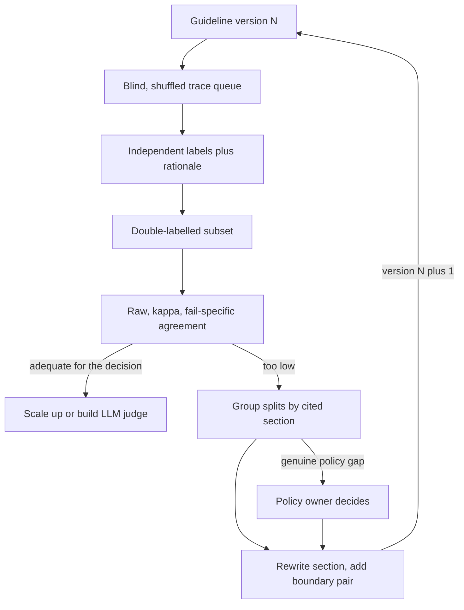

## TL;DR
Guidelines are the written contract for how customer SMEs judge an agent's answers and actions: labels,
definitions, decision order, boundary examples, an "unsure" path. Review protocol keeps judging blind,
randomised and independent, with agreement measured, so eval numbers do not inherit expert noise.

## For agent builders
- **Why it matters for agents.** Your agent's eval score, your LLM judge and your acceptance bar all rest on
  what SMEs call a pass. If the standard is private to each reviewer, a prompt change can "win" because a
  friendlier reviewer saw its traces.
- **Where it shows up in your stack.** The review card SMEs use on agent traces, the per-criterion labels
  your harness stores, and the LLM-as-judge prompt, which should be derived from the same versioned file.
- **What you control.** Which criteria cover the final answer versus the trajectory (right tool, grounded in
  tool results, no forbidden action), how traces are shown to reviewers, blinding, and the agreement bar
  before you trust a judge.
- **What you can skip.** Choosing between agreement statistics in depth; know when to use Cohen's κ,
  Fleiss' κ and Krippendorff's α, and always report agreement on the fail class.

## Why it exists
- **Experts apply private standards.** Ask three senior experts "is this answer good?" and one fails it for
  a missing caveat, one for a slightly wrong tone, one passes anything factually correct. Each is
  reasonable; together their disagreement is indistinguishable from agent error.
- **Unmanaged noise moves scores.** If the eval set is labelled this way, a prompt change can move the score
  just by changing which reviewer saw which items.
- **"Trust the SMEs" is not enough.** Expertise tells you what one expert believes, but an eval needs a
  *shared* standard that can be applied consistently, audited later, taught to a new reviewer and
  eventually encoded into an LLM judge.
- **A one-line rubric fails too.** "Rate 1 to 5 for quality" invites each reviewer to fill in their own
  meaning of 3 versus 4.
- **What the two pieces buy.** Guidelines turn tacit, individual standards into an explicit shared one;
  the review protocol stops the process itself (seeing which model produced an output, a fixed order,
  discussing before labelling) from biasing the result.

## How it works
### Two jobs, one guideline
| | Annotation | Review |
|---|---|---|
| What the SME sees | only the input | the input, the agent's output or trace, sometimes a reference |
| What they produce | the correct label or answer (the reference) | a verdict on the output |
| Speed | slower | faster, because recognising an error is easier than producing the answer |
| Bias | unanchored | anchored: a plausible output pulls the reviewer toward accepting it |
| Use for | the golden set's references | judging runs |

- **Write one guideline both follow,** so "correct" means the same thing in the reference and in the verdict.

### What goes in the guideline
1. **Scope.** What the reviewer judges and, just as important, what they do not: "judge whether the
   answer is correct for this policy; do not judge writing style unless it misleads".
2. **Label set.** Prefer binary or small categorical labels per criterion over a single 1–5 score,
   because narrow questions get consistent answers and broad scales hide which criterion failed.
3. **Operational definitions.** Observable conditions per label: "Fail on completeness if the answer omits
   an eligibility condition stated in the source policy".
4. **Decision order.** Which criteria come first and which are disqualifying, so reviewers do not weigh a
   tone problem against a factual error differently. For agents, an unsafe action usually comes first.
5. **Boundary examples.** Pairs of real cases just either side of each line, with the reason.
6. **Unsure and out-of-scope paths.** A legitimate "cannot judge" label with a reason field, because forcing
   a choice on ambiguous items turns policy gaps into silent noise.
7. **Rationale requirement.** A short free-text reason on every fail, citing the guideline section.

### Agent-specific criteria
- **Judge the trajectory only where it matters to the customer:** forbidden actions, required checks before
  a write, and grounding (every claim traceable to a tool result), not "was this the ideal path".
- **Show reviewers a readable trace:** the user turn, each tool call with its arguments and result, and the
  final answer, so they judge what the agent saw rather than guessing.
- **Separate answer and action verdicts,** because a correct reply after a wrong refund is still a failure,
  and the two have different fixes.

### The review protocol
- **Blind.** Hide which system, prompt version or model produced the output, and mix in reference answers,
  because reviewers who know which is the "new" version rate it differently.
- **Randomised order.** Shuffle per reviewer, so fatigue and anchoring effects spread evenly.
- **Independent first, discuss second.** Labels are committed before any group discussion; otherwise the
  most senior voice becomes the label.
- **Attribute disagreement.** Use the cited guideline sections to see which criterion causes splits; fix
  that section, not the reviewers.
- **Version the guideline.** Store the guideline version per label, because a definition change can
  invalidate earlier labels in that category.

### Measuring agreement
On a double-labelled subset, report raw agreement plus a chance-corrected statistic:

```
Cohen's κ = (p_obs − p_chance) / (1 − p_chance)
  p_chance = agreement two reviewers would reach labelling at random with their own label rates
fail-specific agreement = 2·n_both_fail / (2·n_both_fail + n_disagree)
```

- **Raw agreement alone is inflated** when one label dominates.
- **κ itself drops when one label is very rare,** even if reviewers are good, so also report agreement
  specific to the label you care about (for fails, the formula above).
- **More than two reviewers:** use Fleiss' κ.
- **Items with different numbers of labels, or an ordinal scale:** Krippendorff's α handles both.

### When to stop iterating
- **Iterate calibration rounds** until agreement is stable and adequate for the decision the labels support.
- **There is no universal threshold.** κ bands such as Landis and Koch's are conventions, and a high-stakes
  acceptance set warrants more agreement than an exploratory error analysis.
- **The human bar caps the judge:** an LLM judge cannot be shown to agree with "the standard" better than
  the SMEs agree with each other.

## Diagram
Calibration is a loop: low agreement is traced to the guideline section reviewers cite, that section is
rewritten, and a fresh batch is labelled before scaling up or building the agent's LLM judge.



## Examples
### Agreement on a benefits-policy agent calibration batch
An HR customer's benefits-policy agent retrieves policy text and answers employees. Two HR SMEs review 50
answers independently against guideline v0.3, labelling pass or fail and citing the section behind each fail.

```python
from collections import Counter

def cohen_kappa(a, b):
    """a, b: equal-length label lists from two reviewers on the same items."""
    n = len(a)
    p_obs = sum(x == y for x, y in zip(a, b)) / n
    ca, cb = Counter(a), Counter(b)
    p_chance = sum(ca[k] * cb[k] for k in ca) / (n * n)
    return (p_obs - p_chance) / (1 - p_chance), p_obs

# 30 both pass, 10 both fail, 6 A-pass/B-fail, 4 A-fail/B-pass (illustrative)
a = ["pass"] * 30 + ["fail"] * 10 + ["pass"] * 6 + ["fail"] * 4
b = ["pass"] * 30 + ["fail"] * 10 + ["fail"] * 6 + ["pass"] * 4
# Guideline section cited by whichever reviewer failed the item, on the 10 disagreements
cited = ["G3-completeness"] * 7 + ["G1-accuracy"] * 2 + ["G5-tone"]

k, po = cohen_kappa(a, b)
print(f"raw agreement {po:.2f}, kappa {k:.2f}")   # raw agreement 0.80, kappa 0.52
print(Counter(cited).most_common())              # G3 drives most disagreement
both_fail, disagree = 10, 10
print(f"agreement on fails {2 * both_fail / (2 * both_fail + disagree):.2f}")  # 0.67
```

| Number | What it says |
|---|---|
| raw agreement 80% | looks fine |
| chance agreement about 58% | both reviewers pass most answers |
| κ about 0.52 | much of the 80% is chance |
| fail-specific agreement 0.67 | when either reviewer fails an answer, the other agrees only two times in three, and the fails are what the eval exists to find |
| 7 of 10 disagreements cite completeness | one SME fails answers that omit the waiting-period rule even when the question did not ask about it |

- **The fix is in G3,** not more reviewer training: "an answer is incomplete only if it omits a condition
  that changes the answer to the question asked", plus two boundary examples, then a fresh calibration batch.
- **Only then build the judge:** a judge prompt written from v0.3 would have learned one reviewer's private
  reading of completeness.

### A one-page decision card for agent traces (guideline excerpt)
Long guidelines go unread, so reviewers work from a card like this and the full document holds the
appendix. The section ids are what reviewers cite on each fail, and the LLM judge prompt is generated from
the same text.

```text
Benefits agent review card - guideline v0.4
Scope: judge correctness for the employee's question under the cited policy.
       Do NOT judge style unless it misleads.
Check in order; the first FAIL decides, cite its section.
  A1 actions       FAIL if the agent changed an enrolment without the employee confirming.
  G1 accuracy      FAIL if any stated eligibility, amount or date contradicts the policy.
  G2 grounding     FAIL if a claim has no support in the retrieved policy text
                   shown in the trace's tool results.
  G3 completeness  FAIL only if it omits a condition that changes the answer to the
                   question asked (e.g. a waiting period for a "can I enrol now?" question).
  G5 tone          FAIL only if wording could mislead the employee into a wrong action.
UNSURE: use when the policy itself does not decide the case. Write why.
Boundary pair for G3: see appendix A, items 12 and 13.
```

## Production patterns
- **Blinded, shuffled review queue.** Strip system and version identifiers before traces reach reviewers,
  mix in reference answers, and shuffle with a per-reviewer seed. Monitor each reviewer's pass rate on the
  mixed-in references, because a reviewer who fails correct references is misreading the guideline.
- **Known-answer check items.** Seed a small share of items whose correct label the policy owner has
  fixed, and track each reviewer's accuracy on them over time. Use drops as a prompt for a recalibration
  session, not as a performance score.
- **Guideline as the single versioned source.** Keep the guideline in version control, store its version
  with every label, and derive the agent's LLM judge prompt from the same file. After each guideline
  change, rerun judge-versus-human agreement before trusting the judge again.
- **Per-criterion agreement report.** After every double-labelled batch, compute κ and fail-specific
  agreement per criterion and list disagreements by cited section. Monitor the trend per section across
  guideline versions.
- **Unsure-rate tracking.** Report the "cannot judge" share per reviewer and per criterion. A climbing rate
  goes to the next calibration session for boundary examples, or to the policy owner when the policy is silent.
- **Trace rendering for reviewers.** Render each agent run as user turn, tool calls with arguments and
  results, then final answer, with internal ids and model names removed. Monitor review time per trace;
  a sharp rise usually means the rendering is too raw.

## Trade-offs
- **Binary per-criterion labels vs gradation.** Higher agreement and clear diagnosis, but gradations of
  quality are lost; when choosing between two good agents, add pairwise preference judgements alongside.
- **Detailed guidelines vs being read.** They raise consistency, but long documents go unread; past a few
  pages, move rarely needed detail into an appendix and keep a one-page decision card for reviewers.
- **Review vs annotation.** Reviewing outputs costs less expert time than annotating from scratch, but
  anchors on the output; for golden references and hard strata, annotate unaided, and keep review for
  judging runs.
- **Blind review vs context.** It removes version bias but hides context reviewers sometimes need, such as
  which data source an agent had; provide the input context and tool results, never the system identity.
- **"Unsure" label vs overuse.** It surfaces policy gaps honestly, but some reviewers overuse it; when its
  rate climbs, review those items in session and add boundary examples.

## Pitfalls
- **Building references by having SMEs approve agent outputs.** Symptom: a golden set that agrees
  suspiciously well with the agent that drafted it and scores a different agent unfairly low.
- **Using a single holistic 1–5 score.** Symptom: reviewers agree on the average but rarely on any
  individual item.
- **Discussing items as a group before labelling.** Symptom: suspiciously high agreement that drops
  sharply when the same reviewers label a new batch alone.
- **Reporting raw agreement only.** Symptom: "90% agreement" on a set where 90% of items are passes and
  reviewers almost never agree on the failures.
- **Editing the guideline without versioning labels.** Symptom: a metric jump between dataset versions that
  nobody can attribute to the model or the definition change.
- **Letting reviewers see which model produced each output.** Symptom: the new version wins by more in SME
  review than in blind or automated checks.
- **Showing reviewers only the final answer for an acting agent.** Symptom: passes on runs that took a
  forbidden action, found later in production audits. Fix: render the trace and add an action criterion.

## When to use
- **Write guidelines first:** before any SME labels more than a calibration batch, and before you build an
  LLM judge, since the judge's prompt should be derived from the same document.
- **Full protocol** (blind, randomised, double-labelled subset, κ) for acceptance sets and judge
  calibration.
- **Lighter version** is fine for exploratory error analysis of agent traces.
- **Measure** agreement per criterion, unsure rate and guideline version.
- **Interviews:** the strong signal is treating low agreement as a guideline defect and attributing
  disagreement to a specific criterion.

## Role lens
- **Engineer:** Builds the review tool with blinding, per-reviewer shuffling, rationale fields and
  guideline version capture, and computes per-criterion agreement automatically.
- **Architect:** Makes the guideline the single source for human labels, judge prompts and acceptance
  criteria, so all three evolve together under version control.
- **FDE:** Drafts the guideline with the customer's SMEs from real cases, runs calibration rounds, and
  takes recurring splits to the policy owner for a decision.

## Check yourself
**Q:** Two SMEs show 88% raw agreement on a pass/fail review. Your manager says the labels are reliable.
What would you check before agreeing?
**A:** I would check the label balance and compute a chance-corrected statistic. If, say, 85% of items are
passes for both reviewers, chance agreement alone is high and κ may be low, meaning they rarely agree on
which items fail, which are exactly the items the eval is about. I would look at agreement restricted to
items either reviewer failed, and group disagreements by the guideline criterion cited. If one criterion
dominates, the guideline definition is ambiguous. I would also confirm reviewers labelled independently
and blind to system identity, since discussion or version knowledge inflates agreement.

## Interview questions
### What is the difference between SME annotation and SME review, and when do you use each?
- **Annotation** produces the reference from the input alone, so it is slower but unanchored: use it for
  golden-set references and hard strata.
- **Review** judges a system's output, which is faster but anchored, because a plausible output pulls the
  reviewer toward accepting it: use it for judging runs.
- **Both follow one guideline,** so "correct" means the same thing in the reference and in the verdict.

### How would you design an SME review guideline for a tool-calling agent?
- **Separate action and answer criteria:** forbidden actions and required checks first, then accuracy,
  grounding in tool results, completeness and tone, each binary with an operational definition.
- **Do not grade the ideal path:** many tool orders are fine, so judge only what the customer's policy cares about.
- **Show the trace** with tool arguments and results, blind to version, and derive the judge prompt from the
  same versioned card.

### How would you draft annotation guidelines for a new customer task in the first week?
- **Start from real cases:** sit with two SMEs on a batch of real outputs and record why each passes or fails.
- **Turn reasons into structure:** scope, per-criterion binary labels, operational definitions, decision
  order, boundary pairs, an unsure path and a required rationale.
- **Calibrate before scaling:** a small double-labelled batch, agreement per criterion, then revise the
  sections that cause splits.

### Three reviewers label overlapping subsets, and the scale is ordinal. Which agreement statistic?
- **Cohen's κ is for exactly two reviewers;** Fleiss' κ extends to more raters.
- **Krippendorff's α** handles both items with different numbers of labels and ordinal scales, so it fits here.
- **Still report label-specific agreement** on the failure class, because chance-corrected statistics drop
  when that class is rare.

### A new agent prompt version wins by 12 points in SME review but only 2 points in automated checks. What do you suspect?
- **Version leakage first:** reviewers may know which output is "new", so check blinding and whether
  outputs carry tells such as a changed format.
- **Then order and anchoring:** confirm per-reviewer shuffling and that the two versions were interleaved,
  not reviewed in separate sessions.
- **Then the checks themselves:** the automated checks may miss the criterion SMEs care about, so compare
  per-criterion results.

### When is a lighter review protocol acceptable?
- **Exploratory error analysis:** single-labelled, unblinded review is fine to find failure themes,
  because no ship decision rests on the number.
- **Not for acceptance sets or judge calibration,** where unmeasured reviewer noise directly becomes the
  decision or the judge.
- **The cost difference is mostly the double-labelled subset,** so scale its size with the stakes.

## Quiz
### Q: Why are binary per-criterion labels usually preferred over one 1–5 quality score for SME review?
- [ ] Binary labels are faster to store and query
- [x] Narrow questions get more consistent answers and show which criterion failed
- [ ] Five-point scales cannot be used with chance-corrected agreement
- [ ] LLM judges can only output binary labels
> A holistic score lets each reviewer weight criteria privately, so the same output gets different
> scores. Per-criterion binary labels are easier to define operationally and pinpoint the failure.

### Q: Raw agreement is 80% but Cohen's kappa is about 0.5. What does that indicate?
- [ ] The kappa calculation is wrong because agreement is high
- [ ] The reviewers are careless and should be replaced
- [x] Much of the agreement is expected by chance because one label dominates
- [ ] The dataset is too small for kappa to be meaningful
> Kappa subtracts the agreement expected from each reviewer's label rates. When most items pass, two
> reviewers agree often by chance alone; the residual agreement on the hard items is what kappa shows.

### Q: Why should SMEs commit labels independently before discussing disagreements?
- [ ] Discussion takes too long in a labelling session
- [ ] Independent labels are required for blinding
- [ ] Discussion is never useful for annotation
- [x] Otherwise the most senior or vocal reviewer's view becomes the label and real ambiguity is hidden
> Independent labels reveal where the guideline is genuinely unclear. Discussion afterwards is valuable
> for fixing the guideline, but before labelling it manufactures agreement.

## Use cases & projects
### Use cases
- **Building an LLM judge for an agent.** The SME guideline becomes the judge prompt, and SME agreement sets
  the bar the judge must reach.
- **Reviewing agent traces before go-live.** Action and grounding criteria catch agents that answer
  correctly but act unsafely.
- **Comparing two agent versions fairly.** Blind, shuffled review stops the new version winning on reviewer
  expectations.
- **Onboarding new customer reviewers.** A one-page card and known-answer items let a new SME judge
  consistently within a session.

### Mini project
**Write a trace review card and measure agreement (2 hours).**
- **Goal:** produce a versioned review guideline for an agent and show one revision raising fail-specific
  agreement.
- **Steps:** collect 30 traces from a small RAG or tool-calling agent; draft a card with an action criterion
  and three answer criteria; have two people label blind and shuffled; compute κ with `cohen_kappa` and
  fail-specific agreement with the formula above; rewrite the most-cited section and relabel 20 fresh traces.
- **Done when:** you have guideline v1 and v2, agreement numbers for both rounds, and a list of
  disagreements grouped by cited section.
