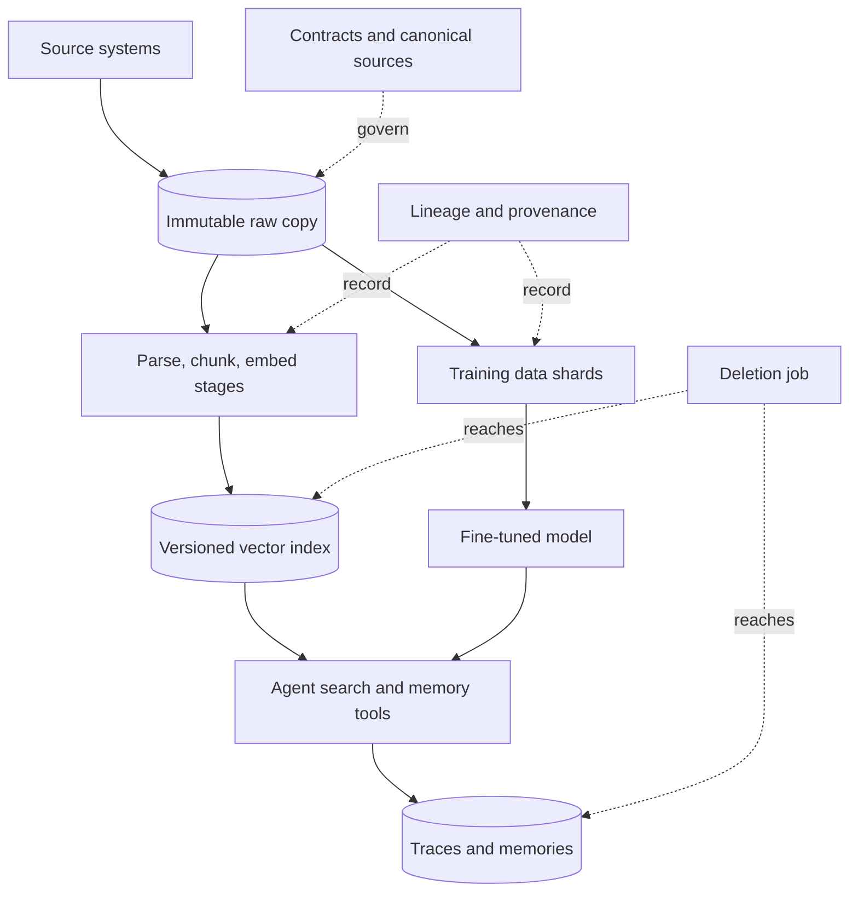

## Overview
This module covers the data side of an AI system, and of an agent in particular: how bytes leave
source systems and become retrieval units, memories, training examples and features. It also covers
how you can later say where each one came from, and remove it when asked.

An agent's search and memory tools return whatever the index holds, and the agent acts on it. A missed
delete, a stale chunk or a drifted embedding recipe never errors; it becomes a confident, cited, wrong
action. This module is how you stop that at the data layer.

How the topics connect, from the edge inwards:

- **Getting data in:** ingestion pipelines capture changes from sources (deletes included) into an immutable, replayable raw copy with a committed watermark. The lakehouse gives that copy and every derived table atomic commits, snapshots, time travel and real deletes on cheap object storage.
- **Turning it into retrieval units:** staged ELT turns raw data into materialized parse, chunk, enrich and embed tables. Document processing pipelines route each file to the cheapest extractor that keeps its structure.
- **Governing what enters:** knowledge management decides which sources are canonical, who owns them and how documents age out. Data contracts make producers responsible for the schema and meaning their consumers rely on.
- **Serving:** embedding versioning treats the model, its settings and the chunker as part of an index's identity. Vector database architecture explains mutability, filtered search and memory residency. Vector store sizing turns a corpus into a RAM and cost number before you choose a vendor.
- **Training:** training data pipelines produce deduplicated, decontaminated, versioned shards.
- **Tying it together:** lineage is a recorded graph of what was built from what, provenance gives tamper-evident manifests for models and datasets, and retention makes a deletion reach every copy with proof.
- **Hybrid systems:** feature stores close the module for systems that also run classical models.

Which lessons matter most for agents:

- **Core (you use them directly):** ingestion-pipelines, etl-elt-for-rag, document-processing-pipelines, knowledge-management, embedding-versioning-re-indexing-strategy, vector-database-architecture and data-retention-and-deletion-architecture.
- **Useful (you meet them when sizing, fine-tuning or operating agents):** vector-store-sizing, data-contracts, data-lineage, training-data-pipelines and model-and-dataset-provenance.
- **Background:** lakehouse and feature-stores.

Afterwards you can:

- Design a RAG and fine-tuning data platform behind an agent's retrieval and memory tools.
- Re-index without downtime and survive upstream schema changes.
- Honour an erasure request across every store, including memories, traces and caches.

It matters most for Architects, and for Engineers who own the pipelines.

## Why it matters
- **Engineer:** You write the change capture, the content-hashed stage tables, the extraction router, the alias swap and the deletion job behind your agent's search and memory tools, so stale chunks, re-embedding bills that scale with the corpus and documents that are never removed are bugs in your pipeline code that surface as wrong agent actions.
- **Architect:** You decide what is the system of record and what is a rebuildable projection, how an index version is identified, where lineage is emitted and how deletion propagates through indexes, memories and traces, and these choices are a full rebuild to change once the first index behind a live agent is serving.
- **FDE:** Customer corpora are messy, mixed-format and unowned, and their first hard questions about a deployed agent are about cost, freshness and erasure; you answer with a sizing estimate, a canonical-source agreement, a contract on their feeds and a deletion drill run on their own data.

## Mental model
Picture one directed graph that runs left to right. On the left are source systems; the first node is an
immutable raw copy keyed by source identity and content hash.

Every node after it is a derived, versioned table produced by a job: parsed blocks, chunks, embeddings,
training shards, features. On the right are serving projections: a vector index, an online feature store,
a fine-tuned checkpoint. The agent's tools read only from those projections.

Three rules hold everywhere:

- **Only the raw copy is the system of record.** Everything to its right can be rebuilt, so a new chunker or embedding model is a re-run into a new version beside the old one, followed by an evaluated swap.
- **Every edge is recorded.** The job that walked an edge records it, which is lineage. Every artifact that reaches a registry carries a hashed manifest, which is provenance.
- **Every edge carries a contract and a retention class.** A schema change fails loudly at the producer, and a deletion request is a forward traversal from one source record to every node derived from it.

Contracts and knowledge management govern what enters on the left; sizing and vector architecture
govern what it costs on the right.

## Suggested order
1. ingestion-pipelines — agent core: everything downstream depends on an incremental, delete-aware, replayable raw copy, so getting bytes out of sources comes first.
2. etl-elt-for-rag — agent core: establishes the staged, content-addressed transformation DAG and the rule that the index behind the retrieval tool is a projection, not the source.
3. document-processing-pipelines — agent core: fills in the parse stage of that DAG with tiered routing, quality scoring and a canonical block model.
4. knowledge-management — agent core: decides which sources are canonical and what ownership and freshness metadata the ingestion schema must carry.
5. embedding-versioning-re-indexing-strategy — agent core: treats model, settings and chunker as the index's identity and teaches build-beside, evaluate and alias swap over the stored chunks.
6. vector-database-architecture — agent core: explains how the serving index handles updates, deletes, selective filters, memory residency and sharding.
7. vector-store-sizing — useful: turns the corpus, chunking and embedding choices into a RAM and cost estimate, using the index mechanics just covered.
8. data-contracts — useful: makes producers responsible for the schema and meaning the pipeline stages now depend on, catching silent breakage at write time.
9. data-lineage — useful: records the graph of inputs, jobs and versions across the RAG path, the prerequisite for tracing an answer and for deletion.
10. data-retention-and-deletion-architecture — agent core: uses the store inventory, lineage and versioned tables to propagate an erasure request with receipts.
11. lakehouse — background: gives the raw copy and the stage tables transactional commits, snapshots and real deletes, which the earlier lessons assume; read it earlier if you own the platform.
12. training-data-pipelines — useful: applies the same staged, versioned approach to fine-tuning data, adding dedup, decontamination and packing.
13. model-and-dataset-provenance — useful: adds hashed, signed manifests for registry artifacts on top of lineage, so models and datasets can be verified.
14. feature-stores — background: an optional extension for hybrid systems that also train and serve classical models, best read once the rest is in place.

## Capstone
### Brief
**Use case:** a mid-sized software company wants an internal support agent that answers staff questions
over its help-centre articles (HTML), a shared drive of policy PDFs (some scanned, some with tables) and
a Postgres table of resolved support tickets. A small fine-tuned classifier routes new tickets.

Today a nightly script re-crawls everything, embeds it into one vector collection and never removes
deleted documents. This is the module's major project: over a week, rebuild it as a data platform
behind the agent's search tool.

- **Ingest:** each source incrementally into an immutable raw table with content hashes and tombstones.
- **Transform:** run a staged ELT DAG (parse, clean, chunk, embed) on lakehouse or Postgres tables, with a tiered document router that escalates to OCR only when a quality score fails.
- **Govern:** tag canonical sources and owners, and put a data contract with a CI compatibility check on the ticket feed.
- **Serve:** version the embedding recipe, build a second index with a different chunker beside the first, evaluate both on a fixed query set and swap an alias. Size the store before choosing pgvector or a dedicated engine.
- **Train:** build a deduplicated, eval-decontaminated training set for the classifier with a manifest hash.
- **Trace and delete:** record lineage for every job, and finish with a deletion drill for one customer.

### Deliverables
- A pipeline repository with per-source change capture, a raw landing table keyed by source id and content hash, a committed watermark, and stage tables for parsed blocks, chunks and embeddings that a second run fills incrementally.
- A document-routing report showing per-tier volume, cost, quality-score distribution and escalation rate, with extraction accuracy measured on a small hand-labelled gold set.
- A data contract file for the ticket feed with a CI check that rejects a breaking change, plus a source registry listing canonical status, owner and `last_verified_at` for each source.
- A sizing worksheet with explicit assumptions (chunks per document from a sample, dimension, precision, graph overhead, payload, replicas, rebuild headroom) and the resulting store choice, and an index-version record with eval recall for both index versions and the alias swap.
- A training-set manifest for the routing classifier giving dataset hash, removal counts per stage, overlap rate with the eval set and base model revision, and a lineage table that connects every chunk and training row to its source record and job run.
- A deletion runbook and a drill report for one customer, listing every store reached, a receipt per store and the time taken, with an explicit statement about any fine-tuned weights.

### Rubric
- Deleting a policy PDF at the source removes its chunks from the live index on the next run, and a second run with no source changes re-embeds zero chunks, shown by the per-run change ratio and embedding cache hit rate.
- Renaming a field in the ticket feed fails the producer's CI contract check before any data lands, rather than producing empty chunks or blank training targets downstream.
- Live agent queries are served from exactly one index version throughout the re-index, the swap is a single alias change that can be reversed, and both versions report recall on the same fixed query set.
- The sizing estimate is within a stated margin of the store's measured memory after loading, and the worksheet names quantization and payload placement as the levers with their effect on the number.
- Starting from one customer id, a lineage traversal lists every derived chunk, cache entry, eval row and training row, and the drill report shows each of them deleted or tombstoned with a receipt.
- The classifier's training config references the dataset manifest hash, and re-running the training-data pipeline from the same raw snapshot reproduces that hash.
