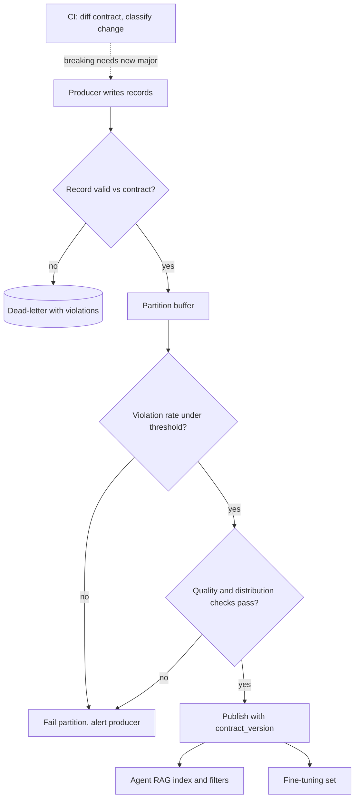

## TL;DR
A data contract is a versioned, machine-checked agreement on schema, meaning, quality, freshness and
ownership. The data feeding your agent's index, memory, tools and fine-tuning fails silently on upstream
changes, so the contract makes the producer fail loudly at write time.

## For agent builders
- **Why it matters for agents.** Agents consume other teams' data everywhere: the ticket feed behind the
  RAG index, the CRM fields the retrieval filter uses, the JSON a tool's backend API returns, the traces
  exported for fine-tuning. A renamed field produces empty chunks, filters that match nothing, or tool
  results the model misreads, with no error anywhere.
- **Where it shows up in your stack.** Pydantic or JSON Schema models on ingestion and on tool responses,
  schema registries on Kafka topics feeding embedding jobs, quality suites on batch partitions, and the
  typed tool contracts your agent framework already asks for.
- **What you control.** The fields your agent pipeline depends on (text to embed, filter metadata, labels),
  the compatibility direction you require, the violation-rate threshold that stops a partition, and
  validating tool responses before they enter the model's context.
- **What you can skip.** Choosing between contract specification standards and data-mesh governance
  debates. One typed model per crossing, checked in CI, covers most agent pipelines.

## Decision case
### Scenario
A B2B software company's support agent depends on six datasets owned by other teams. Last quarter three
silent upstream changes (a renamed text field, integer category ids, a unit change) each took about
4 days to notice, so roughly 12 days of degraded answers in total. The AI team owns none of the producers.

| Crossing | Producer | Volume or shape | Risk |
|---|---|---|---|
| Ticket stream into the RAG index | Ticketing team, Kafka | about 48,000 records a day | High: text and filter fields |
| CRM account metadata for filters | CRM team, nightly batch | 1 partition a night | High: `tenant_id`, `access_scope` |
| Orders API behind `get_order` | Commerce team | live tool calls | High: units and status values |
| Three low-change reference tables | Various | weekly | Low |

Constraints (figures illustrative):
- **Producer time.** Each high-risk producer team agreed to one sprint; the low-change owners to nothing.
- **Detection target.** A break must be caught within one hourly partition, at about 2,000 tickets an hour.
- **No skewed index.** A partition missing a whole category must never be published.
- **Producers ship weekly** and must not wait on AI-team deploys.

### Options
| Option | How it works | Time to detect | Attribution | Producer effort | Semantic changes |
|---|---|---|---|---|---|
| **A. Consumer-side checks only** | AI team validates on ingestion and in tool wrappers | About an hour, after bad data is written | Late: AI team chases the producer | None | Missed unless the AI team guesses the rule |
| **B. Producer contracts on the 3 high-risk crossings** | Registry `FORWARD` on the topic, quality suite and breaker on each hourly ticket partition and the CRM partition, response schema on the orders API; consumers validate the same contracts | At write or at registration, minutes | Correct: the producer's CI or gate fails | One sprint each | Caught when units and taxonomy versions are in the contract |
| **C. Company-wide contract programme** | Contracts for all 6 crossings and the wider warehouse | Minutes | Correct | Months, many teams | Caught |
| **D. AI-team sign-off on every upstream change** | Producers wait for review | Before release | Correct | High ongoing cost | Depends on reviewers |

### Decision
Choose **B**, producer contracts where the risk is, with consumer validation everywhere:
- **It fits the agreed producer time.** Three teams, one sprint each, and nothing asked of the low-change owners.
- **It meets the detection target at the right place.** Registry rejection and producer CI fail before any
  record is written, and the CRM gate fails the partition instead of the agent's filters matching nothing.
- **`FORWARD` matches who ships first.** Producers ship weekly, so today's data must stay readable by the
  chunker and tool wrapper deployed last month.
- **The breaker protects the index.** At about 2,000 tickets an hour, a 1% threshold allows about 20 bad
  records before the partition fails, plus the category distribution check on survivors.
- **Semantics are in the contract.** `total_usd` is dollars and the category taxonomy is versioned, so the
  unit change from last quarter needs a major version, not a quiet deploy.
- **D is rejected** because it makes the AI team a bottleneck and still relies on humans spotting breaks.

What would change it:
- **A producer team refuses.** Fall back to A for that crossing, with lineage-derived alerts to its owner.
- **Categories churn weekly.** Replace the closed value set with a reference table the contract points to.
- **More agent teams start consuming these datasets.** Then C's shared cost pays off.

### Trade-offs accepted
- **Low-change tables stay consumer-checked.** A break there is found after it lands; watch the AI-side
  violation rate per table.
- **Producers own a spec.** Their CI blocks some changes; watch breaking-change requests per quarter and the
  length of dual-production windows.
- **Hard tool errors.** `get_order` fails on contract violations rather than guessing; watch violation errors
  per tool in traces and degrade by omitting optional fields.
- **Empty hours instead of skewed ones.** A failed partition means no new tickets for that hour; watch failed
  partitions and the oldest dead-letter age.

### Review rubric
- **Crossings are ranked by risk,** with each listed and tied to what silently breaks in the agent.
- **Enforcement sits at the producer** for the high-risk crossings, with the mechanism named for each.
- **The compatibility direction is stated and justified** by who deploys first.
- **A batch threshold is specified,** with the arithmetic for the partition size.
- **Semantics are covered,** with units, taxonomy versions and a `contract_version` stamped on records.
- **Fallbacks are named** for producers that will not adopt a contract.

## Why it exists
- **Upstream changes break AI pipelines silently.** The ticketing team renames `resolution_text` to
  `resolution` and starts writing `category` as an integer id instead of a label. Nothing errors. The
  chunker reads the missing field as an empty string and emits empty chunks; the filter on
  `category == "billing"` silently matches nothing; the fine-tuning set gets three weeks of examples with
  blank targets.
- **Detection is late and slow.** The first signal is a product manager asking why the agent's answers got
  worse, and the investigation takes days because the producer did not know anyone depended on those
  fields.
- **Data has no type-checked boundary.** A typed API client breaks at compile time or returns a 400. Data
  pipelines do not, *because* data flows through files and tables with no type-checked boundary, and
  *because* consumers are typically discovered after the fact.
- **AI makes it worse.** Embeddings and gradients absorb any input, and an LLM will happily reason over a
  tool result with a missing field, so bad data becomes a slightly wrong vector, weight or answer,
  invisible until an evaluation runs, if one runs.
- **Consumer-side validation alone fails three ways.** It runs after the bad data was written, so the
  producer still has to be found and persuaded. Every consumer writes its own checks and they disagree. And
  semantic changes (the same column now in cents instead of dollars) pass schema checks entirely. A contract
  makes the producer own a published, versioned spec enforced where the change is made.

## How it works
### What a contract contains
1. **Schema.** Field names, types, nullability and allowed values, machine-readable (JSON Schema, Avro,
   Protobuf, or a Pydantic or dataclass model that generates one). Catches renames and type changes.
2. **Semantics.** What each field means, its unit, timezone and reference data: `amount` is "USD, two
   decimal places, net of tax". Prose plus, where possible, checks: ranges, regexes, cross-field rules such
   as `closed_at >= opened_at`.
3. **Quality guarantees.** Null rates, key uniqueness, referential integrity, row-count bounds per
   partition, and distribution expectations that catch "all categories are suddenly 0".
4. **Freshness and delivery.** How often data lands, maximum lag, partitioning, and how late data is
   handled.
5. **Ownership and change policy.** Who owns the dataset, how changes are proposed, what counts as breaking,
   and how long a deprecated version stays available.
6. **Version.** The contract has a version and the data carries it, so consumers know which contract a
   record was written under.
7. **Known consumers.** Which pipelines depend on which fields, so the producer's CI can tell the author of
   a breaking change whom it will break. Derive this from lineage (a forward traversal from the dataset),
   because hand-kept lists miss the newest consumer, which is usually the AI pipeline.

- **Format matters less than discipline.** The schema usually uses an existing format; the rest often lives
  in a YAML spec beside it. Open specifications for the whole document exist (the Open Data Contract
  Standard is one), but what matters is that it is versioned, reviewed and machine-checked.

### Where enforcement lives
Enforce at the **producer boundary**, *because* a failure there is attributed correctly and happens before
any consumer reads bad data.

| Producer type | Enforcement point |
|---|---|
| Service | validates each record against the schema before publishing |
| Streaming platform | schema registry rejects incompatible schema versions at registration time (Confluent's registry has backward, forward and full compatibility modes for exactly this) |
| Batch pipeline | quality suite (Great Expectations or a hand-rolled equivalent) on the output partition; refuses to mark it complete if checks fail |
| Tool backend an agent calls | validates its response against the published response schema; the tool wrapper validates again before the result enters the model's context |

- **Violations go to a dead-letter location** with the violation attached: not silently dropped, not passed
  through.
- **Consumers still validate,** but against the same published contract, so the two sides cannot disagree
  about what valid means.
- **The contract lives in version control.** A CI check diffs proposed changes and classifies them as
  compatible (adding an optional field) or breaking (removing or renaming a field, narrowing a type,
  changing a unit). Breaking changes need a new major version and a migration window during which both
  versions are produced.

### Batch-level circuit breaker
Per-record dead-lettering needs a batch-level threshold beside it.

| Violation rate | Likely cause | Right action |
|---|---|---|
| 0.1% of a partition | scattered bad records | quarantine those rows, publish the rest |
| 40% of a partition | a systematic upstream change | fail the whole partition, publish nothing |

- **Why fail everything at 40%:** publishing the surviving 60% hands consumers a biased sample that looks
  valid, for example a training set or agent index missing every ticket from one product.
- **So the contract states a violation-rate threshold,** *because* "no new data today" is a loud, safe
  failure and "a skewed subset" is a silent one.

### Compatibility rules
The two directions are easy to swap, so use the schema-registry definitions:

| Mode | Meaning | Lets you | Permits |
|---|---|---|---|
| *Backward* | a consumer on the new schema can read data written with the old one | upgrade consumers first | deleting fields; adding fields that have defaults |
| *Forward* | data written with the new schema can be read by consumers still on the old one | upgrade producers first | adding fields; deleting only fields that had defaults |
| *Full* | both | either order | the intersection |

- **Renaming a field breaks both directions.**
- **Forward matters most for AI consumers** fed by an independent producer, *because* the producer ships
  first and a chunker, feature pipeline or tool wrapper deployed last month must keep working on today's
  data.
- **Backward matters** when you deploy a new consumer and reprocess history written under older schemas.
- **Write the direction into the contract explicitly,** since teams outside the streaming world often use
  the words the other way round.

### Contracts specific to agent pipelines
- **Text fields intended for embedding:** encoding, language tag, maximum length, and whether the field may
  contain PII (which decides redaction before embedding).
- **Metadata used for filtering:** the exact value set for `tenant_id`, `access_scope`, `product`, since a
  filter on a value that stopped being produced returns nothing with no error, and the agent then answers
  "I found no documents".
- **Labels for fine-tuning or evaluation:** the label taxonomy version and the annotation guideline version,
  because a change in labeling policy is a semantic break even when the schema is unchanged.
- **Timestamps for point-in-time joins:** which timestamp is event time versus ingestion time, because
  confusing them creates leakage in training data.
- **Tool responses:** the fields and units the tool description promises the model. If a backend starts
  returning cents, the agent quotes prices 100 times too high unless the wrapper's contract check fails.

### Testing the contract
1. **Producer CI** runs the validation suite against sample output.
2. **Consumer CI** runs its pipeline (or the agent's tool wrapper) against fixture data generated from the
   contract.
3. **A compatibility check** compares the proposed contract version against the current one.

This is the data equivalent of contract testing between services.

## Diagram
Every record and every partition passes the contract at the producer; the agent's index, filters and
training set only ever see data that passed.



## Examples
### Contract as code with producer-side dead-lettering
A Pydantic model carrying schema and semantic checks, a contract version embedded in every record, and a
producer-side gate that routes violations to a dead-letter list instead of publishing them.

```python
from datetime import datetime, timezone
from typing import Literal
from pydantic import BaseModel, Field, ValidationError, model_validator

CONTRACT_VERSION = "support_tickets.v2"

class Ticket(BaseModel):
    contract_version: Literal["support_tickets.v2"] = CONTRACT_VERSION
    ticket_id: str = Field(pattern=r"^T-\d{6,}$")
    tenant_id: str = Field(min_length=1)
    category: Literal["billing", "login", "bug", "feature", "other"]   # closed value set
    opened_at: datetime
    closed_at: datetime | None = None
    resolution: str | None = Field(default=None, max_length=8000)       # text that will be embedded
    language: Literal["en", "de", "fr"] = "en"
    contains_pii: bool                                                  # decides redaction before embedding

    @model_validator(mode="after")
    def semantics(self):                    # tz check first: naive-vs-aware compare raises TypeError
        if any(t is not None and t.tzinfo is None for t in (self.opened_at, self.closed_at)):
            raise ValueError("timestamps must be timezone-aware (UTC)")
        if self.closed_at and self.closed_at < self.opened_at:
            raise ValueError("closed_at before opened_at")
        if self.closed_at and not self.resolution:
            raise ValueError("closed ticket must carry a resolution")
        return self

def publish(raw_records: list[dict]):
    good, dead = [], []
    for r in raw_records:
        try:
            good.append(Ticket(**r).model_dump())
        except ValidationError as e:
            dead.append({"record": r, "violations": e.errors(include_url=False)})
    return good, dead

now = datetime.now(timezone.utc)
good, dead = publish([
    {"ticket_id": "T-000123", "tenant_id": "acme", "category": "billing",
     "opened_at": now, "closed_at": now, "resolution": "Refunded.", "contains_pii": False},
    {"ticket_id": "T-000124", "tenant_id": "acme", "category": 3,       # upstream changed to int ids
     "opened_at": now, "contains_pii": False},
])
print(len(good), "published;", len(dead), "dead-lettered:", dead[0]["violations"][0]["msg"])
```

The second record is the silent failure from the "Why it exists" section, now caught at the producer with
a message naming the field, before the embedding job ever sees it.

### A tool wrapper that enforces the backend's response contract
The agent's `get_order` tool validates the backend response before the model sees it. A contract
violation becomes a clear tool error the agent can report, instead of a silently wrong number.

```python
from typing import Literal
from pydantic import BaseModel, ConfigDict, ValidationError

class OrderV1(BaseModel):
    model_config = ConfigDict(extra="ignore")      # tolerant reader: new fields are fine
    contract_version: Literal["orders.v1"]
    order_id: str
    status: Literal["placed", "shipped", "delivered", "refunded"]
    total_usd: float                                # contract: dollars, two decimals

def get_order(raw_response: dict) -> dict:
    """Tool result handed to the model."""
    try:
        o = OrderV1(**raw_response)
    except ValidationError as e:
        return {"error": "order_service_contract_violation",
                "fields": [".".join(map(str, err["loc"])) for err in e.errors()]}
    return {"order_id": o.order_id, "status": o.status, "total_usd": round(o.total_usd, 2)}

print(get_order({"contract_version": "orders.v1", "order_id": "A1", "status": "shipped",
                 "total_usd": 42.5, "carrier": "ups"}))      # extra field ignored
print(get_order({"contract_version": "orders.v1", "order_id": "A2",
                 "status": "in_transit", "total_usd": 42.5}))  # new enum value: error, not a guess
```

A unit change that keeps the type (dollars to cents) still passes; that is why the producer must bump the
contract version for semantic changes, and the wrapper pins the version it understands.

### Batch-level circuit breaker on a partition
Runs after per-record validation. The 1% threshold and the 10-point distribution tolerance are illustrative
values a contract would state explicitly.

```python
from collections import Counter

MAX_VIOLATION_RATE = 0.01      # contract: above 1% the whole partition fails

def gate_partition(good: list[dict], dead: list[dict], baseline: dict[str, float]):
    total = len(good) + len(dead)
    rate = len(dead) / total if total else 1.0
    if rate > MAX_VIOLATION_RATE:
        return "FAIL", f"violation rate {rate:.1%} > {MAX_VIOLATION_RATE:.0%}; nothing published"
    share = Counter(r["category"] for r in good)
    for cat, expected in baseline.items():              # distribution check on what survives
        seen = share[cat] / len(good)
        if abs(seen - expected) > 0.10:
            return "FAIL", f"category {cat!r} share {seen:.0%} vs expected {expected:.0%}"
    return "PUBLISH", f"{len(good)} rows published, {len(dead)} quarantined ({rate:.1%})"

baseline = {"billing": 0.4, "login": 0.3, "bug": 0.3}
good = [{"category": c} for c in ["billing"] * 400 + ["login"] * 300 + ["bug"] * 299]
print(gate_partition(good, [{}], baseline))            # 1 of 1,000 bad: publish
good = [{"category": c} for c in ["login"] * 300 + ["bug"] * 300]
print(gate_partition(good, [{}] * 400, baseline))      # every billing row broke upstream: fail
```

| Partition | Dead-lettered | Outcome | Why it is right |
|---|---|---|---|
| 1,000 rows, 1 bad | 0.1% | publish 999 | scattered noise, consumers lose nothing material |
| 1,000 rows, all 400 billing rows bad | 40.0% | publish nothing | the 600 survivors contain zero billing tickets, a silently skewed sample |

- **What the agent would have done otherwise:** with the 600 survivors indexed, every billing question
  retrieves login and bug tickets, and the agent answers confidently from the wrong category.

## Production patterns
- **Registry-enforced compatibility on streams.** Use for Kafka topics feeding embedding or feature
  pipelines. Set the subject's compatibility mode in Confluent Schema Registry (its config endpoint accepts
  `{"compatibility": "FORWARD"}` or `"FULL"`) so incompatible schemas are rejected at registration. Monitor
  rejected registrations; each one is a breaking change caught before production.
- **Contract diff in producer CI.** Use for every contract file in version control. A CI step compares the
  proposed schema with the current one, labels the change compatible or breaking, and blocks breaking
  changes without a major version bump and listed consumer sign-off. Monitor breaking changes per quarter.
- **Validated tool responses.** Use for every agent tool backed by another team's API. Parse the response
  into a typed model in the tool wrapper and return a structured error on violation, so the model never
  reasons over a malformed result. Monitor contract-violation errors per tool in agent traces.
- **Dead-letter queue with rate and age alerts.** Use with any per-record validation. Write violations with
  the record and the error list, alert on a change in rate (not only its level) and on the oldest
  unprocessed item's age. Monitor both on the producer team's dashboard, not only the AI team's.
- **Partition circuit breaker and tolerant readers.** Fail a batch partition feeding training or indexes
  above the contract's violation-rate threshold, and check category distribution on survivors. On
  consumers, Pydantic's `model_config = ConfigDict(extra="ignore")` ignores unknown fields while required
  fields stay required ("ignore unknown fields, forbid missing ones"). Monitor partitions failed and
  unknown-field counts as an early signal of a contract change.
- **Dual-production migration window.** Use for breaking changes. The producer emits old and new fields (or
  topics) with the version stamped on each record until consumers migrate; CI prevents dropping the old
  field early. Monitor reads of the old field to know when the window can close.

## Trade-offs
- **Correct attribution vs organisational buy-in.** Producer-side enforcement attributes failures correctly
  and stops bad data early, but asks the producing team to own a specification. Without buy-in,
  consumer-side checks (including tool-wrapper validation) are the realistic fallback.
- **Safe filters vs category churn.** A closed value set for categorical fields makes filters safe, but every
  new business category needs a contract change. If categories churn weekly, use an open set plus a
  reference table the contract points to.
- **No drift vs rejecting harmless additions.** Strict schemas that reject unexpected fields prevent drift
  but also reject harmless additions; "ignore unknown fields, forbid missing ones" is the usual compromise.
- **Repairable data vs silent loss.** Dead-lettering preserves data for repair, but a dead-letter queue
  nobody monitors is silent data loss; alert on its rate and age.
- **Safe breaking changes vs doubled output.** Dual-production windows make breaking changes safe but double
  the producer's output for the window. For high-volume streams, keep the window short and the migration
  automated.
- **Hard tool errors vs agent availability.** Failing a tool call on a contract violation stops wrong
  answers but makes the agent less able to help; when a field is optional for the task, degrade by
  omitting it rather than failing the whole call.

## Pitfalls
- **Validating only schema and not semantics.** Symptom: model or agent quality drops with no schema errors,
  traced weeks later to a unit or label-taxonomy change. Fix: range and unit checks plus taxonomy versions.
- **Enforcing the contract only in the consumer.** Symptom: the AI team discovers every upstream change and
  argues for a fix after the damage is done. Fix: producer-side gate.
- **Omitting the contract version from the records themselves.** Symptom: a reprocessing job that cannot
  tell which rules applied to which historical rows. Fix: stamp `contract_version` on every record.
- **Treating filter metadata as free text.** Symptom: `tenant_id` values with different casing or whitespace
  making ACL filters leak or return nothing. Fix: closed or normalised value sets.
- **Passing raw tool responses straight into the context.** Symptom: the agent improvises around a missing
  or renamed field, for example reporting an order as "not found". Fix: typed parsing in the tool wrapper.
- **Silently dropping violating records to keep the pipeline green.** Symptom: row counts drift down and a
  training set over-represents whatever happened to validate. Fix: dead-letter and alert.
- **Making every field required to be safe.** Symptom: the producer defaults fields to placeholder values
  just to pass, which is worse than null. Fix: require only what consumers need; make the rest nullable.
- **Dead-lettering per record with no batch-level threshold.** Symptom: a partition that publishes on
  schedule with a fraction of its usual rows and a quietly shifted category distribution. Fix: a
  contract-stated violation-rate threshold that fails the partition.

## When to use
- **Use for any dataset crossing a team boundary** into an embedding, fine-tuning, feature, evaluation or
  agent-tool pipeline; these consumers fail silently, so they benefit most.
- **Defer when** the same team produces and consumes the dataset: in-pipeline validation is enough until a
  second consumer appears.
- **Measure:** dead-letter rate (alert on its change, not only its level), partitions failed by the batch
  threshold, time from an upstream change to detection (should be minutes, at the producer), and breaking
  changes per quarter.
- **Day to day:** the contract is the file you open before adding a metadata filter, a tool field or a
  training feature.
- **Interviews:** "how do you keep upstream schema changes from degrading your model" is answered with
  producer-side contracts, compatibility checks in CI and versioned records, not with "we validate inputs".

## Role lens
- **Engineer:** Writes the contract as a typed model, wires validation and dead-lettering into the
  producer, and generates fixtures from the contract for consumer tests.
- **Architect:** Decides which datasets require contracts, the compatibility policy and versioning scheme,
  and the organisational rule that producers own their published data.
- **FDE:** Negotiates the contract with a customer's data owners during onboarding, including PII flags
  and tenant scoping, so the pipeline is protected from their internal changes.

## Check yourself
**Q:** A customer's CRM team wants to change the `region` field from free text to a code list and add a
`segment` field next month. Your RAG metadata filters and a fine-tuned router depend on `region`. How do you
handle the change?
**A:** Classify the two changes. Adding `segment` as an optional field with a default is compatible in both
directions and can ship under the current contract version once documented. Changing `region` from free text to codes is a
breaking semantic change even though the type stays string: existing filters compare against the old
values and the router was trained on them. So it requires a new major contract version. Agree a migration
window in which the producer emits both `region` (old values) and `region_code` (new), with the version
stamped on each record. During the window, update the filter logic to use codes, rebuild the index
metadata, and retrain or remap the router with the new values, validating on the eval set. Run the
compatibility check in CI so the old field cannot be dropped before consumers have migrated, and dead-letter
any record whose `region_code` is outside the agreed list.

## Interview questions
### What is a data contract, and how is it different from schema validation?
- **A contract is broader:** schema plus semantics (units, timezones, meaning), quality guarantees,
  freshness, ownership, change policy and a version carried by every record.
- **Why it matters:** schema validation passes a dollars-to-cents switch; a contract's semantic checks and
  version bump catch it.

### An embedding job started producing empty chunks last week with no errors. How do you investigate and prevent a repeat?
- **Investigate:** compare recent source records with older ones for renamed or retyped fields, such as
  `resolution_text` becoming `resolution`; the chunker read a missing field as an empty string.
- **Prevent:** a producer-side contract that requires the field, dead-letters violations, and fails the
  partition above a violation-rate threshold, plus a CI diff that flags the rename as breaking.

### Your agent suddenly says "no matching documents" for every billing question. What do you check?
- **The filter metadata:** did the producer change `category` values (labels to integer ids, new casing),
  so the retrieval tool's filter matches nothing without an error?
- **The partition history:** did a partition with a skewed category mix publish because there was no
  batch-level threshold?
- **The fix:** a closed value set in the contract, a CI diff that marks the change breaking, and an eval
  case per category that fails when retrieval returns zero hits.

### How do you protect an agent from a tool backend that changes its response format?
- **Typed parsing in the tool wrapper:** validate against the response contract and return a structured
  error, so the model never reasons over a malformed result.
- **Version pinning:** the wrapper accepts only the contract versions it understands; semantic changes
  such as units must bump the version.
- **Monitoring:** count contract-violation errors per tool in traces and alert on any rise.

### Backward versus forward compatibility: which do you enforce for a feed into your RAG pipeline?
- **Forward,** because the independent producer ships first and last month's chunker must still read
  today's data.
- **Add backward** if you will deploy new consumers that reprocess history; renames break both, so they
  always need a new major version and a migration window.

### When would you publish a partial partition, and when would you fail it entirely?
- **Publish** when violations are scattered, such as 0.1%, quarantining the bad rows.
- **Fail** when the rate signals a systematic change, such as 40%, because the surviving rows are a biased
  sample; "no new data today" is the safer, louder failure.

## Quiz
### Q: Why are AI pipelines more exposed to upstream data changes than typical application code?
- [ ] They process more rows per second than applications
- [x] Embeddings and training absorb malformed inputs without errors, so damage appears only as degraded quality
- [ ] They usually run in a different programming language from the producer
- [ ] Their schemas change more frequently
> A typed application fails fast on a renamed field. An embedding job turns an empty string into a vector
> and a training job fits whatever labels it is given, so the only symptom is a worse index or model,
> discovered late.

### Q: Why is the contract enforced at the producer rather than only in consumers?
- [ ] Producers have more compute available for validation
- [ ] Consumers cannot parse schema files
- [x] A failure at the producer is attributed to the change that caused it and happens before any bad data is read
- [ ] It is required by schema registries
> Producer-side enforcement makes the person who changed the data see the failure immediately. Consumer
> checks still matter, but they run after the bad data exists and leave the AI team to track down the
> cause.

### Q: Which change passes a schema check yet should be treated as a breaking contract change?
- [ ] Adding a new optional field with a default value
- [ ] Widening a string field's maximum length
- [x] Switching an amount column from dollars to cents while keeping its type
- [ ] Adding a new enum value to a category list that consumers treat as open
> The type is unchanged, so schema validation passes, but every consumer's interpretation is now wrong by
> a factor of 100. Semantic checks (ranges, units documented and tested) and a version bump are what catch
> and manage this class of change.

## Use cases & projects
### Use cases
- **Ticket and CRM feeds behind a support agent.** A contract on the text and filter fields stops empty
  chunks and dead filters before they reach the index.
- **Tool backends owned by other teams.** Typed response contracts in the tool wrapper turn a silent format
  change into a visible tool error in the agent trace.
- **Agent-trace exports for fine-tuning.** Label taxonomy and guideline versions in the contract keep a
  labeling-policy change from quietly corrupting the training set.
- **Customer data onboarding for a deployed agent.** PII flags and tenant scoping agreed up front decide
  redaction and ACL filtering.

### Mini project
**Contract-guarded ingestion and tools for a small agent (2-3 hours).**
- **Goal:** show that contracts turn three silent agent failures into loud, attributable ones.
- **Steps:** write a Pydantic contract for a ticket feed and an order-service response; build an agent with
  `search_tickets` (filtered by category) and `get_order` tools; inject three upstream changes (a field
  rename, integer category ids, a new status value); run 10 eval questions with and without the contracts,
  adding the partition circuit breaker to ingestion.
- **Done when:** without contracts the eval shows wrong or empty answers with no errors; with contracts each
  change produces a dead-letter entry, a failed partition or a structured tool error naming the field.
