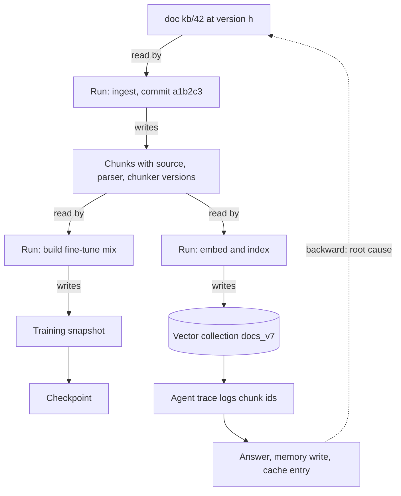

## TL;DR
Data lineage is the recorded graph of where every chunk, memory, dataset and model behind your agent came
from: inputs, job, code version, run. "Why did the agent say that" and "delete this user everywhere" are
graph traversals, so lineage makes debugging and deletion possible.

## For agent builders
- **Why it matters for agents.** An agent answer is built from retrieved chunks, long-term memories,
  cached results and a model trained on some dataset. When a user disputes an answer or asks for erasure,
  you need to walk from the trace back to document versions, and from a document forward to every memory
  and cache entry that quotes it.
- **Where it shows up in your stack.** Chunk metadata in the vector store, retrieved chunk ids logged on
  the agent's trace spans, input ids stored on memory writes and semantic-cache rows, and OpenLineage
  events from the ingestion and fine-tuning jobs.
- **What you control.** Which ids you stamp on every chunk, which ids the agent's tools log per call, what
  each request-path write (memory summary, cache entry, feedback row) records about its inputs, and
  whether deletion drills run.
- **What you can skip.** Column-level lineage across the warehouse and catalog vendor comparisons. Start
  with a lineage table, chunk stamps and the trace join.

## Decision case
### Scenario
A fintech runs a customer-support agent with a RAG index, long-term memory and a monthly fine-tune on
agent traces. Its data protection officer now requires two things: erasure requests completed and proven
within 30 days, and disputed answers explained within 5 business days. Today nothing records which
document version a chunk came from.

Constraints (figures illustrative):
- **Scale.** 40 million chunks from 3 ingestion jobs under Airflow; about 2 million memory writes and
  5 million semantic-cache entries a month; one fine-tuning job a month.
- **Team and time.** Two platform engineers for one quarter (about 12 weeks).
- **Storage.** Stamping about 150 bytes of lineage per chunk is 40M × 150 B = 6 GB; that is acceptable.
- **Proof.** Erasure must be shown by a repeatable drill, not by a statement that the code deletes it.
- **Ownership.** Only the AI platform team queries the graph this year; the warehouse team has its own tools.

### Options
| Option | How it works | Erasure proof | Dispute explanation | Fits 12 weeks? |
|---|---|---|---|---|
| **A. Declared lineage** | DAG files and READMEs imported into a catalog | No: shows intended graph, not versions or request-path copies | No: no chunk-to-version link | Yes |
| **B. Full catalog, column-level everywhere** | OpenLineage from every job into a catalog, column-level across the warehouse, record-level for AI data | Yes | Yes | No: warehouse coverage alone is a multi-quarter project |
| **C. Run-time lineage for AI data only** | Airflow OpenLineage events into a lineage table or Marquez; chunk stamps; trace join; input ids on memory and cache writes; versioned training snapshots | Yes, through forward traversal and drills | Yes, trace to chunk to document version | Yes |
| **D. Request-path ids only** | Input ids on memories and caches, nothing for batch jobs | Partial: misses chunks' versions and training snapshots | Partial | Yes |

### Decision
Choose **C**, run-time lineage scoped to what feeds the agent:
- **It answers both DPO questions within the quarter.** Forward traversal from a customer's documents
  reaches chunks, vectors, memories, cache rows and the training snapshot. The trace's chunk ids resolve
  to a document version for disputes.
- **Run-time capture is required for proof.** A, like any declared graph, describes what could run, so a
  drill built on it can pass while a real copy survives.
- **Record level only where deletion and citation need it.** The warehouse stays table-level, which removes
  most of B's effort.
- **The request path is in scope from day one.** About 7 million memory and cache rows a month would
  otherwise be the hole that breaks the 30-day erasure.
- **Weights are named, not cleaned.** Traversal names the monthly checkpoints trained on a snapshot holding
  the data; the retention policy decides whether to retrain or retire them.

What would change it:
- **A second team needs to query the graph.** Then send the same OpenLineage events to a shared catalog
  rather than rebuild.
- **Regulators ask for column-level derivations of reported figures.** Then the warehouse part of B becomes
  required work, planned separately.
- **The fine-tune is dropped.** Then training snapshots leave scope and C shrinks.

### Trade-offs accepted
- **An owned lineage table instead of a catalog.** Less tooling, more custom queries; watch how often
  people ask questions the table cannot answer.
- **No column-level lineage.** Schema-change impact on the warehouse stays manual; watch incidents caused
  by upstream column changes.
- **Instrumentation debt on every new writer.** Any new tool that persists state must record input ids;
  enforce it with a CI coverage gate and watch derived rows with empty input-id fields.
- **Snapshot storage.** Retaining training snapshots costs space; watch retained snapshot size against the
  window in which "was this example trained on" can still be asked.

### Review rubric
- **Questions drive scope.** The write-up names the questions lineage must answer (erasure, disputes,
  regressions) and the granularity each needs.
- **Capture is at run time,** with named facets (input versions, code commit, container digest, row counts).
- **Request-path artifacts are covered:** memories, caches, saved answers and feedback copies record input ids.
- **The trace join is specified:** retrieved chunk ids on the retrieval tool's span, resolving to a document
  version.
- **Proof is a drill:** a scheduled forward traversal and purge with a pass rate and a time target.
- **Limits are honest:** it says what lineage cannot do for model weights and what decides that instead.

## Why it exists
- **AI systems are long chains of transformations.** Source documents become parsed text, then chunks,
  then vectors joined with metadata into an index. Separately, raw records become cleaned datasets,
  training mixes, checkpoints and served models. Each hop is written by a different job, often a different
  team.
- **Each hop forgets the one before.** A vector in the index does not know which parser version produced
  its text; a checkpoint does not know which rows were filtered out of its training set; an agent memory
  does not know which conversation produced it unless you record it.
- **The question is always upstream or downstream.** Deletion: which chunks, caches, fine-tuning sets and
  checkpoints contain this customer's data? Regression on Tuesday: did the source, parser, chunker,
  embedding model or index build change? Impossible output: was the offending example in the training data,
  and which pipeline let it through? Each is "walk backward to inputs" or "walk forward to derivatives".
- **Reading pipeline code fails,** because code describes what *could* run, not what *did* run with which
  inputs at which version.
- **Naming conventions and READMEs fail,** because jobs do not update them and they drift immediately.
  Lineage must be emitted by the job at run time, as a side effect of doing the work, or it will not be
  accurate.

## How it works
### Background: the graph
- **Two node types:** **datasets** (a table, a file prefix, a vector collection, a model artifact, a prompt
  template) and **jobs** (a pipeline step).
- **A run is one execution of a job** and carries edges: run *reads* datasets A and B, run *writes* dataset
  C.
- **Dataset versions are nodes, not just names,** *because* "the training table" is not an input; "the
  training table as of snapshot 2024-06-01T00:00Z, 4.2 million rows, content hash h" is. Without versioned
  nodes, the graph says a job touched a table and nothing about which state of the table.

### Granularity
| Level | Example | Use it for |
|---|---|---|
| Table-level | job J read table T | the warehouse |
| Column-level | `price_usd` in C derives from `price_cents` in A through J | schema changes, impact analysis |
| Record- or chunk-level | each chunk carries source document id, document version, parser version, chunker version | anything feeding retrieval, fine-tuning or a model's outputs |

- **Record-level is heavier,** but it is the only granularity at which "delete this person's data" and "why
  was this passage retrieved" can be answered.
- **Practical compromise:** table-level for the warehouse, record-level for anything that feeds retrieval,
  agent memory, fine-tuning or a model's outputs.

### Capture at run time, not by declaration
1. **Start event:** job name, run id, inputs with their versions.
2. **Complete event:** outputs with their versions, plus facets such as row counts, schema and the code
   commit.
3. **Fail and abort events too.** OpenLineage defines FAIL and ABORT states, *because* a run that wrote half
   its output before crashing is exactly the one you need to find later.

- **Why run time:** declared lineage (a YAML file describing the DAG) tells you the intended graph, not the
  actual one for a specific run.
- **Tooling:** OpenLineage is the common open standard for these events. Orchestrators and transformation
  tools (Airflow, Spark, dbt among them) can emit them; Marquez is the reference backend that stores and
  renders the graph; catalogs such as DataHub can ingest the events.
- **Check formats:** other catalogs (Apache Atlas, for example) use their own lineage model, so check which
  format your catalog actually consumes.
- **No tooling needed to start:** a table of `(run_id, job, direction, dataset, version, facets)` rows gives
  you the same power.

### Facets that make lineage useful
- **A bare edge is not enough.** Each run records the code version (commit hash, container digest), the
  parameters (chunk size, embedding model id), the environment, and per-dataset statistics (row count,
  schema fingerprint, content hash).
- **Facets turn events into explanations:** "the index was rebuilt" becomes "the index was rebuilt by commit
  abc with chunk size 512 from document snapshot h".
- **Debugging is a facet diff:** when two runs produce different results, diff their facets.

### Traversals
- **Impact analysis (forward):** from a dataset version, everything derived from it. Used before changing a
  source schema and for deletion propagation: a document id walks forward to chunks, vectors, caches, agent
  memories, eval sets and fine-tuning examples.
- **Root cause (backward):** from an artifact (or an agent answer), its ancestors. Used when quality
  regresses: compare the ancestor facets of the good run and the bad run.
- **Reproduction:** the backward closure plus the code versions is the recipe to rebuild an artifact.

### Lineage versus provenance
The two words are often used interchangeably; the useful distinction is scope.

| | Lineage | Provenance |
|---|---|---|
| Scope | the whole derivation graph across the platform | the verifiable record attached to one artifact |
| Typical query | traversal: "what depends on this table" | "this checkpoint was built from these digests by this commit, and here is a signature" |
| Relationship | the graph lets you walk from one manifest to every artifact sharing an input | manifests are nodes and facets in the lineage graph |

### Agent runtime artifacts are the usual hole
- **Batch jobs are easy** to instrument because an orchestrator wraps them.
- **Request-path artifacts escape:** an agent's memory summary of a conversation, a semantic-cache entry, a
  generated answer saved as a draft, a tool result persisted to a scratchpad, a user-feedback row copied
  into an eval set.
- **Same treatment for each:** record the ids of the inputs it was derived from (conversation, retrieved
  chunk ids, model version) at write time. Otherwise forward traversal from a deleted document stops at the
  batch boundary and misses the copies users actually see.
- **Know where traversal stops being actionable.** Forward traversal can show a document reached a training
  snapshot and therefore a checkpoint, but cannot remove its influence from the weights; it tells you which
  models must be retrained or retired. Lineage finds the blast radius; retention and deletion architecture
  decides what to do about it.

### Lineage for RAG and agent traces
- **Stamp every chunk** with `source_id`, `source_version`, `parser_version`, `chunker_version`,
  `embedding_version` and `ingest_run_id`.
- **Log each retrieved chunk with the request trace,** as attributes on the retrieval tool's span, which
  connects the serving-time trace to the ingestion-time graph.
- **That join makes citations trustworthy:** not "a chunk that looks like page 12" but "chunk c, from
  document d at version v, ingested by run r".

### Lineage for training
- **Inputs and outputs:** a training run reads dataset versions and a base model version, and writes
  checkpoints and eval results. Fine-tuning on agent traces is the same: the trace export is a dataset
  version.
- **Keep the exact data snapshot** as an immutable version, retained and addressed by its hash. That lets you
  answer "was example x in the training set" by lookup rather than re-running the filter pipeline. It is
  also what dataset contamination checks need.
- **A hash alone is not enough:** it proves which bytes were used but cannot be searched, so the snapshot
  must be kept for as long as that question can be asked.

## Diagram
Runs connect versioned datasets. Forward edges answer deletion and impact; backward edges answer root
cause; the trace join links an agent's answer into the graph.



## Examples
### Agent tools that record lineage at write time
The retrieval tool logs the chunk ids it returned on the trace, and the memory tool stores the ids it was
derived from, so a forward traversal from a deleted document reaches the memory.

```python
import uuid

trace_spans = []   # stand-in for your tracing backend
memories = {}      # memory_id -> row

def search_docs(query: str, trace_id: str, hits: list[dict]) -> list[dict]:
    trace_spans.append({"trace_id": trace_id, "tool": "search_docs", "query": query,
                        "chunk_ids": [h["chunk_id"] for h in hits],
                        "source_versions": [h["source_version"] for h in hits]})
    return hits

def write_memory(summary: str, trace_id: str, conversation_id: str, model: str) -> str:
    used = [c for s in trace_spans if s["trace_id"] == trace_id for c in s["chunk_ids"]]
    mid = str(uuid.uuid4())[:8]
    memories[mid] = {"text": summary, "conversation_id": conversation_id,
                     "derived_from_chunks": used, "model": model}
    return mid

def memories_derived_from(doc_id: str) -> list[str]:
    """Forward traversal for the request path: which memories quote this document?"""
    return [m for m, row in memories.items()
            if any(c.startswith(f"chunk:{doc_id}:") for c in row["derived_from_chunks"])]

hits = [{"chunk_id": "chunk:kb/42:h1:0", "source_version": "h1", "text": "Refunds take 5 days."}]
search_docs("refund time", "t-1", hits)
write_memory("User was told refunds take 5 days.", "t-1", "conv-9", "model-2025-01")
print(memories_derived_from("kb/42"))   # the memory to purge or refresh when kb/42 changes
```

### A minimal lineage recorder with forward and backward traversal
It writes versioned dataset nodes and run edges to an in-memory store, then answers the two traversals
that matter: forward impact from a document and backward root cause from a chunk.

```python
import hashlib, uuid, time

edges = []          # (run_id, direction, dataset_id)
runs = {}           # run_id -> facets
chunk_lineage = {}  # chunk_id -> facets

def version_of(content: bytes) -> str:
    return hashlib.sha256(content).hexdigest()[:12]

def ingest(doc_id: str, text: str, commit: str, chunker="recursive-v3", emb="emb-v7"):
    run_id = str(uuid.uuid4())[:8]
    doc_ver = version_of(text.encode())
    runs[run_id] = {"job": "ingest", "commit": commit, "chunker": chunker,
                    "embedding_version": emb, "started": time.time()}
    edges.append((run_id, "reads", f"doc:{doc_id}@{doc_ver}"))
    for i, piece in enumerate(text.split(". ")):            # stand-in chunker
        chunk_id = f"chunk:{doc_id}:{doc_ver}:{i}"
        chunk_lineage[chunk_id] = {"source": f"doc:{doc_id}@{doc_ver}", "run": run_id,
                                   "chunker": chunker, "embedding_version": emb}
        edges.append((run_id, "writes", chunk_id))
    return run_id

def forward(dataset_id: str):
    """Everything derived from a dataset version (deletion propagation / impact)."""
    out, frontier = set(), {dataset_id}
    while frontier:
        d = frontier.pop()
        for run_id in {r for r, dir_, ds in edges if dir_ == "reads" and ds == d}:
            for r, dir_, ds in edges:
                if r == run_id and dir_ == "writes" and ds not in out:
                    out.add(ds); frontier.add(ds)
    return out

def backward(chunk_id: str):
    """Why does this chunk look the way it does?"""
    lin = chunk_lineage[chunk_id]
    return {**lin, "run_facets": runs[lin["run"]]}

r1 = ingest("kb/42", "Refunds take 5 days. Chat support is 24/7.", commit="a1b2c3")
doc_node = next(ds for r, d, ds in edges if r == r1 and d == "reads")
print(sorted(forward(doc_node)))      # the chunks to delete if kb/42 must be erased
print(backward("chunk:kb/42:%s:0" % doc_node.split("@")[1]))
```

In a real system the same records would be OpenLineage events to a catalog, and the agent trace would
log the chunk ids it retrieved so a user-visible answer links back to `backward(...)`.

### Production snippet: forward traversal over a lineage table in SQL
With lineage stored as `(run_id, job, direction, dataset, version, facets)` rows, a recursive query finds
everything derived from one document version. `UNION` (not `UNION ALL`) drops repeats, so the query
terminates even if the graph has a cycle.

```sql
WITH RECURSIVE downstream(dataset, version) AS (
  SELECT 'doc:kb/42', 'h1'                         -- the deleted document version
  UNION
  SELECT w.dataset, w.version
  FROM downstream d
  JOIN lineage r ON r.direction = 'reads'  AND r.dataset = d.dataset AND r.version = d.version
  JOIN lineage w ON w.direction = 'writes' AND w.run_id = r.run_id
)
SELECT dataset, version FROM downstream;
```

### Worked scenario: the Tuesday regression with no deploy
The support agent's answers on one product area get worse overnight and retrieval recall drops. Backward
traversal from a chunk that should have been retrieved, comparing the last good run with the bad one
(illustrative values):

| Facet | Good run (Monday) | Bad run (Tuesday) | Reading |
|---|---|---|---|
| `source_version` | h | h | upstream content unchanged |
| code commit | abc | abc | no deploy of our code |
| `parser_version` | pdf-parser 1.x | pdf-parser 2.x | a dependency upgrade slipped in via an unpinned image |
| `chunker_version` | recursive-v3 | recursive-v3 | unchanged |
| output row count | baseline | far fewer chunks for that area | the new parser drops tables |

- **Root cause in minutes:** the parser changed under an unchanged commit, which only a container-digest or
  parser-version facet reveals. Fix: pin the parser, re-ingest the affected sources, add a row-count check.

## Production patterns
- **Orchestrator-emitted OpenLineage events.** Use when ingestion and fine-tuning jobs run under Airflow,
  Spark or dbt. Enable the tool's OpenLineage integration and point its transport at your backend (Marquez
  or a catalog that ingests OpenLineage). Monitor event volume per job and jobs with START but no COMPLETE,
  FAIL or ABORT.
- **Lineage coverage gate in CI.** Use once more than a few pipelines exist. Fail the build if a new job
  definition does not emit run events or omits required facets (commit, container digest, input versions).
  Monitor coverage as fraction of jobs emitting lineage.
- **Chunk stamping plus trace join.** Use for every RAG index behind an agent. Write `source_version`,
  `parser_version`, `chunker_version`, `embedding_version` and `ingest_run_id` on each chunk, and log
  retrieved chunk ids as attributes on the retrieval tool's trace span. Monitor the share of served answers
  whose citations resolve to a document version.
- **Request-path lineage at write time.** Use for agent memories, semantic caches, saved drafts, persisted
  tool results and feedback-to-eval copies. Store input ids (conversation id, chunk ids, model version) in
  the same row as the derived artifact. Monitor derived rows with empty input-id fields.
- **Scheduled deletion drill.** Use where erasure requests are possible. Pick a test document, traverse
  forward, and assert every derived artifact (chunks, vectors, caches, agent memories, eval rows, fine-tune
  rows) is found and purged. Monitor drill pass rate and time to complete.

## Trade-offs
- **Exact deletion and citation vs storage.** Record-level lineage makes deletion and citation exact, but
  adds a handful of metadata fields to every chunk and row; at billions of records the storage is real, and
  table-level may be all the warehouse side needs.
- **Accuracy vs instrumentation effort.** Run-time capture is accurate but requires every job and every
  agent tool that writes state to be instrumented. One uninstrumented writer creates a hole exactly where
  you later need it, so coverage is worth enforcing in CI.
- **Cross-team impact analysis vs another system to run.** A full lineage catalog serves many teams, but a
  single lineage table owned by the AI platform is enough until multiple teams need to query it.
- **Precise reproduction vs pipeline changes.** Versioned dataset nodes need immutable snapshots or content
  hashes for every input, which changes how pipelines write data; mutable tables with no snapshot are the
  enemy.

## Pitfalls
- **Recording dataset names instead of dataset versions.** Symptom: a graph that says "the training job read
  the events table" and cannot tell you which rows were present. Fix: version nodes.
- **Documenting lineage in a diagram or README rather than emitting it from jobs.** Symptom: a graph that is
  confidently wrong six weeks later. Fix: run-time events.
- **Storing chunk metadata without the ingest run id or source version.** Symptom: being unable to explain
  why two retrievals of the "same" page differ after a re-index. Fix: stamp both on every chunk at ingest.
- **Treating the agent trace and the ingestion lineage as separate systems.** Symptom: a citation that
  cannot be linked to a specific document version when a user disputes it. Fix: log chunk ids on the trace.
- **Skipping lineage for manual one-off fixes** ("I just patched that table by hand"). Symptom: an
  unexplained discontinuity nobody can reproduce. Fix: run manual fixes as recorded jobs.
- **Instrumenting batch pipelines but not request-path writes** such as memories, caches and saved answers.
  Symptom: a deletion drill that finds every chunk yet misses the agent memories that quote the document.

## When to use
- **Mandatory when** a system must honour deletion requests, must explain its outputs, or has more than one
  pipeline feeding retrieval, memory or training, which describes nearly every production agent.
- **Start with the minimum:** a run table with inputs, outputs, versions and code commit, plus source and
  run identifiers on every chunk and input ids on every memory write.
- **Adopt a catalog** when more than one team needs the graph.
- **Measure:** coverage (fraction of jobs emitting lineage), and test it with a deletion drill: pick a
  document, traverse forward, and verify every derived artifact is found.
- **Interviews:** "how would you handle a right-to-erasure request across a RAG and fine-tuning stack" is
  answered by describing forward traversal over a lineage graph; without it the honest answer is "we could
  not".

## Role lens
- **Engineer:** Instruments ingestion and training jobs to emit run events with versions and facets, and
  stamps every chunk with its source version and ingest run id.
- **Architect:** Decides the lineage granularity per data domain, picks declarative versus run-time capture
  and the catalog, and makes lineage coverage a release requirement.
- **FDE:** Uses the graph to answer a customer's auditor or DPO: which of their records are in which
  indexes and datasets, and proves deletion with a forward traversal.

## Check yourself
**Q:** Retrieval quality for one product area dropped sharply after last night's pipeline runs. Nothing was
deployed. How does lineage help you find the cause, and what would you need to have recorded?
**A:** Take a failing query, find the chunks that should have been retrieved, and walk backward: each chunk
records its source document version, parser version, chunker version, embedding version and ingest run.
Compare those facets against the same chunks from the last good index. If the source version changed, the
upstream content moved or was reformatted; if parser or chunker versions changed, a dependency upgrade
slipped in without a deploy of your code; if the embedding version changed, a model revision moved under
you; if only the run differs, compare run facets such as row counts and schema fingerprints to find a
partial or failed load. For this to work, jobs must emit run events with code and container versions and
per-dataset statistics, and chunks must carry their run and source versions. Without versions, you only
know that "ingestion ran", which is where the investigation would stall.

## Interview questions
### What is data lineage, and why must it be captured at run time?
- **Definition:** a directed graph of versioned datasets and job runs, with read and write edges and facets
  such as code commit and row counts.
- **Why run time:** code and DAG files describe what could run; only events emitted by the run record which
  input versions were actually read and what was written, including failed partial runs.

### A customer invokes right to erasure. Walk me through finding every copy of their data.
- **Start forward from the source records** at every version, following writes to chunks, vectors, caches,
  eval examples and fine-tuning rows.
- **Include request-path artifacts:** memories, semantic-cache entries and saved answers, which only appear
  if their input ids were recorded at write time.
- **Stop at weights honestly:** lineage names the checkpoints trained on a snapshot containing the data;
  deletion policy decides whether to retrain or retire them.

### A user disputes something your agent told them last week. What must you have logged to explain it?
- **The trace:** the model version, the prompt version, and every tool call with its arguments and result
  ids, especially the retrieved chunk ids and any memory ids read.
- **The chunk stamps:** each chunk id resolves to a source document version, parser, chunker and ingest run,
  so you can show exactly which page version the agent relied on.
- **Memory inputs:** if a memory shaped the answer, its stored conversation and chunk ids let you walk back
  to where that belief came from.

### How do lineage and provenance differ, and when do you need both?
- **Lineage** is the platform-wide derivation graph, queried by traversal.
- **Provenance** is a verifiable, often signed, record attached to one artifact.
- **Both** when you ship models or datasets to others: provenance proves what one artifact is, and the
  lineage graph finds every other artifact sharing its inputs.

### Record-level lineage at billions of rows: is it worth it?
- **For retrieval, fine-tuning and outputs, yes:** it is the only granularity that answers deletion and
  citation questions.
- **For the warehouse, usually no:** table-level is enough, and the extra metadata fields per row are real
  storage at that scale.

### How would you measure whether your agent platform's lineage is actually trustworthy?
- **Coverage:** fraction of jobs and state-writing agent tools emitting lineage with required facets,
  enforced in CI.
- **Deletion drills:** pick a document, traverse forward, and verify every derived artifact is found;
  a miss means an uninstrumented job or request-path write.

## Quiz
### Q: Why must lineage nodes be dataset versions rather than dataset names?
- [ ] Names are not unique across teams
- [x] A job reads a specific state of a dataset, and reproduction or deletion requires knowing which state
- [ ] Versions are easier to store in a graph database
- [ ] Names change too often to be reliable identifiers
> "Job J read table T" cannot answer which rows were present or let you rebuild the output. Recording the
> snapshot or content hash as the node makes the graph a recipe rather than a sketch.

### Q: Which lineage traversal answers "which artifacts must be purged when this document is deleted"?
- [ ] Backward traversal from the index to the document
- [x] Forward traversal from the document version to everything derived from it
- [ ] A search of the vector index for similar content
- [ ] A diff of the last two ingestion runs
> Deletion propagation starts from the source and follows writes downstream: chunks, vectors, caches,
> eval examples, fine-tuning rows. Backward traversal explains a single artifact; similarity search would
> miss derived data that no longer resembles the original.

### Q: Why is lineage captured by jobs at run time preferred over a maintained diagram of the pipeline?
- [ ] Diagrams cannot represent cycles in the pipeline
- [ ] Run-time capture is cheaper to implement
- [x] A diagram describes the intended graph; run-time events describe what actually ran, with which versions
- [ ] Regulators require machine-readable formats
> Declared lineage drifts the moment someone changes a job, and it never knows which input version a given
> run used. Events emitted as a side effect of doing the work are accurate by construction.

## Use cases & projects
### Use cases
- **Explaining a disputed agent answer.** The trace's chunk ids resolve to document versions, so support
  can show which page version the agent quoted.
- **Erasure across an agent stack.** Forward traversal from a user's documents reaches chunks, vectors,
  memories, semantic-cache entries and fine-tuning rows.
- **Debugging an overnight quality drop.** A facet diff between ingestion runs finds the unpinned parser or
  embedding change that no deploy explains.
- **Fine-tuning on agent traces.** The trace export is a versioned dataset, so you can tell which
  checkpoint learned from which conversations.

### Mini project
**Lineage for a RAG agent with memory (2-3 hours).**
- **Goal:** make every agent answer and memory traceable to document versions, and prove a deletion reaches
  all of them.
- **Steps:** ingest 20 documents into a lineage table and a vector store with chunk stamps; build an agent
  with `search_docs` and `write_memory` tools that log chunk ids and input ids; run 15 conversations; write a
  `explain(trace_id)` function that walks back to documents, and a `forward(doc_id)` that finds chunks,
  vectors and memories; run a deletion drill on one document.
- **Done when:** `explain` prints document id and version for every cited chunk, and the drill deletes the
  document's chunks and every memory derived from it with zero leftovers on re-query.
