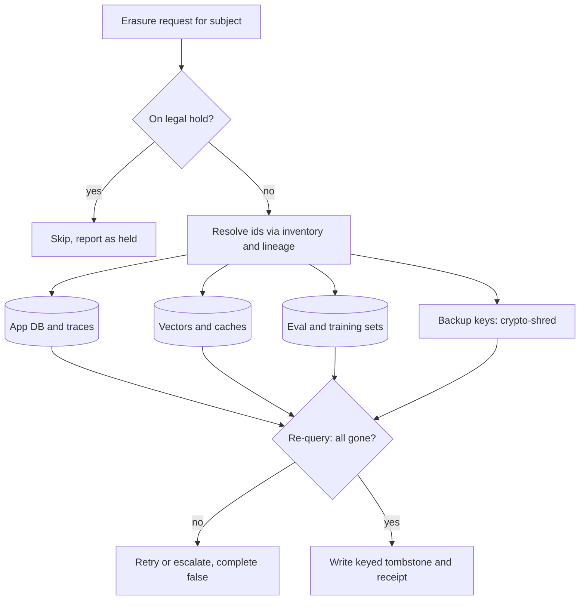

## TL;DR
LLM apps copy user data into logs, traces, indexes, caches, eval and training sets, vendor logs and
weights. This architecture inventories every copy, gives each a retention class and TTL, and executes
deletion across all of them with proof, designed in from the start.

## Why it exists
- **Law and contracts bound retention.** GDPR's right to erasure, similar rights under CCPA and other
  regimes, and most enterprise contracts require personal or customer data to be kept no longer than needed
  and deleted on request within a bounded time. Under GDPR a response is due without undue delay and within
  one month, extendable by two further months for complex requests.
- **The classic model does not fit.** For a web app, data lives in a database with backups, and deletion is
  a `DELETE` plus a backup expiry policy. An AI application breaks that model.
- **One conversation, eight persisted copies.** The message (name, order number) goes to the application
  database; into a prompt; to a vendor whose API logs it; into a trace with full prompt and completion; into
  a memory vector; into a semantic-cache entry; into a weekly eval set; into a fine-tuning dataset; and
  partially into model weights.
- **Spread across owners and companies.** Setting aside the transient prompt, that is eight persisted
  copies in eight systems, owned by several teams, with at least one (vendor logs) outside the company, two
  if observability is hosted.
- **"Delete the primary and let the rest expire" fails,** because several copies have no expiry (vector
  index, fine-tuning dataset, weights), and those that do often expire too late for the request deadline.
- **"Never store anything" fails,** because observability, evaluation and improvement all depend on
  retaining interactions. Retention must be a per-copy decision, and deletion a traversal that reaches every
  copy.

## How it works
### Inventory and classify every copy
- **Map where data lands.** For each store record the data classes it holds (user content, derived content
  such as embeddings and summaries, operational metadata, aggregate metrics), whether it is keyed by a
  subject identifier, and who owns it.
- **Sources of the map:** the lineage system supplies most of it for derived data; the rest (vendor logs,
  caches, backups) is documented by hand.
- **Why classify:** retention is set per class. An aggregate latency metric can live for years; a raw prompt
  with a customer's address should not.

### Retention classes and TTLs
- **Each store gets a policy:** a time-to-live after which data is deleted automatically, or "retain while
  the relationship exists".
- **Derived data inherits the shortest TTL of its inputs,** *because* an embedding of a deleted message is
  still a representation of it.
- **Enforce TTLs mechanically:** database partitions dropped by date, object storage lifecycle rules, vector
  collections partitioned by ingestion month, trace stores with built-in retention. Policy that depends on
  someone remembering to run a cleanup is not a policy.

### Retention minimums and legal holds
- **Retention has a floor as well as a ceiling.** Some data must be kept for a minimum period (financial
  records, security audit logs, records a regulator requires).
- **Legal holds** from litigation can freeze data that would otherwise expire or be erased.
- **Erasure has exceptions.** GDPR's erasure right excludes, among others, data needed to comply with a legal
  obligation or to establish or defend legal claims.
- **The deletion job consults a hold register first:** a held record is skipped and reported as held, not
  deleted and not silently ignored.
- **Conflicts are for counsel.** Resolving floor versus ceiling versus hold versus erasure is a policy
  decision; the architecture makes the rule explicit and executable rather than deciding it.
- **Vendors are a store too.** Model API providers typically retain request logs for abuse monitoring
  unless a zero-retention arrangement is in place. Terms vary by provider and contract, so record what the
  agreement is and whether it covers the data classes you send.

### Deletion as a propagated job
A deletion request (one subject, one tenant, or one document) becomes a job that:
1. Resolves the subject to identifiers in every store, using lineage to find derived artifacts: the
   document's chunks, their vectors, cache entries that embedded them, eval examples sampled from them,
   fine-tuning rows that include them.
2. Issues deletes to each store, idempotently, with retries, and records a per-store receipt.
3. Verifies by re-querying each store for the identifiers.
4. Writes a tombstone so re-ingestion from a still-live source does not resurrect the data, and so a
   later audit can show when and where deletion happened.

- **Idempotent and resumable,** *because* it fans out across many systems and some will be down.
- **Partial completion must be visible,** not silently treated as done.

### Store-specific mechanics
| Store | Mechanism | Watch out for |
|---|---|---|
| Vector indexes | delete by metadata (`subject_id`, `document_id`), so those fields must exist on every vector | soft-delete markers until compaction, segment merge or rebuild: the vector may remain on disk after it stops being returned |
| Caches | key entries so a subject's data can be found, or a TTL short enough that expiry alone meets deadlines | semantic and exact-match caches hold full prompts and completions |
| Traces and logs | redact PII before the trace is written, or key by subject with a short retention | redaction at write time is the more robust choice |
| Backups, immutable stores | short rotation plus a deletion log, or crypto-shredding | you cannot delete one row from a backup |
| Summaries and memories | record source conversations and subjects; delete or regenerate on erasure | one summary can blend several people's data |
| Training datasets | rows carry subject or tenant identifiers | the snapshot digest changes, which flows into provenance |
| Model weights | keep deletable data out, time-box models, or retrain | cannot delete from weights |

- **Vector indexes:** treat the index as a derived store that can be rebuilt from the source of truth, and
  schedule rebuilds so soft-deleted vectors actually leave disk.
- **Backups, the simpler pattern:** backups age out within a defined window, and any restore replays the
  recorded deletions before the data goes live again.
- **Backups, the stronger pattern (crypto-shredding):** encrypt each subject's (or tenant's) data under its
  own key, and delete the key. The ciphertext remains but is unrecoverable, widely treated as meeting the
  intent of erasure for backups and append-only logs. Regulators have not uniformly codified that view, so
  confirm the approach with your privacy counsel.
- **Summaries and memories:** an LLM-written summary or agent memory is a new document that cannot be
  filtered row by row, so erasing one subject means deleting it or regenerating it from the remaining inputs.
- **Model weights:** machine unlearning techniques exist but are not reliable enough to certify. The
  architectural answers: keep deletable data out of training (redact, or train only on data with consent
  terms that survive deletion requests); time-box models so a retrain on the cleaned dataset happens within
  the deadline; or accept retraining as the deletion mechanism and budget for it.

### Tenant-level deletion
- **Partition every store by tenant** (separate collections, prefixes or keys). Enterprise offboarding then
  becomes dropping a partition instead of a filtered scan, which is faster and more verifiable.
- **Per-tenant encryption keys** make the backup problem disappear for the same reason as crypto-shredding.

### Proof
- **The job's output is a report:** request id, a keyed reference to the subject, each store touched,
  receipts, verification results, and the tombstone id.
- **Why the job must produce it:** regulators and customers ask for this, and the job is the only thing that
  can produce it accurately.

## Diagram
An erasure request fans out to every store found by inventory and lineage; holds are checked first, and only
verified deletes count toward a complete receipt.



## Examples
### A deletion orchestrator with retries, verification and receipts
It fans out over registered stores, retries, verifies, and produces a receipt. Stores are small stand-ins;
the shape of the job is what matters.

```python
import hashlib, hmac, time
from dataclasses import dataclass, field

TOMB_KEY = b"from-a-secret-store"                       # tombstones must not hold the raw id
def tomb_id(subject): return hmac.new(TOMB_KEY, subject.encode(), hashlib.sha256).hexdigest()

@dataclass
class Store:
    name: str
    rows: dict = field(default_factory=dict)           # id -> {"subject": ..., ...}
    flaky: int = 0                                     # simulate transient failures
    def find(self, subject):
        return [i for i, r in self.rows.items() if r["subject"] == subject]
    def delete(self, ids):
        if self.flaky: self.flaky -= 1; raise ConnectionError(self.name)
        for i in ids: self.rows.pop(i, None)

class KeyVault(Store):                                  # crypto-shredding for backups
    def find(self, subject): return [subject] if subject in self.rows else []

def erase(subject: str, stores: list[Store], tombstones: set, max_tries=3) -> dict:
    receipt = {"subject_ref": tomb_id(subject)[:16], "stores": {}, "complete": True}
    for s in stores:
        ids = s.find(subject)
        for attempt in range(1, max_tries + 1):
            try:
                s.delete(ids); break
            except ConnectionError:
                time.sleep(0)                           # backoff in real code
        remaining = s.find(subject)
        ok = not remaining
        receipt["stores"][s.name] = {"found": len(ids), "verified": ok, "attempts": attempt}
        receipt["complete"] &= ok
    tombstones.add(tomb_id(subject))                    # blocks re-ingestion from live sources
    receipt["tombstone"] = tomb_id(subject) in tombstones
    return receipt

app_db   = Store("app_db",   {"m1": {"subject": "u42", "text": "order 991"}, "m2": {"subject": "u7"}})
vectors  = Store("vectors",  {"c1": {"subject": "u42", "doc": "m1"}}, flaky=1)
cache    = Store("sem_cache",{"k9": {"subject": "u42"}})
backups  = KeyVault("backup_keys", {"u42": {"subject": "u42", "key": "..."}})
tomb = set()
print(erase("u42", [app_db, vectors, cache, backups], tomb))
# ingestion computes tomb_id(subject) and skips any record whose id is in `tomb`
```

The `complete` flag is what an audit reads; a `False` means the job must be rerun or escalated, never
quietly closed. In production the store list comes from the inventory, and the derived-artifact ids come
from a forward lineage traversal rather than a per-store scan.

### Worked scenario: does expiry alone meet a one-month deadline?
An inventory for the support assistant above, with illustrative TTLs. The deadline is the GDPR one month.

| Store | TTL | Expiry meets deadline? | Action on erasure |
|---|---|---|---|
| Application database | while relationship exists | no | explicit delete |
| Traces (PII redacted at write) | 14 days | yes, and nothing personal is stored | none needed |
| Semantic cache | 7 days | yes | optional explicit delete |
| Vendor API logs | per contract (zero-retention or provider default) | only if the contract says so | record terms; request deletion if retained |
| Memory vectors | none | no | delete by `subject_id`, rebuild on schedule |
| Weekly eval set | none | no | remove rows, new snapshot digest |
| Fine-tuning dataset | none | no | remove rows, new snapshot digest |
| Last month's checkpoint | until replaced | no | retrain on cleaned snapshot or retire |
| Backups | 35-day rotation | no, 35 days exceeds one month | replay deletion log on restore, or crypto-shred |

- **Reading it:** five stores need explicit action and one needs a retrain. Shortening the backup rotation
  well under one month, or crypto-shredding, removes one more row of manual work.

### Production snippet: TTL by lifecycle rule
Object storage enforces the trace-export TTL mechanically, so nobody has to remember a cleanup job.

```json
{
  "Rules": [
    {
      "ID": "expire-trace-exports",
      "Filter": { "Prefix": "traces/" },
      "Status": "Enabled",
      "Expiration": { "Days": 14 }
    }
  ]
}
```

## Production patterns
- **Redact before the trace is written.** Use whenever full prompts reach observability. Run a PII detector
  (Microsoft Presidio is a common open-source choice) in the app or in an OpenTelemetry Collector processor
  that deletes or hashes span attributes, so the trace store holds nothing deletable. Monitor the detector's
  hit rate and sample traces for missed PII.
- **Mechanical TTLs per store.** Use for every store with a retention class. S3-style lifecycle expiration
  rules for exports, time-partitioned Postgres tables dropped by date (`DROP TABLE` on the old partition),
  and the trace backend's own retention setting. Monitor the number of stores with no automated TTL; the
  target is zero outside "retain while relationship exists".
- **Metadata-keyed vector deletes plus scheduled rebuilds.** Use for every RAG or memory index. Store
  `subject_id`, `tenant_id` and `document_id` on each point and delete by filter (Qdrant deletes points by
  payload filter; in pgvector it is a plain `DELETE ... WHERE subject_id = ...` followed by vacuum). Rebuild
  or compact on a schedule so soft-deleted vectors leave disk. Monitor deleted-but-not-compacted counts.
- **Per-tenant envelope encryption.** Use for multi-tenant enterprise products. Each tenant's data key is
  wrapped by a KMS key; offboarding deletes the tenant's key, shredding backups and logs. Monitor key-to-tenant
  coverage and key deletion events.
- **Tombstone check at ingestion.** Use wherever a crawl or sync can re-read deleted data. Ingestion computes
  the keyed hash of each record's subject and skips matches. Monitor tombstone hits per sync; hits mean the
  source still holds the data and the owner should be told.
- **Quarterly deletion drill.** Use for every regulated deployment. Erase a synthetic test subject seeded into
  every store, and require a `complete: True` receipt within the target time. Monitor request-to-verified
  completion time.

## Trade-offs
- **Easy deadlines vs debugging window.** Short TTLs on traces and caches make deletion deadlines trivial but
  shrink the window for debugging and evaluation; the balance shifts toward longer retention once PII is
  redacted at write time.
- **Clean backup deletion vs key management.** Crypto-shredding handles backups and immutable logs cleanly,
  but per-subject keys add a key-management system and a lookup on every read. Per-tenant keys are far
  cheaper and cover offboarding, but cannot shred one person inside a tenant, so per-subject erasure then
  falls back to backup expiry plus replay of the deletion log on restore.
- **No unlearning problem vs useful training data.** Keeping personal data out of fine-tuning avoids the
  unlearning problem entirely, but some use cases need it; then retraining on a schedule is the cost of being
  able to honour deletions.
- **Partition drops vs collection sprawl.** Partitioning every store by tenant makes offboarding a partition
  drop, but multiplies collections and indexes. For thousands of small tenants, logical partitioning with
  tenant keys plus filtered deletes is more practical.
- **Evidence vs load.** Verification by re-query adds load and time to each deletion job, but a deletion
  without verification is an assertion, not evidence; skip it only for stores with transactional guarantees.

## Pitfalls
- **Vectors stored without subject or document identifiers.** Symptom: a deletion request that requires a
  full index rebuild because nothing can be targeted.
- **Treating "the source document was deleted" as "the chunks are gone".** Symptom: retrieval still citing a
  page that no longer exists. Fix: propagate via lineage.
- **Relying on ANN soft deletes.** Symptom: an audit finding the bytes still on disk months after a confirmed
  deletion. Fix: scheduled compaction or rebuild.
- **Full prompts in traces with multi-year retention.** Symptom: the observability stack becomes the largest
  PII store in the company and the hardest to delete from. Fix: redact at write time.
- **Re-ingestion resurrecting deleted data** because the source system still has it. Symptom: a user deleted
  last month reappears in the index after the next crawl. Fix: tombstone check at ingestion.
- **Forgetting the vendor.** Symptom: a data-processing audit asks for the provider's retention terms and
  nobody knows whether zero-retention was ever enabled.
- **Deletion jobs that report success on partial completion.** Symptom: a later discovery in a store that
  was down during the run. Fix: per-store verification and a `complete` flag.
- **Tombstones and receipts that store the raw email or user id.** Symptom: a deny-list that is itself a
  growing register of exactly the people who asked to be forgotten. Store a keyed hash instead.
- **Deleting data under legal hold** because the erasure job never consults the hold register. The symptom
  surfaces in litigation, which is the worst place to discover it.

## When to use
- **Required wherever** personal, customer-confidential or regulated data enters prompts, indexes or
  training sets: most enterprise deployments and any consumer product.
- **Design it before the first index exists,** because adding subject identifiers to vectors and tenant
  partitioning to collections after the fact is a full rebuild.
- **Measure:** time from deletion request to verified completion across all stores, number of stores with no
  automated TTL, and percentage of derived artifacts reachable through lineage.
- **Drill:** run deletion drills quarterly.
- **Interviews:** "a user invokes their right to erasure; walk me through what happens in your RAG system"
  should produce the store inventory, the propagated job with receipts, the tombstone, and an honest
  statement about model weights.

## Role lens
- **Engineer:** Adds subject and tenant identifiers to every vector, cache entry and training row, builds
  the idempotent deletion job with receipts, and wires tombstone checks into ingestion.
- **Architect:** Owns the store inventory and retention classes, chooses crypto-shredding and partitioning
  strategies, and decides whether personal data may enter training at all.
- **FDE:** Maps a customer's data-protection requirements onto the stack, confirms the vendor's retention
  terms match their contract, and runs a deletion drill with their privacy officer before go-live.

## Check yourself
**Q:** Your assistant fine-tunes a model monthly on sampled conversations, and a user invokes their right to
erasure. The conversations are already in last month's checkpoint. What do you do, and how should the
system have been designed?
**A:** Immediately run the propagated deletion for all deletable copies: application records, traces,
vector memories, caches, the eval and fine-tuning datasets (producing a new dataset snapshot digest), and
record a tombstone and receipt. For the checkpoint, be honest: the data cannot be surgically removed from
weights with certifiable reliability. The options are to retire the checkpoint and retrain on the cleaned
snapshot within the deadline, which the monthly cadence makes feasible if the retrain can be triggered on
demand, or to show that the training data was redacted so no personal data was ever in the weights. The
system should have been designed to make one of those true by construction: redact PII before sampling
into training data, carry subject identifiers on every training row, keep models time-boxed with an
on-demand retrain path, and document in the vendor agreement what the provider retains. Deletion proof is
the job's receipt plus the provenance manifest of the replacement model showing the cleaned snapshot.

## Interview questions
### Why do AI applications need a dedicated deletion architecture when web apps get by with DELETE and backup expiry?
- **Copies multiply:** one conversation lands in roughly eight persisted stores, several owned by other teams
  and one outside the company.
- **Several never expire:** vector indexes, training datasets and weights persist until something deletes
  them, so deletion has to be a propagated, verified job.

### A user deleted last month reappears in search results. What went wrong and how do you fix it?
- **Likely cause:** the source system still holds the record and the next crawl re-ingested it, because
  ingestion does not check tombstones.
- **Other suspects:** chunks deleted only from the primary, or soft-deleted vectors restored by a rebuild
  from a stale snapshot.
- **Fix:** keyed-hash tombstones checked at ingestion, deletion propagated via lineage, and a drill that
  re-runs a crawl after erasure.

### Per-subject or per-tenant encryption keys for crypto-shredding: which do you choose?
- **Per-tenant** is far cheaper and makes offboarding a key deletion, but cannot shred one person.
- **Per-subject** covers individual erasure in backups but adds key management and a lookup on every read.
- **Common compromise:** per-tenant keys plus short backup rotation and deletion-log replay for individuals.

### How do you handle an erasure request when the data is already in model weights?
- **Be honest:** unlearning is not reliable enough to certify.
- **Options:** retire the checkpoint and retrain on the cleaned snapshot within the deadline, or show that
  training data was redacted so no personal data entered the weights.
- **Design for it:** time-boxed models with an on-demand retrain path.

### What would you measure to prove the deletion system works?
- **Request-to-verified-completion time** across all stores, against the one-month deadline.
- **Stores with no automated TTL,** and the share of derived artifacts reachable through lineage.
- **Quarterly drills** with a synthetic subject, requiring a complete receipt.

## Quiz
### Q: Why is "delete from the primary database and let everything else expire" insufficient for an LLM application?
- [ ] Primary databases cannot delete rows that are referenced by foreign keys
- [x] Several derived copies, such as vectors, fine-tuning data and weights, have no expiry at all
- [ ] Expiry policies are not permitted under privacy regulation
- [ ] The primary database is usually not the system of record
> Vector indexes, training datasets and model weights persist indefinitely unless a deletion mechanism
> is designed for them. Expiry works only for stores that have a TTL, and even those may expire after the
> request deadline.

### Q: How does crypto-shredding make deletion possible in backups and append-only logs?
- [ ] It compresses the backup so the deleted rows are overwritten
- [ ] It rewrites the backup without the subject's rows
- [x] Data is encrypted per subject or tenant, and deleting the key makes the remaining ciphertext unrecoverable
- [ ] It moves the subject's rows to a separate archive with shorter retention
> Immutable stores cannot have individual rows removed. Encrypting under a per-subject key and destroying
> the key leaves only unreadable ciphertext without modifying the store, which is why it is the common
> pattern for backups. Compression or a separate archive still leaves the data readable.

### Q: In the propagated deletion job, what is the tombstone written in the final step for?
- [ ] To mark the subject's rows as pending so a nightly job can remove them later
- [x] To prevent re-ingestion from resurrecting deleted data and to record that deletion occurred
- [ ] To hold the subject's data for the appeal period before final deletion
- [ ] To signal the model vendor to purge their logs
> Source systems or crawls may still contain the data; the tombstone tells ingestion to skip it and gives
> auditors a record of what was deleted and when. It is a deny-list, not a holding area.
