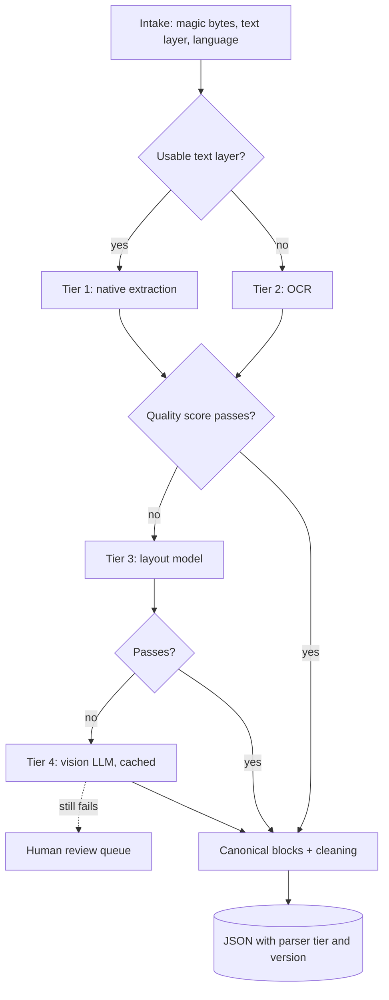

## TL;DR
Agents read documents through retrieval tools and file uploads, so their answers are only as good as
parsing. Route each page to the cheapest extractor that preserves structure, score it, and escalate
(native, OCR, layout model, vision LLM) only on failure.

## For agent builders
- **Why it matters for agents.** A scanned annex parsed as empty or a table flattened to loose numbers never
  errors; the agent just retrieves nothing or the wrong cell and answers confidently. Most "the agent
  hallucinated a figure" incidents on enterprise documents start here.
- **Where it shows up in your stack.** The parse stage behind your knowledge-base tools, and a `read_document`
  tool for files users attach mid-conversation: PyMuPDF, Tesseract or a cloud OCR service, Docling or
  Unstructured, and a vision model as the last tier.
- **What you control.** The tier ladder and thresholds, the canonical block schema (page and `bbox` for
  citations), what the tool returns for pages that failed, and the per-session latency and cost budget.
- **What you can skip.** OCR and layout-model internals. Treat extractors as tiers with a cost, a latency and a
  quality score.

## Decision case
### Scenario
A lender is building an underwriting assistant agent. Applicants upload packets (payslips, bank statements,
IDs, signed forms), and the agent answers underwriter questions with page citations. All figures are illustrative.

- **Volume.** 50,000 packets a month at about 40 pages each: 2 million pages a month.
- **Mix.** About 70% born-digital, 25% scans or phone photos, and 5% that defeat OCR and layout models
  (handwriting, stamped forms, skewed photos of tables).

Constraints:
- **Residency.** Documents may not leave the company's cloud region; any model endpoint must be in-region.
- **Budget.** At most $5,000 a month for model-based extraction.
- **Accuracy.** Bank-statement table cell accuracy of at least 98% on a gold set of 60 statements.
- **Latency.** When an underwriter uploads a packet mid-conversation, the agent must answer from the readable pages within 15 seconds.
- **Team.** Three engineers; no one has run GPU inference in production.

### Options
| Option | How it works | Budget (at an illustrative 1 cent per vision page) | Table accuracy | Inline latency | Residency |
|---|---|---|---|---|---|
| **A. Native extraction only** | One library for every page | About $0 | Fails: 25% of pages are scans and come back empty | Pass | Pass |
| **B. Vision LLM on every page** | Every page to an in-region vision model | Fails: 2 million × $0.01 = $20,000 a month | Likely good, but re-runs differ | Fails for 40 pages inside one tool call | Pass only with an in-region endpoint |
| **C. Layout model on every page** | Self-hosted Docling-style layout extraction for all pages | No per-page fee, but a GPU fleet for 2 million pages a month | Good on born-digital tables; weak on handwriting | Borderline for 40 pages | Pass |
| **D. Per-page tier ladder** | Native, then OCR, then layout, then vision, each gated by a quality score; cheap tiers inline, the rest in the background | 5% of pages reach vision: 100,000 × $0.01 = $1,000 a month | Pass if the gold-set gate holds per tier | Pass: native and OCR inline, `pending_pages` for the rest | Pass with an in-region vision endpoint |

### Decision
Choose **D**, because it is the only option that meets budget, latency and accuracy together:
- **Budget.** Vision spend tracks the 5% residue, $1,000 a month, leaving $4,000 of headroom for re-runs after
  a parser change and for growth.
- **Latency.** Native extraction and OCR run inline on the packet, so the agent answers from readable pages
  in one tool call and names the pages still pending.
- **Accuracy.** Table-heavy statements escalate to the layout tier, and the gold set of 60 statements gates every parser change.
- **Team.** Only the layout tier needs a GPU, and it serves the minority of pages that fail OCR or carry
  tables, which is a smaller fleet to learn on than option C's.

What would change it:
- **No in-region vision endpoint.** The residue goes to human review: about 100,000 pages a month, roughly 3,300 a day, which needs staffing or a self-hosted vision model.
- **The mix shifts to scans.** If most packets become phone photos, start the ladder at OCR for those sources and recompute the vision share.
- **Vision prices fall tenfold.** At 0.1 cent a page, option B costs about $2,000 a month and the case turns on latency and determinism alone.

### Trade-offs accepted
- **Two passes for escalated pages.** Scoring adds work and latency. Watch the share of pages reaching each tier per source per day.
- **Crude quality scores.** A word-ratio gate can pass a page with a wrong table. Keep the separate table checks and track cell accuracy per document class.
- **Vision output is non-deterministic.** Cache it by page hash, model and prompt version, and watch the cache hit rate after changes.
- **Some answers arrive in two turns.** The agent says which pages are pending. Watch the share of answers given while pages were pending.

### Review rubric
- **The page mix is quantified.** The write-up estimates the share of born-digital, scanned and hard pages and where each goes.
- **Cost is computed per tier.** Pages per tier times an illustrative unit price, checked against the budget.
- **Accuracy has a gate.** A gold set with a named metric blocks parser changes.
- **The agent's view is designed.** Inline versus background tiers and how pending or failed pages appear in the tool result.
- **Data policy shapes the options.** Residency or privacy limits on model endpoints are applied to each option.
- **Reversal conditions are concrete.** It names the price, mix or endpoint change that flips the choice.

## Why it exists
- **The single library call breaks on the real corpus.** Scanned PDFs have no text layer, so it returns empty
  strings and the pipeline embeds nothing. Two-column papers interleave lines of both columns.
- **Tables, headers and encoding fail too.** Tables flatten into numbers with no column association, so
  "what was Q3 revenue" retrieves the right number next to the wrong label. Every page adds its header and
  footer, giving thousands of chunks starting "Confidential — Page 14 of 62". Hyphenated line breaks split
  words; encoding glitches turn ligatures into garbage.
- **None of this fails loudly.** An embedding model produces a valid vector for a garbled chunk, so the damage
  appears months later as retrieval that "sometimes misses obvious passages".
- **The opposite extreme, a vision LLM on every page, swaps quality for cost.** It is orders of magnitude more
  expensive per page than native extraction (illustratively, a tenth of a cent to a few cents per page
  depending on the model, versus milliseconds of CPU), slow, and non-deterministic, so a re-run gives
  slightly different text, chunks and embeddings.
- **Neither extreme is a pipeline.** Classify, route, verify and escalate, so the expensive path is spent only
  where the cheap path demonstrably failed. The rag-retrieval parsing lesson covers the extractors (OCR,
  layout, tables); this lesson covers the system around them.

## How it works
### 1. Intake and classification
- **Real type by magic bytes, not extension;** customers rename files.
- **Record page count, file size and, for PDFs, whether pages carry a text layer.** A page with an image
  covering it and near zero extractable characters is a scan.
- **Detect language,** because OCR engines need the right language packs and the quality heuristics below
  (dictionary-word ratios, hyphen repair) are language-specific.
- **Detect encrypted or malformed files early** and park them.

### 2. Routing tiers
Order extractors by cost and by what they preserve; route each page to the first tier expected to succeed.

| Tier | Examples | Strengths | Weaknesses |
|---|---|---|---|
| 1. Native extraction with layout heuristics | PyMuPDF, pdfplumber, python-docx, HTML parsers | born-digital files; fast, deterministic, cheap; reading order from glyph positions reasonably well | tables poorly |
| 2. OCR | Tesseract, cloud OCR services | scans and images; per-word confidence and bounding boxes | depends on resolution, skew and language; preprocessing (deskew, binarize) matters as much as the engine |
| 3. Layout-aware document models | Docling, Unstructured's high-resolution strategy, LayoutLM-family models | detect regions (title, paragraph, table, figure, caption), reconstruct tables; make multi-column and table-heavy documents usable | slower and heavier |
| 4. Vision LLMs | any vision-capable model | the residue: handwritten forms, charts to describe, pages failing layout verification | most expensive, non-deterministic, so used last and cached |

- **Why a ladder:** cost per page differs by orders of magnitude between tiers, while most pages in a typical
  corpus are born-digital text that tier one handles well.

**Route per page where the format allows it:**
- **Real files are mixed:** a born-digital report with a scanned appendix, a slide deck where one slide is a
  screenshot of a table.
- **A per-document decision** picks one tier for the whole file, which either loses the odd pages or overpays
  for the ordinary ones.
- **Some decisions stay at document level,** because they need several pages at once: header and footer
  detection, tables that continue across a page break, and section hierarchy. They run after per-page
  extraction, over the assembled blocks.

### 3. The canonical document model
- **Blocks.** Each has `type` (title, heading with level, paragraph, list item, table, figure, caption,
  header, footer, footnote), `text`, `page`, `bbox`, and a `parent` reference giving section hierarchy.
- **Tables** are stored as cell grids with row and column spans, and also serialized to Markdown or HTML for
  embedding.
- **Figures** carry captions and optionally an LLM-written description.
- **Why one schema:** chunkers, metadata extractors and citation rendering depend on it rather than on each
  extractor's quirks, and a document re-processed by a better tier later slots into the same downstream
  pipeline.

### 4. Cleaning
- **Headers and footers:** text repeating at the same position across many pages is dropped.
- **Hyphenation** at line ends is repaired.
- **Unicode normalized (NFKC),** control characters removed, whitespace collapsed while paragraph boundaries
  are kept.
- **HTML boilerplate** (cookie banners, navigation) stripped.
- Each step is cheap and removes a class of chunk-level noise that would otherwise be embedded thousands of
  times.

### 5. Quality scoring and escalation
- **Signals:** characters per page against an expectation for the document type, OCR mean confidence,
  fraction of tokens that are dictionary words, ratio of single-character "words", and known garbage
  patterns (replacement characters, repeated glyphs).
- **Below threshold,** the page goes to the next tier or, after the last tier, to a human review queue.
- **This gate** is what keeps extraction failures from becoming silent retrieval failures.

### 6. Output, versioning and isolation
- **Store canonical JSON next to the raw bytes** with `parser_tier` and `parser_version`, so a layout-model
  upgrade re-processes only documents parsed by the old version or the lower tier.
- **Isolate parsers** in workers with timeouts and memory limits, because a malformed PDF can hang or exhaust
  a process; record failures per document rather than failing the batch.
- **Run a gold evaluation set** (gold text and gold tables, measured by character error rate and table cell
  accuracy) on every parser change.

### 7. Parsing inside an agent loop
Files a user attaches mid-conversation need the same ladder under a tighter budget, because the agent is
waiting:
- **Run the cheap tiers inline.** Native extraction answers in milliseconds of CPU; OCR on a few pages is
  usually acceptable inside one tool call.
- **Escalate asynchronously.** Pages needing a layout model or vision LLM go to a background job, and the tool
  result says which pages are pending instead of returning silence.
- **Return structure the model can use.** Blocks with type, page and a table serialized as Markdown let the
  agent cite "page 14, table 2" and answer column-aware questions.
- **Say what failed.** A `needs_review` page in the tool result lets the agent tell the user, rather than
  answering as if the annex were blank.

## Diagram
Each page starts at the cheapest tier that can work for it and climbs only when its quality score fails;
document-level cleaning runs after all pages are assembled, and the stored blocks are what the agent's
retrieval and `read_document` tools return.



## Examples
### A per-page router with escalation
A text-layer check, a quality score and escalation. The extractors are stand-ins for real tiers that take
one page and return canonical blocks; the control flow is the point.

```python
import fitz, re                                   # PyMuPDF

MIN_CHARS_PER_PAGE, MIN_WORD_RATIO = 200, 0.85

def quality(blocks):                              # English prose heuristic; tables scored separately
    text = " ".join(b["text"] for b in blocks if b["type"] not in ("header", "footer", "table"))
    tokens = text.split()
    if not tokens:
        return 0.0
    wordlike = sum(1 for t in tokens if re.search(r"[A-Za-z]{2,}", t))
    garbage = text.count("\ufffd") + len(re.findall(r"(.)\1{5,}", text))
    return (wordlike / len(tokens)) * (0.0 if garbage > 20 else 1.0)

def process(path, tiers):
    """tiers: ordered list of (name, extract_page) returning canonical blocks for one page."""
    pages, errors = [], []
    for page in fitz.open(path):
        native = page.get_text().strip()
        if not native and not page.get_images():
            pages.append({"page": page.number, "tier": "blank", "blocks": []}); continue
        start = 0 if len(native) >= MIN_CHARS_PER_PAGE else 1   # no usable text layer: skip native
        for name, extract in tiers[start:]:
            try:
                blocks = extract(page)                          # worker timeout in production
            except Exception as e:                              # a bad page must not kill the batch
                errors.append((page.number, name, repr(e))); continue
            if (q := quality(blocks)) >= MIN_WORD_RATIO:
                pages.append({"page": page.number, "tier": name, "quality": q, "blocks": blocks})
                break
        else:
            pages.append({"page": page.number, "tier": "needs_review", "blocks": []})
    return {"pages": pages, "errors": errors}

# tiers = [("native", native_page), ("ocr", ocr_page), ("layout", layout_page), ("vlm", vlm_page)]
```

- **Store each record** with the raw file's hash and per-page tiers; count `needs_review` pages on the pipeline
  dashboard rather than silently indexing them as empty.
- **The word-ratio score is deliberately crude and English-specific.** It excludes table blocks, because a
  correct financial table is mostly numbers and would fail the gate; tables need their own check
  (consistent column counts per row, numeric cells that parse).
- **Header and footer removal runs after routing,** across all pages, because it depends on text repeating
  from page to page.

### Worked scenario: a contract with a scanned annex
A 60-page born-digital contract whose last 8 pages are a scanned, signed annex.

| Pages | Route | Outcome |
|---|---|---|
| 52 text pages | native tier | pass at near-zero cost |
| 8 annex pages | no text layer, start at OCR | 6 pass |
| 2 handwritten annex pages | fail the word-ratio gate | escalate through layout to the vision model |
| Total | | 52 native, 8 OCR, 2 vision-LLM pages |

- **A per-document router does worse either way.** It sends the whole file to native extraction because
  87 % of pages have text, and silently loses the annex. Or, with a stricter threshold, it OCRs 52 pages that
  already had perfect text.
- **The cost argument scales.** At an illustrative vision-model price of one cent per page, a 1-million-page
  corpus costs about $10,000 per full pass with every page on the vision model, and about $500 when only the
  5 % that fail the cheaper tiers go there.
- **Re-processing after a parser change** multiplies whichever figure you chose.

### Removing repeated headers and footers
Runnable as-is. It normalizes digits so "Page 3 of 62" and "Page 4 of 62" count as the same line, then drops
edge lines that repeat on most pages.

```python
import re
from collections import Counter

def norm(line):
    return re.sub(r"\d+", "#", line.strip().lower())       # "Page 14 of 62" -> "page # of #"

def strip_repeating(pages, min_share=0.6, edge=1):
    """pages: list of line lists. Drop lines in the top/bottom `edge` positions whose normalized
    text repeats on at least min_share of pages: headers, footers, page numbers."""
    counts = Counter()
    for lines in pages:
        counts.update({norm(l) for l in lines[:edge] + lines[-edge:]})
    repeated = {k for k, c in counts.items() if c >= min_share * len(pages)}
    cleaned = []
    for lines in pages:
        n = len(lines)
        cleaned.append([l for i, l in enumerate(lines)
                        if not ((i < edge or i >= n - edge) and norm(l) in repeated)])
    return cleaned, repeated

bodies = ["Scope of services.", "Fees and payment.", "Revenue grew 12% in Q3.", "Termination.", "Signatures."]
pages = [["ACME Corp - Master Agreement", body, f"Confidential - Page {p} of 62"]
         for p, body in enumerate(bodies, start=1)]
cleaned, repeated = strip_repeating(pages)
print(sorted(repeated))   # ['acme corp - master agreement', 'confidential - page # of #']
print(cleaned[2])         # ['Revenue grew 12% in Q3.']
```

### Agent scenario: a `read_document` tool with an inline budget
The tool reuses `process` from the router above, but only with the inline tiers, and queues the rest. The
agent gets typed blocks with page numbers, plus an explicit list of pages it must not pretend to have read.

```python
INLINE_TIERS = ["native", "ocr"]          # fast enough for one tool call
def read_document(path, tiers, queue, max_pages=100):
    inline = [(n, f) for n, f in tiers if n in INLINE_TIERS]
    result = process(path, inline)        # per-page routing, quality gate, errors recorded
    pending = [p["page"] for p in result["pages"] if p["tier"] == "needs_review"]
    if pending:
        queue.put({"path": path, "pages": pending, "tiers": ["layout", "vlm"]})   # background escalation
    shown = result["pages"][:max_pages]   # cap the tool result size, but never silently
    blocks = [{"page": p["page"] + 1, "type": b["type"], "text": b["text"]}
              for p in shown for b in p["blocks"]
              if b["type"] not in ("header", "footer")]
    return {"blocks": blocks,
            "pending_pages": [n + 1 for n in pending],     # tell the agent, and through it the user
            "not_returned_from_page": len(shown) + 1 if len(result["pages"]) > max_pages else None,
            "note": "Pages in pending_pages are still being processed; do not answer from them."}
```

| User uploads the 60-page contract above | Inline (native + OCR) | Background (layout, vision) |
|---|---|---|
| Pages handled | 58 (52 native, 6 OCR) | 2 handwritten annex pages |
| Tool result | blocks for 58 pages, `pending_pages` lists 2 | results cached by page hash for the next call |
| Agent behaviour | answers from 58 pages, says 2 annex pages are still processing | re-reads the 2 pages on the next turn |

## Production patterns
- **Detect type from content.** At intake, sniff the MIME type from the first bytes (for example
  `magic.from_buffer(data, mime=True)` with python-magic) and route by that, not the extension. Monitor the
  count of extension/content mismatches per source; a spike usually means a new export format.
- **Sandboxed parser workers.** Run each extractor in a separate process or container with a hard timeout and
  memory limit, and record timeouts and OOM kills per document. Monitor failure rate by file type and parser
  version.
- **Cache expensive extractions by page hash.** Key vision-LLM and layout outputs by page content hash,
  model and prompt version, and reuse them on re-runs. This restores reproducibility and caps cost; monitor
  cache hit rate after parser changes.
- **Gold-set regression gate.** Keep a few dozen hand-verified documents per document class and block a
  parser change if character error rate or table cell accuracy regresses. Track both per class.
- **Escalation-rate alarm.** Chart the share of pages reaching each tier per source per day; a climbing
  escalation rate is the earliest sign of a new document type entering the corpus.
- **Explicit gaps in agent tool results.** Agent teams return pending or failed pages as a field in the
  document tool's output and instruct the agent to mention them, instead of returning partial text silently.
  Monitor the share of agent answers given while pages were pending and the p95 latency of the inline tiers
  per tool call.

## Trade-offs
- **Tiered routing vs extra passes.** Average cost stays near the cheapest extractor, but there is a scoring
  step and a second pass for escalated pages. For a corpus that is almost entirely scans, start at OCR.
- **Layout models and vision LLMs vs cost.** They recover tables and reading order native extraction loses,
  at a cost and latency that make them wrong for the whole corpus until retrieval evals prove the gain on
  your document types.
- **Rich canonical model vs effort.** Bounding boxes and hierarchy enable precise citations and
  structure-aware chunking, but are more work to populate from simple sources such as plain HTML or email.
- **Deterministic extractors vs vision LLMs.** Deterministic re-runs are reproducible, which vision LLM
  output is not; cache LLM extractions by page hash and treat them as versioned artifacts to recover
  reproducibility.

## Pitfalls
- **Trusting the file extension.** Symptom: parser crashes on files that are secretly HTML, images or zip
  archives, and documents marked processed that produced nothing.
- **Not detecting scanned PDFs.** Symptom: documents in the index with zero or one chunk, found when a user
  asks about a contract that "should be there".
- **Skipping header and footer removal.** Symptom: chunks that begin with a confidentiality notice and a page
  number, and retrieval that favours documents with the longest boilerplate.
- **Flattening tables to text.** Symptom: numeric questions answered with the right number from the wrong
  column or year.
- **No parser version in the output.** Symptom: you cannot re-process only the documents an old, buggy
  extractor touched, so every parser fix becomes a full re-run.
- **Routing whole documents by an average text-layer ratio.** Symptom: a contract's scanned signature annex
  is missing from the index while the rest retrieves fine.
- **Running parsers in the orchestrator's process.** Symptom: one malformed file hangs or OOM-kills an entire
  nightly batch.

## When to use
- **Use** a tiered pipeline as soon as a corpus mixes formats or includes scans, tables or multi-column
  layouts, which describes nearly every enterprise document set.
- **A homogeneous Markdown or HTML corpus** needs only the cleaning and canonical-model steps.
- **Use the inline variant when** an agent accepts user uploads: cheap tiers inside the tool call, expensive
  tiers in the background, with pending pages reported to the agent.
- **Measure** text-layer ratio, per-tier volume and cost, quality-score distribution, escalation rate,
  review-queue size, and extraction accuracy on the gold set.
- **Day to day,** this is where retrieval incidents are traced to and fixed.
- **Interviews:** "how would you ingest 50,000 mixed PDFs for RAG?" Answer with classification, routing by
  cost, a canonical structure, quality gates and selective re-processing by parser version, not with the
  name of a library.

## Role lens
- **Engineer:** Implements classification, the extractor adapters that emit the canonical block model,
  header and footer removal, and the quality score, and runs the gold-set accuracy check on every change.
- **Architect:** Defines the canonical document schema and the tier ladder with its cost and quality
  thresholds, and decides where vision LLM extraction is allowed given cost, latency and data policy.
- **FDE:** Profiles the customer's real documents in the first week, finds the scans and the table-heavy
  forms the demo never saw, and sets expectations about which document classes need review or custom
  handling.

## Check yourself
**Q:** A customer's RAG system answers well for policy documents but fails on their financial reports,
which are multi-column PDFs with many tables; some older reports are scans. The current pipeline uses one
text-extraction library for everything. Describe how you would restructure processing and how you would
know it worked.
**A:** First, classify: detect the scans by text-layer ratio and send them to OCR with deskewing instead of
native extraction, which currently yields nothing for them. Second, route the born-digital reports to a
layout-aware extractor that reconstructs reading order across columns and emits tables as cell grids,
serialized to Markdown for embedding, with the original cells kept for citation. Third, define a canonical
block model so both routes produce the same structure, remove repeated headers and footers, and store
parser tier and version with each output. Fourth, add a quality score with escalation to a vision LLM for
pages that fail, cached by page hash. To know it worked: build a small gold set from the failing reports
with hand-verified text and table cells, measure character error rate and cell accuracy before and after,
and re-run the retrieval evaluation on the questions that used to fail, expecting the numeric questions to
retrieve the correct table chunk.

## Interview questions
### Why not send every page to a vision LLM, given they handle almost everything?
- **Cost:** per page it is orders of magnitude more than native extraction; at an illustrative one cent per
  page, 1 million pages is about $10,000 per full pass versus about $500 if only the 5 % that fail cheaper
  tiers escalate.
- **Latency and determinism:** it is slow, and re-runs produce slightly different text, so chunks and
  embeddings churn.
- **So** use it as the last tier, gated by a quality score and cached by page hash.

### Users say your contracts agent claims an annex "has no signatures", but it does. How do you debug it?
- **Check the per-page record:** which tier processed each annex page and what quality it scored.
- **Likely cause:** whole-document routing sent a mostly born-digital file to native extraction, and the
  scanned annex yielded empty text that was indexed as nothing.
- **Fix:** route per page, flag pages with near-zero characters, and count `needs_review` pages on a dashboard.

### What belongs in a canonical document model, and why have one?
- **Typed, ordered blocks** with `type`, `text`, `page`, `bbox` and a `parent` for hierarchy; tables as cell
  grids plus a Markdown or HTML serialization.
- **Why:** chunking, metadata extraction and citations depend on one schema, so swapping or escalating an
  extractor changes nothing downstream.

### Design a document tool for an agent that accepts uploads mid-conversation. What does it return?
- **Typed blocks with page numbers,** tables serialized as Markdown, headers and footers removed, so the agent
  can cite and answer column-aware questions.
- **A latency split:** native and OCR inline within the tool call, layout and vision tiers queued in the
  background and cached by page hash.
- **Explicit gaps:** `pending_pages` and `needs_review` pages in the result, with an instruction not to answer
  from them, so silence is never mistaken for "not in the document".

### When would you skip the tier ladder?
- **A corpus that is almost entirely scans:** start at OCR, since tier one would fail nearly every page.
- **A homogeneous Markdown or HTML corpus:** only cleaning and the canonical model are needed.
- **Re-evaluate** when the escalation rate changes, because that signals a new document type.

### How do you score extraction quality without ground truth for every document?
- **Cheap per-page heuristics:** characters per page against an expectation, OCR mean confidence, word-like
  token ratio, single-character token ratio, replacement characters and repeated glyphs.
- **Separate table checks:** consistent column counts and numeric cells that parse, because a correct table
  fails a prose word-ratio test.
- **Calibrate on a gold set** measured by character error rate and table cell accuracy.

## Quiz
### Q: Why route documents through tiers rather than sending every page to the best available extractor?
- [ ] The best extractors cannot read born-digital PDFs
- [x] Cost and latency per page differ by orders of magnitude across tiers, and most pages are handled well by the cheapest one, so escalation should be driven by measured failure
- [ ] Vision LLMs are not permitted to process documents in most jurisdictions
- [ ] Layout models require a text layer to operate
> A typical corpus is mostly born-digital text where native extraction is accurate and nearly free. A
> quality gate identifies the minority of pages that need OCR, layout analysis or a vision model, keeping
> spend proportional to difficulty.

### Q: What is the purpose of a canonical document model shared by all extractors?
- [ ] It compresses documents for cheaper storage
- [ ] It lets the vector database index documents without chunking
- [x] It decouples chunking, metadata and citation logic from each extractor's output format, so documents can be re-processed by a better tier without downstream changes
- [ ] It guarantees deterministic output from vision LLMs
> Downstream stages should depend on one schema of typed, ordered blocks with hierarchy and tables as
> cells. Then swapping or upgrading an extractor, or escalating a document to a higher tier, changes
> nothing after the parsing stage.

### Q: A quality gate flags a batch of documents with chars-per-page near zero after native extraction. What does this most likely indicate?
- [ ] The documents are written in a language the chunker does not support
- [x] The pages are scanned images without a text layer and need OCR
- [ ] The embedding model rejected the text as too short
- [ ] The headers and footers were removed too aggressively
> Native extraction reads the PDF's text layer; scans have none, so the output is empty even though the
> pages are full of content. The gate exists precisely to catch this and route the documents to OCR
> instead of indexing them as empty.

## Use cases & projects
### Use cases
- **Contract and claims agents.** Mixed born-digital and scanned files need per-page routing so the agent sees
  the signed annex, not an empty page.
- **Financial-report question answering.** Tables kept as cell grids and Markdown let an agent answer "Q3
  revenue" from the right column and cite the page.
- **Chat with your uploaded file.** A `read_document` tool runs cheap tiers inline and escalates the rest in
  the background, reporting pending pages to the agent.
- **Knowledge-base hygiene.** Header and footer removal plus a quality gate stop boilerplate chunks from
  crowding the agent's top-k.

### Mini project
**Build a tiered `read_document` tool for an agent (2-3 hours).**
- **Goal:** an agent tool that parses a mixed PDF, reports what it could not read, and lets the agent cite
  pages.
- **Steps:** collect five PDFs (one born-digital, one scanned, one two-column, one table-heavy, one mixed);
  implement native and OCR tiers with PyMuPDF and Tesseract plus the quality score; add `strip_repeating`;
  return typed blocks and `pending_pages`; wire it into a small tool-calling agent and ask 10 questions,
  including two whose answers sit on scanned pages.
- **Done when:** a table shows tier per page and quality scores for each file, the agent cites page numbers in
  its answers, and for pending pages it says they are still processing instead of answering.
