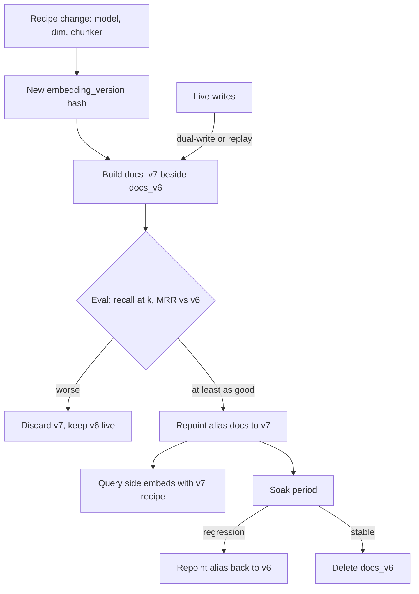

## TL;DR
A vector only means something relative to the recipe (model, settings, chunker) that produced it, so a
recipe change means re-embedding everything. Version the recipe, build beside the old index, evaluate,
swap atomically, and hash content to re-embed only changed chunks.

## Why it exists
- **The index silently depends on three things.** Which model turned text into vectors; how it was called
  (dimension, normalization, instruction prefix, input truncation); and how documents were cut into chunks.
  None of those appear in the vector itself.
- **Mixing models fails silently.** A query embedded with model B against an index built with model A is
  not "slightly worse". If dimensions differ, the store at least rejects the query. If they happen to
  match, cosine similarity across spaces is noise, so retrieval degrades to near-random while the pipeline
  reports no error at all.
- **Change is forced on you.** Embedding models improve and vendors deprecate old ones; you will want
  longer context, a multilingual or a cheaper model; you will tune the chunker; you may quantize vectors to
  save memory. Each of those invalidates every stored vector.
- **"Just re-embed in place" fails three ways.** During the hours or days the job runs, live queries hit a
  mix of two spaces. If the new model is worse on your eval set, there is nothing to roll back to. And it
  pays full cost to re-embed unchanged content, when usually only a small fraction changed since the last
  run.
- **What versioning buys.** Versioning the index and swapping it as a unit removes all three problems.

## How it works
### What makes up an embedding version
Treat the index as the product of a recipe and give the recipe a version identifier:

```
embedding_version = hash(model_id, model_revision, dimension, normalization,
                         instruction_prefix, max_input_tokens, chunker_id, chunker_params)
```

- **Store it on every vector row and on the collection,** *because* the only reliable compatibility check
  is to compute the query-side recipe and compare. The query path reads the collection's version and
  refuses, or routes elsewhere, on mismatch.
- **Pin the model *revision*, not just its name.** Hosted models can be silently updated, and open-weight
  models on a hub have commit hashes.
- **Chunker parameters belong in the recipe,** because retrieval granularity changes what a vector means. A
  512-token chunk and a 128-token chunk of the same paragraph are different items even under the same
  model, and the citation offsets you return to users change with them.

### Re-embedding versus re-indexing
Two operations hide behind the word "re-index", and they cost very different amounts.

| Operation | Trigger | What is rebuilt | Typical duration |
|---|---|---|---|
| *Re-embedding* | the recipe changed | new vectors, then the ANN structure | days of API throughput |
| *Re-indexing* | index parameters, data drift, churn | only the ANN structure over existing vectors | hours of index build |

Re-indexing is needed even when the model never changes:
- **Parameter changes.** HNSW's `M` and `ef_construction` are fixed when the graph is built, so raising them
  to buy recall means a rebuild. `ef_search` is a query-time knob and needs no rebuild, which is why it is
  the first thing to tune.
- **Centroid staleness.** IVF-style indexes assign each vector to the nearest of a set of centroids learned
  from the data present at build time. pgvector's documentation advises creating an IVFFlat index only after
  the table holds data for this reason. As the corpus grows into topics the original sample did not cover,
  lists become unbalanced and recall at a fixed `nprobe` falls, so the centroids must be retrained.
- **Accumulated deletes and updates.** Many implementations mark deleted vectors rather than removing them,
  so a heavily churned index carries dead entries that cost memory and can weaken graph connectivity until
  compaction or rebuild.
- **Same swap, no embedding calls.** Re-indexing uses the same blue-green swap but skips the embedding
  calls. Keep two version counters (`embedding_version` for the vectors, an index build id for the
  structure) so you can tell which one moved when recall changes.

### The query side is part of the version
- **The alias resolves to a pair:** the collection and the recipe that built it.
- **The query path embeds with exactly that recipe** (model, prefix, dimension), *because* swapping the
  collection while the query embedder stays on the old model recreates the cross-space mismatch in reverse.
- **Key query-embedding caches on `(query_text, embedding_version)`,** never on text alone.
- **Adapters are a temporary bridge only.** A learned mapping from the new model's space into the old one
  (a linear or small adapter trained on pairs of embeddings of the same texts) lets a new query model run
  against the old index before the rebuild finishes. It recovers only part of the quality, so it must pass
  the same eval gate and is not an alternative to rebuilding.

### Content hashing to avoid re-embedding the unchanged
1. Give each chunk a stable key: `chunk_key = hash(source_id, chunk_text)`.
2. Keep a table mapping `(chunk_key, embedding_version) -> vector`.
3. On each ingestion run, chunk the source, compute keys and skip any key already embedded under the
   current version.
4. Chunks whose text changed get new keys and are embedded; keys that disappear are deleted.

- **Why it is safe:** embedding is, for practical purposes, a pure function of (text, recipe). The same
  inputs yield the same vector up to small floating-point noise from batching and hardware.
- **Version changes are full misses:** every key misses and you pay for a full rebuild, which is correct.

### Blue-green indexes and the alias swap
1. **Build beside.** Build the new version into a separate collection or table (`docs_v7` beside
   `docs_v6`) while the old one keeps serving.
2. **Resolve through a pointer.** Most stores support an alias the application resolves at query time:
   Qdrant collection aliases, OpenSearch index aliases; in pgvector a view or a config row naming the live
   table.
3. **Repoint in one operation** when the build finishes and passes evaluation. Queries never see a mixed
   index.
4. **Roll back** by repointing the alias back; delete the old collection after a soak period.

- **The price:** temporarily holding two copies of vectors and two ANN graphs, which must be planned into
  memory and disk sizing.

### Catching up on writes during the build
Documents keep changing while the rebuild runs.

| | Dual-write | Replay |
|---|---|---|
| How | ingestion embeds every new chunk under both versions until the swap | the build records a start watermark, then re-processes everything changed since |
| Embedding cost | each changed chunk embedded once per version | same, slightly cheaper when a document changes several times in the window, because only its final state is embedded |
| New collection currency | current at every moment | short lag to close just before the swap |
| Operational risk | backfill and live writes race on the same collection: a backfill must not overwrite a newer live write, and deletes must reach both | needs a reliable change watermark and a final catch-up pass |

### Evaluate before you swap
- **A new model is not better by assumption.** Run the retrieval eval set (queries with known relevant
  chunks) against both collections and compare recall@k and MRR.
- **Also check answers on a sample,** because a model that retrieves different-but-also-relevant chunks can
  shift answers in ways retrieval metrics miss.
- **The swap is gated on this comparison,** which is why the build must be separate.

### Dimension and quantization changes
- **These are new embedding versions too.** Truncating a Matryoshka-trained model to fewer dimensions, or
  changing storage precision (float32 to int8 or binary), changes the stored representation and the ANN
  index parameters, even if the model is the same.
- **Rebuild rather than convert in place, and re-run the eval,** because quantization costs recall that must
  be measured, not assumed.

### Cost and duration (illustrative arithmetic)
| Quantity | Value |
|---|---|
| Corpus | 10 million chunks averaging 400 tokens = 4 billion tokens |
| Cost at an illustrative few cents per million tokens | on the order of a hundred dollars, rarely the problem |
| Time at an illustrative rate limit of a million tokens per minute | roughly 67 hours of embedding calls, before HNSW build time |

That duration is what makes dual-write or replay necessary, and makes content hashing worth having for the
routine runs in between.

## Diagram
A recipe change never touches the live collection: the new one is built beside it, caught up, and only
promoted if it wins the eval.



## Examples
### Recipe hash, content-keyed cache and alias swap
A minimal version of the three mechanisms. The vector store is abstracted as a dict of collections so the
logic is visible.

```python
import hashlib, json

# "revision" is your own pin; hosted APIs may not expose one, so record the date you validated it
RECIPE = {"model": "text-embedding-3-small", "revision": "2024-01", "dim": 1536,
          "normalize": True, "chunker": "recursive", "chunk_tokens": 400, "overlap": 40}
EMB_VERSION = hashlib.sha256(json.dumps(RECIPE, sort_keys=True).encode()).hexdigest()[:12]

def chunk_key(source_id: str, text: str) -> str:
    return hashlib.sha256(f"{source_id}\x00{text}".encode()).hexdigest()[:16]

collections = {}                 # name -> {chunk_key: (vector, meta)}
alias = {"docs": "docs_v6"}      # what queries resolve against
cache = {}                       # (chunk_key, EMB_VERSION) -> vector

def embed(text):                 # stand-in for the model call
    return [float(b) for b in hashlib.md5(text.encode()).digest()[:4]]

def build(target: str, sources: dict[str, list[str]]):
    col = collections.setdefault(target, {})
    seen, calls = set(), 0
    for sid, chunks in sources.items():
        for text in chunks:
            k = chunk_key(sid, text); seen.add(k)
            if (k, EMB_VERSION) not in cache:
                cache[(k, EMB_VERSION)] = embed(text); calls += 1
            col[k] = (cache[(k, EMB_VERSION)], {"source": sid, "emb_version": EMB_VERSION})
    for k in set(col) - seen:    # chunks that vanished upstream
        del col[k]
    return calls

docs = {"kb/1": ["Refunds take 5 days.", "Contact support via chat."]}
print("first build, calls:", build("docs_v7", docs))          # 2
docs["kb/1"][0] = "Refunds take 3 days."
print("incremental, calls:", build("docs_v7", docs))          # 1 (only the changed chunk)

def swap(name, new_target):      # gate this on the eval comparison in real life
    old, alias[name] = alias.get(name), new_target
    return old
print("retired:", swap("docs", "docs_v7"), "live:", alias["docs"])
```

The eval gate is deliberately a comment: in production `swap` runs only after recall@k on the eval set for
`docs_v7` is at least as good as for `docs_v6`.

### Worked scenario: full rebuild versus routine run
Using the illustrative rate limit above (a million tokens per minute) on the 10-million-chunk corpus.

| Run | Chunks embedded | Tokens | Embedding time |
|---|---|---|---|
| Model upgrade (every key misses) | 10,000,000 | 4 billion | ~4,000 min, about 67 h |
| Nightly run, 1% of chunks changed (illustrative) | 100,000 | 40 million | ~40 min |
| Nightly run without content hashing | 10,000,000 | 4 billion | ~67 h, longer than a day, so it overruns the next run |

- **Reading it:** content hashing turns the nightly job from impossible into minutes; the full rebuild is
  rare but long enough that it needs dual-write or replay.

### Production snippet: blue-green in pgvector with a view as the alias
The application queries `docs`; the swap is a single statement, and rollback is the same statement naming
the old table.

```sql
-- build v7 beside v6, index it without blocking writes
CREATE TABLE docs_v7 (LIKE docs_v6 INCLUDING ALL);
-- ... backfill embeddings into docs_v7, then:
CREATE INDEX CONCURRENTLY docs_v7_hnsw ON docs_v7
  USING hnsw (embedding vector_cosine_ops) WITH (m = 16, ef_construction = 64);

-- after the eval gate passes: atomic repoint
CREATE OR REPLACE VIEW docs AS SELECT * FROM docs_v7;
```

## Production patterns
- **Recipe-stamped collections with a fail-loud query path.** Use from the first production index. Store
  `embedding_version` on the collection and each row; at query time compare it with the embedder's recipe
  hash and raise on mismatch instead of searching. Monitor mismatch errors (should be zero) and which
  version each request was served from.
- **Alias-based blue-green swap.** Use for any corpus that takes more than minutes to rebuild. Qdrant
  collection aliases, OpenSearch's `_aliases` endpoint with remove and add actions in one request, or a
  Postgres view repointed with `CREATE OR REPLACE VIEW`. Monitor recall@k on the eval set before and after
  the swap, plus p95 latency for the first hour.
- **Content-hash cache table for incremental runs.** Use once ingestion runs on a schedule. Keep a table
  keyed on `(chunk_key, embedding_version)` and skip hits. Monitor fraction of chunks re-embedded per run:
  near zero normally, 100% only on version changes. A sudden jump with no recipe change usually means the
  chunker or text extraction changed.
- **Tune query-time recall before rebuilding.** When recall dips, raise `hnsw.ef_search` (pgvector session
  setting) or the IVF probe count first, because they need no rebuild. Rebuild with higher `M` or
  `ef_construction` only if that cannot reach the target within the latency budget.
- **Weekly fixed-eval recall tracking between swaps.** Run the same eval set against the live alias on a
  schedule. A slow decline with no recipe change signals stale centroids or accumulated deletes: schedule a
  re-index, not a re-embed.
- **Retirement window for old versions.** Keep the previous collection for an explicit soak (for example a
  week, set by your rollback needs), then delete it. Monitor disk and memory headroom, because two indexes
  coexist during every rebuild.

## Trade-offs
- **Atomic cutover vs double memory.** Blue-green rebuilds give atomic cutover and instant rollback but
  double vector and index memory during the build. If the corpus barely fits one GPU or one node, you need
  a staged or tiered rebuild instead.
- **Cheap routine runs vs edit blast radius.** Content hashing makes routine runs cheap, but a hash on exact
  text means a one-character edit re-embeds the chunk and its overlapping neighbours. With fixed-size
  chunking an insertion shifts every later boundary in that document, so all following chunks re-embed too.
  Structure-aware chunking that cuts on headings or paragraphs keeps the blast radius local.
- **Pinned revision vs owning upgrades.** Pinning a model revision protects consistency but means you
  consciously own upgrades. Letting a vendor update silently is cheaper to operate right up until retrieval
  quality shifts with no deploy to blame.
- **Dual-write vs replay.** Dual-write keeps the new index current with no catch-up step but couples live
  ingestion to the new collection and makes it race the backfill. Replay keeps ingestion untouched at the
  cost of a catch-up pass, and tends to win when builds take days and the change watermark is trustworthy.
- **Rollback safety vs storage.** Keeping old versions for rollback is safe, but each held version is
  storage and an ANN graph; set an explicit retirement window rather than letting versions accumulate.

## Pitfalls
- **Upgrading the query-side model without rebuilding the index.** Symptom: plausible-looking but
  irrelevant chunks with no errors, and eval recall that collapses overnight. Fix: the query path reads the
  recipe from the alias target.
- **Changing the chunker and reusing the old vectors** because "the model is the same". Symptom: citations
  pointing at wrong offsets and duplicated or truncated passages in context. Fix: chunker params are in the
  recipe hash.
- **Re-embedding in place against the live collection.** Symptom: a window of mixed-space results and user
  complaints that correlate with the ingestion job's schedule. Fix: build beside and swap.
- **Swapping on build completion rather than on eval results.** Symptom: a regression discovered by users,
  with the old index already deleted. Fix: gate the swap on the eval and keep a soak window.
- **Forgetting that filters and metadata live beside vectors.** A rebuild that drops ACL or tenant fields
  produces an index that passes retrieval eval and fails a security review. Fix: diff schemas and test a
  filtered query before the swap.
- **Sizing memory for one copy of the index.** Symptom: out-of-memory or evictions precisely during the
  rebuild, the moment you can least afford it. Fix: plan for two.
- **Caching query embeddings keyed on query text alone.** Symptom after a swap: popular (cached) queries
  retrieve garbage while rare, uncached queries work fine. Fix: key on `(query_text, embedding_version)`.
- **Treating every recall drop as a model problem.** When recall decays slowly with no recipe change, the
  cause is usually stale IVF centroids or accumulated deletes, and a re-index (no re-embedding) fixes it.

## When to use
- **Version from the first production index,** because the first model upgrade arrives sooner than planned
  and the retrofit is painful.
- **Use the alias swap** for any corpus that takes longer than a few minutes to rebuild; below that, a
  rebuild-and-replace in a transaction is fine.
- **Add content hashing** as soon as ingestion runs on a schedule rather than once; it pays for itself.
- **Measure four things:** fraction of chunks re-embedded per run (small except on version changes); build
  duration versus the rate of upstream change (decides dual-write versus replay); eval recall before and
  after every swap; and recall on a fixed eval set tracked weekly between swaps, since a slow decline with
  no recipe change is the signal to re-index rather than re-embed.
- **Interviews:** the expected answer to "how do you upgrade the embedding model in production" is this
  exact sequence: version the recipe, build beside, evaluate, swap the alias, retire later.

## Role lens
- **Engineer:** Stamps every vector with the recipe hash, writes the content-keyed embedding cache, and
  wires the alias lookup into the query path so mismatches fail loudly.
- **Architect:** Owns the capacity plan that includes two live indexes during rebuilds and the policy for
  how many versions are retained and for how long.
- **FDE:** Explains to a customer why a "quick model upgrade" is a multi-day rebuild with an eval gate,
  and designs the replay window around their document change rate.

## Check yourself
**Q:** Your team wants to move a 20-million-chunk index from a 1536-dimension model to a newer
1024-dimension model. Walk through the plan and the two biggest risks.
**A:** First, define the new recipe (model id, pinned revision, 1024 dims, normalization, same chunker if
chunking is unchanged) and hash it as a new embedding version. Build it into a new collection while the
old serves; estimate duration from token count divided by the embedding throughput limit, and because
that is likely days, either dual-write new chunks under both versions or record a watermark and replay
changes afterward. Run the retrieval eval set against both collections and compare recall@k and MRR,
plus a sample of end-to-end answers. Swap the alias only if the new one is at least as good, keep the old
collection for a rollback window, then delete it. The two biggest risks are memory: both collections and
both ANN graphs coexist, so the cluster must have headroom; and silent quality regression: the new model
may retrieve differently on your domain, which only the eval gate catches.

## Interview questions
### Why can't you just point ingestion at the new embedding model and overwrite vectors in place?
- **Mixed spaces during the run.** For hours or days the index holds vectors from two unrelated spaces, so
  live queries get near-random results with no error.
- **No rollback.** If the new model is worse on your eval set, the old vectors are already gone.
- **Wasted cost.** It re-embeds unchanged content; building beside, gating on eval and swapping an alias
  fixes all three.

### Recall has drifted down 6 points over three months and nobody changed the model. How do you debug it?
- **Rule out a recipe change first:** compare the stored `embedding_version` with the query embedder's, and
  check whether a vendor silently updated an unpinned model.
- **Then suspect the index structure:** stale IVF centroids as the corpus grew into new topics, or
  accumulated deletes in a churned HNSW graph.
- **Try the cheap knob, then re-index:** raise `ef_search` or probes; if that recovers recall within the
  latency budget, schedule a rebuild of the structure, with no re-embedding.

### Dual-write or watermark replay for a five-day rebuild: which do you pick and why?
- **Replay** if the change watermark is trustworthy: ingestion stays untouched, and documents edited several
  times are embedded once in their final state.
- **Dual-write** if the new collection must be current at every moment, accepting that backfill must not
  overwrite newer live writes and deletes must reach both versions.
- **Either way** close the gap before the alias swap, never after.

### How do you estimate how long a re-embed will take, and what dominates?
- **Tokens divided by throughput.** 10 million chunks at 400 tokens is 4 billion tokens; at an illustrative
  million tokens per minute that is roughly 67 hours.
- **Throughput, not price, is the constraint:** at a few cents per million tokens the bill is around a
  hundred dollars. Add HNSW build time on top.

### What has to change on the query side when you swap the index?
- **The query embedder:** the alias must resolve to collection plus recipe, so queries use the same model,
  prefix and dimension.
- **Caches:** query-embedding caches keyed on text alone serve old-space vectors for popular queries; key
  them on `(query_text, embedding_version)`.

## Quiz
### Q: Why can't you query an index built with embedding model A using vectors from model B?
- [ ] Model B produces vectors that are too large to compare efficiently
- [x] The two models define unrelated vector spaces, so similarity between their vectors is meaningless
- [ ] Model B normalizes vectors differently, which the index can correct for at query time
- [ ] The ANN index stores the model name and rejects the query
> Each model learns its own geometry; the same text lands at unrelated points. Cosine similarity across
> spaces is noise, which is why retrieval degrades to near-random, with no error when the dimensions
> happen to match. Indexes check dimension at most, never which model produced a vector, unless you store
> and check the version yourself.

### Q: What is the main purpose of keying the embedding cache on both chunk content hash and embedding version?
- [ ] To allow the same vector to be reused across different embedding models
- [ ] To detect duplicate documents across sources
- [x] To skip re-embedding unchanged chunks on routine runs while forcing a full rebuild when the recipe changes
- [ ] To make vector lookups faster at query time
> Embedding is a pure function of (text, recipe). Keying on both means an unchanged chunk under the same
> recipe is a cache hit, and any change to model, dimension or chunker makes every key miss, which is the
> correct behaviour.

### Q: During a multi-day rebuild, documents keep changing. Which approach keeps the new index current without a mixed-space window?
- [ ] Pause ingestion until the rebuild finishes
- [ ] Write new chunks only to the old index and copy them over after the swap
- [x] Dual-write new chunks under both versions, or record a watermark and replay changes after the build
- [ ] Embed new chunks with whichever model is faster and tag them
> Dual-write or watermark-and-replay both deliver a complete new collection at swap time. Pausing ingestion
> leaves users with stale data for days; copying after the swap creates a gap; mixing models in one
> collection is exactly the failure versioning exists to prevent.
