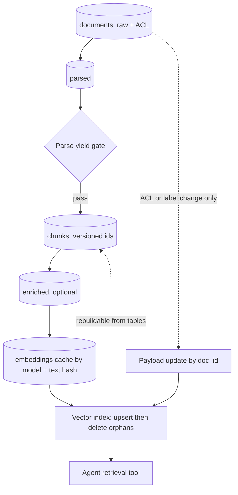

## TL;DR
ETL transforms before loading; ELT loads raw first. For an agent's retrieval tools, load raw, then run a
staged DAG (parse, clean, chunk, enrich, embed, index) of versioned tables, so the index is a rebuildable
projection you can re-tune without re-crawling.

## For agent builders
- **Why it matters for agents.** When an agent picks the wrong tool argument or cites a bad passage, the cause
  is often a chunk. Stored stages let you trace a tool result back to parsed text and raw bytes, and fix
  one stage instead of rebuilding everything.
- **Where it shows up in your stack.** The pipeline behind every `search_docs` or `retrieve` tool: Dagster,
  Airflow or dbt over a lakehouse, an embedding cache table, and a vector store with collection or index
  aliases.
- **What you control.** Chunker and embedding versions, which stages are cached by content hash, the quality
  gates that block promotion, the metadata path for ACL changes, and the alias cutover gated on a retrieval
  eval.
- **What you can skip.** Warehouse modelling theory (star schemas, slowly changing dimensions). The agent
  builder needs versioned stage tables, a cache and a reconciliation step.

## Why it exists
- **The terms come from data warehousing.** ETL was the norm when warehouse storage and compute were
  expensive: clean and shape data on a separate server, load only the final tables. ELT took over when
  cloud warehouses and lakes made storage cheap and put elastic compute next to the data: load everything
  raw, transform with SQL (the dbt workflow), keep every intermediate table.
- **ELT won because transformations are where requirements change.** With raw data kept, a changed
  transformation is a re-run, not a re-extraction.
- **RAG rediscovers this the hard way.** Version one is one function: fetch, split into 512-token chunks,
  embed, upsert. Then the team wants semantic chunking, section titles on chunks, a new embedding model, or
  an LLM-written summary per chunk (contextual retrieval), and each means re-running from the source.
- **Nothing in between was kept.** No way to A/B two chunkers on the same parsed text, no intermediate to
  inspect when a failure traces to a garbled chunk, no embedding cache, so the second attempt costs as much
  as the first.
- **A vector database is a poor transformation engine.** It cannot join, deduplicate or re-chunk, so
  warehouse-style "transform inside the target" is not an option. Treat the chunk and embedding tables as
  the data product and the index as a projection of them.

## How it works
### The stage tables
A chain of derived tables, each keyed so it can be recomputed incrementally:

| # | Table | Key and contents | Why it is stored |
|---|---|---|---|
| 1 | `documents` | raw bytes (or a pointer) plus `doc_id`, `doc_version` (content hash), source metadata including ACLs | produced by ingestion; immutable per version |
| 2 | `parsed` | text plus structure (headings, tables, page numbers) per `(doc_id, doc_version, parser_version)` | parsing is the most expensive and most bug-prone step |
| 3 | `chunks` | `chunk_id`, `doc_id`, `doc_version`, `chunker_version`, `position`, `text`, `section_path`, `metadata` | the retrieval unit; versioned ids make orphans findable |
| 4 | `enriched` (optional) | chunk text plus title and section path, extracted entities, or a short LLM-written context sentence (contextual retrieval) | enrichment calls an LLM and is the step most likely to be re-tuned |
| 5 | `embeddings` | `(chunk_id, embedding_model, vector)`, cached by `(embedding_model, text_hash)` | an unchanged chunk is never embedded twice; two models can coexist during a migration |
| 6 | the index | upsert of `embeddings` joined to `chunks` metadata, keyed by `chunk_id`, then delete ids absent from the current `chunks` for that document | serving structure, rebuildable from 3 to 5 |

- **Content-addressed chunk ids.** `chunk_id = hash(doc_id, doc_version, chunker_version, position)`, so a
  new chunker produces new ids and old chunks are found and deleted as orphans rather than overwritten in
  place.
- **Each table is a deterministic function of the previous one plus a version parameter.** That is what
  makes the pipeline incremental.
- **A `chunker_version` change** recomputes only `chunks`, `enriched`, `embeddings` and the index: for all
  documents, but from `parsed`, not from the source.
- **One document change** flows only that document's rows through every stage.

### Why materialize instead of streaming through
Storing intermediates costs disk and adds a write per stage. It buys four things:
- **Debuggability.** A bad answer traces to a chunk, the chunk to its parsed text, the parsed text to the raw
  bytes, each inspectable.
- **Experimentation.** Two chunkers or two embedding models run against the same `parsed` table and are
  compared with the same retrieval eval set.
- **Cost control.** Embedding and LLM enrichment, the expensive calls, are cached by content hash and never
  repeated for unchanged text.
- **Late binding.** The embedding model is a parameter of the last stage, so upgrading it re-runs one stage,
  not the pipeline.

### Where ETL still applies
- **Some transforms must happen before anything is stored** (ETL in the strict sense): redacting PII that
  may not be persisted, dropping documents whose classification forbids them here, and enforcing tenant
  boundaries at the landing store.
- **The rule:** compliance-driven transformations go before the load; quality-driven transformations go
  after it.

### Quality gates between stages
Every stage always produces *something*, so failures are silent unless measured. Standard gates:
- **Characters per page** from the parser (a scanned PDF parsed as text yields near zero).
- **Empty or near-duplicate chunk ratio.**
- **Embedding failure rate.**
- **Orphan count** after index reconciliation.

A gate that trips stops promotion of that stage's output, which is cheaper than finding out from users.

### Orchestration and incrementality
- **A DAG scheduler** (Dagster, Airflow, Prefect, or dbt-style SQL models over a lakehouse) runs stages in
  dependency order on partitions of changed documents.
- **Index writes are idempotent upserts by `chunk_id`,** so a retried stage is harmless. The version columns
  make "re-run everything from `parsed` with chunker v3" a one-line change rather than a project.
- **Recompute like a build system.** Each row's key includes the hash of its inputs plus the version of the
  function that produced it; a stage runs only for keys whose output row does not exist yet.

| Change | New `doc_version`? | Where new keys appear |
|---|---|---|
| A document edit | yes | every stage, that document only |
| A chunker change | no, new `chunker_version` | from `chunks` onward, every document |
| An embedding-model change | no | only `embeddings` |

Nothing has to track "what changed"; the missing keys are the work list.

### Not every change needs a re-embed
- **Metadata-only changes** (an ACL edit, a move to a new folder, a retention label) go to the index as a
  payload update keyed by `doc_id`, without re-chunking or re-embedding, because the vectors did not
  change.
- **So the pipeline needs two paths:** a content path through every stage and a metadata path straight to
  the index payload.
- **Without the metadata path,** a permission change either triggers an expensive full re-run or never
  reaches the index, and the second outcome is a security bug.

### Shaping chunks for agent tools
- **Carry what the agent cites.** Keep `doc_id`, `doc_version`, `section_path` and a source URI in the index
  payload, so a retrieval tool result can be quoted with a citation the user can open.
- **Carry what the agent filters on.** Product, region, tenant and ACL groups belong in payload fields, because
  an agent passes them as tool arguments (for example `search_docs(query, product="billing")`).
- **Stamp the pipeline version into results.** Returning `chunker_version` and the embedding model in tool
  output makes agent traces explain which index build produced an answer.
- **Eval the agent, not only retrieval.** A chunker that wins recall@k can still lose on task completion if
  chunks split the steps an agent needs in one tool result.

## Diagram
Each stage is a stored table keyed by input hash plus version; the content path runs every stage, while
metadata-only changes skip straight to the index payload that the agent's retrieval tool reads.



## Examples
### A content-addressed transform stage
Chunk ids include the chunker version, embeddings are cached by `(model, text_hash)`, and index
reconciliation deletes orphaned chunks of re-chunked documents. The stores are stand-ins for lakehouse
tables and a vector database.

```python
import hashlib, json

CHUNKER_VERSION, EMBED_MODEL = "v3-semantic", "text-embedding-3-small"

def h(*parts):
    return hashlib.sha256("|".join(map(str, parts)).encode()).hexdigest()[:24]

def build_chunks(doc_id, doc_version, parsed_sections, chunker):
    rows = []
    for pos, (section_path, text) in enumerate(chunker(parsed_sections)):
        rows.append({"chunk_id": h(doc_id, doc_version, CHUNKER_VERSION, pos),
                     "doc_id": doc_id, "doc_version": doc_version,
                     "chunker_version": CHUNKER_VERSION, "position": pos,
                     "text": f"{section_path}\n{text}",            # cheap enrichment: section path
                     "text_hash": h(section_path, text)})
    return rows

def embed_stage(chunks, cache, embed_fn):
    todo = [c for c in chunks if (EMBED_MODEL, c["text_hash"]) not in cache]
    for c, vec in zip(todo, embed_fn([c["text"] for c in todo])):   # batched, rate-limited call
        cache[(EMBED_MODEL, c["text_hash"])] = vec
    return [(c["chunk_id"], cache[(EMBED_MODEL, c["text_hash"])], c) for c in chunks]

def reconcile_index(index, doc_id, rows):
    live = {cid for cid, _, _ in rows}
    for cid, vec, meta in rows:
        index.upsert(cid, vec, {k: meta[k] for k in ("doc_id", "doc_version", "position")})
    stale = index.ids_for_doc(doc_id) - live                       # chunks from an older chunker version
    index.delete(stale)
    return {"upserted": len(live), "deleted": len(stale)}
```

Switching chunkers is now `CHUNKER_VERSION = "v4"` plus a re-run from the parsed table. Unchanged text
still hits the embedding cache, and `reconcile_index` removes the v3 chunks of each document as its v4
chunks land. Three details in the code are deliberate, plus one caveat:
- **Upsert before delete.** A reader can briefly see old and new chunks of a document together, which is
  better than briefly seeing none of them.
- **Source deletion needs no special path.** Calling `reconcile_index(index, doc_id, [])` deletes every chunk
  of that document.
- **`text_hash` leaves out `doc_version`.** Edit one paragraph of a 40-chunk document and all 40 chunk ids
  change because the version changed, but 39 texts hash the same, so only one embedding call is made.
- **Caveat: that holds for structure-aligned chunking** (boundaries follow sections and paragraphs). With fixed-size
  token windows, an edit that changes text length moves every later boundary, so every later chunk gets a
  new hash. Chunk-boundary stability is a cost property as well as a quality one.

### Missing keys are the work list
Runnable as-is. Output keys include input hashes and versions, so the set of keys not yet materialized is
exactly what each kind of change must recompute.

```python
import hashlib

def key(*parts):
    return hashlib.sha256("|".join(map(str, parts)).encode()).hexdigest()[:12]

def work_list(docs, chunker_version, embed_model, done):
    """docs: {doc_id: doc_version}. done: output keys already materialized. Missing keys = work."""
    todo = {"chunks": [], "embeddings": []}
    for doc_id, doc_version in docs.items():
        ck = key("chunks", doc_id, doc_version, chunker_version)
        if ck not in done:
            todo["chunks"].append(doc_id)
        if key("embeddings", ck, embed_model) not in done:
            todo["embeddings"].append(doc_id)
    return todo

docs = {"a": "h1", "b": "h2", "c": "h3"}
done = set()
for d, v in docs.items():                                   # chunker v3 + model-1 already ran
    ck = key("chunks", d, v, "v3")
    done |= {ck, key("embeddings", ck, "model-1")}

print(work_list(docs, "v3", "model-1", done))   # nothing to do
print(work_list(docs, "v3", "model-2", done))   # model change: embeddings only, every doc
print(work_list(docs, "v4", "model-1", done))   # chunker change: chunks onward, every doc
docs["b"] = "h2-edited"                          # one document edited
print(work_list(docs, "v3", "model-1", done))   # only b, in every stage
```

### Worked scenario: what a full pass costs at 2 million documents
The cache matters most for the expensive optional stage. Take 2 million documents at 4,000 tokens and 12
chunks each.

| Quantity | Arithmetic | Result |
|---|---|---|
| Chunks | 2 M × 12 | 24 million |
| Embedding pass (each chunk read once, ~400 tokens) | 24 M × 400 | ≈ 10 billion tokens |
| Contextual enrichment (whole document as context per chunk) | 24 M × 4,400 | ≈ 100 billion input tokens, plus an output sentence per chunk |
| Enrichment vs embedding | 100 B ÷ 10 B | about ten times the embedding pass |

- **Prompt caching of the shared document prefix** reduces the enrichment bill.
- **A content-hash cache** means a chunker change does not repeat enrichment for text that did not move.
- **Run this arithmetic** before choosing which stages to re-run and how often.

### Agent scenario: tracing a bad tool result back through the stages
An agent's `search_docs` call returned a chunk that cut a refund procedure in half, so the agent skipped a
step. Because every stage is a stored table, the trace is a few lookups, and the tool result itself carries
the keys to start from.

```python
def trace_tool_result(result, tables):
    """result: one item from the agent's search_docs output (payload fields from the index)."""
    chunk = tables["chunks"].get(result["chunk_id"])
    parsed = tables["parsed"].get((chunk["doc_id"], chunk["doc_version"], chunk["parser_version"]))
    raw = tables["documents"].get((chunk["doc_id"], chunk["doc_version"]))
    return {
        "chunker_version": chunk["chunker_version"],
        "position": chunk["position"],
        "chunk_chars": len(chunk["text"]),
        "section_path": chunk["section_path"],
        "parsed_section": parsed["sections"][chunk["section_path"]][:200],   # what the chunker saw
        "raw_uri": raw["uri"],                                                # what the source holds
    }
# If the parsed section is whole but the chunk is cut, the chunker is at fault: bump CHUNKER_VERSION,
# re-run from `parsed`, eval the agent on the refund tasks, then cut the alias over.
```

| Fix | Stages re-run | Cost at 2 M documents (from the table above) |
|---|---|---|
| Re-crawl and rebuild (no stored stages) | all, plus source fetches | full fetch, parse and ≈ 10 billion embedding tokens |
| New chunker from `parsed` | chunks, embeddings, index | ≈ 10 billion tokens at worst, less with the text-hash cache |
| Payload-only fix (missing `section_path`) | index payload | no embedding calls |

## Production patterns
- **Embedding cache as a table, not a dict.** When any stage is re-run, look up `(embedding_model,
  text_hash)` in a lakehouse table before calling the provider and write misses back. Monitor cache hit
  rate per run; a re-run after a chunker change with a near-zero hit rate means boundaries moved.
- **Versioned index plus alias cutover.** For a model or chunker upgrade, build a second collection or
  index and point a read alias at it after the retrieval eval wins (Qdrant collection aliases and
  OpenSearch index aliases both do this). Keep the old one for rollback and monitor retrieval eval scores
  and answer quality across the switch.
- **Quality gates as orchestrator checks.** Express parse yield, empty-chunk ratio and orphan count as
  Dagster asset checks or dbt tests that block downstream materialization. Monitor gate failures per
  source, because one bad source usually explains most failures.
- **Batch the expensive calls.** Send bulk re-embeds through a provider's batch endpoint (OpenAI's Batch API
  accepts embedding requests at a discount) and put the full document first in contextual-enrichment
  prompts so prompt caching applies. Monitor tokens and spend per run against the arithmetic above.
- **Separate metadata path.** Route ACL and label changes to a payload update keyed by `doc_id` instead of
  the content DAG. Monitor the lag between a source permission change and the index payload update.
- **Agent-eval gate on alias cutover.** Agent teams run the agent's task suite (not only recall@k) against the
  candidate index before flipping the alias, and log the index version in every tool-call trace. Monitor task
  completion rate and citation accuracy per index version, and roll the alias back on regression.

## Trade-offs
- **Materialized stages vs storage.** Every stage costs storage and one extra write, but it flips to a clear
  win as soon as the team changes a chunker or embedding model for the second time.
- **ELT flexibility vs compliance.** Raw data stays available for any future transformation, but rules that
  forbid storing certain content force those specific transformations back before the load.
- **Content-addressed ids vs re-embed cost.** They make orphans detectable and re-runs idempotent, yet any
  chunker version change re-embeds the whole corpus; a cache keyed by text hash limits that to chunks whose
  text actually changed.
- **LLM enrichment vs pipeline cost.** Summaries and contextual prefixes can raise retrieval quality
  noticeably, but add an LLM call per chunk per version, which dominates pipeline cost at corpus scale
  unless cached and applied selectively.

## Pitfalls
- **Chunk ids from `(doc_id, position)` only, without orphan reconciliation.** Symptom after a chunker change:
  old and new chunks of one document both rank in the top-k, often overlapping, because a new chunker that
  emits fewer chunks overwrites positions 0..n−1 and leaves the old tail live. Even with reconciliation,
  position-only ids overwrite in place, so a half-finished re-run leaves mixed chunker versions with no way
  to tell rows apart.
- **Mixing vectors from two embedding models in one index.** Symptom: retrieval quality drops right after a
  model "upgrade", because similarity scores from different models are not comparable.
- **Embedding before near-duplicate removal.** Symptom: the top-k fills with copies of the same boilerplate
  paragraph and the useful passage is pushed below the cutoff.
- **Transforming inside the vector database's ingest hooks.** Symptom: a re-index that takes days and a
  pipeline that cannot move to another vendor without a rewrite.
- **No quality gate after parsing.** Symptom: a retrieval failure traced, weeks later, to thousands of chunks
  containing nothing but page headers or OCR noise.
- **Treating the index as the system of record.** Symptom: an outage or a vendor migration that requires
  re-crawling every source because the chunk tables never existed.

## When to use
- **Use** staged ELT for any corpus behind an agent's retrieval tools that you expect to re-chunk, re-embed or
  audit, which is every corpus that lives longer than a prototype.
- **The signal you need it:** "what would it cost to try a different chunk size?" is answered in weeks
  rather than hours.
- **Measure** embedding cache hit rate, re-run time per stage, orphan count after reconciliation and parse
  yield; these show whether the pipeline is incremental in practice.
- **Skip the full apparatus** for a static corpus of a few thousand files rebuilt from scratch on any
  change, but still keep the raw copy.
- **Interviews:** "how would you upgrade the embedding model on a live system?" Re-run the embedding stage
  into a second index version from stored chunks, then an evaluated cutover; only possible if the chunk
  table exists.

## Role lens
- **Engineer:** Implements stage functions with version parameters and content hashes, caches embedding
  calls by text hash, and writes the reconciliation step that deletes orphans after re-chunking.
- **Architect:** Defines the chunk and embedding tables as the data product, sets which transformations
  must run before storage for compliance, and chooses the orchestrator and lakehouse that host the stages.
- **FDE:** Shows the customer the parsed and chunked intermediates when a retrieval answer is wrong, so
  the fix is traced to a stage rather than blamed on "the model", and estimates re-index cost from them.

## Check yourself
**Q:** Your team wants to move from fixed 512-token chunks to a semantic chunker and, a month later, to a
new embedding model, on a corpus of two million documents that is live for customers. What does the
pipeline need so each change is a bounded, reversible job rather than a quarter-long project?
**A:** It needs stored, versioned intermediates. The parsed table lets the semantic chunker run without
re-crawling or re-parsing two million documents. Chunk ids that include the chunker version let the new
chunks land beside the old ones and let reconciliation delete the old per document, so the cutover is
gradual and reversible. An embedding cache keyed by model and text hash means only genuinely new chunk
text is embedded. For the model change, the embedding stage is re-run with a new model parameter into a
second index version, evaluated against the same retrieval test set, and traffic is switched when it wins;
the old index remains for rollback. Quality gates on parse yield and orphan count catch regressions before
users do, and the vector index is treated as a projection that can always be rebuilt from the tables.

## Interview questions
### What is the difference between ETL and ELT, and why does RAG favour ELT?
- **ETL** transforms on a separate server and loads only final tables; **ELT** loads raw and transforms next
  to the data, keeping intermediates.
- **RAG favours ELT** because chunking, enrichment and embedding change far more often than sources, so
  re-transforming from stored raw or parsed data is the operation you run most.
- **The exception** is compliance: PII that may not be persisted must be redacted before the load.

### After a chunker change, your agent's answers cite duplicated passages. How do you debug it?
- **Check chunk ids:** if they come from `(doc_id, position)` only, the new chunker overwrote some rows and
  left the old tail live.
- **Check reconciliation:** count indexed ids per document that are absent from the current `chunks`; a
  non-zero orphan count confirms it.
- **Fix:** version the ids with `chunker_version`, upsert then delete stale ids per document, and add an
  orphan-count gate.

### When is materializing every stage not worth it?
- **A small static corpus** of a few thousand files rebuilt from scratch on any change gains little from
  stage tables; keep only the raw copy.
- **It pays off** once the team changes a chunker or embedding model a second time, or must audit why an
  answer cited a chunk.

### Estimate the cost of adding contextual retrieval to 2 million documents.
- **Chunks:** 2 M documents × 12 chunks = 24 million.
- **Input tokens:** each call carries the document (~4,000) plus the chunk (~400), so about 24 M × 4,400 ≈
  100 billion tokens, roughly ten times a full embedding pass.
- **Levers:** prompt caching of the document prefix, a content-hash cache so re-chunking does not repeat
  unchanged text, and applying enrichment only where evals show it helps.

### How do you propagate a permission change without re-embedding?
- **Treat it as metadata:** the vectors did not change, so send a payload update keyed by `doc_id` straight
  to the index.
- **Why a separate path matters:** without it, the change either triggers a full re-run or never reaches the
  index, and the second outcome is a security bug.
- **Monitor** the lag from source permission change to index payload update.

### How would you ship a new chunker for a production agent without breaking it?
- **Build beside, not over:** run the new `chunker_version` from `parsed` into a second index version, with
  the embedding cache absorbing unchanged text.
- **Gate on the agent's evals:** run the agent's task suite and retrieval eval against both versions, and
  compare task completion and citation accuracy, not only recall.
- **Cut over by alias and keep rollback:** flip the read alias, log the index version in tool-call traces,
  and keep the old index until the new one has held for a release cycle.

## Quiz
### Q: In a RAG pipeline, why is the vector index treated as a derived structure rather than the system of record?
- [ ] Vector databases cannot store document metadata reliably
- [x] Chunking, enrichment and embedding change often, and keeping the chunk tables lets any of them be re-run without re-extracting from sources
- [ ] Vector indexes are always rebuilt nightly regardless of changes
- [ ] Regulations require a relational copy of every embedded chunk
> The transformations are the volatile part of a RAG system. If the index is the only copy, every
> chunker or model change becomes a re-crawl; if chunk and embedding tables exist, the index is a cheap
> projection that can be rebuilt, versioned or moved to another vendor.

### Q: Which transformation genuinely belongs before the load (ETL) rather than after it (ELT) in a RAG pipeline?
- [ ] Splitting documents into chunks
- [ ] Prepending section titles to chunk text
- [x] Redacting personal data that policy forbids persisting anywhere in the system
- [ ] Computing embeddings with the current model
> ELT is preferable for quality-driven steps because they are re-tuned often. Compliance-driven steps are
> different: if the data may not be stored, it must be removed before the landing write, since a raw copy
> would itself be a violation.

### Q: After switching chunkers, users see overlapping passages from the same document twice in the top-k. What is the likely cause?
- [ ] The embedding model was changed at the same time
- [ ] The reranker was not retrained on the new chunk sizes
- [x] Old chunks were never reconciled away: ids lacked the chunker version and no step deleted ids absent from the new chunk set
- [ ] The new chunker produces chunks that are too small for the index
> When ids depend only on document and position, a new chunker overwrites some old rows and leaves others
> (the tail beyond its own chunk count) live. Versioned ids plus a reconciliation step that deletes every
> indexed id for the document not in the current chunk set make the old chunks discoverable and removable.

## Use cases & projects
### Use cases
- **Re-tuning a support agent's knowledge base.** Trying a semantic chunker or section-path prefixes is a
  re-run from `parsed`, compared on the agent's task evals, instead of a re-crawl.
- **Embedding-model upgrades under a live agent.** A second index built from stored chunks, an agent-eval
  gate and an alias flip let the team upgrade without downtime and roll back in seconds.
- **Debugging agent citations.** A wrong or truncated tool result traces through `chunks`, `parsed` and
  `documents` to the stage that broke it.
- **Contextual retrieval at scale.** Caching enrichment by content hash and prompt-caching the document
  prefix keep the per-chunk LLM call affordable for a large agent corpus.

### Mini project
**Version a RAG pipeline and A/B two chunkers on an agent (2-3 hours).**
- **Goal:** show that a chunker change is a bounded re-run judged by an agent's task results.
- **Steps:** take 50-100 Markdown docs; store `documents`, `parsed`, `chunks` and an embedding cache as
  local tables (SQLite or Parquet); build two index versions with different `chunker_version` values; wire
  a small tool-calling agent to a `search_docs` tool pointed at an alias; run 20 scripted questions against
  each version.
- **Done when:** you have a table of cache hit rate, orphans deleted, recall@5 and agent answer accuracy per
  chunker version, the alias points at the winner, and each tool-call trace logs the index version it used.
