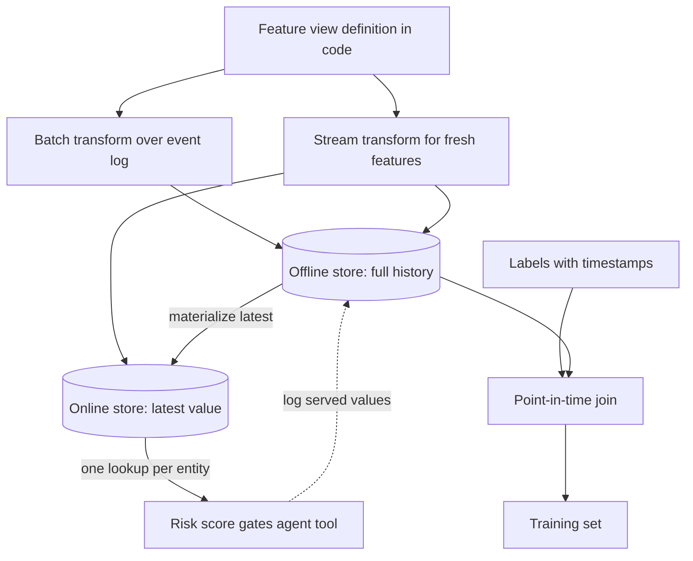

## TL;DR
Caveat first: this matters only when your agent relies on classical ML models (risk scores, routers,
rankers). A feature store computes features once, serves them point-in-time correct to training and fresh
to inference, preventing training/serving skew and time leakage.

## For agent builders
- **Why it matters for agents.** Many production agents sit beside classical models: a fraud or risk score
  decides whether the agent's refund action executes, a routing classifier picks the model or sub-agent, a
  ranker orders documents. If those scores are skewed or leaky, the agent acts on wrong numbers with full
  confidence.
- **Where it shows up in your stack.** A tool or guardrail that calls `get_online_features` and a scoring
  model before a consequential action, the feature views the ML team owns (often in Feast or a managed
  store), and served-feature logs you join with agent traces.
- **What you control.** Usually little of the store itself. You control which score gates which tool, what
  the agent does when a feature is null or stale, and that the score and feature version land in the
  trace.
- **What you can skip.** All of it, if your agent uses only LLMs over retrieved text. Then ingestion
  contracts and embedding versioning cover the analogous concerns.

## Why it exists
- **Caveat: hybrid systems only.** Feature stores matter in systems that train and serve classical ML models
  (ranking, fraud, churn, routing classifiers) alongside LLM components. Pure LLM-application roles can skim
  this and move on.
- **Two implementations drift (training/serving skew).** A fraud model needs "transactions by this card in
  the last hour" and "customer's average order value over 90 days". A batch SQL job computes them for the
  training set; a service computes them at request time.
- **The two silently disagree.** The batch job counts refunds, the service does not; the batch job uses UTC
  day boundaries, the service local time. The model learns one definition and is scored with another, so
  production accuracy is lower than in evaluation for reasons nobody can see.
- **Joins to today's values leak the future (time leakage).** Training rows must join features *as they
  were when each label's event happened*. Join to today's values and the "90-day average" for a transaction
  last March includes orders from April. Offline metrics look excellent, production is worse.
- **Hand-rolled joins go wrong at scale.** Doing this join correctly by hand across dozens of features with
  different update cadences is where most hand-rolled pipelines fail.
- **A shared library plus a cache is not enough.** It fixes definition drift but not leakage, stores no
  history, and cannot say "which feature version did model v12 train on". The feature store adds a historical
  store, point-in-time joins, versioned definitions and an online serving path: the minimum set that solves
  both problems.

## How it works
### Background: the moving parts
- **A feature** is a named, typed value attached to an **entity** (a customer id, a card id, a merchant id)
  with an **event timestamp** saying when the value became true.
- **A feature view** (Feast's term; other systems say feature groups or tables) is a set of features for one
  entity, computed by one transformation from one source, with a TTL saying how long a value stays valid.
  The definition lives in code under version control, *because* it must be the single source of truth for
  both the batch and the serving path.
- **The offline store** holds historical feature values, keyed by entity and event timestamp, in the
  warehouse or lakehouse. It is append-only by design: a new value is a new row with a later timestamp, not
  an overwrite, *because* training needs every past value to reconstruct what was known at any given moment.
- **The online store** is a low-latency key-value store (Redis, DynamoDB, Bigtable and similar) holding only
  the latest value per entity per feature view; serving reads it with a single lookup per entity. A
  scheduled materialization job copies the latest values from the offline store into it, so both paths see
  the same computed numbers.
- **A streaming path** writes to both stores from the event stream for features that must be fresher than the
  materialization cadence (counts in the last minute).

### Background: the point-in-time join
Given a label table with `(entity_id, label_timestamp, label)`, for each row and each feature view:
1. Select the latest value with `event_timestamp <= label_timestamp`.
2. Require `label_timestamp - event_timestamp <= ttl`.
3. If no value qualifies, the feature is null: the honest answer, since at that time the model would not have
   known it.

- **This "as-of" join is the core algorithm** and the reason the offline store keeps history. Feast exposes
  it as `get_historical_features`.

### The boundary must match what serving sees
The `<=` in the join is a decision, not a detail.

| Step | Training (inclusive join) | Serving |
|---|---|---|
| Feature | transactions by this card in the last hour | same |
| Label event | a transaction at 14:00:00 | the same transaction, being scored |
| What the count includes | the pipeline already counted it in a value stamped 14:00:00 | the scorer runs *before* the transaction is recorded, so never itself |
| Result | count includes the very event being scored | count is exactly one lower, systematically |

- **This is leakage that looks like a rounding error.** Choose strict or inclusive comparison, and any
  allowance for ingestion delay, to reproduce what the online path can know at decision time.

### Backfills
- **A new feature is useless for training until it has history.** A *backfill* runs the transformation over
  historical source data to populate the offline store as if the feature had always existed.
- **Only possible with historical sources** (an event log or a snapshot table).
- **If the source is a mutable table keeping only current state,** history cannot be reconstructed. The
  honest options: start logging the feature now and wait for enough labelled history, or accept a training
  set where the feature is null before its launch date.
- **So feature sources should be append-only events** wherever possible.

### Why one definition serves both paths
- **Written once, executed twice:** in the batch engine for history, and in the materializer or stream
  processor for serving. Skew is prevented structurally rather than by code review, *because* there is no
  second implementation to drift.
- **Request-payload features have two options.** Run the same transformation code at request time and at
  training time (Feast's on-demand feature views work this way), or log the values actually served and reuse
  them as training features later, closing the loop.
- **Logging is safer** when the request-time inputs cannot be reconstructed from history.

### Versioning and lineage
- **Feature view definitions are versioned,** and a training run records which versions and which offline
  snapshot it used, which plugs directly into provenance.
- **Changing semantics means a new version;** both versions can be served during a model migration.
- **Statistics computed at materialization** (null rates, distributions) are what drift monitoring compares
  against.

### Where it sits in an agent system
- **Typical shapes:** a ranking or routing model decides which documents or which LLM an agent should use; a
  fraud or risk score gates whether an LLM-generated action executes; a churn model decides which users get
  an LLM-drafted outreach.
- **The LLM gets the score or the decision,** not the features, which come from the feature store. Keep the
  gate in code, not in the prompt, *because* a model asked to "refuse risky refunds" can be talked out of it
  and a threshold check cannot.
- **Embeddings as features:** a user or item embedding fed to a ranker makes the embedding model's version
  part of the feature view's definition. Changing it is a new feature version and a retrain, for the same
  reason it forces a re-index in retrieval.
- **No such models?** Then the analogous concerns (consistent metadata between ingestion and query time,
  versioned transformations) are handled by the ingestion contract and embedding versioning, not a feature
  store.

### Products
- **Feast** is the common open-source option (definitions in Python, pluggable offline and online stores).
- **Managed or commercial:** Tecton, the Databricks feature store, Amazon SageMaker Feature Store, Vertex AI
  Feature Store and Hopsworks. This market consolidates and renames products often, so check current
  offerings.
- **Differences** are mostly in streaming support, transformation execution and platform integration; the
  concepts above are shared.

## Diagram
One definition feeds both paths: history for point-in-time training joins, latest values for the score
that gates the agent's action.



## Examples
### A risk score gating an agent's refund tool
The agent proposes a refund; code, not the model, reads online features, scores them and decides. Stale or
missing features fail closed to human review. The feature lookup and model are stand-ins for
`get_online_features` and a trained classifier.

```python
from datetime import datetime, timedelta, timezone

ONLINE = {"card:4242": {"txn_count_1h": 7, "avg_order_value_90d": 55.0,
                        "event_timestamp": datetime.now(timezone.utc) - timedelta(minutes=3)}}
MAX_STALENESS = timedelta(minutes=15)    # illustrative: the freshness the model was trained to expect
THRESHOLD = 0.7                          # illustrative: set from the model's precision/recall curve

def risk_model(f: dict) -> float:        # stand-in for the classical model
    return min(1.0, 0.08 * f["txn_count_1h"] + 0.001 * f["avg_order_value_90d"])

def refund_tool(card_id: str, amount_usd: float, trace: dict) -> dict:
    f = ONLINE.get(f"card:{card_id}")
    if f is None or datetime.now(timezone.utc) - f["event_timestamp"] > MAX_STALENESS:
        trace["gate"] = "features_missing_or_stale"
        return {"status": "needs_human_review", "reason": "risk features unavailable"}
    score = risk_model(f)
    trace.update(gate="risk_score", score=round(score, 3), feature_view="card_activity:v3")
    if score >= THRESHOLD:
        return {"status": "needs_human_review", "reason": "risk score above threshold"}
    return {"status": "refunded", "amount_usd": amount_usd}

trace = {}
print(refund_tool("4242", 30.0, trace), trace)   # score 0.615 -> refunded, score logged in the trace
```

Logging the score and feature view version in the agent trace is what lets you later join served values
with batch values to check for skew.

### Point-in-time join versus the leaky latest-value join
Pure Python, contrasted with the "join to the latest value" that hand-rolled pipelines usually do. Feature
rows are `(entity, event_time, value)`; labels are `(entity, label_time)`.

```python
from bisect import bisect_right
from collections import defaultdict

# avg_order_value_90d for customer c1, appended as it changes (offline store rows)
features = [("c1", "2024-03-01", 40.0), ("c1", "2024-04-15", 55.0), ("c1", "2024-05-20", 90.0)]
labels   = [("c1", "2024-03-10"), ("c1", "2024-04-20"), ("c1", "2024-06-01")]
TTL_DAYS = 120

by_entity = defaultdict(list)
for ent, ts, val in sorted(features, key=lambda r: r[1]):
    by_entity[ent].append((ts, val))

def days_between(a, b):                     # ISO dates, good enough for the demo
    from datetime import date
    return (date.fromisoformat(b) - date.fromisoformat(a)).days

def point_in_time(ent, label_ts):
    rows = by_entity[ent]
    i = bisect_right([ts for ts, _ in rows], label_ts) - 1      # latest event_time <= label_ts
    if i < 0 or days_between(rows[i][0], label_ts) > TTL_DAYS:
        return None                                              # unknown at that time
    return rows[i][1]

def leaky_latest(ent, _label_ts):
    return by_entity[ent][-1][1]                                 # what a naive join does

for ent, lts in labels:
    print(lts, "correct:", point_in_time(ent, lts), "| leaky:", leaky_latest(ent, lts))
# 2024-03-10 correct: 40.0 | leaky: 90.0
# 2024-04-20 correct: 55.0 | leaky: 90.0
# 2024-06-01 correct: 90.0 | leaky: 90.0
```

The March label trained with the leaky join would see a value that only became true in May. A model fit
on such rows learns relationships that cannot exist at inference time, which is exactly why offline
metrics overstate production performance.

### Production snippet: the same feature in Feast
One definition, applied with `feast apply`, then used for both a point-in-time training set and online
serving. The entity dataframe must carry an `event_timestamp` column, which is the label time for the as-of
join.

```python
from datetime import datetime, timedelta, timezone
import pandas as pd
from feast import Entity, FeatureStore, FeatureView, Field, FileSource
from feast.types import Float32

customer = Entity(name="customer", join_keys=["customer_id"])
orders = FileSource(path="data/customer_orders.parquet", timestamp_field="event_timestamp")
customer_orders = FeatureView(
    name="customer_orders", entities=[customer], ttl=timedelta(days=120),
    schema=[Field(name="avg_order_value_90d", dtype=Float32)], source=orders,
)

store = FeatureStore(repo_path=".")
labels = pd.DataFrame({"customer_id": [1001, 1001],
                       "event_timestamp": pd.to_datetime(["2024-03-10", "2024-04-20"], utc=True)})
train_df = store.get_historical_features(            # point-in-time correct, TTL applied
    entity_df=labels, features=["customer_orders:avg_order_value_90d"]).to_df()

store.materialize_incremental(end_date=datetime.now(timezone.utc))   # offline -> online
online = store.get_online_features(features=["customer_orders:avg_order_value_90d"],
                                   entity_rows=[{"customer_id": 1001}]).to_dict()
```

### Worked scenario: the 0.95-offline, 0.80-production fraud model behind an agent
A support agent's refund tool is gated by a fraud model that scored 0.95 offline and behaves like 0.80 in
production, so the agent approves refunds it should escalate. Logging served features and comparing them
with batch values for the same entities and timestamps (illustrative findings):

| Check | Finding | Class of bug | Fix |
|---|---|---|---|
| How the training set was built | labels joined to current values | time leakage | rebuild with a point-in-time join |
| Refund handling | batch counts refunds, service does not | skew | one definition in the feature view |
| Day boundaries | batch UTC, service local time | skew | one definition, UTC event time |
| Last-hour count at the label event | logged serving values sit one below training values | inclusive-join leakage | strict comparison at the boundary |

- **After the rebuild the offline score drops** toward production, which is the point: the evaluation now
  measures the model production actually runs. The agent's prompt never needed changing.

## Production patterns
- **Gate consequential agent tools on scores in code.** Use when a classical model decides whether an agent
  action runs (refunds, account changes, outreach). The tool reads online features, scores, and returns
  "needs review" above the threshold or when features are null or stale. Monitor gate outcomes per tool and
  the share of decisions made on stale features.
- **Feature definitions as reviewed code.** Use from the first shared feature. Keep feature views in a repo,
  run `feast apply` (or the managed store's equivalent) from CI, and require a new version for any semantic
  change. Monitor the fraction of model features with a single definition.
- **Scheduled incremental materialization and streaming push.** Run `materialize_incremental` on a cadence
  shorter than the feature's freshness requirement; only features like last-minute counts get a stream
  processor writing into both stores (Feast offers a push source for this). Monitor serve-time freshness
  (now minus the served value's event timestamp), materialization failures and stream lag.
- **Served-feature logging and skew checks.** Use for every model in production. Log the feature vector with
  each prediction asynchronously (sample at high traffic), alongside the agent trace id, then join to
  batch-recomputed values for the same entity and timestamp. Monitor per-feature mismatch rate; a constant
  offset of one points at the join boundary.
- **TTL on every feature view.** Use always. Set `ttl` to the longest staleness the model can tolerate, so
  dormant entities get nulls instead of year-old values. Monitor null rate per feature at training and serve
  time; a jump means a source stopped producing.
- **Offline/online metric gap as the headline alert.** Use for every hybrid model. Track the difference
  between offline evaluation and production metrics per model version; skew or leakage shows up here first.

## Trade-offs
- **Skew-proof by construction vs another platform.** A feature store removes skew and leakage by
  construction, but it is another platform to run and a new workflow for data scientists. Below a handful of
  models, a shared transformation library plus a careful as-of join in SQL is a reasonable interim.
- **Millisecond lookups vs bounded freshness.** Materializing to an online store gives millisecond lookups
  but bounds freshness by the materialization cadence. Features that must reflect the last few seconds need
  the streaming path, which costs more to operate.
- **Point-in-time joins vs unbounded storage.** Append-only history makes point-in-time joins possible but
  grows storage without bound; partition by time and expire beyond the longest TTL any model needs.
- **Managed integration vs lock-in.** Managed stores integrate tightly with their platform and reduce
  operational work, but lock the feature layer to that platform; Feast keeps portability at the cost of
  assembling the pieces yourself.
- **Closed loop vs write per prediction.** Logging served features closes the loop on online-only
  transformations, but adds a write per prediction to a read-only path; make it asynchronous and sample when
  traffic is high.
- **Fail closed vs agent throughput.** Routing every stale-feature case to human review keeps actions safe
  but queues work when the online store lags; size the staleness limit to what the model was trained on.

## Pitfalls
- **Joining labels to current feature values.** Symptom: offline evaluation far better than production, with
  no bug anywhere in the model code. Fix: point-in-time join.
- **Two implementations of the same feature for batch and serving.** Symptom: a production accuracy drop that
  disappears when the serving values are logged and compared against the batch ones. Fix: one definition.
- **Setting no TTL on a feature view.** Symptom: a model happily consuming a value computed a year ago for a
  dormant entity as if it were current.
- **Mixing event time and ingestion time.** Symptom: subtle leakage when late-arriving events get stamped with
  when they were loaded rather than when they happened.
- **Putting the risk gate in the prompt.** Symptom: the agent approves a flagged action after a persuasive
  user message. Fix: the threshold check lives in the tool's code.
- **Adopting a feature store for an LLM-only application.** Symptom: an expensive platform holding document
  metadata that the ingestion pipeline already handled.
- **Not recording feature view versions in the model's provenance.** Symptom: being unable to tell why model
  v12 and v13 disagree after a feature definition changed.
- **An inclusive as-of join on a feature that counts the label event itself.** Symptom: a feature that is
  suspiciously predictive offline and whose logged serving values sit consistently one below the training
  values.

## When to use
- **Use when** the system trains and serves more than a couple of classical models that share features, when
  any feature is computed from time-varying history, or when training/serving skew has already been observed.
- **Avoid when** the only models are LLMs consuming retrieved text; there the equivalent discipline lives in
  ingestion contracts and embedding versioning.
- **Measure:** the gap between offline and online metrics (skew or leakage shows up here first), feature
  freshness at serve time, and the fraction of features with a single definition.
- **Interviews:** for hybrid roles, expect to explain the point-in-time join and why the online and offline
  stores must be fed from one definition; for LLM-application roles, expect at most to say why you do not
  need one.

## Role lens
- **Engineer:** Writes feature views as code, implements the as-of join or uses the store's historical
  retrieval, and sets materialization schedules and TTLs per feature.
- **Architect:** Decides whether the system is hybrid enough to justify a feature store, picks managed
  versus open source, and owns the freshness and consistency guarantees between offline and online paths.
- **FDE:** Recognizes when a customer's "AI system" includes classical models with hand-rolled feature
  pipelines, and diagnoses skew and leakage before attributing problems to the LLM.

## Check yourself
**Q:** A customer's fraud model shows 0.95 AUC offline and behaves like 0.80 in production. They blame the
model and want to add an LLM to "explain" transactions. What do you check first, and why?
**A:** Check for time leakage and training/serving skew before touching the model. First, inspect how the
training set was built: if labels were joined to current feature values rather than values as of each
transaction's timestamp, the offline score is inflated by information from the future; rebuild with a
point-in-time join and re-evaluate. Second, log the feature values the serving path actually sends and
compare them with the batch-computed values for the same entities and timestamps; any systematic
difference (refund handling, timezone boundaries, null defaults) is skew, and the model is being scored on
inputs it never saw in training. Both are fixed by a single feature definition feeding an offline store
with history and an online store by materialization, which is what a feature store provides. An LLM
explanation layer would add cost and would explain decisions made on wrong inputs; it belongs, if at all,
after the inputs are right.

## Interview questions
### What is training/serving skew, and how does a feature store prevent it?
- **Definition:** the model is trained on features computed one way and scored on features computed another,
  such as refunds counted in batch but not in the service.
- **Prevention is structural:** one feature view definition executes in the batch engine and in the
  materializer or stream processor, so there is no second implementation to drift.

### Your agent's refund tool is gated by a fraud score. How do you design the gate?
- **In code, not the prompt:** the tool reads online features, scores them and enforces the threshold, so no
  user message can talk the agent past it.
- **Fail closed:** null or stale features (older than the freshness the model was trained on) route to human
  review instead of defaulting to "low risk".
- **Observable:** log the score, threshold and feature view version on the agent trace so skew checks and
  incident reviews can join them later.

### Walk me through building a leakage-free training set for a churn model.
- **Start from labels** with entity id and label timestamp.
- **As-of join each feature view:** latest value with event time at or before the label time, within the TTL,
  null otherwise.
- **Check the boundary:** decide strict or inclusive comparison to match what serving can know at decision
  time, and use event time, not ingestion time.

### Would you add a feature store to a pure RAG assistant or agent?
- **No:** with no classical model to train and serve, there is no skew or point-in-time problem to solve.
- **Use instead** an ingestion contract for metadata consistency and embedding versioning for transformation
  versions; a feature store would hold document metadata the ingestion pipeline already handles.

### A new feature looks valuable, but its source is a table that keeps only current state. What do you do?
- **You cannot backfill it honestly,** because past values were overwritten.
- **Options:** start logging the feature now and wait for labelled history, or train with the feature null
  before its launch date; then move the source to append-only events.

### How do you choose a materialization cadence, and what do you monitor?
- **Cadence follows the freshness the model needs:** hourly or daily for slow features; anything needing the
  last few seconds goes through the streaming path instead.
- **Monitor** serve-time freshness, materialization failures, null rates, and the offline-versus-online
  metric gap per model version.

## Quiz
### Q: What does a point-in-time join guarantee when building a training set?
- [ ] Each label is matched to the most recently computed feature value
- [x] Each label sees only feature values whose event time is at or before the label's timestamp
- [ ] Features are computed in the same timezone as the labels
- [ ] Every label has a non-null value for every feature
> The join reconstructs what was knowable when each label event occurred. Matching to the latest value
> leaks the future into training, and nulls are the correct outcome when no value existed yet or the TTL
> had expired.

### Q: Why does a feature store keep separate offline and online stores rather than one database?
- [ ] Offline stores are cheaper, so all data should live there
- [ ] Online stores can run SQL joins faster
- [x] Training needs full history for as-of joins while serving needs millisecond lookups of only the latest values
- [ ] Regulations require training data to be isolated from production
> The two access patterns conflict: history and heavy scans versus single-key latency. Materialization
> copies the latest values from the historical store to the key-value store so both paths see the same
> computed numbers.

### Q: A team building a pure RAG assistant asks whether they need a feature store for document metadata. What is the right guidance?
- [ ] Yes, because metadata filters are features of the retrieval model
- [ ] Yes, because the online store will speed up metadata lookups
- [x] No; without classical models to train and serve, the ingestion contract and embedding versioning cover their needs
- [ ] Only if they use more than one embedding model
> Feature stores solve training/serving skew and time leakage for models trained on tabular features.
> A RAG assistant has no such model; consistency between ingestion and query metadata is an ingestion
> contract concern, and transformation versioning is handled by the embedding recipe.

## Use cases & projects
### Use cases
- **Risk-gated agent actions.** A fraud or abuse score from online features decides whether a refund,
  account change or payout tool runs or goes to review.
- **Routing in multi-model agent systems.** A classical classifier trained on request features picks the
  model or sub-agent, and must be point-in-time correct to evaluate honestly.
- **Ranking for retrieval or recommendations.** A ranker with user and item features (embeddings included)
  orders what the agent sees.
- **Proactive outreach agents.** A churn model decides which users get an LLM-drafted message; leakage there
  means messaging the wrong people.

### Mini project
**A leakage-free risk gate for an agent tool (2-3 hours).**
- **Goal:** gate a toy refund tool with a small classifier and show how leakage changes the gate's
  decisions.
- **Steps:** generate synthetic transaction events with timestamps and fraud labels; build features once with
  a leaky latest-value join and once with a point-in-time join; train a logistic regression on each and
  compare offline AUC; put the point-in-time model behind a `refund_tool` that reads the latest features,
  fails closed on stale ones, and logs the score on the trace; replay 200 later events through it.
- **Done when:** a table shows the leaky model's offline AUC beating the honest one but losing on the
  replayed events, and every replayed tool call has a score and feature version in its trace.
