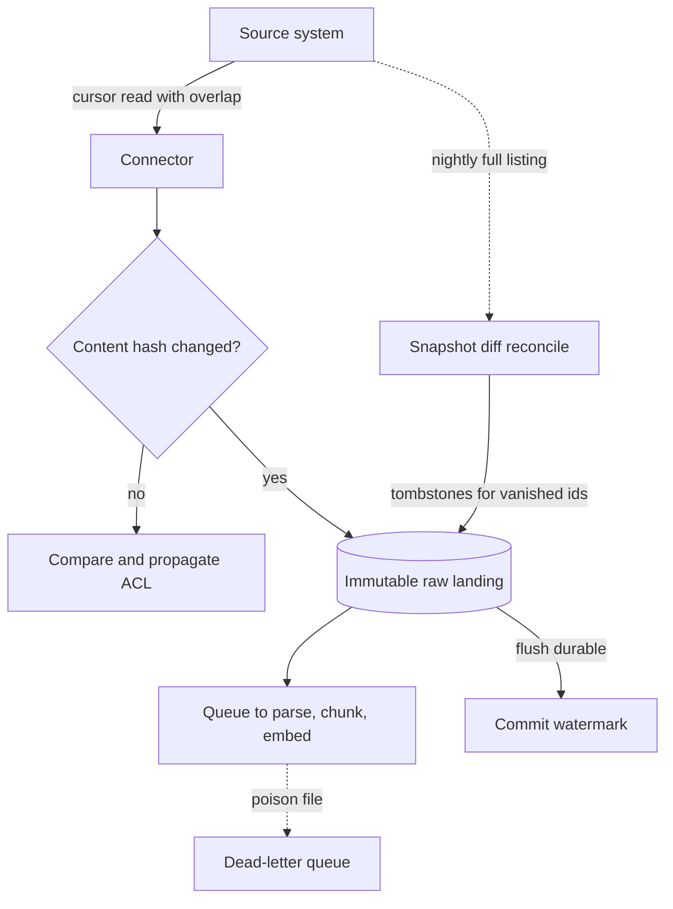

## TL;DR
An ingestion pipeline moves data from source systems into a durable, replayable landing store. What
survives production: incremental change capture including deletes, an immutable raw copy keyed by source
identity and content hash, and idempotent stages with a committed watermark.

## Why it exists
- **The first version is always a script.** List everything in Confluence or an S3 bucket, embed it,
  upsert it, run it nightly. It works at 2,000 documents and fails in four predictable ways at 200,000.
- **Cost scales with the corpus, not with change.** A nightly full re-crawl re-fetches, re-parses and
  re-embeds documents that have not moved. The embedding bill and API rate limits become the bottleneck
  long before the vector store does.
- **Deletes are invisible, and crashes leave a mess.** A listing-based crawl only sees what exists now, so a
  deleted document stays in the index and keeps being retrieved: a compliance bug for HR policies or
  revoked contracts. A crash halfway leaves the index half new and half old, and the only recovery is
  another full run.
- **No raw copy means re-index equals re-crawl.** When the team changes the chunker or the embedding model,
  there is nothing to re-transform from, so the work collides again with rate limits and with the source
  team's goodwill.
- **"Make the script faster" fixes none of this.** The fix is to separate *getting bytes out of sources*
  (incremental, polite, durable) from *turning bytes into retrieval units* (cheap to re-run). This lesson
  covers the first half; the ETL/ELT lesson in this module covers the second.

## How it works
### Classify each source by how it exposes change
Every connector design starts with one question: how does this source tell me what changed? Four answers,
in rising order of fidelity and cost:

| Mode | How | Catches deletes? | Cost and caveats |
|---|---|---|---|
| 1. Snapshot diff | List everything, hash each item, compare with the last snapshot | Yes | O(corpus) per run for the listing (not the content, if the source gives a cheap version or ETag); fine for a few hundred thousand items, wrong for a billion rows |
| 2. Cursor / watermark | `WHERE updated_at > :last_seen`, or a provider change token (Microsoft Graph delta queries, Google Drive's changes feed) | Change tokens usually yes (Graph delta marks removed items); a timestamp cursor no | Cheap and incremental, but a plain cursor misses hard deletes and rows written with an earlier timestamp due to clock skew or long transactions |
| 3. Change data capture (CDC) | Tail the transaction log (Postgres logical decoding, MySQL binlog) with a tool such as Debezium | Yes, every insert, update and delete as an ordered event | Highest fidelity; you operate a streaming system and need DBA cooperation |
| 4. Push: webhooks, event streams | The source calls you | Only if it sends them | Lowest latency, but webhooks are at-least-once at best and often lossy, so treat them as a trigger to fetch, not the source of truth |

- **Fix the cursor's blind spots.** Read with `>=` and a small overlap window, dedupe by id, and pair it with
  a periodic snapshot diff that reconciles deletes.
- **Choose from freshness needs and what the source offers, not taste.** A support knowledge base that
  changes a few hundred times a day is fine on a 15-minute cursor poll with a nightly snapshot reconcile.
  An orders table that drives agent decisions wants CDC.

### Land raw bytes immutably
- **What is written.** Raw bytes in object storage or a lakehouse table, plus a metadata record: `source`,
  `source_id`, `source_version` (ETag, revision number or content hash), `fetched_at`, `acl` (who may read
  it at the source) and the raw `uri`.
- **Immutable.** A new version is a new row, not an overwrite.
- **Why this is the most important choice.** Parsing, chunking and embedding are deterministic functions of
  the raw bytes, so they can be replayed without touching the source again.

### Make every stage idempotent
1. **Key by natural identity.** The key is `(source, source_id)`.
2. **Skip unchanged bytes by content hash,** even when the source claims an update, because many SaaS APIs
   bump `updated_at` on permission changes or views.
3. **Still compare and propagate the ACL** when bytes are identical, because a permission change with
   identical bytes is exactly the update retrieval filtering depends on.
4. **Write upserts keyed by identity; write deletes as tombstone rows** with the same key, so replaying any
   window produces the same end state.
5. **Commit the watermark *after* the batch's writes are durable.** Committing it first is the classic bug
   that turns a crash into a silent gap.

**The delivery guarantee, stated precisely:**
- **No stage is exactly-once.** The overlap window, retries and redelivered webhooks mean the same change
  can arrive twice.
- **The pipeline is *at-least-once with idempotent effects*.** Re-applying a change keyed by
  `(source, source_id, version)` leaves the store unchanged, so a duplicate does no harm.
- **Commit order matters more than deduplication.** Duplicates are absorbed downstream; gaps are not, and a
  gap is the only failure you must prevent.

### Initial load, backfills and the handoff to incremental
- **Two modes per connector:** the first full load and steady-state increments. The switch between them is
  the dangerous moment.
- **The gap.** Snapshot the source, then poll "from now", and changes made during the snapshot (which can
  take hours for a large source) fall between the two.
- **The fix.** Record the change position *before* the snapshot starts (cursor value, provider delta token,
  or CDC log position). Start the incremental reader there; idempotent upserts absorb the overlap.
- **Debezium works this way.** It takes a consistent initial snapshot, then streams from the log offset it
  recorded at snapshot time.
- **Run backfills in a separate lane** with their own rate-limit budget, such as re-ingesting a source after
  a connector bug. Otherwise a multi-day backfill uses up the API quota and the incremental sync goes stale.

### Treat source schemas as a contract that will break
- **Sources drift.** SaaS APIs add fields, rename them and change pagination without notice; a database
  team will eventually drop a column the connector reads.
- **Validate at the landing boundary.** Check each fetched record against an expected schema; store unknown
  fields in the raw record instead of dropping them.
- **Quarantine failures** rather than letting them flow on with nulls. A connector that quietly writes
  `title = null` for a whole source is worse than one that stops, because the index fills with untitled
  chunks and nothing alarms. The data-contracts lesson covers making this explicit with the source owner.

### Decouple fetch rate from processing rate
- **A queue between connector and transforms** absorbs the mismatch between source rate limits and
  parser/embedder throughput, and gives retries with backoff a place to live.
- **A dead-letter queue** parks a poison document (a 2 GB PDF that crashes the parser) instead of stalling
  the run.
- **Match orchestration to the source.** Batch orchestration (Airflow, Dagster, Prefect) suits snapshot and
  cursor sources; a streaming consumer suits CDC and webhooks. Micro-batches every few minutes are the
  common middle ground.

### Carry ACLs and lineage as data
- **ACLs are a first-class field** travelling with the document, because retrieval must filter on them
  later and a pipeline that drops them cannot be fixed at query time.
- **Lineage** (which raw version a chunk came from, which pipeline version produced it) is what makes a
  selective re-run possible.

### Observe the pipeline as a pipeline
- **Per stage:** items in, items out, items failed.
- **Lag:** `now − last_committed_watermark`.
- **Change ratio alarms:** zero means the connector is silently broken; near 100 % means the source migrated
  and every id changed.
- These three numbers answer "is the index fresh?" without reading the index.

## Diagram
Changes flow from the source into an immutable landing store; the watermark advances only after writes are
durable, and a nightly snapshot diff catches deletes the cursor misses.



## Examples
### Incremental connector loop for a cursor-based source
It reads with an overlap window, dedupes by id, skips re-embedding unchanged content by hash while still
propagating ACL changes, writes tombstones for deletes reported by the source, and commits the watermark
only after the batch is durable.

```python
import hashlib, datetime as dt

OVERLAP = dt.timedelta(minutes=5)          # tolerate clock skew / late commits at the source
EPOCH = dt.datetime(1970, 1, 1, tzinfo=dt.timezone.utc)

def sync_once(source, landing, state):
    wm = state.get("watermark")                              # tz-aware datetime, or None on first run
    since = wm - OVERLAP if wm else EPOCH
    seen, newest = set(), wm or EPOCH
    for item in source.list_changes(since=since):          # yields {id, updated_at, deleted, acl, fetch}
        if item["id"] in seen:
            continue                                         # same id twice in one listing (paged API)
        seen.add(item["id"])
        newest = max(newest, item["updated_at"])
        key = (source.name, item["id"])
        if item["deleted"]:
            landing.write_tombstone(key, at=item["updated_at"])   # idempotent if re-delivered
            continue
        raw = item["fetch"]()                                # bytes; respects source rate limits
        digest = hashlib.sha256(raw).hexdigest()
        if landing.latest_hash(key) == digest:               # overlap re-delivery or metadata-only bump
            if landing.latest_acl(key) != item.get("acl"):
                landing.update_acl(key, item.get("acl"))     # permissions changed: no re-embed needed
                landing.emit_event("document.acl_changed", key=key)
            continue
        landing.write_version(key, raw, hash=digest, acl=item.get("acl"),
                              fetched_at=dt.datetime.now(dt.timezone.utc))
        landing.emit_event("document.changed", key=key, hash=digest)
    landing.flush()                                          # make writes durable first ...
    state["watermark"] = newest                              # ... then advance the cursor
    return len(seen)
```

A nightly snapshot-diff job runs alongside this loop to catch deletes the source never reported, which is
the standard pairing for sources that only expose `updated_at`.

### The nightly snapshot diff that catches deletes
Runnable as-is. It compares tonight's `{id: content_hash}` listing with last night's and reports the change
ratio you would alarm on.

```python
import hashlib

def snapshot_diff(previous, current):
    """previous/current: {source_id: content_hash}. Returns (created, updated, deleted)."""
    prev_ids, cur_ids = set(previous), set(current)
    created = sorted(cur_ids - prev_ids)
    deleted = sorted(prev_ids - cur_ids)                       # the only way a listing reveals deletes
    updated = sorted(i for i in cur_ids & prev_ids if previous[i] != current[i])
    return created, updated, deleted

def h(text):
    return hashlib.sha256(text.encode()).hexdigest()

unchanged  = {f"page-{i}": h(f"doc {i}") for i in range(5, 15)}          # 10 pages nobody touched
last_night = {**unchanged, "page-1": h("Leave policy v1"), "page-2": h("Expenses"), "page-3": h("Old VPN guide")}
tonight    = {**unchanged, "page-1": h("Leave policy v2"), "page-2": h("Expenses"), "page-4": h("New VPN guide")}

created, updated, deleted = snapshot_diff(last_night, tonight)
print("created:", created)    # ['page-4']
print("updated:", updated)    # ['page-1']
print("deleted:", deleted)    # ['page-3'] -> write a tombstone for it
ratio = (len(created) + len(updated) + len(deleted)) / max(len(last_night), 1)
print(f"change ratio: {ratio:.0%}")   # 23%; alarm if 0% for days or near 100%
```

### Worked scenario: full re-crawl vs incremental at 200,000 documents
Illustrative orders of magnitude, not a benchmark: assume 200,000 documents averaging 2,000 tokens, and
1% of documents changing per day.

| Design | Documents re-embedded per day | Tokens embedded per day | Source API calls per day |
|---|---|---|---|
| Nightly full re-crawl | 200,000 | 400 million | every document fetched |
| Cursor + content hash | about 2,000 | about 4 million | changed items plus a cheap listing |
| Ratio | 100x fewer | 100x fewer | the full fetch disappears |

- **The bill tracks the change rate, not the corpus.** At a 1% daily change rate the incremental design does
  about 1% of the embedding work.
- **Deletes still need the listing.** The nightly snapshot diff touches only ids and versions, not content.

## Production patterns
- **Snapshot-then-stream for CDC sources.** When a database table drives decisions, run Debezium with an
  initial snapshot (its `snapshot.mode` setting, `initial` by default) so it records the log offset before
  streaming. Monitor replication-slot lag in `pg_replication_slots`, because a stalled consumer makes
  Postgres retain WAL and fill the disk.
- **Cursor poll plus nightly reconcile for SaaS.** For wikis and ticketing tools, poll every 15 minutes with
  a 5-minute overlap and a content hash, and run a snapshot diff nightly for deletes. Monitor freshness lag
  and the tombstones emitted per reconcile; a reconcile that keeps finding deletes means the cursor is
  missing them.
- **Dead-letter queue with a retry cap.** Put a queue between fetch and parse, retry with exponential
  backoff, and move a message to a DLQ after a fixed number of receives (for SQS, the redrive policy's
  `maxReceiveCount`). Alert on DLQ depth above zero for more than one run.
- **Separate backfill lane.** Run backfills as their own job with a lower share of the source's rate limit,
  and with `max_active_runs=1` on an Airflow DAG so runs do not pile up. Monitor incremental lag while the
  backfill runs; it must stay inside the freshness SLA.
- **Pipeline health dashboard.** Per connector, chart items in/out/failed per stage, `now − watermark`, and
  change ratio per run, with alarms at zero change for N runs and near 100 % change.

## Trade-offs
- **Snapshot diff: simplicity vs listing cost.** It catches deletes with no source cooperation, but listing
  cost grows with the corpus. It flips to cursor-plus-reconcile once a full listing takes longer than the
  freshness window.
- **CDC: exactness vs operating cost.** It gives exact, ordered, delete-inclusive change streams, but needs
  log access, DBA buy-in and a streaming platform. For a source changing a few hundred times a day, polling
  is cheaper to run.
- **Every raw version: easy replays vs storage.** Storing all versions makes replays and audits trivial at
  the cost of storage. When documents are large binaries that change often, keep only the last N versions
  and rely on lineage for the rest.
- **Streaming vs micro-batch.** Streaming cuts freshness lag to seconds but spreads work evenly, which is
  worse for embedding APIs that are cheaper and faster in large batches. Micro-batching usually wins unless
  the use case is truly real-time.

## Pitfalls
- **Advancing the watermark before writes are durable.** Symptom: documents missing from the index after a
  crash, with no error in any log. Fix: flush, then commit the cursor.
- **A timestamp cursor without an overlap window.** Symptom: sporadic missed updates traced to rows committed
  late or from a clock-skewed replica. Fix: read with `>=` and an overlap, dedupe by id.
- **Never handling deletes.** Symptom: an answer citing a document that no longer exists at the source,
  often discovered by a customer rather than a dashboard. Fix: tombstones plus a snapshot reconcile.
- **Dropping source ACLs "to simplify".** Symptom: a user retrieves a document they could not open in the
  source system, which is a security incident, not a bug. Fix: carry ACLs as a first-class field.
- **Re-fetching on every `updated_at` bump without a content hash.** Symptom: a large embedding bill for a
  corpus that barely changes, because the SaaS source bumps timestamps on permission edits. The opposite
  error, skipping hash-identical items entirely, silently drops those permission edits.
- **Starting the incremental cursor when the initial snapshot *finished*.** Symptom: documents edited during
  the first load stay at their old version until someone edits them again. Fix: record the position when
  the snapshot started.
- **No dead-letter path.** Symptom: a nightly run fails repeatedly on the same oversized or malformed file
  while thousands of healthy documents go stale. Fix: a DLQ with a retry cap.

## When to use
- **Use when** a corpus has more than one source, changes while the system is live, or must respect
  deletions and permissions, which is to say anything beyond a demo.
- **Avoid** CDC for a wiki that changes twice a day, and reject a "full re-crawl nightly" design for a corpus
  whose embedding cost per full pass exceeds the monthly vector store bill.
- **Measure** freshness lag, change ratio per run, per-stage failure counts and embedding spend per run;
  those four numbers expose nearly every ingestion defect.
- **Day to day,** this is the code that pages you at 3 a.m. when a source's API changes.
- **Interviews:** "design ingestion for SharePoint plus Jira plus a Postgres orders table, with deletes and
  permissions". Walk through change detection per source, immutable raw landing, idempotent upserts and
  tombstones, and the watermark commit order.

## Role lens
- **Engineer:** Writes connectors with cursors, overlap windows, content hashing and tombstones, and
  instruments lag and change ratio so a silent connector failure is visible within one polling interval.
- **Architect:** Decides per source between snapshot diff, cursor polling, CDC and push, defines the
  landing-store schema including ACL and lineage fields, and sets the freshness SLA that justifies the cost.
- **FDE:** Negotiates API access, rate limits and service accounts with the customer's source-system owners,
  and proves deletions and permission changes propagate before go-live, because that is the question
  their security team will ask.

## Check yourself
**Q:** A customer's RAG index is built by a nightly job that lists every page in their wiki and embeds
pages whose `updated_at` changed. Users report that deleted pages still appear in answers and that some
edits never show up. Diagnose both symptoms and describe the minimal redesign.
**A:** Deleted pages persist because a listing of current pages can only report what exists; nothing
ever emits a delete for a page that is gone, so the index keeps its chunks. Missed edits come from the
timestamp cursor: a page saved just before the previous run's watermark but committed after the listing
was taken, or saved on a replica with skewed time, falls below the cursor and is never re-read. The
minimal fix keeps the nightly job but makes it a snapshot diff: hash the current page list and content
versions, compare with the stored snapshot, and emit tombstones for ids that disappeared and updates for
changed hashes. Add an overlap window to the cursor read and dedupe by id, commit the watermark only
after writes are durable, and store the raw page bytes so chunker changes can be replayed without
re-crawling the wiki.

## Interview questions
### What does "at-least-once with idempotent effects" mean for an ingestion pipeline, and why aim for it?
- **Definition:** a change may be delivered more than once (overlap windows, retries, redelivered
  webhooks), but applying it twice leaves the store unchanged because writes are keyed by
  `(source, source_id, version)`.
- **Why:** exactly-once across a SaaS API, a queue and a vector store is not achievable in practice, while
  idempotent upserts make duplicates harmless.
- **The consequence:** the only failure left to prevent is a gap, which is why the watermark commit order
  matters more than deduplication.

### Design ingestion for SharePoint, Jira and a Postgres orders table, with deletes and permissions.
- **Per-source change detection:** Graph delta queries for SharePoint, an `updated` cursor with overlap plus a
  nightly snapshot diff for Jira, Debezium CDC for the orders table.
- **One landing schema:** immutable raw bytes plus `source`, `source_id`, `source_version`, `fetched_at`,
  `acl` and `uri`; deletes become tombstones.
- **Shared plumbing:** a queue with a DLQ before parsing, watermark committed after flush, and per-source lag
  and change-ratio alarms.

### Users say an edited policy page still shows the old text in answers. How do you debug it?
- **Check the landing store first:** is there a new version for that `source_id`? If not, the fault is in
  the connector (cursor gap, clock skew, watermark committed too early).
- **If the version landed,** follow lineage downstream: was a `document.changed` event emitted, did parsing
  fail into the DLQ, or did the index upsert miss?
- **Then fix the class of bug:** add an overlap window, reorder the commit, or alarm on DLQ depth.

### When would you not use CDC?
- **When the source changes slowly:** a wiki changing a few hundred times a day is well served by a cursor
  poll plus a nightly reconcile.
- **When you lack log access or DBA buy-in,** because CDC needs logical decoding or binlog access and a
  streaming platform to run.
- **Use it** when the table drives agent decisions and needs ordered, delete-inclusive changes in seconds.

### Your embedding bill doubled but the corpus barely changed. What do you look at?
- **Change ratio per run:** a jump suggests re-embedding on `updated_at` bumps without a content-hash check,
  often caused by permission edits or view counts.
- **Id churn:** a change ratio near 100 % means the source migrated and every id changed, so everything looks
  new.
- **Backfills:** an unplanned re-ingest in the main lane re-embeds everything; move it to its own budget.

## Quiz
### Q: Why should the ingestion watermark be committed only after the batch's writes are durable?
- [ ] Because the watermark must be the largest timestamp in the batch, which is unknown until the end
- [x] Because a crash between committing the watermark and persisting the writes would silently skip those items on the next run
- [ ] Because committing earlier would cause duplicate writes in the landing store
- [ ] Because the source system rejects queries with a watermark newer than its own clock
> If the cursor advances first and the process dies before the writes land, the next run starts after the
> lost items and nothing ever re-reads them. Duplicates are the safe failure; gaps are the silent one.

### Q: A source exposes only an `updated_at` field and a list-all endpoint. Which design catches deletes?
- [ ] Polling `updated_at` with an overlap window and deduplicating by id
- [ ] Subscribing to the source's webhooks and treating each event as authoritative
- [x] Running a periodic snapshot diff of the listed ids against the previously stored snapshot
- [ ] Hashing document content and skipping items whose hash has not changed
> A timestamp cursor never sees a row that no longer exists, and webhooks are lossy. Only comparing the
> set of ids present now with the set stored last time reveals which ids vanished, so tombstones can be
> emitted for them.

### Q: What is the main reason to store immutable raw bytes in a landing store rather than only the derived chunks?
- [ ] Raw bytes compress better than chunk text in object storage
- [ ] Vector databases cannot store the original document
- [x] Parsing, chunking and embedding are re-run far more often than sources change, and replaying from raw avoids re-crawling
- [ ] Regulators require a copy of every source document
> The transformation steps are where experimentation and model upgrades happen. With a raw copy, a new
> chunker is a local re-run; without it, every change becomes a full re-crawl against rate-limited sources.
