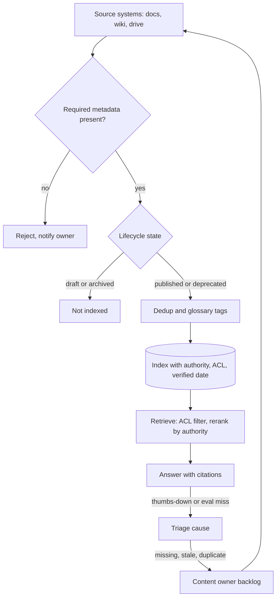

## TL;DR
Retrieval cannot beat its corpus, and enterprise corpora are stale, duplicated and unowned. Knowledge
management decides canonical sources, owners, lifecycle and metadata, so the retriever chooses among
correct candidates; many "hallucination" reports trace here, not to the model.

## Why it exists
- **Similarity is not correctness.** Point a crawler at a wiki, a ticketing system and a shared drive, and
  "what is the refund window" matches a 2019 policy page, a 2023 revision, a never-approved draft, a Slack
  export of someone guessing, and three copies of one PDF with different file names. The retriever ranks by
  similarity, which has nothing to do with correctness or currency, so the model's blended answer is
  confidently wrong.
- **Better models do not fix bad candidates.** The embedding model, the reranker and the prompt all operate
  on candidates, and the candidates are the problem.
- **"Index more, the model will sort it out" fails.** The model has no signal that one chunk is
  authoritative and another deprecated unless the data carries it. Larger context windows make it worse:
  more contradictory passages fit, and the model's choice between them is arbitrary.
- **A one-time cleanup fails too.** Corpora drift continuously: pages are edited, products renamed, people
  leave and their documents go unmaintained. Without ownership and lifecycle rules, the cleaned corpus
  decays back within months.
- **What it buys.** A standing process with owners, metadata and feedback loops instead of a one-off
  cleanup.

## How it works
### Decide what is canonical
- **Name a system of record per class of question.** Pricing comes from the catalogue, not from sales decks
  that quote it. Policy comes from the policy repository, not from support macros that paraphrase it.
- **Why:** retrieval needs a tiebreaker between similar passages, and "which source is authoritative for
  this topic" is the one humans use.
- **Encode it** as a `source_rank` or `authority` field on every chunk, so the retriever or reranker can
  prefer canonical sources and the generator can cite them.
- **Secondaries still help recall,** but they should lose to primaries on conflict.

### Assign ownership and freshness expectations
- **Every indexed source gets an owner** (a team, not a person who may leave) and a review cadence. The
  owner confirms the content is still correct or retires it.
- **Record `last_verified_at` separately from `last_modified_at`.** A document untouched for two years may
  be perfectly current; one edited yesterday may be a typo fix on an obsolete page.
- **Score freshness on verification, not modification,** where the distinction exists.

### Give documents a lifecycle
| State | Index behaviour |
|---|---|
| draft | not indexed by default |
| published | indexed |
| deprecated | leaves the index, or carries a flag the prompt surfaces ("this page is marked superseded by X") |
| archived | removed |

- **The lifecycle lives in the source system** where possible (a wiki label, a status field) and is read by
  ingestion, *because* content owners work in the source tool, not in the vector database, and a state they
  cannot see will not be maintained.

### Deduplicate and canonicalize
- **Why:** near-duplicates waste context slots and make the retriever look confident when it has really
  found the same passage three times.
- **Exact duplicates** are caught by content hashing at ingestion.
- **Near-duplicates** (the same PDF exported twice with different headers) need a similarity threshold or a
  MinHash pass, plus a rule for which copy survives, usually the one in the canonical source.
- **Keep the mapping,** so retrieval hits on a discarded copy can be redirected to the surviving one.

### Decide what belongs in the index at all
- **An index is a snapshot** refreshed on the ingestion cadence. Any fact that changes faster than that, or
  must be exact for this user right now (a price, stock level, account balance, ticket status), is stale by
  construction once indexed.
- **Look those up at query time** from the system of record through a tool or API call. The index holds the
  stable prose that explains them (how pricing tiers work, what a status means).
- **Rule of thumb: index explanations, look up values.** *Because* a retrieved chunk carrying last week's
  price is indistinguishable to the model from a correct one, while a live lookup either returns the current
  value or fails visibly.

### Keep a controlled vocabulary
- **The problem:** products get renamed, teams reorganise, and three departments call one thing three
  names. With free-text tags, a filter on `product = "Atlas Pro"` misses every page still tagged with last
  year's name.
- **The fix:** a small glossary mapping aliases and former names to one canonical term, applied to tags at
  ingestion and used for query expansion at retrieval time.
- **Why it is worth it:** it is cheap, owned like any other source, and closes a class of misses no
  embedding model reliably closes, because a new product name often has no semantic relationship to the old
  one.

### Carry metadata that the retriever can act on
- **Minimum set:** source system, owner, authority rank, lifecycle state, verified date, audience or access
  scope, product or domain tags, and language.
- **Why:** metadata filters and rerankers use these to turn "similar" into "relevant to this user now".
- **Reject, do not default.** Metadata not populated at ingestion is never populated, so the ingestion
  contract should reject documents missing required fields.

### Close the loop from failures to content
1. **Collect signals:** user thumbs-downs and missed eval queries are the best signal about the corpus.
2. **Classify the cause:** missing document, stale document, duplicate crowding out the right one, or a
   genuine retrieval failure.
3. **Route the first three to the content owner** with the query attached. Cheap once ownership exists;
   without it, every user who hits the gap rediscovers it.

- **Detect equal-authority conflicts explicitly.** When top candidates share an authority rank but
  contradict each other on a value, show the user both with their dates and open a ticket for the owners.
  Do not let the model pick silently, because the silent pick is right only by chance and nobody learns the
  conflict exists.

### Access and tenancy are part of knowledge, not an afterthought
- **Permissions are knowledge about who may see a document.** Ingestion must capture ACLs from the source and
  retrieval must filter on them.
- **A correct corpus that leaks HR pages to engineering is a failed deployment.** Treat access scope as a
  required metadata field like any other.

## Diagram
Each document passes the same gates on the way in, and failures flow back to the owner rather than into
prompt tweaks.



## Examples
### Lifecycle gate, ACL filter, dedup and authority-aware ranking
Raw similarity would put the deprecated 14-day page first. The gates leave only the canonical answer.

```python
import hashlib
from datetime import date

chunks = [
    {"text": "Refund window is 30 days.", "source": "docs", "authority": 1, "state": "published",
     "verified": date(2025, 1, 10), "acl": {"all"}, "sim": 0.81},
    {"text": "Refund window is 14 days.", "source": "confluence", "authority": 2, "state": "deprecated",
     "verified": date(2021, 3, 2), "acl": {"all"}, "sim": 0.86},
    {"text": "Refund window is 30 days.", "source": "drive", "authority": 2, "state": "published",
     "verified": date(2024, 6, 1), "acl": {"all"}, "sim": 0.81},
    {"text": "Refunds over $500 need HR sign-off.", "source": "hr", "authority": 1, "state": "published",
     "verified": date(2025, 2, 1), "acl": {"hr"}, "sim": 0.70},
    {"text": "DRAFT: refund window may move to 60 days.", "source": "confluence", "authority": 2,
     "state": "draft", "verified": None, "acl": {"all"}, "sim": 0.84},
]

def candidates(chunks, user_groups, today=date(2025, 3, 1)):
    seen, out = set(), []
    for c in chunks:
        if c["state"] != "published" or not (c["acl"] & user_groups):
            continue                                   # lifecycle gate and ACL filter
        h = hashlib.sha256(c["text"].encode()).hexdigest()
        if h in seen:
            continue                                   # exact duplicate: first (canonical) copy wins
        seen.add(h)
        age_days = (today - c["verified"]).days        # verification, not modification
        score = c["sim"] - 0.05 * (c["authority"] - 1) - 0.0001 * age_days
        out.append((round(score, 3), c["source"], c["text"]))
    return sorted(out, reverse=True)

ordered = sorted(chunks, key=lambda c: c["authority"])  # canonical sources first for dedup
for row in candidates(ordered, {"all"}):
    print(row)        # (0.805, 'docs', 'Refund window is 30 days.')
```

The weights (0.05 per authority step, a small age penalty) are illustrative; in production they are
reranker features tuned on the eval set.

### Worked scenario: an internal support assistant at 58 percent
Illustrative numbers. Three sources: the product documentation site (about 4,000 pages), the support
team's Confluence space (about 9,000 pages accumulated over six years) and a Google Drive folder of PDFs
(about 2,500 files). Everything is chunked and embedded; the eval set of 300 support questions scores 58
percent "answer correct" as judged by the support leads.

**Failure analysis of the 126 wrong answers:**

| Cause | Count |
|---|---|
| Cites a Confluence page superseded by a newer one still in the index | 51 |
| Blends numbers from a PDF export of an old price list with the current docs | 23 |
| Near-identical chunks from three copies of one onboarding guide push the relevant page out of the top five | 19 |
| Answers from an unapproved draft | 14 |
| Genuine retrieval or generation problems | 19 |

**Fixes, with no model change:**
1. The documentation site is canonical for product behaviour and the pricing catalogue for prices, both
   `authority=1`; Confluence gets `authority=2`.
2. Confluence pages get a lifecycle label. Support leads spend two afternoons marking 3,100 pages deprecated
   and 800 archived, which ingestion now respects.
3. Content hashing plus a near-duplicate pass removes about 1,900 chunks.
4. Price-list PDFs are excluded entirely, because the catalogue API is now ingested directly.
5. The reranker gets `authority` and `last_verified_at` as features.

**Result:**

| | Before | After |
|---|---|---|
| Correct | 174 of 300 (58 percent) | 243 of 300 (81 percent) |
| Content-caused failures | 107 | 38 (69 recovered) |
| Genuine retrieval or generation failures | 19 | 19, now a clean, isolated bucket |

- **The 38 content leftovers:** pages superseded but not yet labelled, near-duplicates below the dedup
  threshold, and questions whose answers exist nowhere in writing, logged as content requests to the docs
  team. Together with the 19 they make the 57 remaining failures.
- **The standing process:** a weekly report, owned by the support leads, lists deprecated pages still
  receiving retrieval hits and unanswered question clusters.

## Production patterns
- **Ingestion contract that rejects incomplete documents.** Use for every connector. Validate each document
  against a schema (for example a Pydantic model with required `owner`, `authority`, `lifecycle_state`,
  `acl` and `last_verified_at` fields) and send failures to a rejection queue tagged with the source owner.
  Monitor rejection rate per source; a spike means a connector or source schema changed.
- **Lifecycle read from the source tool.** Use when owners already work in a wiki or CMS. Map a source label
  or status field (for example a Confluence page label such as "deprecated") to `lifecycle_state` at every
  sync, so retiring a page needs no AI-team action. Monitor deprecated pages still receiving retrieval
  hits.
- **Near-duplicate pass with MinHash LSH.** Use when the same content is exported or copied across systems.
  Shingle chunks, index them in an LSH structure (the `datasketch` library's `MinHashLSH` is one common
  choice), keep the canonical-source copy and store the redirect mapping. Monitor duplicate ratio in top-k.
- **Glossary-backed tag normalization and query expansion.** Use once products or teams have been renamed.
  A small owned table of alias to canonical term, applied to tags at ingestion and appended to queries.
  Monitor zero-result filtered queries, which often point at a missing alias.
- **Failure triage queue routed to owners.** Use from launch. Every thumbs-down or eval miss gets one cause
  label (missing, stale, duplicate, access, retrieval, generation) and content causes become tickets in the
  owner's tracker with the query attached. Monitor the share of failures per cause week over week.
- **Live lookups for volatile values.** Use for prices, stock, balances and statuses. Expose a tool that
  calls the system of record and keep only explanatory prose in the index. Monitor answers citing indexed
  values that also exist in a live API.

## Trade-offs
- **Correctness on conflicts vs secondary context.** Declaring canonical sources improves correctness on
  conflicts but suppresses useful secondary context. When the canonical source is thin, let secondaries win
  on recall and lose only on conflict.
- **Clean corpus vs hidden work in progress.** Strict lifecycle gating (only published content indexed)
  keeps the corpus clean but hides drafts. For engineering teams that live in drafts, indexing drafts with a
  visible flag can be better.
- **Sharper ranking vs merged versions.** Aggressive deduplication frees context slots and sharpens ranking,
  but a threshold set too low merges legitimately different versions; the choice depends on how much the
  corpus versions in place.
- **Trustworthy corpus vs owner time.** Ownership and review cadences make the corpus trustworthy but cost
  owner time every cycle. If nobody will do the reviews, a shorter freshness-based demotion is more honest
  than a fake cadence.
- **Better filtering vs rejections.** Rich required metadata improves filtering, but every required field is
  a reason for a document to be rejected at ingestion. Keep the required set small and the optional set
  large.

## Pitfalls
- **Treating a bad answer as a model problem and iterating on prompts.** Symptom: eval scores that move a
  point or two per week while the same stale pages keep getting cited. Fix: classify failures by cause
  first.
- **Indexing everything a connector can reach because recall seems free.** Symptom: top-k results dominated
  by duplicates and drafts, and a context window full of contradictory passages. Fix: lifecycle gate and
  dedup.
- **Using modification date as freshness.** Symptom: a correct, stable policy page demoted below a recently
  edited but obsolete one. Fix: rank on `last_verified_at`.
- **Storing lifecycle state only in the vector database.** Symptom: owners mark pages obsolete in the wiki
  while the index keeps serving them, because nobody re-ran the cleanup. Fix: read state from the source.
- **Skipping ACL capture at ingestion to ship faster.** Symptom: a security finding, or a user seeing a page
  they could never open in the source system. Fix: access scope is a required field.
- **No feedback path from users to content owners.** Symptom: the same gap reported many times with nobody
  positioned to fix it. Fix: a triage queue routed to owners.
- **Indexing volatile values such as prices or stock levels instead of looking them up.** Symptom: answers
  that were right on the day of ingestion and drift wrong until the next run. Fix: index explanations, look
  up values.

## When to use
- **Use for any RAG system over content people maintain,** which is nearly all of them.
- **Skip only for effectively immutable, single-sourced corpora,** such as a frozen archive of closed case
  files or a product's own generated logs.
- **Start before the first index,** since the ingestion schema must carry the metadata.
- **Measure:** share of eval failures attributed to content versus retrieval versus generation, count of
  deprecated pages still receiving hits, duplicate ratio in top-k, and median `last_verified_at` of cited
  chunks. Day to day it shows up as the ingestion contract and the weekly content report.
- **Interviews:** "how would you improve a RAG system scoring 60 percent" should start with failure analysis
  of the corpus, not with a bigger model.

## Role lens
- **Engineer:** Builds ingestion that reads lifecycle and ACL state from source systems, enforces required
  metadata, deduplicates, and exposes authority and verification fields to the reranker.
- **Architect:** Decides which systems are canonical for which domains, defines the metadata schema every
  connector must satisfy, and sets the ownership and review model with the business.
- **FDE:** Runs the failure analysis with the customer's subject-matter experts, negotiates who owns which
  content, and turns "the bot is wrong" into a prioritized content backlog.

## Check yourself
**Q:** A customer's RAG assistant is scoring poorly, and they want to switch to a larger model. What do you
do first, and how do you argue for it?
**A:** Before touching the model, sample the failures and classify each by cause: missing document, stale or
superseded document, duplicates crowding out the right chunk, access-filtered content, or a true retrieval
or generation error. In enterprise corpora the first three often dominate, and no model fixes them because
the model only sees the candidates it is given. Show the customer the breakdown with concrete cited pages:
"this answer came from a 2021 page that your own wiki marks obsolete". Then propose the fixes that address
the largest buckets: canonical sources with authority ranks, lifecycle labels read by ingestion,
deduplication, and a feedback loop to content owners. Re-run the eval after those changes; if genuine
retrieval or generation errors remain the largest bucket, that is when a model or retriever change is
justified, and the eval now isolates its effect.

## Interview questions
### What does "canonical source" mean in a RAG corpus, and why does retrieval need it?
- **Definition:** the named system of record for a class of question, such as the pricing catalogue for
  prices or the policy repository for policy.
- **Why:** similarity cannot tell a current policy from a superseded paraphrase, so an `authority` field on
  every chunk gives the reranker a tiebreaker and the generator something trustworthy to cite.

### Users say the assistant quotes a refund window that changed last quarter. How do you debug and fix it?
- **Trace the citation:** find which chunk was used, its source, lifecycle state and `last_verified_at`.
- **Likely causes:** the old page is still published in the source, its deprecation label is not read by
  ingestion, or a copy lives in another system with no dedup mapping.
- **Fix the class, not the instance:** read lifecycle from the source, dedup to the canonical copy, and route
  the case to the page owner.

### When would you index drafts or secondary sources despite the risk?
- **Thin canonical sources:** if primaries do not cover a topic, secondaries should win on recall and lose
  only on conflict.
- **Draft-heavy teams:** engineering groups that live in drafts may need them indexed with a visible flag
  the prompt surfaces, rather than hidden.

### Which facts should not be embedded at all, and how do you serve them?
- **Volatile or per-user values:** prices, stock levels, account balances, ticket status, because an index
  snapshot is stale by construction.
- **Serve them by live lookup** through a tool calling the system of record, and keep only the explanatory
  prose in the index; a failed lookup fails visibly, a stale chunk does not.

### How would you show a customer that content, not the model, is the bottleneck?
- **Classify a sample of failures** by cause and present the table with cited pages, as in the support
  assistant case: 107 of 126 failures were content-caused.
- **Fix the largest buckets and re-run the eval:** in that case 58 to 81 percent with no model change, which
  also isolates the 19 genuine retrieval or generation errors for later work.

## Quiz
### Q: Why does a larger context window not fix a corpus with contradictory documents?
- [ ] Larger windows are slower, so fewer documents can be retrieved
- [x] More contradictory passages fit, and the model has no signal about which one is authoritative
- [ ] Embedding models cannot embed documents longer than the window
- [ ] The reranker discards documents beyond the first few thousand tokens
> The problem is the absence of an authority signal, not capacity. Fitting more passages increases the
> number of conflicting claims the model must choose between, and without metadata indicating which source
> is canonical, its choice is arbitrary.

### Q: Which field is the better basis for freshness in retrieval, and why?
- [ ] last_modified_at, because recent edits indicate active maintenance
- [x] last_verified_at, because an owner confirming correctness is different from any edit having happened
- [ ] created_at, because older documents are more established
- [ ] indexed_at, because it reflects when the chunk entered the system
> A stable policy page may be unedited for years yet fully current, while an obsolete page may get a typo
> fix yesterday. Verification captures what freshness actually means; modification only captures activity.

### Q: Where should a document's lifecycle state (published, deprecated, archived) be maintained?
- [ ] In the vector database metadata, since that is what retrieval reads
- [ ] In a spreadsheet maintained by the AI team
- [x] In the source system where content owners work, read by ingestion
- [ ] In the prompt, as a list of deprecated page titles
> Content owners maintain state where they already work. A state stored only in the index or a side
> spreadsheet drifts immediately because the people who know a page is obsolete never see it. Ingestion
> propagates the source's state into the index.
