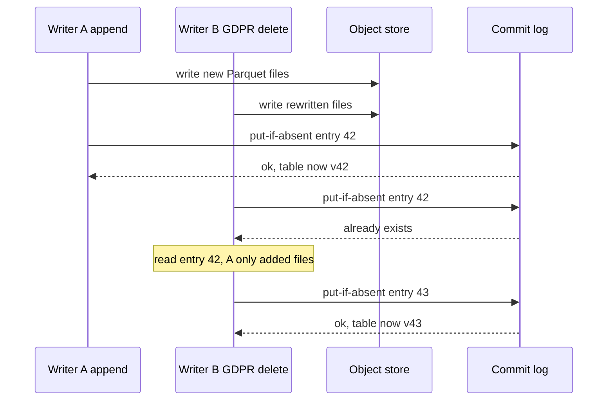

## TL;DR
A lakehouse (Delta Lake, Apache Iceberg, Apache Hudi over Parquet in object storage) is where an agent
platform keeps its documents, chunks, embeddings, traces and eval snapshots, with atomic commits, time
travel and real deletes behind them.

## For agent builders
- **Why it matters for agents.** Agent runs produce traces, tool results and memory writes that you later
  replay, evaluate, fine-tune on or must delete for a user. A lakehouse table gives those a consistent
  snapshot to evaluate against and a provable delete.
- **Where it shows up in your stack.** The stage tables behind your retrieval tools, a trace table your
  observability exports land in, pinned snapshots in eval and fine-tune configs, and the source your vector
  index is rebuilt from.
- **What you control.** Partition keys (date, tenant), a `model_id` column on embeddings, which snapshot each
  agent eval records, and retention so deletes reach physical storage.
- **What you can skip.** The internals of Iceberg manifests or Hudi indexes, and the choice of format unless
  you own the platform. Know that commits are atomic, snapshots expire, and the lakehouse never serves the
  agent's request path.

## Why it exists
- **The lake was cheap but was not a table.** Files in S3 or similar held raw and semi-structured data that
  Spark or Python could read. But a writer dying halfway leaves readers seeing a partial dataset, two
  concurrent writers corrupt each other, no schema is enforced, and deleting one user's rows means
  rewriting files by hand with no record. This is the "data swamp".
- **The warehouse was safe but closed.** Curated tables with ACID and SQL performance, but a proprietary
  format, higher cost, and a poor fit for images, PDFs, embeddings or Python-first ML tooling.
- **So data was copied between the two,** the copies drifted, and governance had to be enforced twice.
- **AI workloads make the swamp worse.** A RAG pipeline appends millions of chunk rows while a retrieval
  eval reads a consistent snapshot; a training job must reproduce against exactly the data it saw; a GDPR
  request must delete one person's documents and prove it reached the derived tables. All need
  transactions and versioning on cheap storage.
- **The idea, plainly:** keep the files open and the storage cheap, and add a metadata layer that turns a
  set of files into a versioned, transactional table any engine can read, because many engines need the
  same data and none should own it.

## How it works
### Background
The agent builder needs one picture; the layer subsections below are reference detail to skim.
- **Three layers.** Open Parquet files in object storage, a table format whose log says which files form each
  version, and a catalog that maps table names to the current version for every engine.
- **One rule.** Writes add invisible files, then atomically publish a new version, so a reader (your agent
  eval, your index rebuild) sees a whole snapshot or none of it.
- **One caveat.** Old versions keep deleted rows until expiry and vacuum run.

### Layer 1: open columnar files in object storage
- **Parquet on S3, GCS or ADLS.** Columnar and compressed, split into row groups with per-column statistics
  (min, max, null count).
- **Statistics enable skipping.** A scan for `tenant_id = 'acme'` skips whole row groups whose statistics
  exclude the value.
- **Object storage's constraint drives everything.** Durable, essentially unlimited capacity at a low price
  per GB, but high per-request latency and no in-place updates: a file is written whole or not at all.

### Layer 2: the table format
A table format is a metadata log saying which files make up the table at each version.

| Format | Metadata structure |
|---|---|
| Delta Lake | a `_delta_log` of JSON commit entries with periodic Parquet checkpoints |
| Iceberg | a tree of metadata files, manifest lists and manifests pointing at data files |
| Hudi | a timeline of commits |

**A write, in all three:**
1. Add new data files (invisible to readers, because nothing references them yet).
2. Atomically publish a new log entry or metadata pointer that references them.
3. Readers see the old version or the new one, never a mix.
4. Concurrent writers use optimistic concurrency: each validates that no conflicting commit landed since it
   started, and retries if one did. That is ACID without a database server in front of the files.

**The atomic publish still needs one primitive from somewhere:**
- **A put-if-absent write in the object store.** S3 lacked this until it added conditional writes, so Delta
  on S3 long relied on a single writer or an external lock table.
- **Or an atomic pointer swap in the catalog,** which is how Iceberg commits.

### What the log gives you
- **Snapshot isolation and time travel.** A reader pins a version; a training job records the snapshot id
  and re-reading it returns identical rows, as long as the snapshot has not been expired and its files
  vacuumed. Default retention is days to weeks (Delta's default vacuum threshold is 7 days), so a
  snapshot needed for a year must be explicitly retained (an Iceberg tag, a longer retention setting) or
  materialized as its own dataset.
- **Schema enforcement and evolution.** The current schema is in the metadata; writes with a mismatched
  schema are rejected, and adding a column is a metadata change rather than a rewrite.
- **Deletes and updates.** Copy-on-write rewrites the affected files and commits the replacement.
  Merge-on-read records deletes in small side files (Iceberg delete files, Delta deletion vectors) that
  readers apply at scan time, deferring the rewrite to compaction. Copy-on-write favours readers;
  merge-on-read favours frequent small writes.
- **Partitioning and clustering.** Rows are laid out by a partition value (date, tenant) and optionally
  clustered within partitions so statistics-based skipping works. Iceberg's hidden partitioning derives the
  partition from a column transform, so queries need not know the layout.

### Delta, Iceberg and Hudi: what actually differs
All three implement the same idea and differ mainly in origin.

| Format | Origin | Distinctive traits |
|---|---|---|
| Delta Lake | Databricks and Spark | linear log of JSON commits with Parquet checkpoints; most mature inside that ecosystem |
| Iceberg | Netflix, as an engine-neutral spec | snapshots point to manifest lists, then manifests, then data files, so planning reads a small metadata tree instead of listing directories; hidden partitioning and partition evolution (change layout without rewriting old data or queries) |
| Hudi | Uber, for upsert-heavy CDC-fed tables | explicit copy-on-write and merge-on-read table types; record-level indexes that locate the file holding a key, making frequent upserts cheaper |

- **The choice is less permanent than it was.** Interoperability layers such as Delta UniForm and Apache
  XTable write one format's metadata for another format's data.

### Layer 3: the catalog
- **What it does.** Maps table names to the current metadata location; access control, discovery and
  lineage attach here.
- **Examples.** Hive Metastore, AWS Glue, Unity Catalog, Nessie, or an Iceberg REST catalog.
- **Why it matters.** It makes "the same table" mean the same thing to Spark, Trino, DuckDB, Flink, Ray and a
  pandas script, which is the whole point: no copies, one access policy.

### Maintenance the format does not do for you
- **Compaction.** Streaming appends create many small files; object listing plus per-file overhead then
  dominates query time. Periodic compaction rewrites them into large files.
- **Snapshot expiry and vacuum.** Old snapshots and the files only they reference accumulate until expired
  and vacuumed. That is also the moment a "deleted" row is physically gone, so retention policy and
  deletion guarantees depend on running this job.

### Where AI data sits in it
- **Medallion layering.** Bronze (raw ingested bytes and metadata), silver (parsed, cleaned, conformed),
  gold (serving-ready tables).
- **Concrete AI tables.** Documents (raw pointer, hash, ACL), parsed text, chunks, embeddings (an array
  column alongside `model_id`), training datasets as pinned snapshots, and evaluation and trace logs.
- **Serving stores are derived.** The vector index and any feature-serving store are rebuilt from these
  tables and are never the only copy.
- **Not a serving database.** The lakehouse is an analytical and batch store; point lookups and sub-100 ms
  serving belong to Postgres, a key-value store or the vector database.

### Agent data specifically
- **Trace tables.** One row per agent step (run id, step, tool name, arguments, result size, latency, outcome),
  partitioned by date and tenant. They feed failure analysis, cost reports and fine-tuning exports.
- **Eval snapshots.** An agent eval records the chunk table version it retrieved from, so a score change can be
  attributed to the index build or to the agent's prompt.
- **Long-term memory exports.** Memory written by agents can be mirrored here for audit and bulk deletion,
  while the live memory store stays a low-latency database.
- **The agent never queries it inline.** A tool that scans object storage on every step adds seconds of
  latency; build a derived store and point the tool at that.

## Diagram
A commit writes invisible data files, then races to publish the next log entry; the loser checks for a
conflict and either republishes as the next version or re-runs. In an agent platform, writer A is the
trace or chunk append job and writer B a user's deletion request.



## Examples
### A chunk table in Delta Lake
Using the `deltalake` Python package: append new chunks, upsert changed ones by `chunk_id`, read an older
snapshot for a reproducible evaluation, and compact small files. Spark, DuckDB or Trino can read the same
table through a catalog.

```python
import pyarrow as pa
from deltalake import DeltaTable, write_deltalake

path = "s3://ai-lake/silver/chunks"           # or a local directory while developing

batch = pa.table({
    "chunk_id":   ["c-001", "c-002"],
    "doc_id":     ["d-1", "d-1"],
    "doc_version":["9f3a", "9f3a"],
    "text":       ["Refund window is 30 days.", "Returns need a receipt."],
    "model_id":   ["emb-v2", "emb-v2"],
    "embedding":  [[0.01, 0.42, -0.13], [0.33, 0.05, 0.27]],   # real width: hundreds to ~3,000 floats
})
write_deltalake(path, batch, mode="append", partition_by=["model_id"])

# Upsert re-chunked rows: match on chunk_id, update text/embedding, insert new ids.
dt = DeltaTable(path)
(dt.merge(source=batch, predicate="t.chunk_id = s.chunk_id", source_alias="s", target_alias="t")
   .when_matched_update_all()
   .when_not_matched_insert_all()
   .execute())

# Reproducible evaluation: pin the snapshot the eval ran against.
eval_version = dt.version()
frozen = DeltaTable(path, version=eval_version).to_pyarrow_table()
print(eval_version, frozen.num_rows)

# Maintenance: fold small streaming files into large ones, then expire old files.
dt.optimize.compact()
dt.vacuum(retention_hours=168, dry_run=False)
```

**What the log looks like afterwards:**

| Version | Operation | Log actions |
|---|---|---|
| 0 | append | one `add` per new Parquet file |
| 1 | merge (rows exist, so the matched file is rewritten) | a `remove` for the old file and an `add` for its replacement, in one atomic entry |
| 2 | compaction | `remove` for the small files and an `add` for the large one, no change to rows |

- **Toy caveat.** On this two-row table compaction may find nothing to merge and commit nothing; on a real
  table fed by streaming appends it is a large commit.
- **`remove` is logical.** A reader pinned to version 0 still resolves the original file, because `remove`
  only drops a file from later versions. Vacuum is the step that deletes files no retained version
  references.
- **Retention and reproducibility are one decision.** Every run records `eval_version`, and an audit can
  re-read the same rows provided retention keeps that version. `vacuum(retention_hours=168)` deletes files
  that only versions older than seven days reference, so time travel to them stops working.

### Optimistic concurrency, simulated
Runnable as-is. The table is at version 41. Writer A appends chunks for new documents; writer B runs a
GDPR delete that rewrites three files (one in the simulation); both read version 41 and race for 42.

```python
class Log:
    """A table's commit log: version -> actions. put_if_absent is the one atomic primitive."""
    def __init__(self, upto):
        self.entries = {v: {"add": [f"f{v}.parquet"], "remove": []} for v in range(upto + 1)}
    def put_if_absent(self, version, entry):
        if version in self.entries:
            return False
        self.entries[version] = entry
        return True

def commit(log, read_version, adds, removes, retries=3):
    v = read_version + 1
    for _ in range(retries):
        if log.put_if_absent(v, {"add": adds, "remove": removes}):
            return v
        winner = log.entries[v]
        # Simplified check: real formats also ask whether the winner's added files could hold
        # rows matching our predicate (via partition values or file statistics).
        if set(winner["remove"]) & set(removes):
            raise RuntimeError(f"conflict at v{v}: re-run against the new state")
        v += 1                                        # disjoint change: publish as the next version
    raise RuntimeError("too many retries")

log = Log(upto=41)                                    # table is at version 41
print("A:", commit(log, 41, adds=["chunks-new.parquet"], removes=[]))            # A: 42
print("B:", commit(log, 41, adds=["f7b.parquet"], removes=["f7.parquet"]))       # B: 43
try:
    commit(log, 41, adds=["f7c.parquet"], removes=["f7.parquet"])                # C rewrote f7 too
except RuntimeError as e:
    print("C:", e)                                                               # C: conflict at v43
```

| Step | What happens |
|---|---|
| A and B both read version 41 | each writes new Parquet files no reader can see yet |
| A publishes entry 42 | put-if-absent succeeds |
| B tries entry 42 | fails; B reads entry 42 and checks for conflict with what it read and rewrote |
| A only added files that cannot hold rows matching B's predicate | judged by partition values or file statistics, so the check can be conservative; no conflict, B publishes as version 43 |
| Had A rewritten a file B removed | B aborts and re-runs against the new state (writer C above) |

- **Cheap when writers touch disjoint data;** it degrades into retry storms when many writers rewrite the
  same partitions, and that is when you serialize writers through one job instead.

### Agent scenario: a trace table for evals and deletion
Agent steps land in a Delta table in batches; an eval pins the version it scored; a user's deletion request
removes their steps in one commit. Same `deltalake` package as above.

```python
import pyarrow as pa
from deltalake import DeltaTable, write_deltalake

traces = "s3://ai-lake/silver/agent_steps"

steps = pa.table({
    "run_id": ["r-17", "r-17"], "step": [1, 2], "user_id": ["u-42", "u-42"],
    "tool": ["search_docs", "create_ticket"], "ok": [True, True],
    "latency_ms": [420, 1310], "date": ["2026-10-01", "2026-10-01"],
})
write_deltalake(traces, steps, mode="append", partition_by=["date"])   # batch flush, not per step

dt = DeltaTable(traces)
eval_snapshot = dt.version()            # an offline eval scoring these runs stores this with its results

dt.delete("user_id = 'u-42'")           # commits a new version without the user's rows
# The rows still exist in eval_snapshot until vacuum removes files older than the retention window,
# so the deletion SLA and the eval-reproducibility window are the same setting.
```

| Question | Where the answer comes from |
|---|---|
| Did the agent eval drop because of the prompt or the data? | re-run the old prompt against the chunk-table version the old eval recorded (`DeltaTable(path, version=n)`) |
| Which tool fails most for tenant X this week? | scan of the trace table, partition-pruned by date |
| Is user u-42 gone everywhere? | delete commit, then vacuum after retention, then purge the vector index and memory store |

## Production patterns
- **Scheduled compaction per table.** For tables fed by streaming appends, run `OPTIMIZE` (Delta) or the
  `rewrite_data_files` procedure (Iceberg on Spark) on a schedule, after ingestion windows. Monitor file
  count and average file size per table; a falling average file size is the early warning.
- **Retention as an explicit policy.** Set snapshot expiry (`VACUUM` with a retention period in Delta, the
  `expire_snapshots` procedure in Iceberg) to match the deletion SLA, and tag or materialize any snapshot a
  training run must keep longer. Monitor time from deletion request to physical removal.
- **Pin snapshots in run configs.** Record the table version or snapshot id each training and evaluation
  run read, next to the code commit. Alert when a pinned version is about to fall outside retention.
- **One writer per hot partition.** When several jobs rewrite the same partitions (re-chunking, GDPR deletes,
  CDC merges), route them through one job or queue. Monitor commit retries and conflict aborts per table.
- **Merge-on-read for CDC tables.** For continuously upserted tables, enable deletion vectors (Delta) or
  merge-on-read deletes (Iceberg, Hudi) and compact regularly so read-time merge cost stays bounded. Monitor
  scan time and the number of delete files per data file.
- **Batched trace sink for agents.** Agent teams buffer step events (from OpenTelemetry or their own logger)
  and append them to a date-partitioned trace table every few minutes, then compact daily. Monitor append
  lag, small-file count and the share of runs with a complete step sequence.

## Trade-offs
- **Open files vs operations work.** Any engine can read the data without copies, but you now operate
  compaction, snapshot expiry and vacuuming yourself unless a managed platform does it.
- **Cheap capacity vs latency.** Object storage makes capacity nearly free, but per-request latency makes the
  lakehouse wrong for point lookups or request-path serving; once a query needs sub-100 ms, the data needs a
  derived store.
- **Copy-on-write vs merge-on-read.** Copy-on-write keeps reads simple and fast; merge-on-read makes frequent
  small updates and deletes cheap. The choice flips toward merge-on-read when CDC-style streams feed the
  table continuously.
- **Time travel vs prompt deletion.** Reproducibility and audit come cheaply, but every retained snapshot
  pins files, and a deletion is not a deletion until expiry runs. Training snapshots that must outlive
  retention are usually materialized separately with deletion handled explicitly.
- **Delta vs Iceberg vs Hudi.** Mostly an ecosystem decision (Databricks, Spark and Trino, or a
  streaming-first stack); the formats converge on features, so engine support and catalog integration
  should decide.

## Pitfalls
- **Streaming small appends without compaction.** Symptom: query time dominated by listing and opening
  thousands of tiny files, visible as low bytes-scanned but long wall-clock.
- **Partitioning on a high-cardinality column such as `doc_id`.** Symptom: millions of directories, slow
  metadata operations and no skipping benefit.
- **Using the lakehouse as the serving database** for retrieval or features. Symptom: p99 latency in seconds
  and a request path that depends on object-store availability.
- **Embeddings without a `model_id` column.** Symptom: an index rebuilt from mixed vectors after a model
  upgrade, with retrieval quality that silently degrades.
- **Never expiring snapshots or vacuuming.** Symptom: storage growing without bound and a GDPR deletion that
  an auditor can still find in an old version.
- **Every writer evolving the schema freely.** Symptom: downstream jobs failing on a renamed column, which
  the data-contracts lesson addresses.

## When to use
- **Use when** more than one engine or team needs the same large tables, when reproducibility and audit
  matter (training sets, evaluation snapshots, deletion proof), or when raw documents and derived chunk and
  embedding tables must coexist with analytics.
- **Avoid when** it is a single service with a few gigabytes; a Postgres schema is simpler and should win.
- **Measure** file count and average file size per table, bytes scanned versus rows returned (skipping
  effectiveness), snapshot retention versus storage growth, and time from deletion request to physical
  removal.
- **Day to day,** the lakehouse is where the RAG pipeline's stage tables, the agent trace table and the
  training manifest live.
- **Use for agents when** you need to replay, evaluate or fine-tune on agent runs across teams, or prove a
  user's agent history was deleted; a single small agent can log to Postgres instead.
- **Interviews:** explain how an atomic commit over immutable files yields ACID, and why the vector index is
  derived from a table rather than being the source.

## Role lens
- **Engineer:** Writes stage outputs as Delta or Iceberg tables with partition keys and `model_id` columns,
  pins snapshot versions in evaluation and training configs, and schedules compaction and vacuum jobs.
- **Architect:** Chooses the table format and catalog to match the engines in use, defines the bronze,
  silver and gold boundaries, and decides which derived serving stores are rebuilt from which tables.
- **FDE:** Lands customer data into the customer's own lakehouse account and region, respects their
  catalog's access policies, and uses time travel to show exactly which data a delivered model was
  trained on.

## Check yourself
**Q:** A team keeps parsed documents and chunk embeddings as plain Parquet files in S3, written by a nightly
Spark job and read by a Python evaluation script and a Trino dashboard. They see occasional evaluation
runs with partially missing data and cannot honour a customer's deletion request confidently. What does
moving to a lakehouse table format change, mechanically, and what still remains their responsibility?
**A:** Plain Parquet directories have no commit boundary, so the evaluation script sometimes lists files
while Spark is mid-write and reads a mix of old and new. A table format records which files form each
version in a log and publishes a new version atomically, so readers see a complete snapshot and writers
detect conflicts through optimistic concurrency. Deletion becomes a `DELETE` or `MERGE` that commits a new
version excluding the rows, with copy-on-write or deletion files handling the physical layout, and the
log records what changed. What stays with the team: the deleted rows persist in prior snapshots until
expiry and vacuum run, so a retention job and a check against derived stores such as the vector index are
still needed; compaction of the nightly job's small files; and a catalog so Trino, Spark and Python all
resolve the same table and access policy.

## Interview questions
### What is a lakehouse, and why not just use a data lake plus a warehouse?
- **Definition:** a transactional metadata layer (Delta, Iceberg, Hudi) over open Parquet files in object
  storage, giving atomic commits, snapshots, schema enforcement and real deletes.
- **Why not two tiers:** copying lake data into a warehouse creates drifting copies and doubles governance,
  and warehouses fit embeddings, PDFs and Python tooling poorly.
- **The payoff for AI:** one copy of chunks, embeddings and training sets that Spark, Trino, DuckDB and
  pandas all read through one catalog and one access policy.

### Commits on a busy table keep failing with conflicts. How do you debug it?
- **Look at who rewrites what:** conflicts come from concurrent writers rewriting the same files or
  partitions, such as a re-chunk job and a GDPR delete job.
- **Check the partitioning:** a coarse partition (all chunks in one) makes every rewrite overlap; partition by
  date or tenant so writers touch disjoint data.
- **Then serialize** the remaining hot writers through one job, and track retries per table.

### An agent eval score dropped overnight with no prompt change. How does the lakehouse help you find out why?
- **Every eval records the snapshot it read:** compare the chunk and embedding table versions of the two runs,
  and re-run yesterday's prompt against today's snapshot and vice versa.
- **If the data moved,** the table log shows which commits landed (a re-chunk merge, a backfill, a delete), so
  the drop traces to a pipeline change.
- **If nothing moved,** look at the model, the tools or the eval itself.

### When would you not put data in a lakehouse?
- **Request-path serving:** sub-100 ms lookups belong in Postgres, a key-value store or the vector database,
  because object storage has high per-request latency.
- **Small single-service data:** a few gigabytes owned by one service is simpler in Postgres.
- **Keep the lakehouse as the source** those serving stores are rebuilt from.

### A customer asks you to prove a user's data, including their agent traces, is deleted. What do you check?
- **The delete commit:** a `DELETE` or `MERGE` produced a new version without the rows.
- **Old snapshots:** the rows still exist in prior versions until snapshot expiry and vacuum run, so check
  retention (Delta's default vacuum threshold is 7 days) and that the job ran.
- **Derived stores:** the vector index, caches, the agent's long-term memory store and any materialized
  training snapshots must also be purged.

### Why do training runs record a snapshot id, and what can break it?
- **Reproducibility:** re-reading a pinned version returns identical rows, so a regression can be traced to a
  data change.
- **What breaks it:** vacuum deletes files only old versions reference; with `retention_hours=168`, versions
  older than seven days stop resolving.
- **Fix:** tag the snapshot (Iceberg), extend retention for that table, or materialize the training set as
  its own dataset with deletion handled explicitly.

## Quiz
### Q: How does a lakehouse table format provide atomic commits on object storage that has no in-place updates?
- [ ] By locking the S3 bucket for the duration of a write
- [x] By writing new immutable data files first and then atomically publishing a metadata entry that references them, so readers see the old or new version entirely
- [ ] By buffering writes in a database server that fronts the files
- [ ] By using Parquet row-group checksums to detect partial writes
> The files themselves are immutable and written whole; the only mutable thing is the pointer or log
> entry naming the current version. Making that single publish step atomic, with optimistic conflict
> checks for concurrent writers, yields snapshot isolation without a server in the path.

### Q: Which workload is a poor fit for a lakehouse and should use a derived store instead?
- [ ] Rebuilding a vector index from the embeddings table every night
- [ ] Pinning the exact training set a model run read
- [x] Serving per-request vector similarity lookups within a 100 ms latency budget
- [ ] Running an evaluation across a consistent snapshot while new chunks are appended
> Object storage has high per-request latency and tables are optimized for scans, not point lookups.
> Request-path retrieval belongs in a vector database or OLTP store that is rebuilt from the lakehouse
> table, which remains the system of record.

### Q: After deleting a user's rows from a Delta or Iceberg table, why might an auditor still find them?
- [ ] Parquet files cannot be modified, so deletes are impossible
- [ ] The catalog caches query results for 24 hours
- [x] Prior snapshots still reference the old files until snapshot expiry and vacuum physically remove them
- [ ] Merge-on-read tables never apply deletes to readers
> Time travel works precisely because old files are retained. A delete commits a new version without the
> rows, but the previous version remains readable until its files are expired, so the retention job is
> part of the deletion guarantee.

## Use cases & projects
### Use cases
- **Agent trace warehouse.** Every step of every run lands in one table that cost reports, failure analysis
  and fine-tuning exports all read through the same catalog.
- **Reproducible agent evals.** Each eval run records the chunk-table snapshot it retrieved from, so a score
  change is attributed to data or to the agent.
- **Source of truth for retrieval indexes.** The vector store behind an agent's search tool is rebuilt from
  versioned chunk and embedding tables after an outage or vendor move.
- **Deletion requests across agent data.** One `DELETE` commit plus vacuum, followed by purges of the index and
  memory store, gives an auditable answer to "is this user gone?"

### Mini project
**Pin agent evals to lakehouse snapshots (1-2 hours).**
- **Goal:** show that an agent eval score change can be traced to a data commit.
- **Steps:** with the `deltalake` package on a local directory, write a small chunk table; build an in-memory
  index from it and run 10 scripted questions through a tiny retrieval agent, recording `dt.version()`;
  merge a change that breaks one answer; re-run; then load the recorded version with
  `DeltaTable(path, version=n)` and re-run against it.
- **Done when:** a two-row table shows score and snapshot version per run, the table history names the commit
  that caused the drop, and time travel to the old version restores the original score.
