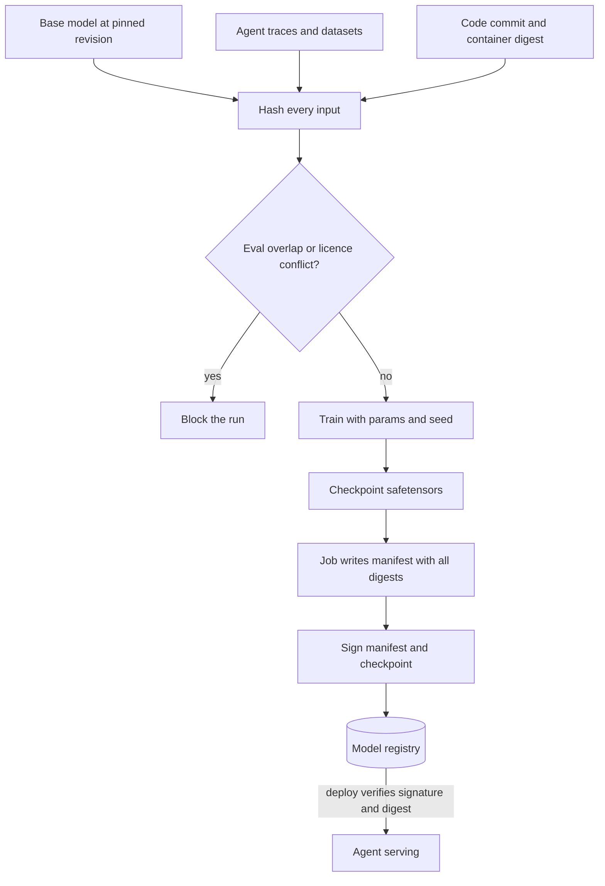

## TL;DR
Provenance is the verifiable record of where the models, fine-tunes and datasets behind your agent came
from: exact input bytes, code, parameters, builder, licence and evaluations. It replaces "trust me" with
hashes, manifests and signatures you can diff when the agent regresses.

## For agent builders
- **Why it matters for agents.** Agent teams fine-tune routers, tool-calling models and judges on agent
  traces, generate synthetic tool-use data with other models, and pull open-weight checkpoints from hubs.
  When the agent regresses, a customer asks if their conversations trained it, or an agent benchmark
  score looks too good, only build-time records answer.
- **Where it shows up in your stack.** `revision` pins on hub downloads, the manifest attached to each
  model in the registry (MLflow or similar), `safetensors` loading, eval-set digests in your agent eval
  harness, and the release record of which model, prompt and tool versions an agent build ships with.
- **What you control.** What every fine-tuning job writes beside its checkpoint, the gates before
  promotion (contamination, licence, customer isolation), signing and verification at deploy, and
  whether the agent release itself has a manifest.
- **What you can skip.** Choosing between attestation and bill-of-materials formats. Completeness of the
  manifest matters far more than its format.

## Decision case
### Scenario
A startup sells a support agent to 25 business customers. A small fine-tuned router picks the tool or
sub-agent for each request. It is retrained twice a month on about 130,000 rows: opted-in traces from 20
customers, synthetic tool-use data and a pinned open-weight base model. Five customers forbid any use of
their traces.

The next enterprise security review asks three questions:
1. Can you prove a given customer's traces never trained a shared model?
2. Was the base model taken from the official repository, and is the deployed checkpoint the one you built?
3. Can you show your agent benchmark is not contaminated?

Constraints (figures illustrative):
- **Deadline.** Answers with evidence are due in 8 weeks.
- **Team.** One ML engineer and one platform engineer; MLflow is already the model registry.
- **On-premises deploy.** A regulated customer runs the router in its own VPC and wants to verify, at deploy
  time, that the checkpoint came from your pipeline.
- **Retention.** Keeping each snapshot (about 130,000 rows × 4 KB ≈ 520 MB) for 24 runs a year is about
  12.5 GB a year; that is acceptable.
- **Benchmark.** 1,200 agent eval tasks, some drawn from production traces.

### Options
| Option | How it works | Q1 isolation proof | Q2 integrity | Q3 contamination | Effort |
|---|---|---|---|---|---|
| **A. Model cards and registry names** | Prose written after training | No: describes belief, not bytes | No | No | Days |
| **B. Job-written manifests and gates** | Digests of snapshot, base revision, code and params; promotion blocked without a manifest; isolation, licence and overlap gates | Yes: no restricted digests among inputs | Partial: digests, but no proof of who built it | Yes: example digests plus n-grams | About 3 weeks |
| **C. B plus signing and deploy verification** | Sign manifest and checkpoint at promotion; deploy verifies signature and digest | Yes | Yes | Yes | About 5 weeks |
| **D. C plus standard attestation and BOM formats** | Emit in-toto or SLSA-style provenance and a CycloneDX ML-BOM | Yes | Yes | Yes | Over 8 weeks with this team |

### Decision
Choose **C**:
- **Only C answers all three questions within 8 weeks.** A answers none with evidence. B cannot show the
  VPC customer who built the checkpoint. D's format work does not fit the deadline.
- **Isolation is a gate, not a promise.** Each customer's traces are their own snapshot digest with an
  allow-list flag. The promotion step rejects any manifest whose inputs include a restricted digest, which
  is the evidence for Q1.
- **The base model is pinned by commit** and its file digests are in the manifest. Loading uses
  `safetensors`, so a tampered file cannot execute code.
- **Contamination is checked before training.** Normalized example digests and 8-token n-grams between the
  training snapshot and the 1,200 eval tasks; overlaps are removed from training, not from the benchmark.
- **The agent release manifest ships too,** so a regression is a diff of router digest, prompt, tool schemas
  and index version.

What would change it:
- **A customer's scanner requires a standard format.** Then export the same manifest as an attestation or
  ML-BOM, which is D's extra step.
- **No on-premises deploys.** Then signing can wait, and B answers the review.
- **Traces stop being used for training.** Then Q1 becomes trivially true, and the isolation gate guards
  only the eval and synthetic sets.

### Trade-offs accepted
- **Custom JSON instead of a standard format.** Watch questionnaires that ask for a specific format.
- **Promotion can block a release.** A missing digest or restricted input stops promotion; watch blocked
  promotions and fix the job, never the gate.
- **Snapshot storage.** About 12.5 GB a year; watch growth if training volume rises.
- **Near-duplicate checks are approximate.** n-grams miss heavy paraphrase; watch suspiciously large
  eval gains between router versions and add embedding-similarity checks if they appear.

### Review rubric
- **Each stakeholder question maps to evidence,** naming the manifest field or gate that answers it.
- **Inputs are content-addressed:** snapshot digests, pinned base revision, code commit, container digest,
  params and seed.
- **Gates run before promotion,** covering customer isolation, licence and contamination, with what happens
  on failure.
- **Integrity is verified at deploy,** not only recorded at build.
- **The agent release is covered,** not just the checkpoint.
- **Format is chosen by reader,** with the condition that would force a standard format.

## Why it exists
- **The questions arrive months later.** A fine-tune lands in the registry as `router-v4.safetensors`.
  Six months on: Legal asks about non-commercial data sources; a customer asks whether their data was used;
  the eval team suspects the benchmark leaked; Security asks whether the base model came from the official
  repository or a lookalike; an engineer wants to reproduce the run to fix a regression.
- **Only build-time records answer them,** and only if someone recorded the inputs precisely and made the
  record tamper-evident.
- **After-the-fact model cards and READMEs fail,** because they are prose written from memory: what the
  author believes the inputs were, not what the job read. "The cleaned support tickets" folder has since had
  rows added and removed; a base model pulled by name resolves to a different revision today. Prose cannot
  be diffed, verified or traced.
- **"Git is enough" fails,** because code is one of six inputs. The data snapshot, base model revision,
  environment (library and CUDA versions), hyperparameters and random seed all change outputs, and none
  lives in the training script.
- **What provenance is:** the discipline of capturing all of them as checkable identifiers at the moment
  the artifact is created.

## How it works
### Content addressing: identity by hash
- **Identify by bytes, not by name or path.** A dataset snapshot is the sorted list of its files with their
  SHA-256 digests, hashed again into one dataset digest (a Merkle-style root). A model artifact is its file
  digests.
- **Why:** a hash is the only identifier stable across copies, it cannot drift when someone edits the
  folder, and it lets a reader verify they hold the same bytes.
- **Pin hub revisions.** Hugging Face model repositories are git repositories, so a commit hash identifies a
  revision exactly. Always pin `revision` rather than relying on the default branch, which moves.

### The build manifest
Every training or fine-tuning run writes a manifest beside its output:

| Section | Contents |
|---|---|
| Base model | repository id and revision hash, plus file digests |
| Datasets | each snapshot digest, row counts, filter or sampling parameters used |
| Code | commit hash, container or environment digest, library versions |
| Parameters | the full hyperparameter set and the seed |
| Outputs | checkpoint digests, eval results with the eval set's own digest |
| Actor and time | who or what launched the run, and when |

- **Merged, distilled and adapter models list every parent** as an input, each with its own manifest
  digest, *because* a merge has several ancestors and the licence and contamination questions must be
  answered for all of them. A LoRA adapter for a tool-calling agent lists its base model too.
- **Completeness beats format.** Software supply-chain attestation formats (in-toto and SLSA-style
  provenance) and bill-of-materials formats with ML profiles (CycloneDX and SPDX both have them) are being
  adopted so registries and scanners can read manifests without bespoke parsers.
- **The job writes it, not a person,** *because* that is the only way it describes what ran. Store it in
  the model registry as the artifact's metadata, and commit it where the lineage system can link it to
  dataset versions.

### The agent release manifest
- **An agent is more than a checkpoint.** Its behaviour depends on the model id (hosted) or checkpoint
  digest (self-hosted), the system prompt, the tool schemas, the retrieval index version and any judge or
  router models.
- **Record each as a digest in a release manifest,** written by the deploy pipeline, so "what changed
  between Tuesday's agent and today's" is a diff rather than an investigation.
- **Hosted models are pinned by dated model id** where the provider offers one, *because* an alias that
  moves to a newer snapshot changes the agent without a deploy.

### Background: dataset and model documentation
- **Datasheets (Gebru et al.)** formalize what a dataset should answer: motivation, composition, collection
  process, preprocessing, intended uses, distribution and maintenance.
- **The operational subset for an AI team:** source systems and their terms, consent or licence basis, PII
  handling applied, the filtering recipe and its parameters, known gaps, and the eval sets that must never
  overlap with it. Store it next to the snapshot digest as a structured file, so documentation and bytes
  are versioned together.
- **Model cards (Mitchell et al.)** cover intended use, out-of-scope use, training data summary, evaluation
  results by relevant slices, limitations and ethical considerations.
- **Two layers:** the provenance manifest is the machine-readable backbone; the model card is the
  human-readable layer that references it.
- **Regulation increasingly expects both.** The EU AI Act, for example, requires technical documentation
  covering data and evaluation for high-risk systems, and for general-purpose model providers technical
  documentation plus a public summary of training content. Templates, codes of practice and application
  dates are still being phased in, so check current obligations rather than relying on a summary.

### Synthetic and model-generated data
- **A generated dataset has more inputs than its seed data:** the generator model and revision, the prompt
  template version, the sampling parameters and the filter that kept or discarded outputs. Record all of
  them. Synthetic tool-use trajectories for agent fine-tuning are the common case.
- **Why each matters:** the generator's errors and biases propagate into your model; a change of generator
  explains a change of downstream quality; and the generator's usage terms travel with its outputs.
- **Terms are a counsel question:** some providers' terms restrict using outputs to train competing models,
  and the manifest must make that answerable.

### Licence and terms tracking
- **Each dataset and base model carries its licence identifier** in the manifest.
- **Derived artifacts inherit combined obligations,** computed by walking the lineage graph, *because*
  publishing a fine-tune under a permissive licence does not release it from the base model's terms (many
  model licences explicitly bind derivatives).
- **Licences are not a simple ranking.** Two inputs can impose different, even incompatible, obligations,
  and whether a dataset licence reaches the trained weights is a legal question. The graph surfaces every
  applicable term for counsel; it does not decide.
- **Customer isolation is enforced here:** the manifest of any shared model must show no
  customer-restricted dataset digests among its inputs, including customer agent traces.

### Integrity and supply chain
- **A hash says what you have; a signature says who produced it.** Signing artifacts and manifests
  (Sigstore-style keyless signing is one approach being adopted for ML artifacts) lets a deployer verify a
  checkpoint came from the registry's build pipeline, not a laptop or a tampered download.
- **Prefer `safetensors` over pickle-based formats,** because loading a pickle executes arbitrary code
  embedded in the file. A signed safetensors file is both authentic and inert.
- **Record dependency digests too,** since a training run is only as trustworthy as the libraries that ran
  it.

### Using provenance
- **Contamination check:** hash the eval set's examples and the training snapshot's examples; exact overlap
  is found by digest comparison without re-reading the pipeline. Hashes only catch exact copies, so
  normalize text before hashing and add n-gram or embedding-similarity checks for reformatted or paraphrased
  leaks. Agent eval tasks leak easily when production traces feed both training and eval sets.
- **Data subject requests:** the dataset snapshot digests in a model's manifest, joined with lineage, answer
  whether a person's records contributed to a model.
- **Reproduction:** the manifest is the command line: same base revision, snapshot, commit, parameters and
  seed. Bitwise identity is not guaranteed on GPUs, but the result should land within the known run-to-run
  variance.
- **Incident response:** when a model or agent misbehaves, compare its manifest with the last good one; the
  diff is the list of suspects.

## Diagram
Every input is reduced to a digest before training; gates run on the digests, and only a signed manifest
lets the checkpoint into the registry the agent deploys from.



## Examples
### An agent release manifest and its diff
The deploy pipeline hashes everything that shapes agent behaviour. Diffing two releases names the suspects
when task success drops.

```python
import hashlib, json

def digest(obj) -> str:
    data = obj if isinstance(obj, bytes) else json.dumps(obj, sort_keys=True).encode()
    return hashlib.sha256(data).hexdigest()[:12]

def release_manifest(model_id, system_prompt, tools, index_version, router_ckpt_digest):
    return {"model_id": model_id,                          # a dated id, never a moving alias
            "system_prompt": digest(system_prompt.encode()),
            "tools": {t["name"]: digest(t) for t in tools},
            "index_version": index_version,
            "router_checkpoint": router_ckpt_digest}

def diff(a: dict, b: dict, prefix=""):
    for k in sorted(set(a) | set(b)):
        va, vb = a.get(k), b.get(k)
        if isinstance(va, dict) and isinstance(vb, dict):
            yield from diff(va, vb, prefix + k + ".")
        elif va != vb:
            yield f"{prefix}{k}: {va} -> {vb}"

tools = [{"name": "search_docs", "input_schema": {"query": "string"}},
         {"name": "refund", "input_schema": {"order_id": "string", "amount_usd": "number"}}]
v3 = release_manifest("model-2025-01-15", "You are a support agent.", tools, "docs_v6", "9ab")
tools[1]["input_schema"]["amount_usd"] = "integer"         # a tool schema edit nobody announced
v4 = release_manifest("model-2025-01-15", "You are a support agent.", tools, "docs_v7", "c42")
print(list(diff(v3, v4)))   # index_version, router_checkpoint and tools.refund changed
```

The model ids and digests here are placeholders; use your provider's dated model identifiers.

### A manifest writer for a fine-tuning run
It hashes the dataset snapshot and base model files, captures code and environment identifiers, and writes
a JSON manifest beside the checkpoint. The training call is a stub; everything around it is what
provenance requires.

```python
import hashlib, json, subprocess, sys, platform, time
from pathlib import Path

def file_digest(p: Path) -> str:
    h = hashlib.sha256()
    with p.open("rb") as f:
        for block in iter(lambda: f.read(1 << 20), b""):
            h.update(block)
    return h.hexdigest()

def tree_digest(root: Path) -> dict:
    files = sorted(p for p in root.rglob("*") if p.is_file())
    per_file = {str(p.relative_to(root)): file_digest(p) for p in files}
    root_hash = hashlib.sha256(json.dumps(per_file, sort_keys=True).encode()).hexdigest()
    return {"root": root_hash, "files": len(per_file), "per_file": per_file}

def git_commit() -> str:
    return subprocess.check_output(["git", "rev-parse", "HEAD"], text=True).strip()

def train(out_dir: Path, params: dict) -> Path:       # stand-in for the real trainer
    out_dir.mkdir(parents=True, exist_ok=True)
    ckpt = out_dir / "model.safetensors"
    ckpt.write_bytes(b"weights-placeholder")
    return ckpt

def run(base_model: dict, dataset_dir: Path, eval_dir: Path, out_dir: Path, params: dict):
    data, evalset = tree_digest(dataset_dir), tree_digest(eval_dir)
    overlap = set(data["per_file"].values()) & set(evalset["per_file"].values())
    if overlap:
        raise SystemExit(f"eval files present in training snapshot: {len(overlap)}")
    ckpt = train(out_dir, params)
    manifest = {
        "base_model": base_model,                       # {"repo": ..., "revision": <commit hash>}
        "datasets": [{"path": str(dataset_dir), "digest": data["root"], "files": data["files"],
                      "license": "customer-restricted:acme"}],
        "eval_set_digest": evalset["root"],
        "code": {"commit": git_commit(), "python": sys.version.split()[0], "platform": platform.platform()},
        "params": params,
        "outputs": {"checkpoint": str(ckpt), "digest": file_digest(ckpt)},
        "created_at": time.strftime("%Y-%m-%dT%H:%M:%SZ", time.gmtime()),
    }
    (out_dir / "manifest.json").write_text(json.dumps(manifest, indent=2, sort_keys=True))
    return manifest
```

The overlap check is deliberately crude (whole-file hashes); a real contamination check hashes individual
examples or n-grams. The licence field on the dataset is what later blocks this checkpoint from being
promoted to a shared, multi-customer deployment.

### Example-level contamination check: exact digests plus n-grams
The step the crude file check above defers. Normalizing before hashing catches reformatted copies; shared
n-grams catch light paraphrases. The 8-token n-gram size is an illustrative choice; tune it on your data.

```python
import hashlib, re

def normalize(text: str) -> str:
    return re.sub(r"\s+", " ", re.sub(r"[^\w\s]", "", text.lower())).strip()

def digest(text: str) -> str:
    return hashlib.sha256(normalize(text).encode()).hexdigest()

def ngrams(text: str, n: int = 8) -> set[tuple[str, ...]]:
    toks = normalize(text).split()
    return {tuple(toks[i:i + n]) for i in range(len(toks) - n + 1)}

def contamination(train: list[str], evalset: list[str], n: int = 8, min_shared: int = 1):
    train_digests = {digest(t) for t in train}
    train_grams = set().union(*(ngrams(t, n) for t in train))
    exact = [e for e in evalset if digest(e) in train_digests]
    near = [e for e in evalset if e not in exact and len(ngrams(e, n) & train_grams) >= min_shared]
    return exact, near

train = ["How do I reset my password? Go to Settings, then Security, then Reset.",
         "Refunds are issued to the original card within five business days of approval."]
evalset = ["how do I reset my password?  go to settings, then security, then reset",   # reformatted copy
           "Refunds are issued to the original card within five business days, per policy.",
           "What is the API rate limit for the free tier?"]
exact, near = contamination(train, evalset)
print(len(exact), "exact;", len(near), "near-duplicate;", len(evalset) - len(exact) - len(near), "clean")
# 1 exact; 1 near-duplicate; 1 clean
```

### Worked scenario: diffing manifests after a router regression
`router-v4`, a small fine-tuned model that picks which tool or sub-agent handles a request, routes worse
than `router-v3` in production. Diff the two manifests (illustrative values):

| Field | router-v3 | router-v4 | Suspect? |
|---|---|---|---|
| Base model revision | commit e1f… | commit e1f… | no |
| Training snapshot digest | 9ab… (120k rows) | c42… (131k rows) | yes: 11k new rows |
| Synthetic subset generator | model A, prompt v2 | model B, prompt v2 | yes: generator changed |
| Code commit | 5d0… | 5d0… | no |
| Seed and params | identical | identical | no |
| Eval set digest | 77c… | 77c… | no, scores are comparable |

- **Two suspects, both in data:** retrain v4's recipe with the old generator's subset to isolate the
  effect. Without the generator recorded, "the same" synthetic dataset would look unchanged.

## Production patterns
- **Pin every hub download to a commit.** Use for all base models and hub datasets. Pass
  `revision="<commit sha>"` to `from_pretrained` or `huggingface_hub.snapshot_download`, and record that
  sha in the manifest. Monitor any training config that resolves a branch name instead of a commit.
- **Manifest required for registry promotion.** Use for every artifact that reaches a registry. Attach the
  job-written manifest to the registered model (in MLflow, for example, `mlflow.log_dict(manifest,
  "manifest.json")` on the run), and have the promotion step reject artifacts without one. Monitor coverage:
  fraction of registry artifacts with complete manifests.
- **Agent release manifest on every deploy.** Use for any agent in production. The deploy pipeline records
  the dated model id, prompt and tool-schema digests, index version and checkpoint digests, and tags every
  trace with the release id. Monitor eval and task-success deltas per release, attributed by manifest diff.
- **Safetensors-only loading, signed at build and verified at deploy.** In Transformers pass
  `use_safetensors=True` so a pickle file is refused rather than executed. Sign the manifest and checkpoint
  in the build pipeline (Sigstore's `cosign sign-blob` is one option) and verify signature and digest before
  the serving process loads weights. Monitor pickle-format artifacts and verification failures.
- **Licence and isolation gate in CI.** Use before promoting shared models. Walk the manifest closure and
  fail if any input carries a customer-restricted tag (including customer agent traces) or an unreviewed
  licence. Monitor gate failures and time to counsel review.
- **Contamination gate before training.** Use whenever eval sets exist. Run the digest and n-gram overlap
  check between the training snapshot and every registered eval set, including agent task suites, and
  record the result in the manifest. Monitor overlap counts per run.

## Trade-offs
- **Exact inputs vs immutable storage.** Content-addressed snapshots make inputs exact but require immutable
  copies or a lakehouse with snapshot isolation; hashing a mutable table "as of now" is cheap and nearly
  useless.
- **Full digests vs scan cost.** Per-file digests for large corpora cost a scan per run. For multi-terabyte
  datasets, hash partition manifests the lakehouse already maintains rather than every byte again.
- **Tamper evidence vs key management.** Signing adds key management and a verification step at load time;
  skip it only for throwaway experiments that never reach a registry.
- **Rich datasheets vs staleness.** Datasheets improve downstream decisions but are written by people and go
  stale. Keep the machine-written manifest authoritative and the prose as commentary on it.
- **Reproducibility vs automatic patches.** Pinning base model revisions (or dated hosted model ids) means
  improvements and security patches are not picked up automatically; make upgrading an explicit, evaluated
  change.

## Pitfalls
- **Referencing the base model by name without a revision.** Symptom: a reproduction attempt silently uses a
  newer upstream commit and lands outside the expected variance. Fix: pin the commit.
- **Pointing the agent at a moving hosted model alias.** Symptom: tool-calling behaviour changes on a day
  with no deploy. Fix: pin a dated model id and record it in the release manifest.
- **Writing the model card from memory after the run.** Symptom: documented training data does not match the
  snapshot the job actually read. Fix: generate the card from the manifest.
- **Hashing a dataset directory that was later edited in place.** Symptom: a manifest digest that matches
  nothing on disk when an audit asks for the bytes. Fix: immutable snapshots.
- **Loading pickle-format checkpoints from an unverified source.** Symptom: arbitrary code execution at load
  time, usually discovered by a security review rather than by the model misbehaving. Fix: safetensors only,
  verified against a signed digest.
- **Forgetting licence propagation through fine-tunes and merges.** Symptom: a commercial deployment of a
  model whose ancestor forbids it. Fix: compute obligations over the full closure.
- **Recording eval results but not the eval set digest.** Symptom: scores that cannot be compared across
  runs because the set quietly changed. Fix: store the eval set digest beside every score.
- **Recording a synthetic dataset's digest but not the generator model and prompt version.** Symptom: a
  quality shift after regenerating "the same" dataset that nobody can explain. Fix: record generator model,
  revision, prompt version, sampling parameters and filter.

## When to use
- **Record provenance for every artifact that reaches a registry:** every fine-tune, merged model, dataset
  snapshot used for training or evaluation, and eval set; and a release manifest for every agent deploy.
- **Notebook experiments** can skip signing but should still capture the manifest, since the one that works
  will be promoted.
- **Measure:** coverage (fraction of registry artifacts with complete manifests), reproduction success rate
  on a sampled run, and time to answer "what was this trained on".
- **Day to day:** the manifest is what you read before deploying someone else's checkpoint.
- **Interviews:** "how would you prove your model was not trained on the benchmark" is answered with dataset
  and eval digests and an overlap check, not with "we were careful".

## Role lens
- **Engineer:** Makes the training job write the manifest, pins base model revisions and dependency
  digests, and adds the contamination and licence checks as pipeline gates.
- **Architect:** Defines what a complete manifest contains, requires it for registry promotion, and sets
  the licence inheritance and customer-data isolation rules the manifests enforce.
- **FDE:** Shows a customer's compliance team the manifest proving which of their datasets touched which
  models, and that none reached a shared model.

## Check yourself
**Q:** A customer alleges that a shared model you deploy to several clients was trained on their
proprietary documents. How do you establish the truth, and what must have been in place beforehand?
**A:** Pull the deployed model's manifest from the registry and walk its ancestry: the fine-tune's dataset
snapshot digests, its base model revision, and recursively the manifests of any merged or distilled
inputs. Each dataset snapshot carries a licence or restriction tag and a lineage link to its source
systems. If no snapshot in the closure carries the customer's restriction tag or derives from their source
systems, the manifests are strong evidence for the negative across everything your own pipelines fed in
(a third-party base model's pretraining data is covered only by its vendor's documentation); if one does, you know exactly which run introduced it and which
other models share that ancestor. For this to be credible, the manifests must have been written by the
jobs at build time with content hashes, signed so they cannot be edited afterwards, and stored with the
artifact so the deployed digest can be matched to its manifest. Without that, the honest answer is "we
believe not", which does not survive a dispute.

## Interview questions
### What is the difference between a model card and a provenance manifest?
- **Manifest:** machine-written at build time, with digests of the base model, data snapshots, code,
  environment, params, seed and outputs; it can be verified and diffed.
- **Model card:** human-readable intended use, limitations and sliced eval results that reference the
  manifest; written alone from memory it drifts from what actually ran.

### Your agent's task success dropped 8 points after Thursday's release. How does provenance shorten the investigation?
- **Diff the release manifests:** model id, prompt and tool-schema digests, index version and router or
  judge checkpoints; the changed fields are the suspects.
- **Diff the checkpoint manifests** for any fine-tuned component that changed: snapshot digests, synthetic
  data generator, params.
- **Isolate:** roll back one changed component at a time against the same agent eval set, whose digest
  must match so scores are comparable.

### Your agent benchmark scores jumped 9 points after a data refresh. How do you check for contamination?
- **Exact overlap:** normalize and hash every eval example and every training example, then intersect the
  digests.
- **Near overlap:** n-gram or embedding-similarity checks catch reformatted and paraphrased leaks that
  hashes miss, common when production traces feed both training and eval sets.
- **Then diff manifests:** the new snapshot digest and any changed synthetic-data generator are the
  suspects.

### A merged model has three parents. How do you decide whether it can be deployed commercially?
- **Walk the closure:** every parent's manifest, recursively, down to base models and datasets with their
  licence identifiers.
- **Surface, do not rank:** obligations can be different or incompatible, so the tooling lists every
  applicable term and counsel decides; a permissive licence on the merge does not override a parent's terms.

### When is signing artifacts not worth the cost?
- **Throwaway experiments** that never reach a registry can skip it; they should still write the manifest.
- **Anything deployed or shared across trust boundaries should be signed,** because a hash alone cannot say
  who produced the file.

### Can you reproduce a fine-tune bit for bit from its manifest?
- **Usually not on GPUs:** non-deterministic kernels mean bitwise identity is not guaranteed.
- **But you can land within known run-to-run variance** using the same base revision, snapshot, commit,
  params and seed; a result outside that variance points at an unpinned input.

## Quiz
### Q: Why is a dataset identified by a content hash rather than by its path or name?
- [ ] Hashes are shorter than paths
- [x] A hash is stable across copies and changes when any byte changes, so it can be verified and cannot drift
- [ ] Paths are not allowed in model registries
- [ ] Hashing is required by safetensors
> A name points at whatever is currently in that location, which changes silently. A digest identifies
> the exact bytes, so a manifest naming it can be checked later and a reader can confirm they hold the
> same data.

### Q: Which input is most often missing from "we committed the training script, so it is reproducible"?
- [ ] The programming language version
- [ ] The name of the engineer who ran it
- [x] The exact data snapshot and base model revision the run consumed
- [ ] The number of GPUs used
> Code is one input among several. The data snapshot and base model revision usually change the output
> more than anything in the script, and neither is captured by a commit unless the manifest records their
> digests.

### Q: Why prefer safetensors over pickle-based checkpoint formats when loading third-party models?
- [ ] Safetensors files are smaller
- [ ] Pickle cannot store floating-point tensors
- [x] Loading a pickle executes code embedded in the file, while safetensors is a pure data format
- [ ] Safetensors includes the model card automatically
> Pickle deserialization runs arbitrary Python, so an unverified checkpoint is an executable. A data-only
> format combined with a verified digest or signature gives you an artifact that is both authentic and
> inert to load.

## Use cases & projects
### Use cases
- **Fine-tuning a tool-calling model on agent traces.** The manifest records which trace snapshot, base
  revision and synthetic generator produced the checkpoint, and blocks customer-restricted traces from
  shared models.
- **Debugging an agent regression across releases.** A release manifest diff names the changed model,
  prompt, tool schema or index in seconds.
- **Proving agent benchmark integrity.** Eval-set digests and overlap checks show that task suites did not
  leak into training data.
- **Loading open-weight models for self-hosted agents.** Pinned revisions, safetensors and signature
  checks stop lookalike or tampered checkpoints.

### Mini project
**Provenance for an agent release (2-3 hours).**
- **Goal:** make two releases of a small agent diffable and their fine-tuned component auditable.
- **Steps:** write a deploy script that emits a release manifest (model id, prompt digest, tool-schema
  digests, index version); fine-tune or stub a tiny router with the manifest writer above; run the
  contamination check between its training rows and a 30-task agent eval set; ship two releases with one
  deliberate tool-schema change and one dataset change; tag traces with the release id.
- **Done when:** `diff(v1, v2)` prints exactly the two changes (the edited tool's digest and the
  retrained router's checkpoint digest), the contamination report shows zero exact and
  near overlaps (or blocks the run), and any trace can be mapped to its release manifest.
