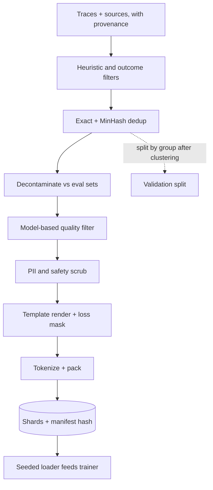

## TL;DR
When you fine-tune a model on agent trajectories, this pipeline turns raw traces into versioned,
deduplicated, decontaminated, template-exact shards. It decides whether the tuned agent calls tools
correctly or just memorized your eval tasks.

## For agent builders
- **Why it matters for agents.** Fine-tuning a smaller model to call your tools reliably is a common way to
  cut agent cost and latency. The training data is logged agent traces, and their duplicates, leaked eval
  tasks and template bugs show up as broken tool calls in production.
- **Where it shows up in your stack.** Trace exports from your agent's logs, `apply_chat_template` with the
  tool definitions, loss masks, `datasketch` or `datatrove` for dedup, and a manifest hash in the SFT or
  LoRA run config.
- **What you control.** Which turns carry loss (assistant reasoning and tool calls, not tool results or the
  system prompt), group splits by task and session, decontamination against the agent eval suite, and
  mixture weights for rare tools.
- **What you can skip.** Pretraining-scale web filtering and the theory behind quality classifiers. Keep the
  MinHash intuition, the masking rule and the repetition arithmetic.

## Decision case
### Scenario
A subscription company runs a support agent on a large hosted model with 6 tools. Finance wants cost per
conversation cut sharply, and the team proposes distilling the agent into a smaller open-weight model with
LoRA. All figures are illustrative.

- **Data.** 120,000 logged runs from the last 3 months, about 3,000 tokens each (360 million tokens).
- **Eval.** A 600-task agent eval suite, written from real tickets of the same period.
- **Tools.** The `cancel_subscription` tool appears in only 400 successful, distinct runs. Its `reason` argument was
  renamed 5 weeks ago.

Constraints:
- **Privacy.** Traces contain customer emails and card fragments; they must be scrubbed before training
  and must stay in the EU region.
- **Validity.** The tuned model must beat the base small model on held-out tasks, not just on the suite it was trained near.
- **Team and hardware.** Two ML engineers, one 8-GPU node, no Spark cluster.
- **Deadline.** A go or no-go in 4 weeks.

### Options
| Option | How it works | Privacy | Eval validity | Fits team and 4 weeks |
|---|---|---|---|---|
| **A. Export JSONL and train** | Dump all runs, random 90/10 split, provider-style formatting at load time | Fails unless scrubbed separately | Fails: retries and eval-period tickets leak across splits | Yes, in days |
| **B. Single-node staged pipeline** | Outcome filter, exact and MinHash dedup by task, decontaminate against the 600 tasks, PII scrub, offline template render with serving tool schemas and role masks, packed shards plus manifest hash | Pass: scrub is a blocking stage in-region | Pass: group split by task after clustering | Yes: 360 million tokens fit on one machine |
| **C. Distributed pretraining-style pipeline** | `datatrove` on a cluster, a model-based quality classifier, streaming shards | Pass | Pass | No: cluster setup eats the deadline for data that fits on one node |
| **D. Do not fine-tune yet** | Fix prompts and tool descriptions on the large model | Pass | Not applicable | Yes, but the per-call price of the large model is the cost problem, so it cannot meet the goal |

### Decision
Choose **B**, because the binding constraints are validity and privacy, not scale:
- **Scale does not justify C.** 120,000 runs and 360 million tokens are a single-node job; MinHash on 66,000
  surviving runs takes minutes with `datasketch`.
- **The funnel is computed before training.** The outcome filter keeps about 55% (66,000), dedup by task
  leaves about 25,000, and decontamination removes about 4% (1,000), leaving 24,000 trajectories, or about
  72 million tokens per epoch.
- **Rare tools get an explicit weight.** At 10% of a 24,000-example epoch, the 400 `cancel_subscription` runs
  would be drawn 2,400 times, 6 passes. Cap it at 5%: 1,200 draws, 3 passes.
- **The rename is handled in the data.** Runs older than 5 weeks are re-rendered with the current schema or dropped,
  so the model never learns the old argument name.
- **The eval is protected.** Splitting by task and decontaminating against the 600 tasks is what lets the go or no-go mean something.

What would change it:
- **Much more data.** At billions of tokens or many sources, the dedup and quality stages outgrow one node: move toward C.
- **Unstable tools.** If schemas still change weekly, or fewer than a few hundred successful runs exist per
  tool, choose D and revisit when the tool set settles.
- **A hosted fine-tuning service.** The stages stay; only the render step targets the service's format.

### Trade-offs accepted
- **No model-based quality filter.** The outcome filter stands in for it. Hand-review 50 kept trajectories per
  dataset version and log what fraction a reviewer would reject.
- **MinHash may merge distinct but templated runs.** Watch the cluster-size distribution; one giant cluster means a template problem, not real duplicates.
- **Filtering thins rare tools.** Track examples and passes per tool in the manifest, and tool-call validity per tool on held-out tasks.
- **Decontamination by n-gram misses paraphrases.** Keep a second eval set of tasks dated after the export as the final check.

### Review rubric
- **Fine-tuning is justified first.** The write-up says why prompts, tools or retrieval cannot meet the goal.
- **The funnel has numbers.** Runs left after each stage and tokens per epoch are derived, not guessed.
- **Splits and decontamination are by group.** Task or session grouping after clustering is explicit, with the eval set named.
- **Masking and schemas are specified.** Which roles carry loss, and how schema changes in old traces are handled.
- **Repetition is computed per small source.** Passes per rare tool are calculated and capped.
- **The scale choice is argued.** It explains why the tooling matches the data volume and what volume would change it.

## Why it exists
- **"Export a JSONL file and point the trainer at it" fails invisibly.** The failures do not show in the
  loss curve and are expensive to discover afterwards.
- **Duplicates.** Web and enterprise corpora contain the same page, template or ticket thousands of times.
  The model memorizes them and spends capacity on boilerplate; Lee et al. found near-duplicate removal made
  models emit memorized training text roughly ten times less often, with the same or better accuracy in
  fewer training steps.
- **Contamination and formatting noise.** If eval questions leaked into training (a scraped forum, an
  internal doc), the benchmark measures memorization and the deployment regression has no explanation.
  Hand-assembled SFT examples with inconsistent chat templates, stray system prompts or missing end-of-turn
  tokens teach the noise: the model stops at the wrong place or emits template fragments.
- **Reproducibility and throughput.** Without a dataset version and a deterministic shuffle, a loss
  divergence cannot be reproduced, a resumed run does not match, and a regression cannot be attributed to a
  data change. Tokenizing, packing and globally shuffling raw text in the dataloader is CPU- and I/O-bound
  and can leave accelerators idle in a sawtooth, most visibly for smaller models with high per-GPU token
  consumption.
- **The pipeline makes these properties structural, not hoped for.** Filter, deduplicate, decontaminate,
  format, tokenize, pack and shard offline, and record what came from where. This lesson covers the
  pipeline; the curation, labeling and synthetic-data lessons in Training & adaptation cover what makes an
  individual example good.

## How it works
### Stage order, and why
Cheap operations shrink the data before expensive ones run.

1. **Sourcing and provenance.** Every source gets a manifest: origin, license or contractual basis,
   snapshot date, raw hash. This is the only point where that information is cheap to capture.
2. **Heuristic filtering.** Language ID, length bounds, symbol-to-word ratio, fraction of lines ending in
   terminal punctuation, repeated-line ratio, blocklisted domains. These C4 and Gopher-style rules are cheap
   per document, remove a large fraction of junk, and run first because everything after costs more per
   byte.
3. **Deduplication.** Exact dedup by document hash catches byte-identical copies only; near-duplicates need
   MinHash (next subsection). It exists because exact hashing misses the same article with a different
   footer, and pairwise comparison of a billion documents is impossible.
4. **Decontamination.** Compare training text against every eval set the model will be judged on with
   n-gram overlap and remove or flag overlapping documents (details below). Redo it whenever an eval set is
   added.
5. **Model-based quality filtering.** A small classifier or a perplexity threshold from a reference model
   ranks documents for "educational" or domain quality. It runs late because it is the most expensive per
   document and operates on the smallest set. FineWeb is a good public reference for how much each stage
   removes on web data.
6. **Safety and PII scrubbing.** Regex and NER passes for emails, keys and phone numbers, plus toxicity
   filters, with the policy decided by legal rather than by the pipeline author.
7. **Formatting.** Pretraining: concatenate documents with an end-of-sequence token between them. SFT:
   render each example through the exact chat template the model will serve with, and mask the loss so only
   assistant tokens contribute; prompt tokens get the ignore index. Doing this offline, deterministically,
   removes a whole class of template bugs.
8. **Tokenization and packing.** Tokenize offline, store token ids, and pack short examples into
   fixed-length sequences (see the packing subsection).
9. **Sharding and mixture.** Write fixed-size shards with a shard index and sample sources by mixture
   weight (see below).
10. **Versioning.** A dataset version is the ordered list of shard hashes plus the pipeline config. The
    training run records that version; lineage goes from any training sample back to its source manifest.

### Near-duplicate detection with MinHash and LSH
1. **Shingle** each document into overlapping n-grams.
2. **Hash** each shingle with *k* hash functions and keep the minimum per function: the signature.
3. **Band** the signature with locality-sensitive hashing; documents sharing a band become candidate pairs.
4. **Cluster** candidates with union-find and keep one per cluster.

**Why it works:**
- For one random hash function, the chance two documents share the minimum shingle hash equals their Jaccard
  similarity *s*, so a signature of *k* minima estimates *s*.
- Split the signature into *b* bands of *r* rows (*k = b·r*). A pair is a candidate if all *r* values in at
  least one band match: `P(s) = 1 − (1 − s^r)^b`.
- That is an S-curve with its steep part near `(1/b)^(1/r)`. More rows per band moves the threshold up and
  makes the curve steeper.

| *k* = 100 as *b* = 20, *r* = 5 (threshold about 0.55) | Candidate probability |
|---|---|
| *s* = 0.8 | about 0.9996 |
| *s* = 0.5 | about 0.47 |
| *s* = 0.3 | about 0.05 |

- **Verify candidates** against a real similarity before merging, because LSH controls recall, not
  precision.

### Decontamination and the validation split
- **N-gram overlap against eval sets.** The GPT-3 report used 13-gram overlap. The right *n* is a judgement
  between missing paraphrases and deleting common phrases.
- **Your own validation split needs the same care.** Split *after* near-duplicate clustering and by group
  (customer, thread, product), so a cluster never has members on both sides.
- **Why:** a random row-level split of support tickets puts near-identical tickets in train and validation,
  and validation loss then reports memorization.

### Packing
- **Padding waste without it.** A batch of 4,096-token slots filled with 300-token examples is over 90 %
  padding.
- **Cross-document attention.** Packing requires either resetting position ids and masking attention across
  document boundaries, or accepting a small amount of cross-document attention; the choice depends on the
  trainer's support.

### Sharding and mixture weights
- **Formats.** Parquet, Arrow, WebDataset tar, or a streaming format such as MDS, with a shard index.
- **What the index buys.** The loader can shuffle at shard level and within a buffer, resume from a global
  sample offset, and sample sources by mixture weight (for example up-weighting the customer's domain data
  relative to general text).
- **A weight implies a repetition count:** `epochs_of_source = weight × total_training_tokens / source_tokens`.
  Giving a 50M-token domain source 20 % of a 1B-token run draws 200M tokens from it: four passes.
- **Write that number down per source,** because a small source with a high weight is repeated many times,
  and repetition is where memorization and overfitting come from.

### The dataloader contract
- **The loader only reads shards,** does buffered shuffling with a seeded RNG, and collates.
- **Its throughput must exceed the model's consumption** in tokens per second with headroom, which is why
  the expensive work moved offline. Prefetching and multiple workers handle the rest.

### Agent trajectories as training data
The same stages apply when the source is your agent's own logs, with four agent-specific rules:
- **Filter on outcome, not just text quality.** Keep trajectories whose task succeeded (eval pass, user
  accepted, no rollback) and drop ones that hit the step budget or looped, because SFT copies whatever
  behaviour it sees.
- **Mask by role across every turn.** Assistant turns, including tool-call turns, carry loss; system prompt,
  user turns and tool results get the ignore index, because the model should learn to call tools, not to
  predict what your APIs return.
- **Render with the serving tool definitions.** Pass the same tool schemas to the chat template at training
  and serving time; a renamed argument in training data teaches calls your runtime rejects.
- **Dedup and split by task.** Agents retry the same task many times, so cluster near-duplicate trajectories,
  split by task or session group, and decontaminate against the agent eval suite's task prompts.

## Diagram
Cheap filters shrink the data before expensive stages run; the output is a hashed set of shards the
training run references. For agent fine-tunes the sources are logged trajectories filtered by outcome.



## Examples
### Offline SFT formatting and packing
Render the chat template, mask prompt tokens with the ignore index, pack examples into fixed-length
sequences separated by EOS, and emit shards with a content hash for the dataset manifest. The tokenizer is
any Hugging Face tokenizer with a chat template.

```python
import hashlib, json
IGNORE, SEQ_LEN, SHARD_ROWS = -100, 4096, 2048

def render(tok, messages):
    prompt = tok.apply_chat_template(messages[:-1], tokenize=False, add_generation_prompt=True)
    full   = tok.apply_chat_template(messages, tokenize=False)
    enc = lambda s: tok(s, add_special_tokens=False)["input_ids"]   # template already has BOS
    p_ids, f_ids = enc(prompt), enc(full)
    assert f_ids[:len(p_ids)] == p_ids, "template must be prefix-stable"
    labels = [IGNORE] * len(p_ids) + f_ids[len(p_ids):]      # loss only on the final assistant turn
    return f_ids, labels

def pack(examples, tok):
    ids, labels, doc_ids = [], [], []
    for n, msgs in enumerate(examples):
        i, l = render(tok, msgs)
        if len(i) + 1 > SEQ_LEN:
            continue                                            # too long: drop (or truncate) and count it
        if len(ids) + len(i) + 1 > SEQ_LEN:
            yield ids, labels, doc_ids; ids, labels, doc_ids = [], [], []
        ids += i + [tok.eos_token_id]; labels += l + [tok.eos_token_id]; doc_ids += [n] * (len(i) + 1)
    if ids:
        yield ids, labels, doc_ids                              # trainer pads this last one

def write_shards(packed, path):
    manifest, rows = [], []
    def flush():
        blob = json.dumps(rows).encode(); name = f"{path}/shard-{len(manifest):05d}.json"
        with open(name, "wb") as f: f.write(blob)
        manifest.append({"shard": name, "rows": len(rows), "sha256": hashlib.sha256(blob).hexdigest()})
    for ids, labels, doc_ids in packed:
        rows.append({"input_ids": ids, "labels": labels, "doc_ids": doc_ids})  # doc_ids -> attention mask
        if len(rows) == SHARD_ROWS:
            flush(); rows = []
    if rows:
        flush()                                                 # keep the final partial shard
    with open(f"{path}/manifest.json", "w") as f:
        json.dump(manifest, f)                                  # the dataset version is this file's hash
```

- **`doc_ids`** lets a trainer that supports it block attention across packed documents.
- **The manifest of shard hashes** is what the training config references, so the run is reproducible.

### Tuning the LSH threshold and checking mixture repetition
Runnable as-is. It prints the candidate probability for three band layouts of the same 100 hash functions,
then the repetition and padding arithmetic from above.

```python
def p_candidate(s, b, r):
    """Probability two docs with Jaccard s share at least one fully matching band."""
    return 1 - (1 - s**r) ** b

for b, r in [(20, 5), (10, 10), (50, 2)]:                  # each uses k = b*r = 100 hash functions
    thr = (1 / b) ** (1 / r)
    row = "  ".join(f"s={s}: {p_candidate(s, b, r):.4f}" for s in (0.3, 0.5, 0.8))
    print(f"b={b:>2} r={r:>2} threshold~{thr:.2f}  {row}")

def epochs(weight, total_tokens, source_tokens):
    return weight * total_tokens / source_tokens

print(epochs(0.20, 1e9, 50e6))       # 4.0 passes over a 50M-token source at 20% of a 1B run
print(1 - 300 / 4096)                # padding fraction of 300-token examples in 4,096 slots, unpacked
```

| Layout | Threshold | P at s = 0.3 | P at s = 0.5 | P at s = 0.8 |
|---|---|---|---|---|
| b = 20, r = 5 | ~0.55 | 0.0475 | 0.4701 | 0.9996 |
| b = 10, r = 10 | ~0.79 | 0.0001 | 0.0097 | 0.6789 |
| b = 50, r = 2 | ~0.14 | 0.9910 | 1.0000 | 1.0000 |

- **Read it as a recall dial.** b = 10, r = 10 misses a third of pairs at s = 0.8; b = 50, r = 2 flags almost
  everything and floods the verification step.

### Agent scenario: masking a multi-turn tool-calling trajectory
For a trajectory of user, assistant tool call, tool result and final answer, every assistant turn carries
loss and everything else is ignored. It reuses the prefix-stability idea from `render` above, and passes
the serving tool schemas through the template's `tools` argument.

```python
IGNORE = -100

def render_trajectory(tok, messages, tools):
    """Labels cover every assistant turn (tool calls and final answer); tool results are masked."""
    enc = lambda s: tok(s, add_special_tokens=False)["input_ids"]
    full_ids = enc(tok.apply_chat_template(messages, tools=tools, tokenize=False))
    labels = [IGNORE] * len(full_ids)
    for i, m in enumerate(messages):
        if m["role"] != "assistant":
            continue
        start = len(enc(tok.apply_chat_template(messages[:i], tools=tools, tokenize=False,
                                                add_generation_prompt=True)))
        upto = enc(tok.apply_chat_template(messages[:i + 1], tools=tools, tokenize=False))
        assert full_ids[:len(upto)] == upto, "template must be prefix-stable"
        labels[start:len(upto)] = upto[start:]
    return full_ids, labels

def keep(traj):
    """Outcome filter: only successful, bounded runs become training data."""
    return traj["outcome"] == "success" and not traj["hit_step_budget"] and traj["tool_errors"] == 0
```

Decode one rendered trajectory with labels shown before every run; templates differ in how they serialize
tool calls, and some are not prefix-stable across tool turns, which the assertion catches.

### Worked scenario: from 40,000 logged runs to a tool-calling SFT set
Illustrative numbers for a support agent's logs.

| Stage | Trajectories left | Why |
|---|---|---|
| Raw exported runs | 40,000 | every session in the period |
| Outcome filter (success, no step-budget hit) | 22,000 | failed and looping runs teach failure |
| MinHash dedup by task (retries of one task) | 9,000 | users and evals retry the same task many times |
| Decontaminate against 500 eval tasks | 8,600 | 400 trajectories overlapped eval prompts |
| Mixture check: `refund_order` tool | 300 examples at 15 % weight of an 8,600-example epoch | about 1,290 draws, about 4.3 passes: watch for memorization |

The 400 overlapping runs would have inflated the agent eval score while doing nothing for live traffic.

## Production patterns
- **Use a dedup library built for scale.** For corpora beyond one machine, run MinHash dedup with an
  existing tool (Hugging Face `datatrove` was used for FineWeb; `datasketch` offers `MinHashLSH` with a
  `threshold` and `num_perm` for smaller jobs). Monitor the fraction removed and the cluster-size
  distribution; one giant cluster usually means a template or boilerplate problem.
- **Decontamination as a blocking gate.** Before any training run, compute n-gram overlap between the new
  shards and every registered eval set and fail the pipeline above a set overlap rate. Re-run the gate when
  an eval set is added, and log overlap per eval set in the run record.
- **Eyeball the loss mask.** For every new template or tokenizer, decode a few rendered examples with
  labels shown and confirm only assistant tokens and the end-of-turn token carry loss. Monitor the share of
  examples dropped as too long, because silent drops skew the data mix.
- **Pin the dataset version in the run config.** Reference the manifest hash, the pipeline config and the
  loader seed in the training config, and refuse to launch without them. This makes resume and divergence
  debugging possible.
- **Benchmark the loader before the run.** Measure loader tokens per second against the model's
  consumption on the target hardware, and watch GPU utilization for a sawtooth during the first minutes.
- **Trace-to-dataset export with outcome labels.** Agent teams log every run with task id, tool calls, tool
  results and outcome, then export only successful, deduplicated trajectories into the pipeline, holding out
  whole tasks for the agent eval. Monitor tool-call validity rate and task success of the tuned model against
  the base model on the held-out tasks.

## Trade-offs
- **Aggressive heuristic filtering vs coverage.** It removes junk cheaply but also legitimate code, tables
  and non-English text; the thresholds flip when the target domain is exactly the content the rules
  distrust.
- **Near-duplicate removal vs templated content.** It improves generalization and reduces memorization, but
  a low similarity threshold deletes templated-but-distinct documents such as product pages, which can
  matter for a domain model.
- **Packing vs isolation.** It eliminates padding waste and raises tokens per second, but without
  cross-document masking examples attend to unrelated neighbours; for short SFT examples masking is worth
  it.
- **Offline tokenization vs flexibility.** It maximizes throughput and reproducibility, yet binds the dataset
  to one tokenizer, so a tokenizer or model-family change means re-tokenizing from the text tables.
- **Strict decontamination vs data volume.** It protects eval validity, but at small *n* removes documents
  that merely share common phrases with the eval set, shrinking the training set for no gain.

## Pitfalls
- **Decontaminating with exact match only.** Symptom: a benchmark score that collapses on a freshly written
  eval set of the same difficulty. Fix: n-gram overlap.
- **A training template that differs from serving.** Symptom: the fine-tuned model emits role tags or fails
  to stop at the end of its turn. Fix: render with the exact serving template.
- **Tokenizing, packing or globally shuffling inside the dataloader at scale.** Symptom: GPU utilization
  oscillates between near zero and full while CPUs are saturated. Fix: do it offline.
- **Non-deterministic shuffling without a seeded, offset-addressable order.** Symptom: a resumed run whose
  loss curve does not continue the original, and a divergence nobody can reproduce.
- **Near-dup detection before cheap filters.** Symptom: MinHash jobs that take days on data most of which a
  one-line length rule then discards.
- **Random-row train/validation splits instead of group splits after dedup.** Symptom: validation loss keeps
  falling while quality on genuinely new customers or threads stays flat.
- **Dropping provenance at the first join.** Symptom: a takedown or license question that can only be
  answered by retraining without the disputed source.

## When to use
- **Use** this pipeline, at whatever scale, the moment training data comes from more than one source or
  will be used more than once, including a first LoRA run on your own agent's traces.
- **Avoid fine-tuning at all** while prompt changes, better tool descriptions or retrieval still fix the
  agent's failures; the pipeline is worth building once you have hundreds of successful trajectories and a
  stable tool set.
- **Small fine-tunes still need the properties.** For a few thousand customer examples the stages are small
  scripts, but keep template-exact rendering, loss masking, dedup against the eval set, and a manifest hash
  in the training config.
- **Measure** fraction removed per stage, near-duplicate cluster sizes, overlap rate with each eval set,
  padding ratio after packing, and loader tokens per second against model consumption.
- **Interviews:** "how would you prepare data to fine-tune on a customer's support tickets?" Walk these
  stages; the differentiators are decontamination against the eval set, prompt-token loss masking and a
  reproducible dataset version.

## Role lens
- **Engineer:** Writes the filtering, MinHash dedup, template rendering and packing jobs, verifies the
  loss mask on a handful of examples by eye, and checks loader throughput before launching a run.
- **Architect:** Sets the stage order and the quality, PII and licensing policies, chooses the shard
  format and storage layout, and requires that every run references a hashed dataset version.
- **FDE:** Assembles customer data into the pipeline with provenance intact, agrees PII rules with the
  customer's legal team, and holds back the eval set from the data the customer hands over for training.

## Check yourself
**Q:** A fine-tuned support model scores well on the team's internal benchmark but performs no better than
the base model on live tickets, and it sometimes ends its replies with a stray assistant tag. Which
pipeline stages would you inspect first and why?
**A:** Two stages explain both symptoms. The benchmark gap points to contamination: the internal eval set
was probably drawn from the same ticket export as the training data, so near-identical tickets appear in
both and the benchmark measures memorization; check n-gram overlap between training shards and the eval
set and decontaminate or rebuild the eval from tickets dated after the export. The stray tag points to
formatting: examples were rendered with a chat template that differs from the serving template, or the
loss mask included prompt tokens so the model learned to reproduce template structure; inspect a few
rendered examples token by token, confirm the ignore index covers the prompt and that the end-of-turn
token terminates the labels. Near-duplicate inflation in the training set would compound both, so look at
the dedup cluster sizes as well.

## Interview questions
### Why does stage order matter in a training data pipeline?
- **Cost per byte rises along the pipeline:** heuristic filters are nearly free, MinHash is moderate, and
  model-based quality scoring is the most expensive per document.
- **So cheap filters run first** and shrink the set before costly stages run; running MinHash first means
  days of compute on data a length rule would have discarded.
- **Provenance is captured first** because it is only cheap at the source.

### Validation loss keeps falling but the model is no better on new customers. What happened?
- **Likely a leaky split:** rows were split at random, so near-duplicate tickets from one customer or thread
  sit on both sides and validation measures memorization.
- **Check** dedup clusters that span train and validation, and overlap with the eval set.
- **Fix:** split by group after near-duplicate clustering, and rebuild the eval from data dated after the
  training export.

### How do you choose the MinHash band layout?
- **The threshold sits near `(1/b)^(1/r)`:** with 100 hash functions, 20 bands of 5 rows puts it near
  0.55, while 10 bands of 10 rows moves it near 0.79 and makes the curve steeper.
- **Trade recall for verification cost:** a lower threshold finds more near-duplicates but sends more
  candidate pairs to the exact-similarity check.
- **Domain matters:** a low threshold deletes templated-but-distinct documents such as product pages.

### A 50M-token domain dataset gets 20 % of a 1B-token run. Is that a problem?
- **Compute repetitions:** 0.2 × 1B / 50M = four passes over the domain data.
- **Four passes is a risk to watch, not automatically wrong;** repetition is where memorization and
  overfitting come from, so track held-out loss on that domain.
- **Levers:** lower the weight, add more domain data, or deduplicate it harder first.

### You are fine-tuning a model on your agent's logged trajectories. Which tokens should carry loss, and why?
- **Assistant turns only:** reasoning text, tool-call turns and the final answer, because those are the
  behaviours you want the model to produce.
- **Mask tool results, user turns and the system prompt:** training on tool results teaches the model to
  predict your APIs' output and invent results instead of waiting for them.
- **Render with the serving tool schemas** and decode a few examples with labels shown before the run.

### Your fine-tuned agent model aces the eval suite but fails on live tasks and calls tools with stale argument names. What went wrong?
- **Contamination:** trajectories for eval tasks leaked into training, often as retries of the same task;
  decontaminate against eval prompts and split by task.
- **Schema drift:** training traces were logged before a tool's arguments were renamed, so the model learned
  the old schema; re-render or drop traces older than the current tool version.
- **Fix the pipeline, not the model:** add both checks as blocking gates.

## Quiz
### Q: Why do near-duplicate removal with MinHash rather than relying on exact document hashing?
- [ ] MinHash is faster than computing a SHA-256 per document
- [x] Most duplicates differ in small ways such as footers or timestamps, which exact hashing misses, and MinHash with LSH finds similar pairs without comparing every pair
- [ ] Exact hashing cannot be parallelized across shards
- [ ] MinHash also detects contamination against evaluation sets
> Real corpora contain the same content with trivial variations. MinHash signatures approximate shingle
> similarity, and LSH banding turns the impossible all-pairs comparison into candidate lookups, so near
> duplicates are found at scale; decontamination is a separate n-gram check.

### Q: In SFT formatting, what does setting prompt tokens' labels to the ignore index achieve?
- [ ] It removes the prompt from the model's context so it only sees the answer
- [ ] It prevents the tokenizer from splitting special template tokens
- [x] It excludes prompt tokens from the loss so the model learns to produce assistant turns rather than to reproduce prompts and templates
- [ ] It allows examples to be packed without attention masking
> The prompt stays in the input, so the model conditions on it, but gradients only flow from assistant
> tokens. Training on prompt tokens wastes capacity and teaches the model to emit template structure,
> which shows up as stray role tags at inference.

### Q: What is the strongest reason to tokenize and pack offline rather than in the training dataloader?
- [ ] Offline tokenization produces smaller files than raw text
- [ ] The trainer cannot apply chat templates at runtime
- [x] Tokenization and packing are CPU-bound; done at training time they bottleneck the loader and leave accelerators idle, and done offline they are also reproducible
- [ ] Packing is only possible when all examples are known in advance
> When accelerators consume tokens faster than the loader's CPU workers can tokenize and pack them, the
> result is a sawtooth utilization pattern; whether that happens depends on model size and worker count,
> but the reproducibility benefit holds regardless. Precomputed shards make the loader a simple reader and make the exact
> sequence of training tokens part of the versioned dataset.

## Use cases & projects
### Use cases
- **Distilling an agent into a smaller model.** Successful trajectories from a large model become SFT data
  for a cheaper model that calls the same tools, cutting cost and latency per step.
- **Fixing a recurring tool-call failure.** A targeted set of corrected trajectories for one tool, with a
  mixture weight and repetition count written down, teaches the right arguments without overfitting.
- **Keeping agent evals honest.** Decontaminating training traces against the eval suite and splitting by task
  keeps a fine-tuned agent's benchmark gains real.
- **Reproducible fine-tune debugging.** A manifest hash and seeded loader let the team re-run a LoRA job that
  regressed and attribute the change to data, not noise.

### Mini project
**Turn agent logs into a decontaminated SFT set (2-3 hours).**
- **Goal:** produce a versioned, masked training set from a small agent's trajectories and prove it is clean.
- **Steps:** run a simple two-tool agent on 100-200 generated tasks and log each run with task id and outcome;
  keep successful runs; dedup with `datasketch` `MinHashLSH`; hold out 20 tasks as the eval set and remove
  overlapping trajectories; render with `render_trajectory` and the serving tool schemas; write shards and a
  manifest.
- **Done when:** a report shows trajectories left per stage, zero eval-task overlap, one decoded example with
  labels shown covering only assistant turns, and the manifest hash recorded in a training config.
