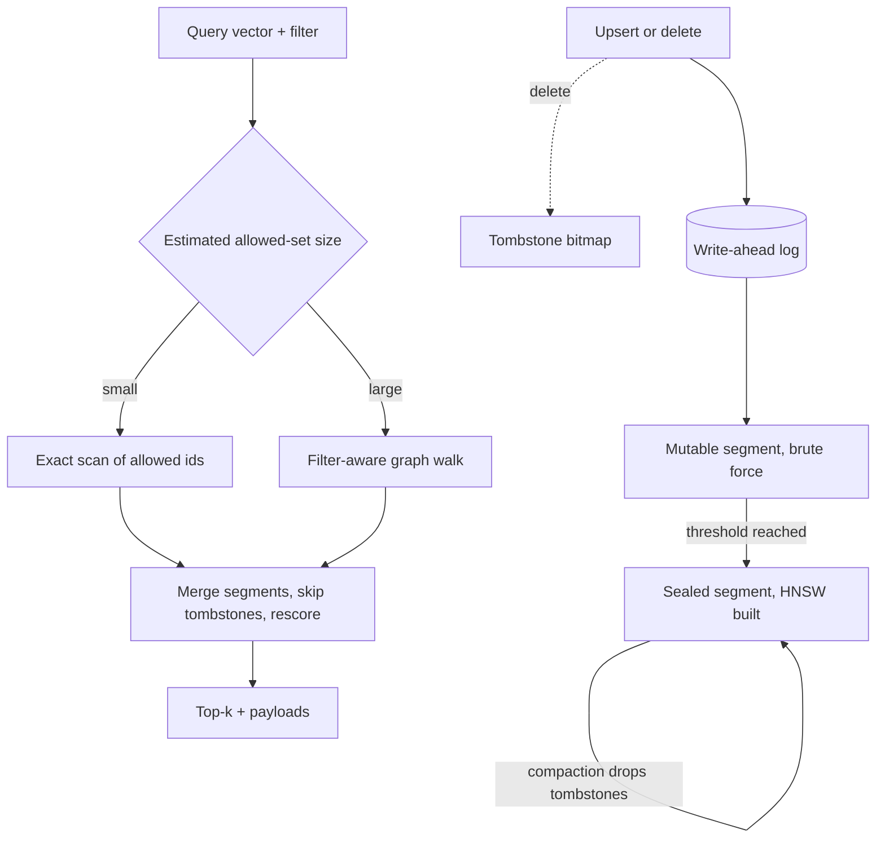

## TL;DR
The vector database behind an agent's search and memory tools is an ANN index, a payload store and a query
planner. Agents hit its hard parts directly: filtered search, deletes, memory residency and multi-tenancy
across many users.

## For agent builders
- **Why it matters for agents.** An agent passes filters as tool arguments (product, date, user), and each
  user's long-term memory is a tiny tenant. Selective filters that return fewer than k results make agents
  retry, loop or answer from nothing, and a forgotten tenant filter leaks one user's memory to another.
- **Where it shows up in your stack.** The `search_docs` and `recall_memory` tools, backed by Qdrant,
  Weaviate, Milvus, pgvector or OpenSearch, with payload indexes on every field a tool can filter on.
- **What you control.** Which filters the agent may set and which come from auth, payload indexes, the
  multi-tenancy pattern, quantization and `ef`, and compaction after deletes.
- **What you can skip.** HNSW construction details and DiskANN internals. Know that the graph must be in
  RAM, deletes are tombstones, and filtered search needs a planner.

## Why it exists
- **Exact search does not scale.** It is a dot product per stored vector. A million 1,536-dimensional float32
  vectors is about 6 GB of reads per query, which at the tens of GB/s of server memory bandwidth is on the
  order of 100 ms or more per query, growing linearly with the corpus.
- **ANN fixes the math, not the system.** HNSW cuts the work to a few thousand distance computations by
  navigating a graph (the rag-retrieval module explains ANN). But an index alone is a library call; production
  also needs live adds and deletes, metadata filters (tenant, date, ACL), restart durability, replication and
  sharding.
- **Each requirement collides with the index.** HNSW graph quality depends on insertion order and nodes cannot
  be removed without disconnecting the graph, so deletes become tombstones and rebuilds. A filter after top-k
  yields fewer than k, or zero, results when selective; a filter before means searching a set the graph was
  not built for.
- **Memory and distribution collide too.** Graph traversal is random memory access, so an index that spills
  to disk becomes orders of magnitude slower unless designed for SSDs. Sharded similarity search means every
  shard answers and results are merged.
- **A vector database is the engineering that resolves those collisions.** Choosing a dedicated engine or a
  vector extension in Postgres or OpenSearch is choosing which collisions you need solved and which you can
  live with.

## How it works
### Data model
- **Points in a collection:** an id, one or more named vectors (dense, and in many engines sparse for hybrid
  search), and a payload of key-value metadata.
- **Payload indexes** (keyword, numeric range, geo; typically inverted or bitmap) on every filtered field,
  because filter evaluation must produce candidate id sets quickly.

### Index layer and why it is memory-bound
- **HNSW** keeps a layered proximity graph. A query enters at the top layer, greedily walks to the nearest
  node, descends, and at the base layer explores a beam of `ef` candidates.
- **Each hop reads a neighbour list and a vector from unpredictable addresses,** so throughput tracks memory
  latency and the index must be RAM-resident.
- **IVF** partitions vectors into k-means clusters and scans a few posting lists: more sequential and cheaper
  in memory, but needs training and loses recall on skewed data.
- **Quantization** (scalar int8, product quantization, binary) shrinks the vectors touched during traversal.
  The small recall loss is recovered by rescoring final candidates against full-precision vectors on disk.
- **DiskANN-style designs** keep a compressed copy in RAM to guide the walk and put full vectors plus
  adjacency on SSD, one read per visited node; that is how billion-scale search fits on one machine.

### Write path: segments, tombstones and compaction
Writes do not go into the graph directly. The common design, shared in spirit by Qdrant, Milvus and
Lucene-based engines:
1. Append to a write-ahead log for durability.
2. Insert into a small mutable segment searched by brute force.
3. At a threshold, seal it and build an index in the background.
4. Serve queries across all segments and merge.
5. Deletes mark a tombstone bitmap consulted at query time; updates are a delete plus an insert.
6. Periodic compaction merges segments, drops tombstoned points and rebuilds the graph.

- **Why:** writes stay cheap and the index stays immutable.
- **The cost:** eventual visibility (a point is searchable once it lands in the mutable segment, possibly after
  a refresh interval), and query cost that creeps up between compactions as tombstones and segment counts
  grow.

### Query path and the filtering problem
A query: embed (outside the database), evaluate the filter to a candidate set, search, merge across segments
and shards, rescore if quantized, fetch payloads, return top-k. The filter strategy is the subtle part.

| Strategy | How | When it works | When it fails |
|---|---|---|---|
| Post-filtering | ANN for top-k′ (k′ > k), then drop points failing the filter | filter matches most points | selective filters: at 1 % matching, top-100 has on average one survivor |
| Pre-filtering | allowed-id bitmap from the payload index, search only among them | always correct; engines brute-force the allowed set when it is small, fine precisely because it is small | traversal restricted to 1 % of nodes is disconnected; exact scan is expensive when the set is large |
| Filter-aware traversal | check the filter at each hop, keep walking through disallowed nodes without returning them | mid and large selectivity | needs engine support |

**How engines implement filter-aware search:**
- **Qdrant** builds extra graph links per indexed payload field so the filtered subgraph stays connected.
- **Weaviate** uses a flat-search cutoff (`flatSearchCutoff`) below which it abandons the graph; newer
  releases also offer an ACORN-style filtered traversal.
- **pgvector** historically returned fewer than k rows under a selective `WHERE` because the index scan ran
  first; newer releases added iterative index scans that keep walking until enough rows pass.

A plain `WHERE tenant_id = ?` across millions of points is therefore an architecture question, not a syntax
question, and the first thing to test when evaluating an engine.

### Distribution and multi-tenancy
- **Shard by hashed point id:** even load, but every query scatters to all shards and merges, so latency is
  the slowest shard's.
- **Shard by a routing key such as tenant:** one shard per query, faster and a natural isolation boundary, at
  the cost of hot shards for large tenants.
- **Replication** gives availability and read scaling; most engines offer per-request consistency levels
  because replicas apply writes asynchronously.

| Multi-tenancy pattern | Strength | Weakness |
|---|---|---|
| Collection per tenant | strong isolation | each HNSW graph carries fixed overhead; thousands of tiny collections waste memory |
| Payload filter per tenant | cheap | relies on the filtered-search path and on nobody forgetting the filter |
| Tenant-partitioned indexes (a graph per tenant value inside one collection) | the usual recommendation for many small tenants | engine support required |

### Dedicated engine versus extension
- **pgvector:** ANN inside the database that already holds the chunks, with transactions, joins and row
  security. Right until the index no longer fits comfortably in the database's memory, or filtered recall and
  write throughput become the bottleneck.
- **OpenSearch and Elasticsearch:** HNSW beside BM25 and existing log infrastructure.
- **Dedicated engines:** win on filtered-search machinery, quantization options, segment management and
  horizontal scaling.
- The architecture above is the lens for deciding which of those you will actually hit.

### What agents add to the workload
- **Model-chosen filters.** The agent decides filter values at run time, so selectivity varies per call; a
  narrow `product` plus `date` filter can match 0.1 % of points, exactly the case post-filtering fails.
- **Memory as tenancy.** Per-user memory means as many tenants as users, each tiny, which is the "many small
  tenants" pattern above, with the user id taken from the session, never from the model.
- **Write-then-read in one run.** An agent that saves a memory and recalls it two steps later depends on
  write visibility; eventual visibility shows up as "the agent forgot what I just told it".
- **Deletes on request.** "Forget this" is a delete that must stop retrieval immediately, even though memory
  is reclaimed only at compaction.

## Diagram
Writes land in a log and a brute-force segment before background indexing; queries plan the filter by
estimated selectivity, search every segment, skip tombstones and merge. An agent's tool call is the
"query vector + filter" box, with the tenant part of the filter supplied by auth.



## Examples
### The filtering problem, made visible
This simulation uses exact similarity, so the only variable is *when* the filter is applied. One collection
holds three tenants owning 90 %, 9.5 % and 0.5 % of the points. Post-filtering takes the top-k′ by
similarity, then drops other tenants' points; pre-filtering builds the allowed-id set first and scans it
exactly.

```python
import numpy as np

rng = np.random.default_rng(0)
N, D, K = 200_000, 64, 10
X = rng.standard_normal((N, D)).astype(np.float32)
X /= np.linalg.norm(X, axis=1, keepdims=True)              # cosine = dot product
share = {"big": 0.90, "mid": 0.095, "small": 0.005}         # tenant sizes: 90 %, 9.5 %, 0.5 %
tenant = rng.choice(list(share), size=N, p=list(share.values()))

def post_filter(q, t, k_prime):                             # ANN-style: top-k' first, then filter
    top = np.argpartition(-(X @ q), k_prime)[:k_prime]
    return [i for i in top if tenant[i] == t][:K]

def pre_filter(q, t):                                       # allowed ids first, exact scan over them
    allowed = np.flatnonzero(tenant == t)
    scores = X[allowed] @ q
    return allowed[np.argsort(-scores)[:K]], len(allowed)

q = rng.standard_normal(D).astype(np.float32); q /= np.linalg.norm(q)
for t in share:
    got = [len(post_filter(q, t, kp)) for kp in (10, 100, 1000)]
    ids, scanned = pre_filter(q, t)
    print(f"{t:>5}: post-filter results for k'=10/100/1000 -> {got}; "
          f"pre-filter -> {len(ids)} results, scanned {scanned:,} vectors")
# Output (seed 0):
#   big: post-filter results for k'=10/100/1000 -> [9, 10, 10]; pre-filter -> 10 results, scanned 179,893 vectors
#   mid: post-filter results for k'=10/100/1000 -> [1, 10, 10]; pre-filter -> 10 results, scanned 19,110 vectors
# small: post-filter results for k'=10/100/1000 -> [0, 0, 4]; pre-filter -> 10 results, scanned 997 vectors
```

- **Read the output as the planner's decision table.** Post-filtering returns about `k′ × selectivity`
  survivors: fine for the big tenant, empty for the small one even at k′ = 1,000, a hundred times the
  requested k.
- **Pre-filtering is always correct,** but its cost is the size of the allowed set.

### Worked scenario: scaling the same tenants to 10 million vectors
A production collection of 10 million 1,024-dimensional float32 vectors (4 KB each), same tenant shares.

| Tenant | Vectors | Bytes to scan exactly | Right strategy |
|---|---|---|---|
| small (0.5 %) | 50,000 | about 200 MB: a few ms to a few tens of ms on one node, depending on memory bandwidth and threads | exact scan of the allowed set |
| big (90 %) | 9 million | about 36 GB: far too much per query | graph walk checking the filter during traversal, where the filter hardly prunes |
| mid (9.5 %) | about 950,000 | about 3.8 GB | neither is cheap: the range to benchmark |

- **A good engine picks per query.** It estimates the allowed-set size from the payload index: exact scan below
  a threshold (Qdrant's `full_scan_threshold`, Weaviate's `flatSearchCutoff`), filter-aware graph search above.
- **Test the tenant sizes in between,** where neither strategy is cheap.

### Production setup in Qdrant
In a real engine the setup is a payload index on the filtered field, for example
`client.create_payload_index("chunks", field_name="tenant", field_schema="keyword")` in Qdrant, plus a filter
passed with the query. For many small tenants, Qdrant's multitenancy setup builds graphs per tenant value
instead of one global graph.

```python
from qdrant_client import QdrantClient, models

client = QdrantClient(url="http://localhost:6333")
client.create_collection(
    "chunks",
    vectors_config=models.VectorParams(size=1024, distance=models.Distance.COSINE),
    hnsw_config=models.HnswConfigDiff(payload_m=16, m=0),     # per-tenant graphs, no global graph
)
client.create_payload_index(
    "chunks", field_name="tenant",
    field_schema=models.KeywordIndexParams(type="keyword", is_tenant=True),
)

def search(tenant_from_auth, query_vector, k=10):            # tenant comes from auth, never the request
    return client.query_points(
        "chunks", query=query_vector, limit=k,
        query_filter=models.Filter(must=[
            models.FieldCondition(key="tenant", match=models.MatchValue(value=tenant_from_auth))]),
    ).points
```

- **Deletes are eventual in memory.** A delete marks a tombstone and returns at once; its memory comes back
  when the segment is optimized.
- **Neither behaviour shows on a toy collection,** because servers brute-force segments below their indexing
  threshold. Benchmark at realistic sizes.

### Agent scenario: a memory tool on many tiny tenants
The agent may choose a `topic` filter; the user id always comes from the session. The tool reports when it
found fewer than k results so the agent widens the query instead of looping on the same call. It reuses
`client` and `models` from the setup above, with `user_id` as the tenant-marked field.

```python
RECALL_TOOL = {
    "name": "recall_memory",
    "description": "Search this user's saved memories. Optionally narrow by topic.",
    "input_schema": {"type": "object", "properties": {
        "query": {"type": "string"}, "topic": {"type": "string"}}, "required": ["query"]},
}

def recall_memory(session, args, embed, k=5):
    must = [models.FieldCondition(key="user_id", match=models.MatchValue(value=session.user_id))]
    if args.get("topic"):                                     # model-chosen, so selectivity varies
        must.append(models.FieldCondition(key="topic", match=models.MatchValue(value=args["topic"])))
    points = client.query_points("memories", query=embed(args["query"]), limit=k,
                                 query_filter=models.Filter(must=must)).points
    short = len(points) < k and args.get("topic")             # a new user simply has few memories
    return {"memories": [p.payload["text"] for p in points],
            "found": len(points),
            "hint": "Fewer results than requested; retry without topic." if short else None}
```

| Agent memory at scale (illustrative) | Value |
|---|---|
| Users | 100,000 |
| Memories per user | about 200 |
| Points in the collection | 20 million |
| One user's share | 0.001 %: post-filtering a top-1,000 returns about 0.01 results |
| Bytes to scan one user exactly (1,024-dim float32, 4 KB each) | about 800 KB: trivial, so per-tenant indexing or exact scan |

## Production patterns
- **Shadow exact search for recall.** Sample a few hundred real queries with their real filters each week, run
  them with exact search (Qdrant's `exact=True` search parameter, or a sequential scan in Postgres) and with
  normal settings, and chart recall@k next to p99 latency. Alert when recall drops after weeks of writes.
- **Turn on iterative scans in pgvector.** On pgvector 0.8 or later, set `hnsw.iterative_scan` (for example to
  `relaxed_order`) so filtered queries keep walking until enough rows pass, and tune `hnsw.ef_search`. Monitor
  queries that return fewer than k rows.
- **Quantize with rescoring.** Enable scalar int8 quantization with rescoring against original vectors for
  collections that strain RAM, and keep originals on disk. Compare recall@k before and after on the same
  query sample.
- **Watch segment health.** Track segment count, deleted-point count and optimizer status per collection;
  rising tombstones with flat traffic mean compaction is falling behind, and latency will follow.
- **Isolate whales, partition minnows.** Put the few very large tenants on dedicated shards or collections and
  keep many small tenants in one collection with per-tenant indexing. Monitor p99 latency per tenant size
  bucket, not just overall.
- **Auth-scoped filters in the tool layer.** Agent teams build the tenant and ACL part of every filter inside
  the tool handler from the session, and let the model set only content filters such as topic or date.
  Monitor tool calls returning fewer than k results by filter combination, and repeated identical search
  calls per run, which signal an agent stuck on an empty filter.

## Trade-offs
- **HNSW vs IVF or disk-based indexes.** HNSW gives high recall at low latency but costs RAM for links plus
  vectors and a slow build; IVF or disk-based indexes win when the corpus is billions of vectors or memory is
  the budget line.
- **Quantization vs recall.** It cuts index memory by 4× to 32× and often speeds traversal, at a recall cost
  that rescoring mostly recovers; not worth it when the collection fits unquantized anyway.
- **Pre-filtering vs cost.** Correct for selective filters but expensive when the filter matches most of the
  collection; engines pick per query by estimated selectivity, and you should test both extremes.
- **Tenant-routed sharding vs large tenants.** Isolation and single-shard queries, but a tenant larger than
  one shard forces routing plus scatter-gather, which most engines handle less gracefully.
- **Extension vs dedicated engine.** An extension saves a system and gives transactions with the chunk
  tables; it flips toward a dedicated engine when filtered recall, write throughput or memory residency in
  the shared database become the bottleneck.

## Pitfalls
- **Post-filtering with a selective filter.** Symptom: queries return fewer than k results, or none, for small
  tenants while large tenants work fine.
- **Measuring recall only on a freshly built index.** Symptom: retrieval quality and latency drift worse over
  months as tombstones and segment fragmentation accumulate without compaction.
- **Sizing memory for vectors alone,** forgetting graph links, payload and merge headroom. Symptom: OOM kills
  during background index builds rather than steady-state queries.
- **Large payloads such as full chunk text inside the vector engine.** Symptom: RAM dominated by text while
  the index itself is small, and slow snapshots and rebalances.
- **Relying on application code to add the tenant filter.** Symptom: a cross-tenant result in a log or a
  security review, which the ACL-aware retrieval lesson treats as a structural problem.
- **Expecting writes to be immediately searchable.** Symptom: an integration test that upserts and queries in
  the same millisecond and intermittently fails.

## When to use
- **Think in these terms** whenever you choose or tune a vector store, size a cluster, or debug retrieval that
  is correct in notebooks and wrong in production.
- **Answer concretely:** how selective are your filters, how many writes and deletes per hour, does the index
  fit in RAM with headroom, how many tenants and how skewed, and what recall at what p99 latency.
- **Measure recall precisely.** Take a few hundred real queries with their real filters, compute exact top-k
  by brute force, report the fraction of those ids the engine returns at the p99 latency of the same
  settings. Repeat after a month of writes and deletes, because a fresh index is the best case.
- **Start with pgvector** when the chunk tables already live in Postgres and the corpus is in the low
  millions; move to a dedicated engine when one of the mechanisms above is what you need.
- **For agent memory,** test the write-then-read path and the smallest-user case first, because those are
  where per-user memory differs from document search.
- **Interviews:** explaining why a selective filter breaks naive ANN, and how segments and tombstones make
  deletes eventual, is the level expected of an architect.

## Role lens
- **Engineer:** Creates payload indexes for every filtered field, sets `ef` and quantization per
  collection, tests filtered recall at real selectivity, and schedules or monitors compaction.
- **Architect:** Chooses between an extension and a dedicated engine, defines the sharding and
  multi-tenancy pattern, and sets recall, latency and freshness targets the engine must be benchmarked
  against.
- **FDE:** Maps the customer's tenant, ACL and retention requirements onto the engine's filtering and
  isolation model, and demonstrates that a deleted document stops being retrievable within the agreed
  window.

## Check yourself
**Q:** A SaaS product serves 3,000 tenants from one collection using a payload filter on `tenant_id`.
Small tenants complain that search returns only one or two results, large tenants report slow queries,
and a security audit asks how cross-tenant leakage is prevented. Explain the mechanisms behind each
symptom and propose an architecture.
**A:** Small tenants get few results because the filter is applied after similarity search: the engine
takes the top-k′ over all 3,000 tenants and then discards the others, so a tenant owning 0.1 % of points
gets about `k′ × 0.001` survivors, which is effectively none. Large tenants are slow for related reasons.
The usual workaround for small tenants, a larger k′ or `ef` on every query, makes each query walk much
more of the shared graph. And a large tenant's points are spread over every shard, so each of its
queries pays scatter-gather and waits for the slowest shard. Leakage prevention currently depends on
application code remembering the filter. The fix has three parts. First, give the engine what it needs
to plan by selectivity: a payload index on `tenant_id`, and ideally per-tenant index structure inside the
collection (in Qdrant, a tenant-marked keyword index with graphs built per payload value instead of one
global graph). Small tenants are then searched exactly or as small graphs, and none of them is a sliver
of a huge one. Second, put the handful of very large tenants on dedicated shards or collections, which
gives them isolation and predictable latency. Third, enforce the filter in a retrieval service that
derives `tenant_id` from authentication, never from the request body. Then verify with recall@k against
exact search, measured separately at the smallest, median and largest tenant sizes.

## Interview questions
### Why can't you just bolt a metadata filter onto an HNSW search?
- **Post-filtering loses results:** survivors are about k′ × selectivity, so a 0.5 % tenant gets nothing from a
  top-100 and only a handful from a top-1,000.
- **Pre-filtering breaks the graph:** restricting traversal to a small allowed set leaves it disconnected, so
  engines brute-force small sets and use filter-aware traversal for large ones.
- **So the planner must estimate selectivity per query,** which is why payload indexes are mandatory.

### Deletes return instantly, yet memory and latency keep climbing. What is going on?
- **Tombstones, not removal:** a delete marks a bitmap consulted at query time; the graph node and memory stay
  until compaction rebuilds the segment.
- **Check** deleted-point counts, segment counts and optimizer status; a backlog means compaction is starved.
- **Fix:** give compaction resources or schedule it after bulk deletes, and re-measure recall afterwards.

### When would you stay on pgvector instead of a dedicated vector database?
- **When the chunks already live in Postgres** and the corpus is in the low millions: you get transactions,
  joins and row security with no extra system.
- **Move** when the index no longer fits comfortably in the database's memory, or filtered recall and write
  throughput become the bottleneck.
- **Check first** whether iterative index scans on a newer pgvector already fix the filtered-recall problem.

### How many bytes does an exact scan read per query at 10 million 1,024-dimensional vectors?
- **Per vector:** 1,024 × 4 bytes = 4 KB, so the whole collection is about 40 GB of reads.
- **Per tenant:** a 0.5 % tenant is about 200 MB, cheap to scan; a 90 % tenant is about 36 GB, which needs the
  graph.
- **The planner's threshold** sits between those, and the mid-sized tenants are what you benchmark.

### Your agent keeps calling `search_docs` with the same narrow filter and getting nothing back. What is happening and what do you change?
- **Mechanism:** the model-chosen filter is selective, and the engine (or an old pgvector without iterative
  scans) post-filters, so few or zero results survive; the agent retries the same call.
- **Engine side:** payload indexes on every tool-filterable field, iterative scans or filter-aware search, and
  recall@k tested at that selectivity.
- **Tool side:** return a `found` count and a hint to relax the filter, and cap identical repeated calls in
  the agent loop.

### How do you design multi-tenancy for thousands of tenants of very different sizes?
- **Many small tenants:** one collection with per-tenant index structure, so each is searched exactly or as a
  small graph.
- **A few very large tenants:** dedicated shards or collections for isolation and predictable latency.
- **Security:** a retrieval service derives the tenant from authentication and always applies the filter.
- **Agent memory is the extreme case:** one tenant per user, each a few hundred points, so per-tenant
  indexing or exact scan of the user's points, with the user id never taken from the model.

## Quiz
### Q: Why does an HNSW index need to be resident in RAM to perform well?
- [ ] Because the distance computation uses SIMD instructions that require RAM
- [x] Because graph traversal reads neighbour lists and vectors from unpredictable addresses, so each hop is a random access that disk cannot serve quickly
- [ ] Because the graph is rebuilt on every query
- [ ] Because payload filters are stored in the same memory region
> A query walks tens to thousands of nodes, each at an address determined by the previous hop. Random
> reads from SSD are orders of magnitude slower than from memory, which is why disk-based designs like
> DiskANN keep a compressed copy in RAM to guide the walk and read full vectors once per visited node.

### Q: A deletion in a vector database returns instantly but memory is not freed. What explains this?
- [ ] The engine batches deletes until the next replica sync
- [ ] Deletes are only applied to the payload store, not the vectors
- [x] The point is marked with a tombstone consulted at query time, and the graph and memory are rebuilt during a later compaction
- [ ] Vector indexes cannot remove nodes, so deletes are ignored
> Removing a node from a proximity graph would leave neighbours disconnected and degrade recall, so
> engines mark deletions and filter them out of results. Compaction later rebuilds segments without the
> tombstoned points, which is when memory and query cost recover.

### Q: With a filter that matches 0.5 % of a collection, which filtering strategy is likely to return correct top-k results?
- [ ] Retrieve the top-k by similarity, then discard points failing the filter
- [x] Compute the matching ids first and search only within them, falling back to brute force over that small set
- [ ] Keep post-filtering but double the candidate count k′ before discarding non-matching points
- [ ] Disable the HNSW index and rely on the payload index alone
> With 0.5 % selectivity, a top-100 similarity result contains about half a matching point on average,
> and doubling k′ to 200 still yields about one, so post-filtering returns almost nothing. Pre-filtering
> yields a small candidate set that is cheap to scan exactly, which is why engines switch strategy based on
> estimated selectivity.

## Use cases & projects
### Use cases
- **Per-user agent memory.** One collection with per-user index structure serves hundreds of thousands of
  tiny memory tenants, with the user id applied from the session.
- **Filtered knowledge search for agents.** Payload indexes and a selectivity-aware planner keep
  model-chosen filters (product, region, date) from returning empty results.
- **Multi-tenant agent platforms.** Whale tenants on dedicated shards and minnows partitioned in one
  collection keep p99 tool-call latency predictable.
- **"Forget this" requests.** Deletes stop retrieval at once via tombstones, and compaction monitoring makes
  sure memory and latency recover.

### Mini project
**Break and fix filtered search behind an agent tool (2-3 hours).**
- **Goal:** reproduce the empty-results failure for a small tenant and fix it in the engine and in the tool.
- **Steps:** run Qdrant locally; load 200,000 random vectors with a skewed `tenant` field (90 %, 9.5 %, 0.5 %);
  measure recall@10 against exact search per tenant with and without a payload index and per-tenant
  indexing; wrap search as an agent tool that applies the tenant from a session and returns `found` and a
  hint; run a small agent that issues narrow-filter queries.
- **Done when:** a table shows recall@10 and p99 latency per tenant before and after, the small tenant gets
  10 results, and the agent's trace shows it relaxing the filter after a short result instead of repeating
  the call.
