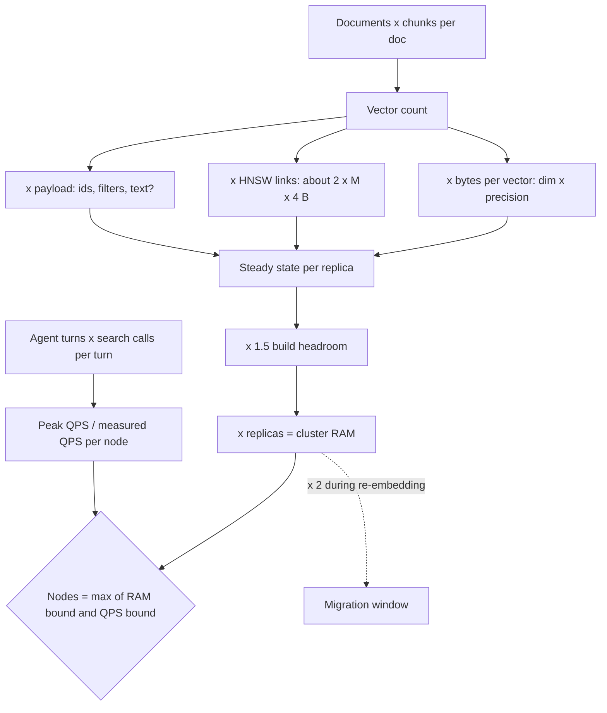

## TL;DR
The store behind an agent's search and memory tools costs RAM-resident bytes, `vectors × (dim ×
bytes_per_dim + graph_overhead + payload)` times replicas and headroom, and QPS set by tool calls per agent
turn. Do the arithmetic before picking a vendor.

## For agent builders
- **Why it matters for agents.** Agents multiply both terms: per-user memory adds vectors with every
  conversation, and one agent turn can issue several search calls, so retrieval QPS is a multiple of user
  traffic. Both decide whether pgvector suffices or a cluster is needed.
- **Where it shows up in your stack.** The collection behind `search_docs` and `recall_memory`, its
  quantization and on-disk settings, the managed-tier quote, and the latency budget each tool call gets
  inside the agent's step.
- **What you control.** Chunk size, embedding dimension and precision, where chunk text lives, how many
  memories per user you keep, and how many retrieval calls the agent may make per turn.
- **What you can skip.** Product-quantization theory. The eight-step checklist and the calculator below are
  what you need.

## Decision case
### Scenario
A law firm is launching a legal-research agent for 2,000 lawyers over 1 million documents (opinions,
briefs, internal memos) averaging 3,000 tokens. All figures are illustrative.

- **Chunking.** 500-token chunks with 100 overlap: ceil(3,000 / 400) = 8 per document, so 8 million vectors.
- **Embedding.** 1,536 dimensions; float32 is 6,144 B per vector, and a chunk's text is about 2 KB plus 300 B of ids and filter fields.
- **Traffic.** At peak, 50 agent turns a second with up to 5 retrieval calls each: 250 QPS. Staging measured about
  400 QPS per node with production-shaped filters.

Constraints:
- **Budget.** At most 4 nodes of 64 GB RAM, including during migrations.
- **Quality.** Recall@10 of at least 0.95 against exact float32 search; p99 under 100 ms per tool call.
- **Availability.** Two replicas, each on its own node.
- **Migration.** An embedding-model upgrade (same dimension) is planned within 6 months and must fit without new nodes.
- **Text.** Chunk text already lives in the firm's Postgres chunk table, keyed by `chunk_id`.

### Options
Per-replica RAM is (vectors + HNSW links at `M = 16` + payload) × 1.5 headroom; nodes = 2 replicas × ceil(per-replica RAM / 64 GB).

| Option | Vectors + links + payload | Per replica | Nodes | Nodes during migration (×2) | Recall risk |
|---|---|---|---|---|---|
| **A. float32, text in engine** | 49.2 + 1.0 + 18.4 GB | ≈ 103 GB | 4 | 8: fails the budget | None |
| **B. int8 in RAM, float32 on disk, text in engine** | 12.3 + 1.0 + 18.4 GB | ≈ 48 GB | 2 | 4: at the budget limit | Low, with rescoring |
| **C. int8 in RAM, float32 on disk, text in Postgres** | 12.3 + 1.0 + 1.6 GB | ≈ 22 GB | 2 | 2 | Low, with rescoring |
| **D. Binary in RAM, text in Postgres** | 1.5 + 1.0 + 1.6 GB | ≈ 6 GB | 2 | 2 | Higher: needs heavy oversampling |

The QPS bound is ceil(250 / 400) = 1 node per replica, so memory binds in every option.

### Decision
Choose **C**, because it is the cheapest option that keeps the migration inside the budget at low recall risk:
- **The migration decides it.** A doubles to 8 nodes and B to the full budget of 4; C holds both model versions
  at about 45 GB per replica, still one 64 GB node each.
- **Text was the biggest line after quantization.** In B, 18.4 GB of payload outweighs the 12.3 GB of int8 vectors.
  The text already sits in Postgres, so moving it costs one keyed fetch for the final k per call.
- **D saves RAM but no nodes.** Two replicas need two nodes either way, so binary codes would buy recall risk for nothing.
- **Disk is sized separately.** Full-precision vectors for rescoring are about 49 GB per replica on SSD, plus WAL and snapshots.

What would change it:
- **Recall misses 0.95 at int8.** Fall back to B, accept the 4-node migration, and migrate tenant by tenant to bound the overlap.
- **Traffic grows.** If peak exceeds 400 QPS per replica (for example a planner making 10 calls a turn at 50 turns a second, which is 500 QPS), the QPS bound adds nodes before RAM does.
- **A larger model.** Moving to 3,072 dimensions doubles the vector line, about 24.6 GB at int8, and the arithmetic must be redone.

### Trade-offs accepted
- **An extra hop for text.** Each tool call fetches k chunk texts from Postgres. Watch p99 per tool call against the 100 ms budget.
- **Quantization error.** Measure recall@10 against exact float32 search on a labelled query set before launch and after each model change.
- **Thin headroom during migration.** About 45 of 64 GB per node. Alarm when steady-state RAM crosses about two thirds of node memory.
- **Two copies on disk.** Quantized and full-precision vectors both persist; track disk per replica with snapshots included.

### Review rubric
- **Vectors come from chunks.** The write-up derives the vector count from tokens, chunk size and overlap, not documents.
- **Every RAM term is itemized.** Vectors, links, payload, headroom and replicas each appear with arithmetic.
- **Both bounds are checked.** Node count is the larger of the RAM and QPS bounds, with QPS derived from agent turns times calls per turn.
- **The migration window is budgeted.** It shows the doubled footprint fits, or how the overlap is bounded.
- **Recall is gated by measurement.** Quantization is accepted only against a stated recall target.
- **Reversal conditions are concrete.** It names the recall, traffic or model change that flips the choice.

## Why it exists
- **Teams size vector stores by feel.** They pick a managed tier that "looks big enough" or the instance with
  the most RAM they can justify. Both fail.
- **Under-sizing fails in production.** Out-of-memory during a background index build, p99 latency jumping
  when the index spills out of memory, or a managed plan that silently caps vectors so the last 30 % of the
  corpus never lands.
- **Over-sizing fails on the invoice.** A five-figure monthly bill for a corpus that would fit in a Postgres
  replica.
- **The inputs are not mysterious; omission is what breaks estimates.** Counting documents instead of chunks
  (a 10× error), forgetting the ANN graph's own memory, storing full chunk text beside each vector and
  finding text dominates, or forgetting a re-embedding migration doubles the collection while it runs.
- **Same discipline as KV-cache sizing in serving.** This lesson is the checklist and the arithmetic, so the
  number comes from the corpus rather than a pricing page.

## How it works
### Step 1: count vectors
- **Formula:** `vectors = documents × chunks_per_document × vectors_per_chunk`.
- **With token-based chunking:** `chunks_per_document ≈ tokens_per_document / (chunk_tokens − overlap_tokens)`,
  rounded up per document.
- **`vectors_per_chunk`** is 1 for standard dense retrieval, more than 1 if you embed several views (title
  plus body, or a summary), and much more for late-interaction models that store one vector per token.
- **Add growth:** a corpus adding 2 % per month is 27 % larger in a year.

### Step 2: bytes per vector
`dim × bytes_per_dim`:

| Precision | Bytes per dimension |
|---|---|
| float32 | 4 |
| float16 | 2 |
| scalar int8 quantization | 1 |
| binary quantization | 1 bit (one eighth of a byte) |
| product quantization | a fixed number of bytes per vector, commonly tens of bytes |

- **Dimension comes from the model.** Common text embedding models sit between 384 and 3,072 dimensions;
  Matryoshka-style models let you truncate to a smaller prefix at a quality cost you must measure.
- **Quantization frees RAM, not disk.** Quantized indexes usually keep full-precision vectors on disk for
  rescoring.

### Step 3: index overhead
- **HNSW stores neighbour lists.** With degree parameter `M`, the base layer holds up to `2M` links per node,
  each a 4-byte id, so links cost about `2 × M × 4` bytes per vector plus a little for upper layers.
- **`M = 16` gives roughly 128 bytes per vector.** The hnswlib parameter guide puts link memory at roughly
  `M × 8–10` bytes per element, which matches.
- **Treat it as a lower bound,** because engines add per-point bookkeeping (ids, versions, locks).
- **IVF** adds only centroids and posting lists of ids, negligible next to the vectors.

### Step 4: payload and secondary indexes
- **Everything beside the vector costs memory** in most engines: the id, filterable fields and their indexes,
  and the chunk text if you keep it there.
- **Text is the surprise.** At roughly 4 characters per token (an English-prose approximation), a 400-token
  chunk is about 1.6 KB, larger than an int8-quantized 1,024-dimensional vector.
- **If memory is the constraint,** keep text and rich metadata in Postgres or object storage keyed by
  `chunk_id`, and store only ids and filter fields with the vector.

### Step 5: replicas and headroom
- **Multiply by the replication factor** for availability.
- **Add headroom,** because segment merges and index rebuilds temporarily hold two copies of a segment, and
  running at the edge of RAM turns every compaction into an incident. About 1.5 is a common rule of thumb.
- **Know what 1.5 is applied to.** Qdrant's capacity guidance multiplies raw vector bytes by 1.5 to cover
  index structures, metadata and temporary segments together. This lesson itemizes links and payload first,
  then applies 1.5× as build headroom: the more conservative reading. Treat either as a floor, not a target.

### Step 6: throughput and shards
- **Memory gives one lower bound on node count; QPS gives another.**
- **Per-node throughput** depends on dimension, `ef`, filter selectivity and hardware, so measure it with your
  own vectors and filters, not a benchmark.
- **Formula:** `nodes = max(ceil(total_RAM / RAM_per_node), ceil(peak_QPS / QPS_per_node))`, sized at peak
  rather than average, within the latency budget the product allows retrieval.

### Step 7: decide what must be RAM-resident, then size the disk
The line between "must be in RAM" and "may be on disk" is set by access pattern.

| Data | Access pattern | Placement |
|---|---|---|
| Graph links and the vectors traversal compares | random reads on every hop | RAM; if memory-mapped and the working set falls out of page cache, latency rises by orders of magnitude |
| Full-precision vectors for rescoring | a few dozen to a few hundred per query (k times the oversampling factor) | disk on an SSD |
| Payload | fetched only for the final k | disk |

- **Engines expose this per collection** (for example on-disk vectors or payload in Qdrant, with the quantized
  copy kept in RAM).
- **Then size the disk separately:** full-precision vectors, the quantized copy, the write-ahead log, and
  snapshots or backups, which are complete copies. Disk is cheap but not free, and the snapshot is what you
  restore from.

### Step 8: migrations
- **A new embedding model means old and new vectors coexist until cutover.**
- **Budget for the collection to double** during that window, or migrate tenant by tenant so the overlap is
  bounded; the re-indexing lesson in this module covers the strategy.

### Agent-specific inputs
- **Memory vectors grow with users, not documents.** `memory_vectors = active_users × memories_per_user`, and
  without a retention or consolidation policy `memories_per_user` only rises.
- **Retrieval QPS is tool calls, not user requests.** `peak_QPS = peak_agent_turns_per_second ×
  retrieval_calls_per_turn`; a planner that searches four times per turn quadruples the QPS bound.
- **Latency budget is per step.** A 100 ms search inside a ten-step agent run is a second of wall-clock, so
  size for p99 per call at that QPS, not for a single query.

## Diagram
The estimate is a chain of multiplications; each decision box is a lever that changes one term. For agents,
the QPS input is agent turns times retrieval calls per turn.



## Examples
### Worked scenario: 200,000 documents
A knowledge base has 200,000 documents averaging 4,000 tokens. Chunks are 400 tokens with 50 overlap, so
each document yields about 4,000 / 350 ≈ 11.4 chunks; with rounding per document call it 12, giving 2.4
million vectors. The embedding model is 1,024-dimensional.

| Line item | Arithmetic | Size |
|---|---|---|
| Vectors in float32 | 2.4 M × 4,096 B | ≈ 9.8 GB |
| HNSW links at `M = 16` | 2.4 M × 128 B | ≈ 0.3 GB |
| Payload: chunk text (≈ 1.6 KB) plus ids and filter fields (≈ 0.4 KB) | 2.4 M × 2 KB | ≈ 4.8 GB |
| Steady state per replica | sum | ≈ 14.9 GB |
| With 1.5× headroom | × 1.5 | ≈ 22 GB |
| Two replicas | × 2 | ≈ 45 GB of RAM in total |

**Now change two decisions:**

| Change | In-memory total per replica |
|---|---|
| Scalar int8: vectors become 2.4 M × 1,024 B ≈ 2.5 GB | 2.5 + 0.3 + 4.8 ≈ 7.6 GB; text is now the biggest line |
| Also move text to the chunk table, keep 200 B of ids and filters | 2.5 + 0.3 + 0.5 ≈ 3.3 GB, about 5 GB with headroom |

- **The same corpus went from large-memory nodes to one modest node,** with full-precision vectors (9.8 GB)
  kept on disk for rescoring.
- **Engine support varies.** pgvector offers half-precision (`halfvec`, 2 bytes per dimension) and binary
  (`bit`) types rather than int8, so its nearest equivalent is about 4.9 GB of vectors, still small enough
  for an existing database host.
- **All figures are illustrative order-of-magnitude arithmetic;** measure recall after quantizing.

**Push one step further to see the next bottleneck:**
- **Binary quantization** stores 1,024 bits, which is 128 bytes per vector: 2.4 M × 128 B ≈ 0.3 GB, the same as
  the HNSW links.
- **Shrinking vectors further barely helps,** because the graph and per-point ids and filter fields now
  dominate. Remaining levers: a smaller `M` (fewer links, lower recall), or IVF-style or disk-based indexes
  whose overhead is not per-link.
- **Binary codes lose more recall than int8,** so they normally come with heavier oversampling and rescoring
  from full-precision vectors on disk.
- **Each lever you pull exposes the next term of the formula as the largest one.**

### A calculator you can keep

```python
import math

def vector_store_bytes(docs, tokens_per_doc, chunk_tokens, overlap, dim,
                       bytes_per_dim=4.0, M=16, payload_bytes=2048, replicas=2, headroom=1.5):
    chunks_per_doc = math.ceil(tokens_per_doc / (chunk_tokens - overlap))
    n = docs * chunks_per_doc
    vec = n * dim * bytes_per_dim
    links = n * 2 * M * 4                      # base-layer HNSW neighbour ids
    payload = n * payload_bytes
    per_replica = (vec + links + payload) * headroom
    return {"vectors": n, "vector_gb": vec / 1e9, "links_gb": links / 1e9,
            "payload_gb": payload / 1e9, "ram_per_replica_gb": per_replica / 1e9,
            "cluster_ram_gb": per_replica * replicas / 1e9}

base  = vector_store_bytes(200_000, 4_000, 400, 50, 1024)
lean  = vector_store_bytes(200_000, 4_000, 400, 50, 1024, bytes_per_dim=1.0, payload_bytes=200)
for name, r in (("float32 + text in engine", base), ("int8 + ids only", lean)):
    print(f"{name}: {r['vectors']:,} vectors, {r['ram_per_replica_gb']:.1f} GB per replica, "
          f"{r['cluster_ram_gb']:.1f} GB cluster")
```

Run it with your own corpus numbers before any vendor conversation; the two scenarios print about 22.6 GB
and 4.9 GB per replica, a factor of roughly 4.6 in RAM for the same retrieval corpus.

### Node count: memory bound vs throughput bound
Runnable as-is. The QPS figures are assumptions for illustration: 1,200 peak QPS and 400 QPS per node as if
measured on staging with production-shaped filters.

```python
import math

def nodes_needed(cluster_ram_gb, ram_per_node_gb, peak_qps, qps_per_node):
    by_ram = math.ceil(cluster_ram_gb / ram_per_node_gb)
    by_qps = math.ceil(peak_qps / qps_per_node)            # qps_per_node: measured, not from a benchmark
    return max(by_ram, by_qps), by_ram, by_qps

print(nodes_needed(45, 32, 1200, 400))      # (3, 2, 3): throughput binds, not memory
print(nodes_needed(90, 32, 1200, 400))      # migration window doubles RAM: (3, 3, 3)
```

- **Throughput can bind before memory.** Quantizing shrinks the RAM bound but does nothing for the QPS bound
  unless it also speeds traversal.
- **The migration window** doubles the RAM line, so check it still fits before an embedding upgrade.

### Agent scenario: sizing memory and tool-call QPS for an assistant
An assistant agent serves 100,000 active users and keeps about 200 memories each, embedded at 1,024
dimensions with int8 quantization and 200 B of ids and filters per point. At peak it handles 300 agent
turns per second, and the planner averages 4 retrieval calls per turn. Illustrative assumptions throughout.

```python
import math

def agent_store(users, memories_per_user, dim, bytes_per_dim=1.0, M=16, payload_bytes=200,
                headroom=1.5, turns_per_s=300, calls_per_turn=4):
    n = users * memories_per_user
    ram = n * (dim * bytes_per_dim + 2 * M * 4 + payload_bytes) * headroom
    return {"vectors": n, "ram_per_replica_gb": ram / 1e9, "peak_qps": turns_per_s * calls_per_turn}

r = agent_store(100_000, 200, 1024)
print(r)                                   # 20,000,000 vectors, about 40.6 GB per replica, 1,200 QPS
print(nodes_needed(2 * r["ram_per_replica_gb"], 32, r["peak_qps"], 400))   # (3, 3, 3)
```

| Line item | Arithmetic | Result |
|---|---|---|
| Memory vectors | 100,000 × 200 | 20 million |
| int8 vectors + links + payload | 20 M × (1,024 + 128 + 200) B | ≈ 27 GB |
| With 1.5× headroom, per replica | × 1.5 | ≈ 40.6 GB |
| Peak retrieval QPS | 300 turns/s × 4 calls | 1,200, the same figure as the node-count example |
| Cap calls at 2 per turn | 300 × 2 | 600 QPS: the throughput bound drops from three nodes to two |
| Also consolidate to 100 memories per user | 10 M vectors, ≈ 20.3 GB per replica, ≈ 40.6 GB for two | RAM bound drops to two nodes as well |

- **The agent design is a sizing lever.** Halving retrieval calls per turn moved the QPS bound as much as any
  index setting, but the node count only falls once the RAM bound falls too.
- **Memory retention is the other lever.** Consolidating to 100 memories per user halves the RAM line, and
  together the two changes take the cluster from three nodes to two.

## Production patterns
- **Size from measured chunk statistics.** Run the real chunker over a sample of a few thousand documents and
  use the p50 and p95 chunks per document, not the mean of document lengths. Re-run when chunking changes and
  compare the vector count actually loaded with the estimate.
- **Keep the quantized copy in RAM, originals on disk.** In Qdrant, store full vectors with `on_disk=True` on
  the vector config and keep scalar-quantized vectors in RAM (`always_ram=True` in the quantization config),
  with `on_disk_payload=True` for large payloads. Monitor p99 latency and page-cache misses after the change.
- **Half-precision indexes in pgvector.** Index a cast of the column, for example
  `USING hnsw ((embedding::halfvec(1024)) halfvec_cosine_ops)`, to halve index memory, and query with the
  same cast so the index is used. Compare recall@k with the float32 index on a labelled query set.
- **Alarm below the headroom line.** With a 1.5× headroom factor, steady-state RAM should stay under about
  two thirds of node memory; alert when it crosses that, before compaction fails rather than after.
- **Bound the migration window.** Re-embed tenant by tenant or collection by collection, and delete the old
  vectors as each slice cuts over, so the doubling applies to one slice at a time. Track RAM per collection
  through the migration.
- **Budget retrieval calls per agent turn.** Agent teams log search calls per turn from traces, cap them in
  the agent loop, and feed the measured p95 into the QPS bound. Pair it with a memory retention or
  consolidation job, and monitor memory vectors per active user and p99 latency per tool call.

## Trade-offs
- **Quantization vs recall.** It cuts RAM by 4× (int8) to 32× (binary) and speeds traversal, but costs recall
  that must be measured per model; for a collection that fits unquantized with headroom, it is complexity for
  nothing.
- **Text in the engine vs memory.** Retrieval becomes a single call and the stack is simpler, but text often
  outweighs quantized vectors; move it out when memory, snapshot time or rebalance time are the constraint.
- **Larger chunks vs precision.** Fewer vectors and a smaller index, but retrieval precision usually falls as
  chunks grow; size for the chunking the retrieval evals chose, not the other way round.
- **Lower dimension vs quality.** A smaller model or a Matryoshka prefix shrinks memory linearly, at a quality
  cost that is small for some models and tasks and large for others; a measured decision, not a default.
- **More replicas vs cost.** Availability and read throughput at linear cost; a single replica with a fast
  rebuild from the chunk table is acceptable for internal tools and wrong for a customer-facing SLA.

## Pitfalls
- **Counting documents instead of chunks.** Symptom: a cluster sized for 200,000 vectors receives 2.4 million
  and fails to load the index.
- **Forgetting graph links and merge headroom.** Symptom: out-of-memory kills during background compaction or
  index rebuild rather than under query load.
- **Ignoring payload size.** Symptom: RAM dominated by text with an index that is a fraction of it, and slow
  snapshots and rebalances.
- **Sizing throughput on average QPS.** Symptom: p99 latency collapses during the daily peak while dashboards
  show healthy averages.
- **Assuming a spill to disk degrades gracefully.** Symptom: latency rises by orders of magnitude once the
  graph no longer fits, because traversal is random access.
- **Not budgeting for the migration window.** Symptom: a model upgrade blocked because the cluster cannot hold
  both embedding versions at once.

## When to use
- **Do the arithmetic** whenever a vector store is chosen, a tier is upgraded, a chunking or embedding change
  is proposed, or a tenant is onboarded with a known corpus.
- **Redo it for agents when** you add long-term memory, change the planner so it searches more per turn, or
  launch to a larger user base, because each changes a term directly.
- **Measure** the real chunks-per-document distribution from a sample rather than assuming the mean, recall
  before and after any quantization, and QPS under production-shaped filters.
- **What the number tells you:** whether pgvector in the existing database suffices, whether quantization is
  worth its recall cost, and what the managed-service bill will be at the chosen precision.
- **Interviews:** "how big a vector store does this corpus need?" Walk the eight steps with explicit
  assumptions, then name the two levers that change the answer most: quantization and payload placement.

## Role lens
- **Engineer:** Computes vectors, bytes and overhead from the pipeline's real chunk statistics, chooses
  quantization and payload placement, and verifies recall and peak QPS on a staging cluster.
- **Architect:** Owns the capacity model and the cost line for retrieval, decides between an extension
  and a dedicated engine on the basis of the estimate, and budgets memory for re-embedding migrations.
- **FDE:** Sizes a customer deployment from their document count and page statistics during scoping, and
  explains why the quoted tier changes when they add a second content source or a larger embedding model.

## Check yourself
**Q:** A customer wants to index 1.5 million support tickets averaging 300 tokens with a 1,536-dimensional
float32 embedding, one chunk per ticket, on a managed service, and they want the full ticket text
returned with each hit. Estimate the memory, then show how you would cut it by more than half without
changing the embedding model or the retrieval results they see.
**A:** One chunk per ticket gives 1.5 million vectors. Float32 at 1,536 dimensions is 6,144 bytes per
vector, so about 9.2 GB of vectors; HNSW links at `M = 16` add about 128 bytes each, roughly 0.2 GB; ticket
text at 300 tokens is about 1.2 KB plus metadata, roughly 2 GB. Steady state is about 11.4 GB, around
17 GB with 1.5× headroom per replica, and double that for two replicas. To cut it: store the vectors with
scalar int8 quantization, bringing vectors to about 2.3 GB while keeping float32 copies on disk for
rescoring so returned results are effectively unchanged, and move ticket text out of the engine into the
ticket database keyed by id, fetched after retrieval. The in-memory total drops to roughly 2.3 + 0.2 +
small metadata, under 3 GB before headroom, which is a quarter of the original. Then measure recall on a
labelled query set to confirm quantization did not change the top-k, and load-test at peak QPS.

## Interview questions
### Walk me through estimating RAM for a vector store.
- **Count vectors from chunks, not documents:** documents × chunks per document × vectors per chunk, plus
  growth.
- **Add the terms per vector:** dim × bytes per dimension, about 2 × M × 4 bytes of HNSW links, and payload.
- **Multiply** by 1.5 for build headroom and by the replica count, then check the QPS bound on node count.

### A cluster runs fine under load but crashes during nightly compaction. Why?
- **Merges and rebuilds hold two copies of a segment** while building the new one, so peak memory exceeds
  steady state.
- **The estimate likely omitted headroom or graph links.** Check steady-state RAM against node memory; above
  about two thirds leaves no room for a 1.5× build peak.
- **Fix:** quantize, move payload out, or add memory, then re-test compaction under load.

### You are adding per-user long-term memory to an agent with 100,000 users. How do you size the store?
- **Vectors:** users × memories per user, about 20 million at 200 each, growing unless a retention or
  consolidation policy caps it.
- **Bytes:** at 1,024 dimensions int8 with 200 B payload, about 27 GB steady state and 40.6 GB per replica with
  headroom.
- **Throughput:** peak agent turns per second × memory and search calls per turn, then nodes as the max of
  the RAM and QPS bounds.

### After launching a planning agent, retrieval p99 doubled though the corpus did not change. Why?
- **QPS is tool calls, not users:** a planner that searches several times per turn multiplies retrieval
  traffic, so the throughput bound, not memory, is now binding.
- **Check traces** for search calls per turn and compare peak QPS with measured QPS per node.
- **Fix:** cap or batch calls per turn, cache repeated queries within a run, or add nodes for the QPS bound.

### Estimate memory for 200,000 documents of 4,000 tokens, 400-token chunks with 50 overlap, 1,024 dimensions.
- **Vectors:** ceil(4,000 / 350) = 12 chunks per document, so 2.4 million vectors.
- **Float32 with text in the engine:** about 9.8 GB vectors, 0.3 GB links, 4.8 GB payload; about 22 GB per
  replica with headroom.
- **Int8 and ids only:** about 3.3 GB, roughly 5 GB with headroom per replica, a 4.6× reduction.

### Vectors are already binary-quantized and the index is still too big. What next?
- **Look at which term now dominates:** binary vectors at 1,024 dimensions are 128 bytes, equal to the HNSW
  links at `M = 16`, so ids, filter fields and the graph are the bulk.
- **Levers:** a smaller `M` (fewer links, lower recall), IVF-style or disk-based indexes whose overhead is not
  per-link, or moving payload out of the engine.

## Quiz
### Q: Which omission most often causes a vector store to be under-provisioned by an order of magnitude?
- [ ] Forgetting that cosine similarity needs normalized vectors
- [x] Counting documents rather than chunks when estimating the number of vectors
- [ ] Using float16 instead of float32 in the estimate
- [ ] Ignoring the number of HNSW layers
> A document with a few thousand tokens becomes ten or more chunks, each with its own vector. Estimates
> that start from document count miss this multiplier entirely; precision and graph layers change the
> total by much smaller factors.

### Q: After enabling int8 scalar quantization, why does disk usage not fall (it even grows slightly) while vector RAM drops roughly 4×?
- [ ] The engine compresses the payload instead of the vectors
- [ ] Quantization only applies to the HNSW links
- [x] The quantized copy replaces float32 in memory, but full-precision vectors are kept on disk for rescoring the final candidates
- [ ] Disk usage is always dominated by the write-ahead log
> Quantization trades precision during graph traversal for memory, and engines recover accuracy by
> re-ranking the shortlist against the original vectors. Those originals must still exist, so disk holds
> both copies while RAM holds only the small one.

### Q: Why should the capacity estimate include a headroom factor beyond steady-state bytes?
- [ ] Because object storage charges per request
- [ ] Because embedding dimensions grow over time
- [x] Because segment merges and index rebuilds temporarily hold additional copies, and a cluster at the edge of RAM fails during those operations
- [ ] Because replicas must each hold the full write-ahead log
> Background maintenance builds a new segment or graph before releasing the old one. Without free memory
> for that overlap, compaction and re-indexing trigger out-of-memory failures even though steady-state
> queries fit.

## Use cases & projects
### Use cases
- **Choosing pgvector or a cluster for an agent's knowledge base.** The calculator shows whether the corpus
  fits beside the existing Postgres data once quantized and with text moved out.
- **Adding long-term memory to an assistant agent.** Users × memories per user is a new, growing vector line
  that needs a retention policy before it needs a bigger tier.
- **Capacity for planning agents.** Retrieval QPS is agent turns times search calls per turn, so a planner
  change can require nodes even when the corpus is unchanged.
- **Budgeting an embedding-model upgrade.** The migration window doubles the RAM line under a live agent.

### Mini project
**Build a sizing sheet from your agent's own traces (1-2 hours).**
- **Goal:** size the vector store for an agent from measured inputs rather than guesses.
- **Steps:** run the real chunker on a sample of 1,000 documents and record p50 and p95 chunks per document;
  run 50 agent tasks and count retrieval calls per turn from the traces; plug both into
  `vector_store_bytes`, `agent_store` and `nodes_needed`; compare float32 and int8, text in engine and out.
- **Done when:** a one-page table gives RAM per replica, cluster RAM, peak QPS and node count for each
  option, names the binding bound, and states the one change (quantization, payload placement or calls per
  turn) that most reduces cost.
