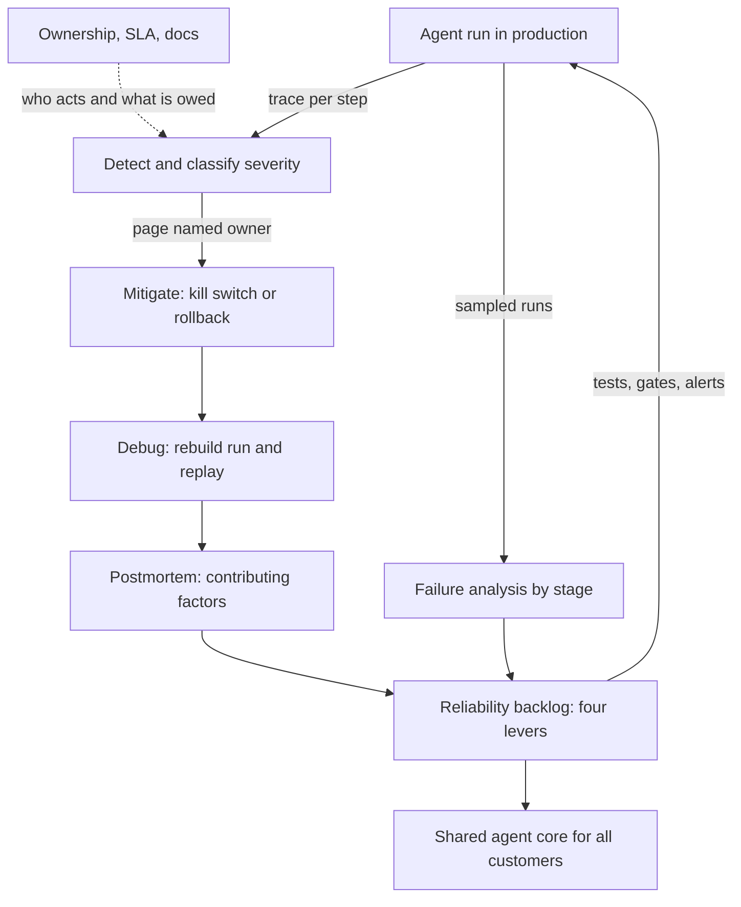

## Overview
This module is about what happens after an AI agent ships and someone has to answer for it. An agent run
is a chain of model calls, tool calls and retrievals, so failures start at any step and often throw no
error at all.

The lessons move from one failure, to many failures, to the promises and handover around them:

- **Production debugging** teaches you to rebuild the exact input the model saw (rendered prompt,
  retrieved chunks, tool results, model snapshot, sampling settings) from traces, then bisect and replay
  instead of guessing.
- **Incident severity and escalation** decides, before anything breaks, how bad a failure is by its
  impact rather than its cause, including the silent ones that return HTTP 200 with wrong or unsafe
  content.
- **Root-cause analysis and postmortems** turn a mitigated incident into contributing factors and owned
  actions, without blame.
- **Failure analysis** zooms out from one incident to hundreds of small failures, sampled, labelled by
  pipeline stage and ranked by harm.
- **System reliability** gives the owner's view of four levers: how often things fail, how big each
  failure is, how fast you notice and how fast you recover.
- **Operational ownership and support boundaries** say who is paged for each layer and how issues cross
  between you, the customer and vendors.
- **SLAs** turn all of this into a contract your dependency chain and on-call rotation can actually back.
- **Technical documentation** keeps the system working once the builders leave, and **productizing**
  turns the third bespoke build into one shared core.

Core for agents: production-debugging, failure-analysis and system-reliability. You use them directly
whenever you run an agent. Useful background: incident severity, postmortems, ownership, SLAs,
documentation and productizing, which you meet when operating agents for customers.

Afterwards you can:

- run an agent incident end to end, from trace to replay to postmortem;
- write a severity scale, a postmortem, a boundary table and an SLA;
- build a tracing and replay harness and a failure taxonomy for your own agent;
- decide when field work should become product.

It matters most for FDEs and for Engineers who own a live service.

## Why it matters
- **Engineer:** You carry the pager for an LLM pipeline or agent, so you need trace IDs, captured prompts and a replay harness that let you reproduce a one-in-ten failure. You also need a severity scale you can apply at 3 a.m. without a debate, and postmortem actions that change the system rather than ask people to be more careful.
- **Architect:** You set the reliability levers of an agent system and the promises built on them: change gating, containment, symptom alerts and rollback time, the dependency-chain ceiling behind any SLA, and the shared core, configuration and extension points that let one agent design serve many customers without turning into N forks.
- **FDE:** You take agents live inside someone else's environment, so you must agree the boundary table, support SLA and escalation path with the customer before launch, leave runbooks and a system card behind when you rotate off, and notice when the third customer is asking for the same build so it can become product.

## Mental model
Picture delivery as a loop that runs on every agent failure, wrapped in a set of promises.

| Layer | Speed | What happens | Lessons |
|---|---|---|---|
| Inner loop | Fast | Detect, classify by severity, escalate to the right owner, mitigate, then debug from the trace until you can replay the failure | production-debugging, incident-severity-and-escalation |
| Outer loop | Slow | Postmortems find contributing factors behind each serious incident; failure analysis ranks the many small failures nobody declared | root-cause-analysis-and-postmortems, failure-analysis |
| Reliability work | Ongoing | Both loops feed one prioritised list, chosen by whichever of the four levers is cheapest to pull next | system-reliability |
| Promises | Contract | Ownership says who acts at each layer, the SLA says what the customer is owed, documentation lets someone who was not there carry the loop on | operational-ownership-and-support-boundaries, slas, technical-documentation |
| Business scale | Quarterly | What each deployment teaches flows back into one core, so every fix reaches every customer | productizing-repeated-customer-solutions |

- A promise without a loop behind it is a future breach.
- A loop with no promises around it is unowned work.

The fast loop sits on the left path from run to debug, the slow loop feeds the reliability backlog, and
the promises wrap the whole cycle.

## Suggested order
1. production-debugging — the base skill of reconstructing and replaying one live agent failure from its trace, which every later lesson assumes.
2. failure-analysis — core for agents: widens from one run to hundreds of small failures, ranked by stage and harm, so effort goes to the dominant modes.
3. system-reliability — core for agents: combines incident and failure data into the owner's four levers and decides which lever to fund next.
4. incident-severity-and-escalation — adds the response frame around debugging: classify by impact, decide who is woken and when to escalate.
5. root-cause-analysis-and-postmortems — follows a mitigated incident to its contributing factors and owned actions, using the timeline and severity from the earlier lessons.
6. operational-ownership-and-support-boundaries — names who owns each layer and how issues cross between you, the customer and vendors, which an SLA needs.
7. slas — writes the service and support promise, computed from the dependency ceiling and backed by the ownership and on-call model.
8. technical-documentation — writes down runbooks, decisions and the system card so the loop and the promises survive handover.
9. productizing-repeated-customer-solutions — the business-scale step, which assumes you can already deliver, own and document one deployment well.

## Capstone
### Brief
**Use case:** you are the forward-deployed engineer handing over a contract-review agent to an insurance
customer after an eight-week pilot. This major project takes several days, about a week of work.

The agent retrieves clauses from the customer's document store, calls a hosted LLM to flag risky terms,
and writes findings to their case-management tool through a tool call. Two other insurers want the same
thing, and your team has already copied the repository once for the second.

Your job is to prepare the deployment for production ownership:

- Instrument the pipeline so any flagged finding can be traced to its rendered prompt, retrieved chunks
  and model version, and build a replay harness.
- Take a seeded incident (a prompt change that silently stopped flagging indemnity clauses for one week)
  through severity classification, mitigation, debugging and a blameless postmortem.
- Run a failure analysis on 100 sampled outputs.
- Write the ownership boundary table, the SLA, the runbooks and handover documents, and a productizing
  proposal that separates the shared core from per-insurer configuration and extensions.

### Deliverables
- A tracing and replay harness that, given a request ID, rebuilds the exact model input and replays it N times with one variable changed, plus a short write-up of the seeded incident reproduced from its trace.
- A severity scale and escalation policy with at least four levels, including content-level criteria for missed or wrong findings and cross-tenant exposure, with time-to-acknowledge and update cadence per level.
- A blameless postmortem for the seeded incident: a timeline, contributing factors across prevention, detection and mitigation, and at least three owned, dated action items.
- A failure-analysis report on 100 sampled outputs, labelled by failure mode and pipeline stage, with severity-weighted counts and the top three fixes ranked by expected reduction in harm.
- An ownership boundary table covering model provider, your platform, the application, the customer's document store and identity provider, plus a draft SLA with service and support terms, exclusions, credits and the dependency-chain arithmetic.
- A handover pack containing an architecture overview, at least two decision records, runbooks tied to specific alerts and a system card listing model and prompt versions, eval results and known failure modes, plus a productizing proposal with the core, configuration and extension split and break-even estimate.

### Rubric
- Replaying the seeded incident's request ID reproduces the missed indemnity flag at the old prompt version and not at the fixed one, across repeated runs that account for sampling variance.
- The postmortem names no individual as the cause, does not stop at "the model missed it", and each action item changes a test, an alert, a deploy gate or a guardrail rather than asking for vigilance.
- The failure-analysis categories come from reading the sampled outputs, each category shows its share and stage, and the chosen fix targets the top weighted category, not the most recent complaint.
- The SLA's availability figure does not exceed the product of the dependencies' availabilities, every support response time maps to a named rotation, and the internal SLO alert is stricter than the contract.
- In a tabletop run of "answers cite superseded policy documents", a reviewer can use the boundary table and runbook alone to route the issue to its owner within one step, with no ticket bouncing.
- The productizing proposal lists every difference between the existing forks and assigns each to core, configuration or extension, refusing at least one customer-specific request with a stated reason.
