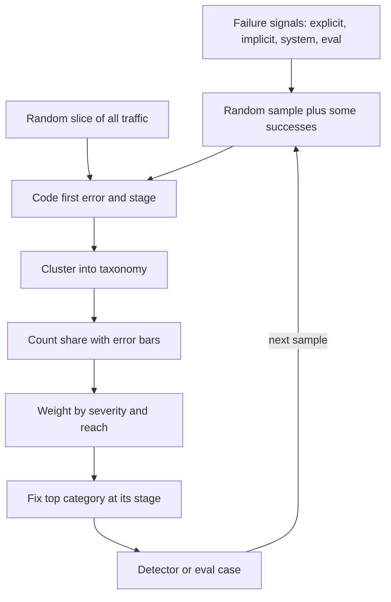

## TL;DR
Failure analysis finds the few failure modes causing most harm across many failures. Sample without
bias, label each by error and stage, count, weight by severity, and fix the top of the list. LLM
failures are diverse and quiet, so this matters.

## Why it exists
- **Debugging explains one failure; products fail in hundreds of ways a day.** An answer misses a detail,
  a tool call gets a wrong argument, a refusal should not have happened, a request times out.
- **Reacting to reports funds the loudest failure.** Effort goes to the angry enterprise customer, the
  social-media screenshot, the bug the CEO hit. The loudest is rarely the most common, and fixing one at a
  time leaves the dominant modes untouched.
- **Aggregate metrics say "wrong", not "what".** "Satisfaction dropped from 82% to 76%" tells you
  something broke, not what to change.
- **Big swaps are guesses.** A bigger model or a full prompt rewrite costs money and often moves the error
  elsewhere.
- **Classifiers first bake in imagined categories.** Building one before anyone has read the data encodes
  what the team imagined, not what occurs. Failure analysis turns a pile of failures into a ranked,
  quantified list of causes, so the next fix has the largest expected reduction in harm.

## How it works
### 1. Define what counts as a failure
| Signal type | Examples | Bias |
|---|---|---|
| Explicit | Thumbs-down, escalation to a human, complaint | Over-represents engaged, annoyed users |
| Implicit | User rephrases the same question, abandons the session, copies nothing | Noisy per case |
| System | Exception, timeout, schema validation failure, tool error | Misses confident wrong answers |
| Evaluation | An LLM judge or rule flags the output | Only as good as the judge |

- **Use several sources**, because each is biased and combining them reduces the blind spots of any one.

### 2. Sample without bias
- **Random, not forwarded.** Pull a random sample of failing cases from a fixed window, stratified if
  needed by tenant or use case, rather than the cases someone forwarded.
- **A few hundred is usually enough** to rank the top modes, because you are estimating proportions, not
  finding every bug.
- **Pull some successes too.** They calibrate whether a "failure pattern" is really specific to failures.
- **Label a small random sample of *all* traffic, flagged or not.** Failure signals miss the confident
  wrong answer nobody thumbs down. This sample is the only way to estimate the silent failure rate.
- **It also converts shares to rates.** It turns "38% of flagged failures" into an absolute rate per
  conversation, which is what a fix's benefit is actually measured in.

### 3. Open coding, then a taxonomy
1. **Read each case end to end** (the trace, not just the final answer) and write a short free-text note
   on the *first* thing that went wrong.
2. **Anchor on the first error**, because later errors are often consequences of it. A wrong retrieval
   causes a wrong citation causes a wrong answer: count one failure, not three.
3. **Read until saturation.** Stop when new cases stop producing new kinds of note; that, not a fixed
   quota, tells you the taxonomy is complete enough to rank.
4. **Cluster the notes** into categories ("retrieved outdated policy", "tool called with wrong date
   format", "ignored instruction to ask for order ID"), each tagged with its originating pipeline stage.
5. **Double-code a few dozen cases.** If two coders disagree often, the definitions are ambiguous and the
   counts that follow are noise.

This is the discipline the evals module calls error analysis, applied here to live production traffic.

### 4. Count and weight
- **Share with uncertainty.** A proportion *p* from *n* samples has standard error √(p(1−p)/n).
- **Weight by severity**, because a rare failure that leaks another tenant's data outranks a common one
  that adds an extra sentence.
- **Simple score:** frequency × severity × reach (fraction of users or revenue exposed).

### 5. Attribute and choose fixes
For each top category, estimate the most a fix could buy before choosing one:

```
expected reduction in failure rate ≈ overall failure rate × category share × fix efficacy
```

- **Category share is a hard ceiling.** A perfect fix for a 12% category removes at most 12% of failures,
  however impressive the intervention.
- **Rank by** that reduction, weighted by severity, divided by the fix's cost.
- **Pick the cheapest effective intervention at the originating stage**, because fixing there beats
  patching downstream symptoms:

| Category | Intervention |
|---|---|
| Stale retrieval | Index freshness |
| Malformed tool arguments | A schema or validator |
| Ignored instructions | A prompt rule or few-shot example |
| Unsafe content | A guardrail |

### 6. Make it repeatable
- **Automate the top categories** as detectors or eval cases so their rate becomes a tracked metric.
- **Repeat the manual pass periodically**, because new features and traffic shifts create new categories.

### Reactive versus proactive
- **This lesson is reactive:** it analyses failures that happened.
- **FMEA is the proactive counterpart:** it enumerates failure modes before launch and scores severity,
  occurrence and detectability.
- **They feed each other**, since observed failures update the FMEA's occurrence estimates.

## Diagram
The loop runs from biased-signal sampling to a ranked list; a fix is confirmed only when the next sample
shows its category shrinking.



## Examples
### Worked example: the bigger-model instinct
A support assistant handles about 10,000 conversations a week. The satisfaction metric has dropped and
the team's instinct is to switch to a larger model. Instead, they randomly sample 200 conversations that
had a failure signal and code the first error in each:

| Category (originating stage)            | Count | Share |
|-----------------------------------------|------:|------:|
| Retrieved outdated policy (retrieval)   | 76    | 38%   |
| Wrong order lookup argument (tool)      | 44    | 22%   |
| Answered when it should escalate (policy)| 30   | 15%   |
| Reasoning error with correct context (model) | 24 | 12% |
| Timeout or provider error (infra)       | 16    | 8%    |
| Other                                   | 10    | 5%    |

- **Uncertainty:** the top share has standard error √(0.38 × 0.62 / 200) ≈ 0.034, so a 95% interval of
  roughly 31%–45%: wide, but clearly the largest bucket.
- **The model is a small target.** Only 12% of failures are genuine model reasoning errors, so a bigger
  model directly targets about an eighth of the problem while increasing cost on every call.
- **Spillover is limited.** It may help somewhat with tool arguments and escalation judgement, but it
  cannot fix stale retrieval or provider timeouts, which together are 46% of failures.
- **Stage fixes attack more.** Re-indexing on document change plus filtering superseded policies attacks
  38%; validating the order-ID format before the tool call attacks another 22%.
- **Severity reorders the list.** The escalation category is lower in frequency but higher in severity (a
  customer given a wrong commitment), so it goes second in priority despite its share.

**Same unit for every option.** Suppose (illustratively) that 8% of conversations fail.

| Option | Calculation | Overall reduction |
|---|---|---|
| Freshness fix removing 80% of stale-retrieval failures | 0.08 × 0.38 × 0.8 | ≈ 2.4 percentage points |
| Larger model fixing half of reasoning errors | 0.08 × 0.12 × 0.5 | ≈ 0.5 points, plus spillover on tool arguments, at a higher price per request |

The efficacy figures are guesses, which is fine: the category share bounds each option, and the next
sample tells you whether the guess held.

### Ranking script (runnable)
Pure Python. The severity scores are illustrative (1 = cosmetic, 4 = wrong commitment); replace them with
the scale your team agrees.

```python
import math

counts = {"stale retrieval": 76, "tool argument": 44, "missed escalation": 30,
          "model reasoning": 24, "infra timeout": 16, "other": 10}
severity = {"stale retrieval": 2, "tool argument": 2, "missed escalation": 4,
            "model reasoning": 2, "infra timeout": 1, "other": 1}
n = sum(counts.values())                 # 200
failure_rate = 0.08                      # illustrative: 8% of conversations fail

def share_ci(k, n, z=1.96):
    p = k / n
    se = math.sqrt(p * (1 - p) / n)
    return p, max(0.0, p - z * se), p + z * se

rows = []
for cat, k in counts.items():
    p, lo, hi = share_ci(k, n)
    rows.append((p * severity[cat], cat, p, lo, hi))
for score, cat, p, lo, hi in sorted(rows, reverse=True):
    print(f"{cat:18} share {p:4.0%} (95% CI {lo:.0%}-{hi:.0%})  weighted {score:.2f}")
# stale retrieval first (0.76), missed escalation second (0.60), tool argument third (0.44)

def expected_reduction(share, efficacy):
    return failure_rate * share * efficacy   # absolute drop in failure rate

print(f"freshness fix: {expected_reduction(0.38, 0.8):.1%} points")   # 2.4%
print(f"bigger model:  {expected_reduction(0.12, 0.5):.1%} points")   # 0.5%
```

## Production patterns
- **Weekly failure review.** When: any system in production. How: a fixed slot where an engineer and a
  domain expert code a fresh random sample of flagged traces plus a slice of unflagged traffic into the
  shared taxonomy. Monitor: category shares week over week and the size of "other".
- **Promote categories to detectors.** When: a category is stable and recurring. How: write a rule,
  validator or LLM-judge check for it and run it on all traffic and in the regression eval. Monitor: the
  detector's rate, spot-checked against manual labels.
- **Inter-coder agreement check.** When: the taxonomy is new or changed. How: two people code the same few
  dozen cases and compare; rewrite any definition they split on. Monitor: share of cases with agreement.
- **Fix-confirmation sample.** When: after shipping a stage fix. How: draw the next random sample from a
  window that starts after the fix and recompute that category's share with its interval. Monitor: the
  share falling outside the previous interval.
- **Stage tag in the trace schema.** When: designing tracing. How: record per-stage outputs (retrieval
  results, tool arguments, validation errors) so coders can name the originating stage quickly. Monitor:
  fraction of cases coded "unknown stage".

## Trade-offs
- **Manual reading vs expert hours.** Reading traces finds categories nobody anticipated but costs expert
  hours. It flips toward automated classifiers once the taxonomy is stable and volume makes reading every
  week impractical.
- **Larger samples vs diminishing returns.** Larger samples narrow the confidence intervals, but ranking
  the top few modes rarely needs more than a few hundred cases. Spend extra effort on rare, high-severity
  categories instead.
- **Fine-grained taxonomy vs sparse counts.** Fine categories give precise fixes but few cases each. Merge
  categories when most have only a handful of cases.
- **First-error coding vs compounding issues.** Coding only the first error keeps counts honest but hides
  compounding issues. Record secondary errors separately when you suspect two independent defects.

## Pitfalls
- **Analysing only the failures customers forwarded.** Symptom: a priority list that tracks your largest
  accounts rather than your most common defects. Fix: random sampling.
- **Reading only final answers instead of full traces.** Symptom: almost everything is labelled "model
  hallucinated" and no stage-specific fix emerges. Fix: read the trace.
- **Counting cascaded errors as separate failures.** Symptom: category totals exceed the number of cases,
  and fixes all point at the same upstream defect. Fix: code the first error.
- **Building the automated classifier before a manual pass.** Symptom: a large "other" bucket and
  categories that never change week to week. Fix: open coding first.
- **Ranking by frequency alone.** Symptom: the team polishes tone while a rare data-exposure or
  wrong-commitment failure keeps recurring. Fix: weight by severity.
- **Sampling only flagged conversations.** Symptom: a reported failure rate that looks stable while
  customers, on manual review, turn out to be receiving confidently wrong answers nobody flagged. Fix:
  label a random slice of all traffic.

## When to use
- **Use when:** an aggregate quality metric moves, before choosing between expensive interventions (model
  swap, fine-tuning, re-architecture), at the end of a pilot, and on a regular cadence for any system in
  production.
- **Avoid when:** you need incident response. A single severe failure needs debugging and mitigation now,
  not a sampling exercise.
- **Measure:** category shares over time; a fix is confirmed when its category's share falls in the next
  sample.
- **Interviews:** answering "quality dropped, what do you do?" with "sample failures, categorise by stage,
  rank by impact" signals maturity.

## Role lens
- **Engineer:** Pulls the sample, codes traces, and converts the top failure categories into automated
  detectors and regression eval cases that run on every change.
- **Architect:** Uses the stage attribution to decide where to invest, for example retrieval freshness
  infrastructure versus model upgrades, and ensures traces exist to make analysis possible.
- **FDE:** Runs the analysis with the customer's subject-matter experts, whose judgement of what counts as
  a failure and how severe it is often differs from the vendor's assumptions.

## Check yourself
**Q:** Leadership wants to fine-tune a model because "accuracy is 78%". How do you decide whether
fine-tuning is the right investment?
**A:** I would sample a few hundred failing cases at random, read the full traces and code the first error
with its originating stage. Fine-tuning mainly addresses failures where the model had the right context and
still answered wrongly, or where learned behaviour is the issue (output format, tool-argument conventions,
when to escalate). If most failures originate in retrieval, data freshness or infrastructure, fine-tuning
cannot fix them, and even model-behaviour failures are often cheaper to fix with validators or prompt rules,
so the money is better spent at those stages. I would show the category shares with confidence intervals, weight them by severity, and
estimate the ceiling each intervention could reach before committing.

## Interview questions
### What is failure analysis and how does it differ from debugging?
- **Definition:** a pass over a random sample of many failures that codes each by first error and stage,
  then ranks categories by frequency, severity and reach.
- **Why it differs:** debugging explains one failure; failure analysis decides which fix removes the most
  harm, so effort stops following the loudest report.

### Your satisfaction score fell from 82% to 76% over two weeks. Walk me through what you do.
- **Sample:** a few hundred random flagged conversations from the drop window, some successes, and a
  random slice of unflagged traffic.
- **Code:** read full traces, note the first error and its stage, cluster into categories, double-code a
  subset to check definitions.
- **Rank and act:** shares with error bars, weighted by severity; fix the top category at its originating
  stage and confirm with the next sample.

### When would you not run a failure-analysis pass?
- **During an active severe incident.** One harmful failure needs mitigation and debugging now, not a
  sampling exercise.
- **When volume is tiny.** With a handful of failures, read them all; sampling statistics add nothing.
- **When the taxonomy is stable and automated**, the weekly manual pass can shrink to spot checks, though
  periodic fresh reading still catches new categories.

### A category is 15% of 200 sampled failures. How confident are you in that number?
- **Standard error** is √(0.15 × 0.85 / 200) ≈ 0.025, so the 95% interval is roughly 10%–20%.
- **Good enough to rank** against a 38% category, not good enough to distinguish it from a 12% one.
- **To compare close categories**, sample more or accept that severity should decide the order.

### Why code only the first error in a trace?
- **Cascades inflate counts.** A wrong retrieval produces a wrong citation and a wrong answer; counting all
  three makes downstream stages look guilty.
- **Trade-off:** you can miss a second, independent defect, so record secondary errors in a separate field
  when you suspect one.

## Quiz
### Q: Why should failure coding anchor on the first thing that went wrong in a trace?
- [ ] The first error is always the most severe one
- [x] Later errors are often consequences of the first, so counting them separately inflates downstream categories
- [ ] Models only make one error per conversation
- [ ] It makes the analysis faster because the rest of the trace can be skipped
> A wrong retrieval often causes a wrong citation and then a wrong answer; attributing all three to the
> originating defect keeps counts honest and points the fix at the stage that actually caused the failure.

### Q: Which failure sample is the least biased basis for prioritisation?
- [ ] All conversations escalated by the five largest customers
- [ ] Every thumbs-down from the past day
- [x] A random sample from all failure signals over a fixed window, plus a few successes for comparison
- [ ] The cases the support team flagged as most embarrassing
> Forwarded or explicit-feedback samples over-represent loud accounts and engaged users; random sampling
> across several signal types estimates true proportions, and successes show whether a pattern is failure-specific.

### Q: In a sample of 200 failures, 12% are model reasoning errors with correct context. What does that imply about switching to a stronger model?
- [ ] It will fix most failures because stronger models also retrieve better
- [ ] It is pointless because 12% is within the margin of error
- [x] It directly targets roughly that share and cannot fix retrieval or infra failures, so other stages likely offer larger gains
- [ ] It should be done first because model errors are the hardest to fix otherwise
> A stronger model improves generation, not stale indexes or provider timeouts; its main lever is the share
> of failures that originate in the model (plus some spillover into tool arguments and instruction following),
> so larger categories elsewhere usually deserve priority.
