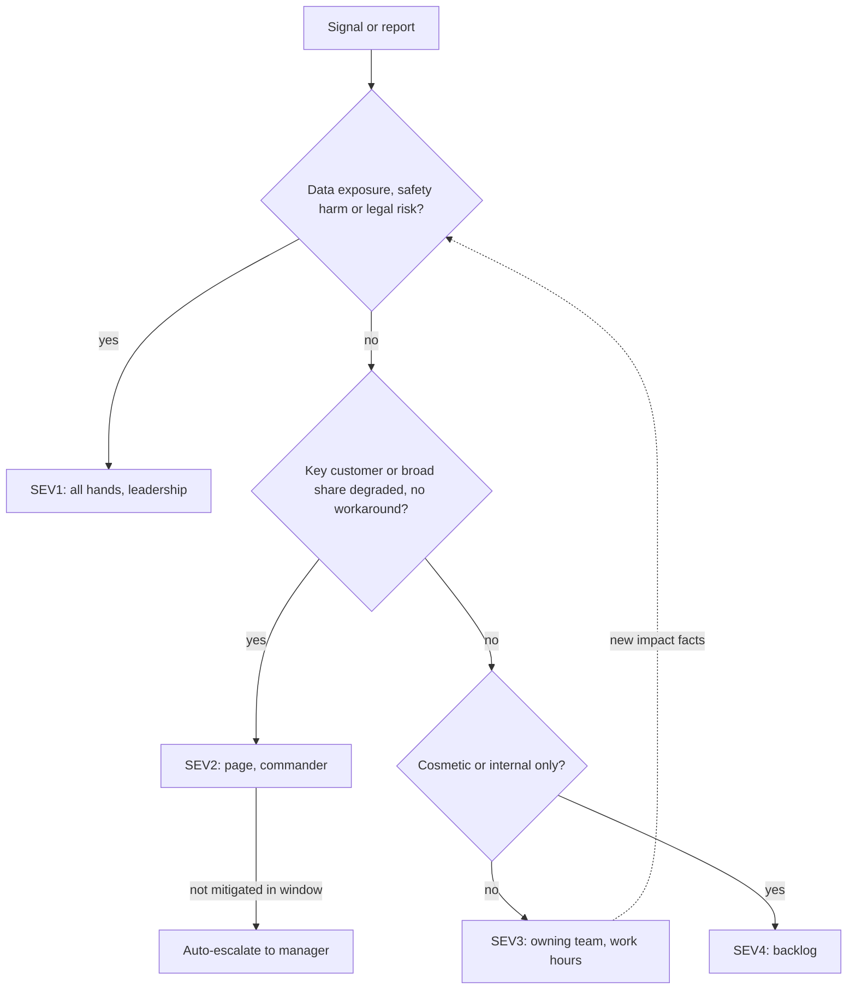

## TL;DR
A severity scale classifies incidents by impact, not cause, so paging and response speed are decided in
advance. Escalation adds expertise or authority. Agents need extra criteria: wrong actions, unsafe
outputs and leaks that throw no errors.

## For agent builders
- **Why it matters for agents.** An agent can do damage while every dashboard is green: it returns HTTP
  200 while issuing a duplicate refund, emailing the wrong customer or leaking another tenant's document.
  Severity criteria that only mention uptime will not page anyone for that.
- **Where it shows up in your stack.** Alerts on tool-action rates, guardrail blocks and quality scores;
  per-tool and per-tenant kill switches; the paging tool's escalation timers; and the request IDs you
  send to your model provider.
- **What you control.** Which agent behaviours count as SEV1 (irreversible or unauthorised actions, data
  exposure), which mitigations exist without a deploy (disable a tool, read-only mode, pin a snapshot),
  and who can flip them.
- **What you can skip.** Designing an organisation-wide incident programme from scratch; adopt the
  company's scale and add agent-specific criteria and switches to it.

## Why it exists
- **Without levels, every incident starts with a negotiation.** One engineer thinks a 5% error rate is a
  shrug; another pages the VP.
- **Both directions fail.** Small issues wake people at 3 a.m. and burn out on-call, while serious ones
  sit in a ticket queue because whoever noticed did not feel entitled to raise the alarm. Customers get
  updates erratically, and the contractual clock in an SLA runs while people debate.
- **"Use judgement" fails under incident conditions:** stress, partial information, and someone senior
  asking whether it is really that bad.
- **Classifying by cause fails too** ("it's just a config bug"), because cause is unknown at the start and
  the same root cause can be trivial or catastrophic depending on how many users it reaches.
- **AI incidents are often silent.** A conventional outage is loud: errors spike, health checks fail. An
  AI incident returns HTTP 200 with fluent, wrong, or unsafe content. If criteria only mention
  availability and latency, a model giving incorrect medical dosage information, or leaking one tenant's
  documents into another's answers, may not register as an incident at all.

## How it works
### Severity is defined by impact
A typical scale has four or five levels. The exact criteria are organisation-specific; a common shape:

| Level | Impact | Response |
|---|---|---|
| **SEV1 / critical** | Broad user-facing outage or degradation of a core function, data exposure or security breach, safety harm, or legal or regulatory exposure | All hands, leadership informed |
| **SEV2 / major** | Significant degradation for a meaningful share of users or a key customer, with no workaround | Urgent, paged response |
| **SEV3 / minor** | Limited impact or a workaround exists | Working hours, owning team |
| **SEV4 / low** | Cosmetic or internal-only | Backlog |

- **Write criteria as observable facts:** fraction of requests or tenants affected, whether data crossed a
  tenant boundary, whether a contractual SLA is at risk.
- **Why observable:** responders must classify within minutes, with incomplete information.

### AI-specific criteria
Add impact criteria about content, not uptime:
- **Unsafe or harmful outputs** reaching users.
- **Cross-tenant or PII leakage**, including through prompt injection.
- **An agent taking unauthorised or irreversible actions.**
- **A measured quality metric** (groundedness, task success) falling past a defined threshold.
- **A provider model change or outage** affecting all traffic.
- **One case can be enough.** A single confirmed data-exposure case can justify the top severity even if
  it touched one user, because the harm is not proportional to volume.

### Agent action criteria
Agents act, so classify by what the action did and whether it can be undone:

| Agent behaviour | Typical severity | First mitigation |
|---|---|---|
| Irreversible or unauthorised action (payment, deletion, external email) | SEV1 | Disable that tool or switch the agent to read-only |
| Reversible wrong actions at scale (mis-filed tickets, wrong tags) | SEV2 | Require human approval for that tool |
| Agent loops or step budget hit, cost spiking, no user harm | SEV3 | Lower the step cap or route to a fallback |
| Odd tool choice with correct outcome | SEV4 | Backlog, add an eval case |

- **Count actions, not just requests.** One run can call a side-effecting tool many times, so the share of
  degraded requests understates impact.

### Declare early, adjust freely
- **Declare at the higher plausible severity and downgrade as facts arrive**, *because* under-declaring
  delays response while over-declaring costs only some attention.
- **Severity is not a verdict on anyone.** It is a routing decision and should change as the picture
  changes.
- **The asymmetry is for humans, not alerts.** It applies to a human declaring a suspected incident, not
  to automated alert thresholds. A page that fires on noise has a real cost, because people learn to
  ignore it, so tune alerts for precision while declaration stays biased high.

### Severity is not priority
- **Severity measures impact; priority is work order.** Priority also weighs urgency (is the harm growing
  or stable?) and available effort.
- **Example:** a SEV3 with a workaround can still top the queue because the workaround expires tomorrow.
- **Map customer priorities explicitly.** Contracts usually define their own ticket priorities (P1 to P4
  or similar) with response targets. Without an explicit mapping to internal severities, a customer's P1
  lands as an internal SEV3 and the SLA clock runs out while both sides think the other is on it.
- **Bug vs incident:** a defect becomes an *incident* when it needs a coordinated response now, not when
  it is merely a bug in the backlog.

### Severity drives the response
Each level maps to:
1. who is paged;
2. a target time to acknowledge and to mitigate;
3. whether an incident commander is assigned;
4. the update cadence for stakeholders and customers;
5. whether a postmortem is mandatory.

- **Split the roles.** The commander coordinates and decides; others investigate, communicate, or scribe.
  This stops the person debugging from also fielding questions from executives.

### Two kinds of escalation
| | Functional escalation | Hierarchical escalation |
|---|---|---|
| **Brings in** | Expertise or ownership: the retrieval team, the platform on-call, the model provider's support with request IDs and timestamps | Authority: a decision to take a feature offline, notify customers or regulators, spend money, or override a customer's change freeze |
| **Trigger** | Current responders cannot make progress, or the fault is in someone else's component | The needed decision is above the responder's remit |

- **Make both time-based.** If a SEV2 is not mitigated within the policy's window, it escalates
  automatically, so no one has to judge whether asking for help is admitting failure.

## Diagram
Impact facts, not cause, pick the level; new facts can move it either way at any time.



## Examples
### Worked timeline: severity changes as facts arrive
An illustrative policy (the targets are examples, not a standard) and a timeline for an enterprise RAG
assistant.

**Policy excerpt:** SEV2 = a key customer or more than 5% of requests degraded with no workaround; page
on-call, acknowledge within 15 minutes, updates every 30 minutes, escalate to engineering manager if not
mitigated in 60 minutes. Any confirmed cross-tenant data exposure = SEV1.

| Time | What happened | Severity |
|---|---|---|
| **09:10** | Alert: 4% of responses fail JSON schema validation (later traced to a provider model alias moving to a newer snapshot). Failures fall back to a generic answer. Workaround exists, small share. | SEV3 |
| **09:25** | Scoping: all failures are from one enterprise tenant whose prompts use a tool schema the new snapshot handles differently; for them, 60% of requests fail. That tenant is a named account with an SLA. Incident commander assigned; account team informed. | SEV2 |
| **09:40** | Functional escalation: ticket to the provider with ten request IDs. Mitigation: pin that tenant to the previous model snapshot. | SEV2 |
| **09:55** | Failure rate back to baseline. Customer update sent. Stays open until the schema is made compatible with the new snapshot. | SEV3 |
| **10:30** | During review, an engineer notices one fallback answer contained a document title from a different tenant's cache. Security on-call paged, leadership and legal informed, cache disabled. | SEV1 |

The severity changed three times (SEV3, SEV2, SEV3, SEV1), each time because new facts about impact
arrived, not because the cause changed.

### The policy as code (runnable)
Encoding the excerpt makes the rule testable and keeps cause out of the inputs. Pure Python.

```python
from dataclasses import dataclass

@dataclass
class Impact:
    share_of_requests_degraded: float   # 0.0-1.0, across all traffic
    key_customer_degraded: bool         # a named account with an SLA
    workaround_exists: bool
    cross_tenant_exposure: bool = False
    unsafe_output_reached_user: bool = False
    cosmetic_only: bool = False

def classify(i: Impact) -> str:
    """Illustrative policy: impact facts in, severity out. Cause is not an input."""
    if i.cross_tenant_exposure or i.unsafe_output_reached_user:
        return "SEV1"                               # harm is not proportional to volume
    if (i.key_customer_degraded or i.share_of_requests_degraded > 0.05) and not i.workaround_exists:
        return "SEV2"
    if i.cosmetic_only:
        return "SEV4"
    return "SEV3"

def needs_escalation(sev: str, minutes_unmitigated: int) -> bool:
    return sev == "SEV2" and minutes_unmitigated >= 60   # time-based, from the policy excerpt

print(classify(Impact(0.04, False, True)))                     # SEV3 at 09:10
print(classify(Impact(0.04, True, False)))                     # SEV2 at 09:25
print(classify(Impact(0.0, False, True)))                      # SEV3 at 09:55
print(classify(Impact(0.0, False, True, cross_tenant_exposure=True)))  # SEV1 at 10:30
print(needs_escalation("SEV2", 45), needs_escalation("SEV2", 60))      # False True
```

### Worked scenario: duplicate refunds from a support agent
A support agent can call `issue_refund`. A retry change makes it re-issue a refund when the tool times
out but the payment actually went through (timeline illustrative).

| Time | What happened | Severity |
|---|---|---|
| **14:05** | Cost alert: tool calls per run up from about 4 to about 7. No errors, no complaints. | SEV3 |
| **14:20** | Trace sample: 9 of 40 runs called `issue_refund` twice for the same order. Money left the company and cannot be pulled back automatically. | SEV1 |
| **14:23** | Mitigation: `issue_refund` disabled by flag, agent tells users a human will follow up. Finance and leadership informed. | SEV1 |
| **15:10** | Duplicates listed from traces and handed to finance; idempotency key added to the tool before re-enabling. | SEV2 until reconciled |

The step that moved it to SEV1 was not volume but the fact that the action was irreversible.

## Production patterns
- **Per-tool kill switches for agents.** When: any agent with side-effecting tools. How: a flag per tool
  that removes it from the agent's tool list or forces human approval, plus a read-only mode, all
  switchable without a deploy. Monitor: side-effecting calls per run and time from declaration to tool
  disabled.
- **Severity matrix in the runbook header.** When: before the first incident. How: a one-screen table of
  observable criteria per level, with paging target, acknowledge and mitigate targets, update cadence and
  postmortem requirement. Monitor: how often severity was disputed or changed during incidents.
- **Customer priority mapping.** When: any enterprise contract. How: a written table mapping each
  contractual priority (P1 to P4) to an internal severity and on-call rotation, stored with the SLA.
  Monitor: customer P1s acknowledged inside the contractual target.
- **Content-level alerts.** When: any AI feature in production. How: page on online quality or safety
  signals (groundedness score dropping past a threshold, cross-tenant document IDs in a response,
  guardrail block rate spiking), not only on errors and latency. Monitor: alert precision, so pages stay
  trusted.
- **Timer-driven escalation.** When: SEV1 and SEV2. How: the paging or incident tool escalates
  automatically if the incident is not acknowledged or mitigated within the policy window, and the
  commander can defer with a stated reason. Monitor: time to acknowledge and time to mitigate by severity.
- **Per-tenant kill switches.** When: multi-tenant AI products. How: flags that pin one tenant to a
  previous model snapshot, disable a cache or retrieval path, or switch a feature off without a deploy.
  Monitor: time from declaration to first mitigation.

## Trade-offs
- **Low thresholds vs on-call fatigue.** Low thresholds catch real incidents early but page people for
  noise. They flip toward higher thresholds when fatigue causes alerts to be ignored, which is worse than
  a slower page.
- **Detailed criteria vs speed.** Detailed criteria reduce argument but take time to apply under pressure.
  Keep the top levels simple and observable, and put nuance in the lower levels.
- **Automatic escalation vs interruptions.** Time-based escalation removes social friction but can pull
  managers into incidents that are nearly resolved. Allow the commander to acknowledge and defer with a
  stated reason.
- **Quality incidents vs false alarms.** Treating quality degradations as incidents protects users but
  requires a trustworthy online quality metric. Without one, quality incidents generate false alarms and
  are quietly ignored.

## Pitfalls
- **Defining severity only by uptime and error rate.** Symptom: a harmful or wrong-answer episode that ran
  for days because every dashboard stayed green. Fix: add content-level criteria.
- **Classifying by suspected cause.** Symptom: "it's only a config change" incidents that turn out to
  affect every tenant. Fix: classify by impact.
- **Reluctance to declare or escalate for fear of blame.** Symptom: incidents first heard about from
  customers or account managers rather than from monitoring or on-call. Fix: declare high, blameless
  culture, time-based escalation.
- **One person as commander, debugger and communicator.** Symptom: customer updates that stop for an hour
  exactly when the incident is worst. Fix: split roles.
- **Escalating to a model provider without request IDs, timestamps and a minimal reproduction.** Symptom:
  a support ticket that sits unanswered while you wait. Fix: attach the evidence.
- **Severity inflation.** Everything urgent-sounding is declared SEV1 and never downgraded. Symptom: SEV1
  pages that no longer mobilise anyone and a postmortem backlog nobody can clear. Fix: downgrade as facts
  arrive.
- **Shipping side-effecting agent tools with no off switch.** Symptom: the only mitigation for a
  misbehaving tool is a full rollback or taking the whole agent down. Fix: per-tool flags and a read-only
  mode, tested before launch.

## When to use
- **Use when:** any team runs a production service. Write the scale and escalation policy before the
  first incident, agreed with support and account management and, for enterprise deals, aligned with the
  SLA's priority definitions.
- **Revisit:** after each postmortem that revealed a classification dispute. For AI systems, add
  content-level criteria and the online signals that detect them.
- **Measure:** time to declare, time to acknowledge and time to mitigate by severity, and how often
  severity changed during incidents.
- **Interviews:** expect "how would you classify a hallucination that reached one customer?" and answer by
  impact and harm, not by error rate.

## Role lens
- **Engineer:** Writes alerts that map to severity criteria, carries the pager, and knows how to pin a
  model snapshot or disable a feature as the first mitigation.
- **Architect:** Defines the severity scale with AI-specific impact criteria and ensures the system has
  kill switches and per-tenant controls that make fast mitigation possible.
- **FDE:** Aligns the customer's own severity scale and contacts with the vendor's, so an incident in the
  customer's environment escalates to the right people on both sides within minutes.

## Check yourself
**Q:** One user reports that the assistant quoted a paragraph from a document they should not have access
to. Error rates and latency are normal. What severity do you assign and what happens next?
**A:** Top severity, provisionally. Impact, not volume, drives classification: a single confirmed access-
control breach is a data exposure with legal and contractual consequences, and it may affect many users
who simply did not notice. I would page security and the owning team, assign a commander, preserve the
trace, and mitigate fast, for example by disabling the retrieval path or the cache involved. Hierarchical
escalation covers customer and possibly regulatory notification. If investigation shows the user did
have access, we downgrade; declaring high and downgrading is cheaper than the reverse.

## Interview questions
### Why define severity by impact rather than by cause?
- **Cause is unknown at the start.** Responders must classify in minutes, and impact (share of requests,
  tenants affected, data crossing a boundary) is observable early.
- **The same cause scales differently.** A config bug can be trivial for one internal user or catastrophic
  for every tenant, so cause cannot set the response.

### An enterprise customer files a P1, but your on-call classifies it SEV3. What went wrong and how do you fix it?
- **The mapping is missing.** Contract priorities and internal severities are separate scales, so without
  an explicit table the SLA clock runs while each side assumes the other is acting.
- **Fix:** write the P1-to-P4 mapping into the escalation policy, route customer P1s to the paged rotation,
  and review disputed cases in the next postmortem.

### When would you not page someone for a quality drop?
- **When the online metric is untrustworthy.** A noisy groundedness score that fires on normal variation
  teaches people to ignore pages, which is worse than a slower page.
- **When a workaround holds and harm is stable**, it is a SEV3 for working hours, not a 3 a.m. page.
- **Do page** when the drop crosses a validated threshold or involves unsafe content or data exposure.

### How would you classify a hallucination that reached one customer?
- **By harm, not count.** A wrong cosmetic detail is SEV3 or SEV4; a wrong medical dosage or a wrong
  contractual commitment can justify SEV1 or SEV2 even for one user.
- **Then check reach.** Search traces for the same pattern, because one report often means many unnoticed
  cases.
- **If an agent acted on it**, classify the action: a hallucinated order ID used in a cancellation is an
  irreversible-action incident, not a wording issue.

### Your agent just sent 30 emails to the wrong customers and errors are at zero. What do you do in the first 15 minutes?
- **Declare high.** An external, irreversible action with possible data exposure is SEV1 provisionally;
  assign a commander and inform security and the account owner.
- **Mitigate without a deploy:** disable the email tool by flag or switch the agent to read-only, then
  snapshot the traces for the affected runs.
- **Escalate hierarchically** for customer and possibly regulatory notification, and functionally to the
  team that owns the recipient lookup the agent called.

### What numbers would you track to know your severity policy works?
- **Time to declare, acknowledge and mitigate**, broken down by severity.
- **Severity changes per incident** and disputed classifications, which point to unclear criteria.
- **Share of incidents first reported by customers** rather than monitoring, which reveals detection gaps,
  especially for silent AI failures.

## Quiz
### Q: What should primarily determine an incident's severity level?
- [ ] How difficult the root cause is expected to be to fix
- [ ] Which team's component is suspected to be at fault
- [x] The observed impact on users, data, safety and contractual obligations
- [ ] How long the system has been in production
> Cause and ownership are usually unknown when an incident starts, and the same cause can be trivial or
> severe; impact is observable early and determines how urgent and broad the response must be.

### Q: What distinguishes hierarchical escalation from functional escalation?
- [ ] Hierarchical escalation is automatic, functional escalation is manual
- [x] Hierarchical brings in authority to make decisions; functional brings in expertise or the owning team
- [ ] Hierarchical escalation is only used for security incidents
- [ ] Functional escalation always goes to an external vendor
> Functional escalation adds people who can diagnose or fix the component; hierarchical escalation adds
> people who can approve decisions such as taking a feature offline or notifying customers.

### Q: Why do incident policies tell responders to declare at the higher plausible severity?
- [ ] Higher severity incidents are exempt from postmortems
- [ ] It guarantees the SLA clock stops running
- [ ] Customers expect every incident to be reported as critical
- [x] Under-declaring delays the response while over-declaring only costs attention, and severity can be lowered later
> The costs are asymmetric: a late response to a real SEV1 compounds harm, whereas downgrading after facts
> arrive is cheap, so the policy biases toward early, high declaration.

## Use cases & projects
### Use cases
- **Agents with payment or account tools.** Irreversible actions get their own SEV1 criterion and a
  per-tool kill switch before launch.
- **Multi-tenant RAG agents.** A single cross-tenant document in an answer is a top-severity incident even
  with normal error rates.
- **Silent provider model updates.** A schema or tool-call regression for one key tenant escalates to SEV2
  and is mitigated by pinning that tenant's snapshot.
- **Enterprise agent contracts.** Customer P1 to P4 priorities are mapped to internal severities so the
  SLA clock and the on-call rotation agree.

### Mini project
**Write and test a severity policy for a tool-calling agent (1-2 hours).**
- **Goal:** turn agent-specific impact facts into a tested classifier plus the switches it relies on.
- **Steps:** list your agent's tools and mark each reversible or irreversible; extend the `Impact`
  dataclass from the example with fields such as irreversible action taken and tenant boundary crossed;
  write `classify` and `needs_escalation`; add a flag that removes a named tool from the agent's tool list
  at runtime; write tests for five scenarios, including duplicate refunds and a loop with no user harm.
- **Done when:** all five scenarios classify as your policy says, the flag disables a tool without a
  restart, and the one-screen severity matrix is written down next to the code.
