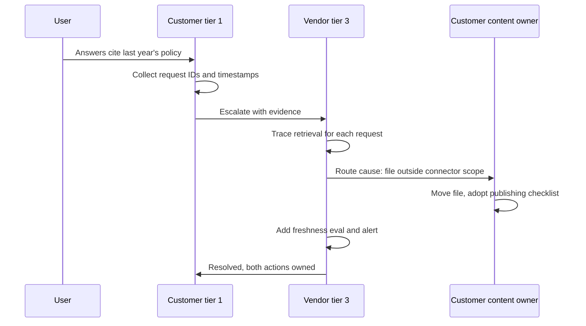

## TL;DR
Operational ownership means a named team is paged for a component, can change it, and answers for it.
Support boundaries say where that stops and how issues cross. An agent touches many owners' tools and
data, so without them incidents bounce between teams unfixed.

## For agent builders
- **Why it matters for agents.** An agent is glue across other people's systems: a model provider, your
  orchestration and prompts, tools wrapping other teams' APIs, and the customer's data. When a run fails,
  someone must own each of those, and someone must own the agent's overall task success.
- **Where it shows up in your stack.** The service catalog entry for the agent and each tool or tool
  server, the on-call rotation that alerts route to, the escalation template, and the boundary table in
  the deployment agreement.
- **What you control.** Naming one Accountable owner per layer (including "agent behaviour" and "each
  tool"), what evidence a ticket must carry (run ID, step, tool), and the hypercare exit criteria.
- **What you can skip.** Formal ITIL process detail; a boundary table, a catalog and a tested escalation
  route cover what an agent team needs.

## Why it exists
- **A deployed AI system is a stack with many owners:** the model provider's API, your platform and
  serving layer, the application's prompts, retrieval and tools, the customer's identity provider,
  network and data sources, and often a customer-built front end.
- **Every owner's first instinct is "not mine".** When an answer is wrong or a request fails, the cause
  can be in any layer, and each owner tries to show it is not theirs. The customer just sees "your AI is
  broken."
- **Implicit ownership does not scale.** Whoever built it, or whoever is most helpful, fixes it. In
  forward-deployed work the integration engineer keeps getting called months after go-live, for systems
  they no longer control. That makes them a single point of failure and hides the true support cost.
- **Rigid "not our problem" boundaries fail the other way.** With no path across them, a ticket about
  stale answers is closed because the stale documents live in the customer's SharePoint.
- **What explicit boundaries buy:** every component has someone who will act, every party knows what it
  must do, and cross-boundary issues have a defined route instead of a debate.

## How it works
### Owners have pager, access and authority
A team owns a component only if it carries all three together:
1. **Pager:** it is paged when the component fails.
2. **Access:** it can diagnose and change it.
3. **Authority (and budget):** it can prioritise fixes.

- **Missing one breaks it.** Ownership without access produces helpless on-call; access without ownership
  produces drive-by changes no one is accountable for.
- **A service catalog records** each component's owner, on-call rotation, runbook, dependencies and
  support hours.

### Draw the boundary by layer
- **For each layer, state who operates it, who changes it, and who owns its inputs.**
- **The usual artefact is a shared-responsibility table**, sometimes as RACI (Responsible, Accountable,
  Consulted, Informed), *because* "who must act" and "who must be told" are different questions, and
  conflating them causes either paralysis or surprise.
- **Exactly one Accountable per row** is the rule that makes RACI useful. Several Responsible parties can
  share the work, but if two parties are Accountable each can wait for the other, and a row with none is
  unowned by construction.

### Supported configurations and coverage
- **Scope: what you support.** A supported-configuration list names the versions, models, connectors and
  deployment shapes you will diagnose. A customer who swaps in their own model or edits the system prompt
  has moved outside it; the agreement should say whether support then becomes best-effort.
- **Coverage: when you support it.** A 24×7 SEV1 commitment needs a staffed rotation (or follow-the-sun
  across time zones). Business-hours support must say what happens to a SEV1 at 02:00 on Saturday.
- **Mismatched hours are a classic gap**, because each side's on-call assumes the other's is awake.

### Define the crossing points
Most real incidents span a boundary, so the interface matters most:
- **Evidence** the reporting party must provide: request IDs, timestamps, tenant.
- **Channel** to use.
- **Response targets** by severity.
- **Who leads** joint incidents.
- **"Out of scope" means routing**, "we route it to the right owner with evidence", not "we close the
  ticket."

### Tiered support
| Tier | Does | Needs |
|---|---|---|
| **Tier 1** | Takes the report, gathers evidence, resolves known issues from runbooks | Runbooks, evidence checklist |
| **Tier 2** | Diagnoses using logs and tooling | Dashboards, trace access |
| **Tier 3** | The engineering team that can change code, prompts or models | Clean escalations |

- **Each tier needs documentation to resolve what it can**, *because* every issue that reaches
  engineering unnecessarily is expensive and slows real fixes.
- **Measure** the share of tickets resolved at each tier and the share escalated with complete evidence.
  A tier 3 that keeps asking "which request ID?" is doing tier 1's job.

### Plan the handover
- **Phases:** build, launch, a period of elevated attention (hypercare) and steady state.
- **Ownership changes at defined points with exit criteria:** a stable error and quality baseline,
  runbooks validated by the receiving team, and alerts routed to their on-call.
- **Without this, the build team never actually lets go.**

### AI-specific boundaries
Make explicit what is new in AI systems; these are the questions most likely to be unowned by default:
- **Answer quality:** owned by the prompt and eval owner, not the platform.
- **Source data freshness and access permissions:** often the customer.
- **Model snapshot changes:** who decides when a provider snapshot changes.
- **Harmful-output reports:** who responds.

### Agent-specific boundaries
Agents add layers that default to nobody:

| Layer | Usual owner | Why it gets orphaned |
|---|---|---|
| Agent behaviour (tool choice, task success) | Agent team, via prompts and evals | Each tool team sees only its own calls |
| Each tool's implementation and API | The team that owns the wrapped system | The agent team wrote the wrapper, so is assumed to own the system |
| Tool permissions and scopes | Security or the system owner | Granted once at build time, never reviewed |
| Actions taken on a user's behalf | Agent team for the decision, system owner for the effect | Both assume the other will reverse it |

- **Tool contracts:** for each tool, record its owner, its error format and its on-call, because a tool
  that changes its response shape breaks the agent with no error on either side.

## Diagram
A ticket crosses the boundary with evidence; each side fixes its own factor, and nobody closes it as
"not ours".



## Examples
### Worked boundary table: RAG assistant in a bank's private cloud
A vendor deploys a RAG assistant into a bank's private cloud. The boundary table agreed at handover:

| Layer | Operates | Changes | Notes |
|---|---|---|---|
| Model endpoint (cloud provider) | Provider | Vendor chooses snapshot | Vendor escalates to provider |
| Application, prompts, retrieval, evals | Vendor | Vendor | Quality incidents are the vendor's |
| Kubernetes cluster, network, SSO | Bank platform team | Bank | Vendor has read-only logs |
| Source document repositories | Bank content owners | Bank | Freshness and permissions are the bank's |
| Chat front end in the intranet | Bank web team | Bank | Vendor supplies API only |

**Week 9 ticket:** "answers cite last year's expense policy."
1. Tier 1 at the bank collects three request IDs.
2. Vendor tier 3 traces them: retrieval returned the 2025 document because the 2026 one was uploaded to a
   folder not included in the connector scope.
3. **Cause** is on the bank's side (document placement); **the detection gap** is on the vendor's (no
   freshness eval).
4. **Resolution:** the bank's content owner moves the file and adopts a publishing checklist; the vendor
   adds a freshness eval and an alert when a source's newest document is older than a set threshold.
5. **Outcome:** resolved in a day because both sides knew who did what, and neither closed it as "not
   ours".

### Validating a RACI table (runnable)
Encode the boundary table and check the one rule that matters: exactly one Accountable, at least one
Responsible. Pure Python.

```python
RACI = {  # layer -> {party: role letters}
    "Model endpoint":             {"Provider": "R", "Vendor": "A"},
    "App, prompts, retrieval":    {"Vendor": "RA", "Bank platform": "I"},
    "Cluster, network, SSO":      {"Bank platform": "RA", "Vendor": "C"},
    "Source documents":           {"Bank content": "RA", "Vendor": "I"},
    "Answer quality":             {"Vendor": "A", "Bank content": "A"},   # "shared": a trap
    "Harmful-output reports":     {"Vendor": "R", "Bank platform": "C"},  # nobody accountable
}

def check(raci):
    problems = []
    for layer, parties in raci.items():
        accountable = [p for p, roles in parties.items() if "A" in roles]
        responsible = [p for p, roles in parties.items() if "R" in roles]
        if len(accountable) != 1:
            problems.append(f"{layer}: {len(accountable)} Accountable {accountable}")
        if not responsible:
            problems.append(f"{layer}: nobody Responsible")
    return problems

for p in check(RACI):
    print(p)
# Answer quality: 2 Accountable ['Vendor', 'Bank content']
# Answer quality: nobody Responsible
# Harmful-output reports: 0 Accountable []
```

### Worked ticket: an IT-helpdesk agent and three tool owners
An internal agent resets passwords, checks laptop orders and files tickets, each through a different
team's API (scenario illustrative).

| Time | Event | Owner who acts |
|---|---|---|
| **Mon 09:00** | Tier 1 sees order-status answers saying "no orders found" for 30% of runs | Agent on-call (owns task success) |
| **Mon 09:40** | Traces show `get_orders` returns an empty list with HTTP 200 since the procurement API's Friday release | Agent team routes to procurement on-call with run IDs |
| **Mon 11:00** | Procurement confirms a renamed field; rolls forward a fix | Procurement (owns the tool's API) |
| **Mon 12:00** | Agent team adds a contract test on the tool's response and an alert on empty-result rate | Agent team (owns its detection gap) |

Neither team closed it as "not ours": procurement owned the cause, the agent team owned detection.

## Production patterns
- **Catalog entry per agent tool.** When: an agent calls tools owned by other teams. How: register each
  tool (or tool server) with its owning team, rotation, response contract and permissions, and route tool
  error alerts there while task-success alerts go to the agent team. Monitor: tool calls whose owner
  entry is missing or stale.
- **Service catalog as source of truth.** When: more than a few components or teams. How: every component
  has an entry with owning team, on-call rotation, runbook link, dependencies and support hours, and
  alert routing reads from it. Monitor: entries whose owner or rotation no longer exists.
- **Boundary table in deployment readiness.** When: any multi-party deployment. How: agree the layer table
  with the customer before go-live, mirror it in the SLA, runbooks and support tooling, and rehearse it in
  a tabletop exercise. Monitor: tickets bounced between parties.
- **Evidence-required escalation form.** When: tickets cross from customer or tier 1 to engineering. How:
  the escalation template requires request IDs, timestamps, tenant and severity before it can be
  submitted. Monitor: share of tier 3 tickets escalated with complete evidence.
- **Hypercare with dated exit criteria.** When: every launch. How: a time-boxed window where builders stay
  first line, ending when the baseline is stable, runbooks are validated by the receiving team and alerts
  route to their on-call. Monitor: pages to builders after the exit date (should be near zero).
- **Read-only, audited vendor access.** When: the vendor operates inside a customer environment. How:
  grant read access to logs and traces through the customer's audited access path rather than broad
  admin rights. Monitor: time to diagnose and access-review findings.

## Trade-offs
- **"You build it, you run it" vs on-call load.** It aligns incentives and shortens feedback, but loads
  product teams with on-call. It flips toward a dedicated operations or platform team when many small
  services share infrastructure.
- **Narrow boundaries vs customer frustration.** Narrow support boundaries keep costs predictable, but
  frustrate customers when problems straddle them. Widen them, or sell an extended tier, for strategic
  accounts where retention matters more than margin.
- **FDEs as first line vs FDE capacity.** Customers get expert help, but FDEs cannot move to new
  deployments. It only works for a time-boxed hypercare window with a dated handover.
- **Broad vendor access vs security burden.** Broad access inside a customer environment speeds diagnosis,
  but raises security and compliance burden. Read-only, audited access to logs and traces is usually the
  workable middle.

## Pitfalls
- **Ownership assigned to a team without access or authority.** Symptom: on-call that can only open
  tickets for someone else, and mean time to mitigate measured in days. Fix: grant pager, access and
  authority together.
- **Orphaned components after a reorganisation or project end.** Symptom: alerts routed to a channel
  nobody reads and a service catalog entry naming someone who has left. Fix: re-assign owners as part of
  every reorganisation.
- **No owner for answer quality.** Symptom: a slow decline in user satisfaction with every team pointing at
  another layer and no one running evals. Fix: name the prompt and eval owner.
- **Handover without exit criteria.** Symptom: the original builders still being paged months after
  go-live, often unofficially through direct messages. Fix: dated, verified exit criteria.
- **Boundaries written only in the contract.** Symptom: support staff on both sides who have never seen
  the table and argue scope during an incident. Fix: put it in runbooks and tooling.
- **Two parties marked Accountable for the same layer**, often "shared" data quality. Symptom: a known
  problem that stays open for weeks while each side waits for the other to schedule the fix. Fix: one
  Accountable per row.
- **Assuming the agent team owns every tool it wraps.** Symptom: the agent on-call is paged for another
  team's API outage and can only open tickets. Fix: tool owners carry the pager for their tool; the agent
  team owns task success and the wrapper.

## When to use
- **Use when:** before go-live of any production system; revisit at each phase change, reorganisation or
  new integration.
- **Multi-party AI deployments:** agree the boundary table with the customer as part of deployment
  readiness, mirror it in the SLA, runbooks and support tooling, and test it with a tabletop exercise.
- **Measure:** tickets bounced between parties, time to route an issue to its owner, and the share of
  tickets reaching engineering that tier 1 or 2 could have resolved.
- **Interviews:** expect "after launch, who supports this?" and answer with owners, crossing points and a
  handover plan.

## Role lens
- **Engineer:** Builds the runbooks, dashboards and evidence-gathering tools that let other tiers resolve
  issues without escalating to the engineers who wrote the code.
- **Architect:** Draws component boundaries so each has one owner, and designs the access model and
  interfaces that let ownership cross organisations safely.
- **FDE:** Negotiates the boundary table with the customer, runs hypercare, and executes the handover so
  the deployment does not depend on them personally after it ends.

## Check yourself
**Q:** Six months after launch, the FDE who built a customer's deployment still receives most of its
support requests by direct message. What is wrong, and what would you change?
**A:** Ownership was never transferred: the deployment has an implicit owner with no on-call rotation,
no shared runbooks and no defined route for the customer's issues. That makes one person a single point
of failure and hides the support cost. I would write the boundary table with the customer, register the
components in the service catalog with an owning team and rotation, route requests to a support queue
with tiering, make sure runbooks and dashboards let tier 2 diagnose common issues, and set handover exit
criteria the receiving team signs off. The FDE then becomes a tier 3 escalation, not the front door.

## Interview questions
### What makes a team the real owner of a production component?
- **Three things together:** it is paged when the component fails, it has access to diagnose and change
  it, and it has authority and budget to prioritise fixes.
- **Why all three:** ownership without access gives helpless on-call; access without ownership gives
  drive-by changes nobody answers for.

### A customer says your RAG agent's answers are stale and the documents live in their system. How do you handle it?
- **Route, do not close.** Collect request IDs, trace retrieval, and send the cause to the customer's
  content owner with evidence.
- **Own your side too.** Ask why your monitoring did not detect it, and add a freshness eval or alert as
  your action.

### When would you not use "you build it, you run it"?
- **When many small services share infrastructure**, a dedicated platform or operations team avoids every
  product team carrying a thin, tiring rotation.
- **When the builders are FDEs**, because keeping them first line stops them moving to new deployments;
  limit it to a dated hypercare window.

### Your SLA promises 24×7 SEV1 response, but the customer's platform team works business hours. What breaks?
- **Joint incidents stall at night.** If the fault is in their cluster or SSO, your on-call is awake but
  cannot change it, and the SLA clock still runs.
- **Fix:** agree a customer-side out-of-hours contact for SEV1, or scope the commitment to layers you
  operate, and test the route in a tabletop exercise.

### How would you measure whether your support boundaries work?
- **Tickets bounced between parties** and time to route an issue to its owner.
- **Share of tickets reaching tier 3** that tier 1 or 2 could have resolved, and share escalated with
  complete evidence.
- **Pages to builders after the hypercare exit date**, which should fall to near zero.

### Your agent calls tools owned by four other teams. How do you set up ownership before launch?
- **One row per layer:** agent behaviour and task success (your team), each tool's API (its owning team),
  permissions (security or the system owner), and actions on a user's behalf.
- **Tool contracts and routing:** each tool has a catalog entry, a response contract test and an on-call;
  tool errors page the tool owner, task-success drops page you.
- **Crossing points:** tickets carry run ID, step and tool name, so routing takes minutes.

## Quiz
### Q: Which combination makes a team a genuine operational owner of a component?
- [ ] It wrote the original code and is listed in the README
- [x] It is paged for failures, has access to diagnose and change it, and has authority to prioritise fixes
- [ ] It has admin credentials to the production environment
- [ ] It attends the weekly status meeting with the customer
> Paging without access, or access without accountability, both fail; ownership requires being alerted,
> being able to act, and being empowered to choose the work.

### Q: A user reports stale answers; the stale document lives in the customer's repository, outside your support scope. What is the correct response?
- [ ] Close the ticket as out of scope and inform the user
- [ ] Silently fix the repository yourself using any access you have
- [x] Route it to the customer's content owner with evidence, and check whether your side should have detected it
- [ ] Retrain the embedding model on the latest documents
> A boundary defines who acts, not whether the issue matters; out-of-scope issues are routed with evidence,
> and detection gaps on your side remain your action items.

### Q: What is the main purpose of exit criteria for a hypercare period?
- [ ] To decide when the customer can stop paying for support
- [ ] To guarantee no incidents happen after handover
- [ ] To let the build team skip writing runbooks
- [x] To make the transfer of ownership a deliberate, verified step rather than something that never happens
> Without criteria such as a stable baseline, validated runbooks and alerts routed to the new owner,
> builders stay informally on the hook indefinitely and the receiving team is never ready.

## Use cases & projects
### Use cases
- **Internal agents over many team APIs.** Tool owners carry the pager for their APIs; the agent team owns
  task success, prompts and evals.
- **Agents deployed into a customer environment.** A boundary table splits the model endpoint, the agent,
  the cluster and the customer's data sources before go-live.
- **FDE-built agents after launch.** Hypercare with dated exit criteria moves support off the person who
  built it.
- **Agents acting on users' behalf.** Someone is named to reverse a wrong action, not just to fix the
  agent that took it.

### Mini project
**Write and validate the ownership map for a small agent (1-2 hours).**
- **Goal:** make every layer of an agent you have built owned by exactly one Accountable party.
- **Steps:** list the agent's layers (model endpoint, orchestration and prompts, each tool, data sources,
  permissions, actions on behalf of users); fill a RACI table and run the validator from the example over
  it; write a one-page escalation template requiring run ID, step and tool name; add a contract test for
  one tool's response shape.
- **Done when:** the validator reports no problems, every tool has a named owner and rotation, and the
  contract test fails when you rename a field in a fake tool response.
