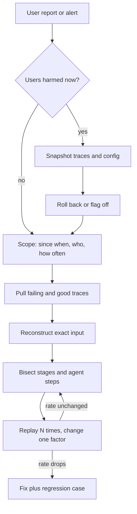

## TL;DR
Production debugging finds why a live agent misbehaved when you cannot pause it or rely on a repeat:
stop the bleeding, rebuild the *exact* run from its trace, find the first step that went wrong, and
replay it with one variable changed at a time.

## For agent builders
- **Why it matters for agents.** An agent run is many model calls, tool calls and retrievals chained
  together, so "it gave a wrong answer" can start at any step. Without a trace you cannot tell a bad tool
  result at step 3 from a bad decision at step 7.
- **Where it shows up in your stack.** Tracing spans per model call and tool call (OpenTelemetry or your
  framework's tracer), the run or conversation ID, recorded tool results, the resolved model snapshot,
  and a replay harness that can restart a run from any step.
- **What you control.** What every step logs (rendered messages, tool arguments, raw tool results),
  whether side-effecting tools can be stubbed in replay, and whether one ID joins every span of a run.
- **What you can skip.** Classic debugger tooling and profilers for the model itself; the leverage for
  agents is in traces, replay and bisecting the steps of a run.

## Why it exists
- **You cannot attach a debugger to yesterday.** In development you control the input, code version and
  data and can step through it. In production you get a ticket: "the assistant told a customer the wrong
  refund policy yesterday afternoon."
- **The evidence has moved on.** The request is gone, the process that served it has been recycled, the
  vector index may have been rebuilt since, and the provider may have updated the model behind the API.
- **The naive replay lies.** Pasting the user's question into a notebook almost always "works", so the
  ticket closes as "cannot reproduce". The question is a small fraction of what the model received: a
  system prompt at some template version, chunks from the index *as it was then*, history, tool outputs,
  a specific model snapshot and temperature. Change any of these and you debug a different request.
- **Sampling hides failures.** A failure that happens 1 time in 10 looks fixed in a single replay 90% of
  the time.
- **What the discipline buys.** Capture enough at request time to reconstruct the failure later, then
  narrow it by evidence rather than by guessing and redeploying.

## How it works
### 1. Stabilize before you diagnose
- **Mitigate first if users are harmed now.** Roll back the last prompt or model change, flip a feature
  flag, route to a fallback, or disable the failing tool.
- **Why before the cause is known:** diagnosis can take hours while damage accrues per request.
- **Capture evidence before rolling back** (trace IDs, a sample of bad outputs, current config), because
  the rollback destroys the live state you would otherwise examine.

### 2. Scope the failure
- **Ask: since when, for whom, how often?** Query metrics and logs for a failure rate over time, sliced by
  tenant, model, prompt version, region and client version.
- **Read the shape:**

| Pattern | Points at |
|---|---|
| Step change at 14:02 | An event (deploy, flag, rebuild) |
| Slow climb | Drift: index staleness, traffic mix |
| Confined to one tenant | Their data or config, not your code |

- **Output of this step:** "it's broken" becomes "3% of tenant X's requests since the 14:00 deploy."

### 3. Find concrete failing requests
- **Pick specific failing requests** by correlation or trace ID, plus a few *succeeding* requests from the
  same window.
- **Diff bad against good** (differential debugging). It is usually faster than studying the bad trace
  alone, because the difference is the clue.

### 4. Reconstruct the exact input
Recover everything that determined the output:
- **the fully rendered messages**, not the template plus variables;
- **the model identifier and snapshot the API actually reported**, not the alias you configured;
- **sampling and format:** temperature, top_p, max tokens, tool schemas, response format;
- **retrieved chunk IDs and their text** *at that time*;
- **every tool call and its raw result**, including errors and truncation.

If any of these was not logged, that gap is itself a finding: fixing logging becomes an action item.

### 5. Bisect the pipeline
An LLM application is a chain: input handling → retrieval → prompt assembly → model call → parsing →
tool execution → post-processing. Check the intermediate output at each boundary.

| What the trace shows | Where the bug is |
|---|---|
| Right document never retrieved | Retrieval (no prompt change will help) |
| Retrieved but below a truncation limit | Prompt assembly |
| In the prompt, model ignored it | Generation |

Bisecting is logarithmic in the number of stages, which is why it beats reading the whole trace linearly.

### 5b. Bisect an agent run by step
An agent repeats that chain once per step, so a run is a sequence of (model decision, tool call, tool
result) triples. Find the **first divergent step**, because every later step inherits its error.

| What step k shows | Where the bug is |
|---|---|
| Tool result wrong or truncated, decision reasonable | The tool or its integration |
| Tool result fine, model picked the wrong tool or arguments | Tool descriptions, prompt or model |
| Loop never stops, same call repeated | Stop condition, step budget or error handling |
| Early steps fine, later steps forget facts | Memory or context compaction |

- **Compare against a good run** of the same task: the step where the two transcripts first differ is
  where to look.
- **Replay from step k**, not from step 1, by feeding recorded tool results for steps before k, so the
  earlier, already-correct steps cannot drift and hide the bug.

### 6. Replay with one variable changed, many times
1. **Measure the baseline.** Replay the reconstructed input N times at the logged parameters to get a
   failure rate.
2. **Change exactly one factor** (current index instead of historical, new prompt version, other model)
   and measure again.
3. **Why repeat:** a single stochastic sample proves nothing.
4. **Why one factor:** changing two leaves you unable to say which one fixed it.

- **Temperature 0 is not determinism on a hosted model.** Batching and floating-point effects on the
  provider side can still vary outputs, and seed parameters, where offered, are typically best-effort.
  Even a "deterministic" replay deserves a handful of repeats before you trust it.
- **Stub side-effecting tools.** Feed the model the recorded tool results instead of calling live tools,
  *because* a replay that re-executes `issue_refund` is a second incident, and because live tools return
  today's data, which silently changes the input you were trying to hold fixed.

### When the failure is latency, cost or errors rather than a wrong answer
The same scope-trace-bisect loop applies, but the evidence is the span waterfall rather than the content.
- **Find the critical path** in a slow trace. Is the time in queueing before the model call, the
  provider's time to first token, a long generation, retries, or a tool?
- **Output length often dominates end-to-end latency**, because each output token is a separate decode
  step.
- **Compare p50 against p99.** A healthy median with a terrible tail usually means a minority of requests
  do something different: retry storms, oversized contexts, one slow tool, agent loops that ran many more
  steps. Find what distinguishes them; do not speed up the average request.
- **Cost spikes yield to the same slicing.** Tokens per request by tenant, route and prompt version
  usually reveal one path whose context or step count grew.

### 7. Correlate with change
- **Most production regressions follow a change:** a deploy, prompt edit, config or flag flip, index
  rebuild, dependency upgrade, upstream schema change, or a provider-side model update.
- **Keep a timestamped change log** so you can line up the onset of the failure against candidate causes.

### 8. Close the loop
- **Ship the fix with the captured failing case added to the regression suite**, so the same bug cannot
  silently return.
- **Close the logging gaps found in step 4** in the same change.

## Diagram
Mitigation comes before diagnosis; the replay loop changes one factor at a time until the stage, or
the first bad agent step, is found.



## Examples
### Replay harness: baseline, then one factor at a time
A minimal replay harness. It loads a logged trace, replays it at the original parameters to estimate the
failure rate, then swaps one factor. `complete` stands in for your provider client and `check` for a
task-specific assertion.

```python
import json
from statistics import mean

def complete(messages, model, **params) -> str:
    raise NotImplementedError("call your provider SDK here")

def check(output: str) -> bool:
    # task-specific: did the answer state the 30-day refund window?
    return "30 days" in output

def replay(trace, n=20, **overrides):
    t = {**trace, **overrides}            # override exactly one factor
    outs = [complete(t["messages"], t["model"], **t["params"]) for _ in range(n)]
    return mean(not check(o) for o in outs)   # failure rate

trace = json.load(open("trace_7f3a.json"))   # rendered messages, model, params, chunk ids
baseline = replay(trace)
print(f"failure rate at logged inputs: {baseline:.0%}")

# Hypothesis: the retrieved chunk was the old policy page. Rebuild messages with today's chunk.
fixed_ctx = dict(trace, messages=rebuild_with_current_chunks(trace))  # your helper
print(f"with current index: {replay(fixed_ctx):.0%}")

# Hypothesis: temperature is the cause. Change only that.
print(f"at temperature 0: {replay(trace, params={**trace['params'], 'temperature': 0}):.0%}")
```

- **Reading the result:** if the baseline reproduces at, say, 40% and swapping in today's chunk drops it
  to 0% while temperature 0 still fails, the defect is stale retrieval, not sampling. The fix belongs in
  index freshness.
- **Keep the sample size honest:** 0 failures in 20 replays only bounds the true rate below roughly 3/20
  ≈ 15% at 95% confidence (the "rule of three"). A failure that was rare to begin with needs a few hundred
  replays before "0%" means fixed.

### How many replays prove a fix (runnable)
Pure Python, no dependencies. The exact bound for zero observed failures is `1 - 0.05 ** (1/n)`; the rule
of three approximates it as `3/n`.

```python
import math

def zero_failure_upper_bound(n, conf=0.95):
    """Highest true failure rate still consistent with 0 failures in n replays."""
    return 1 - (1 - conf) ** (1 / n)

def replays_needed(target_rate, conf=0.95):
    """Replays with 0 failures needed to claim the rate is below target_rate."""
    return math.ceil(math.log(1 - conf) / math.log(1 - target_rate))

for n in (20, 100, 300):
    print(n, f"exact {zero_failure_upper_bound(n):.1%}", f"rule of three {3 / n:.1%}")
# 20 exact 13.9% rule of three 15.0%
# 100 exact 3.0% rule of three 3.0%
# 300 exact 1.0% rule of three 1.0%
print(replays_needed(0.10), replays_needed(0.01))   # 29 299
```

### Agent replay from the first bad step, with tools stubbed
Replays step `k` of a recorded agent run. Earlier steps and every tool call are served from the trace,
so nothing live is executed and only the decision at step `k` is sampled again. `complete` is your
provider call; it returns the model's next tool call (or final answer) as a dict.

```python
import json
from collections import Counter

def complete(messages, model, tools, **params) -> dict:
    raise NotImplementedError("call your provider SDK here")

def messages_before(run, k):
    """Rebuild the exact transcript the model saw before step k from recorded steps."""
    msgs = list(run["initial_messages"])
    for step in run["steps"][:k]:
        msgs.append(step["assistant_message"])           # recorded tool call
        msgs.append({"role": "tool", "tool_call_id": step["call_id"],
                     "content": step["raw_tool_result"]})  # recorded result, never re-executed
    return msgs

def replay_step(run, k, n=20, **overrides):   # k is 0-based: steps[:k] are served from the trace
    t = {**run, **overrides}                              # one factor at a time
    msgs = messages_before(t, k)
    picks = [complete(msgs, t["model"], t["tools"], **t["params"]) for _ in range(n)]
    return Counter(p.get("tool_name", "final_answer") for p in picks)

run = json.load(open("run_4c19.json"))   # rendered messages, model snapshot, params, steps
print(replay_step(run, k=3))             # e.g. Counter({'cancel_order': 9, 'lookup_order': 11})
```

- **Reading the result:** if step 3 picks `cancel_order` 9 times in 20 at the logged inputs, the bad
  decision reproduces at that step; now change only the tool descriptions, or only the model, and count
  again.

### Worked scenario: an agent loop that ran 41 steps
A support agent normally finishes in about 6 steps. After a release, cost per conversation tripled
(numbers illustrative).

| Step | Evidence | Conclusion |
|---|---|---|
| Scope | p50 steps 6, p99 steps 41 since Tuesday's deploy | A minority path, an event |
| Trace diff | Long runs call `search_orders` again and again | Loop at the tool step |
| First divergent step | Step 4: the tool returns an error string, the model retries with the same arguments | Error handling |
| Change log | The deploy renamed a field the tool expects | Candidate cause |
| Replay step 4, n=20, tools stubbed | Same retry chosen 20 of 20 | Reproduced on every sample |
| Fix | Restore the field, return a structured error, cap identical calls per run, add the run as a regression case | Closed |

### Worked incident: wrong refund window
| Step | Evidence | Conclusion |
|---|---|---|
| Scope | 3% of tenant X's refund questions wrong since 14:02 | Event, not drift |
| Change log | Index rebuild at 14:00, no code deploy | Candidate cause |
| Trace diff | Bad traces retrieved the archived policy page, good ones the current page | Retrieval stage |
| Baseline replay, n=20 | 8 of 20 fail (40%) | Reproduced |
| Swap in current chunk, n=300 | 0 of 300 fail | Below ~1% at 95% confidence |
| Fix | Exclude archived pages in the index filter, add the trace as a regression case | Closed |

## Production patterns
- **Trace ID through every stage.** When: from day one. How: generate one ID at the edge, propagate it
  into retrieval, model, tool and parsing spans (for example as an OpenTelemetry trace), and print it in
  user-facing error messages. Monitor: share of requests with a complete trace.
- **Log the resolved model, not the alias.** When: any hosted model call. How: store the model field the
  provider's response reports next to the alias you requested. Monitor: alert when the resolved snapshot
  changes without a deploy on your side.
- **Record-and-stub replay.** When: tools have side effects or return time-varying data. How: persist
  each tool call's raw result in the trace and have the replay harness serve those results instead of
  calling live tools. Monitor: replays that accidentally hit a live tool (should be zero).
- **Sampled full-payload capture with redaction.** When: volume or PII makes logging everything costly.
  How: keep full rendered prompts for a fixed sample plus every errored or flagged request, redact before
  storage, and set a retention window. Monitor: time-to-reproduce and storage per day.
- **One span per agent step.** When: any tool-calling loop. How: emit a child span for each model call
  and each tool call under the run's root span, with the step number, tool name, arguments and a hash or
  copy of the raw result. Monitor: steps per run (p50 and p99) and identical repeated tool calls per run.
- **Change log joined to dashboards.** When: always. How: emit an annotation event for every deploy,
  prompt edit, flag flip and index rebuild onto the same time axis as error and quality metrics. Monitor:
  fraction of incidents whose onset lines up with a logged change.

## Trade-offs
- **Full capture vs privacy and storage.** Logging full rendered prompts and tool results makes
  reconstruction possible, but costs storage and creates a PII store. It flips toward sampling or
  redaction when inputs are sensitive or volume is huge.
- **Immediate rollback vs live evidence.** Rolling back stops harm but destroys the live state you wanted
  to inspect. It is the right call whenever users are affected, provided you snapshot evidence first.
- **Many replays vs tokens and time.** Many samples give a trustworthy failure rate but cost tokens and
  time; for deterministic failures (parsing, tool errors) a single replay is enough.
- **Production data vs safety.** Debugging directly against production data gives the most faithful
  reproduction but risks side effects and access violations. Prefer read-only replicas and replay with
  tools stubbed to recorded results.

## Pitfalls
- **Replaying only the user's question.** Symptom: a long run of "cannot reproduce" closures for problems
  customers keep reporting. Fix: replay the full rendered input.
- **Trusting a single successful replay of a stochastic failure.** Symptom: a fix that "worked" in
  testing and a production failure rate that never moved. Fix: measure rates over many replays.
- **Logging the configured model alias.** Symptom: a regression nobody can explain because no deploy
  happened on your side. Fix: log the snapshot the API returned.
- **Changing several things in one hotfix.** Symptom: the problem goes away and nobody can say why, so it
  returns on the next unrelated change. Fix: one factor per change.
- **Debugging before mitigating.** Symptom: an hour of elegant diagnosis while the incident's impact keeps
  growing. Fix: snapshot, roll back, then diagnose.
- **Replaying with live tools.** Symptom: duplicate side effects (a second email or refund) or replays
  whose tool outputs differ from the trace, so the "reproduction" is not one. Fix: stub to recorded
  results.
- **Replaying an agent from step 1 to debug step 7.** Symptom: earlier steps take a different path each
  replay, so the failure seems to vanish. Fix: replay from the first divergent step with earlier tool
  results served from the trace.

## When to use
- **Use when:** a live agent or LLM system produces wrong, slow, looping or failed results and the cause
  is not obvious from one error message.
- **Invest upfront:** trace IDs threaded through every stage, rendered prompts and retrieval results
  captured (or sampled), a change log, and a replay harness. This is the investment that pays for itself.
- **Measure:** time-to-reproduce. If most investigations stall at "cannot reproduce", the problem is
  instrumentation, not skill.
- **Interviews:** a strong answer to "a customer says the bot gave a wrong answer" walks through mitigate,
  scope, find the trace, reconstruct, bisect, replay and regress, rather than jumping to "I'd tweak the
  prompt."

## Role lens
- **Engineer:** Instruments every stage with trace IDs, records rendered prompts and model snapshots, and
  owns the replay harness that turns tickets into reproducible test cases.
- **Architect:** Decides what the platform must capture by default, how long it is retained, who can
  access it, and where redaction happens, so debugging is possible without a privacy breach.
- **FDE:** Debugs inside a customer environment with limited access, so negotiates log export, read-only
  replicas and trace sharing early, before the first production issue arrives.

## Check yourself
**Q:** A customer reports the assistant cited a discontinued product twice last week. You paste the
question into the playground and get a correct answer. What do you do next, and why is your playground
result not evidence?
**A:** The playground used today's prompt template, today's index and possibly a different model
snapshot and temperature, so it tested a different request. I would find the two traces by request ID,
recover the rendered messages, retrieved chunk IDs and model snapshot, and check the retrieval stage
first: was the discontinued product's page returned? If so, the index or its filters are stale and the
fix is freshness, not the prompt. I would replay the logged input 20 or more times to get a failure rate,
then swap only the retrieved context to confirm the cause, and add the case to the regression suite.

## Interview questions
### Why is "I pasted the question into the playground and it worked" not a reproduction?
- **The question is a fraction of the input.** The model also saw a versioned system prompt, retrieved
  chunks as the index was then, history, tool results, a model snapshot and sampling parameters.
- **So the playground tests a different request.** A real reproduction rebuilds the rendered messages
  from the trace and replays them at the logged parameters.

### Latency p50 is fine but p99 doubled after a release. How do you debug it?
- **Slice the tail, not the average.** Pull the slowest traces and compare their span waterfalls with
  median traces from the same window.
- **Look for what distinguishes them:** retry storms, oversized contexts, one slow tool, longer outputs, or
  agent loops that ran more steps.
- **Line the onset up with the change log**, then fix the minority path rather than tuning the common one.

### When would you not roll back immediately?
- **When nobody is being harmed now.** A cosmetic or low-rate issue can be diagnosed live, keeping the
  evidence in place.
- **When rollback is itself risky**, for example a schema or index change that cannot be reverted
  cleanly; then a flag, fallback route or disabling one tool may be the safer mitigation.
- **Otherwise roll back**, after snapshotting traces and config, because harm accrues per request.

### You replayed a fix 20 times with no failures. Is it fixed?
- **Not necessarily.** Zero in 20 only bounds the true rate below about 15% at 95% confidence (rule of
  three, 3/n).
- **Size the replay to the original rate.** A 1% failure needs roughly 300 clean replays before "0%"
  means fixed.

### An agent took a wrong action at step 7 of 12. How do you find out why?
- **Find the first divergent step.** Compare the run's transcript with a good run of the same task; the
  error often starts earlier than the visible action, for example a truncated tool result at step 5.
- **Replay from that step with tools stubbed.** Rebuild the transcript from recorded steps, sample the
  decision 20 or more times, then change one factor: tool description, model, or the tool result itself.
- **Close it** with the run added to the agent's regression suite.

### What must a trace contain for an agent run to be debuggable later?
- **Rendered messages** and the resolved model snapshot, not the template or alias.
- **Sampling and format parameters**, tool schemas, retrieved chunk IDs with their text at the time, and
  every raw tool result including errors.
- **One run ID shared across stages and one span per step**, so retrieval, model and tool spans can be
  joined in order.
- **Record-and-stub replay** so any run can be restarted from any step without side effects, plus a
  change log on the same time axis as steps-per-run, tool error rate and cost per run.

## Quiz
### Q: Why should you replay a reconstructed LLM request many times rather than once?
- [ ] Providers rate-limit single requests more aggressively than batches
- [x] Sampling makes the output stochastic, so one replay cannot distinguish a fixed bug from a lucky draw
- [ ] The first call warms the cache, so only later replays reflect production behaviour
- [ ] Multiple replays are required to recover the original random seed
> With temperature above zero a failure may occur in only a fraction of samples; measuring the failure
> rate across many replays, before and after a change, is the only way to show the change mattered.

### Q: An answer was wrong. The trace shows the correct document was the top retrieval result, but the prompt assembler's token budget cut it before the model call. Where is the defect?
- [ ] In the embedding model, which ranked the document too low
- [ ] In the generation step, which should have inferred the missing content
- [x] In prompt assembly, which dropped retrieved content before it reached the model
- [ ] In sampling, because a lower temperature would have found it
> Bisecting the pipeline shows retrieval did its job and the model never saw the content; the fix belongs
> in how context is budgeted and ordered, not in retrieval tuning or prompt wording.

### Q: Users are receiving harmful outputs after a prompt change an hour ago. What comes first?
- [ ] Reproduce the failure locally so the rollback can be justified
- [ ] Write the regression test so the bug cannot recur
- [ ] Bisect the pipeline to locate the faulty stage
- [x] Capture sample trace IDs and config, then roll back the prompt change
> Mitigation precedes diagnosis when users are being harmed, but grabbing evidence first keeps the
> investigation possible after the rollback erases the live state.

## Use cases & projects
### Use cases
- **Support agents giving wrong policy answers.** Trace the run, check whether retrieval returned the
  current page, and replay with the historical context to confirm.
- **Coding and ops agents that loop.** Steps-per-run p99 spikes; the first divergent step usually shows a
  tool error the model keeps retrying.
- **Agents that took a harmful action.** Replay the decision step with tools stubbed so the investigation
  never re-issues the refund, email or deletion.
- **Silent provider model updates.** The resolved snapshot in the trace changes with no deploy on your
  side, and replays at old and new snapshots isolate the cause.

### Mini project
**Build a step-level replay harness for a small agent (2-3 hours).**
- **Goal:** turn any recorded agent run into a reproducible test that restarts from a chosen step.
- **Steps:** build a 3-tool agent (one tool side-effecting, such as a fake `send_email`); log every step
  as a JSON record with rendered messages, tool name, arguments and raw result; write `replay_step(run, k,
  n)` that serves recorded results for earlier steps and stubs every tool; inject a bug (a tool that
  returns a truncated result) and use the harness to locate it.
- **Done when:** the harness reports the first divergent step and a failure rate over 20 replays, never
  calls a live tool, and the failing run is saved as a regression case that passes after the fix.
