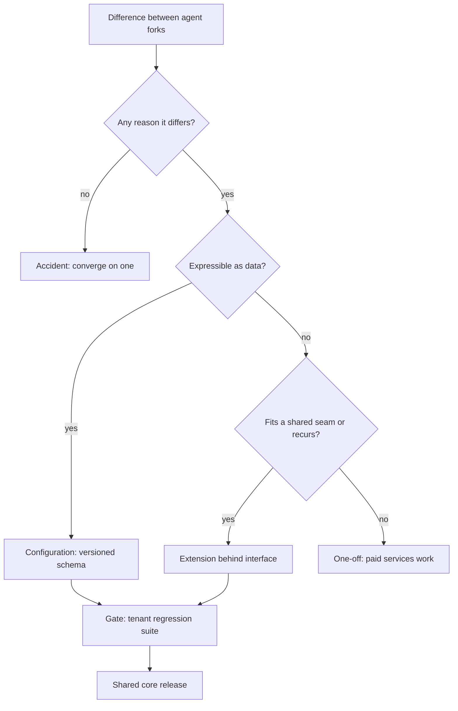

## TL;DR
When the field builds the same agent for a third customer, make it product: one shared agent core,
per-tenant configuration, extension tools for unique parts. Too early bakes in the wrong abstraction;
too late leaves N diverging forks.

## For agent builders
- **Why it matters for agents.** Agent forks drift fast: each customer's system prompt, tool set and
  few-shot examples get tuned separately, so a model upgrade means re-tuning and re-evaluating N prompts
  and N tool lists. A shared core lets you upgrade, fix and evaluate the agent once.
- **Where it shows up in your stack.** One prompt template with slots, a tool registry with per-tenant
  allowlists, connectors exposed as tools behind one interface, tenant-scoped memory and retrieval
  indexes, model aliases routed centrally, and per-tenant regression suites in CI.
- **What you control.** What is tenant config (prompt variables, enabled tools, thresholds, step caps)
  versus extension code (a proprietary connector tool), the upgrade window, and the release gate.
- **What you can skip.** Platform-strategy theory and pricing models. The rule of three, the difference
  buckets and the break-even arithmetic are what you use.

## Decision case
### Scenario
Your field team has built a claims-intake agent four times, as four forks. Three more customers are
signed to start next quarter. The effort figures reuse the illustrative ones from the break-even example
and are planning numbers, not benchmarks.
- **Recurring changes over the next 12 months:** 4 model upgrades (40 hours per fork; on a core, 50 hours
  plus 4 per tenant) and 8 shared fixes (6 hours per fork; on a core, 8 hours plus 1 per tenant).
- **Onboarding:** a new fork takes about 120 hours; on a core, a config file plus a connector about 30.
- **Extraction:** about 600 hours to build the core and migrate all four forks; about 350 to build it
  without migrating anyone.
- **Diff result:** most differences are prompt slots, tool allowlists and output sinks; one customer has a
  proprietary claims-system connector.
- **Constraints:** 3 field engineers; no customer may lose regression-suite parity during a move; the
  current model snapshot is deprecated in about 5 months, so one upgrade is forced.

### Options
| Option | How it works | 12-month hours at 7 customers | Risk |
|---|---|---|---|
| Keep forking | Copy the repo for each new customer | upgrades 4 x 280 + fixes 8 x 42 + onboarding 3 x 120 = 1,816 | seven prompts to re-tune before the deprecation date |
| Extract and migrate all | Core with slots, tool allowlists and a connector seam; move forks least-divergent first, gated by each suite | 600 + 4 x 78 + 8 x 15 + 3 x 30 = 1,122 | build overlaps the forced upgrade |
| Core for new customers only | Build the core, onboard the three new ones on it, leave the four forks | 350 + 4 x 222 + 8 x 35 + 3 x 30 = 1,608 | the halfway state: a product and forks |

### Decision
**Extract and migrate all seven onto one core, least-divergent fork first.** It saves about 1,816 −
1,122 = 694 engineer-hours over the year, and it turns the forced model upgrade into one tuning pass on
one template instead of seven.
- **Sequence it around the deprecation:** build the core and migrate the two least-divergent forks first,
  then do the forced upgrade on the core, so it is done once.
- **The connector becomes an extension** behind the connector interface, not a reason to keep that
  customer on a fork.
- **Parity is the gate:** each move ships only when that tenant's regression suite matches the fork's.

**What would change it.** If the three new deals slip, the year at four customers is 832 hours for forks
against 960 for extraction, so forking is cheaper for now; record differences and extract when the
pipeline is real.

**If the diff showed mostly one-offs** rather than configuration, the core would carry
logic nobody shares, so keep those as paid services work.

### Trade-offs accepted
- **Field engineers lose some freedom.** A tenant change is now a reviewed config change gated by a suite.
  Track time from customer request to production; if it grows, the config schema is missing a slot.
- **Migration risk is concentrated.** Moving forks can break a customer quietly. Watch per-tenant suite
  pass rates and complaint volume for two weeks after each move.
- **Upgrade windows bind every tenant.** Some customers will want to pin a version. Allow a stated window,
  then move them, and watch how many tenants sit on the oldest supported release.

### Review rubric
- **All recurring changes counted:** upgrades, fixes and onboarding enter the comparison, not one upgrade.
- **Arithmetic per option shown:** hours over a stated horizon at a stated customer count, recomputed.
- **Differences classified:** configuration, extension, accident and one-off, with where each goes.
- **Halfway state rejected or justified:** the plan finishes the migration or explains why not.
- **Parity gate named:** each move is gated by that tenant's regression suite.
- **Sensitivity stated:** the customer count or diff result at which the answer flips.

## Why it exists
- **The first build is bespoke on purpose.** A forward-deployed engineer is paid to make one customer
  successful fast: their connector, their prompt, their output format.
- **Copying is the fast path, and it compounds.** The second customer asks for "the same thing", so the
  repository gets copied and changed. By the fifth customer there are five forks:
  - a security fix has to be applied five times;
  - a model upgrade means re-tuning and re-evaluating five prompts that have drifted apart;
  - every improvement made for one customer is unavailable to the others;
  - the engineers who know each fork become permanent bottlenecks.
- **That is the signature of a services business.** Delivery cost per customer stops falling, turning a
  product company into a consultancy.
- **The naive opposite fails too.** Building a general platform after the first customer means guessing
  which parts will vary. With one example you cannot tell an essential requirement from an accident of
  that customer's environment, so you get knobs nobody uses and no seam where the second customer
  actually differs.
- **Productizing finds the moment in between,** with enough repetition to see the real shape, early
  enough that forks have not diverged beyond recovery. It is also a feedback channel: the field sees
  demand before the product team does, and productizing turns that evidence into roadmap.

## How it works
### 1. Detect repetition
- **Keep an inventory** of every deployment and what each component does.
- **Rule of three:** build the first, copy the second while recording every difference, extract on the
  third, *because* with two instances you cannot tell which differences will recur, while a third
  usually shows what genuinely varies and what was coincidence.
- **Three is a heuristic, not a law:** a well-understood domain can justify extracting at two, and a
  very heterogeneous one may need more.

### 2. Run the economics, not just the count
Each recurring change (model upgrade, security fix, shared bug fix) costs:

| Shape | Cost per recurring change |
|---|---|
| N forks | `N × c_fork` |
| Product | `c_core + N × c_tenant`, where `c_tenant` is running and reviewing one customer's regression suite |
| Saving per change | `N × (c_fork − c_tenant) − c_core` |

- **Break-even:** extraction pays back when the per-change saving, summed over the changes you expect in
  your planning horizon, exceeds the one-time cost of building the core and migrating the forks.
- **What the formula shows:** the saving grows linearly with customer count, and it is negative for
  small N if the core is expensive to change, which is the quantitative form of "too early".

### 3. Classify every difference
Diff the instances component by component and put each difference in one bucket:

| Bucket | What it is | Where it goes |
|---|---|---|
| **Configuration** | differences in data, not logic: field lists, thresholds, clause taxonomies, prompt variables, few-shot examples, output destinations | a validated, versioned config schema |
| **Extension** | customer-specific logic that cannot be data, such as a connector to a proprietary system | behind a defined interface, *because* it lets the core evolve without breaking them |
| **Accident** | no reason beyond who wrote it and when | pick one behaviour and converge |
| **Genuine one-off** | a requirement no other customer shares | outside the product as paid services work, *because* pulling it into the core taxes every other customer |

### 4. Build the core and its seams
- **The core owns everything shared:** orchestration, the prompt template, model routing and version
  pinning, evaluation harness, observability, security controls.
- **One prompt template with slots,** not N forked prompts, so a model upgrade is tuned once.
- **Evaluation splits** into a shared core suite plus a per-customer regression suite, *because* the
  core must prove it did not break anyone in particular.
- **Configuration is now code that ships.** A tenant's config is validated against the schema on load
  (bad config fails at deploy, not at 2 a.m. on the first document), versioned, reviewed, and gated by
  that tenant's regression suite, *because* changing a clause description changes prompt text, and
  prompt text changes behaviour as surely as a code change does.

### What agents add to the core
| Agent part | Shared core | Per-tenant |
|---|---|---|
| System prompt | one template, tuned per model upgrade | slot values: tone, categories, policies, few-shot examples |
| Tools | registry, schemas, timeouts, idempotency, audit | allowlist of enabled tools, approval rules, credentials |
| Connectors | tool interface and error handling | extension tool for a proprietary system |
| Memory and retrieval | storage, retrieval code, isolation checks | tenant-scoped namespace or index |
| Loop limits | defaults and hard maximums | step cap and budget within those maximums |
| Evals | core suite for loop behaviour | regression suite from the tenant's real tasks |

- **Tenant isolation is part of the core,** *because* a shared agent that can read another tenant's
  memory or call another tenant's tools is a security incident, not a bug.
- **Enabled tools are config, tool code is not.** Turning a tool on for a tenant is a reviewed config
  change gated by that tenant's suite; writing a new tool is an extension.

### 5. Migrate the forks
1. **Move existing customers onto the product, least-divergent first.**
2. **Gate each move** on their regression suite showing parity with the fork's behaviour.
3. **Finish the job.** Stopping halfway is the worst state: you now maintain a product and forks.
4. **Set a sunset date** after which forks receive security fixes only.

### 6. Transfer ownership
- **A product team owns the core's** roadmap, versioning and deprecation.
- **Upgrade policy:** every tenant moves to a new core release within a stated window, *because* letting
  each customer pin a version indefinitely recreates the forks in time instead of in code.
- **Field engineers** consume the core, contribute extensions, and file evidence-backed requests.
- **Track:** time to onboard a new customer, the share of each deployment that is configuration rather
  than custom code, and engineering hours per customer per month.

## Diagram
The decision path for each difference found when diffing agent forks (prompt, tools, connectors,
limits). Only configuration and extensions enter the product; one-offs stay as priced services work.
A proprietary connector is an extension even for one customer, because it plugs into an existing seam.



## Examples
### Contract-review pipelines: diff three forks into one config
Three customers run contract-review pipelines built by the field team:

| Customer | Source | Sink |
|---|---|---|
| A | SharePoint | Salesforce |
| B | Box | Jira |
| C | S3 | a webhook |

- **Extensions:** the ingestion connectors and output sinks.
- **Configuration:** the clause types, risk threshold and few-shot examples.
- **Accident:** two different chunking strategies.
- **Genuine one-off:** C's requirement to score clauses against its internal playbook.

The resulting customer config:

```python
from typing import Literal, Protocol
from pydantic import BaseModel, Field

class Connector(Protocol):                 # extension point: custom code lives behind this
    def fetch(self, since: str) -> list[bytes]: ...

class ClauseType(BaseModel):
    name: str
    description: str                       # injected into the shared extraction prompt template
    examples: list[str] = Field(default_factory=list, max_length=5)

class CustomerConfig(BaseModel):           # configuration: data, validated, versioned per tenant
    schema_version: Literal[2]
    tenant_id: str
    source: Literal["sharepoint", "box", "s3", "custom"]
    clause_types: list[ClauseType]
    risk_threshold: float = Field(0.7, ge=0.0, le=1.0)
    sink: Literal["salesforce", "jira", "webhook"]
    model_alias: str = "contract-extraction-default"   # pinned and upgraded centrally
```

The fourth customer then needs a connector and a config file, not a new codebase.

### Break-even arithmetic for the extraction
With illustrative effort figures: a model upgrade costs about 40 engineer-hours per fork to re-tune and
re-evaluate; on the product, 50 hours on the core plus 4 hours per customer to run and review its
regression suite; building the core and migrating the forks costs 600 hours (also illustrative).

```python
def per_change(n, c_fork, c_core, c_tenant):
    forks = n * c_fork
    product = c_core + n * c_tenant
    return forks, product, forks - product      # saving = N*(c_fork - c_tenant) - c_core

def changes_to_pay_back(build_cost, saving):
    return float("inf") if saving <= 0 else build_cost / saving

C_FORK, C_CORE, C_TENANT, BUILD = 40, 50, 4, 600   # engineer-hours, illustrative

for n in (1, 2, 3, 10):
    forks, product, saving = per_change(n, C_FORK, C_CORE, C_TENANT)
    print(f"N={n:>2}: forks {forks:>3} h, product {product:>3} h, "
          f"saving {saving:>4} h, pays back after {changes_to_pay_back(BUILD, saving):.1f} changes")
# N= 1: forks  40 h, product  54 h, saving  -14 h, pays back after inf changes
# N= 2: forks  80 h, product  58 h, saving   22 h, pays back after 27.3 changes
# N= 3: forks 120 h, product  62 h, saving   58 h, pays back after 10.3 changes
# N=10: forks 400 h, product  90 h, saving  310 h, pays back after 1.9 changes
```

| Customers | Forks per upgrade | Product per upgrade | Saving | Upgrades to repay 600 hours |
|---|---|---|---|---|
| 3 | 120 hours | 62 hours | 58 hours | about ten |
| 10 | 400 hours | 90 hours | 310 hours | about two |

- **Count every recurring change.** Security and bug fixes shorten both payback periods, which is why
  the honest case is made with all recurring changes, not one.
- **Too early is visible:** at one customer the saving is negative, so no number of upgrades pays back.

### Agent scenario: one support-triage agent core, many tenants
The support-triage forks from Check yourself become one agent core. Each tenant gets a config that
fills prompt slots and picks tools from the shared registry; the escalation rule engine becomes an
extension tool only the tenant that needs it enables.

```python
from pydantic import BaseModel, Field, model_validator

REGISTRY = {"search_kb": "read", "create_ticket": "write", "route_to_queue": "write",
            "run_escalation_rules": "write"}           # tools the core implements (or extensions)

class AgentTenantConfig(BaseModel):
    tenant_id: str
    categories: list[str]                              # prompt slot
    tone: str = "concise and polite"                   # prompt slot
    queue_map: dict[str, str]                          # category -> destination queue
    enabled_tools: list[str]
    approval_required: list[str] = Field(default_factory=list)
    max_steps: int = Field(8, ge=1, le=15)             # core sets the hard maximum
    memory_namespace: str                              # tenant-scoped memory and retrieval

    @model_validator(mode="after")
    def check_tools(self):
        unknown = set(self.enabled_tools) - REGISTRY.keys()
        if unknown:
            raise ValueError(f"unknown tools: {sorted(unknown)}")
        if set(self.approval_required) - set(self.enabled_tools):
            raise ValueError("approval rules name tools that are not enabled")
        # exact prefix plus separator, so tenant "acme" cannot claim "acme2:..."
        if not self.memory_namespace.startswith(f"{self.tenant_id}:"):
            raise ValueError("memory namespace must be scoped to the tenant")
        return self
```

- **Why the separator matters:** a bare `startswith(tenant_id)` check would let tenant `acme` load
  `acme2:tickets`, which is exactly the cross-tenant read the core must refuse.

| Change | With 4 agent forks | With one core and 4 configs |
|---|---|---|
| Model upgrade | re-tune 4 prompts and tool descriptions, 4 eval runs | tune 1 template, run 4 tenant suites |
| New tool for everyone | implement 4 times | add to registry, enable per tenant |
| Fifth customer | a fifth fork | a config file, plus an extension only if truly unique |

## Production patterns
- **Validate tenant config at deploy time** — when configs live in a repository, load each one with the
  schema in CI (with Pydantic v2, `CustomerConfig.model_validate` on the parsed file) so a bad threshold
  or unknown sink fails the pipeline, not the first document. Monitor config validation failures per
  tenant.
- **Per-tenant regression gate on core releases** — run every tenant's regression suite against a core
  release candidate and block promotion if any tenant falls below its baseline. Monitor pass rate per
  tenant per release and how often one tenant blocks a release.
- **Canary tenants for core rollouts** — roll a new core release to one or two low-risk tenants first,
  then the rest within the upgrade window. Monitor error rate and quality scores on canary tenants
  against the previous release.
- **Fork sunset with a hard date** — publish the date after which forks get security fixes only, and
  track remaining forks on the delivery dashboard. Monitor the number of live forks and hours spent
  backporting.
- **Configuration share as a delivery metric** — for each deployment, measure how much is configuration
  and extensions versus custom code changes to the core. Monitor time to onboard and engineering hours
  per customer per month as the count grows.
- **Per-tenant tool allowlists and namespaces** — load the enabled tools and the memory or index namespace
  from tenant config at run start, and have the core refuse any tool call or retrieval outside them.
  Run a cross-tenant isolation test in every release. Monitor refused out-of-scope calls per tenant; any
  non-zero count deserves a look.

## Trade-offs
- **Early productizing vs the wrong seam.** It avoids fork divergence, but with fewer than three examples
  you will likely abstract the wrong seam; it flips toward early extraction only when the domain is
  already well understood.
- **Rich configuration vs test matrix.** A rich schema lets customers onboard without code, but every
  option multiplies the test matrix; prefer an extension point once options start interacting with each
  other.
- **Full migration vs effort now.** Migrating every fork onto the core cuts long-term maintenance, but
  costs revalidation effort and customer goodwill now; leave a fork in place only if that customer is
  winding down.
- **Refusing one-offs vs strategic deals.** Refusing keeps the core clean, but can lose a strategic deal;
  accept them as services work outside the core, priced to cover their ongoing maintenance.
- **Per-tenant prompt freedom vs upgradeability.** Letting tenants edit free-form instructions fits each
  customer better, but every free-form block must be re-evaluated on model upgrades; it flips toward
  structured slots once more than a few tenants share the agent.

## Pitfalls
- **Abstracting from a single deployment.** Symptom: the second customer needing changes inside the
  "generic" core rather than in its configuration.
- **Letting configuration become a programming language.** Symptom: config files with conditionals and
  expressions that only the original engineer can safely edit.
- **Stopping the migration halfway.** Symptom: the team maintaining the product plus most of the old
  forks, with fixes landing in one and not the others.
- **Forking the shared prompt per customer "just for now".** Symptom: a model upgrade that passes core
  evals but regresses two customers whose prompt copies nobody re-tested.
- **Letting tenants pin core versions with no upgrade window.** Symptom: production running several core
  releases at once, with each fix backported by hand, which is the fork problem again.
- **Productizing without per-customer regression suites.** Symptom: a core release that silently breaks
  one customer's edge cases, discovered from their support ticket.
- **Sharing agent memory or indexes across tenants.** Symptom: an agent quoting another customer's
  ticket or document. Fix: tenant-scoped namespaces enforced by the core, with an isolation test per
  release.
- **Putting tenant branches inside tool code.** Symptom: `if tenant == ...` checks spreading through
  shared tools. Fix: move the difference into config or a separate extension tool.

## When to use
- **Use when:** the same agent shape (prompt, tools, loop) appears for the third customer, onboarding
  time per customer has stopped falling, or a model upgrade or security fix has to be applied in
  several places.
- **Avoid when:** the domain is still being discovered and each customer teaches you something new about
  the shape.
- **Before committing:** run the break-even arithmetic with your own hour estimates for recurring
  changes and for the extraction itself.
- **Measure:** onboarding time, custom code per deployment and maintenance hours per customer, before
  and after.
- **Field habit:** record every difference you introduce when copying a solution; it is what makes
  extraction possible later.
- **Interviews:** describe how you decided what became configuration, what became an extension, and
  what you refused.

## Role lens
- **Engineer:** Builds the config schema, the extension interfaces and the per-customer regression suites
  that prove each migration preserved the behaviour the customer relied on.
- **Architect:** Decides where the seams go, which differences become configuration versus extension, and
  when a one-off is refused from the core to protect every other customer.
- **FDE:** Spots the repetition first, documents how each deployment diverges, and brings the evidence to
  the product team instead of quietly maintaining another fork.

## Check yourself
**Q:** Four customers run forks of your support-triage agent. One adds a custom escalation rule engine; the
other three differ only in categories, tone and destination queue. A new customer signs next month. What do you do?
**A:** The three similar forks show the shape: categories, tone guidance and queue mapping become a
validated config schema, the prompt becomes one template with slots, and destinations become sink
extensions behind an interface. I would build the core with a shared eval suite, write regression suites
from each customer's real tickets, and migrate the least-divergent fork first. The rule engine is either an
extension point, if others are likely to need rules, or a supported one-off outside the core. The new
customer onboards onto the product, not a fifth fork, which is the first proof the extraction worked.

## Interview questions
### What does "productizing" a field solution mean, and why not just keep copying the repository?
- **It means one shared core,** per-customer configuration and defined extension points, instead of a
  fork per customer.
- **Copying fails at scale** because every security fix and model upgrade must be applied N times to
  prompts that have drifted apart, so delivery cost per customer stops falling.
- **The test of success** is onboarding time and per-customer maintenance hours falling as the customer
  count grows.

### You are diffing three forks. How do you decide what becomes configuration, what becomes an extension, and what you refuse?
- **Configuration** is any difference expressible as data: thresholds, taxonomies, prompt variables,
  few-shot examples, destinations.
- **Extension** is logic that cannot be data, such as a proprietary connector, placed behind an interface
  so the core can evolve.
- **Accidents converge; one-offs stay out** as priced services work, because pulling them into the core
  taxes every other customer.

### When would you productize at two customers, and when would you wait past three?
- **Extract at two** when the domain is well understood and you can already tell essential variation
  from accident.
- **Wait longer** when the domain is heterogeneous and each customer still changes your picture of the
  shape.
- **Let the economics decide:** the per-change saving is negative for small N when the core is expensive
  to change.

### Walk me through the break-even for extracting a core across ten forks.
- **Per recurring change:** forks cost `N × c_fork`, the product costs `c_core + N × c_tenant`.
- **With illustrative numbers** of 40 hours per fork, 50 on the core and 4 per tenant, ten customers save
  310 hours per upgrade, so a 600-hour extraction repays in about two upgrades.
- **Then add security and bug fixes,** which shorten the payback further.

### After productizing your agent, a core release silently broke one customer. What went wrong and what do you change?
- **Likely missing or weak per-customer regression suites,** so the shared core suite passed while that
  tenant's edge cases failed.
- **Change the release gate:** every tenant's suite runs against the release candidate, and canary
  tenants get it first.
- **Check for a forked prompt or a config change** that bypassed review, since prompt text changes
  behaviour like code.

### Three customers run forked copies of your agent with different tool sets. How do you turn them into one agent core?
- **Diff the forks by agent part:** prompt text, tool list, tool descriptions, connectors, loop limits and
  memory; classify each difference as configuration, extension, accident or one-off.
- **Build the core:** one prompt template with slots, a tool registry with per-tenant allowlists, tenant
  scoped memory, and hard limits the config can only lower.
- **Migrate with evidence:** each tenant's regression suite from its real tasks must show parity before
  its fork is retired.

## Quiz
### Q: Why is the third instance, rather than the first, the usual point to extract a product?
- [ ] Because contracts typically forbid reusing code before three customers
- [x] Because several instances are needed to tell essential variation from accidents of one environment
- [ ] Because model providers discount usage after three tenants
- [ ] Because the first two builds are always discarded
> With one example every detail looks essential. Comparing three shows which differences recur and
> belong in configuration and which were incidental, so the abstraction fits real demand.

### Q: A customer needs a connector to a proprietary document system nobody else uses. Where should it live?
- [ ] Inside the core pipeline, behind a customer-ID conditional
- [ ] In a new fork of the whole product for that customer
- [x] Behind a defined extension interface, implemented outside the core
- [ ] As new keys in the shared configuration schema
> Logic that cannot be expressed as data belongs behind an interface so the core can evolve without it.
> Customer-ID conditionals and forks recreate exactly the divergence productizing removes.

### Q: What best indicates productizing is working?
- [ ] The product exposes more configuration options than any single fork had
- [ ] Every customer request is accepted into the core
- [ ] The field team stops talking to customers about requirements
- [x] Onboarding time and per-customer maintenance hours fall as the customer count grows
> The point is that delivery cost per customer declines. More options or accepting everything usually
> raises cost, and field feedback is the input productizing depends on.

## Use cases & projects
### Use cases
- **Forward-deployed agent teams.** The third support, contract-review or research agent built for a
  customer is the signal to extract a shared agent core.
- **Model upgrades across many tenants.** One prompt template and per-tenant suites turn a model swap
  from N re-tuning projects into one tuning pass plus N automated gates.
- **Multi-tenant agent platforms.** Tool allowlists, tenant-scoped memory and config validation let a new
  customer onboard with a config file instead of a code change.
- **Deciding what to refuse.** The difference buckets give the field a principled answer when one
  customer asks for logic nobody else needs.

### Mini project
**Collapse three agent forks into one core (2-3 hours).**
- **Goal:** replace three copies of a small tool-calling agent with one core plus three tenant configs.
- **Steps:** write three variants of a triage agent that differ in categories, tone, enabled tools and
  one custom tool; classify every difference into the four buckets; build the config model with a tool
  allowlist and memory namespace check; write five regression tasks per tenant and run them against both
  the forks and the core.
- **Done when:** all three tenants pass their suites on the core, a fourth tenant onboards with only a
  config file, and a cross-tenant tool call or memory read is refused by the core.
