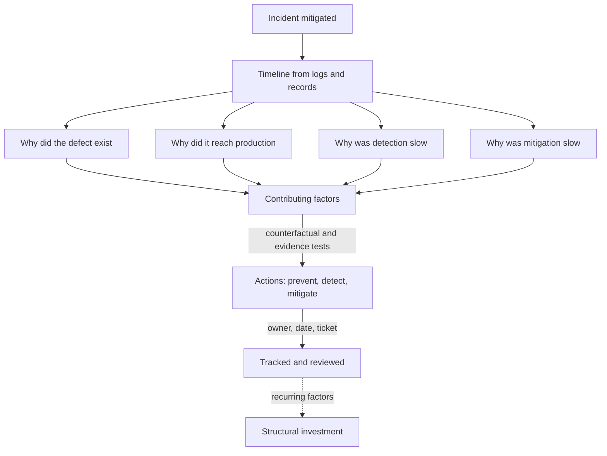

## TL;DR
Root-cause analysis asks why an incident was possible; a postmortem turns the answer into owned, tracked
work. Complex systems rarely have one root cause, so map contributing factors across prevention,
detection and mitigation, blamelessly. "The model hallucinated" is a symptom, never a cause.

## Why it exists
- **Mitigation ends the incident, not the next one.** Roll back, close the ticket and move on, and the
  same class of failure returns in a different shape, because whatever let it through (a missing test, a
  silent alert, a deploy path without review) is still there.
- **Stopping at the proximate cause fails.** "A bad prompt change was deployed" names the trigger and
  suggests "be more careful", which is not an action anyone can execute.
- **Blame fails worse.** "The engineer skipped the eval" feels like accountability but produces the
  opposite: people learn to hide mistakes and sanitise timelines, so the organisation loses the very
  information it needs.
- **Blame also misreads how failures happen.** In complex systems, incidents typically need several latent
  conditions to line up, and the human action at the end was usually reasonable given what that person
  could see at the time.
- **AI makes stopping early tempting.** "The model is non-deterministic" seems like an explanation; it is
  not. A well-built system expects wrong model outputs and has grounding checks, validation, guardrails
  and human review sized to the risk. The question is why none of those caught this one.

## How it works
### 1. Build the timeline first
- **Assemble a factual, timestamped timeline** from logs, alerts, chat and deploy records.
- **Record:** when the trigger happened, when impact began, when it was detected and by whom, each
  decision and its rationale, when it was mitigated and resolved.
- **Why first:** memory is reconstructive. The timeline anchors discussion in evidence and exposes gaps,
  such as a 40-minute stretch between impact and detection.

### 2. Ask "why" along several chains
| Technique | What it does | Limit or use |
|---|---|---|
| **Five whys** | Repeatedly asks why the previous answer happened | Gets past the trigger, but produces one linear chain and stops wherever the asker's knowledge or patience runs out |
| **Ishikawa (fishbone)** | Groups candidate causes by category: code, data, model, process, people, environment | Avoids tunnel vision |
| **Fault tree** | Works backwards from the failure through AND/OR gates | Shows that several conditions were jointly necessary |

Run the whys along several axes:
1. why did the defect exist;
2. why did it reach production;
3. why was it not detected sooner;
4. why did mitigation take as long as it did.

### 3. Prefer contributing factors over "the root cause"
- **List every condition** without which the incident would not have happened or would have been smaller.
- **Why:** this framing is more accurate for complex systems and produces better actions, because each
  factor is a separate place to add a defence.
- **The "Swiss cheese" picture:** each layer of defence has holes, and an incident is the rare moment they
  line up, so shrinking the holes in any one layer helps.
- **Counterfactual test:** had this condition been absent, would the incident have been prevented or
  smaller? If not, it is background, not a factor.
- **Evidence test:** is the causal link shown by logs, traces or a reproduction, or only plausible? A
  plausible story that nobody checked is how postmortems confidently fix the wrong thing.

### When to stop asking why
- **Stop at a changeable, ownable condition:** one a team can change with a system control and own as an
  action.
- **One step too far** usually lands on something true but useless ("people make mistakes", "the deadline
  was tight").
- **One step short** leaves a trigger ("a bad config was pushed").
- **Organisational endings get escalated.** If the chain ends in a factor such as no budget for eval
  coverage, record it and escalate it as a structural finding rather than pretending a ticket can close it.

### 4. Stay blameless, not accountability-free
- **Describe actions by the information and pressures people had:** "the eval suite passed because it
  contained no cases for policy documents", not "Sam didn't test properly."
- **Goal:** a safe environment for honest accounts. Accountability lives in owning the action items.

### 5. Write the postmortem
A standard structure:
1. summary;
2. impact (users, duration, data, money, SLA);
3. timeline;
4. detection (how and how fast);
5. response;
6. contributing factors;
7. what went well;
8. where we got lucky, which captures near-misses that would otherwise be forgotten;
9. action items.

### 6. Action items that actually close
- **Each action has** a single owner, a due date, a tracking ticket and a category.
- **Categories:** **prevent** (stop the defect existing), **detect** (catch it faster), **mitigate** (limit
  blast radius or speed recovery).
- **Change the system, not memory.** Prefer a gate, a test, an alert or a kill switch over actions that
  rely on people remembering.
- **Review open actions on a fixed cadence.** An action with no owner or date is a wish.

### 7. Share and learn
- **Publish postmortems internally** and look across them periodically.
- **Recurring factors** (no eval coverage for new document types, provider changes going unnoticed) are
  where structural investment pays off.

## Diagram
Several "why" chains feed one list of tested factors; only owned, dated actions leave the review.



## Examples
### Worked postmortem: the 12-week leave policy
**Incident:** for six hours an HR assistant told employees the parental-leave policy was 12 weeks; the
current policy is 16. **Proximate trigger:** a re-indexing job ingested an archived policy folder.

**Five whys along the *defect* chain:**
1. The wrong answer was generated because the old PDF ranked top.
2. It ranked top because both versions were indexed with no effective-date metadata.
3. There was no metadata because the ingestion connector was configured by folder, and the archive sat
   inside the indexed folder.
4. Nobody noticed because the connector config was not code-reviewed.

**Along the *detection* chain:**
- The issue was found by an employee complaint, not monitoring.
- The groundedness check verified that answers matched retrieved text (they did) rather than that the
  source was current.
- There were no eval cases asserting current policy values.

**Contributing factors:** archive inside an indexed path; no effective-date filter; unreviewed connector
config; eval suite with no freshness cases; detection reliant on users.

| Category | Action | Owner | Due |
|---|---|---|---|
| Prevent | Index only documents with an effective date and filter superseded versions | retrieval team | 2 weeks |
| Prevent | Connector configuration in version control with review | platform | 3 weeks |
| Detect | Run 30 "current value" questions from HR after every re-index and nightly, since a nightly-only check could be slower than the six hours it took a user to complain | AI engineer and HR SME | 2 weeks |
| Mitigate | Per-collection kill switch to exclude a source within minutes | platform | 4 weeks |

Note what is absent: "the model hallucinated" and "the admin should have checked the folder."

### Linting action items and spotting recurring factors (runnable)
A small check you can run in CI over postmortem action items exported from your tracker. Pure Python.

```python
from collections import Counter
from datetime import date

CATEGORIES = {"prevent", "detect", "mitigate"}
actions = [  # from the leave-policy postmortem, plus one weak item
    {"id": "PM-12-1", "category": "prevent", "owner": "retrieval team", "due": date(2026, 3, 2), "ticket": "RET-88", "done": True},
    {"id": "PM-12-2", "category": "prevent", "owner": "platform", "due": date(2026, 3, 9), "ticket": "PLAT-41", "done": False},
    {"id": "PM-12-3", "category": "detect", "owner": "AI engineer", "due": date(2026, 3, 2), "ticket": "AI-17", "done": True},
    {"id": "PM-12-4", "category": "mitigate", "owner": "platform", "due": date(2026, 3, 16), "ticket": "PLAT-42", "done": False},
    {"id": "PM-12-5", "category": "prevent", "owner": None, "due": None, "ticket": None, "done": False},  # "be more careful"
]

def lint(a):
    problems = [f for f in ("owner", "due", "ticket") if not a.get(f)]
    return problems + ([] if a.get("category") in CATEGORIES else ["category"])

today = date(2026, 3, 12)
for a in actions:
    if p := lint(a):
        print(a["id"], "is a wish, missing:", ", ".join(p))   # PM-12-5
    elif not a["done"] and a["due"] < today:
        print(a["id"], "overdue")                             # PM-12-2
done = sum(a["done"] for a in actions)
print(f"completion {done}/{len(actions)} = {done / len(actions):.0%}")   # 2/5 = 40%

# Factors that recur across postmortems point at structural work
factors = [["no freshness evals", "unreviewed config"], ["no freshness evals", "user-detected"],
           ["provider change unnoticed", "user-detected"]]
print(Counter(f for pm in factors for f in pm).most_common(2))
# [('no freshness evals', 2), ('user-detected', 2)]
```

## Production patterns
- **Postmortem template with mandatory sections.** When: every incident above the policy's severity
  threshold. How: a shared document template with the nine sections above, including "where we got
  lucky", started by the incident scribe during the incident. Monitor: days from resolution to review.
- **Fixed-cadence action review.** When: always. How: a recurring meeting or report that lists open
  postmortem actions by owner and due date, with overdue items escalated to the owning manager. Monitor:
  action-item completion rate and median age of open items.
- **Tag contributing factors with a shared vocabulary.** When: you have more than a handful of
  postmortems. How: label each factor from an agreed list (freshness, eval gap, config review, provider
  change, detection by user) so they can be counted across incidents. Monitor: share of new incidents
  repeating an earlier factor.
- **Every detection gap becomes an eval or alert.** When: an AI incident was found by a user. How: add the
  failing inputs as regression eval cases and an online check (for example a scheduled "current value"
  question set). Monitor: time from impact start to detection on the next incident.
- **Internal and external versions.** When: customers were affected. How: keep the internal postmortem
  fully candid and derive a customer version with impact, timeline summary and corrective actions.
  Monitor: customer follow-up questions the external version failed to answer.

## Trade-offs
- **Depth vs senior time.** Deep analysis of every incident yields learning but consumes senior time.
  Reserve full postmortems for higher severities and near-misses with high potential impact, and use a
  short template for the rest.
- **Contributing factors vs priority.** The framing is more accurate than a single root cause, but can
  produce a long list with no priority. Rank actions by how many future failure paths each one closes.
- **Wide publication vs sensitivity.** Publishing widely spreads lessons, but candid detail can be
  sensitive for customers. Share an external version with impact and corrective actions, and keep the
  internal one fully candid.
- **Systemic fixes vs speed.** Gates, tests and automation are durable but slower to ship than process
  reminders. Flip toward a temporary process control only as a bridge, with a dated plan for the systemic
  fix.

## Pitfalls
- **Stopping at the trigger** ("bad deploy", "model hallucinated"). Symptom: action items like "be more
  careful" and the same class of incident recurring within months. Fix: ask why along every chain.
- **Blame, explicit or implied.** Symptom: vague timelines, defensive meetings and fewer incidents reported
  even as customer complaints rise. Fix: describe information and pressures, not people.
- **Action items without owners, dates or tickets.** Symptom: a postmortem archive whose actions are
  mostly still open when the next similar incident happens. Fix: lint and review them.
- **Only "prevent" actions.** Symptom: a different trigger produces the same long, user-detected outage
  because detection and mitigation never improved. Fix: require detect and mitigate actions.
- **Writing the postmortem weeks later.** Symptom: a timeline reconstructed from memory with gaps exactly
  where the important decisions were made. Fix: start the timeline during the incident.
- **Hindsight bias**, judging decisions by an outcome nobody could see at the time. Symptom: "should have"
  and "failed to" language in the timeline, and no explanation of why the action looked reasonable to the
  person who took it. Fix: record what each person knew when they acted.

## When to use
- **Use when:** an incident is above a severity threshold defined in your incident policy, for any data
  exposure or safety event regardless of scale, and for near-misses that would have been severe.
- **Timing:** start the timeline while the incident is fresh and hold the review within days.
- **Measure:** action-item completion rate and how often incidents share contributing factors with
  earlier ones; both tell you whether postmortems are changing anything.
- **Interviews:** a strong answer separates trigger, contributing factors and detection gaps, and proposes
  system changes rather than personal vigilance.

## Role lens
- **Engineer:** Builds the timeline from traces and deploy logs, and turns detection gaps into concrete
  eval cases, alerts and regression tests with owners.
- **Architect:** Looks across postmortems for recurring structural factors and funds the platform changes,
  such as release gates or source freshness controls, that close whole classes of failure.
- **FDE:** Writes the customer-facing version, joins joint reviews with the customer's teams, and makes
  sure factors on the customer's side become actions they own.

## Check yourself
**Q:** A postmortem draft says: "Root cause: the LLM hallucinated a refund amount. Action: improve the
prompt." What is wrong with it, and how would you rewrite the analysis?
**A:** Hallucination is an expected behaviour of the component, so it is a symptom, not a cause; the
question is why the system let an unverified amount reach a customer. I would ask why the amount was
generated rather than looked up from the order system, why no validator compared it to the order record,
why evals did not cover refund amounts, and how the issue was detected. Actions would then be: fetch
amounts via a tool, validate before sending, add eval cases, and alert on mismatches, each with an owner
and date. "Improve the prompt" may stay, but only as one item among them.

## Interview questions
### What does "blameless" mean in a postmortem, and why does it matter?
- **Definition:** actions are described by the information and pressures people had, not as personal
  failings, while accountability lives in owned action items.
- **Why:** blame makes people hide mistakes and sanitise timelines, so the organisation loses the evidence
  it needs to fix the system.

### An incident was detected 40 minutes after impact began. How do you analyse that gap?
- **Treat detection as its own chain.** Ask why no alert fired, which signal would have caught it, and
  who noticed first.
- **Check the evidence:** did monitoring look at the right property (source freshness, not just
  groundedness)?
- **Output a detect action:** an alert or eval with an owner, date and ticket, measured by time to detect
  on the next incident.

### When would you not write a full postmortem?
- **Low-severity incidents with no near-miss potential**: use a short template so senior time goes to
  the incidents that teach the most.
- **Always write one** for data exposure or safety events regardless of scale, and for near-misses that
  would have been severe.

### How do you know your postmortem process is working?
- **Action-item completion rate**: a process whose actions stay open changes nothing.
- **Recurrence of contributing factors**: if new incidents keep sharing factors with earlier ones, the
  structural fixes are not landing.
- **Time to detect and mitigate** trending down for similar incident classes.

### Five whys versus a fault tree: when do you use which?
- **Five whys** is fast for getting past the trigger, but follows one chain and stops where knowledge ends.
- **A fault tree** works back through AND/OR gates and is the better tool when you must show several
  conditions were jointly necessary.
- **In practice** run whys along several axes and use a fishbone or fault tree when the chains branch.

## Quiz
### Q: What is the main limitation of the five-whys technique in complex systems?
- [ ] It requires specialised software to run
- [x] It follows one linear chain and stops where the asker's knowledge ends, missing parallel contributing factors
- [ ] It can only be applied to hardware failures
- [ ] It always assigns the cause to an individual
> Incidents usually need several conditions at once; a single chain of whys finds one of them. Running
> it along prevention, detection and mitigation axes, or using a fishbone or fault tree, surfaces the rest.

### Q: Why are blameless postmortems more effective than assigning individual fault?
- [ ] They remove the need for anyone to own follow-up actions
- [ ] They shorten the postmortem meeting
- [x] People give honest, detailed accounts when they are not punished, which reveals the system conditions behind the error
- [ ] Regulators require that individuals never be named
> Blame drives people to hide or sanitise what happened, destroying the information needed to fix the
> system; blamelessness keeps accounts honest while accountability lives in owned action items.

### Q: Which action item best addresses a detection gap in an AI incident found by a user complaint?
- [ ] Remind the team to review outputs more carefully during releases
- [ ] Switch to a more capable model
- [ ] Add a disclaimer that answers may be inaccurate
- [x] Add an automated eval or online check for the failure type, with an owner and due date
> A detection action should catch the failure automatically before users do; reminders and disclaimers do
> not detect anything, and a model swap is a prevention guess rather than a detection control.
