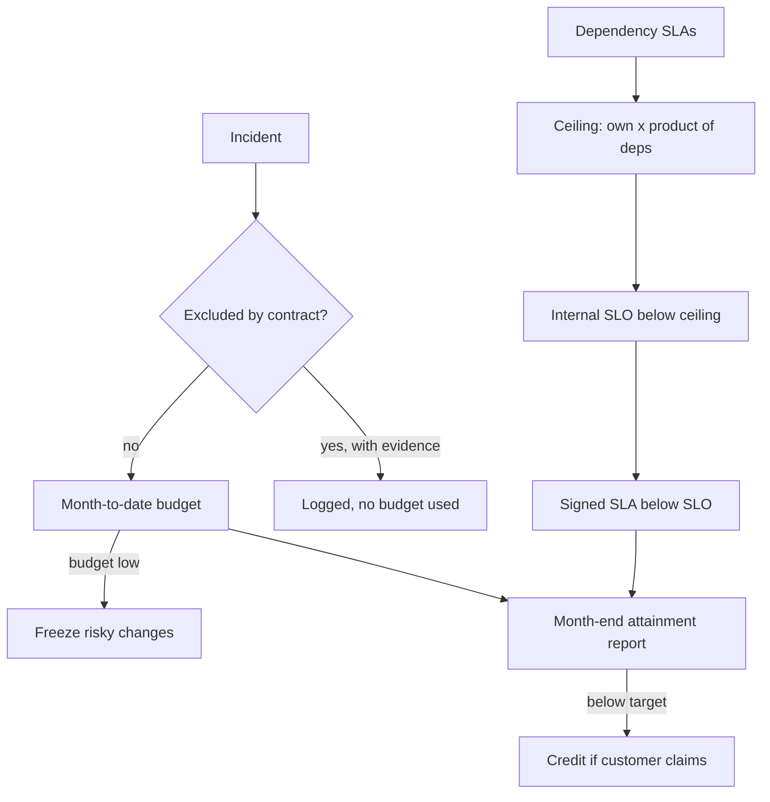

## TL;DR
An SLA is a contract, not a dashboard: covered service, exact measurement, exclusions and remedies.
Delivery owners run service SLAs (availability, latency) and support SLAs (response by severity), and
commit only to what dependencies and on-call can back.

## Why it exists
- **The buyer needs a written promise.** An enterprise is about to route a business process through your
  AI system. Procurement, legal and their operations team need to know what happens when it is down at
  2 a.m., how fast someone answers, and what they are owed if it keeps happening.
- **Unwritten expectations get set anyway.** Without an SLA they come from the best week of the pilot,
  what a salesperson said on a call, or the customer's experience with a hyperscaler. Every outage then
  becomes an argument about whether it "counted".
- **The naive numbers fail predictably.**
  - Copying a cloud provider's headline number ignores that your service sits on several dependencies,
    each failing independently, so your honest ceiling is lower than any one of theirs.
  - Promising what the pilot achieved ignores that it ran at a tenth of production traffic with the
    builders watching it.
  - Promising "24/7 support" with no rotation behind it turns the first night incident into a breach.
  - Promising answer quality as if it were uptime creates a metric neither side measures the same way.
- **A signed SLA changes what an incident is.** Downtime is no longer only an engineering problem: it
  accrues credits, triggers reporting obligations and, past a threshold, termination rights. The delivery
  owner has to understand that commercial clock as well as the technical one.
- **Scope of this lesson.** SLI, SLO and error-budget mechanics live in reliability/slas-slos; this
  lesson is about writing and operating the promise.

## How it works
### Anatomy of a service SLA
1. **Service definition.** Which endpoints, features and environments are covered. Production only;
   beta features and sandboxes are explicitly out, *because* you need somewhere to ship experiments.
2. **Metric definition.** The SLI formula in one sentence a query can implement:
   - share of valid requests returning a non-error response within the latency bound, or
   - minutes in which a synthetic probe failed.
   - **Measurement point:** your load balancer, not the customer's laptop, *because* both sides must
     compute the same number from data both can inspect.
   - **Partial outages:** need an explicit rule, usually a "bad minute" whose error rate exceeds a
     threshold. Without it, a month of 3 percent errors is either invisible (probe minutes rarely fail)
     or a total breach, depending on who is reading.
   - **Valid requests:** requests over the rate limit, malformed requests and client cancellations are
     normally excluded from the denominator.
3. **Window and target.** Almost always a calendar month, *because* credits are paid against monthly
   invoices. The allowance is `allowed_downtime = (1 − target) × minutes_in_window`.
4. **Exclusions.** Scheduled maintenance with notice, customer-caused load beyond contracted limits,
   force majeure, and features marked preview. Whether an upstream model provider's outage is excluded
   is the most contested line in AI contracts; customers usually refuse, reasoning that your vendor
   choice is your risk.
5. **Remedies.** Tiered service credits as a percentage of the monthly fee, often stated as the sole
   remedy, plus a termination right after repeated misses. Credits are usually claimed by the customer
   within a stated period, not paid automatically.

### The allowance table is a staffing statement
For a 30-day month (43,200 minutes):

| Target | Allowed downtime per month | What it implies |
|---|---|---|
| 99 percent | 432 minutes | humans can notice and fix |
| 99.5 percent | 216 minutes | a staffed rotation with fast paging |
| 99.9 percent | 43.2 minutes | automated detection and rollback |
| 99.95 percent | 21.6 minutes | automation plus tested failover |
| 99.99 percent | about 4.3 minutes | redundancy across every dependency |

- **Why 99.9 needs automation:** 43 minutes a month is less than one slow
  page-acknowledge-diagnose-rollback cycle, so it cannot rely on a human noticing.

### Support SLAs
- **Promise response time.** The time until a qualified human acknowledges and starts work, per severity
  level (see incident-severity-and-escalation).
- **Treat resolution time as a target** or a workaround commitment, *because* you control when someone
  picks up but not how long an unknown root cause takes to find.
- **Coverage hours matter as much as minutes.** A 30-minute Sev1 response around the clock implies a
  staffed on-call rotation, not one engineer with a phone.

### Deriving what you can commit
1. **List the serial dependencies** on the request path with their own SLAs.
2. **Multiply them, then account for your own failures:** `ceiling = A_own × ∏ SLA_dependency`.
3. **Order the numbers:** `SLA < internal SLO < ceiling`. Set the internal SLO below the ceiling and the
   SLA below the SLO, *because* the gap is the room in which you detect and fix problems before they
   become contract events.

- **The ceiling is contractually backed, not a forecast.** It assumes failures are independent and each
  dependency runs exactly at its SLA floor. Real availability may be better or, for some providers,
  worse, so use measured history where you have it.
- **Remember the asymmetry.** When your provider misses its SLA you receive credits on your provider
  bill, while you owe credits on a customer contract that is usually far larger.

### Operating the promise
Signing is the start. The owner runs the promise all month:
1. **Month-to-date budget.** Minutes consumed against the allowance, visible to the on-call team,
   *because* a 20-minute incident on day 3 and on day 28 of a month that already burned 200 minutes are
   different decisions.
2. **Error-budget policy.** When most of the budget is gone, slow risky changes (prompt edits, model
   swaps, migrations) until the window resets.
3. **SLA-impact field on every incident.** Covered minutes, excluded or not, and why, filled in during
   the postmortem rather than reconstructed at month end, *because* exclusion arguments are won with
   contemporaneous evidence.
4. **Month-end attainment report.** Built from the same query the contract describes; handle credit
   claims against it.

Two commercial facts shape this:
- **Credits are small.** They are commonly capped and stated as the sole remedy, so their value to the
  customer is small next to the business they lost.
- **Repeated misses are what customers escalate over,** which is why termination-on-repeated-breach
  clauses are the ones that matter.

### What AI changes
- **Quality** rarely belongs in the SLA as a percentage. Put it in acceptance criteria, recurring eval
  reports, and a commitment to remediate regressions within a set time.
- **Model changes** need a notice clause: how far ahead you announce a model or prompt change that can
  alter outputs, and whether the customer can pin a version.
- **Latency** depends on output length, so define it as time to first token or per-request latency for
  requests under a token cap; an unqualified p95 promise is broken by one long-answer workload.
- **Throughput**: the SLA applies within contracted rate limits, *because* a 10x burst would otherwise
  turn a provider quota into your breach.

## Diagram
Read it top to bottom: the ceiling bounds the SLO, the SLO bounds the SLA, and every incident flows into
the monthly attainment and credit decision.



## Examples
### SLA calculator: allowance, attainment, credits and ceiling
Pure Python; the numbers match the worked month below.

```python
MINUTES = 30 * 24 * 60  # 43,200 in a 30-day month
TIERS = [(0.95, 0.50), (0.99, 0.25), (0.995, 0.10)]  # (below this, credit share of fee)

def allowance(target, minutes=MINUTES):
    return (1 - target) * minutes

def attainment(bad_minutes, minutes=MINUTES):
    return 1 - bad_minutes / minutes

def credit(avail, fee):
    for floor, pct in TIERS:          # most severe tier first
        if avail < floor:
            return pct * fee
    return 0.0

def ceiling(own, *deps):
    out = own
    for d in deps:
        out *= d
    return out

for t in (0.99, 0.995, 0.999, 0.9995, 0.9999):
    print(f"{t:.2%} -> {allowance(t):.1f} min/month")   # 432.0, 216.0, 43.2, 21.6, 4.3

incidents = {"provider outage": 140, "bad deploy": 95}
for exclude_provider in (False, True):
    bad = sum(m for name, m in incidents.items()
              if not (exclude_provider and name.startswith("provider")))
    a = attainment(bad)
    print(f"exclude_provider={exclude_provider}: {bad} min, {a:.3%}, credit ${credit(a, 40_000):,.0f}")
# exclude_provider=False: 235 min, 99.456%, credit $4,000
# exclude_provider=True: 95 min, 99.780%, credit $0

print(f"ceiling = {ceiling(0.999, 0.999, 0.9995):.4%}")   # 99.7502%
```

### Worked month: two incidents and a breach
A customer pays $40,000 per month (illustrative). The SLA promises 99.5 percent monthly availability,
measured as minutes in which a synthetic probe against the production API fails twice in a row.

| Credit tier | Credit |
|---|---|
| below 99.5 percent | 10 percent of the fee |
| below 99.0 percent | 25 percent |
| below 95 percent | 50 percent |

The month has 30 days, so 43,200 minutes and an allowance of 216 minutes.

| Day | Event | Budget left |
|---|---|---|
| 9 | Model provider regional outage, 140 minutes; fallback never configured for that region | 76 minutes for 21 days |
| 9 | The error-budget policy should have frozen risky changes now; it did not | 76 |
| 22 | Bad deploy breaks the API for 95 minutes | none: 235 minutes total |

- **Attainment:** 1 − 235/43,200 ≈ 99.456 percent, a breach in the first tier: a $4,000 credit if the
  customer files a claim.
- **With a provider exclusion:** downtime would be 95 minutes, 99.78 percent, no breach, which is
  exactly why that clause is fought over.
- **The ceiling behind the number:** provider SLA 99.9 percent, vector database 99.95 percent, your own
  service historically about 99.9 percent. The serial product is 0.999 × 0.9995 × 0.999 ≈ 0.9975, or
  about 99.75 percent if each runs at those levels and fails independently.
- **Margin:** a 99.5 percent SLA leaves about a quarter of a percent. A 99.9 percent SLA, which sales had
  floated, would be breached in an ordinary month unless a tested cross-region or cross-provider
  fallback existed.
- **The asymmetry:** your provider bill is $6,000, so even a 10 percent provider credit returns $600
  against the $4,000 you owe.

## Production patterns
- **Contract-exact SLI query** — when signing any SLA, write the attainment query first and attach its
  definition (measurement point, bad-minute rule, valid-request filter) to the contract. Run the same
  query for the internal dashboard and the monthly report; monitor any gap between it and the
  customer's own monitoring.
- **Burn-rate alerts on the internal SLO** — when the SLA allowance is under an hour, alert on how fast
  the stricter SLO budget is burning (a fast window for paging, a slow one for tickets) rather than on
  the SLA threshold. Monitor pages per month and time from first bad minute to acknowledgement.
- **Error-budget change freeze** — when month-to-date budget consumption passes an agreed share, block
  prompt edits, model swaps and migrations through a deploy-pipeline gate until the window resets.
  Monitor how often the freeze triggers and how many changes it deferred.
- **SLA-impact fields in the incident template** — on every incident, require covered minutes, the
  exclusion claimed and the evidence link before the postmortem closes. Monitor the share of incidents
  closed with the field empty.
- **Tested fallback before raising the number** — when sales asks for a higher tier, first run a
  scheduled failover drill to a secondary provider or region and record the switch time. Monitor
  fallback success rate and the drill's measured switch time against the allowance.

## Trade-offs
- **Tighter SLA vs cost.** It wins enterprise deals and premium pricing, but each step multiplies the
  redundancy and on-call cost; it flips to worthwhile only when the price uplift exceeds that recurring
  cost.
- **Excluding upstream provider outages vs trust.** It protects your margin, but customers read it as
  you not owning your architecture; it flips toward acceptable when the customer chose or mandated that
  provider.
- **Request-based vs probe-minute measurement.** Requests are fairer to partial outages but need logs
  both sides trust; it flips to probe-based when the customer cannot see your logs or traffic is too
  sparse for per-minute error rates to mean anything.
- **Resolution-time commitments vs control.** They reassure buyers, but you cannot control unknown root
  causes; they only become safe for narrow, well-understood failure classes with a documented
  workaround.
- **Automatic vs claim-based credits.** Automatic credits build trust and avoid claim disputes, but cost
  money on breaches nobody noticed; claim-based credits are cheaper but make every breach a negotiation.

## Pitfalls
- **Signing the number sales promised without computing the dependency ceiling.** Symptom: breaching in
  a month where no single component missed its own SLA.
- **Defining the metric vaguely ("the service is available").** Symptom: a month-end dispute where your
  dashboard says 99.7 percent and the customer's monitoring says 98.9 percent.
- **Promising 24/7 response with no funded rotation.** Symptom: a Sev1 acknowledged hours late because
  the only person on call was asleep or on a plane.
- **Treating the SLA target as the alerting threshold.** Symptom: learning about a breach from the
  customer's credit claim instead of from an internal SLO alert days earlier.
- **Leaving the "bad minute" and valid-request rules undefined.** Symptom: a month with a sustained
  partial error rate that your probe calls 100 percent available while the customer's users saw failures.
- **Changing the model or prompt without the notice the contract requires.** Symptom: a customer
  escalating a "silent regression" that is also a contractual violation.

## When to use
- **Use when:** any production deployment a customer pays for and depends on, and internal platforms
  other teams build on.
- **Pilots and proofs of concept:** skip formal credits, but still write down response expectations so
  the pilot does not set an unspoken bar.
- **Before signing:** compute the dependency ceiling, confirm the on-call staffing behind every support
  commitment, and check that the metric can be computed from data both sides can see.
- **While operating:** track SLA attainment monthly, alert on the stricter internal SLO, and review the
  contract whenever architecture or providers change.
- **Interviews:** expect "how would you set the SLA for this system?" and answer with the chain
  arithmetic.

## Role lens
- **Engineer:** Implements the SLI exactly as the contract defines it, builds the monthly attainment
  report, and wires internal SLO burn alerts that fire well before the contractual threshold.
- **Architect:** Owns the gap between the dependency ceiling and the committed number, deciding which
  redundancy, fallback provider or region the promised SLA actually requires.
- **FDE:** Negotiates exclusions, measurement points and model-change notice with the customer's
  procurement and operations teams, translating their fears into terms you can honestly meet.

## Check yourself
**Q:** A customer asks for 99.95 percent monthly availability and a two-hour resolution time for Sev1. Your
path depends on one LLM provider (99.9 percent SLA) and a managed database (99.99 percent). What do you offer?
**A:** First the ceiling: 0.999 × 0.9999 ≈ 0.9989 before any of my own failures, so 99.95 percent cannot
be backed on this architecture: the provider's own contract permits more downtime than my whole budget,
and signing it means betting on the provider beating its SLA every month. I would offer 99.5 percent, or 99.9
percent only if they fund a tested secondary provider and region, which raises the provider term close
to one. On support, I commit to a Sev1 response time with 24/7 coverage that our rotation can staff,
plus a workaround or status update cadence, but not a two-hour resolution, because root-cause time is
unbounded. I would also add a model-change notice clause and define latency per request under a token cap.

## Interview questions
### What is the difference between an SLA, an SLO and an SLI, and why keep all three?
- **SLI is the measurement,** for example the share of valid requests answered without error within the
  latency bound, computed at a stated point such as your load balancer.
- **SLO is the internal target** on that SLI, and the SLA is the external contract with remedies attached.
- **Why three:** the SLO sits stricter than the SLA so alerts fire and the team acts before a miss
  becomes credits, and the SLI definition is what both sides must compute identically.

### A customer's monitoring shows 98.9 percent for the month and yours shows 99.7 percent. How do you resolve it?
- **Go back to the contract's metric definition:** measurement point, bad-minute rule and which requests
  count as valid. The gap usually lives in one of those three.
- **Recompute with the contract's own query** and compare minute by minute; a sustained partial error
  rate or client-side timeouts often explain the difference.
- **Fix it for next month:** tighten the definition, share the data source both sides can inspect, and
  attach SLA-impact evidence to each incident.

### When would you refuse to exclude upstream model provider outages, and when would you push for it?
- **Accept owning it** when you chose the provider, because customers reasonably say your vendor choice
  is your risk; then you need a tested fallback and a lower committed number.
- **Push for the exclusion** when the customer chose or mandated that provider, because you cannot route
  around their decision.
- **Either way,** price the risk: the provider credit you receive is far smaller than the credit you owe.

### Sales wants to sign 99.9 percent. The path is provider 99.9, vector database 99.95, and your service has historically run at about 99.9. What do you say?
- **Compute the ceiling:** 0.999 × 0.9995 × 0.999 ≈ 99.75 percent, so 99.9 would be breached in an
  ordinary month.
- **Translate it into minutes:** 99.9 allows 43.2 minutes a month, less than one human
  page-diagnose-rollback cycle.
- **Offer options:** sign 99.5 percent now, or 99.9 only after a tested cross-region or cross-provider
  fallback raises the provider term.

### How do you handle answer quality and latency for an LLM feature in an SLA?
- **Quality** goes into acceptance criteria, recurring eval reports and a regression-remediation
  commitment, not an uptime-style percentage neither side measures the same way.
- **Latency** is defined as time to first token or per-request latency under a token cap, because output
  length drives total latency.
- **Model changes** get a notice clause and, where possible, version pinning, so a model swap is not a
  silent contract violation.

## Quiz
### Q: Why should the internal SLO be stricter than the external SLA?
- [ ] Because regulators require internal targets to exceed contractual ones
- [x] Because the gap gives time to detect and fix degradation before it becomes a contract breach
- [ ] Because customers measure availability more leniently than providers do
- [ ] Because service credits are calculated from the internal SLO
> If the alerting target equals the contract, you learn about problems only once you owe credits. A
> stricter SLO burns first and gives the team room to act; regulation and credit formulas do not require it.

### Q: In a support SLA, which commitment is usually safe to make for every severity level?
- [ ] A guaranteed resolution time for each severity
- [ ] A guaranteed root-cause report within one hour
- [x] A response time for a qualified human to acknowledge and begin work
- [ ] A guarantee that no Sev1 incident will recur
> Response time is within your control if the rotation is staffed. Resolution depends on an unknown root
> cause, so promising it per severity converts hard incidents into automatic breaches.

### Q: Your provider SLA is 99.9 percent and you sign 99.9 percent with your customer. What is the main flaw?
- [ ] Provider SLAs are measured quarterly, so the windows cannot match
- [x] Your service also depends on other components and your own code, so its ceiling is below 99.9 percent
- [ ] Customer SLAs must always be at least one nine looser than provider SLAs
- [ ] Credits from the provider will fully cover the credits you owe
> Serial dependencies multiply, so any additional failure source pushes you below the provider's number.
> There is no fixed one-nine rule, and provider credits are usually far smaller than what you owe.
