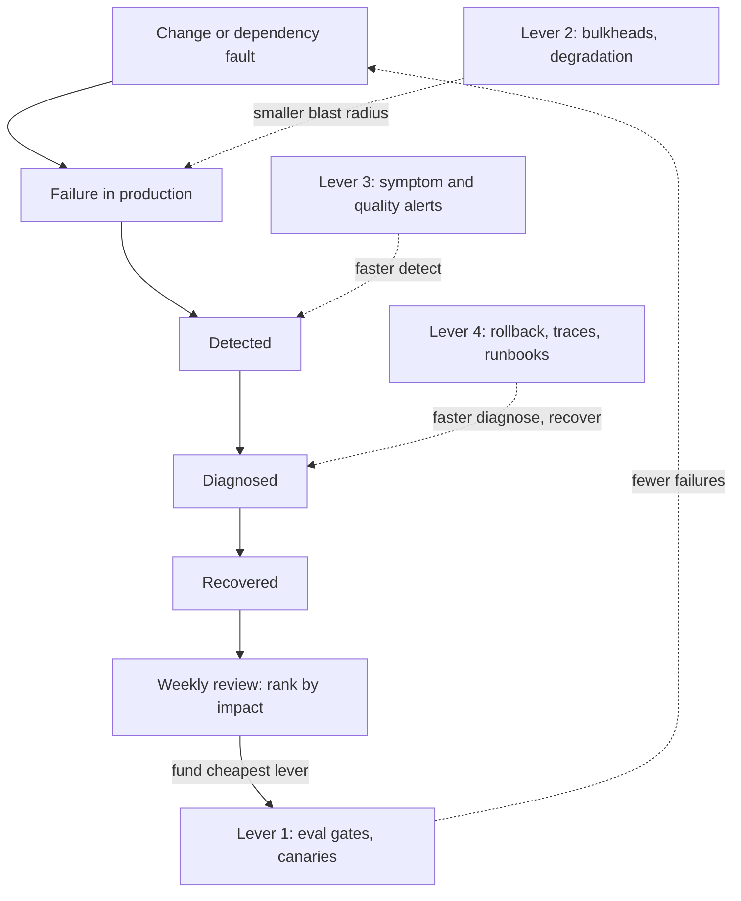

## TL;DR
System reliability is the probability the system does the right thing for users over time. Owning it
means four levers: fail less often, fail smaller, notice sooner, recover faster. For AI, "right"
includes answer quality, so a fully-up system can be unreliable.

## Why it exists
- **Delivered AI systems fail differently from demos.** They fail at 3 a.m. when a provider rate-limits
  a region, the day a vendor silently updates a model, when one tenant's batch job starves everyone
  else, or when an agent's tenth tool call times out and leaves half a workflow done.
- **Tests do not catch these.** Not "it works on my machine", and mostly not unit tests, *because* the
  failures come from load, time, dependencies and change rather than from logic errors.
- **"Add redundancy everywhere" fails twice.**
  - It is expensive and still misses the dominant cause: postmortem experience across the industry,
    Google's SRE writing included, finds a large share of outages is triggered by changes (deploys,
    config, prompts, model versions), and redundant copies running the same bad change fail together.
  - It optimises only one lever. A system that fails rarely but takes four hours to diagnose each time
    can be less available than one that fails weekly and rolls back in five minutes.
- **Someone has to own the whole picture:** which failures matter, which lever is cheapest to pull
  next, and whether the system is getting better or worse. Without that owner, reliability work happens
  only after incidents and only on whatever the last incident touched.
- **Scope.** This lesson is the owner's view; the patterns themselves (redundancy, circuit breakers,
  bulkheads) are taught in the reliability module.

## How it works
### The four levers and the impact formula
- **Availability over time** ≈ MTBF / (MTBF + MTTR): mean uptime between failures over the whole cycle
  of working plus being broken.
- **Convention caveat.** Strictly that numerator is MTTF, mean time to failure. If your MTBF already
  includes repair time, the formula is (MTBF − MTTR) / MTBF. Conventions differ, so say which you use.
- **Split MTTR** into time to detect, time to diagnose and time to recover, add blast radius (the share
  of users affected), and you have every lever you can pull. They combine into one cost function the
  owner can rank work by:

```
user_impact_minutes per period ≈ Σ over incidents of
    (time_to_detect + time_to_diagnose + time_to_recover) × blast_radius_share
expected for a failure mode ≈ frequency × mean_duration × mean_blast_radius
```

- **The product form is the point.** Each term is a separate lever; halving any one term halves the
  impact, so the cheapest term to halve is where the next sprint goes.

### Lever 1: fail less often (raise MTBF)
- **Change safety beats hardware:** canary and shadow releases, evaluation gates on prompt and model
  changes, pinned model versions, config review.
- **Start here,** *because* change causes most incidents, so this is usually where the first effort
  pays off.

### Lever 2: fail smaller (reduce blast radius)
- **Contain the width:** per-tenant quotas, bulkheads between workloads, feature flags, cell or region
  isolation. A failure that hits 2 percent of users for an hour costs far less error budget than one
  that hits everyone.
- **Graceful degradation shrinks the depth.** Serve a worse answer instead of none: a smaller or
  secondary model, a cached response, retrieval-only results without generation, a read-only mode,
  *because* users tolerate degraded far better than down.
- **Stop the spread.** Timeouts, retry budgets, circuit breakers and load shedding stop one slow
  dependency from exhausting threads, connections or quota for everything else, *because* the usual way
  a small failure becomes a big one is queueing behind it.

### Lever 3: notice sooner (reduce detection time)
- **Alert on symptoms users feel:** SLO burn, failed tasks, quality-eval pass rate on sampled traffic,
  not CPU.
- **Quality monitoring is decisive for AI,** *because* it is the difference between detecting a
  regression in an hour or from a customer email a week later.

### Lever 4: recover faster (reduce diagnose and recover time)
- **One-step rollback** for code, prompts and model versions.
- **Runbooks, and traces** that connect a user's request to every model and tool call.
- **Automatic failover** for failures that need sub-minute recovery, *because* humans cannot act that fast.

### Composition arithmetic
| Shape | Formula | Example |
|---|---|---|
| Serial dependencies | multiply: ∏ aᵢ | four components at 99.99, 99.9, 99.95 and 99.9 percent succeed about 99.74 percent of the time |
| Redundant alternatives | 1 − ∏(1 − aᵢ) | only if failures are independent |
| Multi-step agent task | per-step success to the power of steps | ten steps at 99 percent each complete about 90 percent of tasks |

- **Independence is the trap.** Shared regions, shared quotas and shared bad configs violate it, so real
  redundancy gains are smaller than the formula says.

### AI-specific failure classes
- **Dependency failures**: provider outages, rate limits (HTTP 429), regional quota exhaustion.
- **Silent quality failures**: a model update, a retrieval index gone stale, a prompt edit; every request
  returns 200 and the answers get worse.
- **Partial side effects**: an agent fails mid-workflow; reliability then requires idempotent tools and
  resumable state, not just retries.
- **Nondeterminism**: the same input sometimes fails, so "could not reproduce" is not evidence of a fix.

### The ownership loop
1. **Define SLOs**, including a quality SLO (for example, the pass rate of an automated evaluation on
   sampled production traffic), *because* availability alone cannot see the silent failures above.
2. **Agree an error-budget policy in advance**: what happens when the budget is spent (change freeze
   except fixes, reliability work moves to the top of the queue). Agreeing it before the crisis is what
   stops the argument from being re-litigated every time a launch is due.
3. **Review weekly**: budget burn, incidents, and the per-incident split of detect, diagnose and recover
   time, *because* incident count alone hides which lever is failing.
4. **Rank failure modes** from incidents and failure analysis with the impact formula, and fund the
   top items, not the most recent ones.
5. **Verify** with game days, failover drills and chaos tests, *because* a recovery path that has not
   been exercised should be assumed broken. Then repeat.

Before launch, a production readiness review checks each lever explicitly.

## Diagram
Follow one incident through its life; each box on the right is the lever that shortens or shrinks that
stage, and the loop at the bottom decides what gets funded next.



## Examples
### Composition and recovery arithmetic
The arithmetic an owner runs before deciding where the next sprint of reliability work goes. All
component figures are illustrative, not vendor numbers.

```python
from math import prod

def serial(*a):   return prod(a)                        # every component must work
def parallel(*a): return 1 - prod(1 - x for x in a)     # any one suffices; assumes independence
def availability(mtbf_h, mttr_h): return mtbf_h / (mtbf_h + mttr_h)

gateway, llm, vectors, app = 0.9999, 0.999, 0.9995, 0.999
backup_llm = 0.995
print(f"single provider: {serial(gateway, llm, vectors, app):.2%}")                      # 99.74%
print(f"with fallback:   {serial(gateway, parallel(llm, backup_llm), vectors, app):.2%}") # 99.84%

# The app's own term: one incident per month (~720 h) at two recovery speeds
for mttr in (2.0, 0.25):
    print(f"MTTR {mttr:>4} h -> {availability(720, mttr):.3%}")   # 99.723% vs 99.965%

# Agent task of 10 tool calls, 1% transient failure each, without and with one retry
p, n = 0.01, 10
print(f"no retry {(1 - p) ** n:.1%}, one retry {(1 - p ** 2) ** n:.2%}")  # 90.4% vs 99.90%
```

Three conclusions follow:
- **The fallback provider buys only a tenth of a percent,** *because* the other serial terms now dominate.
- **Cutting recovery from two hours to fifteen minutes** (one-step rollback plus a runbook) moves the
  app's own term far more.
- **Retries rescue the agent only if failures are transient and the tools are idempotent;** a
  deterministic bug fails both attempts.

### Worked scenario: ranking failure modes by expected impact
A quarter's incident history, reduced to per-month averages with the impact formula
`frequency × mean_duration × mean_blast_radius`. Figures are illustrative.

| Failure mode | Per month | Mean minutes | Users hit | Impact (user-minutes) |
|---|---|---|---|---|
| Bad prompt deploy | 1 | 180 | 100% | 180 |
| Stale retrieval index | 1 | 600 | 10% | 60 |
| Provider region outage | 0.5 | 30 | 100% | 15 |
| Tenant batch starves others | 2 | 20 | 30% | 12 |

- **Fund the top row first.** Prompt deploys produce more impact than the other three combined, and they
  are self-inflicted, so they are cheap to fix.
- **Pick the term inside it.** If incident timelines show about 150 of the 180 minutes were detection
  (a bad prompt still returns 200s), sampled quality evals that alert within 15 minutes cut that row to
  about 45 user-minutes.
- **A second provider is last,** *because* it addresses the 15-minute row while costing the most.

## Production patterns
- **Pinned model versions with a promotion step** — when calling a hosted model, reference a dated
  model snapshot rather than a floating alias, and promote a new version only after it passes the eval
  set on a canary. Monitor quality-eval pass rate per model version.
- **Timeouts, retry budgets and circuit breakers on every provider call** — set an explicit per-call
  timeout, retry only transient errors such as HTTP 429 and 5xx with exponential backoff and jitter,
  honour a `Retry-After` header when the provider sends one, and open a breaker after repeated failures.
  Monitor retry rate, breaker state changes and queue depth.
- **Degraded-mode kill switch** — when a dependency fails, flip a feature flag that routes to a
  secondary model, cached answers or retrieval-only results. Rehearse the flip in game days. Monitor
  traffic share in degraded mode and its quality score.
- **Quality SLO on sampled traffic** — run an automated evaluation on a fixed sample of production
  requests every hour and page when the pass rate drops below the SLO. Monitor pass rate per route,
  judge disagreement, and eval spend.
- **Per-tenant quotas and bulkheads** — give batch and interactive workloads separate concurrency pools
  and rate limits so one tenant cannot exhaust shared provider quota. Monitor per-tenant quota
  utilisation and rejections.
- **Detect, diagnose, recover timestamps in every postmortem** — record the three durations as fields,
  not prose, so the weekly review can see which lever is failing. Monitor their medians per quarter.

## Trade-offs
- **Redundancy vs cost and rot.** It raises availability for independent failures, but doubles cost and
  adds failover paths that rot unless exercised; it flips to worthwhile once recovery time, not failure
  rate, is already small.
- **Strict change gates vs delivery speed.** Evals, canaries and approvals cut change-induced incidents,
  but slow delivery; loosen them when the error budget is healthy and tighten them when it is being
  burned.
- **Quality monitoring vs spend and noise.** Monitoring sampled traffic catches silent regressions, but
  costs evaluation spend and judge noise; it flips to essential as soon as outputs feed decisions
  without human review.
- **Automatic vs manual failover.** Automatic failover recovers in seconds, but a flapping health check
  can cause the outage it guards against; prefer manual failover where minutes of recovery are
  contractually acceptable.

## Pitfalls
- **Measuring reliability only as HTTP success.** Symptom: green dashboards during a week of customer
  complaints about wrong answers after a provider's model update.
- **Adding retries everywhere without idempotency or budgets.** Symptom: duplicate side effects and retry
  storms that turn a brief provider blip into a long outage.
- **Building a fallback or degraded path nobody tests.** Symptom: discovering during the first real
  outage that the backup provider's credentials expired, its prompt format was never adapted, or its
  quota cannot absorb full production traffic.
- **Fixing whatever the last incident touched.** Symptom: the same failure class recurring across
  postmortems while the team feels busy.
- **Assuming failures are independent when computing redundancy.** Symptom: both "redundant" providers
  failing together because they share a region, quota or upstream.

## When to use
- **Start on day one:** reliability ownership begins the day a system has users who depend on it, not
  after the first outage.
- **Before launch:** run a readiness review against the four levers: how changes are gated, how failures
  are contained, which symptom alerts exist, and how long rollback takes.
- **In operation:** let the error budget and the ranked failure list decide what to fund, and measure
  MTTR and detection time per incident, not just incident count.
- **Pilots:** do not gold-plate with multi-region redundancy; do insist even there on rollback and
  quality monitoring.
- **Interviews:** reliability questions reward reasoning about which lever is cheapest for the given
  failure profile, with the composition arithmetic shown.

## Role lens
- **Engineer:** Builds the mechanisms that move each lever: idempotent tools, retry budgets, one-step
  rollback for prompts and models, and traces that make a failed task diagnosable.
- **Architect:** Decides where redundancy, isolation and fallback belong by running the composition
  arithmetic, and sets the reliability targets each component must meet.
- **FDE:** Learns how the customer's network, identity provider and data systems fail, because in their
  environment those dependencies, not your code, often dominate the reliability budget.

## Check yourself
**Q:** Your assistant had six incidents last quarter: two provider outages of 30 minutes, three bad prompt
deploys each taking about three hours to notice and roll back, and one stale index. Where do you invest first?
**A:** The prompt deploys dominate: roughly nine hours of degraded service versus one hour from the
provider, and they are self-inflicted, so they are cheap to fix. The formula also says where in their
duration to cut: I would expect most of those three hours to be detection, because a bad prompt returns 200s, so I would confirm that from the incident timelines before choosing the fix. I would add an evaluation gate and a
canary for prompt changes to cut their frequency, quality monitoring on sampled traffic to detect a bad
prompt within minutes, and one-step prompt rollback to shrink recovery. The stale index points to the
same detection gap and needs a freshness check. A second provider is worth less until those are done,
because it addresses the smallest slice of downtime.

## Interview questions
### What does "reliable" mean for an LLM system, and how is it different from "available"?
- **Reliable means doing the right thing for users over time,** which includes answer quality, not just
  returning responses.
- **Available is narrower:** a system can serve HTTP 200 on every request while a model update or stale
  index makes answers wrong, so it is up but unreliable.
- **So** you need a quality SLO on sampled traffic alongside the availability SLO.

### An agent completes only about 90 percent of its 10-step tasks. How do you debug and improve that?
- **Do the arithmetic first:** 99 percent per step over ten steps is about 90 percent per task, so the
  per-step failure rate is the target.
- **Classify the failures** from traces: transient (timeouts, 429s) versus deterministic bugs, because
  retries help only the first kind.
- **Fix in order:** idempotent tools and resumable state, then a bounded retry, which moves the task to
  about 99.9 percent for transient failures.

### When would you not add a second LLM provider for redundancy?
- **When the other serial terms dominate:** in the worked example the fallback adds only about a tenth
  of a percent.
- **When recovery time is the bigger lever:** cutting MTTR from two hours to fifteen minutes moves the
  app's own term much more.
- **When failures are correlated:** a shared region, quota or client bug takes both paths down together,
  and an untested fallback is likely broken anyway.

### Your service has one incident a month. What availability does a two-hour versus a fifteen-minute MTTR give?
- **Use MTBF / (MTBF + MTTR)** with about 720 hours between failures.
- **Two hours** gives about 99.72 percent; **fifteen minutes** gives about 99.97 percent.
- **Lesson:** at this failure rate, recovery speed is worth far more than another nine of component
  redundancy.

### How do you decide where the next sprint of reliability work goes?
- **Rank failure modes by expected impact:** frequency × mean duration × mean blast radius, from incident
  history and failure analysis.
- **Inside the top mode,** look at the detect, diagnose and recover split and halve the cheapest term,
  because halving any term halves the impact.
- **Let the error-budget policy decide timing,** agreed in advance so it is not re-argued at each launch.

## Quiz
### Q: Which change most directly reduces MTTR rather than failure frequency?
- [ ] Adding an evaluation gate before prompt changes reach production
- [x] Making prompt and model versions revertible in one step
- [ ] Pinning the model version instead of using a floating alias
- [ ] Running a canary on 5 percent of traffic before full rollout
> Recovery time shrinks when reverting is fast and safe. Gates, pinning and canaries prevent or contain
> bad changes, which raises MTBF or reduces blast radius rather than shortening recovery.

### Q: Two redundant LLM providers each claim 99.9 percent. Why might the pair deliver far less than 1 − 0.001²?
- [ ] Because SLA percentages cannot be multiplied
- [ ] Because the formula applies only to hardware failures
- [x] Because failures can be correlated through shared regions, quotas, client code or configuration
- [ ] Because failover always takes longer than the outage
> The parallel formula assumes independence. A shared cloud region, a common client library bug or a
> bad shared config takes both paths down at once, so real gains are smaller.

### Q: Why is answer quality part of system reliability for an LLM product?
- [ ] Because quality metrics are required in every SLA
- [x] Because a system can return successful responses while users receive wrong answers, which is a failure to them
- [ ] Because low quality always causes HTTP errors eventually
- [ ] Because quality monitoring replaces availability monitoring
> Reliability means doing the right thing for users. Silent quality regressions produce 200 responses,
> so they need their own SLO and monitoring alongside availability, not instead of it.
