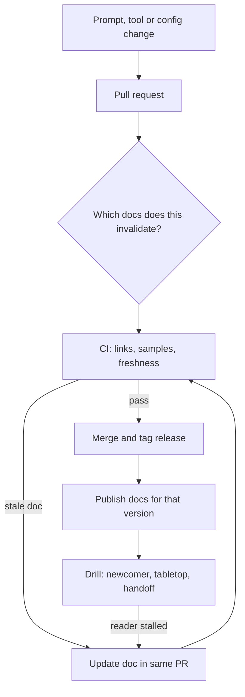

## TL;DR
Documentation keeps an agent working when its builders are gone. Each document needs one reader, one
job, an owner and a staleness check. Agents add model, prompt, tool, eval and failure-mode pages, and
tool descriptions are docs the model itself reads.

## For agent builders
- **Why it matters for agents.** An agent's behaviour lives in artefacts that are not obviously code:
  model snapshot, system prompt, tool schemas, retrieval index, eval set. When a run goes wrong, the first
  question is which of those changed, and only versioned docs and registries answer it.
- **Where it shows up in your stack.** Tool names, descriptions and parameter docs in your tool schemas
  (the model reads them on every call), an agent system card, runbooks for agent alerts, decision records
  for loop design, and repository instruction files that coding agents read.
- **What you control.** One reader per document (human operator or model), docs changed in the same pull
  request as the prompt or tool, versions pulled from the manifest, and drills that test runbooks.
- **What you can skip.** Documentation-tool debates and style guides beyond the four Diátaxis types. The
  mechanism that forces updates at the moment of change is what matters.

## Decision case
### Scenario
You are the forward-deployed engineer on an invoice agent like the one in the examples. In three weeks the
customer's operations team takes it over and you rotate to another account. Figures are illustrative.
- **The system:** 9 tools (3 of them write to the ERP, 1 without approval today), 6 alerts, one prompt
  and one model snapshot in a registry, a retrieval index rebuilt weekly.
- **The readers:** 4 operators in a time zone 8 hours from yours, so they cannot page you during their
  night; and the customer's security team, which will not sign go-live without an architecture overview
  and a statement of what the agent can do on its own.
- **Budget:** 6 person-days for documentation inside the three weeks.
- **Constraint:** after handoff, any prompt or tool change made by the customer must not silently
  invalidate the runbooks.

### Options
| Option | How it works | Days | Security review | Survives the next change? |
|---|---|---|---|---|
| One wiki at the end | Write everything in the last week on a wiki page | 6 | likely passes | no: nothing ties it to code, it drifts from the first edit |
| Runbooks plus a recorded walkthrough | 6 runbooks and a screen recording of the system | 2.5 | fails: no data flow or system card | runbooks only, unchecked |
| Generate only | OpenAPI reference and a system card rendered from the registry | 1.5 | partial: what, never why | yes for reference, no runbooks at all |
| Minimum set as code, drilled | Generated card and reference, overview plus ADRs, runbooks, ops guide, CI freshness check, two drills | 6 | passes | yes: CI and the PR question force updates |

### Decision
**The minimum delivery set, kept in the repository and drilled before handoff.** The 6 days split as:
generated system card and reference 1, architecture overview and 3 ADRs 1.5, six runbooks at a quarter
day each 1.5, operations guide 0.5, CI freshness check 0.5, tabletop and handoff drill 1.
- **Each reader gets a document:** security reads the overview and the card; operators read runbooks and
  the ops guide; the model reads the tool descriptions.
- **The card flags the unapproved write tool,** so security sees it before go-live, not in an incident.
- **Drills are the acceptance test:** the operators run a rollback from the ops guide and a tabletop
  using only the runbooks, and every stall is fixed before you leave.

**What would change it.** If your team keeps operating the agent, cut the ops guide and drill and spend
the time on ADRs. If the customer runs several releases at once, add per-version publishing, because a
runbook for 2.5 misleads a team on 2.3.

### Trade-offs accepted
- **No tutorial for new joiners.** The operators are competent; track the questions new staff ask in the
  first month and write one if the same question repeats.
- **The freshness check is a nudge.** A trivial edit silences it; keep the pull-request question and
  sample a few merged changes each month for missed doc updates.
- **Six runbooks cover today's alerts only.** Each new alert must ship with its runbook; check the alert
  list against the runbook list in CI.

### Review rubric
- **Readers named per document:** each document has one reader and one job, including the model as reader
  of tool descriptions.
- **Budget arithmetic shown:** the effort per document adds up to the time available.
- **Drift mechanism present:** docs live with the code, with a CI check and a PR question.
- **Generated where possible:** versions and tool lists are pulled from the registry, not typed.
- **Verified by a reader other than the author:** a drill or tabletop is planned with stalls fed back.
- **Reopen conditions stated:** who operates and how many releases run would change the set.

## Why it exists
- **Systems outlive their builders' attention.** The forward-deployed engineer rotates to the next
  customer, the architect changes teams, and the customer's operations team inherits a pipeline at 2 a.m.
  with an error message they have never seen. Every unwritten answer becomes a page to someone who has
  moved on, or a guess.
- **The same questions repeat.** Security reviewers, auditors and new team members ask them again and
  again; without documents, senior people answer them in meetings forever.
- **The naive approaches fail.**
  - "The code is the documentation" answers what the system does, never why, what was rejected, or what
    to do when it breaks.
  - One giant wiki page mixing tutorial, configuration reference and design rationale serves nobody: the
    newcomer drowns in reference tables and the on-call engineer cannot find the one command they need.
  - Documentation written once at the end decays immediately, *because* the system keeps changing and
    nothing forces the docs to follow.
- **Drift is structural, not laziness.** The author pays the cost of updating a document and a different
  person, later, pays the cost of it being wrong. Without a mechanism that puts the update at the moment
  of change, drift is the default. A stale doc is worse than none: it is trusted, and it is wrong.
- **AI systems sharpen this.** Behaviour depends on artefacts that are not obviously code: the model
  version, the prompt, the retrieval index, the evaluation set. When output changes, the first question
  is which of these changed, and only documentation and registries can answer it.

## How it works
### One reader, one job per document
The Diátaxis framework separates documentation into four types *because* readers arrive in four
different modes, and mixing them makes each worse:

| Type | Reader and mode | What it contains |
|---|---|---|
| **Tutorials** | a newcomer, learning by doing | a guaranteed-to-work path from nothing to a first result; no options, no edge cases |
| **How-to guides** | a competent reader with a goal | "Rotate the provider API key", "add a new tenant": steps, preconditions, how to verify success |
| **Reference** | lookup | configuration keys, API endpoints, environment variables, error codes |
| **Explanation** | understanding | architecture, design rationale, trade-offs and constraints |

- **Generate reference** from the source of truth wherever possible (OpenAPI, config schemas), *because*
  hand-written reference drifts first.

### The delivery document set
For a system handed to a customer or another team, the minimum set usually maps onto those types:
- **Architecture overview** (explanation): components, data flows, trust boundaries, external
  dependencies. Security review starts here, so draw the data flow, not just the boxes.
- **Architecture decision records** (explanation): one short record per significant decision with
  context, options and consequences, *because* six months later "why not just use X?" is the question.
- **Runbooks** (how-to): one per alert, in a fixed order:
  1. symptom and how to confirm it;
  2. user impact;
  3. the first safe action, usually rollback or failover, *because* it stabilises before anyone
     understands the cause;
  4. diagnosis steps with expected output;
  5. a "stop and escalate if" line naming who to call.
- **API and configuration reference**, generated where possible.
- **AI system card** (explanation plus reference): model and version, prompt versions, retrieval
  sources, evaluation sets and latest results, intended use, out-of-scope uses and known failure modes.
  This borrows the model-card idea and extends it to the whole system.
- **Operations and support guide**: who owns what, escalation paths, SLAs, how to roll back.

### What agents add to the set
- **Tool reference doubles as model context.** Each tool's name, description and parameter docs are sent
  to the model and decide when and how it calls the tool, *because* the model has nothing else to go on.
  Write them like a how-to for a competent reader: what it does, when to use it, what not to pass.
- **Agent system card.** Extend the AI system card with the tool list and each tool's permissions (read
  or write, which systems), step and token caps, human-approval points and the handoff path, *because*
  security reviewers ask "what can this agent do on its own?" first.
- **Agent runbooks.** Write one per agent alert: runaway loops hitting the step cap, a tool error spike,
  completion-rate drop, duplicated writes. The first safe action is usually a prompt or model rollback or
  disabling one tool behind a flag.
- **Decision records for loop design.** Record why a step cap is 12, why a tool needs approval or why a
  retry exists, so a new owner does not "simplify" a guard that prevents a known failure.
- **Instruction files for coding agents.** If agents work in the repository, a short instruction file at
  its root (build, test and convention commands) is reference written for an agent reader; keep it under
  the same freshness checks.

### Docs as code
1. **Keep documents in the repository,** change them in the same pull request as the code, and review
   them with it.
2. **Ask in the pull-request template** "which docs does this change invalidate?", *because* review is
   where staleness is cheapest to catch.
3. **Add CI checks:** broken links, executable code samples, generated reference rebuilt on each build,
   and freshness rules mapping docs to the code they cover.
4. **Give every document an owner and a review date;** an unowned document is a stale document waiting
   to happen.

### Versioned with what is deployed
- **Describe the version the reader is running.** If a customer runs release 2.3 and the docs describe
  2.5, the runbook's commands may not exist yet.
- **Tag docs with the release that built them** and publish per-version reference.
- **Pull versions, do not type them.** Put the deployed model, prompt and index versions in the system
  card by pulling them from the registry or deployment manifest, *because* typed version strings are the
  first thing to go stale.

### Testing documentation
A document is only verified when someone other than its author uses it to do the job:
- **Tutorial test:** a new team member follows it from a clean machine and records each place they stalled.
- **Runbook test:** a tabletop incident where responders may use only the runbooks.
- **Handoff test:** the customer's operator performs a rollback from the operations guide before handoff.

Each stall is a bug in the doc. This is the documentation equivalent of a failover drill, and for the
same reason: an unexercised path should be presumed broken.

### Writing so it gets used
- **Lead with the answer,** then the detail.
- **Make commands copy-pasteable** and state what success looks like.
- **Write for the reader's state:** an on-call engineer at 2 a.m. needs the first safe action, not the
  history.

## Diagram
The loop that keeps an agent's docs true: every prompt, tool or config change passes the invalidation
question and the freshness check, and every stall found by a drill goes back in as a doc fix.



## Examples
### CI freshness check for documented code
A CI check that fails the build when code changes but the document that describes it does not. Each doc
declares which paths it covers in a `covers:` line; the check compares last-commit times.

```python
"""Fail CI when documented code changed after its doc was last updated."""
import pathlib, re, subprocess, sys

def last_commit_ts(path: str) -> int:
    out = subprocess.run(["git", "log", "-1", "--format=%ct", "--", path],
                         capture_output=True, text=True, check=True).stdout.strip()
    return int(out or 0)                     # 0 if the path has no history

stale = []
for doc in pathlib.Path("docs").rglob("*.md"):
    m = re.search(r"^covers:\s*(.+)$", doc.read_text(), re.M)
    if not m:                                # e.g. covers: src/extract/ prompts/invoice.yaml
        continue
    doc_ts = last_commit_ts(str(doc))
    for target in m.group(1).split():
        if last_commit_ts(target) > doc_ts:
            stale.append(f"{doc}: '{target}' changed after this doc was last updated")

print("\n".join(stale) or "all covered docs are fresh")
sys.exit(1 if stale else 0)
```

- **On a customer deployment,** `docs/runbooks/extraction-backlog.md` might cover `src/extract/` and
  `prompts/invoice.yaml`. When someone edits the invoice prompt, CI fails until the runbook is touched,
  which forces a reviewer to ask whether its steps and expected outputs still hold.
- **It is a nudge, not proof:** a trivial edit silences it, so pair it with the pull-request question
  about invalidated docs.
- **It needs real history.** CI often checks out a shallow clone (GitHub Actions fetches one commit by
  default), where paths older than the clone report the same boundary commit and the check silently
  passes, so fetch full history (or at least the merge base) in the job that runs it.

### Production snippet: a runbook in the fixed order
One alert, one page, written for the 2 a.m. reader. Names and thresholds are illustrative.

```markdown
# Runbook: extraction backlog growing
covers: src/extract/ prompts/invoice.yaml
Owner: customer ops team, document-AI on-call. Review by: next release.

Symptom: alert "extraction_queue_age_high" fires; confirm on the queue dashboard
that the oldest job is older than 15 minutes and still rising.

User impact: invoices are not posted to the ERP; nothing is lost, only delayed.

First safe action: roll back the last prompt or model change.
  ./deploy rollback --component extractor --to previous
  Success looks like: queue age falls within 10 minutes.

Diagnosis (only after stabilising):
  1. Check provider error rate on the extractor traces; 429s mean quota, see the quota how-to.
  2. Check the last deploy in the release log; compare system card versions.

Stop and escalate if: queue age still rises 15 minutes after rollback,
or any job shows a partial ERP write. Call the platform on-call (see ops guide).
```

### Agent system card generated from the tool registry
The tool list in the card is rendered from the same definitions the agent sends to the model, so the
card cannot drift from what the agent can actually do. The registry shape and names are illustrative.

```python
TOOLS = [  # the same list the agent loop passes to the model
    {"name": "search_invoices", "description": "Find invoices by vendor or number. Read-only.",
     "access": "read", "system": "ERP", "approval": False},
    {"name": "post_invoice", "description": "Post one validated invoice to the ERP ledger.",
     "access": "write", "system": "ERP", "approval": True},
]
MANIFEST = {"model": "provider-model-2025-01-15", "prompt": "invoice-agent@v14",
            "index": "vendors-2025-02", "max_steps": 12, "eval_pass_rate": 0.94}

def render_card(tools, manifest):
    lines = ["# Agent system card: invoice agent", ""]
    lines += [f"- {k}: {v}" for k, v in manifest.items()]   # pulled, never typed
    lines += ["", "| Tool | Access | System | Human approval |", "|---|---|---|---|"]
    lines += [f'| {t["name"]} | {t["access"]} | {t["system"]} | {"yes" if t["approval"] else "no"} |'
              for t in tools]
    writes = [t["name"] for t in tools if t["access"] == "write" and not t["approval"]]
    if writes:
        lines.append(f"\nWARNING: unapproved write tools: {', '.join(writes)}")
    return "\n".join(lines)

print(render_card(TOOLS, MANIFEST))
```

- **Why generate it:** a reviewer asking "can this agent write to the ERP without a human?" gets an answer
  that matches production, *because* the card and the agent read the same list.
- **Run it in CI:** publish the card per release tag, and turn the warning into a non-zero exit so a
  write tool without human approval cannot merge unless an ADR records why.

## Production patterns
- **Full-history checkout for doc checks** — when a CI job compares commit times, fetch full history;
  with GitHub Actions that is `actions/checkout` with `fetch-depth: 0`, since its default fetches only
  one commit. Monitor the check's failure rate: a check that never fails is probably blind.
- **Pull-request template with a docs question** — add "which docs does this change invalidate?" as a
  required checklist item and ask reviewers to block merges that leave it blank. Monitor the share of
  merged PRs that touched code covered by a doc but not the doc.
- **System card rendered from the deployment manifest** — generate the model, prompt and index version
  lines at build time from the registry or manifest instead of typing them. Monitor that the published
  card's versions match what production reports.
- **Generated reference on every build** — publish API reference from the OpenAPI schema the service
  already serves, and configuration reference from the config schema. Monitor build warnings for
  undocumented endpoints or keys.
- **Doc drills before handoff** — schedule a tabletop incident and a customer-operator rollback using
  only the docs, and file each stall as a doc bug with an owner. Monitor stalls per drill and time to
  find the first safe action.
- **Tool descriptions reviewed like prompts** — treat changes to a tool's name, description or parameter
  docs as behaviour changes: version them with the prompt, run the agent eval set before merging, and
  regenerate the system card. Monitor tool-selection errors and invalid-argument rates per tool after each
  change.

## Trade-offs
- **Docs as code vs editor reach.** It keeps documentation current with changes, but non-engineers find
  repositories hard to edit; it flips toward a wiki for customer-facing guides owned by support or
  product staff.
- **Generated vs hand-written reference.** Generated reference never drifts from the source, but reads
  poorly and lacks intent; it flips to hand-written sections where the reader needs context a schema
  cannot express.
- **Full document set vs maintenance.** It eases handoff and audits, but every page is a maintenance
  liability; prefer fewer, owned documents when the system is still changing weekly.
- **Detailed runbooks vs judgement.** They shorten recovery for known failures, but encourage blind
  command-following; they need a "stop and escalate if" line for situations outside what the author
  anticipated.
- **Rich tool descriptions vs context budget.** Detailed descriptions cut wrong tool calls, but every
  word is sent on every model call and costs tokens; it flips toward terse descriptions plus a reference
  page when the agent has dozens of tools and the descriptions dominate the prompt.

## Pitfalls
- **Mixing tutorial, reference and rationale in one page.** Symptom: readers asking questions in chat
  that the document technically answers somewhere in its fourth screen.
- **Writing documentation once at handoff.** Symptom: the customer's team discovering, during their
  first incident, that the runbook names a config key that was renamed months ago.
- **Documenting what the code does but not why.** Symptom: a new owner "simplifying" a retry or a prompt
  instruction that existed to work around a specific provider failure.
- **Omitting model and prompt versions from system documentation.** Symptom: a behaviour change nobody
  can attribute because no one knows what was running last month.
- **Only ever reviewing docs by reading them.** Symptom: the first real use revealing that a runbook
  assumes access, tools or tribal context the customer's operator does not have.
- **Leaving documents without owners.** Symptom: a wiki where every page has a "this may be out of date"
  banner and nobody trusts any of it.
- **Hand-maintaining the agent's tool list in the docs.** Symptom: a security review approves an agent
  whose card omits a write tool added last sprint. Fix: render the tool table from the registry.
- **Vague tool descriptions.** Symptom: the agent calls the wrong tool or passes malformed arguments, and
  the team tunes the system prompt instead. Fix: rewrite the description and parameter docs, then re-run
  evals.

## When to use
- **Use when:** someone other than the current author must operate, review, extend or approve the
  agent, which for delivered work is always; tool descriptions are needed from the first prototype,
  because the model reads them.
- **Start early** with the architecture overview and decision records, *because* security reviews and
  design debates need them; write runbooks with the alerts they serve; write the handoff and system
  card before the people who know the answers leave.
- **Avoid when:** the code is a throwaway prototype; do not write long documents for it.
- **Measure:** the questions that stop arriving, and incident timelines: how long did responders spend
  finding what to do?
- **Interviews:** describing how you kept documentation true, not merely that you wrote it, signals real
  ownership experience.

## Role lens
- **Engineer:** Updates docs in the same pull request as the change, keeps reference generated from
  schemas, and writes runbooks that start with the first safe action.
- **Architect:** Owns the architecture overview and decision records, and sets the documentation standard
  every delivered system must meet before it is considered production-ready.
- **FDE:** Writes the handoff set the customer's operators will actually use, and the data-flow and system
  card pages their security and compliance reviewers ask for first.

## Check yourself
**Q:** You are handing an AI document-extraction system to a customer's operations team in three weeks. What
documentation do you produce, in what order, and how do you keep it accurate after you leave?
**A:** First the architecture overview with the data flow and trust boundaries, because their security
review gates go-live. Then runbooks for each alert, written from real incidents in the pilot, then the
operations guide with ownership, escalation and rollback. Next an AI system card listing model and
prompt versions, evaluation results, intended use and known failure modes, plus generated configuration
reference. Decision records for the major choices go in alongside. To keep it true, it lives in their
repository, each doc has a named owner on their side, the pull-request template asks which docs a change
invalidates, and CI checks links and freshness. I would run one tabletop incident using only the docs.

## Interview questions
### Why does documentation go stale even on disciplined teams, and what actually fixes it?
- **The incentive is split:** the author pays to update a doc, while a different person later pays for
  it being wrong, so drift is the default, not a character flaw.
- **The fix is a mechanism at the moment of change:** docs in the same repository and pull request, a
  template question about invalidated docs, and CI freshness checks.
- **Plus ownership:** every document has a named owner and a review date.

### Your agent's output quality changed last week and nobody knows why. What documentation would have answered it in minutes?
- **An AI system card** listing the deployed model, prompt and index versions, pulled from the registry
  or manifest rather than typed.
- **Per-release tagging** of docs and versions, so you can diff what ran last week against what runs now.
- **Decision records** that explain why the prompt or retry exists, so nobody "simplifies" a workaround.

### When would you not use docs as code?
- **For customer-facing guides owned by support or product staff,** because they find repositories hard
  to edit; a wiki with named owners fits better.
- **For throwaway prototypes,** where long documents are pure maintenance cost.
- **Keep docs as code** for anything tied to behaviour: runbooks, reference and the system card.

### How do you know a runbook works before the real incident?
- **Test it with someone other than the author:** a tabletop where responders may use only the runbooks,
  and a customer operator doing a rollback from the guide before handoff.
- **Treat each stall as a doc bug** with an owner, because an unexercised path should be presumed broken.
- **Measure** time to find the first safe action in each drill and in real incident timelines.

### Your doc freshness check has never failed in CI. What do you suspect?
- **A shallow clone:** CI often checks out few commits (one by default on GitHub Actions), so paths
  report the same boundary commit and the comparison always passes.
- **Fix it** by fetching full history or the merge base in that job, then confirm the check fails on a
  test change to a covered path.
- **Also check coverage:** docs without a `covers:` line are skipped silently.

### A security reviewer asks what your agent can do without a human. Which documents answer that, and how do you keep them true?
- **The agent system card:** tools with read or write access, target systems, approval points, step and
  token caps, and the handoff path.
- **Decision records** for each write tool explaining why it needs approval or why it does not.
- **Keep it true by generation:** render the tool table from the same registry the agent loop sends to
  the model, publish it per release, and fail CI on an unapproved write tool.

## Quiz
### Q: Why separate how-to guides from tutorials instead of writing one combined guide?
- [ ] Tutorials must be generated automatically while how-to guides are written by hand
- [x] A newcomer needs a single guaranteed path to learn, while a competent reader needs steps for a specific goal
- [ ] How-to guides are only for internal staff and tutorials only for customers
- [ ] Combined guides cannot include code samples
> Readers arrive in different modes. A tutorial removes choices to build confidence; a how-to assumes
> competence and targets a goal. Mixing them gives the learner too many options and the expert too much hand-holding.

### Q: Which artefact best answers "why did we choose this retrieval design over fine-tuning?" a year later?
- [ ] The API reference generated from the OpenAPI schema
- [ ] The runbook for the retrieval latency alert
- [x] An architecture decision record capturing context, options considered and consequences
- [ ] The commit message of the first retrieval commit
> Decision records exist to preserve rationale and rejected alternatives. Reference and runbooks describe
> what and how, and commit messages are scattered and rarely capture the options weighed.

### Q: What is the strongest reason to keep documentation in the same repository as the code?
- [ ] Repositories render Markdown better than wikis do
- [ ] It removes the need for document owners
- [x] Docs can be changed and reviewed in the same pull request that changes the behaviour they describe
- [ ] It makes the documentation publicly visible
> Staleness is cheapest to catch at the moment of change. Co-locating docs lets review and CI tie them to
> the code change; ownership is still needed, and visibility depends on repository settings.

## Use cases & projects
### Use cases
- **Handing an agent to a customer's operations team.** Runbooks for agent alerts, the operations guide
  and the agent system card let their on-call roll back a prompt or disable a tool without you.
- **Security and compliance review of an agent.** The data-flow overview and a generated tool and
  permission table answer "what can it touch, and who approves writes?"
- **Debugging a behaviour change.** Per-release cards with pulled model, prompt, tool and index versions
  let you diff what ran last week against what runs now.
- **Improving tool-call accuracy.** Rewriting tool descriptions and parameter docs, then re-running evals,
  is often cheaper than more prompt engineering.

### Mini project
**Generated agent system card with a freshness gate (1-2 hours).**
- **Goal:** produce documentation for a small tool-calling agent that cannot drift from what it runs.
- **Steps:** take an agent with three or four tools (at least one write tool); render a system card from
  its tool registry and a version manifest, as in the example; write one runbook for "step cap hit rate
  rising" with a `covers:` line; add the freshness check to CI with full-history checkout.
- **Done when:** adding a tool changes the card automatically, editing the prompt without touching the
  runbook fails CI, and a teammate can disable a tool using only the runbook.
