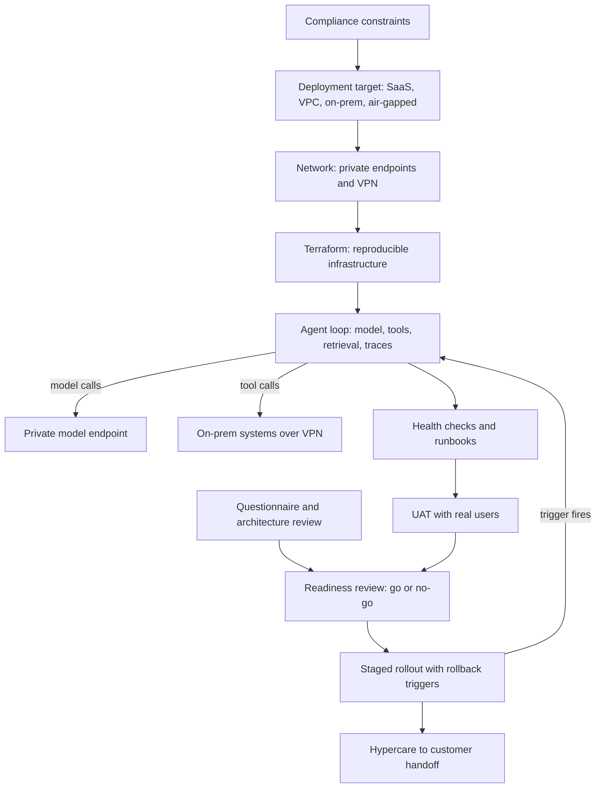

## Overview
This module covers what happens between "the AI system works in our environment" and "the customer's
users depend on it, and the customer's team can run it". For an agent builder, that gap is wide: every
model call, tool call, trace and memory write must land somewhere the customer allows.

Enterprise deployment is shaped by constraints the builders do not control. The topics connect as a
chain, each one feeding the next:

- **Compliance constraints.** Regimes such as HIPAA, GDPR or export control become concrete rules about where data may be processed, which model providers qualify, and what logs must contain and leave out.
- **Deployment target.** Those rules choose it: your SaaS, the customer's VPC, their on-prem cluster or an air-gapped site.
- **Network design.** The target decides it: private endpoints for one-way calls to managed services with no internet egress, and site-to-site VPNs for two-way access to systems in the customer's data center.
- **Terraform.** It makes that infrastructure reproducible in every customer account and auditable for every reviewer.
- **Security questionnaires and security and architecture reviews.** These are how the customer checks your claims and your design before they let you near their data.
- **Health checks and runbooks.** They make the system operable by people who did not build it.
- **UAT.** It proves that the system does the users' job against acceptance criteria agreed in advance.
- **Rollout criteria and rollback triggers.** They set how exposure grows and what pulls it back.
- **Deployment readiness review.** It collects all of that evidence into one go/no-go decision.
- **Hypercare.** It carries the system through its first weeks of real traffic to a criteria-based handoff.

Core versus background for agents:
- **Useful (twelve lessons).** Every lesson except one is marked useful: you meet it the moment you ship an agent into a customer's environment. Closest to the agent loop are health-checks, runbooks, rollout-criteria-and-rollback-triggers, uat and private-endpoints, because they touch model calls, tool calls and traces directly.
- **Background (one lesson).** security-questionnaires is context you should recognise; your design choices become its answers, but the questionnaire mechanics rarely change your agent's code.
- **Core:** none in this module. Deployment wraps the agent rather than shaping its loop.

What you can build afterwards:
- **A justified deployment model.** Choose and justify SaaS, customer VPC, on-prem or air-gapped for an agent, and design its network path.
- **A passed security review.** Pass a customer security review with an accurate diagram, a threat model and evidence.
- **A defensible go-live.** Run a staged go-live you could defend in a postmortem.

It matters most for FDEs, who live this work on every engagement, and for Architects, whose early design
choices decide whether a deployment can pass review at all.

## Why it matters
- **Engineer:** You write the Terraform modules, private endpoint DNS overrides and VPN routes that let the same agent install cleanly in each customer account. You implement separate liveness, readiness, startup and synthetic agent-task checks. You wire automated rollback triggers to error, latency, cost and sampled quality signals, and you keep the runbooks that every paging alert links to.
- **Architect:** You turn compliance regimes into data residency, model provider and logging constraints before the agent's design is fixed. You choose between SaaS, customer VPC, on-prem and air-gapped with the support cost priced in. You walk into the customer's architecture review with an accurate data-flow diagram, a threat model that covers prompt injection and tool permissions, and evidence for every control.
- **FDE:** You run the customer-facing sequence for the agent: answer the questionnaire honestly from one source of truth, steer the security review to dated findings, set acceptance criteria and sample sizes for UAT, chair the readiness review, and run hypercare with daily trace triage until the customer's team meets the exit criteria and owns support.

## Mental model
Picture deployment as a series of gates the agent passes through, each one opened by evidence rather
than confidence. Every gate produces an artifact that the next one consumes.

| Gate | What opens it | Lessons |
|---|---|---|
| 1. Permission | Compliance constraints and the customer's policies decide what is allowed at all, and that picks the deployment target | compliance-constraints, customer-vpc-on-prem-air-gapped |
| 2. Reachability | Private endpoints and VPNs define exactly which network paths exist, and nothing else should | private-endpoints, vpn |
| 3. Reproducibility | Terraform makes the environment a reviewed diff, not a set of console clicks | terraform |
| 4. Trust | Questionnaires check your claims, and architecture reviews test your design | security-questionnaires, security-and-architecture-reviews |
| 5. Operability | Health checks tell infrastructure what to do, and runbooks tell humans | health-checks, runbooks |
| 6. Acceptance | UAT shows that real users get their job done | uat |
| Checkpoint | The readiness review inspects all of that evidence together, with items proven, waived with an expiry, or blocking | deployment-readiness-reviews |
| After go | Rollout criteria widen exposure in stages, rollback triggers narrow it again, and hypercare holds the system under close watch until ownership moves to the customer | rollout-criteria-and-rollback-triggers, hypercare |

The diagram shows where these ideas sit around an agent: the loop in the middle, and each gate wrapped
around a part of it.

When a gate is skipped, you usually find out in production.

## Suggested order
1. compliance-constraints — start here, because regimes and customer policies set the limits that every later deployment choice, from model provider to trace retention, must fit inside.
2. customer-vpc-on-prem-air-gapped — compliance and data custody pick the deployment target, which shapes the network, packaging and support model of the agent.
3. private-endpoints — the default way to reach managed services and model APIs from a customer network with no internet egress, on every agent step.
4. vpn — the alternative for two-way access to on-prem systems that agent tools call, best learned against private endpoints so the trade-off is clear.
5. terraform — once the target and network paths are known, IaC makes them reproducible and reviewable in every customer account.
6. health-checks — makes the deployed agent observable to infrastructure, as the base for runbooks and rollout signals; it needs only a running service, so it can come early.
7. runbooks — gives the humans who respond to health alerts and known agent failure modes a tested way to mitigate.
8. security-and-architecture-reviews — tests your data flows, trust boundaries and AI-specific threats such as prompt injection and excessive agency against evidence, using the architecture and network design you now have.
9. security-questionnaires — background: the first written trust check a buyer runs; read it after the review lesson so you see that your agent's design choices become its answers.
10. uat — real users test the agent against acceptance criteria agreed in advance, which needs a working, observable environment.
11. rollout-criteria-and-rollback-triggers — defines how exposure grows after acceptance and which signals pull it back, using the health and quality metrics from earlier lessons.
12. deployment-readiness-reviews — collects evidence from every earlier lesson into one go/no-go decision, so it only makes sense once you know what that evidence is.
13. hypercare — the last step, carrying the agent through its first weeks of real traffic to a criteria-based handoff.

## Capstone
### Brief
**Use case.** A regional health insurer wants a retrieval-augmented claims agent in production. It
answers adjusters' questions from policy documents and claim notes that contain protected health
information, using retrieval and tools that query claim records.

You are the forward-deployed engineer taking it from a successful pilot to production. This is the
module's major project, built over a week in a sandbox cloud account with synthetic claim data.

The constraints you work inside:
- **Cloud.** The insurer runs on AWS in one region and permits no internet egress from data workloads.
- **On-prem.** Its claims database lives in an on-prem data center that the agent's tools must reach.
- **Security.** Its security team has sent a 120-question questionnaire and has scheduled an architecture review.
- **Go-live.** It is planned for 300 adjusters across two regions in six weeks.

What you produce, end to end:
- **Constraints and model.** Turn the insurer's obligations into constraints and choose the deployment model.
- **Infrastructure.** Write Terraform for the VPC, the private endpoints to the model provider and storage, and the VPN to a simulated on-prem network.
- **Trust.** Answer a representative slice of the questionnaire and prepare the architecture review pack.
- **Operations.** Implement health checks and write runbooks for the top failure modes.
- **Acceptance and launch.** Design and run a small UAT, write the staged rollout plan with rollback triggers, chair a mock readiness review, and plan hypercare through to handoff.

### Deliverables
- A constraints register that maps each regime and customer policy to concrete where, who, what, how-long, how and proof constraints, with a one-page justification of the chosen deployment model and the rejected alternatives with their costs.
- A Terraform repository that stands up the VPC, private endpoints with working DNS overrides, and a site-to-site VPN to a simulated on-prem network, with a reviewed plan output, remote state, and evidence that a clean apply into a second account succeeds.
- Answers to at least 25 questionnaire items drawn from a single answer library, plus an architecture review pack with a data-flow diagram, trust boundaries, a threat model covering prompt injection and tool permissions, and a findings tracker with owners and due dates.
- Liveness, readiness, startup and synthetic end-to-end agent-task checks running against the deployed service, and runbooks for at least five failure modes (provider outage, rate limiting, cost runaway, index staleness, an unsafe output report), each linked from its alert.
- A UAT plan and results with acceptance criteria, a scoring rubric, a justified sample size, the pass rate with a confidence interval, and defects classified by cause.
- A rollout ladder with stage criteria, minimum samples, hard and soft rollback triggers, a readiness review record with every item marked proven, waived with an expiry, or blocking, and a hypercare plan with a triage cadence and written exit criteria.

### Rubric
- VPC flow logs show zero bytes reaching the model provider or storage through NAT or the internet, and the services reject requests that do not come through the private endpoint.
- Liveness does not depend on downstream services: taking the model provider or vector store offline in a test removes instances from readiness without triggering restarts, and the synthetic check alerts.
- Every questionnaire answer is traceable to a control owner and evidence, and at least one answer is an honest "no" with a compensating control and a dated plan, not an aspirational "yes".
- Running each runbook in a rehearsal, by someone other than its author, mitigates the simulated failure without escalation, and any step that turns out wrong is recorded and fixed.
- The UAT pass rate is reported with its interval and per-slice results, and model-quality defects are separated from integration bugs, each with a different owner.
- Every rollback trigger has a numeric threshold, a minimum sample size and a named action. A replayed incident shows the trigger firing and exposure dropping to the previous stage.
- Hypercare exit criteria are things the customer's team demonstrates, such as resolving a set share of tickets alone and running one runbook unassisted, not a date on the calendar.
