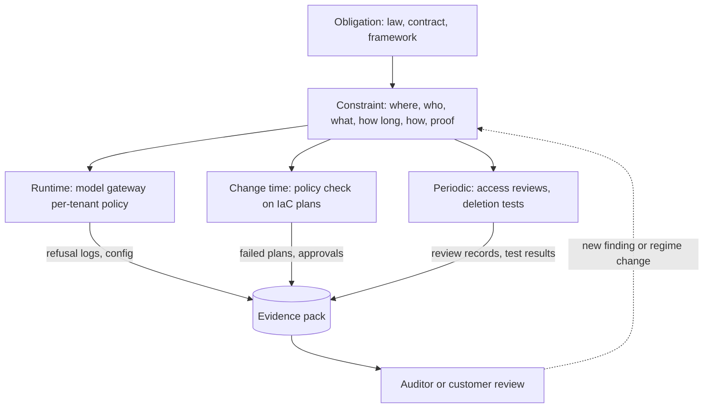

## TL;DR
Compliance constraints are the rules laws, contracts and audit frameworks impose on where data is
processed, who sees it, how long it is kept and what is proven. For AI they decide region, model
provider and logging design; deep treatment lives in security-governance-compliance.

## Why it exists
- **Finished is not deployable.** A hospital cannot send patient notes to a model provider that has not
  signed a business associate agreement. A European insurer may need contractual safeguards before
  prompts with customer data leave the EU. A defense contractor's data may be export-controlled, so only
  certain personnel may touch the system.
- **These are obligations, not preferences.** Breach means fines, lost certifications, voided contracts
  or worse.
- **"Do compliance at the end" fails** because the requirements are architectural (see the table below).
  Discovering them after the build means rework, sometimes a different deployment model entirely, such
  as moving from SaaS into the customer's VPC.
- **The useful skill is translation:** hearing "we are subject to HIPAA and SOC 2" and turning it into a
  short list of concrete constraints the design must satisfy and the evidence it must produce.

| Requirement | What it decides in the architecture |
|---|---|
| Data residency | which regions and model endpoints you may use |
| No-training, limited retention | which model providers qualify |
| Erasure | whether you may fine-tune on customer data, since deleting a record from model weights is not practical |
| Audit | what your logs must contain |
| Minimization | what your logs may contain |

## How it works
### From obligation to evidence
Every requirement flows through the same chain:

```
obligation (law, contract clause, framework criterion)
  → constraint on the system
  → control that enforces it
  → evidence that the control works
```

Auditors and reviewers check the last link, so design controls that produce evidence naturally:
configuration in code, logs, test results.

### The regimes you will meet most
**GDPR (EU personal data).**
- **Core duties:** a lawful basis, purpose limitation and data minimization, data processing agreements
  with processors, honoring rights such as erasure and access, and safeguards for transfers outside the
  EEA (adequacy decisions or mechanisms such as standard contractual clauses).
- **Residency is usually contractual.** GDPR does not strictly mandate EU hosting, but many customers
  impose EU residency contractually because it is the simplest way to stay safe.
- **Controller and processor.** The customer is usually the **controller** and you the **processor**, so
  you act only on their documented instructions, and your subprocessors (model, cloud, tracing) need
  their approval.
- **Remote access counts.** European regulators generally treat *remote access* from outside the EEA,
  such as a US support engineer opening an EU tenant's traces, as a transfer. Residency is about who can
  read the data, not only where disks sit.

**HIPAA (US health data).**
- **BAA required.** Covered entities may share protected health information with a vendor only under a
  business associate agreement, and that obligation flows down to the vendor's subprocessors, including
  model and cloud providers.
- **Security Rule safeguards** cover access control, audit controls and transmission security.

**Other regimes.**

| Regime | What it is | Typical constraint |
|---|---|---|
| SOC 2, ISO/IEC 27001 | assurance frameworks customers require of vendors, not laws | change management, access reviews, logging, incident response, vendor management |
| PCI DSS | payment cards; any system that stores, processes or transmits cardholder data is in scope | keep card data out of prompts and logs so the AI system stays out of scope |
| FedRAMP | US federal cloud use requires FedRAMP-authorized services at an appropriate impact level | approved services only |
| Export control (for example ITAR) | restricts who may access the data | often pushes deployments on-prem or air-gapped |
| EU AI Act | risk-based regulation phasing in obligations over several years | see below |
| Sector rules | financial services model risk management (validation, monitoring, documentation); record-keeping rules | minimum retention, model documentation |

**EU AI Act.** Certain practices are prohibited; high-risk systems carry requirements for risk
management, data governance, logging, human oversight and transparency; general-purpose model providers
have their own duties. Which tier a use case falls into is a legal determination, so involve counsel.

### The constraint categories
Translate any regime into these questions:

| Category | Question |
|---|---|
| **Where** | where may data be processed and stored? |
| **Who** | who may access it, including vendors and personnel? |
| **What** | what data may enter prompts, logs and indexes? |
| **How long** | how long must or may it be kept? |
| **How** | how must it be protected (encryption, customer-managed keys)? |
| **What proof** | which audit trails and change records must exist? |
| **AI-specific** | no training use, human oversight, disclosure that users are talking to AI |

### Enforce at a chokepoint, check in the pipeline
A constraint written only in a policy document is broken by the first engineer who adds a fallback
region. So enforce each constraint where every request must pass, and check it where every change must pass:
1. **Runtime chokepoint.** Route all model calls through one gateway holding a per-tenant policy (allowed
   providers, allowed regions, whether content may be logged) that refuses anything else. It is a
   chokepoint *because* a single enforcement point cannot be bypassed by a new code path the way
   scattered checks can, and its configuration plus its refusal logs are the evidence.
2. **Change-time check.** Run policy checks on infrastructure plans (for example, fail any Terraform plan
   that creates storage outside approved regions or a log sink without a retention setting), and require
   review when a new subprocessor appears in the dependency or egress list. This catches the violation
   before production, which is when it is cheapest.
3. **Periodic proof.** Access reviews; deletion tests that confirm an erased record is gone from the
   database, the vector index and the caches; and a reconciliation of actual egress against the declared
   subprocessor list.

### Constraints conflict
| Conflict | Explicit resolution |
|---|---|
| Audit retention vs erasure | keep the audit record of actions; keep content where it can be deleted |
| Debug logging vs minimization | log metadata and hashes rather than content |
| Cross-region fallback vs residency | in-region fallback or a degraded mode |
| Fine-tuning on customer data vs deletion | keep customer data in retrieval indexes (which can be deleted) instead of in fine-tuned weights |

## Diagram
Each obligation becomes a constraint, then a control at runtime or change time, and the controls emit
the evidence auditors check.



## Examples
### Worked scenario: a US hospital's note-summarizing assistant
Customer requirements: HIPAA, the vendor's SOC 2 Type II, and their own policy of seven-year audit
retention. The translation into constraints and controls:

1. **BAA chain.** Notes are PHI, so the vendor signs a BAA with the hospital, and every subprocessor that
   sees PHI must be covered too: the cloud provider and the model provider. The model provider's offering
   is checked for BAA eligibility; a provider without one is excluded, whatever its quality.
2. **Retention and training.** The model API path must not retain prompts beyond what the BAA allows and
   must not train on them. Where that cannot be confirmed, the design switches to a self-hosted
   open-weight model in the hospital's VPC.
3. **Logs.** Debug traces originally captured full prompts. Under minimum-necessary handling, traces now
   keep request IDs, token counts, latency and a hash of the input; full content is stored only in the
   hospital's own audit store, with access logged.
4. **Audit.** Seven-year retention applies to the record of who generated which summary and when, not to
   the vendor's debug traces, which are kept for 30 days. Separating the two resolves the conflict
   between audit and minimization.
5. **Human oversight.** Summaries are drafts a clinician must approve before they enter the record; the
   approval event is part of the audit trail.
6. **Evidence pack.** BAA list, data-flow diagram, retention configuration in IaC, access review records,
   and the SOC 2 report, ready for the hospital's security review.

| Store | Contents | Retention | Owner |
|---|---|---|---|
| Hospital audit store | who generated which summary, when, approval event, full content | seven years | hospital |
| Vendor debug traces | request ID, token counts, latency, input hash | 30 days | vendor |

The result changed two design decisions (model provider selection and log content) before any code shipped.

### A per-tenant policy at the model gateway
The runtime chokepoint in miniature: deny by default, allow only listed provider and region pairs, and
log a hash instead of content unless the tenant's policy allows content.

```python
"""Per-tenant compliance policy enforced at the model gateway (the chokepoint)."""
import hashlib, json, time, uuid

POLICIES = {
    "eu-insurer": {"providers": {"provider-a"}, "regions": {"eu-west-1", "eu-central-1"},
                   "log_content": False},
    "us-hospital": {"providers": {"provider-b"}, "regions": {"us-east-1"},      # BAA-covered only
                    "log_content": False},
}

class PolicyViolation(Exception):
    pass

def route(tenant, provider, region, prompt):
    policy = POLICIES.get(tenant)
    if policy is None:
        raise PolicyViolation(f"no policy for tenant {tenant}: deny by default")
    if provider not in policy["providers"] or region not in policy["regions"]:
        raise PolicyViolation(f"{tenant}: {provider}/{region} not allowed")
    trace = {"request_id": str(uuid.uuid4()), "tenant": tenant, "provider": provider,
             "region": region, "ts": int(time.time()),
             "input_sha256": hashlib.sha256(prompt.encode()).hexdigest()[:16]}
    if policy["log_content"]:
        trace["prompt"] = prompt
    return trace          # the call to the provider would happen here

print(json.dumps(route("eu-insurer", "provider-a", "eu-west-1", "Claim 4411 for J. Doe"))[:120])
for args in (("eu-insurer", "provider-a", "us-east-1"), ("unknown", "provider-a", "eu-west-1")):
    try:
        route(*args, prompt="x")
    except PolicyViolation as e:
        print("REFUSED:", e)          # refusal logs are compliance evidence
# REFUSED: eu-insurer: provider-a/us-east-1 not allowed
# REFUSED: no policy for tenant unknown: deny by default
```

- **Hash caveat.** A plain hash of a short, guessable input can be reversed by guessing; in production
  use a keyed hash (HMAC with a secret) so the trace still correlates requests without exposing content.

## Production patterns
- **Gateway policy, deny by default.** Every model call goes through one gateway with per-tenant
  allowlists of providers and regions and a content-logging flag, as in the sketch above. Monitor refusal
  counts per tenant; a spike after a release means a code path tried a disallowed route.
- **Policy as code on IaC plans.** Convert plans with `terraform show -json` and evaluate them with a
  policy engine such as Open Policy Agent (via Conftest) to reject storage outside approved regions or
  log sinks without retention. Track failed policy checks per pull request.
- **Split audit and debug stores.** Audit records go to a write-once, long-retention store (for example S3
  with Object Lock); debug traces get a short lifecycle expiry such as 30 days. Alert if any trace store
  lacks an expiry.
- **Erasure that reaches derived data.** An erasure job deletes from the database, the vector index, caches
  and eval datasets, then a test queries each for the subject's identifiers. Monitor time to complete
  erasure requests and failed verification checks.
- **Egress reconciliation.** Compare actual egress destinations and vendor invoices against the declared
  subprocessor list each month, because new SDKs and fallbacks arrive silently. Alert on any new
  external domain.
- **Compliance as non-functional requirements.** Capture each regime as where/who/what/how-long/how/proof
  constraints in discovery, with an owner and the evidence each must produce.

## Trade-offs
- **Region pinning vs failover.** Region-pinning and single-provider routing satisfy residency simply,
  but remove cross-region failover. If availability targets are strict, you need multiple in-region
  providers or accept degraded modes.
- **Self-hosting vs cost and quality.** Self-hosting a model in the customer's environment satisfies the
  strictest data-custody constraints, but costs GPU capacity, operations and often model quality; API
  providers with suitable terms win when available.
- **Minimal logging vs debuggability.** It lowers compliance exposure but makes production debugging
  harder; structured metadata, hashes and on-demand, access-logged content capture recover most of the
  debugging value.
- **One compliant tier vs many.** A single compliant tier for every customer simplifies operations but
  over-serves smaller customers; separate tiers cost more to run and must be described precisely in
  questionnaires.

## Pitfalls
- **Treating "compliant" as a vendor property rather than a configuration.** Symptom: using a provider's
  HIPAA-eligible service without a signed BAA or with ineligible features enabled.
- **Forgetting derived data.** Embeddings, caches, eval datasets and traces contain the same personal
  data. Symptom: an erasure request completed in the database while vectors and logs still hold it.
- **Fine-tuning on customer personal data without a deletion story.** Symptom: an erasure request that
  can only be honored by retraining or discarding the model.
- **Engineering changes that silently violate a constraint**, such as a new fallback region or a new
  analytics SDK. Symptom: an audit finding against a previously compliant system.
- **Deciding the EU AI Act risk tier or other legal classifications in engineering alone.** Symptom: a
  design built for the wrong obligations, discovered when counsel finally reviews it.

## When to use
- **Ask in discovery**, before choosing a deployment model or model provider: which regimes apply, which
  customer policies go beyond them, and what evidence their reviewers will want.
- **Translate and record** each into where/who/what/how-long/how/proof constraints as non-functional
  requirements, and enforce them in code and configuration so evidence comes for free.
- **Revisit** whenever data sources, regions, providers or features change.
- **Do not interpret law yourself:** bring counsel in for classification and contract terms.
- **Go deeper** in the security-governance-compliance module for the full design of controls, audit
  trails and residency.
- **Interviews:** show the translation from regime to architecture.

## Role lens
- **Engineer:** Implements constraints as code: region and provider allowlists in the gateway, log
  redaction, retention policies in IaC, and deletion that reaches embeddings and caches.
- **Architect:** Maps each applicable regime to architectural constraints, resolves conflicts such as audit
  retention versus minimization, and chooses the deployment model and providers that satisfy them.
- **FDE:** Elicits the customer's real obligations and internal policies early, confirms subprocessor
  agreements like BAAs, and assembles the evidence pack for their compliance and security teams.

## Check yourself
**Q:** An EU customer says "we are GDPR-regulated, so everything must stay in the EU." Your system uses an
EU-hosted model by default, a US-hosted fallback, and fine-tunes a small model on customer tickets. What
do you check and change?
**A:** First separate the law from the policy: GDPR permits transfers with safeguards, but the customer's
contractual requirement is stricter and is what you must meet. The US fallback violates it, so disable
cross-region fallback for this tenant and use a second EU-region provider or a degraded mode instead. Check
every subprocessor for EU processing, including tracing and error tools. Fine-tuning on tickets creates an
erasure problem, because personal data in weights cannot be selectively removed; either drop fine-tuning in
favor of retrieval over deletable indexes, train only on anonymized data, or agree a retraining policy.
Ensure deletion reaches embeddings and caches. Document it all in the DPA and data-flow diagram.

## Interview questions
### Why are compliance requirements architectural rather than paperwork?
- **They select components:** residency picks regions and endpoints, no-training terms pick model
  providers, and BAAs decide whether a hosted API is allowed at all.
- **They shape data design:** erasure rules argue against fine-tuning on personal data, and audit versus
  minimization decides what logs contain.
- **So learn them in discovery**, because finding them after the build can force a different deployment
  model.

### A customer says "we are HIPAA-regulated". What do you translate that into?
- **BAA chain:** a BAA with the customer and coverage for every subprocessor that sees PHI, including the
  cloud and model providers; exclude providers that cannot sign.
- **Data handling:** no training and bounded retention on the model path, minimum-necessary logging, and
  access-logged storage for content.
- **Evidence:** BAA list, data-flow diagram, retention config in IaC and access review records.

### How do you stop an engineer from silently breaking residency with a new fallback?
- **Runtime chokepoint:** all model calls go through a gateway with per-tenant allowed providers and
  regions, so an unlisted route is refused and logged.
- **Change-time checks:** policy checks on infrastructure plans and review when a new subprocessor appears
  in dependencies or egress.
- **Periodic proof:** reconcile actual egress against the subprocessor list.

### When would you choose self-hosting a model over an API provider for compliance reasons?
- **When terms cannot be confirmed:** no BAA, no clear no-training or retention terms, or no in-region
  endpoint.
- **When access itself is restricted**, as with export-controlled data or air-gapped mandates.
- **The cost:** GPU capacity, operations and often model quality, so prefer an API with suitable terms
  when one exists.

### An auditor wants seven years of records; privacy wants 30-day logs. How do you size and split storage?
- **Two stores:** an audit record of who did what and when, retained seven years with write-once
  protection; and debug traces with metadata and hashes, expiring at 30 days.
- **Content lives with the customer** in an access-controlled audit store, not in vendor telemetry.
- **Size the audit store from event counts** (events per day × record size × seven years), which stays
  small because it holds metadata, not prompts.

## Quiz
### Q: Why are compliance requirements best gathered before choosing the deployment model?
- [ ] Because auditors require requirements documents to be dated before code
- [x] Because constraints such as residency, subprocessor agreements and retention determine which regions, providers and deployment models are allowed
- [ ] Because compliance requirements rarely change after launch
- [ ] Because compliance reviews are faster for systems with fewer services
> Compliance rules are architectural: they can rule out a model provider, a region or SaaS hosting entirely.
> Learning them after the build forces rework, which is the cost early discovery avoids.

### Q: A hospital asks whether your assistant may use a hosted model API for clinical notes. What is the deciding requirement under HIPAA?
- [ ] The model must score above a set threshold on medical benchmarks
- [ ] The API must be hosted in the same state as the hospital
- [ ] The prompts must be encrypted with the hospital's own keys
- [x] The model provider, as a subprocessor handling PHI, must be covered by a business associate agreement
> PHI may flow to a vendor and its subprocessors only under BAAs. Encryption and hosting location matter
> for security, but without a BAA the flow is not permitted regardless of quality or location.

### Q: An auditor requires seven-year retention of activity records while the privacy team demands minimal logging of personal data. Which design resolves both?
- [ ] Keep full prompts and outputs for seven years in the debug trace store
- [ ] Disable logging entirely to satisfy minimization
- [x] Retain an audit record of who did what and when, with content in an access-controlled store, while debug traces keep only metadata for a short period
- [ ] Encrypt the logs so retention rules no longer apply
> Separating audit records from debug telemetry satisfies each requirement on its own terms. Keeping all
> content for seven years violates minimization, encryption does not remove retention duties, and
> disabling logs fails the audit obligation.
