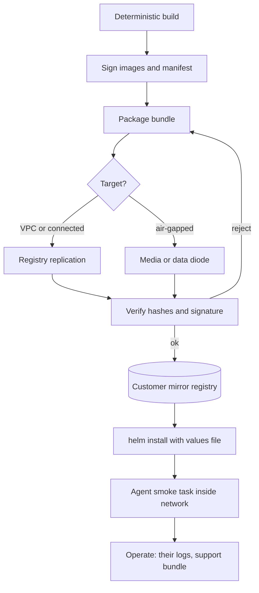

## TL;DR
Customer VPC, on-prem and air-gapped mean your agent runs inside a perimeter the customer owns, because
their data may not leave. Model, tools, retrieval and traces must all work offline, so shipping the
agent becomes a signed, self-contained bundle.

## For agent builders
- **Why it matters for agents.** An agent is a web of outbound calls: the model API, tool endpoints, an
  embedding model, a vector store, a tracing backend. Inside a customer perimeter every one of those must
  resolve to something the customer hosts, or the loop fails on its first step.
- **Where it shows up in your stack.** The model client's base URL, the tool registry's endpoint hosts,
  framework telemetry and tracing exporters, `HF_HUB_OFFLINE=1` for local weights, and the Helm values
  file that wires all of them to the customer's services.
- **What you control.** Which open-weight model the agent is evaluated on, which tools may exist inside,
  where traces go, and an offline preflight that fails install if any tool or model host is outside the
  allowed set.
- **What you can skip.** Data-diode hardware and cross-domain solution internals. Know that artifacts
  cross on media or one-way links and that the customer's site sets the speed.

## Decision case
### Scenario
Your company sells a contract-review agent as SaaS: a hosted frontier model, four tools (clause search,
a policy lookup, a CRM lookup and a redline writer) and traces in a SaaS observability tool. A large EU
bank wants it for its legal team. All figures are illustrative planning numbers, not benchmarks.
- **Data custody:** contracts and agent traces may not leave the bank's AWS account in its EU region.
  Metadata-only egress to a vendor (licence, version, health) is allowed only after a security review.
- **Scale:** 1,500 contracts a day at about 12 model calls each, so 1,500 x 12 = 18,000 calls a day.
  Over an 8-hour working day that is 18,000 / 480 = 37.5 calls a minute on average.
- **Quality bar:** 88% task completion on your 200-case eval set. The hosted frontier model scores 92%;
  the best open-weight model you can serve scores 81% (162 of 200).
- **Customer platform:** a 6-person AWS platform team that already uses Bedrock over a private endpoint.
  GPU instance quota needs a capacity request the bank estimates at 8 weeks.
- **Your team and deadline:** 5 engineers and 1 FDE; pilot live in 12 weeks. A defence prospect has
  asked about an air-gapped version next year.

### Options
| Option | How it works | Data stays in their account | 88% quality bar | 12-week pilot | Your operability |
|---|---|---|---|---|---|
| SaaS in an EU region plus DPA | today's stack, contractual promises | no: processing happens in your account | yes (92%) | yes | full |
| Customer VPC, managed model | your bundle in their account; model via Bedrock over a private endpoint; optional control plane | yes | yes, if the same model scores 88%+ on Bedrock | yes: no GPUs to procure | traces in their backend, support bundle, metadata-only control plane |
| Customer VPC, open-weight on GPUs | same bundle, vLLM on GPU instances in their VPC | yes | no (81%) without tuning work | at risk: 8-week quota plus serving work | as above, plus you own model serving |
| Fully self-contained bundle, no control plane | air-gap-style bundle and offline licence, run in their VPC | yes | depends on the model choice | slower: offline licensing and upgrades first | lowest: per-site upgrades |

### Decision
**Customer VPC with the managed model over a private endpoint, delivered as a signed, self-contained
bundle, with the vendor control plane off by default and offered as an opt-in.**
- **Why not SaaS:** the rule is about where processing happens, so a DPA does not answer it.
- **Why not open-weight now:** 81% is 7 points under the bar, and the GPU quota alone takes 8 of the 12
  weeks. Bedrock gives a strong tool-calling model that is called from the bank's account, in its EU
  region, over the private endpoint its platform team already runs.
- **Custody check for the managed model:** confirm in the security review that the bank counts Bedrock
  as inside its custody boundary, since the model runs in the provider's service, not on the bank's
  instances.
- **Why a self-contained bundle anyway:** pinned images, an offline licence file, a hash manifest and
  the offline preflight cost a few weeks now and turn the later air-gapped tier into a model swap, not a
  rebuild. The control plane stays optional so the review is not on the critical path.
- **Gate:** re-run the 200-case eval on the exact Bedrock model in their region before the pilot; at
  least 176 of 200 passing (88%) is the go criterion.

**What would change it.** If the Bedrock model scored under 88%, or the bank barred managed model
services, the open-weight path returns and the pilot date moves. If the defence deal closes first, build
the air-gapped tier now and treat this bank as its first customer-VPC install of the same bundle.

### Trade-offs accepted
- **Lost direct observability.** Traces go to the bank's OpenTelemetry backend. Watch: support-bundle
  turnaround time and the share of incidents diagnosed from the bundle alone.
- **Model drift outside your control.** Bedrock model versions are the bank's to pin. Watch: the eval
  re-run on every model or bundle change, with tool-call accuracy tracked per site.
- **Upgrades become per-site work.** Watch: bundle versions per site against a bounded support window.
- **Up-front bundle work.** Offline licence, manifest and preflight delay feature work. Watch: the
  offline CI gate passing on every release candidate.

### Review rubric
- **Custody rule stated precisely:** the write-up says what may not leave (data, traces) and what may
  (metadata), before choosing a tier.
- **Quality gate on the shipped model:** the decision depends on an eval run on the exact model and
  endpoint the customer will use, with a numeric pass bar.
- **Numbers recomputed:** call volume, eval pass counts and lead times follow from stated inputs and are
  labelled illustrative.
- **Options scored on constraints:** 2-4 tiers rated on custody, quality, deadline and operability.
- **Future tiers considered:** the write-up says how this choice affects a stricter tier later.
- **Signals for each trade-off:** every accepted cost has a metric, and the conditions that would flip
  the decision are named.

## Why it exists
- **SaaS assumes the customer sends you data.** For a bank's transaction records, a hospital's clinical
  notes, a defence contractor's documents or a government's citizen data, the contract, regulator or
  classification policy says the data stays inside a perimeter they control. An agent that reads those
  records through tools is processing them, wherever its model sits.
- **Encryption promises do not answer the rule.** "We encrypt it and promise not to train on it" does
  not satisfy a rule about *where processing happens* and *who can be compelled to hand it over*.
- **Copying your SaaS stack fails three ways.** It quietly depends on the open internet; you no longer
  own the platform; and you lose your eyes (no dashboards, no logs, no hot-fix at 2 a.m.). For an agent,
  losing traces means losing the only record of why it chose a tool.
- **So it is a different product shape:** a signed, self-contained bundle, one configuration surface
  for every environment decision, and the customer's platform team holding the keys. Each step inward
  trades your operability for their control.

### The hidden internet dependencies
| Dependency | Why it breaks |
|---|---|
| Container images from public registries | outbound pull a review will question, an air gap breaks |
| Model weights fetched from a hub at start-up | same, and often 100+ GB |
| Python packages installed at build time inside their network | no package index reachable |
| Licence checks and feature flags served from your SaaS | call-home traffic |
| Traces shipped to an observability vendor | data leaving the perimeter |
| Hosted LLM API behind the agent loop | every step is an outbound call carrying customer data |
| Tools that call public SaaS APIs (search, web fetch) | no route out, and a data leak if there were |

Platform you no longer own: their Kubernetes version, storage classes, certificate authority, egress
proxy and identity provider.

## How it works
### Three targets, one spectrum
| | Customer VPC | On-prem | Air-gapped |
|---|---|---|---|
| Where it runs | their AWS, Azure or GCP account | their datacentre or colocation | their facility, no network path out |
| Managed services | yes (their IAM, storage, DB, KMS) | none | none |
| Models | managed service over private endpoint, or open-weight on GPUs in the VPC | open-weight on their GPUs | open-weight, shipped in |
| Updates | registry replication | mirror they populate | physical media or diode |
| Your access | optional cross-account role | usually none | none |
| Agent tools | their internal APIs plus managed services | their internal APIs only | their internal APIs only, no web tools |

**Customer VPC (often sold as "bring your own cloud").**
- **Their identity and data stores.** Containers run in a VPC/VNet they own; identity is their IAM;
  storage, databases and KMS keys are theirs. The agent's tool credentials come from their IAM roles.
- **Model calls stay private.** Calls go to the cloud's managed model service (Bedrock, Azure OpenAI,
  Vertex AI) over a private endpoint, or to open-weight models on GPU instances in the same VPC.
- **Vendor access is narrow.** If any, a cross-account role with a time-bound, logged session and an
  `ExternalId` condition to prevent the confused-deputy problem.
- **Control plane / data plane split.** Many vendors host a **control plane** (licensing, version
  catalogue, configuration, upgrade orchestration) while the customer hosts the **data plane** (every
  component that touches customer data: the agent loop, tools, retrieval, memory, traces).
- **Why the split works.** The requirement is data custody, not metadata, so you keep operability for
  everything else. It must be optional *because* some customers reject any outbound connection.

**On-prem.**
- **No managed services.** You get a Kubernetes distribution (OpenShift, Rancher, vanilla upstream, k3s)
  at whatever version they run, their storage classes and their ingress controller.
- **Their hardware and trust.** GPUs come through a device plugin or the NVIDIA GPU Operator; there is
  an internal CA; identity is their directory through OIDC or LDAP.
- **Egress through a proxy.** Outbound traffic, if allowed at all, goes through a proxy that often
  terminates TLS with its own certificate.
- **Deliverable.** A Helm chart or operator plus images in a registry they can reach, usually a mirror
  they populate from your registry.

**Air-gapped.**
- **Everything on-prem implies, plus no network path.** Artifacts cross on physical media or through a
  one-way transfer device (a data diode or a cross-domain solution).
- **Inside:** a mirrored container registry, a package mirror, their own time source and their own CA.
- **Nothing can call home.** No licence server, no telemetry, no automatic update, no hosted model, no
  web-search tool.
- **Updates and support.** Updates are a new bundle carried in; support is a log bundle carried out.

### The delivery pipeline
1. **Build deterministically.** Pin every dependency, build images from a locked manifest, and ensure
   nothing at container start needs the network.
   - Model weights (LLM, embedding model, reranker) are baked into an image or seeded into a persistent
     volume from the bundle.
   - `HF_HUB_OFFLINE=1` and `TRANSFORMERS_OFFLINE=1` turn Hugging Face libraries into pure local loaders.
   - Tokenizer files are shipped, not fetched.
2. **Sign and attest.** Sign images and the bundle manifest (cosign is the common choice), ship an SBOM
   (SPDX or CycloneDX), and publish SHA-256 hashes. Done *because* the receiving side cannot ask you "is
   this file right?" and *because* the security review will ask how they know the artifact is yours and
   unmodified.
3. **Package.** Images exported with `docker save` or `skopeo copy` into a tarball or OCI layout, the
   chart, the weights, a wheelhouse built with `pip download` for anything installed on-site, the docs,
   the agent's eval set, and a verify script.
4. **Transfer.** Registry-to-registry replication for VPC and connected on-prem; media or diode for the
   air gap. A 70B-parameter model in 16-bit precision is roughly 140 GB of weights (2 bytes per
   parameter), so the transfer is a planned activity, not a download.
5. **Install.** `helm install` with a values file holding every environment decision: registry host,
   storage class, ingress class, CA bundle, proxy, model endpoint, tool endpoints, identity provider,
   resource limits. Hard-coded assumptions are the single biggest source of failed installs.
6. **Verify.** Smoke tests that exercise the real path inside their network: a model call, a retrieval,
   an authenticated request, a write to their database, and one end-to-end agent task that calls a tool.
7. **Operate.**
   - Logs, metrics and agent traces stay inside and flow to *their* backends (ship Prometheus and
     OpenTelemetry collector configs that point at them).
   - A `support-bundle` command gathers redacted logs, config, version info and failed agent traces into
     a tarball they can send you.
   - Upgrade is a new bundle plus `helm upgrade`; rollback is the previous chart version, which only
     works if your schema migrations (including agent memory and checkpoint tables) are backward
     compatible.

### Signing for an air gap: key pair vs keyless
- **Key pair (simplest).** A long-lived key pair whose public key ships out of band; verification needs
  nothing but the key, as long as you skip the transparency-log upload when signing (or ship the
  signature bundle), since cosign v2 otherwise looks the entry up in Rekor online.
- **Most air-gapped sites choose key pairs,** trading key-rotation work for simpler verification.
- **Keyless (cosign's default).** Ties signatures to a short-lived certificate (Fulcio) and a
  transparency log (Rekor).
- **Keyless offline is possible but heavy.** It verifies offline only if you also ship the signature
  bundle with its log inclusion proof and the Sigstore trusted root, and keep that root current: extra
  machinery many air-gapped sites decline.

### What changes about the agent itself
- **Licensing.** A signed offline licence file with an expiry and a grace period, checked locally.
- **Feature flags.** Move from a remote service into the values file, including which tools are enabled.
- **Trust the customer's CA.** Every HTTP client, the model client and each tool adapter, reads their CA
  bundle (`SSL_CERT_FILE`, `REQUESTS_CA_BUNDLE`) *because* their proxy re-signs traffic.
- **Secrets.** Tool credentials come from their secret store, not yours.
- **Time bombs fail loudly.** Certificate expiry, licence expiry and token lifetimes must fail loudly and
  early *because* nobody will be watching a dashboard when they fail silently.
- **The model is whatever you shipped.** On-prem and air-gapped customers run open-weight models on vLLM
  or similar, so your evaluation suite must have run on that exact model and prompt set before the
  bundle was cut. Tool-calling accuracy is often what drops first when you leave a frontier model.
- **Tool set shrinks to what is inside.** Web search and public SaaS tools are removed or pointed at
  internal equivalents, and the system prompt and tool descriptions are re-evaluated for the new set.

## Diagram
Follow the agent bundle from your connected build side across the boundary; nothing on the right may
reach back out.



## Examples
### Offline preflight for an agent's model and tool hosts
An init container that blocks the agent if the model or any tool endpoint names a host outside the
values-file allowlist, so a leftover public tool fails at install, not mid-task with customer data in
the request.

```python
"""Preflight: every model and tool endpoint must be an approved internal host."""
import os, sys
from urllib.parse import urlparse

ALLOWED = set(os.environ["AGENT_ALLOWED_HOSTS"].split(","))  # from the Helm values file

AGENT_CONFIG = {
    "model": {"base_url": os.environ["MODEL_BASE_URL"]},          # e.g. in-cluster vLLM service
    "tools": {
        "search_tickets": "https://tickets.internal.example/api",
        "lookup_customer": "https://crm.internal.example/v2",
        "web_search": os.environ.get("WEB_SEARCH_URL", ""),       # must be empty inside an air gap
    },
}

def check():
    problems = []
    host = urlparse(AGENT_CONFIG["model"]["base_url"]).hostname
    if host not in ALLOWED:
        problems.append(f"model host {host!r} not allowed")
    for name, url in AGENT_CONFIG["tools"].items():
        if not url:
            continue                                             # tool disabled for this site
        h = urlparse(url).hostname
        if h not in ALLOWED:
            problems.append(f"tool {name}: host {h!r} not allowed")
    for p in problems:
        print("PREFLIGHT FAIL", p)
    return not problems

if __name__ == "__main__":
    sys.exit(0 if check() else 1)    # run as an init container; the agent never starts on failure
```

### Bundle manifest tool: build and verify
- **Where it runs.** `build` on your connected side; `verify` on the customer's side before anything
  enters their mirror registry, so a corrupted 140 GB copy fails before the install, not during it.
- **Authorship too.** The manifest is then signed with `cosign sign-blob` in key-pair mode, with no
  transparency-log entry or with the signature bundle shipped, so `cosign verify-blob --key` works
  offline and the customer checks authorship as well as integrity.
- **Three distinct rejections.** A file that is missing (truncated transfer); a file whose hash differs
  (corruption or tampering); a file present but not in the manifest (added after signing, which an
  installer that globs the directory would otherwise load).
- **Streaming hash.** Hashing reads 1 MB blocks *because* a 140 GB weights file cannot be read into memory.

```python
"""Build and verify an offline install bundle: `build <dir> <version>` or `verify <dir>`."""
import hashlib, json, sys, pathlib

def sha256(path, chunk=1 << 20):
    h = hashlib.sha256()
    with open(path, "rb") as f:
        for block in iter(lambda: f.read(chunk), b""):
            h.update(block)
    return h.hexdigest()

SKIP = {"manifest.json", "manifest.json.sig"}   # the manifest and its cosign signature

def payload(root):
    return [p for p in root.rglob("*") if p.is_file() and str(p.relative_to(root)) not in SKIP]

def build(bundle_dir, version):
    root = pathlib.Path(bundle_dir)
    files = payload(root)
    manifest = {"version": version, "artifacts": {
        str(p.relative_to(root)): {"sha256": sha256(p), "bytes": p.stat().st_size} for p in files}}
    (root / "manifest.json").write_text(json.dumps(manifest, indent=1))
    total = sum(a["bytes"] for a in manifest["artifacts"].values())
    print(f"{len(files)} artifacts, {total / 1e9:.1f} GB")

def verify(bundle_dir):
    root = pathlib.Path(bundle_dir)
    manifest = json.loads((root / "manifest.json").read_text())
    listed = manifest["artifacts"]
    present = {str(p.relative_to(root)) for p in payload(root)}
    missing = [r for r in listed if r not in present]
    altered = [r for r in listed if r in present and sha256(root / r) != listed[r]["sha256"]]
    extra = sorted(present - set(listed))
    for label, items in (("MISSING", missing), ("ALTERED", altered), ("UNLISTED", extra)):
        if items:
            print(label, items)
    ok = not (missing or altered or extra)
    print("OK" if ok else "REJECT BUNDLE")
    return ok

if __name__ == "__main__":
    cmd, path = sys.argv[1], sys.argv[2]
    if cmd == "build":
        build(path, sys.argv[3])
    else:
        sys.exit(0 if verify(path) else 1)
# Typical layout: images/app-1.8.3.tar, charts/assistant-1.8.3.tgz, models/<name>/, wheels/, docs/
```

### Worked scenario: sizing the weights in an air-gap agent delivery
Weights are parameters × bytes per parameter, so precision choice decides the media and transfer plan.
Link speeds are illustrative; a diode or cross-domain solution is often slower and is set by the site.

| Model | Precision | Bytes/param | Weights | At 1 Gbps | At 10 Gbps |
|---|---|---|---|---|---|
| 7B | 16-bit | 2 | ~14 GB | ~2 min | ~11 s |
| 70B | 16-bit | 2 | ~140 GB | ~19 min | ~2 min |
| 70B | 8-bit | 1 | ~70 GB | ~9 min | ~56 s |
| 70B | 4-bit | 0.5 | ~35 GB | ~5 min | ~28 s |

- **Read it as:** 140 GB × 8 = 1,120 Gb, and 1,120 Gb ÷ 1 Gbps ≈ 1,120 s ≈ 19 min, before hashing,
  media handling and the customer's inbound scanning.
- **Each extra precision ships as another full copy**, so bundling 16-bit and 8-bit doubles the media;
  ship the one your agent eval suite (including tool-calling cases) approved.
- **An agent ships more than one model.** The embedding model and any reranker are small next to the
  LLM, but missing either one breaks retrieval at start-up.

### Offline-first CI gate: deny egress during the install test
Run the install test, including one end-to-end agent task, in a namespace whose pods may only reach each
other and cluster DNS. Any hidden download or public tool call now fails in your CI instead of the
customer's cluster. NetworkPolicy is enforced only if the cluster's CNI plugin supports it.

```yaml
apiVersion: networking.k8s.io/v1
kind: NetworkPolicy
metadata:
  name: offline-install-test
spec:
  podSelector: {}                 # every pod in this namespace
  policyTypes: ["Egress"]
  egress:
    - to:
        - podSelector: {}         # same-namespace traffic only
    - to:
        - namespaceSelector:
            matchLabels:
              kubernetes.io/metadata.name: kube-system
      ports:
        - { protocol: UDP, port: 53 }
        - { protocol: TCP, port: 53 }
```

## Production patterns
- **Offline-first CI gate with a real agent task.** On every release candidate, install the bundle into a
  namespace with the deny-egress NetworkPolicy above and run the smoke tests plus a scripted agent task
  that calls each enabled tool. Monitor DNS and connection-timeout errors in pod logs; any public
  hostname in them is a release blocker.
- **One values file for every environment decision.** Expose registry host, storage class, ingress class,
  CA bundle, proxy, model endpoint and tool endpoints as chart values (Bitnami-style charts use
  `global.imageRegistry` for the registry). Lint with `helm template` against each customer's values
  file before shipping.
- **Per-model agent evals in the bundle.** Ship the eval set and a runner so the customer or your FDE
  can re-run task-completion and tool-call accuracy on their GPUs after install; track scores per site
  and bundle version.
- **Mirror relocation with skopeo.** Use `skopeo copy` to move images into an OCI layout for the media,
  then into the customer's mirror, keeping digests unchanged so signatures still verify. Monitor
  signature-verification failures at admission.
- **Expiry warnings well ahead of the date.** Have the licence and certificate checks log and surface a
  warning weeks before expiry and again during the grace period. Monitor days-to-expiry per site from
  support bundles.
- **Bounded version support and expand-then-contract migrations.** Publish how many bundle versions you
  support and require sites to upgrade into that window, so back-ports stay finite. Add columns and
  tables first, remove old ones a release later, so `helm rollback` to the previous chart still finds a
  schema it understands. Test rollback in CI.

## Trade-offs
- **Data custody vs observability.** The customer keeps custody of data and uses their own cloud
  discounts and controls, but you lose direct observability and fast iteration on prompts and tools.
  Flips toward hosted SaaS plus a strong DPA when the customer has no platform team to operate what you
  ship.
- **Control-plane split vs zero egress.** The split keeps upgrades and configuration manageable across
  many customers, but any outbound connection is a review item. Flips to fully self-contained the moment
  the customer's policy forbids egress.
- **On-prem vs elastic capacity.** On-prem removes cloud dependency and per-token fees, but GPU capacity
  is fixed on a procurement cycle measured in months, and multi-step agents consume many model calls per
  task. Flips when the workload is bursty or needs frontier-model quality.
- **Air-gap isolation vs support speed.** The strongest isolation possible, but every bug fix is a
  physical delivery and bugs surface weeks later through log bundles. Accept it only where mandated,
  and budget support time accordingly.
- **Open-weight portability vs quality.** Shipping open-weight models makes the agent deployable
  anywhere, but your quality bar must be re-established per shipped model, since the hosted model your
  SaaS uses is not an option inside.

## Pitfalls
- **Runtime downloads.** Symptom: works in CI, then the pod crash-loops at the customer with DNS
  resolution or connection-timeout errors for a public hostname. Cause: hub weights, tokenizer files,
  `pip install` on start, NLTK or tiktoken data. Diagnose: run the install under the deny-egress policy
  and grep pod logs for public hostnames. Fix: bundle them and set the offline flags.
- **A tool that still points outside.** Symptom: timeouts on one tool and odd answers, because a
  web-search or SaaS tool left in the registry fails mid-task and the agent retries or improvises.
  Diagnose: per-tool error counts in the traces. Fix: the start-up preflight above, plus removing the
  tool from the prompt.
- **Hard-coded registry host, DNS domain or storage class in the chart.** Symptom: `ImagePullBackOff`
  or persistent volume claims stuck in `Pending` on a healthy cluster. Diagnose: `kubectl describe` the
  pod or claim and compare the image reference or class with their values file. Fix: make them values.
- **Not trusting the customer's CA.** Symptom: every outbound call fails certificate verification,
  because their egress proxy re-signs TLS. Diagnose: `openssl s_client` through the proxy shows their
  issuer, not a public one. Fix: mount their CA bundle.
- **Expiry or missing logs inside an air gap.** Symptom: the system stops on a licence or certificate
  date nobody can renew online, or incidents are debugged from screenshots in email. Diagnose: can a
  support bundle answer "days to expiry" and "which tool failed and why"? Fix: early warnings and a
  support-bundle command, with redacted agent traces, that the customer knows how to run.
- **Version sprawl and one-way migrations.** Symptom: a support matrix nobody can keep in their head,
  since fixes are back-ported to every site's bundle, and a failed upgrade that cannot return to the
  previous chart version, turning a bad hour into a bad week. Diagnose: versions per site from support
  bundles and a rollback test in CI. Fix: a bounded version window and expand-then-contract migrations.

## When to use
- **Customer VPC when** the blocker is data custody within a cloud the customer already runs; it keeps
  managed model services (and a strong tool-calling model) and most of your operability.
- **On-prem when** the customer has no cloud footprint, needs GPU proximity to their systems or has a
  contractual prohibition on public cloud.
- **Air-gapped only when** a regulator or classification policy mandates it, and price the support model in.
- **Measure before committing:** install time per customer, bundle size, supported versions, mean time
  to deliver a fix, and agent eval scores on the shipped model.
- **Interviews:** list what breaks without a network and how delivery changes.

## Exercise
**Goal:** prove an agent you have already built can run with no network path out.
- **Inputs:** any small agent of yours (one model call, one or two tools), Docker, and the two scripts
  above.
- **Constraints:** the model must be served locally (a 0.5-3B open-weight model is enough); nothing may
  be fetched at container start.
- **Deliver:** a table of every outbound dependency and how you removed it; a bundle directory with a
  manifest; one command that runs a scripted agent task.
- **Acceptance:** the task completes with agent and model on a `docker network create --internal`
  network (or in one container under `--network none`); `verify` rejects the bundle
  after you flip one byte in a weights file and after you add a stray file; pointing one tool at a public
  host makes the preflight exit 1 before the agent starts.

## Role lens
- **Engineer:** Removes every runtime network dependency, moves environment decisions into chart
  values, builds the signed bundle and the support-bundle command, and keeps migrations reversible.
- **Architect:** Decides which deployment tiers the product supports, where the control-plane/data-plane
  boundary sits, and which models and dependencies each tier is allowed to assume.
- **FDE:** Runs the install on the customer's cluster, negotiates registry, CA, proxy and identity
  details with their platform and security teams, and operates the sneakernet for air-gapped sites.

## Check yourself
**Q:** A customer wants your RAG assistant inside an air-gapped facility. Today the product calls a
hosted frontier model, sends traces to a SaaS observability tool, downloads its embedding model from a
hub at start-up and validates a licence against your server. What has to change, in what order, and
what do you tell the customer they are giving up?
**A:** First replace the hosted model with an open-weight model served inside (vLLM or similar) and
re-run the evaluation suite on it, because that decides whether the product is still good enough to
ship. Then remove the start-up download by baking or seeding the embedding weights and setting the
offline flags; replace the licence call with a signed offline licence file with expiry and grace; and
redirect traces to a collector targeting the customer's own backend. Package images, chart, weights
and wheels into a signed bundle with a hash manifest and a verify step, and add a support-bundle
command. Tell the customer they lose frontier-model quality, automatic updates and vendor
observability; fixes arrive as bundles on a schedule, and they must operate the stack.

## Interview questions
### How do customer-VPC, on-prem and air-gapped deployments differ, and why does a customer choose one?
- **Customer VPC:** your software in their cloud account, with their IAM, storage and KMS; chosen when
  custody matters but they already trust a cloud, so managed model services stay available.
- **On-prem:** their hardware and Kubernetes with no managed services; chosen with no cloud footprint, a
  ban on public cloud, or GPUs needed next to their systems.
- **Air-gapped:** no network path at all; chosen only when a regulator or classification policy demands
  it, because every update and support exchange becomes physical.

### You are moving a tool-calling agent from your SaaS into a customer's air-gapped site. What changes in the agent itself?
- **The model:** a hosted frontier model becomes an open-weight model on their GPUs, so re-run the agent
  eval suite, especially tool-selection and argument accuracy, on exactly that model and precision.
- **The tools:** public tools (web search, SaaS APIs) are removed or re-pointed at internal services, and
  the prompt and tool descriptions are re-evaluated for the smaller set.
- **The operations:** traces go to their collector, a preflight rejects non-internal hosts, and failed
  runs leave the site only through a redacted support bundle.

### Your chart installs cleanly in your lab but pods sit in ImagePullBackOff at the customer. How do you debug it?
- **Read the event first:** `kubectl describe pod` shows which image reference failed and why
  (unreachable host, auth, unknown manifest).
- **Likely causes:** a hard-coded public registry host instead of their mirror, images not yet loaded
  into the mirror, or a missing pull secret.
- **Fix at the source:** make the registry a chart value, verify the bundle was imported by digest, and
  add the offline CI gate so the next release cannot regress.

### When would you not offer a vendor-hosted control plane?
- **When policy forbids any egress.** Even metadata-only outbound calls are a review item, and some
  customers reject them on principle, so the split must be optional.
- **When the air gap is physical.** There is no path to a control plane, so licensing, configuration and
  upgrades must all work locally from the bundle and values file.
- **Cost of dropping it:** upgrades and configuration become per-site work, so support load grows with
  customer count.

### A customer wants a 70B model delivered into an air-gapped site. What numbers do you plan around?
- **Weights:** 70B × 2 bytes in 16-bit ≈ 140 GB; an 8-bit copy is ~70 GB, so precision choice changes the
  media plan.
- **Time:** at 1 Gbps the copy alone is ~19 minutes, before hashing, the customer's scanning and import
  into their mirror, which often dominate.
- **Quality and hardware:** confirm their GPUs fit the chosen precision and that your eval suite passed
  on exactly that model and precision.

### An on-prem agent works in your smoke test but fails intermittently on real tasks at the customer. How do you investigate without access?
- **Get the evidence out:** ask the customer to run the support-bundle command, which carries redacted
  agent traces, tool error counts and versions, since you cannot log in.
- **Look for the boundary:** a tool timing out through their proxy, a certificate error from a tool
  adapter that skipped their CA bundle, or the open-weight model producing malformed tool arguments.
- **Close the gap:** add the failing case to the bundled eval set and CI gate, then ship a fix bundle.

## Quiz
### Q: Why do many vendors split a customer-VPC deployment into a vendor-hosted control plane and a customer-hosted data plane?
- [ ] Because cloud providers require the control plane to run in the vendor's account
- [x] Because the customer's requirement is custody of data, so keeping only non-data functions vendor-side preserves operability while meeting the requirement
- [ ] Because it removes the need for the customer to grant the vendor any IAM access
- [ ] Because Kubernetes cannot run both planes in the same cluster
> The split keeps licensing, configuration and upgrades manageable across customers while every
> component that touches data stays in the customer's account. It is a design choice, not a platform
> rule, and it must be optional because some customers forbid any outbound connection.

### Q: An on-prem install crash-loops; the pod log shows a DNS resolution failure for a public model-hub hostname. What is the root cause and fix?
- [ ] The customer's cluster lacks a GPU operator, so the model cannot load
- [ ] The Helm chart has the wrong storage class configured
- [x] The application downloads model or tokenizer files at start-up; weights must be bundled and the libraries run in offline mode
- [ ] The customer's CA certificate is not trusted by the container
> A DNS failure for a hub hostname means code is trying to fetch artifacts at runtime. The fix is in
> the build: ship the weights and tokenizer files in the bundle and set the offline environment flags.
> A CA problem would show as a certificate verification error, not a resolution failure.

### Q: Which artifact lets an air-gapped customer confirm a bundle is complete, unmodified and genuinely from you without contacting you?
- [ ] A README listing the included files and their versions
- [ ] A licence file with an expiry date
- [x] A manifest of SHA-256 hashes signed with the vendor's key, plus signed images
- [ ] A telemetry ping sent once the installation completes
> Hashes prove integrity and a signature over the manifest proves origin, and both can be checked
> offline. A README is unverifiable, a licence file proves entitlement rather than integrity, and a
> telemetry ping is impossible without a network path.

## Mastery test
**Problem:** a hospital wants your clinical-notes agent on-prem. You validated it on a 70B model in
16-bit; their server has two 48 GB GPUs. Media goes through a scanning process that takes three days,
and they expect a fix bundle every month. Plan the delivery and say what you must re-test.

**A strong answer:**
- notes 140 GB of 16-bit weights cannot fit in 96 GB, so proposes 8-bit (~70 GB, little KV-cache room)
  or 4-bit (~35 GB), and ships only the one precision that passed;
- re-runs the agent eval suite, especially tool-call accuracy, on exactly that model and precision;
- keeps weights out of monthly bundles unless they change, so each fix is images and chart only, and
  tells them even an urgent fix lands three days after it ships;
- requires reversible migrations, a tested rollback, expiry warnings and a support-bundle command.

## Use cases & projects
### Use cases
- **Agents for regulated enterprises.** A bank's support agent runs in the bank's VPC, calling Bedrock or
  Azure OpenAI over a private endpoint and tools on internal APIs, so no record leaves their account.
- **On-prem document agents.** A hospital's RAG assistant runs open-weight models on the hospital's GPUs,
  with retrieval over notes that may never reach a public cloud.
- **Air-gapped analyst agents.** A defence or government site receives the agent, its models and its eval
  set on media, and sends back only redacted support bundles.
- **Bring-your-own-cloud agent platforms.** A vendor keeps a control plane for licensing and upgrades
  while each customer hosts the data plane that runs agent loops and tools.

### Mini project
**Make a tool-calling agent pass an offline install gate (2-3 hours).**
- **Goal:** prove a small agent (one model endpoint, two tools, one retrieval step) runs with zero
  internet access.
- **Steps:** containerise the agent with weights baked in and `HF_HUB_OFFLINE=1` set; serve a small
  open-weight model (0.5-3B) in-cluster; add the host preflight as an init container.
- **Then gate it:** deploy to a local k3s cluster (it enforces NetworkPolicy out of the box) or kind with
  a policy-enforcing CNI, in a namespace with the deny-egress NetworkPolicy; run a scripted task that
  calls both tools; then add a public web-search tool and watch the preflight fail.
- **Done when:** the clean install completes the task with no DNS errors for public hosts, the polluted
  install is refused before the agent starts, and you have a one-page list of every outbound dependency
  you removed.
