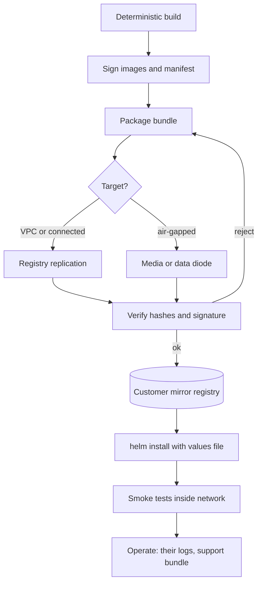

## TL;DR
Customer VPC, on-prem and air-gapped are deployments where the customer owns the perimeter, because
their data may not leave their custody. Each step inward trades your operability for their control,
so the job becomes shipping software that installs, verifies and upgrades offline.

## Why it exists
- **SaaS assumes the customer sends you data.** For a bank's transaction records, a hospital's clinical
  notes, a defence contractor's documents or a government's citizen data, the contract, regulator or
  classification policy says the data stays inside a perimeter they control.
- **Encryption promises do not answer the rule.** "We encrypt it and promise not to train on it" does
  not satisfy a rule about *where processing happens* and *who can be compelled to hand it over*.
- **Copying your SaaS stack fails three ways.** It quietly depends on the open internet; you no longer
  own the platform; and you lose your eyes (no dashboards, no logs, no hot-fix at 2 a.m.).
- **So it is a different product shape.** A signed, self-contained bundle, a configuration surface that
  captures every environment decision, and an operating model where the customer's platform team holds
  the keys. The further inward, the more of your product is packaging rather than infrastructure you run.

### The hidden internet dependencies
| Dependency | Why it breaks |
|---|---|
| Container images from public registries | outbound pull a review will question, an air gap breaks |
| Model weights fetched from a hub at start-up | same, and often 100+ GB |
| Python packages installed at build time inside their network | no package index reachable |
| Licence checks and feature flags served from your SaaS | call-home traffic |
| Traces shipped to an observability vendor | data leaving the perimeter |

Platform you no longer own: their Kubernetes version, storage classes, certificate authority, egress
proxy and identity provider.

## How it works
### Three targets, one spectrum
| | Customer VPC | On-prem | Air-gapped |
|---|---|---|---|
| Where it runs | their AWS, Azure or GCP account | their datacentre or colocation | their facility, no network path out |
| Managed services | yes (their IAM, storage, DB, KMS) | none | none |
| Models | managed service over private endpoint, or open-weight on GPUs in the VPC | open-weight on their GPUs | open-weight, shipped in |
| Updates | registry replication | mirror they populate | physical media or diode |
| Your access | optional cross-account role | usually none | none |

**Customer VPC (often sold as "bring your own cloud").**
- **Their identity and data stores.** Containers run in a VPC/VNet they own; identity is their IAM;
  storage, databases and KMS keys are theirs.
- **Model calls stay private.** Calls go to the cloud's managed model service (Bedrock, Azure OpenAI,
  Vertex AI) over a private endpoint, or to open-weight models on GPU instances in the same VPC.
- **Vendor access is narrow.** If any, a cross-account role with a time-bound, logged session and an
  `ExternalId` condition to prevent the confused-deputy problem.
- **Control plane / data plane split.** Many vendors host a **control plane** (licensing, version
  catalogue, configuration, upgrade orchestration) while the customer hosts the **data plane** (every
  component that touches customer data).
- **Why the split works.** The customer's requirement is about data custody, not metadata, so you keep
  operability for everything that is not data. It must be optional *because* some customers reject any
  outbound connection on principle.

**On-prem.**
- **No managed services.** You get a Kubernetes distribution (OpenShift, Rancher, vanilla upstream, k3s)
  at whatever version they run, their storage classes and their ingress controller.
- **Their hardware and trust.** GPUs come through a device plugin or the NVIDIA GPU Operator; there is
  an internal CA; identity is their directory through OIDC or LDAP.
- **Egress through a proxy.** Outbound traffic, if allowed at all, goes through a proxy that often
  terminates TLS with its own certificate.
- **Deliverable.** A Helm chart or operator plus images in a registry they can reach, usually a mirror
  they populate from your registry.

**Air-gapped.**
- **Everything on-prem implies, plus no network path.** Artifacts cross on physical media or through a
  one-way transfer device (a data diode or a cross-domain solution).
- **Inside:** a mirrored container registry, a package mirror, their own time source and their own CA.
- **Nothing can call home.** No licence server, no telemetry, no automatic update, no hosted model.
- **Updates and support.** Updates are a new bundle carried in; support is a log bundle carried out.

### The delivery pipeline
1. **Build deterministically.** Pin every dependency, build images from a locked manifest, and ensure
   nothing at container start needs the network.
   - Model weights are baked into an image or seeded into a persistent volume from the bundle.
   - `HF_HUB_OFFLINE=1` and `TRANSFORMERS_OFFLINE=1` turn Hugging Face libraries into pure local loaders.
   - Tokenizer files are shipped, not fetched.
2. **Sign and attest.** Sign images and the bundle manifest (cosign is the common choice), ship an SBOM
   (SPDX or CycloneDX), and publish SHA-256 hashes. Done *because* the receiving side cannot ask you "is
   this file right?" and *because* the security review will ask how they know the artifact is yours and
   unmodified.
3. **Package.** Images exported with `docker save` or `skopeo copy` into a tarball or OCI layout, the
   chart, the weights, a wheelhouse built with `pip download` for anything installed on-site, the docs,
   and a verify script.
4. **Transfer.** Registry-to-registry replication for VPC and connected on-prem; media or diode for the
   air gap. A 70B-parameter model in 16-bit precision is roughly 140 GB of weights (2 bytes per
   parameter), so the transfer is a planned activity, not a download.
5. **Install.** `helm install` with a values file holding every environment decision: registry host,
   storage class, ingress class, CA bundle, proxy, model endpoint, identity provider, resource limits.
   Hard-coded assumptions are the single biggest source of failed installs.
6. **Verify.** Smoke tests that exercise the real path inside their network: a model call, a retrieval,
   an authenticated request, a write to their database.
7. **Operate.**
   - Logs and metrics stay inside and flow to *their* backends (ship Prometheus and OpenTelemetry
     collector configs that point at them).
   - A `support-bundle` command gathers redacted logs, config and version info into a tarball they can
     send you.
   - Upgrade is a new bundle plus `helm upgrade`; rollback is the previous chart version, which only
     works if your schema migrations are backward compatible.

### Signing for an air gap: key pair vs keyless
- **Key pair (simplest).** A long-lived key pair whose public key ships out of band; verification needs
  nothing but the key.
- **Keyless (cosign's default).** Ties signatures to a short-lived certificate (Fulcio) and a
  transparency log (Rekor).
- **Keyless offline is possible but heavy.** It verifies offline only if you also ship the signature
  bundle with its log inclusion proof and the Sigstore trusted root, and keep that root current: extra
  machinery many air-gapped sites decline.

### What changes about the software itself
- **Licensing.** A signed offline licence file with an expiry and a grace period, checked locally.
- **Feature flags.** Move from a remote service into the values file.
- **Trust the customer's CA.** Every HTTP client reads their CA bundle (`SSL_CERT_FILE`,
  `REQUESTS_CA_BUNDLE`) *because* their proxy re-signs traffic.
- **Secrets.** Come from their secret store, not yours.
- **Time bombs fail loudly.** Certificate expiry, licence expiry and token lifetimes must fail loudly and
  early *because* nobody will be watching a dashboard when they fail silently.
- **The model is whatever you shipped.** On-prem and air-gapped customers run open-weight models on vLLM
  or similar, so your evaluation suite must have run on that exact model and prompt set before the
  bundle was cut.

## Diagram
Follow the bundle from your connected build side across the boundary; nothing on the right may reach
back out.



## Examples
### Bundle manifest tool: build and verify
- **Where it runs.** `build` runs on your connected side after packaging; `verify` runs on the
  customer's side, before anything is loaded into their mirror registry.
- **Why verify first.** A corrupted 140 GB copy is caught before the install starts rather than during it.
- **Authorship too.** The manifest is then signed with `cosign sign-blob` (key-pair mode, so
  `cosign verify-blob --key` works offline) so the customer checks authorship as well as integrity.
- **Three distinct rejections.** A file that is missing (truncated transfer); a file whose hash differs
  (corruption or tampering); a file present but not in the manifest (added after signing, which an
  installer that globs the directory would otherwise load).
- **Streaming hash.** Hashing reads 1 MB blocks *because* a 140 GB weights file cannot be read into memory.

```python
"""Build and verify an offline install bundle: `build <dir> <version>` or `verify <dir>`."""
import hashlib, json, sys, pathlib

def sha256(path, chunk=1 << 20):
    h = hashlib.sha256()
    with open(path, "rb") as f:
        for block in iter(lambda: f.read(chunk), b""):
            h.update(block)
    return h.hexdigest()

def build(bundle_dir, version):
    root = pathlib.Path(bundle_dir)
    files = [p for p in root.rglob("*") if p.is_file() and p.name != "manifest.json"]
    manifest = {"version": version, "artifacts": {
        str(p.relative_to(root)): {"sha256": sha256(p), "bytes": p.stat().st_size} for p in files}}
    (root / "manifest.json").write_text(json.dumps(manifest, indent=1))
    total = sum(a["bytes"] for a in manifest["artifacts"].values())
    print(f"{len(files)} artifacts, {total / 1e9:.1f} GB")

def verify(bundle_dir):
    root = pathlib.Path(bundle_dir)
    manifest = json.loads((root / "manifest.json").read_text())
    listed = manifest["artifacts"]
    present = {str(p.relative_to(root)) for p in root.rglob("*")
               if p.is_file() and p.name != "manifest.json"}
    missing = [r for r in listed if r not in present]
    altered = [r for r in listed if r in present and sha256(root / r) != listed[r]["sha256"]]
    extra = sorted(present - set(listed))
    for label, items in (("MISSING", missing), ("ALTERED", altered), ("UNLISTED", extra)):
        if items:
            print(label, items)
    ok = not (missing or altered or extra)
    print("OK" if ok else "REJECT BUNDLE")
    return ok

if __name__ == "__main__":
    cmd, path = sys.argv[1], sys.argv[2]
    if cmd == "build":
        build(path, sys.argv[3])
    else:
        sys.exit(0 if verify(path) else 1)
# Typical layout: images/app-1.8.3.tar, charts/assistant-1.8.3.tgz, models/<name>/, wheels/, docs/
```

### Worked scenario: sizing the weights in an air-gap delivery
Weights are parameters × bytes per parameter, so precision choice decides the media and transfer plan.
Link speeds are illustrative; a diode or cross-domain solution is often slower and is set by the site.

| Model | Precision | Bytes/param | Weights | At 1 Gbps | At 10 Gbps |
|---|---|---|---|---|---|
| 7B | 16-bit | 2 | ~14 GB | ~2 min | ~11 s |
| 70B | 16-bit | 2 | ~140 GB | ~19 min | ~2 min |
| 70B | 8-bit | 1 | ~70 GB | ~9 min | ~56 s |
| 70B | 4-bit | 0.5 | ~35 GB | ~5 min | ~28 s |

- **Read it as:** 140 GB × 8 = 1,120 Gb, and 1,120 Gb ÷ 1 Gbps ≈ 1,120 s ≈ 19 min, before hashing,
  media handling and the customer's inbound scanning.
- **Each extra precision ships as another full copy**, so bundling both 16-bit and 8-bit doubles the
  media without doubling usefulness; ship the one your eval suite approved.

### Offline-first CI gate: deny egress during the install test
Run the install test in a namespace whose pods may only reach each other and cluster DNS. Any hidden
download now fails in your CI instead of the customer's cluster. NetworkPolicy is enforced only if the
cluster's CNI plugin supports it.

```yaml
apiVersion: networking.k8s.io/v1
kind: NetworkPolicy
metadata:
  name: offline-install-test
spec:
  podSelector: {}                 # every pod in this namespace
  policyTypes: ["Egress"]
  egress:
    - to:
        - podSelector: {}         # same-namespace traffic only
    - to:
        - namespaceSelector:
            matchLabels:
              kubernetes.io/metadata.name: kube-system
      ports:
        - { protocol: UDP, port: 53 }
        - { protocol: TCP, port: 53 }
```

## Production patterns
- **Offline-first CI gate.** On every release candidate, install the bundle into a namespace with the
  deny-egress NetworkPolicy above and run the smoke tests. Monitor DNS and connection-timeout errors in
  pod logs; any public hostname in them is a release blocker.
- **One values file for every environment decision.** Expose registry host, storage class, ingress class,
  CA bundle, proxy and model endpoint as chart values (Bitnami-style charts use `global.imageRegistry`
  for the registry). Lint with `helm template` against each customer's values file before shipping.
- **Mirror relocation with skopeo.** Use `skopeo copy` to move images into an OCI layout for the media,
  then into the customer's mirror, keeping digests unchanged so signatures still verify. Monitor
  signature-verification failures at admission.
- **Expiry warnings well ahead of the date.** Have the licence and certificate checks log and surface a
  warning weeks before expiry and again during the grace period. Monitor days-to-expiry per site from
  support bundles.
- **Bounded version support.** Publish how many bundle versions you support at once and require sites
  to upgrade into that window, so back-ports stay finite. Track the version each site runs.
- **Expand-then-contract migrations.** Add columns and tables first, remove old ones a release later, so
  `helm rollback` to the previous chart still finds a schema it understands. Test rollback in CI.

## Trade-offs
- **Data custody vs observability.** The customer keeps custody of data and uses their own cloud
  discounts and controls, but you lose direct observability and fast iteration. Flips toward hosted
  SaaS plus a strong DPA when the customer has no platform team to operate what you ship.
- **Control-plane split vs zero egress.** The split keeps upgrades and configuration manageable across
  many customers, but any outbound connection is a review item. Flips to fully self-contained the moment
  the customer's policy forbids egress.
- **On-prem vs elastic capacity.** On-prem removes cloud dependency and per-token fees, but GPU capacity
  is fixed on a procurement cycle measured in months. Flips when the workload is bursty or needs
  frontier-model quality.
- **Air-gap isolation vs support speed.** The strongest isolation possible, but every bug fix is a
  physical delivery and bugs surface weeks later through log bundles. Accept it only where mandated,
  and budget support time accordingly.
- **Open-weight portability vs quality.** Shipping open-weight models makes the product deployable
  anywhere, but your quality bar must be re-established per shipped model, since the hosted model your
  SaaS uses is not an option inside.

## Pitfalls
- **Runtime downloads.** Model weights from a hub, tokenizer files, `pip install` on start, NLTK or
  tiktoken data. Works in CI, then the pod crash-loops in the customer's cluster with DNS resolution or
  connection-timeout errors for a public hostname. Fix: bundle them and set the offline flags.
- **Hard-coded registry host, DNS domain or storage class in the chart.** Symptom: `ImagePullBackOff`
  or persistent volume claims stuck in `Pending` on an otherwise healthy cluster. Fix: make them values.
- **Not trusting the customer's CA.** Every outbound call from your containers fails with a certificate
  verification error because their egress proxy re-signs TLS. Fix: mount their CA bundle.
- **Licence or certificate expiry inside an air gap.** The system stops on a date, nobody can renew
  online, and the customer discovers it during business hours.
- **Assuming you will have the logs.** Incidents are debugged from screenshots in email until a support
  bundle command exists and the customer knows how to run it.
- **Version sprawl across customers.** Each site is on a different bundle, so a fix must be back-ported
  to several versions; the symptom is a support matrix nobody can keep in their head.
- **Schema migrations that cannot roll back.** A failed upgrade on-site leaves the customer unable to
  return to the previous chart version, turning a bad hour into a bad week.

## When to use
- **Customer VPC when** the blocker is data custody within a cloud the customer already runs; it keeps
  managed model services and most of your operability.
- **On-prem when** the customer has no cloud footprint, needs GPU proximity to their systems or has a
  contractual prohibition on public cloud.
- **Air-gapped only when** a regulator or classification policy mandates it, and price the support model in.
- **Measure before committing:** install time per customer, bundle size, number of supported versions,
  and mean time to deliver a fix.
- **Day to day** this shows up as the values file, the bundle pipeline and the support-bundle tool.
- **Interviews:** list what breaks when the network goes away and how the delivery pipeline changes as a
  result; that is the expected depth.

## Role lens
- **Engineer:** Removes every runtime network dependency, moves environment decisions into chart
  values, builds the signed bundle and the support-bundle command, and keeps migrations reversible.
- **Architect:** Decides which deployment tiers the product supports, where the control-plane/data-plane
  boundary sits, and which models and dependencies each tier is allowed to assume.
- **FDE:** Runs the install on the customer's cluster, negotiates registry, CA, proxy and identity
  details with their platform and security teams, and operates the sneakernet for air-gapped sites.

## Check yourself
**Q:** A customer wants your RAG assistant inside an air-gapped facility. Today the product calls a
hosted frontier model, sends traces to a SaaS observability tool, downloads its embedding model from a
hub at start-up and validates a licence against your server. What has to change, in what order, and
what do you tell the customer they are giving up?
**A:** First replace the hosted model with an open-weight model served inside (vLLM or similar) and
re-run the evaluation suite on it, because that decides whether the product is still good enough to
ship. Then remove the start-up download by baking or seeding the embedding weights and setting the
offline flags; replace the licence call with a signed offline licence file with expiry and grace; and
redirect traces to a collector targeting the customer's own backend. Package images, chart, weights
and wheels into a signed bundle with a hash manifest and a verify step, and add a support-bundle
command. Tell the customer they lose frontier-model quality, automatic updates and vendor
observability; fixes arrive as bundles on a schedule, and they must operate the stack.

## Interview questions
### How do customer-VPC, on-prem and air-gapped deployments differ, and why does a customer choose one?
- **Customer VPC:** your software in their cloud account, with their IAM, storage and KMS; chosen when
  custody matters but they already trust a cloud, so managed model services stay available.
- **On-prem:** their hardware and Kubernetes with no managed services; chosen with no cloud footprint, a
  ban on public cloud, or GPUs needed next to their systems.
- **Air-gapped:** no network path at all; chosen only when a regulator or classification policy demands
  it, because every update and support exchange becomes physical.

### Your chart installs cleanly in your lab but pods sit in ImagePullBackOff at the customer. How do you debug it?
- **Read the event first:** `kubectl describe pod` shows which image reference failed and why
  (unreachable host, auth, unknown manifest).
- **Likely causes:** a hard-coded public registry host instead of their mirror, images not yet loaded
  into the mirror, or a missing pull secret.
- **Fix at the source:** make the registry a chart value, verify the bundle was imported by digest, and
  add the offline CI gate so the next release cannot regress.

### When would you not offer a vendor-hosted control plane?
- **When policy forbids any egress.** Even metadata-only outbound calls are a review item, and some
  customers reject them on principle, so the split must be optional.
- **When the air gap is physical.** There is no path to a control plane, so licensing, configuration and
  upgrades must all work locally from the bundle and values file.
- **Cost of dropping it:** fleet-wide upgrades and configuration become per-site work, so support load grows
  with customer count.

### A customer wants a 70B model delivered into an air-gapped site. What numbers do you plan around?
- **Weights:** 70B × 2 bytes in 16-bit ≈ 140 GB; an 8-bit copy is ~70 GB, so precision choice changes the
  media plan.
- **Time:** at 1 Gbps the copy alone is ~19 minutes, before hashing, the customer's scanning and import
  into their mirror, which often dominate.
- **Quality and hardware:** confirm their GPUs fit the chosen precision and that your eval suite passed
  on exactly that model and precision.

### How can an air-gapped customer verify your artifacts, and why might keyless signing be awkward there?
- **Hash manifest plus signature:** SHA-256 per file proves integrity; a signature over the manifest
  proves origin; both check offline with a public key shipped out of band.
- **Keyless needs more shipped state:** cosign keyless relies on Fulcio certificates and the Rekor log, so
  offline verification needs the inclusion proof and a current Sigstore trusted root carried in too.
- **So most sites choose key pairs**, accepting key-rotation work in exchange for simpler verification.

## Quiz
### Q: Why do many vendors split a customer-VPC deployment into a vendor-hosted control plane and a customer-hosted data plane?
- [ ] Because cloud providers require the control plane to run in the vendor's account
- [x] Because the customer's requirement is custody of data, so keeping only non-data functions vendor-side preserves operability while meeting the requirement
- [ ] Because it removes the need for the customer to grant the vendor any IAM access
- [ ] Because Kubernetes cannot run both planes in the same cluster
> The split keeps licensing, configuration and upgrades manageable across customers while every
> component that touches data stays in the customer's account. It is a design choice, not a platform
> rule, and it must be optional because some customers forbid any outbound connection.

### Q: An on-prem install crash-loops; the pod log shows a DNS resolution failure for a public model-hub hostname. What is the root cause and fix?
- [ ] The customer's cluster lacks a GPU operator, so the model cannot load
- [ ] The Helm chart has the wrong storage class configured
- [x] The application downloads model or tokenizer files at start-up; weights must be bundled and the libraries run in offline mode
- [ ] The customer's CA certificate is not trusted by the container
> A DNS failure for a hub hostname means code is trying to fetch artifacts at runtime. The fix is in
> the build: ship the weights and tokenizer files in the bundle and set the offline environment flags.
> A CA problem would show as a certificate verification error, not a resolution failure.

### Q: Which artifact lets an air-gapped customer confirm a bundle is complete, unmodified and genuinely from you without contacting you?
- [ ] A README listing the included files and their versions
- [ ] A licence file with an expiry date
- [x] A manifest of SHA-256 hashes signed with the vendor's key, plus signed images
- [ ] A telemetry ping sent once the installation completes
> Hashes prove integrity and a signature over the manifest proves origin, and both can be checked
> offline. A README is unverifiable, a licence file proves entitlement rather than integrity, and a
> telemetry ping is impossible without a network path.
