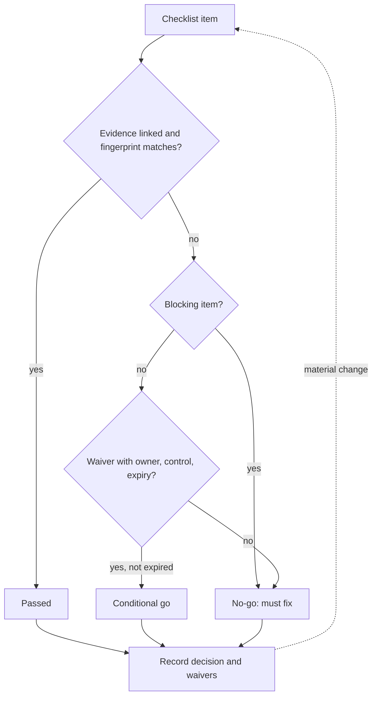

## TL;DR
A readiness review is a scheduled go/no-go before production traffic: every launch requirement is
checked against written evidence by a named owner. Each item ends up proven, waived with an expiry, or
blocking, which turns "we think we're ready" into a decision.

## Why it exists
- **Launch risk is spread across many owners.** Builders of the prompt and retrieval pipeline, the
  customer's security, network and identity teams, the business owner who defined success, and whoever is
  paged at 3 a.m. Each checks its own slice; nobody checks the seams.
- **The seams are where launches fail.** The eval passed, but on last month's index. Security approved the
  architecture, but not the tool the agent gained afterwards. Dashboards exist, but no alert routes to a
  human. A rollback plan exists, but nobody has run it.
- **"The tech lead decides" fails twice.** One person cannot hold the full checklist, and the items they
  forget are the ones outside their expertise. Schedule pressure from a date promised to a sponsor
  rationalises every gap as "we'll fix it in hypercare".
- **The review makes the decision structural.** Criteria are agreed before the date, evidence replaces
  assertions, and the record says which risks were accepted and by whom.
- **It has precedent.** Google's SRE practice formalised the Production Readiness Review, run before an
  SRE team agrees to carry a service's pager. The same logic applies when a customer's operations team is
  about to inherit your system.

## How it works
### 1. Agree the criteria early
Draft the checklist at the start of the build, not the week before launch, because criteria written after
the system exists describe what was built rather than what is needed.

| Category | Typical items for an AI system |
|---|---|
| **Quality** | Golden-set and customer regression evals meet the acceptance criteria from scoping; UAT signed off; known failure modes documented |
| **Safety and security** | Security and architecture review approved for the *current* design; guardrails tested against the red-team set; retention, PII and residency match the contract |
| **Operability** | Health checks, dashboards and alerts route to a named on-call; every alert links to a runbook; logs and traces kept long enough to debug |
| **Capacity and cost** | Load test at expected peak plus headroom; provider quotas and rate limits confirmed in writing; per-request and daily cost ceilings enforced, not just estimated |
| **Release mechanics** | Rollout stages, promotion criteria and rollback triggers defined; rollback rehearsed in a production-like environment; feature flag or kill switch verified |
| **People** | Support model and escalation paths agreed; customer team trained; hypercare staffed |

### 2. Evidence, not assertions
- **Every item has an owner and a link.** An eval report with its dataset version, a load-test result, a
  screenshot of an alert firing in staging, the ticket where security signed off.
- **No evidence means not done**, because "done" is the cheapest word to say and the most expensive to be
  wrong about.
- **Pin evidence to the deploying configuration.** Record a release fingerprint (model identifier, prompt
  version or hash, retrieval config, index build, tool list) and attach it to every eval and load-test
  result, because an eval on last week's prompt is evidence about a different system.
- **Mismatched fingerprint reverts the item to not done.** That catches the "passed, but on last month's
  index" gap mechanically instead of by luck.

### 3. Classify every item
- **Blocking:** no launch without it, e.g. rollback works, PII is not logged.
- **Non-blocking:** launch can proceed if the gap is accepted.
- **Waiver:** how a non-blocking gap is accepted: a named risk owner, a compensating control and an expiry
  date. Waivers expire because "temporary" exceptions without dates become permanent.

### 4. Decide and record
1. **Fix decision rights before the meeting:** who chairs, who decides, and which owners hold a veto on
   their blocking items (security on data handling, the operating team on operability). Otherwise the most
   senior person decides everything and you are back to "tech lead decides", with more attendees.
2. **Put the consequence-carriers among the deciders.** The team taking the pager and the business owner
   decide; they are not the audience.
3. **Walk the open items, not the green ones.** Good prep keeps the meeting short.
4. **Pick an outcome:** *go*, *conditional go* (launch with listed waivers), or *no-go* with the specific
   items that must change.
5. **Write it down with its waivers**, because when an incident happens in week two the first question
   will be "did we know about this?".

### 5. Re-run on material change
- **A review approves one configuration:** model version, prompt, tools, index, data sources.
- **Swapping the model or adding a write-capable tool is a new launch** for review purposes, scaled down to
  the items the change touches.

## Diagram
Each checklist item flows through the same evidence and classification gate; the worst outcome across
items sets the decision.



## Examples
### Readiness gate as code
A readiness gate kept as data next to the code, so the go/no-go is computed rather than argued. The
scenario: an insurer's claims-triage assistant, two weeks before go-live.

```python
from datetime import date

items = [  # (id, blocking, evidence_link_or_None, passed, waiver)
    ("eval.golden_set>=0.85",   True,  "evals/run-0412.json", True,  None),
    ("security.review_current", True,  "SEC-2291",            True,  None),
    ("rollback.rehearsed",      True,  None,                  False, None),
    ("alerts.route_to_oncall",  True,  "staging-alert.png",   True,  None),
    ("load.peak_x2",            False, "load/0409.html",      False,
        {"owner": "cust-ops-lead", "control": "rate limit 20 rps", "expires": date(2026, 11, 30)}),
    ("training.agents_trained", False, None,                  False, None),
]

def decide(items, today):
    blockers, waived, gaps = [], [], []
    for iid, blocking, evidence, passed, waiver in items:
        ok = passed and evidence is not None          # no evidence means not done
        if ok:
            continue
        if blocking:
            blockers.append(iid)
        elif waiver and waiver["expires"] > today:
            waived.append((iid, waiver["owner"], waiver["expires"]))
        else:
            gaps.append(iid)                            # non-blocking but unowned: still a no-go
    if blockers or gaps:
        return "NO-GO", blockers + gaps
    return ("CONDITIONAL GO" if waived else "GO"), waived

print(decide(items, date(2026, 10, 20)))
# ('NO-GO', ['rollback.rehearsed', 'training.agents_trained'])
```

Rehearsing the rollback and either training the agents or writing a waiver for it turns this into a
conditional go, with the load-test gap explicitly owned by the customer's ops lead until 30 November.

### Fingerprint check that catches stale evidence
Each piece of evidence stores the release fingerprint it was produced against; the gate compares it with
the release candidate.

```python
import hashlib, json

def fingerprint(release: dict) -> str:
    keys = ("model", "prompt_hash", "retrieval_config", "index_build", "tools")
    blob = json.dumps({k: release[k] for k in keys}, sort_keys=True)
    return hashlib.sha256(blob.encode()).hexdigest()[:12]

candidate = {"model": "model-v3", "prompt_hash": "a1f9", "retrieval_config": "k=8",
             "index_build": "idx-2026-10-18", "tools": ["lookup_policy"]}
eval_run = dict(candidate, index_build="idx-2026-09-15")   # eval ran on last month's index

stale = fingerprint(eval_run) != fingerprint(candidate)
print("eval evidence stale:", stale)   # True -> item reverts to not done
```

### Worked scenario: what the review caught
Illustrative findings from one review of the claims-triage launch.

| Finding | Class | Outcome |
|---|---|---|
| Rollback never rehearsed | Blocking | Rehearsed in staging two days later |
| Load test at 2x peak failed | Non-blocking | Waiver: owner cust-ops-lead, rate limit 20 rps, expires 30 November |
| Eval evidence on old index | Blocking (fingerprint mismatch) | Eval re-run on the release candidate |
| Agent training not done | Non-blocking, no waiver | Training scheduled before go-live |

## Production patterns
- **Checklist in the repo, evidence by link.** When releases are frequent, keep the checklist as a
  version-controlled file reviewed in the release pull request; CI fails if a blocking item has no
  evidence link. Monitor how many items are green without a link (should be zero).
- **Release fingerprint on every artifact.** Stamp eval reports and load-test results with a hash of model,
  prompt, retrieval config, index build and tool list; the gate compares it with the candidate. Monitor
  fingerprint mismatches per review.
- **Waiver register with expiry alerts.** Store waivers in a tracker with owner, compensating control and
  expiry; a scheduled job flags waivers within a week of expiry. Monitor open waiver count and how many are
  renewed rather than closed.
- **Risk-tiered reviews.** A prompt tweak behind a flag gets an automated eval gate; a new write-capable
  tool gets the full meeting. Write the tier rules down so the trigger is not negotiated per change.
- **Escape analysis after launch.** For each incident in the first weeks, ask whether a checklist item
  would have caught it, and add one if so. Monitor incidents per launch that map to a missing item.

## Trade-offs
- **Coverage vs calendar time.** A formal review catches cross-team gaps but adds calendar time; for a
  low-risk internal tool a lightweight checklist in the pull request is enough, and a full meeting is
  ceremony.
- **Strictness vs honesty.** Strict blocking criteria prevent bad launches, but if everything is blocking
  the team learns to game evidence. Keep the blocking list short and reserve it for irreversible or
  customer-visible harm.
- **Speed vs debt.** Waivers let launches proceed under known risk, but each one is debt. The trade flips
  when waivers outnumber fixes across releases, which means the criteria or the schedule are wrong.
- **Consistency vs throughput.** A central review board brings consistency across customers but becomes a
  bottleneck at scale. Mature teams move to self-service checklists with automated evidence and reserve
  humans for exceptions.

## Pitfalls
- **Reviewing the day before launch.** Every finding becomes a waiver; the symptom is a "conditional go"
  with more conditions than the previous three launches combined. Fix: hold it early enough to fix
  blockers.
- **Accepting "yes, done" without a link.** Symptom: an incident where the alert, runbook or rollback
  marked green never existed. Fix: no link, not done.
- **Reviewing the architecture approved months ago.** Symptom: a tool, data source or model in production
  that no security reviewer ever saw. Fix: review what is deploying now, by fingerprint.
- **Waivers with no expiry or owner.** Symptom: the same accepted risk in next quarter's review and nobody
  can say who agreed to it. Fix: owner and expiry are mandatory fields.
- **Treating AI quality as a single number.** Symptom: the launch passed the aggregate eval but fails a
  critical slice (one claim type, one language) the business cares most about. Fix: per-slice criteria.

## When to use
- **Use before:** any first production launch, handing operations to a customer team, and material
  changes: a new model or provider, a new tool with side effects, a new data source, a new region.
- **Scale it to risk:** a prompt tweak behind a flag needs an automated eval gate, not a meeting; an agent
  that can issue refunds needs the full review.
- **Measure the review by what escapes it:** track incidents in the first weeks after launch and ask
  whether a checklist item would have caught each one, then add it.
- **Interviews:** a strong answer describes criteria, evidence, waivers with expiry, and the re-review
  trigger, not just "we had a launch checklist".

## Role lens
- **Engineer:** Produces the evidence: versioned eval reports, load-test results, a rehearsed rollback,
  and alerts proven to fire, linked from each checklist item rather than described.
- **Architect:** Owns the criteria and the blocking list, decides which changes trigger re-review, and
  signs off on which risks the organisation is willing to accept with waivers.
- **FDE:** Runs the review with the customer's security, ops and business owners in the room, so their
  sign-offs and accepted risks are recorded before the go-live date is defended.

## Check yourself
**Q:** Two days before go-live, the load test shows the system handles only 60% of forecast peak because
the customer's provider quota is lower than requested. The sponsor wants to launch. What do you do?
**A:** First classify the gap: is overload customer-visible harm or graceful degradation? If the system
has a rate limiter and a clear "busy, try again" path, capacity can be non-blocking, so I would propose
a conditional go with a waiver: the customer's ops lead owns the risk, the compensating control is a
rate limit plus a staged rollout capped below 60% of peak, and the waiver expires when the quota
increase lands. If overload would cause silent failures or timeouts mid-workflow, it is blocking and the
answer is no-go or a reduced launch scope. Either way the decision is written down with its owner.

## Interview questions
### What is a deployment readiness review, and why not let the tech lead decide?
- **Definition:** a scheduled go/no-go where every launch criterion (quality, security, operability,
  capacity, release mechanics, people) is judged against linked evidence by a named owner.
- **Why not one person:** they cannot hold the whole checklist, they miss items outside their expertise,
  and schedule pressure turns gaps into "we'll fix it in hypercare".

### The eval report is green, but an incident shows the model was evaluated on an old index. How would you prevent that?
- **Fingerprint the release:** model, prompt hash, retrieval config, index build and tool list, hashed
  and stamped on every eval and load-test result.
- **Gate on a match:** evidence whose fingerprint differs from the release candidate reverts the item to
  not done, so the stale run is caught mechanically.

### When would you skip a full readiness meeting?
- **Low-risk, reversible changes:** a prompt tweak behind a flag needs an automated eval gate, and a
  low-risk internal tool can use a checklist in the pull request.
- **Never for material changes:** a new model or provider, a write-capable tool, a new data source or
  region needs at least the affected items re-reviewed.

### How do you keep waivers from becoming permanent?
- **Mandatory fields:** named risk owner, compensating control and expiry date; no waiver without all
  three.
- **Track them:** a register with expiry alerts, and a signal when waivers outnumber fixes across
  releases, which means the criteria or the schedule are wrong.

### How do you know your readiness review is working?
- **Escape analysis:** for incidents in the first weeks after launch, ask whether a checklist item would
  have caught each one and add it if so.
- **Health signals:** few conditional-go conditions, zero green items without evidence, and the same
  waiver not reappearing quarter after quarter.

## Quiz
### Q: What most distinguishes a readiness review from a team simply agreeing they are ready?
- [ ] It is attended by more senior people
- [x] Each criterion is agreed in advance and judged against linked evidence with a named owner
- [ ] It replaces the need for evals and load tests
- [ ] It always happens after the first week of production traffic
> The value is structural: criteria fixed before schedule pressure, evidence instead of assertions, and
> recorded ownership. Seniority alone does not prevent unchecked seams, and the review consumes evals rather than replacing them.

### Q: A non-blocking item failed. What makes it acceptable to launch anyway?
- [ ] The tech lead believes it will be fixed during hypercare
- [ ] The item is moved to the backlog with a low priority
- [x] A waiver with a named risk owner, a compensating control and an expiry date
- [ ] The sponsor approves the launch date
> A waiver makes the accepted risk explicit and temporary. Backlog items and verbal assurances have no
> owner or deadline, so the gap silently becomes permanent and nobody is accountable when it bites.

### Q: Which change most clearly requires re-running at least part of the readiness review?
- [ ] Rewording a help-text string in the UI
- [ ] Rotating an API key on its normal schedule
- [ ] Adding a new dashboard panel
- [x] Giving the agent a new tool that can write to the customer's CRM
> A review approves a specific configuration. A write-capable tool changes the security surface, the
> failure modes and the rollback story, so the affected items (security, guardrails, runbooks) must be re-checked.
