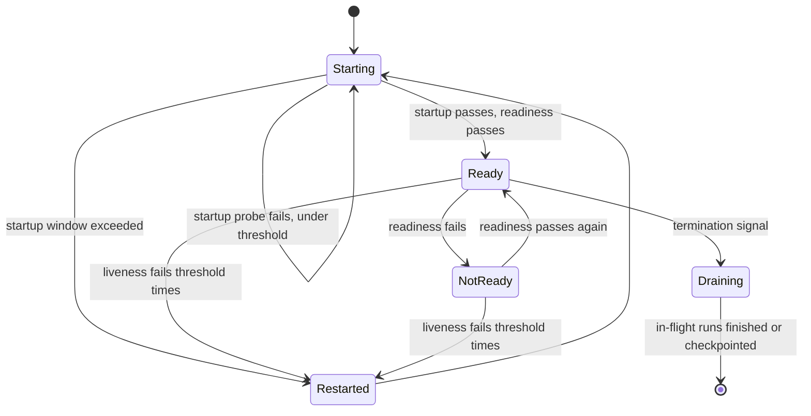

## TL;DR
Health checks tell infrastructure whether an agent service instance should get traffic or be restarted.
Liveness, readiness, startup and synthetic agent-task checks answer different questions; mixing them
turns one slow LLM provider or tool into a total outage.

## For agent builders
- **Why it matters for agents.** Your agent depends on an LLM provider, a vector store and several tools,
  all outside the process. Wire any of them into liveness and one provider blip restarts the whole fleet,
  killing every in-flight agent run.
- **Where it shows up in your stack.** `/livez`, `/readyz` and `/startupz` endpoints in the agent's API
  server, Kubernetes probe settings, a pre-stop delay and grace period for long runs, and a scheduled
  golden agent task from outside the cluster.
- **What you control.** What each probe checks (local only), probe timing from measured load times, the
  per-replica in-flight budget for agent runs, how long draining waits, and the golden task's assertions.
- **What you can skip.** Health-checking every tool on each probe. Report tool and provider health
  through metrics, alerts and the synthetic check, never through restart or routing probes.

## Why it exists
- **Infrastructure cannot see inside an instance.** Without checks, traffic keeps flowing to a process
  that has deadlocked, run out of GPU memory, or is still loading a multi-gigabyte model, while every
  dashboard shows "running".
- **Rolling deploys depend on them.** A new version is only safe to receive traffic once it says it is
  ready.
- **A single shallow `/health` returning 200 is too shallow.** A server can answer HTTP while its model
  failed to load or its connection pool is exhausted.
- **A single deep check wired to restarts is dangerous.** Checking every dependency (database, vector
  store, LLM provider) in the restart probe means one provider blip fails every instance at once: a
  fleet-wide restart storm with cold model loads on top.
- **"Healthy" is not one question.** Restart, route traffic, and "does the agent work end to end" each
  get their own check.

## How it works
### The four checks
| Check | Question | Checks | Action on failure |
|---|---|---|---|
| **Liveness** | Is this process irrecoverably stuck? | Event loop responds, no deadlocked worker | Restart (kubelet, after repeated failures) |
| **Readiness** | Can it serve a request successfully right now? | Model loaded, GPU usable, not overloaded, not shutting down | Remove from Service endpoints, no restart |
| **Startup** | Has slow initialisation finished? | Weights loaded, GPU warmed, in-memory index built | Liveness and readiness wait until it passes |
| **Synthetic end-to-end** | Does the agent complete a known task correctly? | Golden task through the real entry point, tools included | Alert and dashboard, never restart |

### Liveness: should this process be restarted?
- **Check only what a restart would fix:** the event loop responds, a worker thread is not deadlocked.
- **Never check external dependencies**, because restarting your service does not fix someone else's
  outage, and fleet-scale restarts add load exactly when the system is weakest.

### Readiness: should this instance receive traffic right now?
- **Check local conditions only.** In Kubernetes a failing readiness probe removes the pod from the
  Service's endpoints without restarting it, so traffic flows to other replicas.
- **Shared dependencies are risky here.** If every replica checks the same LLM provider and it fails, every
  replica goes unready and the service has zero endpoints, so even a fallback path cannot be served.
  Instead keep serving and degrade (fallback model, cached answer, clear error) and report the
  dependency through metrics and alerts.
- **Drain before exiting:** stop new requests, then finish in-flight ones, because long LLM streams cut
  mid-answer are user-visible errors on every deploy. Behind a plain load balancer, fail readiness first
  and wait before exit.
- **Kubernetes removes a terminating pod from endpoints itself, but asynchronously**, so the usual pattern
  is a short pre-stop delay plus a graceful-shutdown timeout longer than the longest stream.
- **Agent runs can outlast any sensible grace period.** A multi-minute tool-calling run should checkpoint
  its state so another replica can resume it, rather than forcing a grace period long enough for the
  slowest run.

### Startup: has slow initialisation finished?
- **Loading weights, warming a GPU or building an in-memory index can take minutes.** A startup probe
  covers that window; Kubernetes does not run liveness and readiness until it succeeds.
- **Without it** teams either set a huge liveness delay (slow to detect real hangs later) or watch pods
  get killed mid-load in a restart loop.

### Synthetic end-to-end checks
- **Probes describe one instance, not the product.** A synthetic check runs from outside on a schedule:
  a fixed golden request through the real entry point (auth, retrieval, model, tools, guardrails),
  asserting on the answer, for example that it cites the expected document.
- **It catches what probes never see:** a stale index, an expired credential to a customer system, a model
  silently changed behind an alias, a tool whose schema changed so every call fails.
- **For agents, assert on the path too:** the expected tool was called, the step count stayed under budget,
  and no write tool fired on a read-only task.
- **Results feed alerts and dashboards, not restarts.**

### Probe timing is arithmetic, not taste
Each probe acts only after `failureThreshold` consecutive failures, checked every `periodSeconds`:

```
reaction_time ≈ periodSeconds × failureThreshold   (+ up to timeoutSeconds per attempt)
```

| Probe | What the product means | How to set it |
|---|---|---|
| **Startup** | Window for initialisation | Exceed the worst case, not the typical one. Weights load in 90 seconds normally but 4 minutes on a cold node pulling from object storage: `periodSeconds: 10, failureThreshold: 30` gives a 300-second window; a 60-second window kills every pod on a cold node and loops forever |
| **Liveness** | How long a hung process keeps its share of traffic before restart | Short detects hangs fast but also restarts pods merely slow under a load spike (a long GC pause, a CPU-starved event loop) |
| **Readiness** | How long an overloaded or draining instance keeps getting new requests | The matching `successThreshold` decides how quickly it is trusted again |

- **Choose from measured load times and latency, not copied defaults.** That mostly separates probes
  that help from probes that cause outages.

### Making checks cheap and honest
- **Fast, and never calling the LLM**, because probes run often.
- **Deeper checks on a background schedule; the endpoint returns the cached result**, because a probe that
  waits on a slow dependency times out and reports failure for the wrong reason.
- **Return a body saying which condition failed**, so operators following a runbook see why an instance is
  unready.

## Diagram
Kubernetes runs the startup probe first; after it passes, liveness and readiness run independently and
trigger different actions. Draining lets in-flight agent runs finish or checkpoint.



## Examples
### FastAPI service with separate probes
A FastAPI agent service that loads a model at startup, separates liveness from readiness and reports
overload. The model loader is a stand-in for real initialisation (run with FastAPI 0.128 and uvicorn
0.39: probes return 503 for about 5 seconds, then 200).

It runs as a background task because an `await` inside the lifespan would delay the server from
accepting connections until loading ends: probes would see connection refused rather than a 503 with a
reason.

```python
import asyncio
from contextlib import asynccontextmanager
from fastapi import FastAPI, Response

state = {"model": None, "in_flight": 0}
MAX_IN_FLIGHT = 32                       # illustrative per-replica concurrency budget

async def load_model():
    await asyncio.sleep(5)               # stand-in; real blocking loads go in asyncio.to_thread
    state["model"] = object()

@asynccontextmanager
async def lifespan(app):
    task = asyncio.create_task(load_model())   # load in background so probes answer meanwhile
    yield
    task.cancel()

app = FastAPI(lifespan=lifespan)

@app.get("/livez")                      # restart only if the process itself is stuck
async def livez():
    return {"ok": True}                 # reaching this handler proves the event loop runs

@app.get("/startupz")                   # gates liveness and readiness until the model is loaded
async def startupz(resp: Response):
    if state["model"] is None:
        resp.status_code = 503
    return {"model_loaded": state["model"] is not None}

@app.get("/readyz")                     # route traffic here only if a request would succeed now
async def readyz(resp: Response):
    reasons = []
    if state["model"] is None: reasons.append("model not loaded")
    if state["in_flight"] >= MAX_IN_FLIGHT: reasons.append("at capacity")
    if reasons:
        resp.status_code = 503
    return {"ready": not reasons, "reasons": reasons}
```

- **No check calls the LLM provider, the vector store or any tool.** Their health is reported by metrics
  and a separate synthetic check, so an upstream outage degrades the agent instead of emptying the load
  balancer.
- **A real deployment increments and decrements `in_flight`** around each agent run (including the whole
  duration of a streamed response and every tool call in between).
- **Draining is configured in the platform**, for example a Kubernetes pre-stop delay, rather than by
  overriding the server's own signal handling.

### Kubernetes probe configuration for the service above
Illustrative values for a model that loads in 90 seconds typically and up to 4 minutes on a cold node.

```yaml
spec:
  terminationGracePeriodSeconds: 120      # longer than the longest streamed answer
  containers:
    - name: assistant
      image: registry.example.internal/assistant:1.4.2
      ports:
        - containerPort: 8000
      startupProbe:
        httpGet: { path: /startupz, port: 8000 }
        periodSeconds: 10
        failureThreshold: 30              # 300 s window, above the 4-minute worst case
      livenessProbe:
        httpGet: { path: /livez, port: 8000 }
        periodSeconds: 10
        failureThreshold: 3               # about 30 s of hang before restart
        timeoutSeconds: 2
      readinessProbe:
        httpGet: { path: /readyz, port: 8000 }
        periodSeconds: 5
        failureThreshold: 2               # about 10 s before routing away
        successThreshold: 1
      lifecycle:
        preStop:
          exec:
            command: ["sleep", "10"]      # let endpoint removal propagate before SIGTERM
            # exec needs a sleep binary in the image (distroless has none); Kubernetes 1.30+
            # also offers the built-in handler  preStop: { sleep: { seconds: 10 } }
```

### A golden agent task as a synthetic check
Run from outside the cluster every few minutes. It sends a fixed task through the public entry point and
asserts on the answer and the path. The endpoint and response fields are those of your own agent API;
the ones here are illustrative.

```python
import time, httpx

GOLDEN = {"task": "What is the excess on policy P-1001 for water damage?"}

def synthetic_check(base_url, token):
    t0 = time.monotonic()
    r = httpx.post(f"{base_url}/v1/agent/runs", json=GOLDEN,
                   headers={"Authorization": f"Bearer {token}"}, timeout=60)
    took = time.monotonic() - t0
    r.raise_for_status()
    run = r.json()                                   # {"answer", "citations", "tool_calls"}
    tools = [c["tool"] for c in run["tool_calls"]]
    failures = []
    if "lookup_policy" not in tools: failures.append("expected tool not called")
    if "doc-P-1001" not in run["citations"]: failures.append("expected document not cited")
    if len(tools) > 6: failures.append(f"{len(tools)} tool calls, budget 6")
    if any(t.startswith("update_") for t in tools): failures.append("write tool on read-only task")
    if took > 20: failures.append(f"slow: {took:.1f}s")
    return failures                                  # empty list = pass; alert after 2 in a row
```

- **Every probe can be green while this fails:** an expired credential to the policy system, a renamed tool
  parameter, or a stale index all break the golden task without touching any instance's local state.
- **Keep it read-only and cheap:** one fixed task per critical path, costing a handful of model calls
  and never changing customer data.

### Worked scenario: the 90-second provider blip
| Design | What happens during a 90-second provider outage |
|---|---|
| Provider checked in **liveness** | Every pod fails together, all restart, each reloads weights; recovery takes many minutes after the provider is back, and every in-flight agent run is lost |
| Provider checked in **readiness** | No restarts, but every pod goes unready; zero endpoints for roughly the outage's duration, so even the fallback cannot be served |
| Provider in **metrics and synthetic check only** | Pods stay ready; requests use the fallback model or return a clear error; an alert links to the runbook |

## Production patterns
- **Separate endpoints per probe.** Expose `/livez`, `/readyz` and `/startupz` with distinct logic
  (the first two follow the naming the Kubernetes API server uses for its own health endpoints), and wire
  each to the matching probe. Monitor
  container restart counts and ready replica count per deployment.
- **Startup window from measured cold loads.** Measure model load time on a cold node (image pull plus
  weight download), then set startup `periodSeconds × failureThreshold` above the worst case with margin.
  Monitor startup duration percentiles after each model or image change.
- **Pre-stop delay plus graceful timeout.** Add a short pre-stop sleep so endpoint removal propagates, and
  set `terminationGracePeriodSeconds` above the longest stream; the server should finish in-flight
  requests on SIGTERM. Monitor client-side disconnects and truncated streams during deploys.
- **Golden-task synthetic check.** Run a scheduled job (every few minutes) from outside the cluster that
  sends a fixed task through the public entry point and asserts on a cited document ID, the tools called
  and the step count. Alert on consecutive failures and track synthetic latency separately.
- **Capacity-aware readiness with autoscaling.** Fail readiness at a per-replica in-flight budget, and
  pair it with a horizontal autoscaler and a front-door rate limit so the fleet never reaches zero ready
  endpoints. Monitor the fraction of replicas reporting "at capacity".

## Trade-offs
- **Detection vs coupling.** Deep readiness checks catch more broken instances but couple every replica to
  shared dependencies; the balance flips toward deep checks only for dependencies that are per-instance,
  such as a local GPU.
- **Fast detection vs flapping.** Aggressive probe intervals and low failure thresholds detect problems
  fast but cause flapping and needless restarts under load spikes; tolerate a few consecutive failures
  before acting.
- **Graceful shedding vs empty endpoints.** Load-based readiness ("at capacity") sheds traffic gracefully,
  but if every replica hits capacity at once the service has no endpoints.
- **End-to-end proof vs cost and drift.** Synthetic checks prove end-to-end correctness, but each costs
  real model and tool calls and can drift from real usage; keep them few, cheap and representative of the
  critical path.

## Pitfalls
- **Checking the LLM provider or database in liveness.** Symptom: every pod restarts at once during a short
  upstream incident, followed by slow cold starts. Diagnose: line up container restart counts with the
  provider's error-rate graph, and read the probe handler for outbound calls. Fix: liveness is local only.
- **No startup probe for a service loading large weights.** Symptom: pods killed by liveness during model
  loading, stuck in a restart loop. Diagnose: compare measured cold-node load time with the window
  `periodSeconds × failureThreshold`. Fix: a startup probe sized to the worst case.
- **Exiting without draining**, so new requests still arrive during shutdown. Symptom: streamed responses
  and agent runs cut off mid-answer on every deploy or scale-down. Diagnose: count truncated streams and
  lost runs per rollout. Fix: pre-stop delay, graceful timeout, and checkpoints for long runs.
- **Only shallow HTTP pings.** Symptom: instances report healthy while every request fails because the
  model never loaded or a GPU errored. Fix: readiness checks model and GPU state.
- **Treating green probes as proof the agent works.** Symptom: all-green dashboards while users get wrong
  answers from a stale index or a broken tool. Diagnose: compare synthetic pass rate and user-reported
  failures with probe status. Fix: a golden task asserting on the answer and the tool path.

## When to use
- **Every deployed agent service:** liveness and readiness.
- **Slow initialisation:** add a startup probe.
- **Customer-facing agent:** at least one synthetic golden task on the critical path, asserting on answer
  and tool path.
- **Decide scope by the action triggered:** restart, route away, or alert.
- **Measure:** probe failure counts, restart counts, ready replica count and synthetic pass rate, with each
  health alert linked to a runbook.

## Exercise
**Goal:** give a toy agent service probes that survive a provider outage, then prove it with failure
injection. No solution is given.
- **Inputs:** a FastAPI (or similar) agent with a stubbed LLM provider, one stubbed tool, and a model
  load you can make slow.
- **Constraints:** no probe makes an outbound call; probe timings are derived from load times you
  measured, written next to the config.
- **Deliver:** the endpoints, a probe config (Kubernetes or your platform's), a golden-task script, and a
  short log of each injected failure and what every check reported.
- **Acceptance:** with the provider stubbed down, readiness stays 200 and users get a degraded answer;
  doubling load time still fits the startup window; a renamed tool parameter fails the golden task two
  runs in a row while every probe stays green.

## Role lens
- **Engineer:** Implements separate liveness, readiness and startup endpoints, keeps them fast and
  dependency-free, and writes the golden-request synthetic check with a meaningful assertion.
- **Architect:** Decides which failures cause restarts, which cause routing changes and which only alert,
  so a shared dependency outage degrades the service rather than taking it down.
- **FDE:** Adapts checks to the customer's load balancers and monitoring, which may only support one
  endpoint, and makes synthetic checks run inside their network against their real integrations.

## Check yourself
**Q:** After a 90-second outage at the LLM provider, the whole fleet restarted and the service was down
for twelve minutes. What went wrong in the health check design, and how would you change it?
**A:** The provider was almost certainly checked by the liveness probe: readiness failures only remove
pods from endpoints and never restart them, so a fleet-wide restart points at liveness (a provider check
in readiness would instead have emptied the endpoints for roughly the outage's duration). When the
provider failed, every replica failed at once; liveness restarted them all, and each restart
meant reloading model weights or warming caches, so recovery took far longer than the upstream outage.
I would make liveness local only (process responsive), keep readiness to per-instance conditions such as
model loaded, capacity and draining, and report provider health through metrics, alerts and a synthetic
check. The request path should degrade with a fallback model or clear error, and add a startup probe so
slow loads are not killed.

## Interview questions
### Your model takes 90 seconds to load, sometimes 4 minutes. How do you configure the probes?
- **Startup probe sized to the worst case:** reaction time is about `periodSeconds × failureThreshold`, so
  10 × 30 gives 300 seconds; a 60-second window would loop forever on cold nodes.
- **Then short liveness and readiness**, which Kubernetes only starts after startup passes, so hangs are
  still detected quickly later.

### Agent runs take several minutes and are cut off during every deploy. What do you change?
- **Drain properly:** a short pre-stop delay so endpoint removal propagates, then a grace period longer than
  the longest streamed answer so in-flight requests finish.
- **Checkpoint long runs:** persist state after each tool step so a run on a terminating pod resumes on
  another replica; verify by counting runs resumed versus lost and truncated streams per rollout.

### All probes are green but users report the agent gives wrong answers. What check is missing?
- **A synthetic end-to-end check:** probes describe local instance state, so a stale index, expired
  customer credential, broken tool or model silently changed behind an alias leaves every probe green.
- **Design it as a golden task:** sent through the real entry point, asserting on a cited document, the
  tools called and the step count, feeding alerts rather than restarts.

### Should the agent's readiness probe check that its tools are reachable?
- **No, for shared tools:** if every replica checks the same CRM or search API and it fails, all go unready
  together and nothing, not even a degraded answer, can be served.
- **Yes, for per-instance dependencies:** a local GPU or a sidecar only that pod uses, where routing away
  from this replica actually helps. Tool health belongs in metrics, alerts and the synthetic task.

## Quiz
### Q: What happens in Kubernetes when a pod fails its readiness probe but passes liveness?
- [ ] The container is restarted
- [x] The pod is removed from Service endpoints and stops receiving traffic, without a restart
- [ ] The pod is rescheduled onto another node
- [ ] Nothing, readiness is informational only
> Readiness controls routing: an unready pod is taken out of the Service's endpoints until it passes
> again. Restarts are driven by liveness failures, and rescheduling is a scheduler decision, not a probe result.

### Q: Why should a liveness probe avoid checking the external LLM provider?
- [ ] Provider calls are too expensive to run every few seconds
- [ ] Liveness probes cannot make outbound network calls
- [ ] The provider's own status page already reports its health
- [x] Restarting your instances cannot fix the provider, and simultaneous restarts turn a brief upstream issue into a fleet-wide outage
> Cost is a real concern, but the decisive reason is the action liveness triggers. A restart only helps
> for failures inside the process; for shared dependencies it multiplies the damage.

### Q: Which failure would a synthetic end-to-end check catch that liveness and readiness probes would not?
- [ ] A deadlocked worker thread
- [ ] A pod that has not finished loading model weights
- [x] A retrieval index that stopped updating, so answers cite outdated documents
- [ ] A pod that is shutting down
> Probes check one instance's local condition. A stale index leaves every instance healthy while
> answers are wrong, which only a check asserting on real end-to-end output can detect.

## Mastery test
**Problem:** a customer's load balancer supports one health URL per pool and checks it every 5 seconds,
3 failures to eject. Your agent runs on their VMs, calls a hosted LLM through their proxy, and runs last
up to 8 minutes.

Which conditions go behind that URL, and how do you deploy without cutting runs?

**A strong answer:**
- puts only local conditions behind it (model or client initialised, in-flight budget, draining flag),
  never the proxy or the LLM, so one proxy blip does not eject every VM;
- first asks whether a failed check only ejects or also replaces the VM (some autoscaling groups do);
  if it replaces, the in-flight budget stays out;
- notes ejection takes about 15 seconds, so draining fails the check first, waits that long, then
  finishes runs;
- checkpoints runs per tool step because 8 minutes exceeds any sane drain;
- watches the proxy and provider through metrics and a golden task from inside their network.

## Use cases & projects
### Use cases
- **Self-hosted model behind an agent.** A startup probe sized to cold weight loads stops restart loops
  when nodes scale up.
- **Long-running tool-calling agents.** Draining plus checkpointing keeps deploys from killing
  multi-minute runs.
- **RAG agents over customer content.** A golden-task synthetic check catches stale indexes, expired
  connector credentials and broken tools that every probe misses.

### Mini project
**Health checks for a toy agent service (1-2 hours).**
- **Goal:** an agent API whose probes survive a provider outage and whose synthetic check catches a broken
  tool.
- **Steps:** build a FastAPI agent with `/livez`, `/readyz` (model loaded, in-flight budget) and
  `/startupz`; stub the LLM provider and one tool behind a switch; write a golden-task script asserting
  on the tool called and a cited ID; flip the provider switch off and then break the tool's schema.
- **Done when:** with the provider down, readiness stays green and requests get a clear degraded answer;
  with the tool broken, every probe stays green while the synthetic check reports the exact failure two
  runs in a row.
