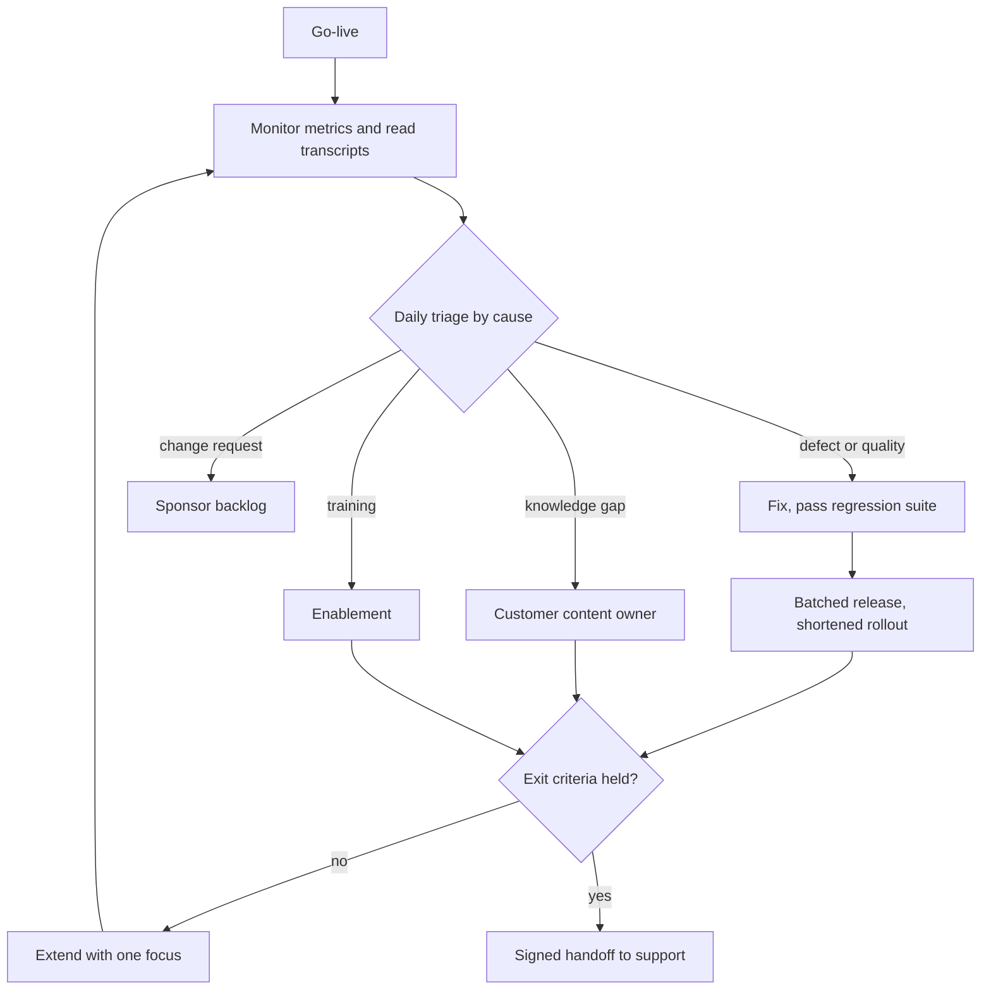

## TL;DR
Hypercare is a time-boxed period after go-live where the delivery team gives elevated support: closer
monitoring, daily triage, faster fixes and named contacts. Real users always find what UAT missed, and it
ends on written exit criteria and a handoff, not reassignment.

## Why it exists
- **Production is the full distribution; UAT only sampled it.** Every user, document type, odd workflow
  and integration under real load arrives at once.
- **The gap is larger for AI**, because quality depends on inputs the team has never seen: queries phrased
  in ways the golden set did not anticipate, the scanned fax from the one branch office that still uses
  them, users pasting whole email threads into the assistant.
- **Adoption is fragile in the first days.** Users switching from a manual process form their opinion
  fast. Early failures met with silence or a two-week ticket queue send them back to the old way, and
  usage never recovers even after the bugs are fixed.
- **"Go-live is the finish line" fails.** Standard support is tuned for a stable system with known issues:
  it cannot tell a prompt regression from a user-training gap and has no route to change the prompt,
  retrieval or model.
- **Open-ended hypercare fails the other way:** the delivery team quietly becomes the customer's permanent
  operations team. Hypercare bridges the two: concentrated expertise for a bounded time, with a defined
  exit.

## How it works
### Plan it before go-live
- **Agree it in the readiness review:** duration, staffing, hours of coverage, escalation paths, what
  counts as an incident versus a request, and exit criteria.
- **Duration is a planning choice, not a standard.** A few weeks is common, scaled to risk and user count.
- **Plan in advance** because the customer's support organisation, the vendor team and the sponsor must
  know who answers what before the first problem arrives.
- **Fix the mechanics:** a single intake channel so issues are not scattered across email and chat;
  severity definitions with an agreed response time for each; coverage hours that match when users work
  (including other time zones); who on each side is reachable out of hours for a severity-1.

### Heightened monitoring
- **Tighten dashboards and alert thresholds**, and have someone actively watch them rather than wait for
  pages.
- **Watch AI signals that rarely page anyone:** user feedback rates, escalation-to-human rate, guardrail
  blocks, retrieval misses ("no relevant documents found"), cost per task.
- **Read a daily sample of real conversations.** It is the fastest way to learn where the system fails,
  because metrics show that something changed while transcripts show why.

### A daily triage loop
Every issue, ticket and piece of negative feedback is classified by cause, which decides the owner and the
fix. A short daily review with the customer keeps both sides on the same list.

| Cause | Meaning | Owner and fix |
|---|---|---|
| **Defect** | System bug, integration failure | Engineers |
| **Quality** | Retrieval or model produced a poor answer | Prompt or retrieval tuning |
| **Knowledge gap** | The answer is not in the indexed content | Customer's content owners |
| **Training** | User misunderstood what the system does | Enablement |
| **Change request** | New scope | Sponsor |

### Fast but safe fixes
- **Faster cadence, same gates.** Every quality fix still passes the regression suite, and every real
  failure becomes a new regression case, because a prompt change fixing today's complaint can quietly
  break a case UAT already accepted.
- **Same rollout criteria, shorter stages**, not around them.
- **Freeze everything else.** A model upgrade, a new feature, or an index rebuild for another team waits
  until hypercare ends, because feedback signals are already noisy and two changes in one week make it
  impossible to say which moved the thumbs-down rate.
- **Batch fixes into one or two predictable releases a week**, each with a written note of what changed,
  so every movement in the metrics stays attributable.

### Exit criteria and handoff
Hypercare ends when written criteria hold for a sustained period, for example:
1. No open severity-1 or severity-2 issues.
2. Incident and ticket volume stable or falling over consecutive weeks, **normalised by active users**
   (because volume also falls when people stop using the system) and read alongside usage retention.
3. Quality metrics at or above the UAT baseline on real traffic.
4. The customer's support team resolves issues using the runbooks without escalating.
5. The known-issues list and backlog are handed over with owners.

The handoff is explicit: a meeting, a signed-off document and a named date when the support model changes.

## Diagram
The daily loop runs until the exit criteria hold; an unmet criterion extends hypercare with a specific
focus rather than letting it drift.



## Examples
### Worked scenario: an HR policy assistant
An HR policy assistant for a 4,000-employee company, three weeks of planned hypercare.

Exit criteria agreed at the readiness review: zero open sev-1/sev-2, weekly actionable issues below 10
for two consecutive weeks, thumbs-down rate at or below the 6% observed in UAT, and the customer's
service desk resolving at least 80% of tickets without vendor escalation.

| Week | Users | Actionable issues | Thumbs-down | Desk unaided |
|---|---|---|---|---|
| 1 | 1,900 | 41 | 11% | n/a |
| 2 | 2,600 | 18 | 7% | 65% |
| 3 | 2,900 | 9 | 5.8% | 78% |

- **Week 1 triage:** 9 defects (most from single sign-on timeouts for one region), 14 quality, 11
  knowledge gaps (the parental-leave policy for one country was never in the indexed content), 5
  training, 2 change requests.
- **Week 1 fixes:** the team fixes SSO, the customer's HR content owner uploads the missing policy, the 14
  quality failures become regression cases, and a retrieval fix passes the suite and ships behind a flag.
- **Week 2 near miss:** a prompt change improved answer tone but dropped citations on long answers. The
  regression suite caught it in staging, so it never shipped and never became a production incident.
- **Week 3 is real improvement:** per active user, issues fell from about 2.2 per 100 users in week 1 to
  about 0.3 while the user count kept rising, so the drop is not people giving up.
- **But exit is not met:** volume is below 10 for only one week and desk resolution is below 80%. Rather
  than letting hypercare drift, the team extends it by one week with a single focus: a runbook session
  with the service desk on the three ticket types they still escalate. Week 4 meets all criteria and
  support is handed over.

### Exit criteria as code
The same criteria, evaluated from weekly numbers so the exit decision is not argued from impressions.

```python
weeks = [  # open_sev12 values are illustrative
    {"week": 1, "users": 1900, "issues": 41, "open_sev12": 0, "thumbs_down": 0.11,  "desk_unaided": None},
    {"week": 2, "users": 2600, "issues": 18, "open_sev12": 0, "thumbs_down": 0.07,  "desk_unaided": 0.65},
    {"week": 3, "users": 2900, "issues": 9,  "open_sev12": 0, "thumbs_down": 0.058, "desk_unaided": 0.78},
]

def exit_check(weeks, max_issues=10, td_baseline=0.06, desk_min=0.80):
    unmet = []
    last = weeks[-1]
    if last["open_sev12"] > 0:
        unmet.append("open sev-1/sev-2")
    if len(weeks) < 2 or any(w["issues"] >= max_issues for w in weeks[-2:]):
        unmet.append("issues below 10 for two consecutive weeks")
    if last["thumbs_down"] > td_baseline:
        unmet.append("thumbs-down above UAT baseline")
    if (last["desk_unaided"] or 0) < desk_min:
        unmet.append("desk resolution below 80%")
    return unmet

for w in weeks:
    print(w["week"], f"{100 * w['issues'] / w['users']:.1f} issues per 100 users")
print(exit_check(weeks))
# 1 2.2 / 2 0.7 / 3 0.3 issues per 100 users
# ['issues below 10 for two consecutive weeks', 'desk resolution below 80%']
```

## Production patterns
- **Single intake channel with a cause field.** Route every report (tickets, chat, feedback buttons) into
  one tracker queue whose required fields include cause and severity. Monitor issues per 100 active users
  by cause each day.
- **Daily transcript sampling.** Pull a fixed random sample of real conversations each morning, under the
  data-access rules agreed in the readiness review, and have one person read them before triage. Monitor
  new failure patterns found per day; when it reaches zero for several days, sampling can drop in
  frequency.
- **Change freeze with a fix train.** Only hypercare fixes ship, batched into one or two scheduled releases
  a week, each passing the regression suite and a shortened rollout with a written change note. Monitor
  metric shifts against release notes so every movement is attributable.
- **Failures become regression cases.** Every quality failure from triage is added to the
  customer-specific regression suite before its fix ships. Monitor suite growth and the number of fixes
  blocked by a regression.
- **Shadow-then-lead support transfer.** The customer's service desk first shadows the vendor on tickets,
  then leads with vendor backup, using the runbooks. Monitor the share of tickets resolved without vendor
  escalation against the exit threshold.

## Trade-offs
- **Expert coverage vs customer ownership.** Longer hypercare catches more issues with experts on hand,
  but ties up the delivery team and delays the customer's own ownership; extend only against unmet exit
  criteria, never by default.
- **Fast fixes vs learning.** Embedding vendor engineers with the customer gives the fastest fixes, but can
  stop the customer team from learning; the balance flips once routine issues are being solved by vendor
  staff on request.
- **Cadence vs regression risk.** A faster release cadence fixes real pain quickly but raises regression
  risk; it is safe only when every change passes the regression suite and a shortened rollout.
- **Insight vs privacy cost.** Reading many real transcripts finds failure patterns early, but costs time
  and needs privacy approval; agree data-access rules during the readiness review, not during an incident.

## Pitfalls
- **No exit criteria.** Symptom: the delivery team still answers the customer's tickets months after
  go-live, and nobody can say when it ends. Fix: written criteria agreed before go-live.
- **Prompt tweaks that skip the regression suite.** Symptom: a fix for this week's issue reopens a case
  accepted in UAT. Fix: no fix ships without the suite.
- **Lumping all feedback into "bugs".** Symptom: engineers spend days on missing content or user training
  while real defects wait. Fix: classify by cause and route to the right owner.
- **Measuring only incidents and uptime.** Symptom: a quiet incident queue alongside falling usage,
  because unhappy users silently returned to the old process. Fix: normalise by active users and track
  retention.
- **Doing the support work instead of transferring it.** Symptom: a customer service desk that escalates
  every ticket on the first day after handoff. Fix: the desk leads tickets before exit.

## When to use
- **Use when:** real users meet a new AI system, the customer's own team will eventually operate it, or
  adoption matters commercially.
- **Size by risk and scale:** a small internal pilot may need a few days of close attention; an enterprise
  rollout to thousands of users needs weeks with dedicated staff.
- **Track:** issue volume by cause, user feedback, usage and retention, quality on real traffic versus the
  UAT baseline, and the share of tickets the customer resolves alone.
- **Interviews:** strong answers describe hypercare as bounded, criteria-driven and aimed at transferring
  ownership, with AI-specific feedback classification.

## Role lens
- **Engineer:** Turns each real failure into a regression case, ships fixes through shortened rollouts,
  and builds the daily views of feedback, escalations and sampled transcripts used in triage.
- **Architect:** Ensures the system supports hypercare safely: feature flags for quick fixes,
  regression gates that cannot be skipped, and data-access rules for reviewing real conversations.
- **FDE:** Runs the daily triage with the customer, separates defects from content, training and scope
  issues, and drives the handoff so their team can operate the system without escalating.

## Check yourself
**Q:** Three weeks into hypercare, incidents are near zero but weekly active users have fallen 30% from
week one. The sponsor says hypercare can close. Do you agree?
**A:** Not yet. A quiet incident queue with falling usage often means users stopped reporting because they
stopped using the system. I would look at who dropped off and what they last did, read a sample of their
final sessions, check feedback and abandonment by task type, and talk to a few users directly. Likely
causes are a quality gap on a common task, missing content, or a workflow that is slower than the old
process. If the cause is fixable, extend hypercare against a specific adoption criterion; if it is a
training or change-management issue, hand that to the customer's enablement owner explicitly. Closing on
incident counts alone would hide the real failure.

## Interview questions
### What is hypercare, and why not hand straight over to standard support at go-live?
- **Definition:** a bounded period of elevated support after go-live, with closer monitoring, daily triage,
  faster fixes and named contacts, ending on written exit criteria.
- **Why not standard support:** it is tuned for stable systems, cannot tell a prompt regression from a
  training gap, and cannot change the prompt, retrieval or model.

### Issue volume halved in week two. How do you know the system actually improved?
- **Normalise by active users:** volume also falls when people stop using the system, so compute issues
  per 100 active users and read it next to usage retention.
- **Example:** 41 issues for 1,900 users (about 2.2 per 100) falling to 9 for 2,900 users (about 0.3) while
  usage grows is real improvement.

### A customer complaint arrives daily about answers on a topic. How do you triage it?
- **Classify by cause first:** is the content indexed (knowledge gap), retrieved but answered badly
  (quality), broken by an integration (defect), misunderstood by users (training), or new scope (change
  request)?
- **Route to the owner:** a knowledge gap goes to the customer's content owners, because tuning the prompt
  for content that is not there risks hallucinated answers.

### Why freeze unrelated changes during hypercare?
- **Attribution:** feedback signals are already noisy, and two changes in one week make it impossible to
  tell which moved the thumbs-down rate.
- **How:** only hypercare fixes ship, batched into one or two predictable releases a week with written
  change notes, each through the regression suite and a shortened rollout.

### The exit date has arrived but criteria are not met. What do you do?
- **Extend with a single focus, not open-endedly:** name the unmet criterion and the work that closes it,
  for example a runbook session on the ticket types the desk still escalates.
- **Do not exit on the calendar:** handing over before the customer can run the system just moves the
  escalations into normal support.

## Quiz
### Q: What should normally end a hypercare period?
- [ ] The planned number of weeks has passed
- [ ] The delivery team is needed on another project
- [x] Written exit criteria have held for a sustained period and ownership is formally handed over
- [ ] The first week with zero incidents
> Hypercare is bounded by criteria, not the calendar or staffing. A single quiet week can be noise or
> reflect falling usage, and calendar-based exits hand over a system the customer cannot yet run.

### Q: Users report that the assistant cannot answer questions about one country's leave policy. The ingestion pipeline works, but the customer's HR team never supplied that policy for indexing. How should this be classified in triage?
- [ ] As a model quality defect needing prompt changes
- [ ] As a user training issue
- [x] As a knowledge gap owned by the customer's content owners
- [ ] As a change request to the sponsor
> The system cannot answer from content it does not have. Tuning prompts would risk hallucinated answers;
> the right owner is whoever controls the source content, and the fix is to ingest the missing policy.

### Q: Why must quality fixes during hypercare still pass the regression suite?
- [ ] Because the customer's change-management policy always requires it
- [x] Because a prompt or retrieval change that fixes one complaint can silently break cases already accepted in UAT
- [ ] Because regression suites are the only way to measure latency
- [ ] Because hypercare fixes are deployed to all users at once
> AI behaviour changes are global: a prompt edit affects every query. The regression suite, extended with
> each real failure, is what keeps a fast fix cadence from trading one problem for another.
