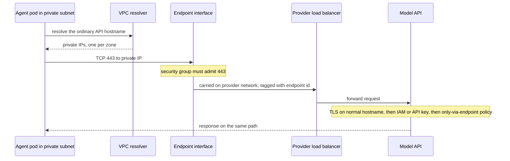

## TL;DR
A private endpoint gives a managed service, such as your agent's model API, a private IP inside the
customer's network, so traffic never crosses the internet. It pairs a network interface with a DNS
override; DNS is where most failures live.

## For agent builders
- **Why it matters for agents.** An agent in a regulated customer's subnet calls a model API on every
  step, plus object storage, a vector store and tool APIs. With no internet route, each of those needs a
  private path, or the loop times out on step one or silently leaks over NAT.
- **Where it shows up in your stack.** The model SDK's ordinary hostname (for example
  `bedrock-runtime.<region>.amazonaws.com`), the Terraform `aws_vpc_endpoint` resource, the endpoint's
  security group, and the private DNS zone that makes the hostname resolve privately.
- **What you control.** A deploy-time check that every hostname the agent and its tools call resolves to
  a private IP, timeouts and error messages in tool adapters that distinguish DNS from connectivity, and
  whether your own agent SaaS is published over PrivateLink.
- **What you can skip.** Provider-network internals and load-balancer routing. Know the four parts
  (interface, published service, DNS override, policy) and the one-way property.

## Why it exists
- **The subnet has no internet route on purpose.** A bank's application subnet still needs a hosted
  model API, object storage and a SaaS observability tool, and every one has a public hostname that
  resolves to a public IP. An agent adds more: every tool backend is another hostname.
- **A NAT gateway opens everything.** The same path that reaches the model API also reaches a paste
  site, which is exactly what the data-loss team was preventing. For an agent that can be steered by
  prompt injection into calling a URL, that open path is a real exfiltration route.
- **IP allowlists are brittle.** Cloud services use large, shared and changing address pools, so the
  allowlist ends up permitting a huge slice of the cloud.
- **Peering is too broad.** It is usually not offered for multi-tenant services; where it is, it connects
  entire networks, requires non-overlapping CIDR ranges and exposes far more than one API.
- **A private endpoint says exactly what security wants.** "This subnet may reach this one service, over
  a path we control, and that service refuses calls that did not come through that path." Once every
  consumer arrives privately, the provider can disable public network access, so a leaked API key is
  useless from the internet.

## How it works
The three large clouds implement the same idea under different names:

| Cloud | Name | Consumer object | Publishing your own SaaS |
|---|---|---|---|
| AWS | PrivateLink | interface VPC endpoint | endpoint service fronted by a Network Load Balancer |
| Azure | Private Link | private endpoint | Private Link service behind a Standard Load Balancer |
| Google Cloud | Private Service Connect | endpoint | service attachment |

The mechanism has four parts.

### 1. A network interface in the consumer's subnet
- **What is created.** One or more network interfaces, each with a private IP from the consumer's
  subnet; packets to that IP travel over the provider's internal network to the service.
- **Overlapping CIDRs are fine.** The consumer only ever sees an IP in its own range, so address spaces
  never have to be compatible. This is the main reason it beats peering for a SaaS whose thousands of
  customers all use 10.0.0.0/8.
- **One interface per availability zone**, because the interface lives in a zone; a single-zone endpoint
  is a single point of failure and pushes cross-zone traffic. For an agent, a zone outage then stops
  every model call mid-task.

### 2. A service published on the provider side
- **First-party services** (model APIs, storage, key management): the cloud publishes them for you.
- **Your own SaaS:** you publish it yourself (see the table above). An agent platform or a hosted tool
  server sold to enterprises is often offered this way.
- **Decide who may connect** by allowlisting customer accounts or requiring manual acceptance of each
  connection request, because otherwise anyone who learns the service name could attach to it.

### 3. DNS that points the normal hostname at the private IP
- **Why DNS matters.** Applications and SDKs use the service's ordinary hostname; if it still resolves to
  a public IP, the endpoint is never used.
- **The override.** The endpoint comes with a private DNS zone that overrides the public record inside
  the consumer network, so the same hostname resolves to the interface's private IP.
- **Hostname unchanged on purpose**, because TLS certificates still validate and no SDK needs
  reconfiguring. The agent's model client keeps its default base URL.
- **Callers outside the VPC** (on-prem over a VPN, or another network) need their DNS queries forwarded
  into the cloud resolver, otherwise they resolve publicly.

### 4. Policy on both ends
- **Connectivity is not authorization.** Calls still need IAM credentials or API keys.
- **Endpoint policy:** which principals and actions may use this endpoint. For an agent's model endpoint
  this can limit the agent's role to invoking models, not managing them.
- **Service-side rule:** a resource policy or network rule saying "only accept requests arriving via
  endpoint X". The combination is what makes stolen credentials useless off-network.

### Following one request
Put the four parts together for one agent step calling a model API from a pod:
1. **Resolve.** The SDK asks the VPC resolver for `bedrock-runtime.<region>.amazonaws.com`; the private
   zone answers with the endpoint interfaces' private IPs (say 10.20.1.15 and 10.20.2.15, one per zone).
2. **Connect.** The pod opens TCP 443 to 10.20.1.15. The **security group on the endpoint interface**
   must allow 443 from the pod's subnet. It is a separate control from the pod's own egress rules, and
   forgetting it is the classic "DNS is right but it still times out" failure.
3. **Carry.** The provider network takes the flow to the service's load balancer. The service never sees
   a route into your VPC; it sees a connection tagged with the endpoint it came through, which is what
   resource policies such as "only via endpoint X" match on.
4. **Authenticate.** TLS is negotiated against the ordinary hostname, so the provider's public
   certificate validates; then the API key or IAM signature is checked as usual.

- **Customer identity for your own SaaS.** On AWS, enabling Proxy Protocol v2 on the NLB is how your
  application learns which customer endpoint a connection came from, *because* the source IP alone is
  not a reliable customer identifier.
- **One-way by design.** Connections are initiated by the consumer toward the service; the provider
  cannot open connections back into the consumer network through the endpoint, which is why security
  teams approve it more easily than a VPN or peering link. A hosted agent therefore cannot use an
  endpoint to call tools inside the customer's network; that needs a different path.

### Gateway endpoints (AWS only)
- **Older, different mechanism** available only for S3 and DynamoDB: a route-table entry (a prefix list)
  instead of an interface.
- **Cost and reach.** Cost nothing extra, but only work from inside that VPC, not from on-prem or peered
  networks.
- **Elsewhere.** Azure and Google Cloud have no direct equivalent; their closest analogues are service
  endpoints and Private Google Access respectively.

## Diagram
One agent step calling a model API: the private DNS answer and the endpoint's security group are the
two steps that most often break.



## Examples
### Deploy-time check that SDK hostnames resolve privately
- **Setting.** A team runs a RAG agent in a private subnet with no NAT. They created an interface
  endpoint for the model runtime API and one for object storage, and expose their own vector service
  through a private endpoint.
- **Why check.** A failed check is the earliest signal that private DNS is off, which otherwise shows up
  only as timeouts (no egress) or, worse, silent internet traffic (if egress exists).

```python
import ipaddress, socket, sys

# Hostnames the application's SDKs actually call (region-specific in real deployments).
REQUIRED_PRIVATE = [
    "bedrock-runtime.eu-west-1.amazonaws.com",
    "s3.eu-west-1.amazonaws.com",
    "vectors.internal.example.com",   # our own SaaS exposed through a private endpoint
]

def resolved_ips(host):
    infos = socket.getaddrinfo(host, 443, proto=socket.IPPROTO_TCP)
    return sorted({ipaddress.ip_address(info[4][0]) for info in infos})

failures = []
for host in REQUIRED_PRIVATE:
    try:
        ips = resolved_ips(host)
    except socket.gaierror as e:
        failures.append(f"{host}: does not resolve ({e})"); continue
    public = [str(ip) for ip in ips if not ip.is_private]
    if public:
        failures.append(f"{host}: resolves to public {public}; private DNS not active here")
    else:
        print(f"ok   {host} -> {[str(ip) for ip in ips]}")

if failures:
    print("\n".join("FAIL " + f for f in failures)); sys.exit(1)
```

- **Run it from inside the workload** (a pod, a task), not a laptop, because resolution depends on which
  resolver the caller uses.
- **Storage may use a gateway route** rather than a private IP; check the route table for those.
- **Derive the list from the agent's config.** Generate `REQUIRED_PRIVATE` from the model client's
  region and every tool's base URL, so adding a tool cannot skip the check.

### Agent tool adapter that reports which half broke
When a tool call fails inside a private subnet, the agent should get a precise, non-retryable error
rather than a generic timeout it will retry until the step budget runs out.

```python
import ipaddress, socket

def diagnose(host, port=443, timeout=3.0):
    """Return a short error string an agent loop can log and surface, or None if reachable."""
    try:
        ips = {ipaddress.ip_address(i[4][0]) for i in socket.getaddrinfo(host, port)}
    except socket.gaierror:
        return f"{host}: DNS lookup failed (no record or no resolver path)"
    if any(not ip.is_private for ip in ips):
        return f"{host}: resolves publicly; private DNS zone missing for this VPC"
    ip = str(sorted(ips)[0])
    try:
        socket.create_connection((ip, port), timeout=timeout).close()
    except OSError:
        return f"{host}: private IP {ip} unreachable on {port}; check endpoint security group"
    return None

def call_tool(tool, host, do_request):
    problem = diagnose(host)
    if problem:                       # network faults are not fixed by retrying the model step
        return {"tool": tool, "error": problem, "retryable": False}
    return {"tool": tool, "result": do_request()}
```

### The endpoint in Terraform, with the security group that usually gets forgotten
One interface per zone, private DNS on, and an ingress rule for 443 from the workload subnets.

```hcl
resource "aws_vpc_endpoint" "bedrock_runtime" {
  vpc_id              = aws_vpc.main.id
  service_name        = "com.amazonaws.eu-west-1.bedrock-runtime"
  vpc_endpoint_type   = "Interface"
  subnet_ids          = [aws_subnet.app_a.id, aws_subnet.app_b.id]   # one per AZ
  security_group_ids  = [aws_security_group.endpoint.id]
  private_dns_enabled = true                                          # the DNS half
}

resource "aws_security_group" "endpoint" {
  vpc_id = aws_vpc.main.id
  ingress {
    from_port   = 443
    to_port     = 443
    protocol    = "tcp"
    cidr_blocks = [aws_subnet.app_a.cidr_block, aws_subnet.app_b.cidr_block]
  }
}
```

### Worked scenario: three symptoms, three different causes
| Symptom seen | What the lookup from the pod shows | Cause | Fix |
|---|---|---|---|
| Flow logs show bytes via NAT to the API | public IP | private DNS off or zone not linked to this VPC | enable private DNS, link the zone |
| Timeouts, hostname resolves to 10.20.1.15 | private IP | endpoint security group blocks 443 | admit 443 from the workload subnet |
| Works in cluster, fails from data centre | public IP on-prem only | no DNS forwarding from on-prem | forward the domain to the cloud resolver |

The second row is the one teams misdiagnose as a provider outage, because DNS already looks correct.

### Worked scenario: one agent task, many private paths
An illustrative support agent task in a no-NAT subnet; the counts show why one missing endpoint stalls
the whole task.

| Dependency | Calls per task (illustrative) | Path | If it is missing |
|---|---|---|---|
| Model API | 8 (one per step) | interface endpoint, two zones | step 1 times out, task fails |
| Object storage (attachments) | 2 | gateway endpoint | file tool hangs |
| Vector store (your SaaS) | 3 | your PrivateLink endpoint service | retrieval empty or timeout |
| Token or identity service | 1 | interface endpoint | auth hangs while other calls succeed |

With the adapter above, each missing path surfaces as one named, non-retryable error instead of 8 model
retries burning the step budget.

## Production patterns
- **Fail closed at the network layer.** Remove the NAT route from subnets that only need endpointed
  services, so a call that resolves publicly fails loudly instead of leaking. Monitor VPC flow logs for
  any bytes to the service via NAT; the target is zero. For agents this also caps where an injected
  instruction can send data.
- **Restrict the service to the endpoint.** For S3, a bucket policy that denies requests unless the
  `aws:SourceVpce` condition key matches your endpoint id; for Azure services, set public network access
  to disabled. Monitor denied requests: a spike means a caller is still on the public path.
- **Shared endpoint hub.** With dozens of services across many VPCs, host endpoints once in a central VPC
  and share the private zones, because per-endpoint, per-zone charges add up. Monitor endpoint count and
  cost per VPC.
- **Hybrid DNS forwarding.** Give on-prem resolvers a conditional forward for the service domains to a
  cloud inbound resolver (Route 53 Resolver inbound endpoints on AWS, Azure DNS Private Resolver on Azure).
  Monitor the DNS check above run from an on-prem host.
- **Manual acceptance for your SaaS endpoint service.** Set `acceptance_required = true` and an explicit
  principal allowlist on the Terraform `aws_vpc_endpoint_service`, so unknown accounts never attach.
  Review the connection list on a schedule.
- **DNS check as a deploy gate.** Run the resolution script, generated from the agent's model and tool
  config, as a pre-start job in each environment and block rollout on failure; alert if it ever flips
  from private to public.

## Trade-offs
- **Narrow path vs cost.** You gain a narrow, one-directional path to exactly one service, but pay
  per-endpoint, per-zone hourly and per-GB charges. With dozens of services across many VPCs, a central
  shared-endpoint VPC becomes cheaper.
- **No public access vs convenience.** Disabling public access blocks leaked credentials from the
  internet, but also blocks your own engineers' laptops and CI runners (including agent eval jobs)
  unless they reach it over VPN or a private runner.
- **No CIDR coordination vs flexibility.** Endpoints avoid the CIDR coordination peering or VPNs need,
  but only carry traffic to the published service. If workloads need many services or bidirectional
  flows, such as a hosted agent calling tools inside the customer, peering or a transit network is
  simpler.
- **Path assurance vs data assurance.** Private networking reassures a security team about the path, but
  does not change who processes the data or where. If the concern is residency or training use, you
  need contractual and regional controls instead.

## Pitfalls
- **Endpoint without private DNS.** Creating the endpoint but not enabling or linking the private DNS
  zone. Symptom: the SDK times out in a no-egress subnet, or flow logs show traffic still leaving
  through the NAT gateway.
- **Forgetting hybrid callers.** On-prem and peered-VPC callers need DNS forwarding to the cloud
  resolver. Symptom: "works from the cluster, fails from the data center", with the hostname resolving to
  a public IP there.
- **Default security group on the interface.** It does not admit 443 from the workload subnet. Symptom:
  the hostname correctly resolves to a private IP but every connection times out, which teams misdiagnose
  as a DNS or provider outage.
- **Endpointing the API but not its dependencies.** Such as the identity provider, token service or a
  separate file-upload host. Symptom: authentication or uploads hang while plain calls succeed.
- **Letting the agent retry network faults.** A tool behind a broken endpoint returns a timeout, the
  model retries the same call, and the task burns its step budget. Fix: classify network errors in the
  adapter and return them as non-retryable.
- **Single-zone interface.** Symptom: a full outage of model calls during a zone incident and unexpected
  cross-zone data charges in normal operation.
- **Auto-accept for any principal on your SaaS endpoint service.** Symptom: unknown accounts appear in
  the connection list, which an audit will flag immediately.

## When to use
- **Use when** a customer's workload in a cloud network must call a managed service and policy says "no
  internet egress" or "no public endpoints for data services". That covers most regulated buyers calling
  hosted model APIs, storage and key management in their own account, which is where their agents run.
- **Offer your SaaS this way**: it is the standard way to serve enterprise customers without a VPN.
- **Prefer it over VPN or peering** when the flow is one-directional to a single service.
- **Do not use it** as a substitute for authorization, encryption or data-processing terms.
- **Measure:** flow logs (zero bytes to the service via NAT) and the service rejecting non-endpoint traffic.
- **Interviews:** explaining the DNS override and the one-way property is what separates real experience
  from slideware.

## Role lens
- **Engineer:** Writes the endpoint, security group and private DNS resources in Terraform, and adds a
  deploy check that every SDK hostname resolves to a private address from inside the workload.
- **Architect:** Decides where endpoints live (per VPC or a shared hub), which services must disable
  public access, and how on-prem DNS forwarding is designed so hybrid callers stay private.
- **FDE:** Walks the customer's network team through publishing or consuming the endpoint, requests
  account allowlisting, and debugs the inevitable DNS resolution difference between clusters and laptops.

## Check yourself
**Q:** A customer created a private endpoint for a hosted LLM API, yet their security team's flow logs
still show traffic from the RAG service going out through the NAT gateway. What is the likely cause, and
how do you make the setup fail closed?
**A:** The endpoint exists but the application's hostname still resolves to the public IP, usually
because private DNS was not enabled on the endpoint, the private zone is not associated with that VPC,
or the workload uses a custom resolver that does not forward to the cloud resolver. Fix the resolution,
verify with a lookup from inside the pod, then make it fail closed: remove the NAT route from that
subnet so a call that resolves publicly fails loudly, set the service's resource policy to accept only requests via
this endpoint, and turn off public network access where the service supports it. Finally add the DNS
check to deployment so a regression is caught before traffic flows.

## Interview questions
### What is a private endpoint, and why is it preferred over a NAT gateway or IP allowlist?
- **Definition:** a network interface with a private IP in the consumer's subnet, plus a private DNS
  override, that carries traffic to one managed service over the provider's network.
- **Versus NAT:** NAT opens the whole internet to the subnet; the endpoint reaches exactly one service.
- **Versus allowlists:** provider IP pools are shared and change, so allowlists end up admitting a large
  slice of the cloud.

### DNS resolves to a private IP but every call times out. Walk me through the debugging.
- **Confirm the path:** from inside the pod, check the resolved IP is the endpoint interface and try a
  TCP connect to 443.
- **Check the endpoint's security group first:** it must admit 443 from the workload subnet, and it is
  separate from the pod's egress rules.
- **Then check** pod egress policy, network ACLs on the subnet, and that the endpoint has an interface in
  the zone the pod is calling.

### Your agent works in staging but in the customer's no-NAT subnet every task fails on its first step. How do you approach it?
- **List what step one calls:** the model API, then usually retrieval and an identity token; each needs an
  endpoint or gateway route.
- **Run the resolution check from the agent pod:** a public answer means private DNS is missing; a private
  answer with timeouts points at the endpoint security group.
- **Stop the retry spiral:** make the tool and model adapters return a named network error, so traces show
  the real cause instead of repeated timeouts.

### When would you choose a VPN or peering instead of private endpoints?
- **Many services or both directions:** endpoints carry traffic only to one published service, so broad
  or bidirectional flows are simpler over peering or a transit network.
- **Non-cloud sources needing routes into the VPC:** a VPN joins networks, which endpoints deliberately
  do not.
- **Cost:** endpoints bill per endpoint, per zone and per GB, so dozens of services across many VPCs
  favour a shared hub or a different topology.

### How do you make a stolen API key useless from outside the customer network?
- **The endpoint alone does not:** it adds a private path but leaves the public one open.
- **Restrict at the service:** disable public network access, or use a resource policy that only accepts
  requests via this endpoint (for S3, the `aws:SourceVpce` condition).
- **Prove it:** call from outside with a valid key and expect a denial; alert on denied-request spikes.

### You are offering your agent SaaS over PrivateLink to 300 enterprise customers. What do you design for?
- **Publishing:** an endpoint service behind a Network Load Balancer, with manual acceptance or an
  account allowlist so only contracted customers attach.
- **Tenant identity:** Proxy Protocol v2 tells your app which endpoint a connection came from, because
  source IPs overlap across customers using the same private ranges.
- **Operations:** availability in every zone customers use, and a runbook for their DNS and security-group
  setup, since most onboarding failures are on their side.

## Quiz
### Q: Why can a SaaS vendor offer private endpoints to hundreds of customers who all use overlapping 10.0.0.0/16 ranges?
- [ ] The vendor runs a separate VPC per customer with a unique CIDR
- [x] Each customer reaches the service through an interface with an IP from their own subnet, so the two address spaces are never joined
- [ ] Private endpoints use IPv6 internally, so IPv4 overlap is irrelevant
- [ ] The cloud's NAT gateway rewrites addresses in both directions
> The consumer only routes to a private IP in its own range and the provider network carries the traffic
> behind a load balancer, so no routes are exchanged. Peering and VPNs join address spaces and therefore
> require non-overlapping ranges.

### Q: An endpoint for a model API is created and healthy, but calls from on-prem servers over the VPN still go to the public internet. What is missing?
- [ ] A second endpoint in another availability zone
- [ ] An endpoint policy allowing the on-prem IP range
- [x] DNS forwarding so on-prem resolvers send the service's hostname to the cloud resolver that holds the private zone
- [ ] A BGP route advertising the service's public IP range over the VPN
> The private zone only answers inside the cloud network. On-prem resolvers still return the public
> record unless queries for that domain are forwarded inward; advertising public ranges over the VPN
> would be a fragile hack, not the design.

### Q: A security reviewer says "we have a private endpoint, so stolen API keys are harmless." What makes that statement true or false?
- [ ] It is true by default, because private endpoints encrypt the API key
- [ ] It is false, because private endpoints only work for storage services
- [ ] It is true, because the endpoint policy replaces the need for credentials
- [x] It is only true if the service also rejects requests that did not arrive through the endpoint, for example by disabling public access
> The endpoint adds a private path but does not remove the public one. Only a resource-side restriction,
> such as disabling public access or a policy requiring this endpoint, makes the key useless from outside.

## Use cases & projects
### Use cases
- **Agents in a bank's no-egress subnet.** The agent reaches Bedrock, Azure OpenAI or Vertex AI and object
  storage only through private endpoints, so security approves it without a NAT gateway.
- **Selling an agent platform to enterprises.** Your agent API or hosted tool server is published as an
  endpoint service, so customers consume it without a VPN and without public exposure.
- **Shrinking the blast radius of prompt injection.** With NAT removed, an agent tricked into fetching an
  attacker's URL has no route to it.
- **Hybrid agents.** On-prem workers calling a cloud model API stay private through DNS forwarding to the
  cloud resolver.

### Mini project
**Prove an agent's dependencies are private (1-2 hours).**
- **Goal:** turn an agent's model and tool configuration into a deploy gate that fails on any public or
  unreachable dependency.
- **Steps:** write a small agent config listing the model client hostname and three tool base URLs;
  generate the `REQUIRED_PRIVATE` list from it; run the resolution check and the `diagnose` adapter from a
  container; then point a hosts-file entry at a public IP and, separately, at an unreachable private IP,
  and record what each reports.
- **Done when:** the gate exits non-zero for both broken cases with the right named cause, passes for the
  clean config, and the agent loop logs a single non-retryable error instead of repeated timeouts.
