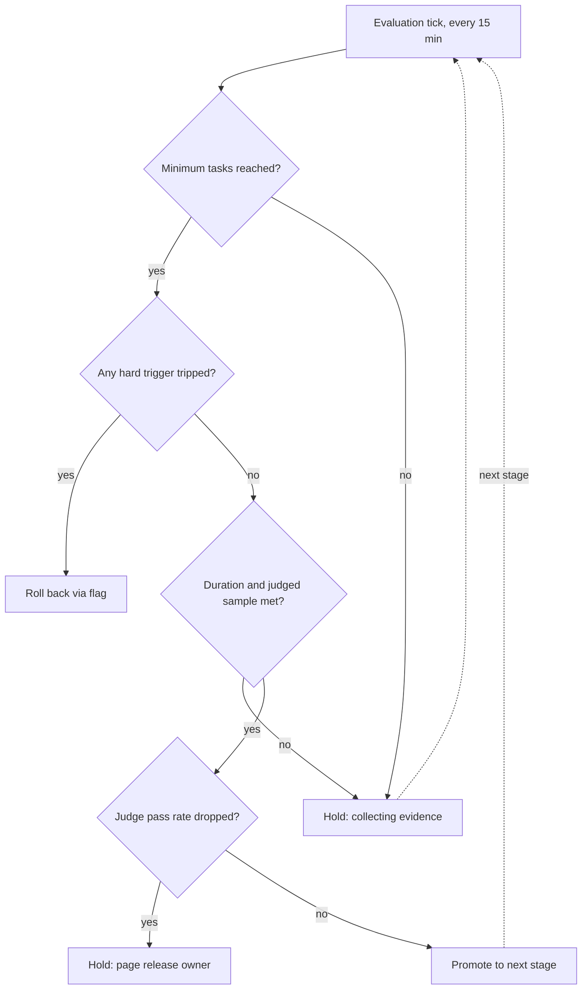

## TL;DR
Rollout criteria say what evidence moves a new agent version to the next exposure stage; rollback
triggers say what sends it back. Write both beforehand as thresholds with minimum samples, because agent
quality signals are noisy and slow.

## For agent builders
- **Why it matters for agents.** Most agent releases are not code: a new prompt, model version, tool
  description or retrieval setting. They can make the agent take worse paths, loop longer or cost more
  per task with no rise in HTTP errors, and some of its actions (emails, record updates) cannot be undone.
- **Where it shows up in your stack.** A feature flag or config service holding prompt version and pinned
  model ID, a canary controller or gate script evaluated on a timer, an LLM judge on sampled traffic, and
  per-task metrics from your agent traces.
- **What you control.** Which agent signals are hard triggers (error rate, cost per task, step-budget
  exhaustion, guardrail blocks), which are soft (judge score, task completion), minimum samples, and
  whether write tools are fenced in early stages.
- **What you can skip.** Building your own traffic-shifting controller; use the flag service or an
  existing canary tool and spend your effort on the agent-specific metrics.

## Why it exists
- **A staged rollout only reduces risk if someone decides at each stage.** Without written criteria, that
  is whoever watches the dashboard, when numbers are ambiguous, with a launch date behind them.
- **The predictable failure is "probably noise, keep going"**, then an incident at 100% that was visible
  at 5%. The opposite also happens: a rollback on pure noise, and the team loses confidence in releasing
  at all.
- **AI releases are often not code.** A new prompt, model version, re-embedded index or retrieval
  parameter can degrade quality with no rise in errors or latency at all.
- **Quality signals are slow and noisy.** Thumbs-down rates, escalations and LLM-judge scores need
  hundreds of requests and hours or days before a difference beats noise. And some AI actions are
  irreversible: emails sent or records updated by an agent are not undone by redeploying.
- **"Watch the dashboards and use judgement" fails** because judgement under pressure is biased toward
  continuing. Writing criteria in advance moves the hard thinking to a calm moment and makes the live
  decision mechanical.

## How it works
### 1. Define the stages and what each must prove
- **A typical ladder:** internal users, then a small percentage or one friendly tenant, then a larger
  fraction (a quarter), then everyone.
- **Minimum duration per stage**, because traffic varies by hour and weekday; a stage that only saw
  Sunday-night traffic proved little about Monday morning.
- **Minimum sample per stage** (requests, sessions or completed agent tasks), because rare failures
  cannot be observed in small samples.

Error counts are roughly Poisson: with *n* requests at baseline rate *p* you expect *np* errors with a
standard deviation of about √(np).

| Requests at a 1% baseline | Expected errors | Doubled rate (2%) | Distinguishable? |
|---|---|---|---|
| 100 | about 1 (±1) | about 2 | No: a canary at 2% is indistinguishable from noise |
| 3,000 | about 30 (±5.5) | about 60 | Yes: a gap of more than five standard deviations |

- **Derive the minimum sample** from the baseline rate and the smallest regression you care about, not
  as a round number.

### Quality signals need far bigger samples
The regressions that matter are a few points on a rate near 90%, not a doubling. To detect an LLM-judge
pass rate falling from 91% to 88% at the usual significance (5%) and power (80%):

```
n per arm ≈ (z_α/2 + z_β)² · (p₁q₁ + p₂q₂) / (p₁ − p₂)²
          = (1.96 + 0.84)² · (0.91·0.09 + 0.88·0.12) / 0.03² ≈ 1,600 judged responses
```

- **That counts judged responses, not requests.** Judging 10% of traffic means about 16,000 requests
  before a 3-point quality drop is reliably visible.
- **So quality criteria force longer bake times than error criteria**, and a stage with "enough requests"
  may still have too few judgements to decide anything about quality.
- **For agents, count tasks, not model calls.** One task may make ten LLM calls; the unit that succeeds or
  fails, and that the judge scores, is the task.

### 2. Compare against a baseline, not an absolute
- **Run old and new side by side** on comparable traffic, so seasonal or upstream effects hit both.
- **Express criteria as relative regressions** ("canary p95 latency no more than 20% above control")
  **plus absolute floors**, so tiny baselines do not produce absurd ratios.

### 3. Split triggers into hard and soft
| | Hard triggers | Soft triggers |
|---|---|---|
| **Signals** | Error rate, timeouts, p95 or p99 latency, guardrail block rate, cost per request or task, step-budget exhaustion rate, tool-call error rate, provider 429s, crash loops | Online LLM-judge score on sampled traffic, user feedback rate, escalation-to-human rate, task completion rate |
| **Nature** | Fast to measure, unambiguous | Slower, noisier |
| **Action** | Automated, immediate rollback | Set a *hold*; a named person decides within a set time |

- **Agent cost is a hard signal.** A model that takes 50% more steps per task shows up immediately in
  cost per task and tokens per task, long before any judge score moves.

### 4. Make the outcome one of three states
- **Promote:** all criteria met, duration and sample reached.
- **Hold:** not enough evidence yet, or a soft trigger needs review.
- **Roll back:** any hard trigger tripped after the minimum sample.
- **The explicit hold state** prevents both premature promotion and panic rollbacks.

### 5. Make rollback cheap and rehearsed
- **Version every behaviour-changing artefact:** prompt, model identifier (pinned, never a floating
  alias), tool definitions, retrieval config, index.
- **Ship behind a flag** so rollback is a config change, not a redeploy.
- **Keep the old index serving** until the new one has baked, because re-embedding a corpus can take hours
  and is not a rollback you can do mid-incident.
- **Fence agent side effects:** gate write actions behind approval or dry-run during early stages, because
  no trigger can un-send an email.

### 6. Decide roll forward versus roll back
- **Roll back by default**, because it restores a known state.
- **Roll forward with a fix only** when rollback is impossible (a schema migration already applied, an
  external contract already changed) or the old version is itself broken by an external change, such as a
  deprecated provider model.

## Diagram
Every evaluation tick runs hard triggers first, then the evidence floors, then the soft quality check;
only a clean pass promotes the new agent version.



## Examples
### Stage gate with hard, soft and evidence checks
A stage gate evaluated every 15 minutes during a canary of a new prompt and model version. The numbers
are illustrative thresholds a team might agree, not recommendations.

```python
def evaluate(canary, control, minutes_in_stage, min_minutes=120, min_requests=3000, min_judged=1600):
    # Hard triggers: checked as soon as there is enough data to trust them.
    if canary["requests"] >= min_requests:
        err_limit = max(2 * control["error_rate"], 0.01)          # relative, with an absolute floor
        if canary["error_rate"] > err_limit:
            return "ROLLBACK", "error rate"
        if canary["p95_ms"] > 1.2 * control["p95_ms"]:
            return "ROLLBACK", "p95 latency"
        if canary["cost_per_req"] > 1.3 * control["cost_per_req"]:
            return "ROLLBACK", "cost per request"
        if canary["guardrail_block_rate"] > control["guardrail_block_rate"] + 0.02:
            return "ROLLBACK", "guardrail blocks"
    # Not enough evidence yet: neither promote nor roll back.
    if (canary["requests"] < min_requests or minutes_in_stage < min_minutes
            or canary["judged"] < min_judged):
        return "HOLD", "collecting evidence"
    # Soft trigger: sampled LLM-judge quality needs a human if it drops.
    if canary["judge_pass"] < control["judge_pass"] - 0.03:
        return "HOLD", "quality drop: page release owner"
    return "PROMOTE", "all criteria met"

control = {"error_rate": 0.004, "p95_ms": 4100, "cost_per_req": 0.011,
           "guardrail_block_rate": 0.006, "judge_pass": 0.91, "judged": 5000}
canary  = {"requests": 18000, "judged": 1800, "error_rate": 0.005, "p95_ms": 4500, "cost_per_req": 0.012,
           "guardrail_block_rate": 0.007, "judge_pass": 0.86}
print(evaluate(canary, control, minutes_in_stage=240))
# ('HOLD', 'quality drop: page release owner')
```

- **No hard trigger fires.** Errors, latency (4500 is under 1.2 × 4100 = 4920) and cost are within limits.
- **The judge pass rate fell five points.** With 1,800 judged canary responses (10% of 18,000 requests)
  against 5,000 on control, the standard error of the difference is just under one point, so a five-point
  drop is more than five standard errors: very unlikely to be noise.
- **It still holds and pages a human** rather than rolling back, because a judge-score drop can also mean
  the judge misreads the new model's style (for example shorter answers it penalises). The human reads a
  sample of failing judgements and decides.
- **The judged-sample floor matters.** Had the same drop appeared after only 200 judgements, the gate
  would have returned "collecting evidence".

### Agent-specific hard triggers from task traces
For a tool-calling agent, add task-level signals computed from traces. The numbers are illustrative.

```python
def agent_triggers(canary, control):
    if canary["tasks"] < 1000:                                   # task-level minimum sample
        return "HOLD", "collecting tasks"
    if canary["cost_per_task"] > 1.3 * control["cost_per_task"]:
        return "ROLLBACK", "cost per task"
    if canary["step_budget_hit_rate"] > max(2 * control["step_budget_hit_rate"], 0.01):
        return "ROLLBACK", "agent hitting max steps (looping)"
    if canary["tool_error_rate"] > max(2 * control["tool_error_rate"], 0.01):
        return "ROLLBACK", "tool-call errors (bad arguments or schema drift)"
    return "OK", "no agent hard trigger"

control = {"tasks": 9000, "cost_per_task": 0.062, "steps_per_task": 6.1,
           "step_budget_hit_rate": 0.004, "tool_error_rate": 0.008}
canary  = {"tasks": 1400, "cost_per_task": 0.094, "steps_per_task": 9.3,
           "step_budget_hit_rate": 0.021, "tool_error_rate": 0.009}
print(agent_triggers(canary, control))   # ('ROLLBACK', 'cost per task')
```

| Signal | Control | Canary | Limit | Result |
|---|---|---|---|---|
| Steps per task | 6.1 | 9.3 | (watched, not a trigger) | about 52% more steps |
| Cost per task | $0.062 | $0.094 | 1.3 × 0.062 ≈ $0.081 | Trips: roll back |
| Step-budget hit rate | 0.4% | 2.1% | max(0.8%, 1%) = 1% | Would also trip |
| Tool error rate | 0.8% | 0.9% | max(1.6%, 1%) = 1.6% | Within limit |

- **No HTTP error moved**, yet the new model loops more and costs about 52% more per task. Request-level
  gates would have promoted it.

### Deriving the minimum request count
Require the expected gap between baseline and regressed error counts to exceed *k* standard deviations
of the baseline count: n·p·(r − 1) ≥ k·√(n·p), so n ≥ k² / (p·(r − 1)²).

```python
from math import ceil

def min_requests(baseline_rate, regression_ratio, k=5):
    """Requests needed before a regression_ratio-fold error rise stands k sigma above noise."""
    return ceil(k * k / (baseline_rate * (regression_ratio - 1) ** 2))

print(min_requests(0.01, 2))     # 2500  -> 3,000 is a sensible rounded-up floor
print(min_requests(0.004, 2))    # 6250  -> lower baselines need more traffic
print(min_requests(0.01, 1.5))   # 10000 -> smaller regressions cost quadratically more
```

## Production patterns
- **Metric-driven canary controller.** On Kubernetes, Argo Rollouts or Flagger step traffic weights and
  run analysis queries against Prometheus between steps, aborting when a metric fails its threshold. Use
  them for hard triggers (error rate, p95, 429s); monitor aborted rollouts and time spent per step.
- **Flag-based percentage rollout for prompts and models.** Keep prompt version and pinned model ID in a
  feature-flag or config service, roll out by percentage or tenant, and roll back by flipping the flag.
  Monitor flag change events alongside the quality dashboard so every shift is attributable.
- **Task-level agent metrics on canary and control.** Tag every trace with the release version and compute
  cost per task, steps per task, step-budget hits and tool-call error rate per arm. Monitor these next to
  request metrics; they catch looping and path regressions that HTTP metrics miss.
- **Judged-sample floor on quality gates.** Route a fixed fraction of canary and control traffic to an
  LLM judge and refuse to promote until the judged count reaches the computed floor (about 1,600 per arm
  for a 3-point drop near 90%). Monitor judged count per stage, not just request count.
- **Old index kept warm.** Serve the new index behind a config switch while the previous index stays
  deployed until the bake ends. Monitor retrieval hit-rate and judge scores per index version.
- **Write-action fencing in early stages.** In internal and first-tenant stages, agent tools with side
  effects run in dry-run or behind human approval. Monitor how many write actions would have executed, to
  size the blast radius before enabling them.

## Trade-offs
- **Trustworthy decisions vs release speed.** Long bake times and large minimum samples make decisions
  trustworthy but slow every release; the balance flips toward speed for low-risk changes behind flags
  and toward caution for model swaps under an agent with tools.
- **Reaction time vs thrash.** Automated rollback reacts in minutes but can thrash on noisy metrics;
  reserve automation for hard, low-noise signals and route noisy quality signals to a human hold.
- **Robust comparison vs cost.** Relative thresholds against a live control absorb traffic shifts, but
  require running two versions at once, which doubles some costs and is awkward for stateful or
  per-tenant releases, such as agents with long-lived memory.
- **Blast radius vs signal.** Rolling out by tenant gives clean blast-radius control and clearer
  attribution, but small tenants produce too little traffic to judge, so per-tenant stages need longer
  durations.

## Pitfalls
- **Writing criteria after the rollout starts.** Symptom: thresholds that conveniently sit just above
  whatever the canary is currently showing. Fix: commit criteria with the release plan.
- **Judging a stage before its minimum sample.** Symptom: releases promoted on a quiet hour and incidents
  that start when peak traffic arrives. Fix: enforce duration and sample floors in the gate.
- **Monitoring only errors and latency for a prompt or model change.** Symptom: a green rollout followed by
  a week of user complaints about worse answers, or a cost bill up by half. Fix: add sampled quality as a
  soft trigger and cost and steps per task as hard ones.
- **Pointing at a floating model alias.** The provider changes the model underneath you; symptom: a
  quality shift no release on your side explains and rollback does not fix. Fix: pin model versions.
- **Assuming rollback undoes everything.** Symptom: a clean revert while records written or messages sent
  by the bad version remain in customer systems. Fix: fence write actions early.

## When to use
- **Use for any behaviour-changing release:** code, prompt, model, tool definitions, retrieval
  configuration, index, guardrail policy, tool set.
- **Scale the ladder to risk:** a copy change behind a flag may need only a short internal stage; a model
  swap for an agent with write tools needs staged tenants, a long bake and human-reviewed quality gates.
- **Measure** what the customer feels (errors, latency, cost, task success) and what predicts it (judge
  score on sampled traffic, escalations, steps per task).
- **Interviews:** strong answers name the three-state decision, minimum samples, relative-plus-absolute
  thresholds, hard versus soft triggers, and the irreversibility of agent side effects.

## Role lens
- **Engineer:** Implements the gate logic, version pinning and flags, and wires metrics so the canary
  and control are comparable on the same dashboard and alert rules.
- **Architect:** Decides which artefacts are versioned and independently rollbackable, which signals are
  hard triggers, and how irreversible actions are fenced during early rollout stages.
- **FDE:** Agrees the stages and thresholds with the customer before go-live, including who on their side
  can call a rollback and how affected users are told.

## Check yourself
**Q:** A new model version is at 10% of traffic. Error rate and latency are fine, but the thumbs-down
rate is 4.1% versus 3.2% on control after 900 rated responses. Roll back, hold or promote?
**A:** Hold, not promote, and probably not an automatic rollback yet. Thumbs-down is a noisy soft
signal: 900 ratings at 4.1% is about 37 negatives against about 29 expected at the control rate. The
standard error of a rate near 4% on 900 ratings is roughly 0.65 points (more once the control's own
noise is added), so the 0.9-point gap is at most about 1.4 standard errors, well within chance, before even counting bias from which users choose to rate. I would extend the stage until the sample
is large enough, read a sample of the negative responses to see whether they share a cause, and run the
LLM judge on matched traffic for a less biased signal. If the failures cluster on a real regression,
roll back; if they are spread and the gap closes with more data, continue.

## Interview questions
### Why have an explicit "hold" state instead of just promote or roll back?
- **Evidence often is not there yet:** before the minimum sample, neither promoting nor rolling back is
  justified by data.
- **Soft signals need a human:** a judge-score drop may be a real regression or the judge misreading a new
  style, so hold and page a named owner rather than automating either way.

### How would you pick the minimum request count for a canary stage?
- **Start from the baseline rate and smallest regression you care about:** errors are roughly Poisson, so
  the standard deviation of the count is about √(np).
- **Worked numbers:** at a 1% baseline, 3,000 requests give about 30 ± 5.5 errors versus about 60 for a
  doubled rate, more than five standard deviations apart; 100 requests cannot tell.

### A prompt change rolled out green on errors and latency, then complaints arrived. What was missing?
- **Quality signals:** prompt and model changes can degrade answers with no error or latency change.
- **Fix the gate:** add sampled LLM-judge scoring on canary and control as a soft trigger, with a judged
  sample floor (about 1,600 per arm to see 91% falling to 88%).

### A new model makes your agent take 50% more steps per task. Which trigger should catch it?
- **A hard cost or step trigger, not the judge:** cost per task and step-budget exhaustion are fast and
  unambiguous, so compare them per arm and roll back automatically past a relative limit.
- **Instrument at task level:** tag traces with the release version, because request-level metrics hide
  that one task now makes nine model calls instead of six.

### When would you roll forward instead of rolling back?
- **When rollback is impossible:** a schema migration already applied, or an external contract already
  changed.
- **When the old version is broken too:** for example a deprecated provider model; otherwise roll back,
  because it restores a known state.

### What does rollback not undo for an agent, and how do you design around it?
- **Side effects:** emails sent or records updated by the bad version stay in customer systems after a
  clean revert.
- **Design:** dry-run or approval-gated write tools in early stages, and log every external write with the
  release version so cleanup is possible.

## Quiz
### Q: Why should rollback triggers be written before the rollout begins?
- [ ] So they can be loaded into the deployment tool's configuration file
- [x] Because decisions made while watching ambiguous live numbers are biased toward continuing the release
- [ ] Because thresholds cannot be changed once traffic is flowing
- [ ] Because auditors require a document for every deployment
> Pre-committed thresholds move the reasoning to a calm moment. In the moment, sunk cost and schedule
> pressure make "probably noise" the default reading of a bad number, which is how 5% problems reach 100%.

### Q: Which signal is the best candidate for an automated, immediate rollback trigger?
- [ ] Average user satisfaction rating from in-app surveys
- [ ] LLM-judge quality score on 50 sampled responses
- [x] Error rate exceeding twice the control rate after the minimum request count
- [ ] Number of support tickets opened this week
> Error rate is fast, low-noise and unambiguous once a minimum sample exists. Survey ratings, small judge
> samples and tickets are slow or noisy, so they should trigger a human-reviewed hold rather than automation.

### Q: A rollout re-embedded the whole corpus with a new embedding model. What makes rollback safe?
- [ ] Re-running the old embedding model over the corpus if quality drops
- [ ] Pinning the new embedding model version
- [ ] Rolling back the application code only
- [x] Keeping the old index serving in parallel until the new one has passed its bake period
> Re-embedding takes hours, so it is not a mid-incident rollback. Keeping the old index live lets
> rollback be a configuration switch, while code-only rollback would query vectors from an incompatible model.

## Use cases & projects
### Use cases
- **Swapping the model under a production agent.** Staged rollout with cost-per-task and step triggers
  catches a model that loops or over-calls tools before it reaches every tenant.
- **Shipping a prompt or tool-description change.** A judged-sample floor decides whether a few points of
  quality loss are real before promotion.
- **Enabling a new write tool.** Early stages run it in dry-run, counting would-be writes to size the blast
  radius before turning it on.
- **Re-embedding the knowledge base behind a RAG agent.** The old index stays warm so rollback is a config
  switch, not hours of re-embedding.

### Mini project
**Canary gate for an agent release (2-3 hours).**
- **Goal:** a gate script that returns promote, hold or roll back for a new agent version from simulated
  task traces.
- **Steps:** generate synthetic traces for control and canary (steps, cost, tool errors, a judge verdict
  per task); implement hard triggers for cost per task and step-budget hits, a task minimum, and a soft
  judge trigger with a judged-sample floor; run it every simulated 15 minutes as traffic accumulates.
- **Done when:** a looping canary rolls back on cost, a canary with a five-point judge drop holds and
  "pages", a clean canary promotes only after its floors are met, and each decision prints its reason.
